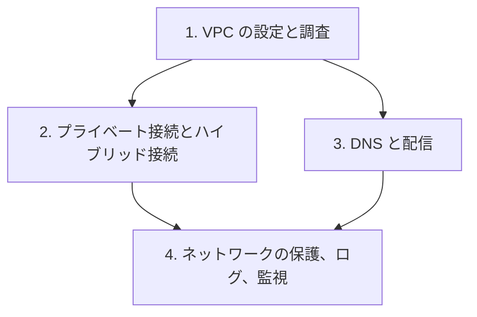

# 分野5: サービス別の学習

分野5（ネットワークとコンテンツ配信）は配点の 18% を占めます。設計は範囲外で、設定と、つながらないときの切り分けが問われます。VPC から順に進めます。

| 順番 | サービス | 問われること | 重要度 |
|---|---|---|---|
| 1 | [VPC の設定と調査](vpc.md) | 経路、NACL、費用、Reachability Analyzer | 高 |
| 2 | [プライベート接続とハイブリッド接続](connectivity.md) | エンドポイント、VPN、Direct Connect | 高 |
| 3 | [DNS と配信](dns-cdn.md) | Resolver、ルーティング、キャッシュ | 高 |
| 4 | [ネットワークの保護、ログ、監視](network-ops.md) | WAF、フローログ、Network Monitor | 中 |

重要度は公式のスキル一覧を見たこの wiki の判断で、公式の数字ではありません。

## 他のサービスにまたがる問題 {#other-questions}

<!-- questions:start -->

この分野の問題は、すべてサービス別のページに載っています。

<!-- questions:end -->
