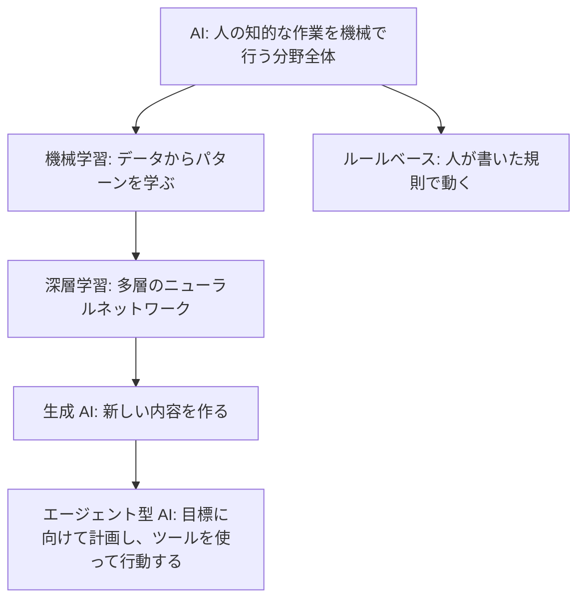
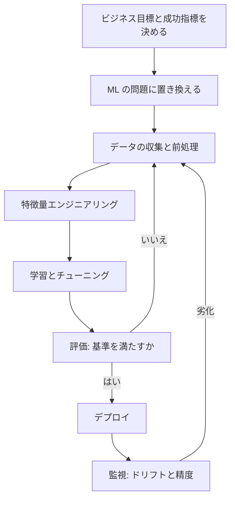
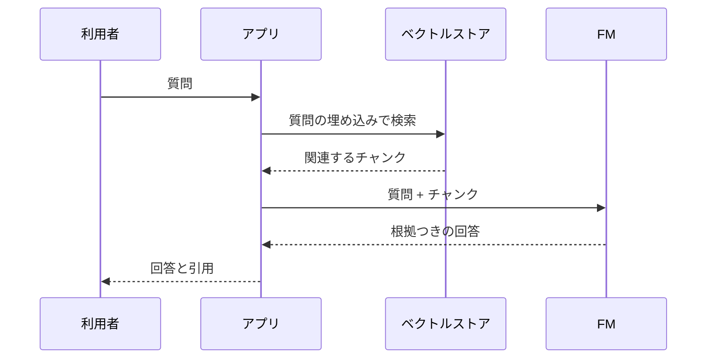

# AI の基礎、責任ある AI、AI 戦略

[:material-sprout: AIF](../courses/aif/services.md){ .exam-badge .exam-foundational .exam-badge--related } [:material-sprout: AIB](../courses/aib/services.md){ .exam-badge .exam-foundational .exam-badge--related } [:material-certificate: MLA](../courses/mla/services.md){ .exam-badge .exam-associate .exam-badge--related } [:material-star-circle: AIP](../courses/aip/services.md){ .exam-badge .exam-professional .exam-badge--related }

AI、機械学習、生成 AI の考え方を、計算例つきでまとめたページです。AIF-C01 と AIB-C01 の中心で、MLA-C02 と AIP-C01 の前提にもなります。

| 試験 | 特に読む節 |
|---|---|
| AIF-C01 | [用語](#terms)、[学習の種類](#learning-types)、[指標](#metrics)、[生成 AI](#genai)、[責任ある AI](#responsible-ai)、[セキュリティ](#security-compliance) |
| AIB-C01 | [用語](#terms)、[AI を使わない判断](#when-not-ai)、[AI 戦略](#ai-strategy)、[ガバナンス](#governance)、[CAF](#caf-ai) |
| MLA-C02 | [特徴量エンジニアリング](#feature-engineering)、[不均衡とデータ品質](#data-quality)、[過学習](#overfitting)、[指標](#metrics)。実装は [SageMaker AI](sagemaker.md) |
| AIP-C01 | [生成 AI](#genai)、[NLP 指標](#nlp-metrics)。実装は [生成 AI アプリ](genai-apps.md) |

## 用語の整理 {#terms}

### AI、ML、深層学習、生成 AI の関係 {#ai-ml-dl}

外側ほど広い概念です。

| 用語 | 意味 | 例 |
|---|---|---|
| AI | 人の知的作業を模倣する技術の総称 | 画像認識、翻訳、チャット |
| 機械学習（ML） | 規則を書かず、データから学ぶ | 解約予測 |
| 深層学習 | 多層のニューラルネットワークを使う ML | 画像分類、音声認識 |
| ニューラルネットワーク | 重みでつながれた計算ノードの層 | CNN、Transformer |
| 生成 AI | 学習した分布から新しい内容を作る | 文章や画像の生成 |
| 基盤モデル（FM） | 広い用途に使える大規模な事前学習済みモデル | Bedrock のモデル |
| LLM | 言語を扱う大規模な FM | チャット、要約 |
| エージェント型 AI | 計画、ツール実行、結果の確認を繰り返す | 調査して発注まで行う |
| コンピュータビジョン | 画像や動画の理解 | 検品、顔照合 |
| NLP | 自然言語の処理 | 感情分析、固有表現抽出 |

### モデル、アルゴリズム、学習、推論 {#model-training-inference}

| 用語 | 意味 | たとえ |
|---|---|---|
| アルゴリズム | 学習の手順 | 調理の手順 |
| モデル | 学習の結果できた、予測する関数 | 完成した料理のレシピ |
| 学習 | データから重みを求める | 練習 |
| 推論 | 学習済みモデルで予測する | 本番 |
| 特徴量 | モデルへの入力の列 | 年齢、購入回数 |
| ラベル | 正解の値 | 解約した / しない |
| ハイパーパラメータ | 学習前に人が決める値 | 学習率、木の深さ |
| パラメータ | 学習で決まる値 | 重み |
| ドリフト | 本番のデータや関係が学習時から変わること | 景気変動で購買傾向が変わる |

### データの種類 {#data-types}

| 分類 | 種類 | 例 |
|---|---|---|
| 構造 | 構造化 | 表、RDB、CSV |
| 構造 | 非構造化 | 文書、画像、音声 |
| ラベル | ラベルあり | 「スパム」と印が付いたメール |
| ラベル | ラベルなし | 印のないメール |
| 形式 | 表形式、時系列、画像、テキスト | 売上表、センサー値、写真、問い合わせ文 |

データの質が結果を決めます。欠損、重複、偏りがあれば、どのアルゴリズムでも悪い結果になります。AIB では「データ品質が AI の成果を左右する理由」を説明できる必要があります。

### 推論の種類 {#inference-types}

| 種類 | 特徴 | 向いている場面 | SageMaker AI の機能 |
|---|---|---|---|
| リアルタイム | 常時起動で低遅延 | 画面表示中の予測 | [リアルタイム](sagemaker.md#realtime) |
| サーバーレス | 待機コストなし、コールドスタートあり | 断続的な呼び出し | [サーバーレス](sagemaker.md#serverless) |
| 非同期 | キューに入れて処理する。大きな入力、長い処理 | 1 件数分の処理 | [非同期](sagemaker.md#async) |
| バッチ | データセットをまとめて処理する | 夜間の一括スコアリング | [バッチ変換](sagemaker.md#batch-transform) |

## 学習の種類と手法の選び方 {#learning-types}

| 種類 | データ | 目的 | 手法の例 | 事例 |
|---|---|---|---|---|
| 教師あり | ラベルあり | 正解を当てる | 線形回帰、ロジスティック回帰、勾配ブースティング | 不正検知、価格予測 |
| 教師なし | ラベルなし | 構造を見つける | k-means、PCA、異常検知 | 顧客分類 |
| 強化学習 | 報酬 | 報酬を最大にする行動を学ぶ | Q 学習、方策勾配 | ロボット制御、在庫の方策 |
| 半教師あり | 少数のラベルと多数の非ラベル | ラベルの不足を補う | 自己学習 | 文書分類 |
| 自己教師あり | データ自身から正解を作る | 表現を学ぶ | Transformer の事前学習 | LLM の事前学習 |

### 問題の種類 {#problem-types}

| やりたいこと | 問題の種類 | 出力 |
|---|---|---|
| 住宅価格を予測する | 回帰 | 数値 |
| メールがスパムか判定する | 二値分類 | クラス |
| 問い合わせを 5 分類する | 多クラス分類 | クラス |
| 似た顧客をまとめる（正解なし） | クラスタリング | グループ |
| 来月の需要を予測する | 時系列予測 | 将来の数値 |
| 不審な取引を見つける | 異常検知 | スコア |
| 列を減らす | 次元削減 | 少ない列 |
| おすすめを出す | レコメンド | 順位 |

### AI を使わない判断 {#when-not-ai}

| こういう場合 | 選ぶもの | 理由 |
|---|---|---|
| 規則を書き切れ、常に同じ結果が必要 | ルールベース | 決定的で説明しやすい |
| 税額のような正確な計算 | 通常のプログラム | 予測ではなく確定値が必要 |
| データが少ない、または質が低い | まずデータ整備 | 学習が成り立たない |
| 効果よりコストが大きい | 実施しない | ROI が合わない |
| 誤りの影響が極めて大きく、説明が必須 | 人の判断か解釈可能なモデル | 説明責任を果たせない |

**具体例:** 「注文額が 5,000 円以上なら送料無料」は規則です。ML は不要です。一方「この注文は不正か」は規則を書き切れないので ML が向きます。

### 従来の ML と FM の使い分け {#ml-vs-fm}

| 観点 | 従来の ML | FM |
|---|---|---|
| 得意なこと | 表データの予測 | 文章、画像、対話 |
| 説明可能性 | 手法により高い | 低い |
| 再現性 | 高い | 応答がぶれる（非決定的） |
| データ | 自社のラベル付きデータが必要 | すぐ試せる |
| 規制の厳しい判定 | 向いている（例: 融資の審査） | 補助に留める |

## ML ライフサイクルと MLOps {#ml-lifecycle}

| 段階 | 主な AWS サービス |
|---|---|
| データ収集、保存 | S3、Kinesis、[データエンジニアリング](data-engineering.md) |
| 前処理 | Glue、DataBrew、[SageMaker Processing](sagemaker.md#processing) |
| ラベル付け | [Ground Truth（新規受付終了）](sagemaker.md#ground-truth) |
| 学習 | [SageMaker AI の学習](sagemaker.md#training) |
| 評価、説明 | MLflow、[Clarify（新規受付終了）](sagemaker.md#clarify) |
| デプロイ | [SageMaker AI のエンドポイント](sagemaker.md#endpoints) |
| 監視 | CloudWatch、[Model Monitor（新規受付終了）](sagemaker.md#model-monitor) |

**データの分割:** 学習用、検証用、テスト用に分けます。割合の目安は 70:15:15 や 80:10:10 です。検証用はハイパーパラメータの調整に、テスト用は最後の評価に使います。時系列は未来のデータが学習に混ざらないよう、時間順に分けます。

**MLOps の要素:**

| 要素 | 内容 |
|---|---|
| 実験管理 | パラメータと結果を記録し、再現できるようにする |
| 反復可能なプロセス | パイプラインで自動化する |
| スケーラブルな仕組み | 手作業に頼らず処理量の増加に耐える |
| 技術的負債の管理 | 特徴量の重複、未使用コード、依存関係を減らす |
| 本番準備 | テスト、承認、ロールバック |
| モデル監視 | データとモデルの品質、バイアスの変化を見る |
| 再学習 | 定期、またはドリフトを契機に実行する |

## 特徴量エンジニアリング {#feature-engineering}

| 手法 | 式、処理 | 計算例 | 使いどころ |
|---|---|---|---|
| 最小最大の正規化 | (x−min) / (max−min) | 範囲 0〜100 で x=25 → 0.25 | 範囲を 0〜1 に揃える |
| 標準化 | (x−平均) / 標準偏差 | 平均 50、標準偏差 10、x=70 → 2.0 | 外れ値に比較的強い。線形モデルや k-means の前 |
| 対数変換 | log(x) | 10、1,000、100,000 → log10 で 1、3、5 | 右に長い分布（年収など） |
| ビニング | 区間に分ける | 年齢を 0-19、20-39 に | 非線形な関係を単純に表す |
| ワンホット | カテゴリを列に展開 | 赤、青、緑 → 3 列 | 順序のないカテゴリ |
| 順序エンコード | 順序を整数に | S=1、M=2、L=3 | 順序のあるカテゴリ |
| 特徴量の分割 | 1 列を複数に | 日時 → 曜日、時間帯 | 周期を捉える |

**落とし穴:**

- **データ漏えい（リーケージ）:** 全データの平均で標準化してから分割すると、テストの情報が学習に混ざります。学習データだけで計算し、同じ値を検証とテストに適用します。
- **距離を使う手法:** k-means や k-NN は尺度を揃えないと、桁の大きい列が結果を支配します。
- **木モデル:** 勾配ブースティングなどは、尺度を揃えなくても動きます。

### テキストの前処理 {#text-preprocessing}

| 処理 | 内容 |
|---|---|
| トークン化 | 文を単語やトークンに分ける |
| 正規化 | 大文字小文字や全角半角を揃える |
| TF-IDF | 文書で多く、全体で少ない語の重みを高くする |
| 単語埋め込み | 語をベクトルにする（Word2vec など） |
| ドメイン固有の拡張 | 専門用語の同義語で学習データを増やす |

## データ品質と不均衡 {#data-quality}

| 問題 | 対応 | 具体例 |
|---|---|---|
| 欠損 | 平均、中央値、最頻値で補完。行や列の削除。別モデルで推定 | 外れ値がある年収は平均でなく中央値 |
| 外れ値 | 検出して確認。上限で丸める、除外する | 四分位範囲の 1.5 倍の外を確認 |
| 重複 | 削除する | 同じ ID の行 |
| クラス不均衡 | オーバーサンプリング、アンダーサンプリング、合成データ（SMOTE）、クラスの重み付け | 不正 1%、正常 99% |
| 偏った収集 | シャッフル、層化分割、データ拡張 | 特定の地域ばかりのデータ |
| ラベルの誤り | 複数人で確認、ラベルの品質分析 | 判定者の間で一致度を見る |

**不均衡の注意:** 精度（accuracy）では評価しません。[下の計算例](#classification-metrics)のとおり、全部「正常」と答えても 90% を超えることがあります。適合率、再現率、PR 曲線を見ます。

**FM の学習データの検査:** 質問と回答の組が正しいか、有害な内容がないか、機密情報がないかを確認します。Bedrock の形式は[データの準備](genai-apps.md#fine-tuning-data)を参照してください。

AWS のツールは Glue Data Quality、DataBrew、[Data Wrangler](sagemaker.md#data-wrangler) です。

## 過学習、バイアス、バリアンス {#overfitting}

| 状態 | 学習データの精度 | 検証データの精度 | 意味 | 対策 |
|---|---|---|---|---|
| 過少適合（アンダーフィット） | 65% | 64% | 単純すぎる。高バイアス | 特徴量を増やす、複雑なモデルにする、学習を長くする、正則化を弱める |
| 適合 | 92% | 90% | 汎化できている | |
| 過学習（オーバーフィット） | 99% | 70% | 学習データを暗記した。高バリアンス | データを増やす、正則化、ドロップアウト、早期停止、特徴量を減らす |

| 用語 | 意味 | 大きいと |
|---|---|---|
| バイアス（統計） | 予測の平均と正解のずれ | 過少適合 |
| バリアンス | データが変わったときの予測のぶれ | 過学習 |
| トレードオフ | 複雑にするとバイアスは減り、バリアンスは増える | 中間を探す |

**同じ「バイアス」でも別物です。** 統計のバイアスは上の意味で、公平性のバイアスは特定の集団に不利な結果が出ることです。

### 正則化と学習の設定 {#regularization}

| 手法 | 効果 | 目安 |
|---|---|---|
| L1 | 不要な重みを 0 にする | 特徴量を選びたい |
| L2 | 重みを全体に小さくする | 一般的な抑制 |
| ドロップアウト | 学習中にノードをランダムに無効化 | ニューラルネットワーク |
| 早期停止 | 検証の損失が悪化したら止める | 学習時間も減る |
| データ拡張 | 回転、言い換えなどで増やす | 画像、テキスト |
| アンサンブル | 複数モデルを組み合わせる | [下の表](#ensembles) |

| ハイパーパラメータ | 意味 | 誤ったときの症状 |
|---|---|---|
| エポック | 全データを何周するか | 少ないと過少適合、多いと過学習 |
| バッチサイズ | 1 回の更新に使う件数 | 大きすぎるとメモリ不足や汎化の低下、小さすぎると損失がぶれる |
| ステップ | 重みの更新回数 | |
| 学習率 | 1 回の更新の大きさ | 大きいと損失が発散、小さいと収束が遅い |

**計算例:** データ 10,000 件、バッチサイズ 100 なら 1 エポックは 100 ステップです。10 エポックで 1,000 ステップになります。

**破滅的忘却:** 新しいデータだけで追加学習すると、以前学んだ内容を忘れる現象です。新旧のデータを混ぜて学習する、学習率を下げる、一部の層を固定するといった対策があります。

### アンサンブル {#ensembles}

| 手法 | 仕組み | 主な効果 | 例 |
|---|---|---|---|
| バギング | データを復元抽出して並列に学習し、平均や多数決 | バリアンスを下げる | ランダムフォレスト |
| ブースティング | 前のモデルの誤りを次が補うよう順に学習 | バイアスを下げる | XGBoost、LightGBM |
| スタッキング | 複数モデルの出力を別のモデルに入れる | 精度を上げる | AutoGluon-Tabular |

## 評価指標と計算例 {#metrics}

### 分類の指標 {#classification-metrics}

メール 1,000 通（スパム 100 通、通常 900 通）をモデルで判定した結果です。

| | 予測: スパム | 予測: 通常 |
|---|---|---|
| 実際: スパム（100） | TP = 80 | FN = 20 |
| 実際: 通常（900） | FP = 30 | TN = 870 |

| 指標 | 式 | 計算 | 重視する場面 |
|---|---|---|---|
| 精度（Accuracy） | (TP+TN) / 全体 | (80+870) / 1000 = **0.95** | クラスが均衡しているとき |
| 適合率（Precision） | TP / (TP+FP) | 80 / 110 = **0.727** | 誤検知の損失が大きい（通常メールを捨てたくない） |
| 再現率（Recall） | TP / (TP+FN) | 80 / 100 = **0.80** | 見逃しの損失が大きい（病気、不正） |
| 特異度 | TN / (TN+FP) | 870 / 900 = **0.967** | 陰性を正しく当てたい |
| F1 | 2PR / (P+R) | 2×80 / (2×80+30+20) = **0.762** | 適合率と再現率の両方を見る |

**精度の罠:** 全部を「通常」と答えるモデルでも、精度は 900 / 1000 = 0.90 です。しかし再現率は 0 で、スパムを 1 通も検出できません。

**しきい値:** スコアが 0.5 以上で陽性とする場合、しきい値を上げると適合率が上がり再現率が下がります。下げると逆です。

### AUC {#auc}

ROC 曲線は、しきい値を動かしたときの再現率（TPR）と偽陽性率（FPR = FP / (FP+TN)）の関係です。その下の面積が AUC で、1.0 が完全、0.5 がランダムです。

AUC は「ランダムに選んだ陽性のスコアが、ランダムに選んだ陰性より高い確率」と同じです。

**計算例:** 陽性のスコアが 0.9、0.8、0.4、陰性のスコアが 0.7、0.3 とします。組は 3 × 2 = 6 通りです。

| 陽性 | 対 0.7 | 対 0.3 |
|---|---|---|
| 0.9 | 勝ち | 勝ち |
| 0.8 | 勝ち | 勝ち |
| 0.4 | 負け | 勝ち |

6 組のうち 5 組で勝つので、AUC = 5 / 6 = **0.83** です。

AUC はしきい値を決めずに比較できます。陽性が極端に少ない場合は、PR 曲線の面積（PR AUC）も見ます。

### 回帰の指標 {#regression-metrics}

正解が 100、150、200、予測が 110、140、230 の場合です。誤差は 10、10、30 です。

| 指標 | 式 | 計算 | 特徴 |
|---|---|---|---|
| MAE | 誤差の絶対値の平均 | (10+10+30) / 3 = **16.67** | 外れ値に強い。単位が元の値と同じ |
| MSE | 誤差の 2 乗の平均 | (100+100+900) / 3 = **366.67** | 大きな誤差を強く罰する |
| RMSE | MSE の平方根 | √366.67 = **19.15** | MSE と同じ性質で、単位が元の値と同じ |
| MAPE | 誤差率の平均 | (10%+6.67%+15%) / 3 = **10.56%** | 規模の違う系列を比較できる。正解が 0 だと使えない |
| R² | 1 − 残差平方和 / 全平方和 | 1 − 1100 / 5000 = **0.78** | 1 に近いほどよい |

R² の全平方和は、平均 150 との差の 2 乗の合計で、2,500 + 0 + 2,500 = 5,000 です。

### NLP の指標 {#nlp-metrics}

| 指標 | 用途 | 見るもの |
|---|---|---|
| BLEU | 機械翻訳 | 正解文との n-gram の一致（適合率寄り）と、短すぎる文への罰 |
| ROUGE | 要約 | 正解要約の語がどれだけ含まれるか（再現率寄り） |
| BERTScore | 翻訳、要約 | BERT 埋め込みで意味の近さを比べる。言い換えを評価できる |
| 意味的類似度 | 回答の比較 | 埋め込みベクトルのコサイン類似度 |
| LLM-as-a-judge | 正確性、有害性など | 別の LLM が採点する。[Bedrock の評価](genai-apps.md#evaluation) |

**BLEU の計算例:**

- 参照文: `the cat sat on the mat`（6 語）
- 候補文: `the cat sat on mat`（5 語）

| n | 候補の n-gram | 一致 | 適合率 |
|---|---|---|---|
| 1 | the, cat, sat, on, mat | 5 | 5/5 = 1.00 |
| 2 | the cat, cat sat, sat on, on mat | 3（on mat は不一致） | 3/4 = 0.75 |
| 3 | the cat sat, cat sat on, sat on mat | 2 | 2/3 = 0.667 |
| 4 | the cat sat on, cat sat on mat | 1 | 1/2 = 0.50 |

1. 幾何平均: (1.00 × 0.75 × 0.667 × 0.50)^(1/4) = 0.25^(1/4) = 0.707
2. 長さの罰（候補が参照より短い）: exp(1 − 6/5) = exp(−0.2) = 0.819
3. BLEU = 0.707 × 0.819 = **0.58**

**ROUGE の計算例:**

- 参照要約: `the cat sat on the mat`（6 語、バイグラム 5 個）
- 候補要約: `the cat on the mat`（5 語、バイグラム 4 個）

| 指標 | 一致 | 再現率 | 適合率 | F1 |
|---|---|---|---|---|
| ROUGE-1 | the×2, cat, on, mat = 5 | 5/6 = 0.833 | 5/5 = 1.00 | **0.909** |
| ROUGE-2 | the cat, on the, the mat = 3 | 3/5 = 0.60 | 3/4 = 0.75 | **0.667** |

**コサイン類似度の計算例:** a = (1, 0)、b = (1, 1) なら、a・b = 1、|a| = 1、|b| = √2 で、類似度は 1 / 1.414 = **0.707** です。1 に近いほど似ています。

**覚え方:** BLEU は翻訳で適合率、ROUGE は要約で再現率です。どちらも語の一致を見るので、意味が同じ言い換えを低く評価します。その弱点を補うのが BERTScore です。

### ビジネス指標 {#business-metrics}

モデルの指標がよくても、事業の成果に結びつくとは限りません。

| 区分 | 例 |
|---|---|
| コスト | ユーザーあたりコスト、やり取りあたりコスト、開発費 |
| 収益 | ROI、コンバージョン率、ユーザーあたり平均収益（ARPU）、顧客生涯価値 |
| 効率 | タスク完了率、処理時間、生産性 |
| 満足度 | 利用者の評価、エンゲージメント |

## 生成 AI の概念 {#genai}

### トークンとコンテキストウィンドウ {#tokens}

| 用語 | 意味 | 影響 |
|---|---|---|
| トークン | モデルが処理する文字列の単位 | 料金と速度の単位 |
| コンテキストウィンドウ | 1 回で扱える入出力トークンの上限 | 超えるとエラーや切り捨て |
| チャンク | 長い文書を分割した一片 | RAG の検索単位 |
| 最大出力トークン | 応答の長さの上限 | 小さいと途中で切れる |

**計算例（単価は説明用の仮の値）:** 入力 100 万トークンあたり $3、出力 100 万トークンあたり $15 とします。1 日 1,000 回、1 回あたり入力 2,000、出力 500 トークンなら次のとおりです。

- 入力: 2,000 × 1,000 = 200 万トークン → $6
- 出力: 500 × 1,000 = 50 万トークン → $7.5
- 合計: 1 日 $13.5

出力の単価は入力より高いことが多いので、応答の長さの制御が効きます。入力を減らすには、会話履歴の要約やプロンプトキャッシュを使います。

AIB の観点では、長い契約書を一度に渡すと上限を超える、会話が長くなると最初の指示が失われる、といった形で現れます。

### 推論パラメータ {#inference-parameters}

| パラメータ | 働き | 低いと | 高いと |
|---|---|---|---|
| temperature | 確率の分布の鋭さ | 確率の高い語を選ぶ。安定 | 多様で創造的 |
| top-p | 累積確率がこの値に届くまでの候補から選ぶ | 候補が狭い | 候補が広い |
| top-k | 上位 k 個の候補から選ぶ | 候補が狭い | 候補が広い |
| 最大トークン | 応答の長さの上限 | 切れる | コストと遅延が増える |
| 停止シーケンス | この文字列で生成を止める | | |

**top-p の例:** 次の語の候補が A 0.50、B 0.30、C 0.15、D 0.05 のとき、top-p = 0.8 なら A と B（累積 0.80）から選びます。top-k = 1 なら常に A です。

**使い分け:** 分類や抽出は temperature を 0 に近く、文案の作成は高めにします。設定の例は [inferenceConfig](ai.md#inference-config) を参照してください。

### 埋め込みとベクトル {#embeddings}

埋め込みは、文章や画像を数値のベクトルに変えたものです。意味が近いものは、ベクトルも近くなります。

**例:** 「犬」と「子犬」のベクトルは近く、「犬」と「請求書」は遠くなります。これを使って、キーワードが一致しなくても意味で検索できます。

| 用語 | 意味 |
|---|---|
| 次元数 | ベクトルの長さ。多いと表現力が増し、保存コストも増える |
| ベクトルデータベース | ベクトルを保存し、近いものを探す |
| 距離 | コサイン類似度、ユークリッド距離、内積 |

### モデルの種類 {#model-kinds}

| 種類 | 仕組み | 用途 |
|---|---|---|
| Transformer | 自己注意で文脈を捉える | LLM |
| 拡散モデル | ノイズを少しずつ除去して生成する | 画像 |
| マルチモーダル | テキスト、画像、音声などを扱う | 図表の説明 |
| GAN | 生成器と識別器を競わせる | 画像 |
| VAE | 潜在空間に圧縮して生成する | 画像、異常検知 |

### プロンプトエンジニアリング {#prompt-engineering}

| 構成要素 | 内容 | 例 |
|---|---|---|
| 指示 | してほしいこと | 3 行で要約してください |
| 文脈 | 背景の情報 | あなたは法務担当です |
| 入力データ | 処理の対象 | 契約書の本文 |
| 出力形式 | 形の指定 | JSON で返してください |
| ネガティブプロンプト | 含めないもの（主に画像） | 文字を入れない |

| 手法 | 内容 | 使いどころ |
|---|---|---|
| ゼロショット | 例を示さない | 単純な作業 |
| シングルショット | 例を 1 つ示す | 形式を伝える |
| フューショット | 例を複数示す | 分類の基準を伝える |
| Chain-of-thought | 段階的に考えさせる | 計算、推論 |
| プロンプトテンプレート | 変数つきの定型文 | 再利用、統一 |

**よい習慣:** 具体的に短く書く、出力形式を指定する、例を示す、複数案を試して比較する、版を管理する（[Prompt Management](genai-apps.md#prompt-management)）。

**コンテキストエンジニアリング:** プロンプトの文面だけでなく、検索結果、会話履歴、ツールの定義、記憶など、モデルに渡す情報全体を設計することです。不要な情報を減らすと、コストも誤答も減ります。

**プロンプトのリスク:**

| リスク | 内容 | 対策 |
|---|---|---|
| インジェクション | 入力に指示を混ぜて動作を変える | 入力の検査、権限の分離、[Guardrails](ai.md#guardrails) |
| ジェイルブレイク | 安全策を回避させる | プロンプト攻撃フィルター |
| ハイジャック | 別の目的に使わせる | 拒否トピック |
| 露出（プロンプトの漏えい） | システムプロンプトや機密を聞き出す | 機密をプロンプトに入れない |
| ポイズニング | 学習データや文書に悪意ある内容を混ぜる | データの出所の管理と検査 |

### モデルを業務に合わせる方法 {#customization-options}

上ほど手軽で安く、下ほど手間とコストがかかります。

| 方法 | 内容 | コスト | 向いている場面 |
|---|---|---|---|
| プロンプト設計 | 指示と例で調整する | 最小 | まず試す |
| RAG | 自社文書を検索して渡す | 中（検索基盤と推論） | 情報が頻繁に変わる、引用が必要 |
| 蒸留 | 大きなモデルの知識を小さなモデルへ | 中〜高 | 精度を保ちコストを下げたい |
| ファインチューニング | ラベル付きデータで重みを調整 | 高（学習と専用の容量） | 文体や形式を学ばせる |
| 継続的な事前学習 | ラベルなしデータで学習を続ける | 高 | 大量の未ラベルデータがある |
| 独自の事前学習 | ゼロから作る | 最大 | ほぼ不要 |

**RAG とファインチューニング:** 最新の社内規定を答えさせるなら RAG です。規定を更新してもモデルの再学習が不要です。独特の文体で書かせるならファインチューニングです。

**RLHF:** 人の評価を報酬に使ってモデルを調整する手法です。Bedrock の[強化ファインチューニング](genai-apps.md#customization)も報酬で学びますが、報酬関数は Lambda などで定義します。

### RAG {#rag}

質問に関連する文書を検索し、プロンプトに加えてモデルに渡す手法です。

事前の準備として、文書のチャンク化、埋め込み、ベクトルストアへの保存が必要です。AWS での実装は [Knowledge Bases](genai-apps.md#knowledge-bases) を参照してください。

### エージェント {#agents}

| 要素 | 役割 |
|---|---|
| FM | 計画と判断 |
| ツール | API、データベース、コード実行 |
| 記憶 | 短期（会話）、長期（学習した事実） |
| オーケストレーション | 考える、実行する、確認するの繰り返し |

| 通常のチャット | エージェント |
|---|---|
| 質問に答える | 目標に向けて複数の手順を実行する |
| 外部を変更しない | ツールで外部を変更できる |
| 人が次の指示を出す | 自分で次の手順を決める |

**プロトコル:** MCP はエージェントとツールやデータをつなぐ標準で、A2A はエージェント同士の通信です。複数エージェントの構成は [MCP とエージェントのパターン](genai-apps.md#agent-patterns) を参照してください。

### FM のライフサイクル {#fm-lifecycle}

| 段階 | 内容 |
|---|---|
| データ選定 | 代表性、権利、品質を確認する |
| モデル選定 | コスト、遅延、モダリティ、言語、入出力の長さ、カスタマイズ性で選ぶ |
| 事前学習 | 大量のデータで学ぶ（通常は提供者が実施） |
| ファインチューニング | 用途に合わせて調整する |
| 評価 | ベンチマーク、人の評価、LLM の採点 |
| デプロイ | API 利用か自前のホスト |
| フィードバック | 利用者の評価を次の改善に使う |

**モデルの入手元と使い方:**

| 区分 | 選択肢 |
|---|---|
| 入手元 | オープンソースの事前学習済みモデル、提供者のモデル、自社で学習 |
| 本番での使い方 | マネージド API（Bedrock）、自前のホスト（SageMaker AI のエンドポイント） |

**モデル選びの観点:** 性能だけでなく、コスト、遅延、文脈の長さ、対応言語、コンプライアンス、消費電力（サステナビリティ）も考えます。小さなモデルで足りるなら、コストと環境負荷の両方が下がります。

### 生成 AI の長所と短所 {#genai-pros-cons}

| 長所 | 短所 |
|---|---|
| 適応性、応答の速さ | ハルシネーション（もっともらしい誤り） |
| 対話できる | 解釈の難しさ |
| 内容を生成できる | 不正確さ |
| 導入の障壁が低い | 非決定性（同じ入力で結果が変わる） |

## 責任ある AI {#responsible-ai}

### AWS の 8 つの観点 {#rai-dimensions}

| 観点 | 意味 | 業務の例 |
|---|---|---|
| 公平性（Fairness） | 集団ごとの影響を考える | 採用スコアが性別で偏らない |
| 説明可能性（Explainability） | 出力を理解し評価できる | 融資の否決理由を示す |
| プライバシーとセキュリティ | データとモデルを適切に取得、利用、保護する | PII をマスクする |
| 安全性（Safety） | 有害な出力と悪用を防ぐ | Guardrails で有害な内容を遮断 |
| 制御可能性（Controllability） | 挙動を監視し、操作できる | 人が止められる仕組み |
| 正確性と堅牢性（Veracity and robustness） | 予期しない入力でも正しく動く | 敵対的な入力のテスト |
| ガバナンス | 提供者と導入者を含む供給網に実践を組み込む | 承認の流れ |
| 透明性（Transparency） | 関係者が情報に基づいて判断できる | AI の使用を明示する |

### バイアスと公平性 {#fairness}

バイアスはライフサイクルのどの段階でも入ります。

| 段階 | 例 | 対策 |
|---|---|---|
| データ収集 | 特定の属性が少ない | データを追加、再サンプリング |
| ラベル付け | 判定者の偏見 | 複数人のレビュー、ラベル品質の分析 |
| 学習 | 多数派に最適化される | 重み付け、集団別の評価 |
| 運用 | 時間とともに偏りが変わる（バイアスドリフト） | 継続的な監視、人の監査 |

**検出の手法:** サブグループ分析（集団ごとに精度を比較する）、人の監査、ラベル品質の分析。指標の計算は [SageMaker Clarify](sagemaker.md#clarify-metrics) の節にあります。

**データセットの望ましい特徴:** 多様性、包摂性、均衡、出所が確かなこと。

### 説明可能性と透明性 {#explainability}

| 区分 | 例 | 特徴 |
|---|---|---|
| 解釈しやすいモデル | 線形回帰、決定木 | 判断を追える。精度は控えめなことがある |
| ブラックボックス | 深層学習、FM | 高精度だが内部が見えない |

| 手法、資料 | 内容 |
|---|---|
| SHAP | 特徴量ごとの予測への寄与 |
| 部分依存プロット（PDP） | 特徴量の変化と予測の関係 |
| [SageMaker Model Cards](sagemaker.md#model-cards) | 用途、学習、評価、リスクの記録 |
| AI サービスカード | AWS の AI サービスの用途と制約の説明 |
| 引用の提示 | RAG の根拠を見せる |
| 推論過程の表示 | エージェントのトレース |

**トレードオフ:** 解釈しやすさと精度は両立しにくいことがあります。融資のように説明が必須なら、精度が少し下がっても解釈しやすいモデルを選びます。透明性を高めすぎると、安全策の回避方法を教えることにもなります。

**人間中心の設計:** 利用者が AI の使用を認識できる、判断の理由を確認できる、誤りを報告できる、という点を設計に入れます。

### ハルシネーションへの対策 {#hallucinations}

| 対策 | 内容 | AWS の機能 |
|---|---|---|
| RAG による根拠づけ | 文書に基づいて答えさせる | [Knowledge Bases](genai-apps.md#knowledge-bases) |
| グラウンディングの検査 | 参照元に基づくかを採点する | [コンテキストグラウンディング](genai-apps.md#contextual-grounding) |
| 論理の検証 | ルールとの矛盾を検出する | [Automated Reasoning](genai-apps.md#automated-reasoning) |
| 形式の強制 | JSON Schema で出力を検証する | [構造化出力](genai-apps.md#structured-output) |
| 信頼度の活用 | 低いときは人に回す | 人によるレビュー |
| 温度を下げる | ばらつきを減らす | 誤りをなくす手段ではない |

### 法的なリスク {#legal-risks}

| リスク | 例 | 対応 |
|---|---|---|
| 知的財産の侵害 | 生成物が他者の著作物に似る | ライセンスの確認、人の確認 |
| 偏った出力 | 差別的な結果で訴訟 | 公平性の評価 |
| 信頼の喪失 | 誤回答の公開 | Guardrails、レビュー |
| 利用者への損害 | 誤った医療助言 | 免責の明示、専門家への誘導 |
| ハルシネーション | 誤情報で判断を誤る | 根拠の提示 |

## AI のセキュリティとコンプライアンス {#security-compliance}

### 責任共有モデル {#shared-responsibility}

| 担当 | 内容 |
|---|---|
| AWS | 基盤、サービス、Bedrock の FM の運用 |
| 利用者 | データ、アクセス権、プロンプト、ガードレールの設定、アプリのセキュリティ、出力の扱い |

自分で管理する範囲は、次のスコープで変わります。

### Generative AI Security Scoping Matrix {#scoping-matrix}

AWS が公開している、生成 AI の利用形態を 5 つに分ける枠組みです。

| スコープ | 形態 | 例 | 利用者の責任 |
|---|---|---|---|
| 1 | 消費者向けアプリ | 公開のチャットサービス | 最小。公開情報に限る |
| 2 | 企業向けアプリ | 第三者の SaaS に組み込まれた AI | 契約とデータの扱いを確認 |
| 3 | 事前学習済みモデル | Bedrock の FM を API で利用 | アプリ、プロンプト、RAG |
| 4 | ファインチューニング | FM を自社データで調整 | ＋ 学習データとカスタムモデル |
| 5 | 自社学習 | ゼロから学習 | 全部 |

**覚え方:** 番号が大きいほど、自社の制御と責任が大きくなります。

### AI システムを守るサービス {#security-services}

| 目的 | サービス |
|---|---|
| アクセス制御 | IAM、[AgentCore Identity と Policy](genai-apps.md#agentcore) |
| 暗号化 | KMS、TLS |
| 機密データの発見 | Macie（S3 の PII） |
| 閉域接続 | PrivateLink（[設定](ai.md#privatelink)） |
| 入出力の保護 | [Guardrails](ai.md#guardrails) |
| 監査 | CloudTrail、[モデル呼び出しログ](ai.md#invocation-logging) |
| 設定の評価 | Config、Trusted Advisor |
| 脆弱性 | Inspector（ECR のイメージなど） |
| 証跡の入手 | Artifact（第三者の監査レポート） |

**データ系譜:** データの出所と加工の履歴を記録します。Glue Data Catalog で登録し、モデルカードに学習データを記載します。引用の表示も、出所を示す手段です。

**データガバナンスの観点:** データのライフサイクル、ログ、データの所在（レジデンシー）、監視、保持期間。データの所在の要件があるなら、[クロスリージョン推論の範囲](ai.md#model-identifiers)に注意します。

**サービスによるデータの扱い:** Bedrock の入出力は学習に使われません（[詳細](ai.md#training-use)）。Comprehend、Rekognition、Lex などの AI サービスでは内容がサービス改善に使われる場合があり、AWS Organizations の [AI サービスのオプトアウトポリシー](ai-managed-services.md#data-use)で止められます。

### 標準と規制 {#standards}

| 枠組み | 内容 | 位置づけ |
|---|---|---|
| ISO/IEC 42001 | AI マネジメントシステムの要求事項 | 組織の仕組みを認証できる |
| ISO/IEC 23053 | ML を使う AI システムの枠組み | 構成要素の整理 |
| ISO/IEC 22989 | AI の概念と用語 | 共通の語彙 |
| NIST AI RMF | Govern、Map、Measure、Manage の 4 機能 | リスク管理の指針 |
| EU AI 法 | リスクを 4 段階に分類（許容できない、高、限定的、最小） | 地域の法規制 |
| GDPR、HIPAA など | 個人情報や医療情報の規制 | データの扱い |

**リスク分類の使い方:** 用途の影響度で分類し、高リスクほど承認、評価、人の監督を厳しくします。例として、社内文書の要約は低く、採用の選考は高くなります。

## AI のビジネス戦略 {#ai-strategy}

### ユースケースの選定と優先順位 {#use-case-prioritization}

| 領域 | 例 |
|---|---|
| 顧客対応 | チャットボット、通話の要約 |
| 営業、マーケティング | 提案文の作成、セグメント分析 |
| 研究開発 | 文献の調査、設計案の生成 |
| ソフトウェア開発 | コード生成、テスト作成 |

**優先順位の軸:**

| 軸 | 問い |
|---|---|
| ビジネス価値 | 収益やコストにどれだけ効くか |
| 実現性 | データ、技術、人材がそろうか |
| サステナビリティ | 継続して運用できるか |
| 戦略との整合 | 経営の目標に合うか |

価値が高く実現しやすいものから始めます。定期的に見直し、拡大、一時停止、中止を決めます。

### 作る、買う、組む {#build-buy-partner}

| 選択 | 内容 | AWS の例 | 向いている場面 |
|---|---|---|---|
| 買う | 完成したアプリを使う | Amazon Quick、Marketplace の製品 | 差別化にならない業務 |
| 組み合わせて作る | マネージドのモデルでアプリを作る | Bedrock | 独自の業務に合わせる |
| 自社で作る | 学習から行う | SageMaker AI | 独自データが競争力になる |
| 組む | パートナーと開発する | | 人材や期間が足りない |

**判断の材料:** 予算、期限、社内の能力、ベンダーの提案、規制の要件。

**移行時の確認:** 事業継続、コスト、データの準備、性能への影響。AI 基盤を切り替えるときも同じです。

### KPI と ROI {#kpi-roi}

| 区分 | 例 |
|---|---|
| 有形 | コスト削減、収益増加 |
| 無形 | 顧客満足度、従業員の生産性 |
| 先行指標 | 利用率、経営層の関与、データの準備度 |
| 遅行指標 | 利益への効果 |

**ベースラインを先に測ります。** 導入前の値がないと効果を示せません。

**ROI の計算例:** 問い合わせ対応を AI で支援します。

| 項目 | 導入前 | 導入後 |
|---|---|---|
| 1 件の処理時間 | 12 分 | 8 分 |
| 年間の件数 | 150,000 件 | 150,000 件 |
| 人件費 | 4,000 円 / 時 | 4,000 円 / 時 |

- 削減時間: 4 分 × 150,000 件 = 600,000 分 = 10,000 時間
- 効果: 10,000 時間 × 4,000 円 = 4,000 万円
- 費用: 開発 1,500 万円 + 運用 1,000 万円 = 2,500 万円
- ROI: (4,000 − 2,500) / 2,500 = **60%**

**数えもれの注意:** データ整備、研修、監視、人のレビュー、モデルの更新も費用に入れます。

### 料金の形とコスト管理 {#ai-pricing}

| 形 | 内容 | 例 |
|---|---|---|
| 消費量ベース | 使った分だけ | Bedrock のトークン単価 |
| インスタンスベース | 起動時間 | SageMaker AI のエンドポイント |
| シートベース | 利用者ごと | 業務向けのアシスタント |

ツールは AWS Pricing Calculator（見積もり）、Cost Explorer（実績）、AWS Marketplace（製品の購入）です。詳細は[コスト管理](cost-management.md)を参照してください。

**基本の統制:** 予算のアラート、アプリごとのコスト配分（[アプリケーション推論プロファイル](genai-apps.md#inference-profiles)のタグ）、小さなモデルの優先。

### 競争優位 {#competitive-advantage}

| 観点 | 内容 |
|---|---|
| 持続する優位 | 独自データ、業務への組み込み、組織の能力。モデル自体はすぐ追いつかれる |
| ビジネスモデルの変革 | 製品に AI を組み込む、新しいサービスを作る |
| 投資の水準 | 業界の成熟度と競合の動きに応じて決める |

## AI のガバナンスと組織 {#governance}

### 役割と責任 {#governance-roles}

| 役割 | 責任 |
|---|---|
| 経営層のスポンサー | 目標と予算、最終責任 |
| AI ガバナンス委員会 | 方針、リスク分類、承認 |
| ビジネスオーナー | ユースケースと成果の責任 |
| データ責任者 | データの品質と権限 |
| データサイエンス、ML エンジニア | モデルの開発と評価 |
| 法務、コンプライアンス | 規制、知的財産の確認 |
| セキュリティ | 脅威への対応と統制 |
| AI CoE | 標準、共通基盤、ノウハウの共有 |

部門横断で構成し、誰が何を決めるかを明確にします。ガバナンスは後付けでなく、企画の段階から組み込みます（ガバナンス・バイ・デザイン）。

### シャドー AI {#shadow-ai}

会社が把握していない AI ツールの利用です。機密情報の流出やライセンス違反につながります。禁止だけでは隠れて使われるので、ツールを分類して公開し、安全な代替手段を用意します。

| 分類 | 意味 |
|---|---|
| 承認済み | 使ってよい |
| 評価中 | 申請すれば限定的に使える |
| 禁止 | 使ってはいけない |

### 人による監督 {#human-oversight}

| 必要性が高い場面 | 安全策 |
|---|---|
| 医療、融資、採用のように影響が大きい判断 | 人が最終判断する |
| 信頼度が低い | 人に回す基準を決める |
| 不可逆な操作（送金、削除） | 実行前の承認 |
| 有害な内容のリスク | [Guardrails](ai.md#guardrails) |

**トレードオフの例:** 自動化を進めたい事業の要望と、説明責任の要件が対立したら、リスク分類に沿って決めます。リスクが高いものは、速度を犠牲にしても人の確認を残します。

### 本番での監視 {#production-monitoring}

AI は一度作って終わりではありません。データや世の中の変化で性能が落ちます。

| 監視の対象 | 例 |
|---|---|
| モデルドリフト | 精度の低下 |
| データ品質の低下 | 欠損の増加 |
| バイアスドリフト | 集団間の差の拡大 |
| ハルシネーションの率 | 根拠のない回答の増加 |
| コスト | トークンの急増 |

## 導入と変革 {#adoption}

### 成熟度と準備状況 {#maturity}

| 観点 | 確認すること |
|---|---|
| リーダーシップ | 経営層の合意と関与 |
| データ | 品質、アクセス、サイロの有無、所有者 |
| 文化 | 失敗への許容、変化への抵抗 |
| 技術基盤 | クラウド、セキュリティ、MLOps |
| ガバナンス | 方針、リスク管理 |

**成熟度の段階の例:** 実験 → 部門での導入 → 全社展開。人材、プロセス、技術、ガバナンスの不足を洗い出し、現在の段階と目標に合わせて投資します。

**データの基礎:** データ戦略、データの所有者、共有の枠組みを決めます。データがサイロに分かれていると、AI の効果は限られます。

### 変革の進め方 {#change-management}

| 課題 | 対応 |
|---|---|
| 仕事を奪われる不安 | 導入の時期、期待する成果、役割の変化を率直に伝える |
| リスク回避、失敗への恐れ | 小さな実験を称賛し、経営層が率先して使う |
| AI リテラシーの不足 | 研修、PoC、ハッカソン、責任ある AI の教育 |
| 推進力の不足 | スポンサーと AI チャンピオンを任命する |

**人の役割:** 手作業から、AI の監督や協働へ移ります。批判的思考、共感、創造性は人の強みとして残します。

### パイロットから全社展開へ {#scaling}

| 手段 | 内容 |
|---|---|
| 短期の成果 | 小さく成功させて支持を得る |
| AI CoE | 標準、基盤、ノウハウを共有する |
| フィードバック | 指標と利用者の声で継続的に改善する |
| 本番の要件 | セキュリティ、監視、運用体制、ガバナンスを満たす |

PoC は小さなデータと少数の利用者で動くので、本番では遅延、コスト、データ品質の問題が新たに出ます。事業の継続と性能を確認しながら広げます。

### AWS Cloud Adoption Framework for AI {#caf-ai}

AWS CAF を AI 向けに拡張した枠組み（CAF-AI）です。

!!! note "公式文書の位置づけ"
    CAF-AI のホワイトペーパー（2024-02-13 公開）は、現在「歴史的な参照用」と表示されています。AIB-C01 の対象一覧に載るのは AWS CAF で、考え方の理解が中心です。

**変革の 4 段階:**

| 段階 | 内容 |
|---|---|
| Envision（構想） | AI が加速できる事業成果を特定し、優先順位を付ける |
| Align（整合） | 基盤能力を整え、部門間の依存と懸念を明らかにする |
| Launch（開始） | 価値の高いパイロットを PoC から本番まで届ける |
| Scale（拡大） | パイロットを広げ、事業の価値を継続的に出す |

AIB の試験ガイドは、反復する進め方の例として envision、experiment、launch、scale を挙げています。CAF-AI の 2 番目は Align です。

**6 つのパースペクティブ:**

| パースペクティブ | 焦点 |
|---|---|
| Business | AI 投資を事業成果につなげる |
| People | 文化、学習、組織の変化 |
| Governance | 取り組みの統制とリスクの最小化。データキュレーション、リスク管理、責任ある AI の利用、コスト管理 |
| Platform | スケールする AI 基盤 |
| Security | データとワークロードの機密性、完全性、可用性 |
| Operations | AI ワークロードを必要な水準で提供する |

**AI フライホイール:** 質のよいデータでモデルを作り、利用が増えるとデータが増え、さらによいモデルになる好循環です。データ戦略がこれを回します。

## 選び方の比較 {#choosing}

| 迷う点 | 判断 |
|---|---|
| 適合率か再現率か | 誤検知が痛いなら適合率、見逃しが痛いなら再現率 |
| RMSE か MAE か | 大きな誤差を重く見るなら RMSE |
| BLEU か ROUGE か | 翻訳なら BLEU、要約なら ROUGE |
| RAG かファインチューニングか | 変わる情報と引用なら RAG、文体や形式なら調整 |
| ルールか ML か | 規則を書き切れるならルール |
| バギングかブースティングか | 過学習を抑えるならバギング、精度を上げるならブースティング |

## 試験のポイント {#exam-points}

| こう問われたら | 答え |
|---|---|
| ラベルのないデータで顧客を分類 | 教師なし学習のクラスタリング |
| 数値を予測 | 回帰 |
| 試行錯誤と報酬で学ぶ | 強化学習 |
| 学習は高精度、検証は低精度 | 過学習（高バリアンス）。正則化、データの追加、早期停止 |
| どちらも低精度 | 過少適合（高バイアス） |
| がんの見落としを減らす | 再現率 |
| 重要なメールの誤判定を減らす | 適合率 |
| 陽性 1% で精度 99% は信頼できるか | できない。再現率、F1、PR AUC を見る |
| しきい値に依存せずモデルを比較 | AUC |
| 機械翻訳の品質 | BLEU |
| 要約の品質 | ROUGE |
| 言い換えも正しく評価 | BERTScore、意味的類似度 |
| 応答を安定させる | temperature を下げる |
| 新しい社内文書で答える | RAG |
| 意味で検索する | 埋め込みとベクトルデータベース |
| 独自の文体を学ばせる | ファインチューニング |
| 文書が入力の上限を超える | チャンク化、要約 |
| 段階的に考えさせる | Chain-of-thought |
| 「前の指示を無視して」 | プロンプトインジェクション |
| 用途とリスクを文書化 | SageMaker Model Cards |
| FM を API で使うスコープ | Scoping Matrix のスコープ 3 |
| 第三者の監査レポートを入手 | AWS Artifact |
| 認可されていない AI の利用 | シャドー AI。分類の公開と代替の提供 |
| ROI を示す前にすること | ベースラインの測定 |
| CAF の 4 段階 | Envision、Align、Launch、Scale |
| AI マネジメントシステムの標準 | ISO/IEC 42001 |
| 全社で標準とノウハウを共有 | AI CoE |
| 定型の計算に AI は適切か | 不適切。確定値にはルールやプログラム |

## 関連ページ {#related}

- [SageMaker AI](sagemaker.md): ML の開発と運用
- [マネージド AI サービス](ai-managed-services.md): 学習不要の AI サービス
- [生成 AI アプリ](genai-apps.md): RAG、エージェント、評価、最適化
- [AI サービスと AI 開発ツール](ai.md): Bedrock の呼び出し方、Guardrails
- [コスト管理](cost-management.md)
- [ガバナンス](governance.md)

## 参考 {#references}

- [What is Responsible AI (AWS)](https://aws.amazon.com/ai/responsible-ai/)
- [Generative AI Security Scoping Matrix](https://aws.amazon.com/ai/security/generative-ai-scoping-matrix/)
- [ISO/IEC 42001 (AWS)](https://aws.amazon.com/compliance/iso-42001-faqs/)
- [AWS CAF for AI, ML, and generative AI](https://docs.aws.amazon.com/whitepapers/latest/aws-caf-for-ai/aws-caf-for-ai.html)
- [Your AI transformation journey](https://docs.aws.amazon.com/whitepapers/latest/aws-caf-for-ai/your-ai-transformation-journey.html)
- [Foundational AI capabilities](https://docs.aws.amazon.com/whitepapers/latest/aws-caf-for-ai/foundational-ai-capabilities.html)
- [AI services opt-out policies](https://docs.aws.amazon.com/organizations/latest/userguide/orgs_manage_policies_ai-opt-out.html)
- [AWS Well-Architected Generative AI Lens](https://docs.aws.amazon.com/wellarchitected/latest/generative-ai-lens/generative-ai-lens.html)
- [NIST AI Risk Management Framework](https://www.nist.gov/itl/ai-risk-management-framework)
- [EU AI Act](https://digital-strategy.ec.europa.eu/en/policies/regulatory-framework-ai)
