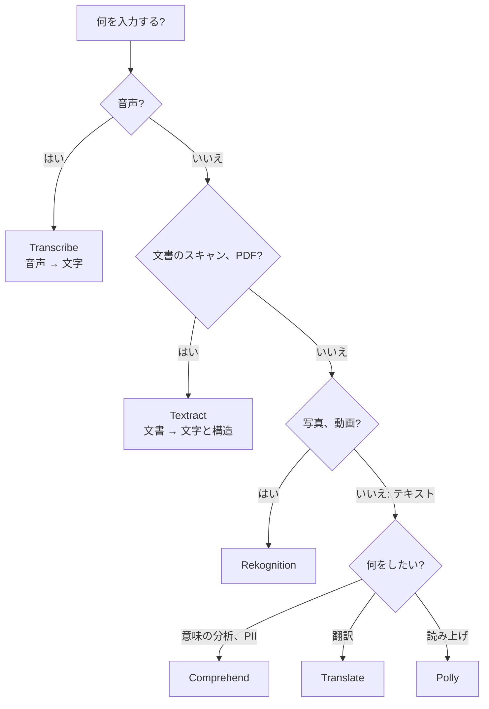
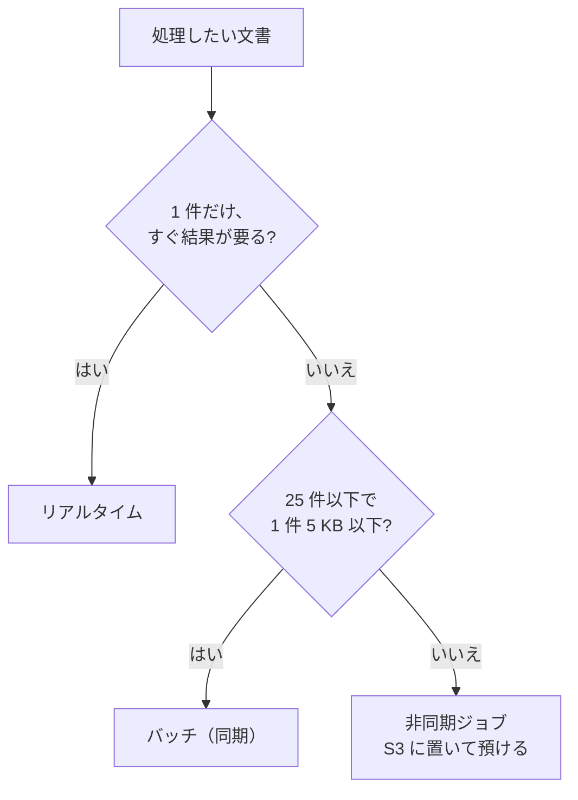
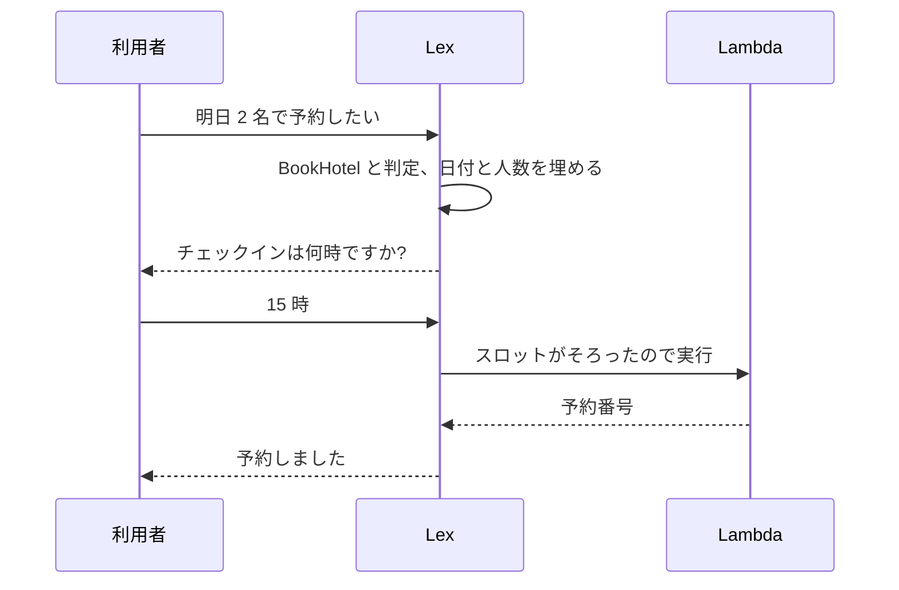
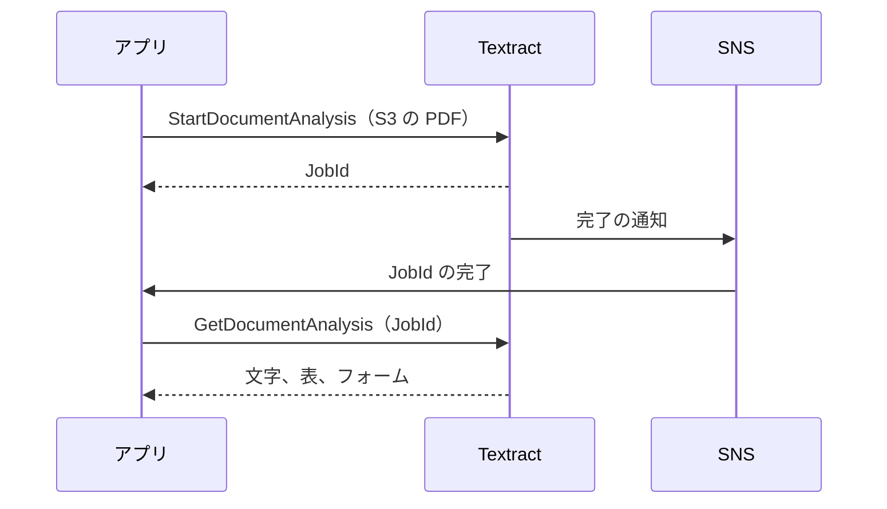
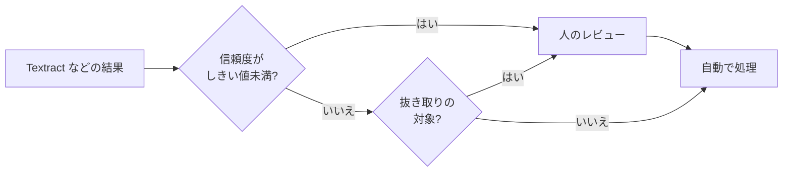
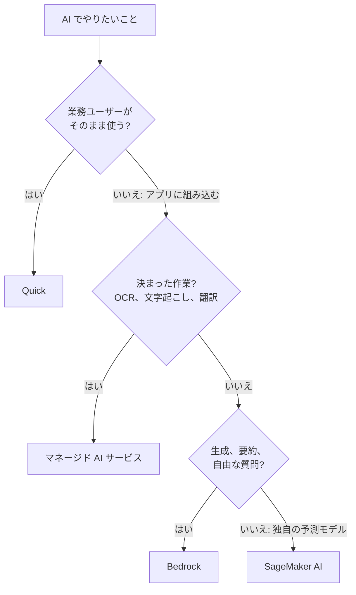

# マネージド AI サービス

[:material-sprout: CLF](../courses/clf/services.md){ .exam-badge .exam-foundational } [:material-sprout: AIF](../courses/aif/services.md){ .exam-badge .exam-foundational } [:material-certificate: SAA](../courses/saa/services.md){ .exam-badge .exam-associate } [:material-certificate: DEA](../courses/dea/services.md){ .exam-badge .exam-associate } [:material-certificate: MLA](../courses/mla/services.md){ .exam-badge .exam-associate } [:material-star-circle: SAP](../courses/sap/services.md){ .exam-badge .exam-professional } [:material-star-circle: AIP](../courses/aip/services.md){ .exam-badge .exam-professional } [:material-target: SCS](../courses/scs/services.md){ .exam-badge .exam-specialty }

学習済みの機能を API で呼べる AWS の AI サービスをまとめたページです。ML の専門知識がなくても使えます。多くの試験で「この業務に合うサービスはどれか」と問われます。

[](../assets/diagrams/ai-managed-services-pipeline.png)

| 入力 | やりたいこと | サービス | 状況（2026 年 10 月） |
|---|---|---|---|
| テキスト | 感情、固有表現、PII の抽出 | [Comprehend](#comprehend) | 提供中。一部機能は新規受付終了 |
| 医療テキスト | 病名、薬、PHI の抽出 | [Comprehend Medical](#comprehend-medical) | 提供中 |
| 音声、テキスト | チャットボット | [Lex](#lex) | 提供中（V2） |
| 文書、画像 | 文字、表、フォームの抽出 | [Textract](#textract) | 提供中 |
| 音声 | 文字起こし | [Transcribe](#transcribe) | 提供中 |
| 医療の音声 | 医療の文字起こし | [Transcribe Medical](#transcribe-medical) | 提供中 |
| テキスト | 翻訳 | [Translate](#translate) | 提供中 |
| テキスト | 音声合成 | [Polly](#polly) | 提供中 |
| 画像、動画 | 物体、顔、不適切な内容の検出 | [Rekognition](#rekognition) | 提供中。一部機能は新規受付終了 |
| 行動データ | レコメンド | [Personalize](#personalize) | 提供中 |
| 文書 | 社内検索 | [Kendra](#kendra) | **メンテナンスモード。新規受付終了** |
| 取引 | 不正検知 | [Fraud Detector](#fraud-detector) | **新規受付終了** |
| 時系列 | 需要予測 | [Forecast](#forecast) | **新規受付終了** |
| 予測結果 | 人によるレビュー | [Augmented AI](#a2i) | **新規受付終了** |
| 医療データ | FHIR での保存と分析 | [HealthLake](#healthlake) | 提供中 |
| 社内データ | 業務アシスタント | [Q Business、Q Apps](#q-business) | **新規受付終了** |

!!! warning "「新規受付終了」の読み方"
    既存の顧客は使い続けられますが、新機能は追加されません。試験の対象一覧に残っていても、新規の設計では公式が示す代替を選びます。

## なぜマネージド AI サービスを使うのか {#why-managed-ai}

文字起こし、OCR、翻訳のような作業は、以前は人手か、ルールを書き込んだソフトウェアで行っていました。マネージド AI サービスは、AWS が学習させたモデルを API として提供し、自分で学習データを集めたりモデルを作ったりせずに使えるようにしたものです。

| 困りごと | 従来のやり方 | 従来のやり方の限界 | マネージド AI サービス |
| --- | --- | --- | --- |
| 紙の請求書をシステムに入れたい | 人が手で入力する、帳票ごとに座標を決めた OCR | 量に比例して人手が要る。帳票の形が変わると OCR の設定を作り直す | Textract が表やフォームの関係ごと読む |
| 通話の内容を記録したい | 人が聞きながら書き起こす | 1 時間の通話に数時間かかる | Transcribe が自動で書き起こす |
| 問い合わせを分類したい | キーワードの辞書や正規表現のルール | 言い回しが変わると漏れる。ルールが増え続ける | Comprehend のカスタム分類 |
| 投稿画像を審査したい | 審査担当者が目視する | 量が増えると追いつかない。担当者の負担が大きい | Rekognition で一次判定し、迷うものだけ人に回す |

どのサービスも結果に信頼度（`Score`、`Confidence`）を付けて返します。従来のルールのような「一致か不一致か」ではなく、「どのくらい確からしいか」で返すので、しきい値を決めて、低いものは人が確認する運用にします。



**Bedrock の FM との違い:** マネージド AI サービスは「決まった作業を、決まった形式で、安定して」行います。FM は自由な指示に応えられますが、出力の形と再現性は自分で整える必要があります。詳しくは[マネージド AI サービスと Bedrock](#vs-bedrock)を参照してください。

## Amazon Comprehend {#comprehend}

[:material-sprout: CLF](../courses/clf/services.md){ .exam-badge .exam-foundational } [:material-sprout: AIF](../courses/aif/services.md){ .exam-badge .exam-foundational } [:material-certificate: SAA](../courses/saa/services.md){ .exam-badge .exam-associate } [:material-certificate: MLA](../courses/mla/services.md){ .exam-badge .exam-associate } [:material-star-circle: AIP](../courses/aip/services.md){ .exam-badge .exam-professional }

テキストから情報を取り出す NLP サービスです。入力は UTF-8 のテキストで、カスタム分類とカスタム固有表現は画像、PDF、Word も受け付けます。

**提供単位:** リージョン単位で、[VPC の外](resource-scope.md#scope-regional-outside)のサービスです。VPC からはインターフェイスエンドポイントか NAT 経由で呼びます。

**ルールベースの処理とくらべる**と、次のようになります。

| 観点 | 正規表現、キーワード辞書 | Comprehend |
| --- | --- | --- |
| 作り方 | 人がパターンを書く | 学習済みのモデル。独自の分類は例を渡して学習させる |
| 言い換え | 「最悪」は拾えても「二度と頼まない」は漏れる | 文全体から感情や意図を判定する |
| 結果 | 一致か不一致か | ラベルと信頼度（`Score`） |
| 得意 | 形式の決まった値（郵便番号など）の確実な検出 | 自由文の意味の分析 |

形式の決まった値は正規表現のほうが確実で安いこともあります。両方を組み合わせるのが現実的です。

| 機能 | 内容 | 例 |
|---|---|---|
| 固有表現 | 人名、場所、組織など | 「東京」→ LOCATION |
| キーフレーズ | 重要な語句 | |
| 言語の判定 | 主な言語 | `ja` |
| 感情 | positive、negative、neutral、mixed | レビューの分析 |
| 対象別の感情 | 語ごとの感情 | 「料理はよいが接客は悪い」 |
| PII | 検出と位置の特定、マスク | 英語とスペイン語 |
| カスタム分類 | 自分のラベルで分類 | 問い合わせの振り分け |
| カスタム固有表現 | 独自の語を抽出 | 契約番号 |
| フライホイール | カスタムモデルの再学習を管理 | |

| 実行方式 | 上限の例 | 使いどころ |
|---|---|---|
| リアルタイム | 1 文書。最大 100 KB（操作により 5 KB） | 1 件ずつ |
| バッチ（同期） | 1 リクエスト 25 文書、1 文書 5 KB | 少数をまとめて |
| 非同期ジョブ | S3 の大量の文書 | 大量の処理 |

同期の API に小さな上限があるのは、呼び出し元を待たせる処理だからです。大きな処理は S3 に置いてジョブとして預け、後で結果を受け取ります。このページの Textract、Transcribe、Translate、Polly も、同じく「小さいものは同期、大きいものは非同期」の 2 段の作りです。



```bash
aws comprehend detect-pii-entities --language-code en \
  --text "My email is taro@example.com"
```

!!! warning "機能の受付終了（2026-04-30）"
    **トピックモデリング、イベント検出、プロンプトの安全性分類**は新規顧客の受付を終了しました。過去 12 か月に利用したアカウントは使えます。代替は、トピックとイベントが Bedrock の LLM、プロンプトの安全性が Bedrock Guardrails です。

**組み合わせ:** Bedrock の前段で PII をマスクする、問い合わせの意図を判定する、といった使い方を AIP-C01 が挙げています。

**Comprehend か Bedrock か:** 決まった形式の抽出を大量に安く行うなら Comprehend、自由な指示で要約や分類をするなら Bedrock です。

- **文書サイズの例:** 12 KB のレビューを `DetectSentiment` に送ると、上限の 5 KB を超えて失敗します。3 つに分けるか、非同期ジョブを使います。同じ 12 KB でも `DetectEntities` なら上限の 100 KB に収まります。
- **バッチの例:** 60 件は `25 + 25 + 10` で 3 回の呼び出しです。1 回に 60 件を入れると失敗します。
- **感情の例:** 「料理はよいが接客は悪い」は全体では `MIXED` になりえます。料理と接客を別々に知りたいなら、対象別の感情を使います。
- **`LanguageCode` の例:** PII の検出は `en` か `es` です。日本語の文は対象外なので、[Guardrails](ai.md#guardrail-filters) などを検討します。
- **`Score` の例:** PII の `Score` が 0.62 の検出は、0.9 以上だけ自動でマスクする運用なら人の確認に回します。

```json
{"RedactionConfig": {
  "PiiEntityTypes": ["EMAIL", "PHONE"],
  "MaskMode": "REPLACE_WITH_PII_ENTITY_TYPE"
}}
```

- **`MaskMode` の例:** `REPLACE_WITH_PII_ENTITY_TYPE` なら `taro@example.com` は値の代わりに種類の `EMAIL` で示されます。`MASK` なら `MaskCharacter` の文字（`*` など）で埋まります。この秘匿は非同期ジョブで行います。
- **`PiiEntityTypes` の誤ると:** `EMAIL` だけを指定すると、電話番号は文に残ります。

## Amazon Comprehend Medical {#comprehend-medical}

[:material-certificate: MLA](../courses/mla/services.md){ .exam-badge .exam-associate } [:material-star-circle: SAP](../courses/sap/services.md){ .exam-badge .exam-professional }

診療記録などの非構造化テキストから医療情報を取り出します。

一般向けの Comprehend の固有表現は人名、場所、組織などで、薬や病状といった医療の種類はありません。医療の文に特化したモデルを別のサービスにしてあり、抽出した語を ICD-10-CM などの標準コードに対応付けられます。従来、診療情報管理の担当者が手で行っていたコード付けの下準備に当たります。

**提供単位:** リージョン単位で、[VPC の外](resource-scope.md#scope-regional-outside)のサービスです。VPC からはインターフェイスエンドポイントか NAT 経由で呼びます。

| 機能 | API | 内容 |
|---|---|---|
| 医療の固有表現 | `DetectEntitiesV2` | 薬、病状、検査、治療など |
| PHI の検出 | `DetectPHI` | 保護対象の健康情報 |
| オントロジーとの対応付け | `InferICD10CM`、`InferRxNorm`、`InferSNOMEDCT` | 標準コードに対応付ける |

- 対象は英語（US-EN）のみです。
- 医師の判断の代わりにはなりません。信頼度スコアを確認し、人がレビューします。

- **文書サイズの例:** `DetectEntitiesV2` は 20 KB、`InferICD10CM` と `InferRxNorm` は 10 KB、`InferSNOMEDCT` は 5 KB までです。30 KB の退院サマリーは分割します。
- **流量の例:** `InferSNOMEDCT` は 2 TPS が既定なので、1,000 件を順に送ると最短でも `1,000 / 2 = 500` 秒かかります。
- **`Score` の例:** 薬の `Score` が 0.55 なら自動で記録せず、薬剤師の確認に回します。
- **誤ると:** 日本語のカルテを送っても対象外なので、医療情報を正しく取り出せません。

## Amazon Lex {#lex}

[:material-sprout: CLF](../courses/clf/services.md){ .exam-badge .exam-foundational } [:material-sprout: AIF](../courses/aif/services.md){ .exam-badge .exam-foundational } [:material-certificate: SAA](../courses/saa/services.md){ .exam-badge .exam-associate } [:material-certificate: MLA](../courses/mla/services.md){ .exam-badge .exam-associate } [:material-star-circle: AIP](../courses/aip/services.md){ .exam-badge .exam-professional }

音声とテキストの会話インターフェイスを作ります。現在のドキュメントは Lex V2 で、V1 からの移行ガイドがあります。

**提供単位:** リージョン単位で、[VPC の外](resource-scope.md#scope-regional-outside)のサービスです。VPC からはインターフェイスエンドポイントか NAT 経由で呼びます。

| 用語 | 意味 | 例 |
|---|---|---|
| ボット | 会話の全体 | ホテル予約 |
| インテント | 利用者の目的 | `BookHotel` |
| 発話（Utterance） | インテントの言い方の例 | 「部屋を予約したい」 |
| スロット | 必要な情報 | 日付、人数 |
| フルフィルメント | 実行の処理 | Lambda を推奨 |

| 機能 | 内容 |
|---|---|
| Assisted NLU | LLM でインテントとスロットの判定を改善 |
| 条件分岐 | コードなしで会話を分ける（2022-08-17 以降に作ったボット） |
| マルチリージョン複製 | 可用性と DR |
| 連携 | Lambda、Amazon Connect、Comprehend、Kendra |

**具体例:** 「明日 2 名で予約」→ インテントは `BookHotel`、スロットの日付と人数が埋まり、残りのチェックイン時間を聞き返します。揃ったら Lambda で予約します。

**電話の自動音声とくらべる**と、Lex の考え方が分かりやすくなります。

| 観点 | 従来の自動音声（「予約は 1 を押してください」） | Lex |
| --- | --- | --- |
| 入力 | 番号のボタン | 自然な話し言葉や文 |
| 用件の判定 | メニューの階層をたどる | 発話からインテントを判定する |
| 必要な情報 | 決まった順に 1 つずつ聞く | 一度に言われた分は埋め、足りない分だけ聞き返す |
| 同じ点 | 最後は業務システムで処理する | 最後は Lambda で予約などを実行する |

「理解する部分」は Lex、「実行する部分」は自分の Lambda と分けてあるのは、予約や決済の規則を会話の仕組みから切り離して、自分で管理できるようにするためです。



**Lex か Bedrock か:** 決まった手続きを確実に進めるなら Lex、自由な質問への回答なら Bedrock です。Lex の中で Bedrock を使う構成もあります。

**Lex か Polly か:** Lex は対話の理解、Polly は音声への変換です。

- **`idleSessionTTLInSeconds` の例:** 既定は 5 分（300 秒）で、最大は 24 時間です。入力に時間がかかる手続きなら 1,800 にします。短すぎると、10 分後に戻った利用者が日付と人数を再び聞かれます。
- **`nluIntentConfidenceThreshold` の例:** 0.00〜1.00 で指定します。`0.7` のとき、最高のスコアが 0.55 なら `AMAZON.FallbackIntent` になり、「もう一度お願いします」と聞き返せます。高すぎると、正しい発話まで聞き返します。
- **発話の例:** `BookHotel` に「部屋を予約したい」「{date} に泊まりたい」を登録します。1 つだけだと、言い回しが変わったときに判定を誤りやすくなります。
- **Lambda の例:** フルフィルメントの Lambda は既定の上限が 30 秒です。60 秒かかる外部予約は、受付だけを返して非同期で処理します。
- **音声の例:** `RecognizeUtterance` の音声は 55 秒までです。
- **エイリアスの例:** `TestBotAlias` の同時会話は 2 までなので、本番や負荷試験には自分のエイリアスを使います。

## Amazon Textract {#textract}

[:material-sprout: CLF](../courses/clf/services.md){ .exam-badge .exam-foundational } [:material-sprout: AIF](../courses/aif/services.md){ .exam-badge .exam-foundational } [:material-certificate: SAA](../courses/saa/services.md){ .exam-badge .exam-associate } [:material-certificate: MLA](../courses/mla/services.md){ .exam-badge .exam-associate } [:material-star-circle: AIP](../courses/aip/services.md){ .exam-badge .exam-professional }

文書から文字と構造を取り出します。単純な OCR と違い、表やフォームの関係も分かります。

**従来の OCR と手入力とくらべる**と、次のようになります。

| 観点 | 人の手入力 | 従来の帳票 OCR | Textract |
| --- | --- | --- | --- |
| 準備 | 不要 | 帳票ごとに読み取る位置を決める | 不要（Queries は質問を書くだけ） |
| 帳票の形が変わったら | 対応できる | 設定を作り直す | そのまま読めることが多い |
| 出力 | 入力した値 | 文字の並び | 文字、表のセル、「氏名: 山田」のようなキーと値、信頼度 |
| 処理量 | 人数に比例 | 大量 | 大量。複数ページは非同期 |

信頼度の低い項目だけを人が確認すれば、全件の手入力より大きく工数を減らせます。

複数ページの文書を同期で受け付けないのは、処理に時間がかかるからです。非同期では、文書を S3 に置いてジョブを始め、終わったら SNS で知らせを受けます。



**提供単位:** リージョン単位で、[VPC の外](resource-scope.md#scope-regional-outside)のサービスです。VPC からはインターフェイスエンドポイントか NAT 経由で呼びます。

| API、機能 | 内容 | 例 |
|---|---|---|
| `DetectDocumentText` | 文字（印刷、手書き） | スキャン文書 |
| `AnalyzeDocument` | Forms、Tables、Layout、Signatures、Queries | 「請求額は?」と聞く |
| `AnalyzeExpense` | 請求書、領収書 | 合計、税 |
| `AnalyzeID` | 米国政府発行の身分証 | 運転免許証、パスポート |
| Analyze Lending | ローン書類を分類し、適切な分析に回す | |
| Custom Queries（アダプター） | 自社の文書で Queries を調整 | |

| 方式 | 形式 | 上限 |
|---|---|---|
| 同期 | JPEG、PNG、PDF、TIFF | 10 MB。PDF と TIFF は 1 ページ |
| 非同期（`Start...`） | PDF、TIFF | 500 MB、3,000 ページ |
| 非同期 | JPEG、PNG | 10 MB |

**落とし穴:** 複数ページの PDF を同期 API で送ると失敗します。`StartDocumentAnalysis` を使い、完了は SNS で受けます。

```bash
aws textract start-document-analysis \
  --document-location '{"S3Object":{"Bucket":"amzn-s3-demo-bucket","Name":"contract.pdf"}}' \
  --feature-types TABLES FORMS \
  --notification-channel '{"SNSTopicArn":"arn:aws:sns:us-east-1:111122223333:textract-done","RoleArn":"arn:aws:iam::111122223333:role/textract-sns"}'
```

- **`FeatureTypes` の例:** 請求書の明細なら `TABLES`、申込書の「氏名: 山田」なら `FORMS`、「請求額は?」と聞くなら `QUERIES` です。文字だけなら `DetectDocumentText` で足ります。
- **Queries の例:** 同期は 1 ページ 15 個、非同期は 1 ページ 30 個までです。Queries は英語の文書だけです。
- **上限の例:** 2 ページの PDF は同期では失敗します。3,500 ページの PDF は非同期の 3,000 ページも超えるので、分割します。
- **言語の例:** 対応は英語、フランス語、ドイツ語、イタリア語、ポルトガル語、スペイン語です。日本語の文書には使えません。縦書きにも対応していません。
- **画質の例:** 文字の高さは 15 ピクセル以上が必要です。150 DPI で 8 ポイントに相当します。
- **アダプターの例:** 自社の帳票で Queries を調整するなら、学習用に 5〜2,500 件の文書を用意します。

**Textract か Rekognition か:** 文書なら Textract、写真の中の看板のような文字なら Rekognition です。

**Textract か Bedrock Data Automation か:** 決まった項目の抽出に実績があるのが Textract で、音声や動画も含めて生成 AI で構造化するなら [BDA](genai-apps.md#bda) です。

## Amazon Transcribe {#transcribe}

[:material-sprout: CLF](../courses/clf/services.md){ .exam-badge .exam-foundational } [:material-sprout: AIF](../courses/aif/services.md){ .exam-badge .exam-foundational } [:material-certificate: SAA](../courses/saa/services.md){ .exam-badge .exam-associate } [:material-certificate: MLA](../courses/mla/services.md){ .exam-badge .exam-associate } [:material-star-circle: AIP](../courses/aip/services.md){ .exam-badge .exam-professional }

音声を文字にします。

**提供単位:** リージョン単位で、[VPC の外](resource-scope.md#scope-regional-outside)のサービスです。VPC からはインターフェイスエンドポイントか NAT 経由で呼びます。

会議の議事録係や、コールセンターで通話を聞き直して記録する作業を自動にするサービスです。人の書き起こしと違い、製品名のような知らない語は誤りやすいので、カスタム語彙で教えます。また、話者の分離や PII の秘匿のように、人が後から手で行っていた加工も書き起こしと同時に行えます。

| 機能 | 内容 |
|---|---|
| バッチ | S3 のファイル |
| ストリーミング | リアルタイム |
| 話者の分離 | 誰の発言かを分ける |
| マルチチャンネル | チャンネルごとに書き起こす |
| カスタム語彙 | 製品名など。**リスト形式は廃止予定なので表形式で作る** |
| カスタム言語モデル | 分野の語彙に合わせる |
| 語彙フィルター | 不適切な語の除去 |
| PII の秘匿 | 文字起こしから PII を除く。元の文も同時に出力できる |
| Call Analytics | コールセンターの分析。通話後とリアルタイム |

**具体例:** 製品名の「Kiro」が誤認識されるならカスタム語彙です。コールセンターの感情や話す速度を見るなら Call Analytics です。

```json
{
  "Settings": {
    "ShowSpeakerLabels": true,
    "MaxSpeakerLabels": 3,
    "VocabularyName": "product-terms",
    "VocabularyFilterName": "ng-words",
    "VocabularyFilterMethod": "mask"
  },
  "ContentRedaction": {
    "RedactionType": "PII",
    "RedactionOutput": "redacted_and_unredacted"
  }
}
```

- **`MaxSpeakerLabels` の例:** 2〜30 で指定します。会議の参加者が 5 人なのに `3` にすると、複数の人が同じ話者にまとめられます。`ShowSpeakerLabels` を有効にするなら必須です。
- **`ChannelIdentification` の例:** 左がオペレーター、右が顧客の 2 チャンネル音声に使います。3 チャンネル以上には対応していません。
- **カスタム語彙の例:** 表の `Phrase` は空白の代わりにハイフンを使います。`Los-Angeles` と書き、`DisplayAs` に `Los Angeles` と書きます。ファイルは 50 KB まで、1 つのフレーズは 256 文字までです。数字は `Phrase` に使えません。
- **`VocabularyFilterMethod` の例:** 指定の語を `mask` は `***` に置き換え、`remove` は削除し、`tag` は文を変えず印だけを付けます。
- **`RedactionOutput` の例:** `redacted` は秘匿済みだけを出力します。元の音声も消すと、PII の記録はどこにも残りません。`redacted_and_unredacted` は両方を出力するので、元の文の権限を絞ります。
- **言語の例:** 日本語と分かっているなら `LanguageCode: ja-JP`、分からないなら `IdentifyLanguage: true` です。両方を指定するとジョブは失敗します。
- **Call Analytics の例:** 通話後の分析の音声は 500 MB までです。

### Transcribe Medical {#transcribe-medical}

[:material-star-circle: SAP](../courses/sap/services.md){ .exam-badge .exam-professional }

医師の口述や患者との会話など、医療の音声向けです。HIPAA の対象ですが、利用者の責任もあります。診断の代わりにはなりません。

**提供単位:** Transcribe と同じくリージョン単位で、VPC の外のサービスです。

- **言語の例:** 対応は米国英語（`en-US`）です。日本語の診察の音声には使えません。
- **音声の例:** サンプルレートは 16,000 Hz 以上で、FLAC や WAV などの可逆形式が最適です。電話の 8,000 Hz の音声は対象外です。ファイルは 2 GB までです。

## Amazon Translate {#translate}

[:material-sprout: CLF](../courses/clf/services.md){ .exam-badge .exam-foundational } [:material-sprout: AIF](../courses/aif/services.md){ .exam-badge .exam-foundational } [:material-certificate: SAA](../courses/saa/services.md){ .exam-badge .exam-associate } [:material-certificate: MLA](../courses/mla/services.md){ .exam-badge .exam-associate }

ニューラル機械翻訳です。

**提供単位:** リージョン単位で、[VPC の外](resource-scope.md#scope-regional-outside)のサービスです。VPC からはインターフェイスエンドポイントか NAT 経由で呼びます。

翻訳会社に依頼するときは、用語集と過去の訳文の例を渡して訳をそろえてもらいます。Translate のカスタム用語と並列データは、この 2 つに当たる仕組みです。違う点は、人の翻訳者のように文脈を聞き返さないことです。契約書や広告の文案のように誤訳の影響が大きい文書は、人の確認を残します。

| 方式 | 上限 |
|---|---|
| リアルタイムのテキスト翻訳（`TranslateText`） | 10,000 バイト |
| リアルタイムのドキュメント翻訳 | 100,000 バイト |
| バッチ（非同期） | 1 文書 20 MB、翻訳対象は 1 MB |

| 機能 | 内容 | 例 |
|---|---|---|
| カスタム用語 | 固定の訳を指定。最大 20 MB | 「Amazon Photos」を訳さない |
| 並列データ | 訳文の例でスタイルを合わせる。バッチのみ（Active Custom Translation） | 自社の文体 |

**カスタム用語か並列データか:** 固有名詞の固定なら用語、文体を合わせるなら並列データです。

- **バイト数の例:** 日本語は UTF-8 でおおむね 1 文字 3 バイトです。4,000 文字は約 12,000 バイトなので、`TranslateText` の 10,000 バイトを超えます。段落で分けて送るか、バッチにします。
- **`SourceLanguageCode` の例:** `auto` にすると Comprehend で言語を判定します。Comprehend のないリージョンではエラーになります。
- **`TargetLanguageCodes` の例:** バッチでは 1 ジョブに最大 10 言語を指定できます。12 言語なら 2 つのジョブに分けます。
- **カスタム用語の例:** 次の CSV で「Amazon Photos」を訳さずに残します。1 回のリクエストに指定できるファイルは 1 つ、用語の長さは 200 バイトまでです。必ず適用されるとは限りません。

```csv
en,fr
Amazon Photos,Amazon Photos
```

- **`Settings` の例:** `{"Formality": "FORMAL", "Profanity": "MASK"}` と指定します。`FORMAL` は日本語なら丁寧語です。`Profanity` は不適切な語を `?$#@$` に置き換えます。対応しない言語では `Formality` は無視されます。
- **並列データの例:** 自社のマニュアルの原文と訳文の組を渡して、バッチの文体を揃えます。`TranslateText` には使えず、料金も高くなります。

## Amazon Polly {#polly}

[:material-sprout: CLF](../courses/clf/services.md){ .exam-badge .exam-foundational } [:material-sprout: AIF](../courses/aif/services.md){ .exam-badge .exam-foundational } [:material-certificate: SAA](../courses/saa/services.md){ .exam-badge .exam-associate } [:material-certificate: MLA](../courses/mla/services.md){ .exam-badge .exam-associate }

テキストを音声にします。

**提供単位:** リージョン単位で、[VPC の外](resource-scope.md#scope-regional-outside)のサービスです。VPC からはインターフェイスエンドポイントか NAT 経由で呼びます。

従来は、案内の音声をナレーターに読んでもらい、録音したファイルを流していました。文面を 1 か所変えるだけでも録り直しが要ります。Polly はテキストから都度音声を作るので、注文番号や日付のように毎回変わる内容も読み上げられます。代わりに、固有名詞の読み方や間の取り方は自分で指示します（レキシコン、SSML）。

| エンジン | 特徴 |
|---|---|
| Generative | 最も人に近い |
| Long-form | 長文の読み上げ |
| Neural | 自然な音声。ニュースキャスターのスタイルもある |
| Standard | 従来の方式 |

| 機能 | 内容 |
|---|---|
| SSML | 発音、音量、速度を制御するマークアップ |
| レキシコン | 語の読み方を定義。1 つ 40,000 文字まで |
| `SynthesizeSpeech` | 同期。課金対象 3,000 文字（合計 6,000 文字）まで |
| `StartSpeechSynthesisTask` | 非同期で S3 へ。課金対象 100,000 文字（合計 200,000 文字）まで |

**具体例:** 「AWS」を「エー・ダブリュー・エス」と読ませるならレキシコンです。文の間に間を入れるなら SSML の `<break>` です。長い記事は非同期にします。

```bash
aws polly synthesize-speech --engine neural --voice-id Takumi \
  --output-format mp3 --text-type ssml \
  --text '<speak>ご注文ありがとうございます。<break time="500ms"/>配送は明日です。</speak>' \
  out.mp3
```

- **文字数の例:** 5,000 文字の記事は `SynthesizeSpeech` の課金対象 3,000 文字を超えるので、`StartSpeechSynthesisTask` で S3 に出力します。SSML のタグは課金対象に入りませんが、合計 6,000 文字の上限には入ります。本文 2,800 文字とタグ 3,500 文字なら、合計 6,300 文字で失敗します。
- **音声の長さの例:** `SynthesizeSpeech` の音声は 10 分までで、超えた分は切れます。
- **`Engine` の例:** 短い案内は Neural、長い記事の朗読は Long-form、最も人に近い対話は Generative です。対応する音声とリージョンはエンジンごとに違います。
- **流量の例:** `SynthesizeSpeech` は Standard が 80 TPS、Neural が 8 TPS です。100 件を Neural で順に処理すると、最短でも `100 / 8 = 12.5` 秒です。
- **`<break>` の例:** 1 つの最大は 10 秒です。
- **レキシコンの例:** 1 つのリクエストに 5 個まで、アカウントに 100 個まで、名前は 20 文字までです。大きいレキシコンは遅延の原因になります。

## Amazon Rekognition {#rekognition}

[:material-sprout: CLF](../courses/clf/services.md){ .exam-badge .exam-foundational } [:material-sprout: AIF](../courses/aif/services.md){ .exam-badge .exam-foundational } [:material-certificate: SAA](../courses/saa/services.md){ .exam-badge .exam-associate } [:material-certificate: MLA](../courses/mla/services.md){ .exam-badge .exam-associate } [:material-star-circle: AIP](../courses/aip/services.md){ .exam-badge .exam-professional }

画像と動画を分析します。

**提供単位:** リージョン単位で、[VPC の外](resource-scope.md#scope-regional-outside)のサービスです。VPC からはインターフェイスエンドポイントか NAT 経由で呼びます。

投稿画像の審査を人だけで行うと、量に追いつかず、審査担当者の心理的な負担も大きくなります。Rekognition で一次判定し、信頼度の高いものは自動で処理し、迷うものだけ人に回すのが基本の形です。顔の比較のように結果が人に重大な影響を与える使い方では、判定の結果だけで決めず、人が確認します。

| 機能 | 画像 | 動画 | 用途 |
|---|---|---|---|
| ラベル検出 | ○ | ○ | 物体、シーン |
| テキスト検出 | ○ | ○ | 写真の中の文字 |
| 不適切な内容 | ○ | ○ | モデレーション |
| 著名人の認識 | ○ | 保存した動画 | メディアの整理 |
| 顔の分析、比較 | ○ | ○ | 本人確認 |
| Custom Labels | ○ | | 自社のロゴや製品 |
| 人物の追跡 | | ○ | |
| ビデオセグメント | | ○ | 黒画面、エンドクレジット |
| Face Liveness | | ○ | なりすましの防止。信頼度 0〜100 |

| カスタマイズ | 内容 |
|---|---|
| Custom Labels | 少ない画像で独自の物体やロゴを学ぶ。数時間で学習 |
| Custom Moderation | モデレーションの精度を上げるアダプター |

!!! warning "機能の受付終了（2026-04-30）"
    **Streaming Video と Bulk Image Analysis** は新規顧客の受付を終了しました。過去 12 か月に利用したアカウントは使えます。

**組み合わせ:** 信頼度の低い判定を人に回す構成は、以前は [A2I](#a2i) が定番でした。人物の判定の結果だけで重大な決定をしてはいけません。

**Rekognition か Bedrock か:** 顔の比較、決まったラベル、モデレーションは Rekognition です。画像について自由に質問するならマルチモーダルの FM です。

```python
rek.detect_moderation_labels(
    Image={"S3Object": {"Bucket": "amzn-s3-demo-bucket", "Name": "post.jpg"}},
    MinConfidence=80,
)
```

- **`MinConfidence` の例:** 省略すると、`DetectModerationLabels` は 50% 以上、`DetectLabels` は 55% 以上を返します。上の例では、信頼度 72% のラベルは返りません。上げすぎると、不適切な画像を見逃します。
- **`MaxLabels` の例:** `DetectLabels` で `MaxLabels=10` にすると、信頼度の高い順に 10 個を返します。
- **`SimilarityThreshold` の例:** `CompareFaces` の既定は 80 です。本人確認では 99 のように上げます。
- **Face Liveness の例:** 信頼度が 0〜100 で返るので、自社で決めたしきい値（例: 90）未満なら再撮影を求めます。
- **画像サイズの例:** API に直接渡す画像は 5 MB まで、S3 の画像は 15 MB までです。6 MB の写真は S3 に置きます。
- **顔のサイズの例:** 1920×1080 の画像で顔は 40×40 ピクセル以上が必要です。3840×2160 なら解像度が 2 倍なので、80×80 が目安です。
- **動画の例:** 保存した動画は 10 GB、6 時間まで、形式は MPEG-4 か MOV（H.264）です。8 時間の動画は分割します。同時ジョブは既定で 20 個です。

## Amazon Personalize {#personalize}

[:material-sprout: AIF](../courses/aif/services.md){ .exam-badge .exam-foundational } [:material-certificate: MLA](../courses/mla/services.md){ .exam-badge .exam-associate }

自社の行動データでレコメンドモデルを作ります。

**提供単位:** リージョン単位で、[VPC の外](resource-scope.md#scope-regional-outside)のサービスです。VPC からはインターフェイスエンドポイントか NAT 経由で呼びます。

| 観点 | ルールベースのおすすめ（人気順、同じカテゴリ） | Personalize |
| --- | --- | --- |
| 作り方 | 担当者が規則を決めて SQL を書く | 行動データからモデルを学習する |
| 利用者ごとの違い | 全員に同じ一覧 | 利用者ごとに違う一覧 |
| 新商品 | 売れるまで上位に出ない | `explorationWeight` で履歴の少ない商品も出す |
| 必要なもの | 商品の属性 | 十分な量の行動データ（下の例を参照） |

行動データが少ないうちは、Popularity-Count のような人気順のレシピや、ルールベースのほうが安定します。

| データ | 内容 | 必須か |
|---|---|---|
| Item interactions | 誰が何をしたか | ほとんどの場合の主データ |
| Users | 利用者の属性 | 任意 |
| Items | 商品の属性 | 任意 |

| レシピの例 | 用途 |
|---|---|
| User-Personalization-v2 | 利用者ごとのおすすめ |
| Personalized-Ranking-v2 | 検索結果の並べ替え |
| Trending-Now | 急に人気が出たもの |
| Popularity-Count | 人気順 |

| 使い方 | 内容 |
|---|---|
| リアルタイム | キャンペーンやレコメンダーの API |
| バッチ | メールなど全員分を一括で |
| ユーザーセグメント | マーケティング対象の抽出 |

**Personalize か SageMaker AI か:** レコメンドだけなら Personalize で済みます。独自のアルゴリズムが必要なら SageMaker AI（Factorization Machines など）です。

- **データ量の例:** 学習には 1,000 件以上の Item interactions と、2 件以上の履歴を持つ利用者が 25 人以上必要です。800 件ではソリューションを作れません。
- **インポートの例:** 初回の 50 GB は `FULL`（100 GB まで）、毎日の 500 MB の追加は `INCREMENTAL`（1 GB まで）です。どちらも 1 回 1,000 件以上が必要です。
- **`explorationWeight` の例:** 既定は 0.3 で、1.0 に近いほど履歴の少ない新商品を多く出します。新商品が売れないなら上げ、定番の成約を優先するなら下げます。
- **`explorationItemAgeCutOff` の例:** `30` なら、最新の操作から 30 日以内の商品を探索の対象にします。
- **`numResults` の例:** メタデータなしなら 500 件まで、ありなら 50 件までです。
- **レシピの例:** トップページの「あなたへ」は User-Personalization-v2、検索結果の並べ替えは Personalized-Ranking-v2 です。

## Amazon Kendra {#kendra}

[:material-certificate: DEA](../courses/dea/services.md){ .exam-badge .exam-associate } [:material-star-circle: AIP](../courses/aip/services.md){ .exam-badge .exam-professional }

!!! warning "メンテナンスモード"
    Kendra は 2026-06-30 にメンテナンスモードに入り、2026-07-30 から新規顧客を受け付けていません。バグ修正とセキュリティ更新は続きます。公式は [Bedrock Managed Knowledge Base](genai-apps.md#managed-kb) への移行を勧めています。

機械学習を使う社内検索です。キーワードではなく自然文の質問で検索できます。

従来の全文検索エンジンは、質問の語を含む文書を返します。「育休」で検索しても「育児休業」としか書かれていない文書は漏れることがあります。Kendra は質問の意味から文書と答えの箇所を探すために作られました。現在は、検索した結果を FM に渡して回答まで作る RAG が主流になり、公式の移行先も Bedrock の Knowledge Bases です（[RAG の考え方](genai-apps.md#knowledge-bases-why)）。

**提供単位:** リージョン単位で、[VPC の外](resource-scope.md#scope-regional-outside)のサービスです。VPC からはインターフェイスエンドポイントか NAT 経由で呼びます。

| インデックス | 特徴 |
|---|---|
| GenAI Enterprise Edition | `Retrieve` と RAG で最高の精度。Bedrock Knowledge Bases からも使える |
| Enterprise Edition | 本番の検索向け |
| Developer Edition | 開発、検証向け |

**コネクタ:** S3、SharePoint など多数のデータソースをつなぎます。

**インデックスの例:** 既存環境で RAG の検索に使うなら GenAI Enterprise、本番の検索なら Enterprise、検証なら Developer です。Developer で本番の検索を受けると、検証向けの構成のまま運用することになります。

**自然文の例:** 「育休はいつまで取れますか」で、「育児休業の期間」と書かれた文書を探せます。

**試験では:** AIP-C01 の対象一覧に載っています。「社内文書を自然文で検索する」で今も選択肢に出ますが、新規なら Managed Knowledge Base を選ぶのが現在の公式の方針です。

## Amazon Fraud Detector {#fraud-detector}

!!! warning "新規受付終了"
    2025-11-07 から新規顧客を受け付けていません。公式の代替の候補は SageMaker AI、AutoGluon、AWS WAF です。

自社の履歴から、オンライン決済や不正アカウントの作成を検知するモデルを作るサービスです。

**提供単位:** リージョン単位で、[VPC の外](resource-scope.md#scope-regional-outside)のサービスです。

**例:** 新規に決済の不正検知を作るなら、過去の取引に不正のラベルを付けて AutoGluon で学習します。不審なボットの登録を止めたいなら、AWS WAF も候補です。

## Amazon Forecast {#forecast}

!!! warning "新規受付終了"
    新規顧客を受け付けていません。既存の顧客は通常どおり使えます。公式は SageMaker Canvas への移行を案内しています。

時系列の予測サービスです。需要や財務の予測に使います。新規に需要予測を作るなら、[SageMaker Canvas または DeepAR](sagemaker.md#built-in-algorithms) を検討します。

**提供単位:** リージョン単位で、[VPC の外](resource-scope.md#scope-regional-outside)のサービスです。

**例:** 店舗 100、商品 500 の 13 週先の需要を週次で予測するなら、新規は SageMaker Canvas か DeepAR を使います。Canvas は業務担当者がコードなしで試せます。

## Amazon Augmented AI（A2I） {#a2i}

[:material-star-circle: AIP](../courses/aip/services.md){ .exam-badge .exam-professional }

!!! warning "新規受付終了"
    SageMaker A2I は新規顧客を受け付けていません。既存の顧客は使えますが、新機能は予定されていません。

ML の予測を人がレビューする仕組みです。

AI の判定は確率なので、一定の割合で誤ります。全件を人が見るなら AI を使う意味が薄れ、全件を自動にすると誤りがそのまま業務に入ります。A2I は、信頼度の低いものと品質確認用の抜き取りだけを人に回す、という中間の運用を作るためのものです。工場の検品で、機械の検査で怪しいものと抜き取りの一部だけを検査員が見るのと同じ考え方です。



**提供単位:** SageMaker AI の機能で、リージョン単位です。

| タスク種別 | 内容 |
|---|---|
| Textract | キーと値の抽出のレビュー |
| Rekognition | モデレーションのレビュー |
| カスタム | 自分のモデルや他のサービス。A2I Runtime API で開始 |

| 起動の条件 | 例 |
|---|---|
| 信頼度のしきい値 | 80% 未満なら人に回す |
| ランダムサンプリング | 5% を品質の確認に回す |

**新規の代替の例:** [Step Functions の人の承認](genai-apps.md#human-in-the-loop)、[Bedrock の人による評価](genai-apps.md#evaluation)。Step Functions で待機し、API Gateway から結果を受け取ります。

```json
{"Conditions": [
  {"ConditionType": "ImportantFormKeyConfidenceCheck",
   "ConditionParameters": {
     "ImportantFormKey": "Mail address",
     "KeyValueBlockConfidenceLessThan": 80,
     "WordBlockConfidenceLessThan": 80
   }},
  {"ConditionType": "Sampling",
   "ConditionParameters": {"RandomSamplingPercentage": 5}}
]}
```

- **信頼度の例:** 上の例では、キーと値の信頼度が 72 なら人に回り、95 なら回りません。
- **`RandomSamplingPercentage` の例:** 0.01〜100 で指定します。月 10,000 件で 5 なら、`10,000 × 0.05 = 500` 件を確認します。自動処理の品質監査に使えます。
- **`MissingImportantFormKey` の例:** 申込書に「署名日」が見つからないときに人に回します。

## AWS HealthLake {#healthlake}

[:material-certificate: MLA](../courses/mla/services.md){ .exam-badge .exam-associate }

医療データを FHIR R4 形式で保存、分析、共有する HIPAA 対象のサービスです。

病院ごとに電子カルテの形式が違うと、データを他の病院やシステムに渡すたびに変換の作業が要ります。FHIR は医療データをやり取りするための共通の形式で、HealthLake はその形式のデータストアと API をまとめて提供します。共通の形式にそろえてから保存するので、受け取る側は FHIR の API を呼ぶだけで済みます。

**提供単位:** リージョン単位で、[VPC の外](resource-scope.md#scope-regional-outside)のサービスです。VPC からはインターフェイスエンドポイントか NAT 経由で呼びます。

| 機能 | 内容 |
|---|---|
| FHIR データストア | FHIR R4 の API で読み書き |
| NLP | 非構造化データから医療情報を抽出 |
| データ変換エージェント | 従来の C-CDA や CSV を FHIR R4 に変換 |
| 分析 | HealthImaging、HealthOmics と組み合わせる |

**Comprehend Medical か HealthLake か:** テキストの抽出だけなら Comprehend Medical、FHIR でデータを管理して相互運用するなら HealthLake です。

**例:** 退院サマリーの文から薬の名前を取るだけなら Comprehend Medical です。複数の病院の患者データを FHIR の `Patient` や `Observation` として保存し、`GET /Patient/<id>` で他のシステムと共有するなら HealthLake です。

**変換の例:** 既存の C-CDA 文書はデータ変換エージェントで FHIR R4 にしてから保存します。

## Amazon Q Business と Q Apps {#q-business}

[:material-star-circle: AIP](../courses/aip/services.md){ .exam-badge .exam-professional } [:material-target: SCS](../courses/scs/services.md){ .exam-badge .exam-specialty }

!!! warning "新規受付終了"
    Amazon Q Business は新規顧客を受け付けていません。既存の顧客にはバグ修正とセキュリティ更新が続きますが、新機能は検討されません。公式は [Amazon Quick](ai.md#quick) への移行を勧めています。

| 項目 | 内容 |
|---|---|
| Q Business | 社内データに基づいて回答する生成 AI アシスタント |
| Q Apps | 自然文で作る小さな業務アプリ。Pro のみ |
| サブスクリプション | Lite、Pro |
| データソース | Kendra、各種コネクタ |

**提供単位:** Q Business はリージョン単位で、[VPC の外](resource-scope.md#scope-regional-outside)のサービスです。VPC からはインターフェイスエンドポイントか NAT 経由で呼びます。

- **サブスクリプションの例:** Q Apps を作って使いたい利用者は Pro です。Lite では Q Apps を使えません。
- **Q Apps の例:** 「議事録を貼ると ToDo を一覧にするアプリ」を自然文で作ります。

**移行の流れ:** まず Bring Your Own Index（BYOI）で既存の Q Business のインデックスを Quick から使います。利用者とアプリを移した後、必要ならデータソースを Quick Index に移します。匿名アクセスや API 連携を使っている場合は、AWS サポートに相談します。

**混同に注意:**

| 名前 | 対象 | 状況 |
|---|---|---|
| Q Business | 業務ユーザー | 新規受付終了 |
| Q Developer | 開発者 | [IDE 部分は Kiro へ移行中](ai.md#q-developer) |
| Amazon Quick | 業務ユーザー | 現行の後継 |
| Quick Sight | BI | Quick の機能の 1 つ |

## データの利用とオプトアウト {#data-use}

Comprehend などは、学習済みモデルの改善のために内容を保存する場合があります。AWS Organizations の **AI サービスのオプトアウトポリシー**で止められます。

アカウントごと、サービスごとに設定を頼むと、新しいアカウントや新しいサービスで設定が漏れます。組織のポリシーにしてあるのは、管理アカウントで一度決めれば、配下のアカウントと将来のサービス（`default`）にまとめて効かせるためです。[SCP](iam.md#boundaries-scp) と同じく、組織全体の線を 1 か所で引く考え方です。

```json
{
  "services": {
    "default": {"opt_out_policy": {"@@assign": "optOut"}}
  }
}
```

- 組織全体、OU、アカウントに付けられます。`comprehend`、`lex`、`rekognition` のようにサービスごとにも指定できます。

- **`default` の例:** 上のポリシーを組織のルートに付けると、将来追加されるサービスも含めて全 AI サービスをオプトアウトします。
- **例外の例:** `"default"` を `optOut`、`"lex"` を `optIn` にすると、Lex だけ利用を許可します。
- **子のポリシーの例:** `"@@operators_allowed_for_child_policies": ["@@none"]` を付けると、配下で変更できなくなります。
- **オプトアウトの効果:** サービス改善のために保存された過去の内容も削除されます。サービスの提供に必要な内容は残ります。
- **リージョンの例:** 設定は全リージョンに適用されます。東京で付けて、大阪で付け直す必要はありません。
- Bedrock は入出力をモデルの学習に使いません（[詳細](ai.md#training-use)）。

## 選び方の比較 {#choosing}

### マネージド AI サービスと Bedrock {#vs-bedrock}

| 観点 | マネージド AI サービス | Bedrock の FM |
|---|---|---|
| 向いている作業 | 決まった作業（OCR、文字起こし、顔照合） | 生成、要約、自由な質問 |
| 出力 | 決まった形式、信頼度つき | 文章。形式は指定が必要 |
| 再現性 | 高い | ぶれる |
| 料金 | リクエスト、ページ、文字数など | トークン |
| 開発 | API を呼ぶだけ | プロンプトの設計と評価 |

| 要件 | 選択 |
|---|---|
| 請求書の項目を大量に確実に抽出 | Textract（AnalyzeExpense） |
| 通話を文字にする | Transcribe |
| 通話を要約する | Transcribe ＋ Bedrock |
| 文の PII をマスクする | Comprehend または Guardrails |
| 感情を集計する | Comprehend |
| 社内規定を質問に答えさせる | Knowledge Bases |
| 汎用の翻訳 | Translate |
| 文脈に合わせた翻訳や言い換え | Bedrock |
| 不適切な画像の検出 | Rekognition |
| 独自の表データの予測 | [SageMaker AI](sagemaker.md) |

**組み合わせの例:** 10 分の通話を要約するなら、まず Transcribe で文字にし、Comprehend で氏名とメールをマスクしてから、Bedrock で 3 行に要約します。Bedrock だけでは音声のファイルから決まった形式で文字を起こせないので、Transcribe を先に置きます。

**費用の考え方の例:** 請求書 100 万枚の合計額を取るなら、ページ単位の料金で決まった項目を返す Textract が向きます。同じ作業を FM で行うと、プロンプトの設計に加えて応答の形の検証も必要です。

### AWS の AI の 3 階層 {#three-layers}

| 階層 | サービス | 使う人 | 制御 |
|---|---|---|---|
| アプリケーション | Quick、Kiro | 業務ユーザー、開発者 | 小 |
| AI サービス、FM | このページのサービス、Bedrock | アプリ開発者 | 中 |
| ML プラットフォーム | SageMaker AI | ML エンジニア | 大 |

**例:** 営業が議事録を要約するなら Quick、自社アプリに要約機能を組み込むなら Bedrock、自社データで需要予測の手法を開発するなら SageMaker AI です。

上の層ほど早く使い始められ、下の層ほど自由に作れます。まず上の層で要件を満たせないかを確かめ、足りないときだけ下りるのが基本です。



### 紛らわしい組み合わせ {#confusing-pairs}

| 組み合わせ | 違い |
|---|---|
| Transcribe / Polly | 音声 → 文字 / 文字 → 音声 |
| Comprehend / Textract | 文の意味の分析 / 文書から文字の抽出 |
| Lex / Kendra | 手続きの対話 / 文書の検索 |
| Rekognition / Textract | 写真、動画 / 文書 |
| Personalize / Comprehend | おすすめ / テキスト分析 |
| Comprehend / Comprehend Medical | 一般 / 医療 |
| Macie / Comprehend | S3 の機密データの発見 / テキストの PII 検出 |

**例:**

- 「S3 に個人情報入りのファイルがないか探す」は Macie、「この問い合わせ文の中の氏名を隠す」は Comprehend です。
- 「領収書の写真から金額を読む」は Textract、「店の看板の文字を読む」は Rekognition です。
- 「解約の手続きを進める」は Lex、「解約の規定を探す」は検索です。

## 既定値と上限のまとめ {#numbers}

| サービス | 項目 | 値 |
|---|---|---|
| Comprehend | 同期のバッチ | 1 リクエスト 25 文書 |
| Textract | 同期 | 10 MB、PDF は 1 ページ |
| Textract | 非同期の PDF | 500 MB、3,000 ページ |
| Translate | `TranslateText` | 10,000 バイト |
| Translate | バッチ | 1 文書 20 MB |
| Polly | `SynthesizeSpeech` | 課金対象 3,000 文字 |
| Polly | 非同期 | 課金対象 100,000 文字 |
| Polly | レキシコン | 40,000 文字 |

## 試験のポイント {#exam-points}

| こう問われたら | 答え |
|---|---|
| レビューの感情を分析 | Comprehend |
| テキストの PII をマスク | Comprehend |
| 病名をカルテから抽出 | Comprehend Medical |
| 音声とテキストのチャットボット | Lex |
| スキャンした表を構造化データに | Textract |
| 複数ページの PDF | Textract の非同期 API |
| 請求書の合計を抽出 | `AnalyzeExpense` |
| 会議を文字起こし | Transcribe |
| 製品名の誤認識 | カスタム語彙（表形式） |
| コールセンターの感情を分析 | Transcribe Call Analytics |
| 多言語に翻訳、ブランド名は固定 | Translate のカスタム用語 |
| 記事を音声にする | Polly |
| 読み方を指定 | レキシコン、SSML |
| 不適切な画像を自動で検出 | Rekognition |
| 自社のロゴを検出 | Rekognition Custom Labels |
| なりすましの防止 | Face Liveness |
| 商品のおすすめ | Personalize |
| 社内文書の検索（新規） | Bedrock Managed Knowledge Base。Kendra は新規受付終了 |
| 信頼度の低い予測を人がレビュー | A2I。ただし新規受付終了 |
| FHIR で医療データを管理 | HealthLake |
| 業務向けのアシスタント（新規） | Amazon Quick。Q Business は新規受付終了 |
| 需要予測（新規） | SageMaker Canvas、DeepAR。Forecast は新規受付終了 |
| 不正検知（新規） | SageMaker AI、AutoGluon。Fraud Detector は新規受付終了 |
| AI サービスのデータ利用を止める | Organizations の AI オプトアウトポリシー |

## 関連ページ {#related}

- [AI の基礎](ai-fundamentals.md)
- [SageMaker AI](sagemaker.md)
- [生成 AI アプリ](genai-apps.md)
- [AI サービスと AI 開発ツール](ai.md): Quick、Q Developer、Kiro

## 参考 {#references}

- [What is Amazon Comprehend?](https://docs.aws.amazon.com/comprehend/latest/dg/what-is.html)
- [Comprehend feature availability change](https://docs.aws.amazon.com/comprehend/latest/dg/comprehend-availability-change.html)
- [Comprehend guidelines and quotas](https://docs.aws.amazon.com/comprehend/latest/dg/guidelines-and-limits.html)
- [Comprehend Medical](https://docs.aws.amazon.com/comprehend-medical/latest/dev/comprehendmedical-welcome.html)
- [What is Amazon Lex V2?](https://docs.aws.amazon.com/lexv2/latest/dg/what-is.html)
- [Lex V1 to V2 migration guide](https://docs.aws.amazon.com/lexv2/latest/dg/migration.html)
- [What is Amazon Textract?](https://docs.aws.amazon.com/textract/latest/dg/what-is.html)
- [Textract quotas](https://docs.aws.amazon.com/textract/latest/dg/limits-document.html)
- [What is Amazon Transcribe?](https://docs.aws.amazon.com/transcribe/latest/dg/what-is.html)
- [Transcribe custom vocabularies](https://docs.aws.amazon.com/transcribe/latest/dg/custom-vocabulary.html)
- [Transcribe Medical](https://docs.aws.amazon.com/transcribe/latest/dg/transcribe-medical.html)
- [What is Amazon Translate?](https://docs.aws.amazon.com/translate/latest/dg/what-is.html)
- [Translate quotas](https://docs.aws.amazon.com/translate/latest/dg/what-is-limits.html)
- [Polly voice engines](https://docs.aws.amazon.com/polly/latest/dg/voice-engines-polly.html)
- [Polly quotas](https://docs.aws.amazon.com/polly/latest/dg/limits.html)
- [What is Amazon Rekognition?](https://docs.aws.amazon.com/rekognition/latest/dg/what-is.html)
- [Rekognition document history](https://docs.aws.amazon.com/rekognition/latest/dg/document-history.html)
- [What is Amazon Personalize?](https://docs.aws.amazon.com/personalize/latest/dg/what-is-personalize.html)
- [Kendra availability change](https://docs.aws.amazon.com/kendra/latest/dg/kendra-availability-change.html)
- [Kendra index types](https://docs.aws.amazon.com/kendra/latest/dg/hiw-index-types.html)
- [What is Amazon Fraud Detector?](https://docs.aws.amazon.com/frauddetector/latest/ug/what-is-frauddetector.html)
- [What is Amazon Forecast?](https://docs.aws.amazon.com/forecast/latest/dg/what-is-forecast.html)
- [Amazon Augmented AI](https://docs.aws.amazon.com/sagemaker/latest/dg/a2i-use-augmented-ai-a2i-human-review-loops.html)
- [What is AWS HealthLake?](https://docs.aws.amazon.com/healthlake/latest/devguide/what-is.html)
- [Q Business availability change](https://docs.aws.amazon.com/amazonq/latest/qbusiness-ug/qbusiness-availability-change.html)
- [Amazon Q Apps](https://docs.aws.amazon.com/amazonq/latest/qbusiness-ug/purpose-built-qapps.html)
- [AI services opt-out policies](https://docs.aws.amazon.com/organizations/latest/userguide/orgs_manage_policies_ai-opt-out.html)
