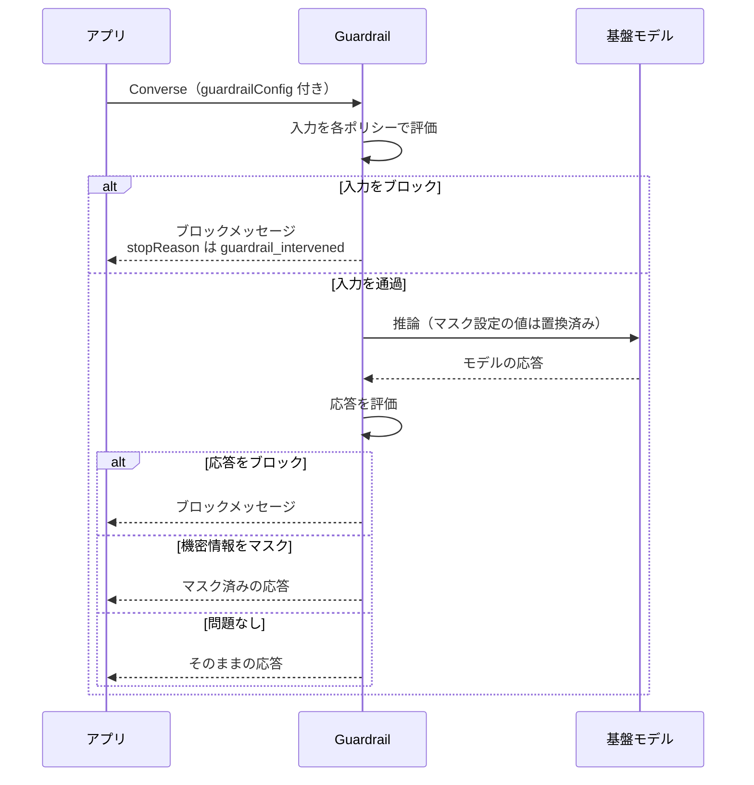

# AI サービスと AI 開発ツール

アプリに生成 AI を組み込むときは Amazon Bedrock と Amazon Bedrock AgentCore を、開発そのものを AI に支援させるときは Kiro（DVA-C02 では Amazon Q Developer）を使います。DVA-C03 では、これらを安全に呼び出して運用する力が新しく問われます。

[](../assets/diagrams/ai-bedrock-private-access.png)

## 試験範囲と全体像 {#overview}

DVA-C03 の対象サービス一覧に載る AI 関連は次の 4 つです。

| サービス | 何をするか | 開発者の関わり方 |
|---|---|---|
| Amazon Bedrock | 基盤モデル（FM）を API で呼ぶ。Guardrails、Knowledge Bases も提供 | SDK で呼び出し、IAM とログを設定する |
| Amazon Bedrock AgentCore | エージェントの実行基盤、ツール接続、認証、認可 | エージェントをデプロイし、ツール呼び出しを統制する |
| Amazon Quick | 業務ユーザー向けの AI チャット、自動化、調査、分析 | コネクタでアプリや API をつなぐ |
| Kiro | 仕様駆動の AI 開発環境（IDE と CLI） | Specs、Steering、Hooks、MCP を使って開発する |

対象外と明記されているのは Amazon SageMaker AI、Amazon Polly、Amazon Rekognition、Strands Agents、Amazon Quick Sight です。

!!! note "候補者に求められないこと"
    FM の選定、プロンプトエンジニアリング、RAG の設計、ガードレールの設計は DVA-C03 の範囲外です。このページでは、呼び出し方、エラー処理、権限、適用方法に絞ります。

| スキル | このページの節 |
|---|---|
| C03 1.1.9 / C02 1.1.11 | [AI 支援開発ツール](#ai-dev-tools) |
| C03 1.1.10 | [アプリから Bedrock を呼ぶ](#bedrock-runtime) |
| C03 2.3.1 | [アクセスの要求と管理](#access) |
| C03 2.3.2 | [データプライバシー](#data-privacy) |
| C03 2.3.3 | [Guardrails](#guardrails) |
| C03 2.3.4 | [エージェントの保護](#agent-security) |
| C03 2.3.5 | [ログの機密情報保護](#log-protection) |
| C03 3.2.5 / C02 3.3.6 | [テスト生成](#ai-testing) |
| C03 3.3.9 | [CI/CD 支援](#ai-cicd) |
| C03 4.1.5 | [エラー分析](#ai-troubleshooting) |
| C03 4.3.6 | [最適化](#ai-optimization) |

## AI 支援開発ツール {#ai-dev-tools}

### Kiro {#kiro}

Kiro は AWS が提供する AI 開発環境で、主に IDE と CLI で使います。自然言語の指示からコードを書かせるだけでなく、仕様を先に固めて、それに沿って実装させる流れを支えます。

| 機能 | 役割 | 置き場所・設定 |
|---|---|---|
| Specs | 要件、設計、タスクを成果物にして実装を進める | `requirements.md`（バグ修正は `bugfix.md`）、`design.md`、`tasks.md` |
| Steering | 規約や技術選定を常に伝える | ワークスペースは `.kiro/steering/`、全体は `~/.kiro/steering/`。競合時はワークスペース優先 |
| Hooks | イベントを契機にコマンドやプロンプトを実行する | `.kiro/hooks/<id>.json` |
| MCP | 外部のツールやデータにつなぐ | ワークスペースは `.kiro/settings/mcp.json`、全体は `~/.kiro/settings/mcp.json` |

**Specs** は要件 → 設計 → タスクの順に進みます。要件は EARS 形式（`WHEN ... THE SYSTEM SHALL ...`）で書かれ、タスクは 1 つずつでもまとめてでも実行できます。機能追加向けの Feature Spec、バグ修正向けの Bugfix Spec、承認を挟まず一度に成果物を作る Quick Spec があります。

**Steering** の基本は `product.md`、`tech.md`、`structure.md` の 3 ファイルです。読み込みモードは `always`、`fileMatch`、`manual`、`auto` の 4 つで、ファイル先頭の YAML で指定します。`AGENTS.md` にも対応します。

**Hooks** は主に次のトリガーを使います。

| トリガー | 使いどころ |
|---|---|
| Pre Tool Use | ツール実行前の検査。ツール呼び出しをブロックできる |
| Post Tool Use | ツール呼び出しの監査ログ |
| File Create / File Save / File Delete | 変更ファイルのテストやリント。エージェントによる変更が対象で、手動編集では動かない |
| Pre / Post Task Execution | Spec タスクの前提確認、完了後のテスト実行 |
| Prompt Submit / Agent Stop | プロンプトの検査（ブロックは IDE のみ）、応答後のビルドチェック |

**MCP** の設定では、`autoApprove` に書いたツールが確認なしで実行され、`disabledTools` のツールはエージェントから使えなくなります。秘密情報は `${VAR}` で参照し、資格情報を含む設定ファイルはコミットしません。

!!! warning "Supervised モードはセキュリティ境界ではない"
    Kiro の公式ドキュメントは、Supervised はレビュー手順であって、サンドボックスやアクセス制御ではないと説明しています。権限は `deny` / `ask` / `allow` のルールで絞ります。ルールが競合すると最も厳しい効果が優先され、`deny` はどの `allow` でも覆せません。

### Amazon Q Developer の現状と Kiro との関係 {#q-developer}

DVA-C02 が名指しする Amazon Q Developer は、IDE 向けの部分が Kiro へ移行中です。AWS の公式告知で確認できる日程は次のとおりです。

| 日付 | 内容 |
|---|---|
| 2026-05-15 | 新規の Free Tier アカウントと新規サブスクリプションの作成を停止（既存の Pro へのユーザー追加は可） |
| 2026-11-18 | Amazon Q Developer for GitHub App の新規インストールを停止 |
| 2027-01-30 | 同 GitHub App のサポート終了 |
| 2027-04-30 | IDE プラグインと有料サブスクリプションのサポート終了 |

- **影響を受けないもの:** マネジメントコンソール、AWS ドキュメントサイト、AWS Console Mobile App、チャットアプリ（Slack と Microsoft Teams）の Q Developer。
- **CLI:** Kiro CLI は Q Developer CLI の次期版です。`q` コマンドや `.amazonq` の設定は引き続き動きます。
- **コード変換:** Java のアップグレードと .NET の移植は AWS Transform へ移ります。
- **試験:** DVA-C02 は 2026-11-30 まで、DVA-C03 は 2026-12-01 からです。DVA-C03 の対象一覧に Q Developer はなく、Kiro が載っています。

### スキル例ごとの対応 {#kiro-vs-q}

| C03 1.1.9 の例 | Kiro | Q Developer（IDE） |
|---|---|---|
| 仕様駆動のコード生成 | Specs | 相当機能なし（Kiro の移行ガイドは Kiro IDE で追加される機能としている） |
| 自動コードレビュー | 専用機能のページは確認できず。チャット、カスタムエージェント、ヘッドレス CLI で実施 | コードレビュー。指定がなければ `git diff` の変更を優先し、自動レビューも可能 |
| コード補完 | インライン提案 | インライン提案 |
| リファクタリング提案 | エージェントへの指示で実施 | 右クリックの Refactor、Fix、Optimize |
| セキュリティスキャン | 専用スキャナのページは確認できず。Hooks や CI でスキャナを実行する | SAST、シークレット検出、IaC、SCA（第三者コード）をレビューで検査 |

## アプリから Bedrock を呼ぶ {#bedrock-runtime}

### API の選び方 {#invoke-apis}

| API | 特徴 | 必要な IAM アクション |
|---|---|---|
| `Converse` | モデル共通の形式でメッセージを送る。チャットやツール利用向け | `bedrock:InvokeModel` |
| `ConverseStream` | `Converse` の応答を逐次受け取る | `bedrock:InvokeModelWithResponseStream` |
| `InvokeModel` | モデル固有の JSON をそのまま送る。埋め込みや画像生成にも使う | `bedrock:InvokeModel` |
| `InvokeModelWithResponseStream` | `InvokeModel` の応答を逐次受け取る | `bedrock:InvokeModelWithResponseStream` |

迷ったらモデルを差し替えやすい `Converse` を選びます。これらは `bedrock-runtime` エンドポイントの API で、boto3 のクライアント名も同じです。

### Converse の例 {#converse}

```python
import boto3
from botocore.config import Config
from botocore.exceptions import ClientError

client = boto3.client(
    "bedrock-runtime",
    region_name="us-east-1",
    config=Config(retries={"max_attempts": 5, "mode": "adaptive"}, read_timeout=300),
)
MODEL_ID = "<モデル ID または推論プロファイル ID>"

try:
    resp = client.converse(
        modelId=MODEL_ID,
        system=[{"text": "簡潔に日本語で答えてください。"}],
        messages=[{"role": "user", "content": [{"text": "SQS とは?"}]}],
        inferenceConfig={"maxTokens": 512, "temperature": 0.2},
    )
    print(resp["output"]["message"]["content"][0]["text"])
    print(resp["stopReason"], resp["usage"]["totalTokens"])
except ClientError as e:
    print(e.response["Error"]["Code"])
    raise
```

`adaptive` はクライアント側でも送信レートを調整するリトライモードです。生成に時間がかかる場合は `read_timeout` を長くします。

応答の `stopReason` は必ず確認します。

| 値 | 意味と対応 |
|---|---|
| `end_turn` | 正常に完了 |
| `max_tokens` | 上限で打ち切り。`maxTokens` を見直す |
| `tool_use` | モデルがツールの実行を要求している。アプリが実行して結果を返す |
| `guardrail_intervened` | ガードレールが介入した。ブロックとマスクの両方でこの値になる |
| `content_filtered` | コンテンツフィルターで応答が止められた |

### ストリーミング {#streaming}

```python
from botocore.exceptions import EventStreamError

resp = client.converse_stream(
    modelId=MODEL_ID,
    messages=[{"role": "user", "content": [{"text": "SQS とは?"}]}],
)
try:
    for event in resp["stream"]:
        if "contentBlockDelta" in event:
            print(event["contentBlockDelta"]["delta"].get("text", ""), end="")
        elif "messageStop" in event:
            stop_reason = event["messageStop"]["stopReason"]
        elif "metadata" in event:
            usage = event["metadata"]["usage"]
except EventStreamError as e:
    print(e.response["Error"]["Code"])  # 例: throttlingException
```

イベントは `messageStart`、`contentBlockStart`、`contentBlockDelta`（複数回）、`contentBlockStop`、`messageStop`、`metadata` の順に届きます。

開始後の失敗はストリーム内のイベントとして届きます。`modelStreamErrorException`、`throttlingException` などがあり、HTTP 200 を受け取った後でもループ内の例外処理が必要です。AWS CLI はストリーミング操作に対応していません。

### InvokeModel の例 {#invoke-model}

本文の形式はモデルごとに違います。次は Anthropic のモデルの例です。

```python
import json

resp = client.invoke_model(
    modelId=MODEL_ID,
    contentType="application/json",
    accept="application/json",
    body=json.dumps({
        "anthropic_version": "bedrock-2023-05-31",
        "max_tokens": 512,
        "messages": [{"role": "user", "content": "SQS とは?"}],
    }),
)
result = json.loads(resp["body"].read())
```

### エラー処理とスロットリング {#errors-throttling}

| 例外 | HTTP | 主な原因 | 対応 |
|---|---|---|---|
| `ValidationException` | 400 | 入力形式の誤り、モデルが要求するデータ保持モードを満たさない | 修正する。再試行しない |
| `ServiceQuotaExceededException` | 400 | クォータ超過（`InvokeModel`） | クォータを確認し、時間を置く |
| `AccessDeniedException` | 403 | IAM の不足、モデル利用の前提が未完了 | [権限と前提](#access)を確認する |
| `ResourceNotFoundException` | 404 | モデル ID や ARN の誤り | 識別子を確認する |
| `ModelTimeoutException` | 408 | モデルの処理時間超過 | 入力を小さくして再試行する |
| `ModelErrorException` | 424 | モデルの処理中のエラー | `originalStatusCode` を確認する |
| `ThrottlingException` | 429 | アカウントのクォータ超過 | 指数バックオフとジッターで再試行する |
| `ModelNotReadyException` | 429 | モデルの準備が未完了 | SDK が最大 5 回まで自動で再試行する |
| `InternalServerException` | 500 | サーバー側の失敗 | バックオフして再試行する |
| `ServiceUnavailableException` | 503 | 一時的な容量不足。クォータとは無関係 | バックオフして再試行する。クロスリージョン推論も検討する |
| `overloaded_error` | 529 | モデル側の一時的な需要超過 | バックオフして再試行する。`Retry-After` があれば従う |

スロットリングを減らす手順は次のとおりです。

1. **`max_tokens` を実態に近づける。** リクエスト開始時に「入力トークン + `max_tokens`」が TPM（1 分あたりのトークン数）と TPD（1 日あたり）のクォータから先に差し引かれ、未使用分は完了時に戻ります。大きすぎる値は同時実行数を減らします。
2. **バックオフとジッターを入れる。** 同時に再試行すると負荷が集中します。一般的なリトライ設計は [SDK と耐障害性](sdk-resilience.md)を参照してください。
3. **出力トークンの消費率を意識する。** 一部のモデルは出力 1 トークンがクォータ上で複数トークン分になります（課金は実トークン数）。率はモデルごとに異なります。
4. **容量を増やす。** クロスリージョン推論、クォータ引き上げ申請、Provisioned Throughput や Reserved Tier を検討します。使用量は CloudWatch の `InputTokenCount` と `OutputTokenCount` で確認できます。

### Knowledge Bases を呼ぶ {#knowledge-bases}

開発者が知っておくのは呼び方です。クライアントは `bedrock-agent-runtime` です。

| API | 動作 | IAM アクション |
|---|---|---|
| `Retrieve` | 検索結果だけを返す | `bedrock:Retrieve`（ナレッジベース ARN に限定できる） |
| `RetrieveAndGenerate` | 検索して、モデルで回答と引用を生成する | `bedrock:RetrieveAndGenerate`。生成に使うモデルの利用権限も必要 |

```python
agent_rt = boto3.client("bedrock-agent-runtime", region_name="us-east-1")
resp = agent_rt.retrieve_and_generate(
    input={"text": "返品の条件は?"},
    retrieveAndGenerateConfiguration={
        "type": "KNOWLEDGE_BASE",
        "knowledgeBaseConfiguration": {
            "knowledgeBaseId": "KB12345678",
            "modelArn": "<モデルまたは推論プロファイルの ARN>",
        },
    },
)
print(resp["output"]["text"], resp["citations"], resp["sessionId"])
```

`sessionId` は初回にサービスが生成するので、会話を続けるときに同じ値を渡します。マネージドナレッジベースでは `RetrieveAndGenerate` を使えず、`Retrieve` や `AgenticRetrieveStream` を使います。

### Bedrock Agents を呼ぶ {#agents}

!!! warning "新規は AgentCore へ"
    Amazon Bedrock Agents は Amazon Bedrock Agents Classic に改称され、2026-07-30 から新規顧客を受け付けていません。過去 12 か月に利用がないアカウントで `CreateAgent` や `InvokeInlineAgent` を呼ぶと `AccessDeniedException`（403）になります。既存のエージェントは動き続け、廃止日は未定ですが、新機能は追加されません。Bedrock 本体、Knowledge Bases、Guardrails はこの変更の影響を受けません。

`InvokeAgent` には `agentId`、`agentAliasId`、`sessionId` を渡し、応答はイベントストリームで受け取ります。IAM は `bedrock:InvokeAgent` で、リソースはエイリアスの ARN（`agent-alias/<AgentId>/<AliasId>`）です。テストでは `DRAFT` を指す `TSTALIASID` を使えます。ドラフトを変更したら `PrepareAgent` で反映します。

```python
resp = agent_rt.invoke_agent(
    agentId="AGENT12345", agentAliasId="ALIAS12345",
    sessionId="user-42-conv-1", inputText="注文をキャンセルして",
)
text = b"".join(e["chunk"]["bytes"] for e in resp["completion"] if "chunk" in e)
```

## アクセスの要求と管理 {#access}

### モデルアクセスの現在の動き {#model-access}

以前のような「Model access ページで申請してから使う」流れは、商用リージョンではなくなりました（そのページは GovCloud 向けに残っています）。多くのモデルは、権限があれば初回の呼び出しで使えるようになります。

| 確認項目 | 内容 |
|---|---|
| 初回の自動有効化 | 第三者モデルの初回呼び出しで、裏側でサブスクリプションが始まる（最大 15 分）。前提が欠けていると失敗し、以後 `AccessDeniedException` になる |
| Marketplace 権限 | 初回だけ `aws-marketplace:Subscribe`、`Unsubscribe`、`ViewSubscriptions` が必要。有効化後の呼び出しには不要 |
| Anthropic モデル | 初回利用前にユースケースの提出が必要（`PutUseCaseForModelAccess`、コンソール）。組織の管理アカウントで提出すると配下へ継承される |
| 状態の確認 | `GetFoundationModelAvailability` の `agreementAvailability`。`PENDING` の間は `AccessDeniedException` が続く |
| 追加のアクセス | 一部のモデルは別途アカウント単位のアクセスが必要で、アカウントごとに判定される |

### 使わせない方法 {#block-access}

- **`aws-marketplace:Subscribe` の拒否だけでは初回呼び出しを止められません。** 自動で有効化されるためです。
- **契約の削除だけでも不十分です。** 次の呼び出しで再び作られます。
- 止めるには、SCP または IAM で `bedrock:InvokeModel` と `bedrock:InvokeModelWithResponseStream` を対象モデルの ARN に対して拒否します。`Converse` と `ConverseStream` も一緒に止まります。

### IAM のスコープ {#iam-scope}

ワイルドカードではなくモデルの ARN に絞ります。基盤モデルの ARN にはアカウント ID が入りません。

推論プロファイルを使う場合は、プロファイルと、経路上の各リージョンの基盤モデルの両方を許可します。次の例は、プロファイル経由の呼び出しだけを認めます。

```json
{
  "Version": "2012-10-17",
  "Statement": [
    {
      "Effect": "Allow",
      "Action": ["bedrock:InvokeModel", "bedrock:InvokeModelWithResponseStream"],
      "Resource": "arn:aws:bedrock:us-west-2:111122223333:inference-profile/<profile-id>"
    },
    {
      "Effect": "Allow",
      "Action": ["bedrock:InvokeModel", "bedrock:InvokeModelWithResponseStream"],
      "Resource": [
        "arn:aws:bedrock:us-east-1::foundation-model/<model-id>",
        "arn:aws:bedrock:us-west-2::foundation-model/<model-id>"
      ],
      "Condition": {
        "StringLike": {
          "bedrock:InferenceProfileArn": "arn:aws:bedrock:us-west-2:111122223333:inference-profile/<profile-id>"
        }
      }
    }
  ]
}
```

### Bedrock API キー {#api-keys}

AWS 署名の代わりにベアラートークンで認証できます。環境変数は `AWS_BEARER_TOKEN_BEDROCK` です。

| 種類 | 有効期間 | 用途 |
|---|---|---|
| 短期キー | 最大 12 時間（セッションが短ければそれまで）。生成元の権限を継承 | 本番で推奨 |
| 長期キー | 設定した期限まで。IAM ユーザーに紐づく | 検証のみ |

使用の可否は `bedrock:CallWithBearerToken`、長期キーの生成は `iam:CreateServiceSpecificCredential` で制御します。アプリは IAM ロールで呼ぶのが基本です。

## データプライバシー {#data-privacy}

### VPC エンドポイントでの接続 {#privatelink}

インターフェイスエンドポイント（AWS PrivateLink）を作ると、インターネットゲートウェイや NAT なしで Bedrock を呼べます。構成はページ先頭の図のとおりです。呼ぶ API に応じてエンドポイントを選びます。

| エンドポイントのサービス名 | 対象 |
|---|---|
| `com.amazonaws.<region>.bedrock-runtime` | `Converse`、`InvokeModel`、`ApplyGuardrail` など |
| `com.amazonaws.<region>.bedrock` | コントロールプレーン（ガードレール作成など） |
| `com.amazonaws.<region>.bedrock-agent-runtime` | `InvokeAgent`、`Retrieve` など |
| `com.amazonaws.<region>.bedrock-agent` | エージェントのビルド時 API |
| `com.amazonaws.<region>.bedrock-agentcore` | AgentCore のデータプレーン |
| `com.amazonaws.<region>.bedrock-agentcore-control` | AgentCore のコントロールプレーン |

- **プライベート DNS:** 有効ならコード変更は不要です。無効なら `endpoint_url` に VPC エンドポイントの URL を渡します。
- **エンドポイントポリシー:** 既定ではフルアクセスです。独自ポリシーで操作を絞れます。
- **`aws:SourceIp` の落とし穴:** エンドポイント経由のリクエストにはこのキーが含まれません。`IpAddress` 条件を付けたポリシーは満たされず拒否されるので、`aws:SourceVpce` などを使います。
- **アイドル切断:** インターフェイスエンドポイントと NAT ゲートウェイのアイドルタイムアウトは 350 秒で固定です。長時間の呼び出しで切断されるときは、`Config(tcp_keepalive=True)` と OS の `net.ipv4.tcp_keepalive_time` の両方を設定します。

```json
{
  "Statement": [{
    "Effect": "Allow",
    "Principal": {"AWS": "arn:aws:iam::111122223333:role/app-role"},
    "Action": ["bedrock:InvokeModel", "bedrock:InvokeModelWithResponseStream"],
    "Resource": "arn:aws:bedrock:us-east-1::foundation-model/<model-id>"
  }]
}
```

VPC の基本は[ネットワーク](networking.md)を参照してください。

### 入出力は学習に使われるか {#training-use}

PrivateLink が守るのは通信経路で、データの利用方法は別の話です。結論はサービスによって違います。

| サービス | 入出力の扱い |
|---|---|
| Bedrock | モデルの学習に使わず、モデル提供者とも共有しない |
| AgentCore | 公式は、サービス改善のために内容を利用、保存する場合があると記載。改善はその顧客の利用に対するもので、他の顧客向けではない |
| Q Developer | Free Tier は学習を含むサービス改善に使われる場合があり、オプトアウト可。Pro は使わない |
| Kiro | Free Tier と個人サブスクリプションは学習を含む改善に使われる場合があり、オプトアウト可。エンタープライズと Q Developer Pro 経由は使わない |

Q Developer のオプトアウトは、IDE の設定または AWS Organizations の AI サービスのオプトアウトポリシーで行います。場所によって方法が異なります。

!!! note "学習に使わないことと保持しないことは別"
    Bedrock では一部のモデルが、不正利用検知のために入出力を最大 30 日保持します。AWS による人によるレビューを条件とするモデルもあります。いずれもモデル提供者とは共有されません。

    保持は `none`、`default`、`aws_review` などのモードで、リージョンのアカウント単位に設定します。モデルの要件を満たさないと `bedrock-runtime` では `ValidationException` になります。`bedrock:PutAccountDataRetention` を `bedrock:DataRetentionMode` 条件で縛れば、組織全体で強制できます。

## Guardrails {#guardrails}

### フィルターの種類 {#guardrail-filters}

| フィルター | 検出対象 | アクション |
|---|---|---|
| コンテンツフィルター | Hate、Insults、Sexual、Violence、Misconduct。強度は `NONE`〜`HIGH` | `BLOCK` / `NONE` |
| プロンプト攻撃 | ジェイルブレイク、プロンプトインジェクション、プロンプト漏えい（Standard 層のみ）。コンテンツフィルターの一分類 | `BLOCK` / `NONE` |
| 拒否トピック | 定義した話題（例: 投資助言）。1 ガードレールに最大 30 件 | `BLOCK` / `NONE` |
| ワードフィルター | 指定語句の完全一致、管理された不適切語リスト | `BLOCK` / `NONE` |
| 機密情報フィルター | 組み込みの PII と正規表現 | `BLOCK` / `ANONYMIZE` / `NONE` |
| コンテキストグラウンディング | 応答が参照元に基づくか、質問に関連するか | `BLOCK` / `NONE` |
| Automated Reasoning | 応答が定義した論理ルールに沿うか | 検証結果を返す |

- **マスク（`ANONYMIZE`）** は機密情報フィルターだけの機能で、`{NAME}` や `{EMAIL}` に置き換えます。
- **検出モード（`NONE`）** は何もせず、トレースに結果だけを返します。本番適用前の評価に使います。
- **PHI:** 組み込みの PII に健康関連の番号（`CA_HEALTH_NUMBER` など）がありますが、対象は限られます。それ以外は正規表現で補います。
- **層:** Standard 層はクロスリージョン推論が必須です。Classic 層は英語、フランス語、スペイン語に対応します。
- **バージョン:** `DRAFT` は作業中の版です。`CreateGuardrailVersion` で番号付きの版を作り、本番ではそれを指定します。

### 適用の流れ {#guardrail-flow}



入力がブロックされると推論は行われず、課金はガードレール評価の分だけです。応答がブロックされた場合は、モデルの推論分も課金されます。

### Converse で適用する {#guardrail-converse}

```python
resp = client.converse(
    modelId=MODEL_ID,
    messages=[{
        "role": "user",
        "content": [
            {"text": "参考情報: ..."},  # guardContent があるので評価されない
            {"guardContent": {"text": {"text": user_input}}},
        ],
    }],
    guardrailConfig={
        "guardrailIdentifier": "<ガードレール ID>",
        "guardrailVersion": "1",
        "trace": "enabled",
    },
)
if resp["stopReason"] == "guardrail_intervened":
    print(resp["trace"]["guardrail"])  # 本番ではログに出さない
```

| 場面 | 動作 |
|---|---|
| `guardContent` を 1 つでも使う | フィルターの多くはそのブロックだけを評価する（ワードフィルターなど例外あり） |
| システムプロンプト | `guardContent` で囲まないと評価されない |
| マスクとブロックの区別 | `stopReason` は同じ。トレースの `action` が `ANONYMIZED` か `BLOCKED` かで見分ける |
| `ConverseStream` | `streamProcessingMode` が `sync` なら評価後に返す（遅延あり）。`async` は即時に返すが不適切な内容が届く場合があり、マスクも使えない |
| `InvokeModel` | ヘッダー相当の `guardrailIdentifier` と `guardrailVersion` を渡す |
| 埋め込み、リランク、画像生成のモデル | ガードレールに非対応 |

!!! warning "InvokeModel のプロンプト攻撃フィルターはタグが必須"
    `InvokeModel` 系では、ユーザー入力を `<amazon-bedrock-guardrails-guardContent_xyz>` タグで囲み、本文の `amazon-bedrock-guardrailConfig.tagSuffix` に `xyz` を指定します。タグがないとプロンプト攻撃は検査されません。タグを閉じる攻撃を防ぐため、サフィックスはリクエストごとにランダムにします。

### ApplyGuardrail {#apply-guardrail}

モデルを呼ばずに、任意のテキストをガードレールだけで評価する API です。Bedrock 以外のモデルの入出力や、RAG の検索前のチェックに使えます。IAM は `bedrock:ApplyGuardrail` です。

```python
resp = client.apply_guardrail(
    guardrailIdentifier="<ガードレール ID>",
    guardrailVersion="1",
    source="INPUT",  # モデルの応答を評価するなら "OUTPUT"
    content=[{"text": {"text": user_input}}],
)
if resp["action"] == "GUARDRAIL_INTERVENED":
    safe_text = resp["outputs"][0]["text"]  # ブロックメッセージまたはマスク済みの文
```

介入がなければ `action` は `NONE` で、`outputs` は空です。

### 適用の強制と限界 {#guardrail-enforcement}

`bedrock:GuardrailIdentifier` 条件キーで、指定のガードレールなしの推論を拒否できます。

```json
{
  "Effect": "Deny",
  "Action": ["bedrock:InvokeModel", "bedrock:InvokeModelWithResponseStream"],
  "Resource": "arn:aws:bedrock:us-east-1::foundation-model/*",
  "Condition": {
    "StringNotEquals": {
      "bedrock:GuardrailIdentifier": "arn:aws:bedrock:us-east-1:111122223333:guardrail/<id>:1"
    }
  }
}
```

ただし、次の限界があります。

- **入力タグ:** ユーザーはタグを使って入力の評価を回避できます。応答には常に適用されます。
- **内部で複数回推論する API:** この条件を付けたロールで `RetrieveAndGenerate`、`InvokeAgent`、`InvokeInlineAgent` を呼ぶと、ガードレールなしの内部呼び出しのせいで拒否されることがあります。
- **ツール利用:** `guardrailConfig` は次の内容を評価しません。

| 内容 | フィールド | 評価 |
|---|---|---|
| アプリがモデルに返すツール結果 | `toolResult` | されない |
| ツール定義 | `toolSpec` | されない |
| モデルが生成するツール引数 | `toolUse.input` | されない |
| プロンプト、システムプロンプト、応答本文 | `text`、`guardContent` | される |

ツール結果に仕込まれた間接的なプロンプトインジェクションや、引数に含まれた PII はここでは止まりません。必要なら、アプリ側でそれらのテキストを `ApplyGuardrail` に通します。

## エージェントの保護 {#agent-security}

エージェントは自分の判断でツールを呼ぶので、モデルの応答ではなく実行の時点で制御します。

### ツール利用の認可 {#tool-authorization}

`Converse` のツール利用では、モデルは実行を要求するだけで、実際に呼ぶのはアプリです。モデルの出力を信用せず、呼び出しごとに認可します。

```python
if resp["stopReason"] == "tool_use":
    for block in resp["output"]["message"]["content"]:
        tool = block.get("toolUse")
        if tool and not is_allowed(current_user, tool["name"], tool["input"]):
            ...  # 実行せず、拒否を toolResult で返す
```

AgentCore では、この制御をエージェントのコードの外に置けます。

| サービス | 役割 | 要点 |
|---|---|---|
| Gateway | API、Lambda、MCP サーバーを MCP ツールとして一元的に公開する | 受信認可は OAuth（JWT）、IAM（SigV4）、認証のみ、認可なし（開発向け）。送信先の資格情報は実行ロールやクレデンシャルプロバイダーで扱う |
| Policy | ツール呼び出しごとの認可 | Gateway を通る呼び出しをコードの外で評価する。Cedar または互換の Dogwood で記述。既定は拒否で、`forbid` が優先。`LOG_ONLY` で試してから `ENFORCE` に上げられる |
| Identity | エージェントの ID と資格情報の管理 | ワークロード ID、トークン保管庫（KMS で暗号化）、OAuth のクライアントクレデンシャル（2LO）と認可コード（3LO、ユーザー同意） |

```text
permit (
    principal,
    action == AgentCore::Action::"RefundAPI___refund",
    resource == AgentCore::Gateway::"<gateway-arn>"
) when { context.input.amount <= 100 };
```

!!! warning "Gateway を迂回させない"
    Policy は Gateway を通る呼び出しにしか効きません。Gateway の背後に Runtime を置くなら、Runtime への直接呼び出しを禁止します。SigV4 ならリソースベースポリシーで Gateway の実行ロールだけを許可し、JWT なら authorizer の `allowedWorkloadConfiguration` を設定します。

実行ロールも絞ります。CLI が作るロールは既定で全モデルの呼び出しを許すので、本番では最小権限のロールを渡します。また、ユーザーを不透明な文字列で指定する `InvokeAgentRuntimeForUser` は、不要なら明示的に拒否します。

### セッションの分離 {#session-isolation}

AgentCore Runtime は、セッションごとに専用の microVM を用意します。CPU、メモリ、ファイルシステムが分離され、終了時に microVM を破棄してメモリを消去します。

| 項目 | 内容 |
|---|---|
| セッション ID | `runtimeSessionId`。33 文字以上で、ユーザーや会話ごとに一意にする |
| ライフサイクル | 既定でアイドル 15 分、最大 8 時間で停止。次の呼び出しで新しい microVM が用意される |
| データの持続 | 既定では揮発する。残すなら AgentCore Memory やセッションストレージを使う |
| ユーザーとの対応 | **AgentCore は強制しない。** バックエンドでユーザーとセッション ID の対応を管理する |
| セッション単位の権限 | 実行ロールのポリシーで `aws:AgentCoreRuntimeSourceSid` を使い、S3 プレフィックスなどをセッションごとに限定する |

- **資格情報:** microVM 内のコードは実行ロールの資格情報を取得できるので、ロールは最小権限にします。
- **入力の検証:** 呼び出し側は任意の JSON を送れます。`prompt` が文字列かを確認し、ユーザーが送った `toolUse` ブロックは取り除きます。ツールが直接実行される恐れがあるためです。

### 人による承認 {#human-in-the-loop}

**Bedrock Agents（Classic）** には 2 つの仕組みがあります。

| 機能 | 設定 | 動作 |
|---|---|---|
| ユーザー確認 | 関数の `requireConfirmation` を `ENABLED` | 実行前に `returnControl` で内容を返す。結果の `confirmationState` が `CONFIRM` なら実行、`DENY` なら実行しない |
| 制御の返却 | アクショングループの `customControl` を `RETURN_CONTROL` | Lambda を呼ばずパラメータをアプリに返す。アプリが実行し結果を送り返す |

```python
agent_rt.invoke_agent(
    agentId="AGENT12345", agentAliasId="ALIAS12345", sessionId="user-42-conv-1",
    sessionState={
        "invocationId": invocation_id,  # returnControl と同じ値
        "returnControlInvocationResults": [{
            "functionResult": {
                "actionGroup": "Orders",
                "function": "cancelOrder",
                "confirmationState": "CONFIRM",
            },
        }],
    },
)
```

**AgentCore** では、次の組み合わせで実現します。承認画面そのものはアプリ側で作ります。

- **ハーネスのインライン関数ツール:** エージェントが停止してクライアントに `tool_use` を返し、結果を待ちます。制御の返却に相当します。
- **Policy の時間的ポリシー（temporal policy）:** 同じセッションで承認ツールが成功している場合にだけ、次の操作を許可できます。Dogwood の `formerly within` などを使い、セッション ID は `x-amzn-bedrock-agentcore-policy-session-id` ヘッダーで渡します。セッション ID は呼び出し側が決めるので、回数制限はセッションをまたぎません。

**一般的な実践:** どの方式でも、承認後に実行する直前で金額やパラメータをアプリが再検証します。

## ログの機密情報保護 {#log-protection}

### モデル呼び出しログ {#invocation-logging}

- **既定は無効です。** `PutModelInvocationLoggingConfiguration` またはコンソールで、アカウントのリージョン単位に有効化します。
- **送信先:** CloudWatch Logs、S3、または両方です。同じアカウント、同じリージョンに限られます。
- **対象:** `bedrock-runtime` 経由の `Converse`、`ConverseStream`、`InvokeModel`、`InvokeModelWithResponseStream` です。
- **本文:** リクエストと応答を 100 KB まで記録します。それより大きい本文やバイナリは S3 に別オブジェクトで保存します。
- **権限:** CloudWatch Logs には `bedrock.amazonaws.com` が引き受けるロールを用意し、S3 にはバケットポリシーを設定します。

!!! warning "Guardrails のマスクはログに効かない"
    呼び出しログの `input` は、ガードレールが介入しても常に元のリクエストのままです。ブロックされた内容も平文で残ります。さらに、Guardrails のトレースの `match` と `modelOutput` にも元の値が入ります。ログの保護は別途必要で、トレースを通常のアプリログに書いてはいけません。

### CloudWatch Logs のデータ保護 {#cloudwatch-data-protection}

ロググループのデータ保護ポリシーは、取り込み時に機密情報を検出してマスクします。

| 項目 | 内容 |
|---|---|
| 操作 | Audit（検出の記録）と Deidentify（マスク）。ポリシーには両方が必須で、`DataIdentifier` は一致させる |
| 検出対象 | 資格情報、金融情報、PII、PHI、デバイス ID などのマネージド識別子と、正規表現のカスタム識別子 |
| 効果の範囲 | Logs Insights、メトリクスフィルター、サブスクリプションフィルターなど、すべての出口でマスクされる |
| マスク解除 | `logs:Unmask` が必要。Logs Insights の `unmask(@message)`、`GetLogEvents` の `unmask` パラメータ |
| 適用単位 | ロググループごとに 1 つ（`PutDataProtectionPolicy`）、アカウント全体にも設定可（`PutAccountPolicy`）。両方あれば両方効く |
| 検知 | `AWS/Logs` 名前空間の `LogEventsWithFindings` メトリクスでアラームを作れる |
| 注意 | **適用前に取り込んだログはマスクされない** |

```json
{
  "Name": "bedrock-log-protection",
  "Version": "2021-06-01",
  "Statement": [
    {
      "Sid": "audit",
      "DataIdentifier": ["arn:aws:dataprotection::aws:data-identifier/EmailAddress"],
      "Operation": {"Audit": {"FindingsDestination": {}}}
    },
    {
      "Sid": "mask",
      "DataIdentifier": ["arn:aws:dataprotection::aws:data-identifier/EmailAddress"],
      "Operation": {"Deidentify": {"MaskConfig": {}}}
    }
  ]
}
```

このポリシーが守るのは CloudWatch Logs だけです。S3 に送ったログには効かないので、バケットポリシーと SSE-KMS で保護します。KMS を使う場合は、キーポリシーで `bedrock.amazonaws.com` に `kms:GenerateDataKey` を許可します。

一般的な実践として、アプリのログにプロンプトや応答をそのまま書かず、`requestId` やトークン数だけを残します。CloudWatch の全般は[オブザーバビリティ](observability.md)を参照してください。

## AI ツールで開発を支える {#ai-tools-lifecycle}

試験ガイドは「AWS AI tools」とだけ書き、製品を指定していません。ここでは、公式ドキュメントで確認できた機能と一般的な実践を分けて示します。

!!! note "対象サービス一覧との関係"
    AWS DevOps Agent、AWS Security Agent、Amazon CodeGuru Profiler は DVA-C03 の対象サービス一覧に載っていません。実務の参考として挙げています。AWS DevOps Agent のインシデント調査は一般提供ですが、リリース管理はプレビューです。

### テスト生成と自動化 {#ai-testing}

| ツール | 確認できた機能 |
|---|---|
| Kiro（Specs） | 要件から正しさの性質を抽出し、プロパティベーステストをランダム入力で実行する。失敗時は最小の入力まで縮小して示す。IDE のみ |
| Kiro（Hooks） | File Save で変更ファイルのテスト、Post Task Execution でタスク完了後のテストを実行する |
| Kiro CLI | ヘッドレスモードでパイプライン内のテスト生成に使う |
| Kiro（Bugfix Spec） | 回帰を防ぎながらバグを修正する |
| Q Developer（C02 3.3.6） | Java と Python のプロジェクトで単体テストを生成する（VS Code、JetBrains）。チャットか右クリックの Generate tests から実行し、1 ファイルずつ処理する。以前の名前は `/test` |
| AWS DevOps Agent（プレビュー） | 変更に合わせてテスト計画を作り、デプロイ済みの環境で実行する |

**一般的な実践:** カバレッジは CI で計測し、不足箇所のテスト作成を AI に頼みます。カバレッジ確保そのものを担う AWS の AI 機能は確認できていません。生成されたテストは、実装の誤りをそのまま正解にしていないか人が確認します。

### CI/CD の支援 {#ai-cicd}

| 例 | 確認できた機能 |
|---|---|
| パイプラインからの AI 実行 | Kiro CLI のヘッドレスモード。認証は `KIRO_API_KEY`、`--no-interactive` で実行し、`--trust-tools` で許可ツールを最小にする。レビュー、テスト生成、ビルド失敗の切り分けに使える |
| デプロイ判断の材料 | AWS DevOps Agent のリリース準備レビュー（プレビュー、`us-east-1` のみ）。`BLOCK` や `Deploy with Caution` などの推奨を返す |
| デプロイ後の検証 | AWS DevOps Agent のリリーステスト（プレビュー）。GitHub Actions や GitLab CI のステージとして実行でき、デプロイ済みの環境を検証する |
| PR のセキュリティレビュー | AWS Security Agent（現在は AWS Continuum の一部）。PR へのコメントと修正案の作成 |
| インシデントからの改善 | AWS DevOps Agent が、デプロイ手順やテストの改善を提案する |

```bash
kiro-cli chat --v3 --no-interactive --trust-tools=read_file,grep_search \
  "この PR の変更をセキュリティの観点でレビューして"
```

**一般的な実践:** 次の 2 点は専用の AWS 製品機能を確認できておらず、組み合わせで実現します。

- **自動承認:** [CodePipeline](cicd.md) の承認やテストのステージで、AI の評価結果を人の判断材料にします。本番は人の承認を残すのが安全です。
- **環境の準備:** Kiro などに IaC テンプレートを書かせ、レビュー後に CloudFormation や SAM でデプロイします。CloudFormation のデプロイ前検証は AI 機能ではありませんが、生成した IaC の確認に役立ちます。

### エラー分析とトラブルシューティング {#ai-troubleshooting}

| ツール | 使う場面 | 要点 |
|---|---|---|
| CloudWatch investigations | アラーム、メトリクス、Logs Insights クエリを起点とする調査 | テレメトリ、デプロイイベント、CloudTrail、X-Ray を分析して根本原因の仮説を示す。サインイン中のユーザーの権限で動き、操作は CloudTrail に残る |
| Q Developer（コンソール） | コンソールで出たエラー | 権限、設定、サービス上限のエラーで「Diagnose with Amazon Q」ボタンが出る。Lambda、ECS、S3 なども対象。この機能は Q の IDE 終了の影響を受けないコンソール側のもの |
| Q Developer（IDE） | コードのバグ | 選択したコードの Fix |
| Kiro | コードのバグ、ビルド失敗 | Bugfix Spec、ヘッドレスでのビルド失敗の切り分け |
| AWS DevOps Agent | 本番インシデント | アラームを契機に調査し、ログ、トレース、デプロイ履歴を関連付けて根本原因を示す。AWS リソースには読み取り専用で、緩和策の実行には人の承認が必要 |

CloudWatch investigations は、設定なしでも実行できますが、調査グループを設定すると共有、提案の採否、クロスアカウント、Systems Manager Automation ランブックの実行まで使えます。以前は Amazon Q Developer operational investigations という名前でプレビュー提供されていました。

**一般的な実践:** スタックトレースやログを AI に渡すときは、機密情報を含めないようにします。提案は根拠のログやトレースで検証してから適用します。

### 最適化 {#ai-optimization}

| 例 | 確認できた機能 |
|---|---|
| コード効率の改善 | Q Developer IDE の Optimize と Refactor。コードレビューの品質検査に性能と保守性が含まれる |
| ボトルネック検出 | Amazon CodeGuru Profiler。実行時データから高コストなコード行を示す（JVM 言語と Python） |
| リソース使用の最適化 | AWS DevOps Agent のインシデント防止評価。既定で毎週実行し、Observability、Infrastructure（容量調整を含む）、Governance、Code optimization に分類して提案する |
| エージェントの改善 | AgentCore Observability と Optimization。トレースから性能の問題を調べ、A/B テストで設定を検証する |

**一般的な実践:** X-Ray のトレースや CloudWatch のメトリクスを根拠として AI に渡し、改善案を出させます。Kiro に最適化専用の機能は確認できていないので、Steering で性能要件を伝え、チャットで依頼します。Lambda のメモリ調整などの基本は [Lambda](lambda.md) を参照してください。

## Amazon Quick {#quick}

Amazon Quick は、チャットを入口にして、データ分析、タスク自動化、調査、Web アプリ作成を行う AI サービスです。開発者向けの API というより、業務ユーザー向けのアプリケーションです。

| 機能 | 内容 |
|---|---|
| Quick Sight | ダッシュボードと BI。**DVA-C03 の対象外** |
| Quick Flows | AI を使った定型タスクの自動化 |
| Quick Automate | エージェントと人の承認を組み合わせた業務プロセスの自動化 |
| Quick Index | 社内文書などをつなぎ、回答の根拠にする |
| Quick Research | Web と社内データを調べて、引用付きのレポートを作る |
| Apps in Quick | 自然言語で Web アプリを作る |

**Quick Sight との違い:** Quick は Amazon QuickSight から発展した製品で、QuickSight は Quick の中の BI 機能「Quick Sight」になりました。既存の QuickSight の API、SDK、連携はそのまま動きます。試験の対象は Quick で、BI 機能の Quick Sight は対象外という切り分けです。

**開発者との接点:** OpenAPI 仕様や MCP サーバーからコネクタを作ると、Quick が外部サービスのデータを読み、処理を実行できます。Quick のナレッジベース機能は、S3、SharePoint、Confluence などの内容を取り込みます。

## 試験のポイント {#exam-points}

| こう問われたら | 答え |
|---|---|
| モデルを差し替えやすい呼び出し方は | `Converse` |
| `ConverseStream` に必要な IAM アクションは | `bedrock:InvokeModelWithResponseStream` |
| `Converse` を呼ぶロールに必要な IAM アクションは | `bedrock:InvokeModel` |
| Bedrock の呼び出しで 429 が出る | `ThrottlingException`。指数バックオフとジッター、`max_tokens` の見直し、クォータ引き上げ |
| 503 が出る | クォータではなく一時的な容量不足。再試行、クロスリージョン推論 |
| ストリームの途中でエラーになる | HTTP 200 の後にイベントで届く。ループ内で処理する |
| 新しいモデルを使うのに申請は必要か | 商用リージョンでは原則不要で、初回呼び出しで有効化。Marketplace の権限と Anthropic のユースケース提出に注意 |
| 特定のモデルを組織全体で禁止するには | SCP で `bedrock:InvokeModel` 系を拒否する。`aws-marketplace:Subscribe` の拒否だけでは止まらない |
| インターネットを通さず Bedrock を呼ぶには | `bedrock-runtime` のインターフェイス VPC エンドポイント（PrivateLink） |
| 入出力は学習に使われるか | Bedrock では使われず、モデル提供者とも共有されない |
| Bedrock 以外のモデルの出力をガードレールで検査するには | `ApplyGuardrail` |
| PII を隠して処理を続けるには | 機密情報フィルターの `ANONYMIZE` |
| 特定の話題を避けるには | 拒否トピック |
| ジェイルブレイクを防ぐには | コンテンツフィルターのプロンプト攻撃。`InvokeModel` では入力タグが必須 |
| ガードレールの使用を強制するには | `bedrock:GuardrailIdentifier` 条件キー |
| マスクとブロックを区別するには | `stopReason` は同じなので、トレースの `action` を見る |
| ツールの引数や結果の PII は Guardrails で止まるか | `guardrailConfig` では評価されない。アプリで検証する |
| 重要な操作の前にユーザーの確認を取るには | Bedrock Agents のユーザー確認、制御の返却。AgentCore はインライン関数ツールと時間的ポリシー |
| エージェントのセッションを分離するには | AgentCore Runtime の microVM。ユーザーとの対応はバックエンドで管理 |
| エージェントのツール呼び出しをコード外で制御するには | AgentCore Gateway ＋ Policy（既定は拒否、`forbid` 優先） |
| エージェントが外部 API の OAuth トークンを安全に使うには | AgentCore Identity のトークン保管庫 |
| 新規アカウントでエージェントを作ると 403 になる | Bedrock Agents Classic は新規受付を終了。AgentCore を使う |
| 呼び出しログの PII を隠すには | CloudWatch Logs のデータ保護ポリシー。Guardrails のマスクはログに効かない |
| マスクされたログを見るには | `logs:Unmask` 権限 |
| 仕様を先に作ってから実装させるには | Kiro の Specs |
| プロジェクトの規約を AI に常に伝えるには | Kiro の Steering |
| ファイル保存時にテストを自動実行するには | Kiro の Hooks |
| CI で Kiro を動かすには | ヘッドレスモード（`KIRO_API_KEY`、`--no-interactive`） |
| Q Developer でテストを生成するには（C02） | IDE のチャットまたは Generate tests（旧 `/test`） |
| アラームの原因を AI で調べるには | CloudWatch investigations |
| Quick と Quick Sight の違いは | Quick が全体の AI サービスで、Quick Sight はその BI 機能（対象外） |

## 関連ページ {#related}

- [IAM](iam.md): ポリシー、条件キー、SCP
- [ネットワーク](networking.md): VPC エンドポイント
- [オブザーバビリティ](observability.md): CloudWatch Logs、X-Ray
- [SDK と耐障害性](sdk-resilience.md): リトライとバックオフ
- [KMS](kms.md): ログとガードレールの暗号化
- [CI/CD](cicd.md): CodePipeline と CodeBuild
- [Lambda](lambda.md): Bedrock を呼ぶ関数と VPC 設定

## 参考 {#references}

**Amazon Bedrock**

- [モデルアクセス](https://docs.aws.amazon.com/bedrock/latest/userguide/model-access.html)
- [Converse API](https://docs.aws.amazon.com/bedrock/latest/userguide/conversation-inference.html) / [Converse](https://docs.aws.amazon.com/bedrock/latest/APIReference/API_runtime_Converse.html) / [ConverseStream](https://docs.aws.amazon.com/bedrock/latest/APIReference/API_runtime_ConverseStream.html) / [InvokeModel](https://docs.aws.amazon.com/bedrock/latest/APIReference/API_runtime_InvokeModel.html)
- [API エラーコード](https://docs.aws.amazon.com/bedrock/latest/userguide/troubleshooting-api-error-codes.html) / [トークンの数え方](https://docs.aws.amazon.com/bedrock/latest/userguide/quotas-token-burndown.html)
- [IAM ポリシー例](https://docs.aws.amazon.com/bedrock/latest/userguide/security_iam_id-based-policy-examples.html) / [推論プロファイルの前提](https://docs.aws.amazon.com/bedrock/latest/userguide/inference-profiles-prereq.html) / [API キー](https://docs.aws.amazon.com/bedrock/latest/userguide/api-keys.html)
- [VPC エンドポイント](https://docs.aws.amazon.com/bedrock/latest/userguide/vpc-interface-endpoints.html) / [データ保護](https://docs.aws.amazon.com/bedrock/latest/userguide/data-protection.html) / [データ保持](https://docs.aws.amazon.com/bedrock/latest/userguide/data-retention.html) / [不正利用検知](https://docs.aws.amazon.com/bedrock/latest/userguide/abuse-detection.html) / [FAQ](https://aws.amazon.com/bedrock/faqs/)
- [Guardrails の仕組み](https://docs.aws.amazon.com/bedrock/latest/userguide/guardrails-how.html) / [作成](https://docs.aws.amazon.com/bedrock/latest/userguide/guardrails-components.html) / [Converse での利用](https://docs.aws.amazon.com/bedrock/latest/userguide/guardrails-use-converse-api.html) / [ApplyGuardrail](https://docs.aws.amazon.com/bedrock/latest/userguide/guardrails-use-independent-api.html) / [機密情報フィルター](https://docs.aws.amazon.com/bedrock/latest/userguide/guardrails-sensitive-filters.html) / [プロンプト攻撃](https://docs.aws.amazon.com/bedrock/latest/userguide/guardrails-prompt-attack.html) / [入力タグ](https://docs.aws.amazon.com/bedrock/latest/userguide/guardrails-tagging.html) / [ストリーミング](https://docs.aws.amazon.com/bedrock/latest/userguide/guardrails-streaming.html) / [強制](https://docs.aws.amazon.com/bedrock/latest/userguide/guardrails-permissions-id.html) / [層](https://docs.aws.amazon.com/bedrock/latest/userguide/guardrails-tiers.html) / [拒否トピック](https://docs.aws.amazon.com/bedrock/latest/userguide/guardrails-denied-topics.html) / [検出モード](https://docs.aws.amazon.com/bedrock/latest/userguide/guardrails-harmful-content-handling-options.html)
- [RetrieveAndGenerate](https://docs.aws.amazon.com/bedrock/latest/APIReference/API_agent-runtime_RetrieveAndGenerate.html) / [ナレッジベースの権限](https://docs.aws.amazon.com/bedrock/latest/userguide/knowledge-base-prereq-permissions-general.html)
- [Agents Classic のメンテナンスモード](https://docs.aws.amazon.com/bedrock/latest/userguide/agents-classic-maintenance-mode.html) / [InvokeAgent](https://docs.aws.amazon.com/bedrock/latest/APIReference/API_agent-runtime_InvokeAgent.html) / [エージェントのテスト](https://docs.aws.amazon.com/bedrock/latest/userguide/agents-test.html) / [ユーザー確認](https://docs.aws.amazon.com/bedrock/latest/userguide/agents-userconfirmation.html) / [制御の返却](https://docs.aws.amazon.com/bedrock/latest/userguide/agents-returncontrol.html) / [エージェントの IAM 例](https://docs.aws.amazon.com/bedrock/latest/userguide/security_iam_id-based-policy-examples-agent.html)
- [モデル呼び出しログ](https://docs.aws.amazon.com/bedrock/latest/userguide/model-invocation-logging.html)

**Amazon Bedrock AgentCore**

- [概要](https://docs.aws.amazon.com/bedrock-agentcore/latest/devguide/what-is-bedrock-agentcore.html) / [Runtime のセッション](https://docs.aws.amazon.com/bedrock-agentcore/latest/devguide/runtime-sessions.html) / [Runtime のセキュリティ](https://docs.aws.amazon.com/bedrock-agentcore/latest/devguide/runtime-security-best-practices.html)
- [Gateway](https://docs.aws.amazon.com/bedrock-agentcore/latest/devguide/gateway.html) / [Gateway の概念](https://docs.aws.amazon.com/bedrock-agentcore/latest/devguide/gateway-core-concepts.html) / [Identity](https://docs.aws.amazon.com/bedrock-agentcore/latest/devguide/identity.html) / [Identity の機能](https://docs.aws.amazon.com/bedrock-agentcore/latest/devguide/key-features-and-benefits.html)
- [Policy](https://docs.aws.amazon.com/bedrock-agentcore/latest/devguide/policy.html) / [Policy の概念](https://docs.aws.amazon.com/bedrock-agentcore/latest/devguide/policy-core-concepts.html) / [時間的ポリシー](https://docs.aws.amazon.com/bedrock-agentcore/latest/devguide/policy-temporal.html)

**Kiro と Amazon Q Developer**

- [Specs](https://kiro.dev/docs/specs/) / [Correctness](https://kiro.dev/docs/specs/correctness/) / [Steering](https://kiro.dev/docs/steering/) / [Hooks](https://kiro.dev/docs/hooks/) / [Hook の種類](https://kiro.dev/docs/hooks/types/) / [MCP 設定](https://kiro.dev/docs/mcp/configuration/) / [権限](https://kiro.dev/docs/permissions/)
- [ヘッドレスモード](https://kiro.dev/docs/cli/headless/) / [プライバシーとセキュリティ](https://kiro.dev/docs/privacy-and-security/) / [データ保護](https://kiro.dev/docs/privacy-and-security/data-protection/)
- [Q Developer からの移行](https://kiro.dev/docs/upgrade-guides/migrating-from-q-developer/) / [Q CLI からの移行](https://kiro.dev/docs/upgrade-guides/migrating-from-q/)
- [Q Developer の終了告知](https://aws.amazon.com/blogs/devops/amazon-q-developer-end-of-support-announcement/) / [IDE プラグインのサポート終了](https://docs.aws.amazon.com/amazonq/latest/qdeveloper-ug/q-developer-ide-end-of-support.html) / [Q Developer for GitHub](https://docs.aws.amazon.com/amazonq/latest/qdeveloper-ug/amazon-q-for-github.html)
- [コードレビュー](https://docs.aws.amazon.com/amazonq/latest/qdeveloper-ug/code-reviews.html) / [テスト生成](https://docs.aws.amazon.com/amazonq/latest/qdeveloper-ug/test-generation.html) / [コードの説明と更新](https://docs.aws.amazon.com/amazonq/latest/qdeveloper-ug/explain-update-code.html) / [コンソールのエラー診断](https://docs.aws.amazon.com/amazonq/latest/qdeveloper-ug/diagnose-console-errors.html) / [サービス改善](https://docs.aws.amazon.com/amazonq/latest/qdeveloper-ug/service-improvement.html)

**運用とログ**

- [CloudWatch Logs のデータ保護](https://docs.aws.amazon.com/AmazonCloudWatch/latest/logs/mask-sensitive-log-data.html) / [ポリシーの構造](https://docs.aws.amazon.com/AmazonCloudWatch/latest/logs/cloudwatch-logs-data-protection-policies.html) / [作成](https://docs.aws.amazon.com/AmazonCloudWatch/latest/logs/mask-sensitive-log-data-start.html) / [マスク解除](https://docs.aws.amazon.com/AmazonCloudWatch/latest/logs/mask-sensitive-log-data-viewunmasked.html)
- [CloudWatch investigations](https://docs.aws.amazon.com/AmazonCloudWatch/latest/monitoring/Investigations.html) / [GA の告知](https://aws.amazon.com/about-aws/whats-new/2025/06/ga-accelerate-troubleshooting-amazon-cloudwatch-investigations/)
- [AWS DevOps Agent のサービスカード](https://docs.aws.amazon.com/ai/responsible-ai/aws-aidevops-agent/overview.html) / [リリース管理](https://docs.aws.amazon.com/devopsagent/latest/userguide/working-with-devops-agent-release-management-index.html) / [インシデント防止](https://docs.aws.amazon.com/devopsagent/latest/userguide/devops-agent-incident-response-preventing-future-incidents.html)
- [AWS Security Agent](https://docs.aws.amazon.com/securityagent/latest/userguide/what-is.html) / [CodeGuru Profiler](https://docs.aws.amazon.com/codeguru/latest/profiler-ug/what-is-codeguru-profiler.html)
- [AI サービスのオプトアウトポリシー](https://docs.aws.amazon.com/organizations/latest/userguide/orgs_manage_policies_ai-opt-out.html)

**Amazon Quick**

- [Amazon Quick とは](https://docs.aws.amazon.com/quick/latest/userguide/what-is.html) / [仕組み](https://docs.aws.amazon.com/quick/latest/userguide/how-quicksuite-works.html)
