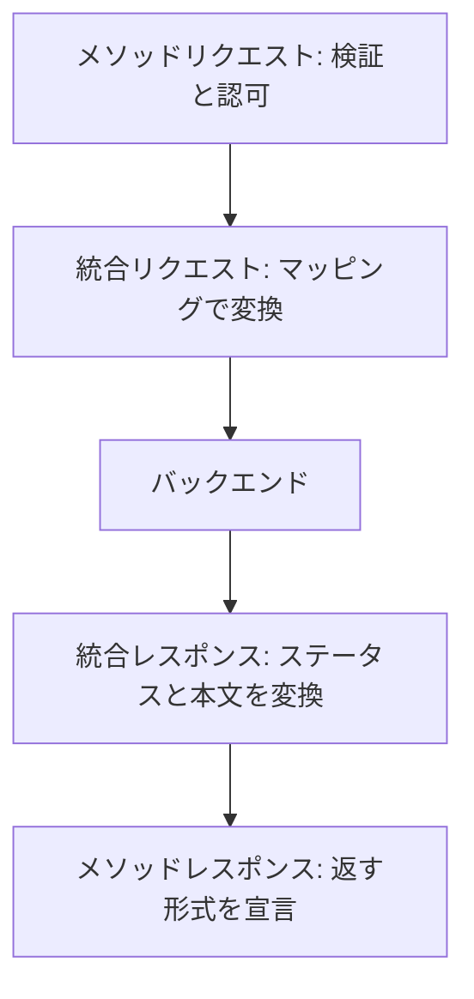
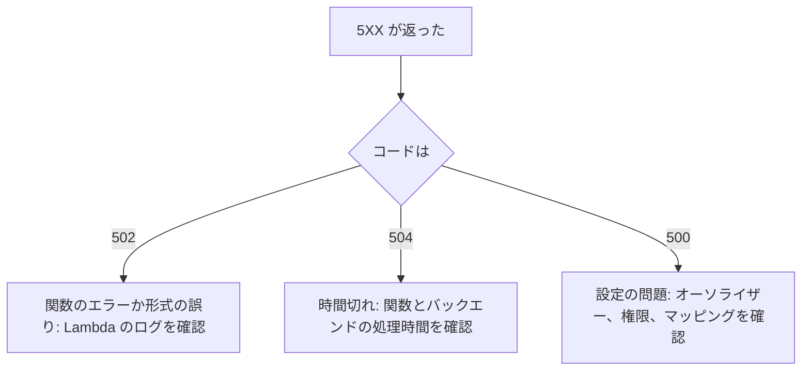

# Amazon API Gateway

HTTP や WebSocket の API を作って公開するマネージドサービス。認証、スロットリング、変換、キャッシュをまとめて扱い、Lambda や他の AWS サービスにつなぐときに使う。

[](../assets/diagrams/api-gateway-overview.png)

## API の種類 {#api-types}

| | REST API | HTTP API | WebSocket API |
| --- | --- | --- | --- |
| 通信 | リクエストとレスポンス | リクエストとレスポンス | 双方向の常時接続 |
| 特徴 | 機能が多い | 機能を絞って低価格 | サーバーからクライアントへ送れる |
| 向いている場面 | API キー、検証、キャッシュ、WAF が要る | Lambda や HTTP への単純な連携 | チャット、通知、ライブ更新 |

REST API と HTTP API の主な違いは次の通り。

| 機能 | REST API | HTTP API |
| --- | --- | --- |
| エンドポイント | エッジ最適化、リージョン、プライベート | リージョンのみ |
| API キーと使用量プラン | あり | なし |
| リクエスト検証 | あり | なし |
| 本文の変換（マッピングテンプレート） | あり | なし（パラメーターのマッピングのみ） |
| キャッシュ | あり | なし |
| モック統合 | あり | なし |
| カナリアリリース | あり | なし |
| WAF | あり | なし |
| リソースポリシー | あり | なし |
| 実行ログ、X-Ray | あり | なし |
| 認可 | IAM、Cognito、Lambda | IAM、JWT、Lambda |
| 自動デプロイ | なし | あり |
| ALB への統合 | あり | あり |
| Cloud Map への統合 | なし | あり |

HTTP API で Cognito を使うときは JWT オーソライザーを設定する。迷ったら、必要な機能が HTTP API にあるか確認し、なければ REST API を選ぶ。

### WebSocket API {#websocket}

ルートでメッセージを振り分ける。ルートの選択式（例: `${request.body.action}`）でメッセージの属性を評価する。

| ルート | 呼ばれるタイミング |
| --- | --- |
| `$connect` | 接続を開始したとき |
| `$disconnect` | クライアントかサーバーが切断したとき |
| `$default` | 選択式を評価できない、または一致するルートがないとき |
| カスタムルート | 選択式の結果が一致したとき |

バックエンドからは `@connections` API で接続先に送信する。接続時間の上限は 2 時間、アイドルタイムアウトは 10 分。フレームは 32 KB まで、メッセージは 128 KB まで。

## 統合タイプ {#integration-types}

`Integration` リソースの `type` で指定する。

| タイプ | 接続先 | 変換 |
| --- | --- | --- |
| `AWS_PROXY` | Lambda（プロキシ統合） | なし。リクエスト全体をそのまま渡す |
| `AWS` | Lambda カスタム統合、他の AWS サービス | マッピングで自分で変換する |
| `HTTP_PROXY` | HTTP エンドポイント | なし。そのまま中継する |
| `HTTP` | HTTP エンドポイント | マッピングで自分で変換する |
| `MOCK` | なし | API Gateway 自身が応答する |

AWS は、Lambda にはプロキシ統合を勧めている。設定が単純で、バックエンドの変更に追随しやすい。

### プロキシ統合 {#proxy-integration}

関数はイベントからヘッダーやパラメーターを取り出し、次の形式で返す。形式が違うと **502 Bad Gateway** になる。

```python
import json


def handler(event, context):
    name = (event.get("queryStringParameters") or {}).get("name", "world")
    return {
        "statusCode": 200,
        "headers": {
            "Content-Type": "application/json",
            "Access-Control-Allow-Origin": "*",
        },
        "body": json.dumps({"message": f"hello {name}"}),  # 文字列にする
        "isBase64Encoded": False,
    }
```

!!! warning "body は文字列"
    `body` に辞書を入れるとよくある 502 の原因になる。`json.dumps()` で文字列にする。

HTTP API はペイロード形式のバージョン（1.0 と 2.0）を選べる。2.0 は構造が単純になっている。

### 非プロキシ統合の流れ {#non-proxy-flow}



## リクエストとレスポンスの変換 {#transformations}

| 機能 | できること | スクリプト |
| --- | --- | --- |
| パラメーターマッピング | ヘッダー、クエリ文字列、パスの変更 | 不要 |
| マッピングテンプレート | 本文の変換、条件分岐 | Velocity Template Language（VTL） |

AWS は、できるならパラメーターマッピングを勧めている。本文を変えたいときや条件分岐が必要なときにマッピングテンプレートを使う。パラメーターマッピングは統合リクエストならプロキシでも使えるが、統合レスポンスには非プロキシ統合が必要。

### マッピングテンプレート {#mapping-templates}

`Content-Type` ごとにテンプレートを定義する。次の例は、クライアントの JSON を DynamoDB の `PutItem` の形に変換する。

```text
#set($body = $input.path('$'))
{
  "TableName": "orders",
  "Item": {
    "id": { "S": "$context.requestId" },
    "name": { "S": "$util.escapeJavaScript($body.name).replaceAll("\\'","'")" }
  }
}
```

`$util.escapeJavaScript` は `'` を `\'` に変換するが、`\'` は JSON として不正なので、JSON の値に使うときは `replaceAll` で戻す。

テンプレートの上限は 300 KB、`#foreach` の繰り返しは 1,000 回まで。

### テンプレートがないときの動き {#passthrough}

`passthroughBehavior` で決める。

| 値 | 動き |
| --- | --- |
| `WHEN_NO_MATCH` | 一致するテンプレートがなければ、そのまま通す |
| `WHEN_NO_TEMPLATES` | テンプレートが一つもなければ通す。定義があるのに一致しなければ 415 を返す |
| `NEVER` | 変換せずには通さない。一致しなければ 415 を返す |

### ステータスコードの上書き {#status-override}

統合が 200 を返しても、内容を見てクライアントには別のコードを返せる。`$context.responseOverride.status` をマッピングテンプレートで設定する。

```text
#set($inputRoot = $input.path('$'))
#if($inputRoot.toString().contains("error"))
  #set($context.responseOverride.status = 400)
#end
$input.json('$')
```

ヘッダーは `$context.responseOverride.header.<名前>`、リクエスト側は `$context.requestOverride` で上書きする。同じパラメーターの上書きは1回だけで、2回行うと 5XX になる。

## リクエストの検証 {#request-validation}

REST API では、リクエストをバックエンドに送る前に検証できる。失敗するとその場で **400** を返すので、不正なリクエストでバックエンドを動かさずに済む。

| 検証の対象 | 内容 |
| --- | --- |
| パラメーター | 必須のパス、クエリ、ヘッダーが存在して空でないか。型や形式は見ない |
| 本文 | メソッドの **モデル**（JSON Schema）に合っているか |

```yaml
# OpenAPI の例
x-amazon-apigateway-request-validators:
  all:
    validateRequestBody: true
    validateRequestParameters: true
x-amazon-apigateway-request-validator: all
```

エラー応答は `BAD_REQUEST_BODY` と `BAD_REQUEST_PARAMETERS` のゲートウェイレスポンスで変更できる。検証と、前述のパススルーは別の話で、一致するモデルがない場合の扱いは後者に従う。

## モック統合 {#mock-integration}

バックエンドなしで API Gateway が応答する。外部 API や別チームの API が未完成でも開発やテストを進められる。料金もバックエンド分がかからない。

統合リクエストのテンプレートで返すステータスを決め、統合レスポンスのテンプレートで本文を決める。

```json
{ "statusCode": 200 }
```

```json
{
  "orderId": "test-001",
  "status": "SHIPPED"
}
```

クエリ文字列で 200 と 500 を切り替えれば、エラーの動作も試せる。外部依存をテストで模擬する方法は [SDK と耐障害性](sdk-resilience.md) も参照する。REST API の機能で、HTTP API では使えない。

## デプロイとステージ {#stages}

**ステージ** はデプロイ（API のスナップショット）への名前付き参照で、`dev`、`test`、`prod` のように環境を分ける。URL はステージごとに変わる。

```text
https://{api-id}.execute-api.{region}.amazonaws.com/{stage}
```

- REST API は変更後に **デプロイしないと反映されない**。ルート、メソッド、統合、オーソライザーなどの変更は再デプロイが必要。
- HTTP API は自動デプロイを有効にできる。`$default` ステージならベース URL で呼べる。
- ステージごとに、スロットリング、キャッシュ、ログ、ステージ変数を設定できる。
- REST API のステージ数の上限は既定で API あたり 10。

### テスト用エンドポイントとテストイベント {#test-endpoints}

開発ではステージの URL をテストの接続先にする。テストの手段は次の通り。

| 方法 | 内容 |
| --- | --- |
| コンソールのテスト呼び出し | REST API のメソッドを試す。ログは模擬だが、バックエンドの呼び出しは本物なので、データは実際に変わる |
| `dev` ステージの URL | デプロイ後に curl や自動テストから呼ぶ |
| `sam local start-api` | ローカルで API を起動する |
| `sam local generate-event apigateway aws-proxy` | Lambda 用のテストイベントを作る |

プロキシ統合の Lambda をテストするときの JSON は次の形になる（抜粋）。

```json
{
  "resource": "/orders/{id}",
  "path": "/orders/1",
  "httpMethod": "GET",
  "headers": { "Accept": "application/json" },
  "queryStringParameters": { "detail": "true" },
  "pathParameters": { "id": "1" },
  "stageVariables": { "env": "dev" },
  "requestContext": { "stage": "dev", "requestId": "test-request" },
  "body": null,
  "isBase64Encoded": false
}
```

## ステージ変数 {#stage-variables}

ステージに紐づくキーと値で、環境変数のように使う。同じ API 定義のまま、ステージごとに接続先を変えられる。

```text
# Lambda 統合: ステージごとのエイリアスを呼ぶ
arn:aws:apigateway:{region}:lambda:path/2015-03-31/functions/arn:aws:lambda:{region}:{account}:function:my-function:${stageVariables.alias}/invocations

# HTTP 統合
https://${stageVariables.url}/orders
```

マッピングテンプレートでは `$stageVariables.env` で読める。Lambda プロキシ統合ではイベントの `stageVariables` に入るので、コードから環境を切り替えられる。

!!! warning "Lambda の権限は自動で付かない"
    ステージ変数で関数名を指定すると、API Gateway から関数を呼ぶ権限を手動で追加する必要がある。`aws lambda add-permission` で、ステージごとの関数やエイリアスに許可を与える。権限が足りないと呼び出しに失敗する。

機密情報はステージ変数に入れない。

## カナリアリリース {#canary}

ステージのトラフィックの一部を新しいデプロイに流す。REST API の機能。

| 設定 | 内容 |
| --- | --- |
| `percentTraffic` | カナリアに流す割合（0.0〜100.0） |
| `stageVariableOverrides` | カナリアだけ値を変えるステージ変数 |
| `useStageCache` | ステージのキャッシュを使うか |

カナリアのログは本番のロググループに加えて、`API-Gateway-Execution-Logs/{rest-api-id}/{stage-name}/Canary` にも出力される。問題なければカナリアを昇格して本番にし、問題があれば無効にする。

## エンドポイントタイプ {#endpoint-types}

| タイプ | 仕組み | 向いている場面 |
| --- | --- | --- |
| エッジ最適化 | 最寄りの CloudFront POP を経由する。REST API の既定 | 利用者が世界中に分散 |
| リージョン | リージョンのエンドポイントに直接つなぐ | 同じリージョンのクライアント、独自の CDN を使う場合 |
| プライベート | インターフェイス VPC エンドポイント経由でのみアクセス | VPC 内部向けの API |

プライベート API のアクセス制御にはリソースポリシーを使う。

## カスタムドメイン {#custom-domains}

既定の URL の代わりに `api.example.com` のような名前を使う。

| 項目 | エッジ最適化 | リージョン |
| --- | --- | --- |
| ACM 証明書の場所 | **`us-east-1`** | **API と同じリージョン** |
| DNS | CloudFront ディストリビューションへ | リージョンのドメイン名へ |

- 準備: [ACM](certificates.md) に証明書を用意し、カスタムドメインを作り、API マッピングでパスと API のステージを結びつけ、DNS を設定する。
- [Route 53](networking.md) ではエイリアスレコードを使える。
- パスで複数の API を分けられる（`/orders` は注文 API、`/users` はユーザー API など）。多階層のマッピングはリージョンのドメイン名で使う。
- 環境ごとにドメインを分けて、同じパスで別のステージを指す構成もできる。

## 認可 {#authorizers}

| 方式 | 仕組み | 向いている場面 |
| --- | --- | --- |
| IAM | SigV4 で署名し、IAM ポリシーの `execute-api:Invoke` で判定 | AWS の中の呼び出し、IAM ロールを持つクライアント |
| Cognito ユーザープール | `COGNITO_USER_POOLS` オーソライザーがトークンを検証 | アプリのユーザーのログイン |
| Lambda オーソライザー | 関数が IAM ポリシーを返す | 独自のトークン、外部の IdP、複雑な判定 |
| JWT（HTTP API） | OIDC や OAuth 2.0 の JWT を検証 | HTTP API と Cognito や外部 IdP |
| リソースポリシー | 送信元 IP、VPC エンドポイント、アカウントで制限 | ネットワーク制限、クロスアカウント |

### Cognito オーソライザー {#cognito-authorizer}

クライアントはログインしてトークンを取得し、通常は `Authorization` ヘッダーに入れて API を呼ぶ。

| トークン | 使われ方 |
| --- | --- |
| ID トークン | サインインしたユーザーのクレームで認可する |
| アクセストークン | リソースのカスタムスコープで認可する |

詳細は [Cognito](cognito.md) を参照する。

### Lambda オーソライザー {#lambda-authorizer}

| タイプ | 入力 | キャッシュキー |
| --- | --- | --- |
| `TOKEN` | ヘッダーの1つのトークン | トークンソースのヘッダー |
| `REQUEST` | ヘッダー、クエリ、ステージ変数、`$context` | 指定した複数のアイデンティティソース |

AWS は `REQUEST` を勧めている。複数の情報源で判定でき、キャッシュキーも細かく分けられるため。

```python
def handler(event, context):
    # 実際はトークンを検証する
    effect = "Allow" if is_valid(event["headers"].get("Authorization")) else "Deny"
    return {
        "principalId": "user-123",
        "policyDocument": {
            "Version": "2012-10-17",
            "Statement": [
                {
                    "Action": "execute-api:Invoke",
                    "Effect": effect,
                    "Resource": event["methodArn"],
                }
            ],
        },
        "context": {"tenantId": "t-1"},  # 統合に渡せる
    }
```

- ポリシーをキャッシュできる。TTL は既定 300 秒、最大 3,600 秒、0 で無効。
- キャッシュを有効にすると、そのポリシーが API の他のメソッドにも使われる。上の例の `event["methodArn"]` だけを許可すると、別のメソッドで拒否される場合がある。全メソッドに使えるポリシーを返すか、キャッシュキーを分ける。
- `REQUEST` でキャッシュを有効にすると、アイデンティティソースが欠けたリクエストは関数を呼ばずに 401 で拒否される。

### IAM 認証 {#iam-auth}

呼び出し元には次のようなポリシーを付ける。

```json
{
  "Version": "2012-10-17",
  "Statement": [
    {
      "Effect": "Allow",
      "Action": "execute-api:Invoke",
      "Resource": "arn:aws:execute-api:ap-northeast-1:111122223333:a1b2c3/prod/GET/orders/*"
    }
  ]
}
```

クロスアカウントでは、呼び出し元の IAM ポリシーに加えて、API のリソースポリシーでも許可する。署名の詳細は [IAM](iam.md) を参照する。

## 使用量プランとスロットリング {#usage-plans-throttling}

### 使用量プランと API キー {#usage-plans}

**使用量プラン** は、API キーごとに API ステージのスロットリングと上限（1日や1か月のリクエスト数）を決める。REST API の機能で、API を顧客ごとの製品として提供するときに使う。

1. API キーを作る。
2. メソッドで API キーを必須にする。
3. 使用量プランにステージとスロットリング、クォータを設定する。
4. プランに API キーを関連付ける。
5. クライアントは `X-API-Key` ヘッダーで送る。

!!! warning "API キーは認証ではない"
    API キーをアクセス制御の手段に使ってはいけない。認証には IAM、Cognito、Lambda オーソライザーを使う。スロットリングとクォータも目標値で、厳密な上限は保証されない。

### スロットリングの階層 {#throttling}

トークンバケット方式で制限する。超えると **429 Too Many Requests** が返る。適用の順序は次の通り。

1. 使用量プランのクライアントごと、メソッドごとの制限
2. ステージのメソッドごとの制限
3. アカウントのリージョンごとの制限
4. AWS のリージョン全体の制限

| 項目 | 既定値 |
| --- | --- |
| アカウントのレート | リージョンごとに 10,000 リクエスト/秒（一部のリージョンは 2,500） |
| バースト | 5,000 リクエスト（一部のリージョンは 1,250） |

この値は HTTP API、REST API、WebSocket API で共有する。429 を受けたクライアントは [バックオフして再試行](sdk-resilience.md) する。

## キャッシュ {#caching}

REST API のステージで有効にする。バックエンドの呼び出しを減らし、応答を速くする。

| 項目 | 値 |
| --- | --- |
| TTL | 既定 300 秒、最大 3,600 秒、0 で無効 |
| 既定で有効なメソッド | `GET` のみ。他はメソッドの設定で上書きする |
| キャッシュ可能な応答 | 1,048,576 バイトまで |
| 容量 | ステージごとに選ぶ。変更すると既存のキャッシュは消える |
| 暗号化 | メソッドごとに設定できる |
| 料金 | 容量と時間による。無料枠の対象外 |

確認は `CacheHitCount` と `CacheMissCount` メトリクスで行う。

### キャッシュキー（ヘッダー別のキャッシュ） {#cache-keys}

カスタムヘッダー、URL パス、クエリ文字列をキャッシュキーにできる。キーに入れなかったパラメーターは区別されないので、結果を変えるものはキーに入れる。コンソールでは対象パラメーターの **Caching** を選ぶ。

| リクエスト | キーに含めるもの |
| --- | --- |
| `GET /users?type=admin` と `?type=regular` で結果が違う | クエリ文字列 `type` |
| `Accept-Language` で言語が変わる | ヘッダー `Accept-Language` |
| `/users/{id}` | パスパラメーター `id` |

```yaml
# CloudFormation の抜粋
Integration:
  CacheKeyParameters:
    - method.request.header.Accept-Language
    - method.request.querystring.type
RequestParameters:
  method.request.header.Accept-Language: false
  method.request.querystring.type: false
```

キーを増やすほどヒット率は下がる。ユーザーごとに違う応答なら、ユーザーを区別する値をキーに含めないと、他人の応答を返してしまう。

### キャッシュの無効化 {#cache-invalidation}

クライアントは `Cache-Control: max-age=0` ヘッダーでキャッシュを無視できる。

**Require authorization** を有効にして `execute-api:InvalidateCache` を許可したクライアントだけに限定する。そうしないと、誰でもキャッシュを無効化でき、レイテンシーが悪化する。ステージのキャッシュをコンソールや API で全消去することもできる。

## CORS {#cors}

ブラウザが別オリジンの API を呼ぶときに必要。

| 統合 | 設定 |
| --- | --- |
| 非プロキシ（REST） | `OPTIONS` メソッドをモック統合で作り、`Access-Control-Allow-*` を返す。実際のメソッドのレスポンスにも `Access-Control-Allow-Origin` を追加する |
| プロキシ（REST） | `OPTIONS` に加え、**関数のレスポンス** に CORS ヘッダーを含める |
| HTTP API | API の CORS 設定を使う。API Gateway がプリフライトに自動で答え、バックエンドの CORS ヘッダーは無視する |

```text
Access-Control-Allow-Origin: https://app.example.com
Access-Control-Allow-Methods: GET,POST,OPTIONS
Access-Control-Allow-Headers: Content-Type,Authorization,X-Api-Key
```

!!! tip "エラー応答にも CORS ヘッダーを"
    4XX や 5XX のゲートウェイレスポンスに CORS ヘッダーがないと、ブラウザでは本当のエラーが見えず CORS エラーに見える。`DEFAULT_4XX` と `DEFAULT_5XX` にヘッダーを追加する。

## エラーコード {#errors}

| コード | ゲートウェイレスポンスなど | 主な原因 | 対処 |
| --- | --- | --- | --- |
| 400 | `BAD_REQUEST_BODY`、`BAD_REQUEST_PARAMETERS` | 検証の失敗 | モデルとリクエストを確認 |
| 401 | `UNAUTHORIZED` | オーソライザーで認証できない | トークン、アイデンティティソースを確認 |
| 403 | `ACCESS_DENIED` | オーソライザーやポリシーで拒否 | ポリシーを確認 |
| 403 | `MISSING_AUTHENTICATION_TOKEN` | 認証情報がない。存在しないパスやメソッドを呼んだ場合も | URL とステージ、メソッドを確認 |
| 403 | `INVALID_API_KEY` | API キーが無効 | キーと使用量プランを確認 |
| 403 | `WAF_FILTERED` | WAF がブロック | WAF のルールを確認 |
| 404 | `RESOURCE_NOT_FOUND` | リソースがない | パスを確認 |
| 413 | `REQUEST_TOO_LARGE` | ペイロードが 10 MB を超えた | S3 の署名付き URL に切り替え |
| 415 | `UNSUPPORTED_MEDIA_TYPE` | テンプレートに一致しない | `Content-Type` とパススルーを確認 |
| 429 | `THROTTLED` | スロットリング | バックオフして再試行、制限の見直し |
| 429 | `QUOTA_EXCEEDED` | 使用量プランのクォータ超過 | プランの見直し |
| 500 | `API_CONFIGURATION_ERROR`、`AUTHORIZER_FAILURE` | 設定の誤り、オーソライザーの失敗、Lambda API が呼び出しを拒否 | 設定、権限を確認 |
| 502 | なし（統合の応答） | 関数のエラー、応答の形式が不正 | ログを確認、`statusCode` と文字列の `body` を返す |
| 504 | `INTEGRATION_TIMEOUT`、`INTEGRATION_FAILURE` | 統合のタイムアウト | 処理の短縮、非同期化 |



### 主なクォータ {#quotas}

| 項目 | REST API | HTTP API |
| --- | --- | --- |
| 統合タイムアウト | 50 ミリ秒〜29 秒。リージョンとプライベートはさらに引き上げられる（アカウントのスロットリング枠が減ることがある） | 最大 30 秒 |
| ペイロード | 10 MB | 10 MB |

REST API のリソース数は API あたり 300（引き上げ可）、ステージ変数はステージあたり 100、値は 512 文字まで。

長い処理は、API では受付だけして [SQS](messaging.md) や [Step Functions](step-functions.md) に渡し、状態は別の API で確認する形にする。

## 試験のポイント {#exam-points}

| こう問われたら | 答え |
| --- | --- |
| 変更が反映されない | REST API はステージへのデプロイが必要 |
| 古い形式のクライアントと新しいバックエンドをつなぐ | 非プロキシ統合とマッピングテンプレート |
| バックエンドを呼ばずに不正リクエストを弾く | リクエストバリデーターとモデル |
| 統合の 200 を別のコードで返す | `$context.responseOverride.status` |
| バックエンドが未完成でも開発したい | モック統合 |
| dev と prod で別の Lambda を呼ぶ | ステージ変数と Lambda エイリアス、`add-permission` |
| 新しい API に一部だけ流す | カナリアリリース |
| 世界中のクライアント向け | エッジ最適化エンドポイント |
| VPC 内からだけ呼ばせる | プライベート API とインターフェイスエンドポイント |
| エッジ最適化のカスタムドメインの証明書 | `us-east-1` の ACM |
| 独自トークンで認可したい | Lambda オーソライザー |
| ユーザーのログインで認可したい | Cognito オーソライザー |
| AWS の認証情報で呼ばせる | IAM 認証（SigV4） |
| 顧客ごとに利用量を制限したい | 使用量プランと API キー |
| API キーで認証してよいか | よくない |
| 読み取りの多い API を速くしたい | ステージのキャッシュ |
| ヘッダーで応答が変わるのに同じキャッシュが返る | ヘッダーをキャッシュキーに追加 |
| 誰でもキャッシュを無効化できてしまう | `execute-api:InvalidateCache` と Require authorization |
| ブラウザで CORS エラー、プロキシ統合 | 関数のレスポンスに CORS ヘッダーを追加 |
| 502 が返る | 関数のエラーや応答形式の不正 |
| 504 が返る | 統合のタイムアウト |
| 429 が返る | スロットリング。バックオフと制限の見直し |
| サーバーからクライアントへ送りたい | WebSocket API と `@connections` |
| 安くて単純な Lambda の API | HTTP API |

## 関連ページ {#related}

- [Lambda](lambda.md)
- [Cognito](cognito.md)
- [IAM](iam.md)
- [証明書](certificates.md)
- [ネットワーク](networking.md)
- [オブザーバビリティ](observability.md)
- [CI/CD](cicd.md)

## 参考 {#references}

- [Choose between REST APIs and HTTP APIs](https://docs.aws.amazon.com/apigateway/latest/developerguide/http-api-vs-rest.html)
- [Overview of WebSocket APIs](https://docs.aws.amazon.com/apigateway/latest/developerguide/apigateway-websocket-api-overview.html)
- [Integration types](https://docs.aws.amazon.com/apigateway/latest/developerguide/api-gateway-api-integration-types.html)
- [Lambda proxy integrations](https://docs.aws.amazon.com/apigateway/latest/developerguide/set-up-lambda-proxy-integrations.html)
- [Data transformations](https://docs.aws.amazon.com/apigateway/latest/developerguide/rest-api-data-transformations.html)
- [Mapping template transformations](https://docs.aws.amazon.com/apigateway/latest/developerguide/models-mappings.html)
- [Passthrough behavior](https://docs.aws.amazon.com/apigateway/latest/developerguide/integration-passthrough-behaviors.html)
- [Overriding parameters and status codes](https://docs.aws.amazon.com/apigateway/latest/developerguide/apigateway-override-request-response-parameters.html)
- [Request validation](https://docs.aws.amazon.com/apigateway/latest/developerguide/api-gateway-method-request-validation.html)
- [Mock integrations](https://docs.aws.amazon.com/apigateway/latest/developerguide/how-to-mock-integration.html)
- [Stages](https://docs.aws.amazon.com/apigateway/latest/developerguide/set-up-stages.html)
- [Stage variables](https://docs.aws.amazon.com/apigateway/latest/developerguide/stage-variables.html)
- [Canary release](https://docs.aws.amazon.com/apigateway/latest/developerguide/canary-release.html)
- [Endpoint types](https://docs.aws.amazon.com/apigateway/latest/developerguide/api-gateway-api-endpoint-types.html)
- [Custom domain names](https://docs.aws.amazon.com/apigateway/latest/developerguide/how-to-custom-domains.html)
- [Controlling access to REST APIs](https://docs.aws.amazon.com/apigateway/latest/developerguide/apigateway-control-access-to-api.html)
- [Lambda authorizers](https://docs.aws.amazon.com/apigateway/latest/developerguide/apigateway-use-lambda-authorizer.html)
- [Cognito user pool authorizers](https://docs.aws.amazon.com/apigateway/latest/developerguide/apigateway-integrate-with-cognito.html)
- [Usage plans and API keys](https://docs.aws.amazon.com/apigateway/latest/developerguide/api-gateway-api-usage-plans.html)
- [Throttling](https://docs.aws.amazon.com/apigateway/latest/developerguide/api-gateway-request-throttling.html)
- [Caching](https://docs.aws.amazon.com/apigateway/latest/developerguide/api-gateway-caching.html)
- [CORS for REST APIs](https://docs.aws.amazon.com/apigateway/latest/developerguide/how-to-cors.html)
- [CORS for HTTP APIs](https://docs.aws.amazon.com/apigateway/latest/developerguide/http-api-cors.html)
- [Gateway response types](https://docs.aws.amazon.com/apigateway/latest/developerguide/supported-gateway-response-types.html)
- [Handling Lambda errors](https://docs.aws.amazon.com/lambda/latest/dg/services-apigateway-errors.html)
- [REST API quotas](https://docs.aws.amazon.com/apigateway/latest/developerguide/api-gateway-execution-service-limits-table.html)
- [Amazon API Gateway quotas](https://docs.aws.amazon.com/apigateway/latest/developerguide/limits.html)
