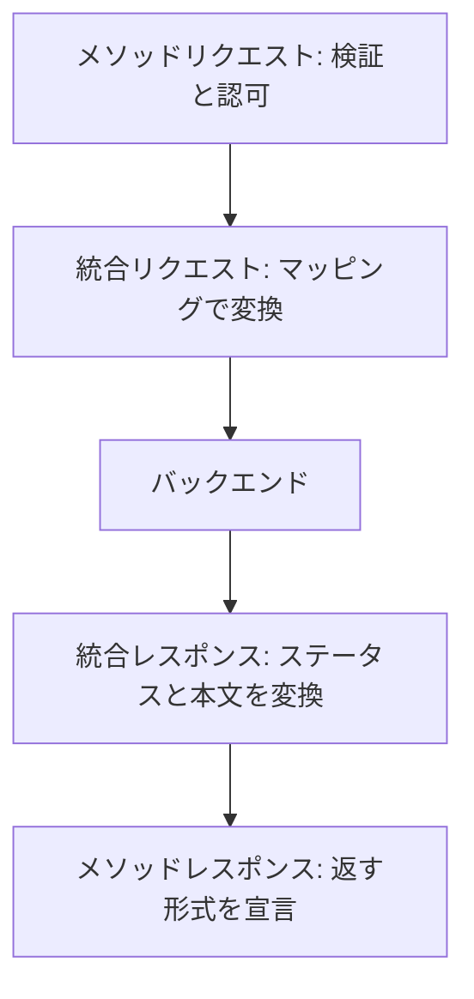
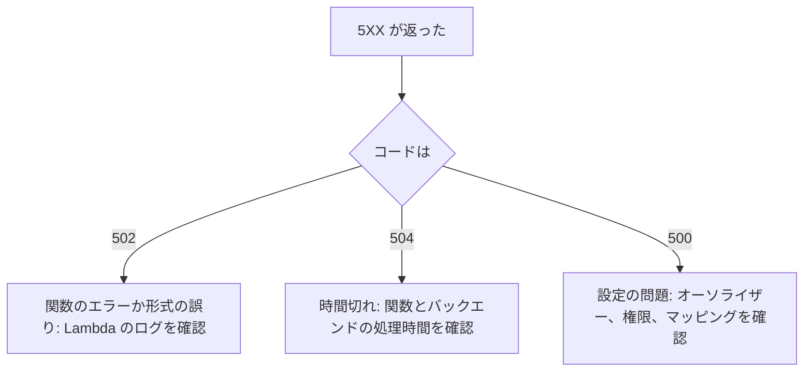

# Amazon API Gateway

[:material-sprout: CLF](../courses/clf/services.md){ .exam-badge .exam-foundational } [:material-certificate: SAA](../courses/saa/services.md){ .exam-badge .exam-associate } [:material-certificate: DVA](../courses/dva/services.md){ .exam-badge .exam-associate } [:material-certificate: DEA](../courses/dea/services.md){ .exam-badge .exam-associate } [:material-certificate: MLA](../courses/mla/services.md){ .exam-badge .exam-associate } [:material-star-circle: SAP](../courses/sap/services.md){ .exam-badge .exam-professional } [:material-star-circle: DOP](../courses/dop/services.md){ .exam-badge .exam-professional } [:material-star-circle: AIP](../courses/aip/services.md){ .exam-badge .exam-professional } [:material-target: ANS](../courses/ans/services.md){ .exam-badge .exam-specialty } [:material-target: SCS](../courses/scs/services.md){ .exam-badge .exam-specialty }

HTTP や WebSocket の API を作って公開するマネージドサービス。認証、スロットリング、変換、キャッシュをまとめて扱い、Lambda や他の AWS サービスにつなぐときに使う。

**提供単位:** リージョン。AZ は選ばない。**VPC:** 外。プライベート API は VPC エンドポイントから呼び、VPC の中のバックエンドへは VPC リンクでつなぐ（[リソースの提供単位](resource-scope.md#scope-regional-vpc)）。

[](../assets/diagrams/api-gateway-overview.png)

## API の種類 {#api-types}

| | REST API | HTTP API | WebSocket API |
| --- | --- | --- | --- |
| 通信 | リクエストとレスポンス | リクエストとレスポンス | 双方向の常時接続 |
| 特徴 | 機能が多い | 機能を絞って低価格 | サーバーからクライアントへ送れる |
| 向いている場面 | API キー、検証、キャッシュ、WAF が要る | Lambda や HTTP への単純な連携 | チャット、通知、ライブ更新 |

REST API と HTTP API の主な違いは次の通り。

| 機能 | REST API | HTTP API |
| --- | --- | --- |
| エンドポイント | エッジ最適化、リージョン、プライベート | リージョンのみ |
| API キーと使用量プラン | あり | なし |
| リクエスト検証 | あり | なし |
| 本文の変換（マッピングテンプレート） | あり | なし（パラメーターのマッピングのみ） |
| キャッシュ | あり | なし |
| モック統合 | あり | なし |
| カナリアリリース | あり | なし |
| WAF | あり | なし |
| リソースポリシー | あり | なし |
| 実行ログ、X-Ray | あり | なし |
| 認可 | IAM、Cognito、Lambda | IAM、JWT、Lambda |
| 自動デプロイ | なし | あり |
| ALB への統合 | あり | あり |
| Cloud Map への統合 | なし | あり |
| カスタムゲートウェイレスポンス | あり | なし |
| コンソールのテスト呼び出し | あり | なし |
| レスポンスストリーミング | あり | なし |
| Firehose へのアクセスログ | あり | なし |

HTTP API で Cognito を使うときは JWT オーソライザーを設定する。迷ったら、必要な機能が HTTP API にあるか確認し、なければ REST API を選ぶ。

**選び方の例:**

| 要件 | 選択 | 理由 |
| --- | --- | --- |
| Lambda を呼ぶだけで、Cognito の JWT で認可する | HTTP API | 必要な機能があり、安い |
| 顧客ごとに月 10,000 回までに制限する | REST API | 使用量プランが要る |
| 攻撃の対策で AWS WAF を直接付ける | REST API | HTTP API は WAF を付けられない |
| `GET /items` の応答を 5 分キャッシュする | REST API | HTTP API にキャッシュがない |
| チャットでサーバーから通知を送る | WebSocket API | 双方向の接続が要る |

### 種類ごとの設定の違い {#settings-by-type}

| 設定 | REST API | HTTP API | WebSocket API |
| --- | --- | --- | --- |
| 統合タイムアウト | 50 ms〜29 秒（既定 29 秒）。リージョンとプライベートは引き上げ可 | 最大 30 秒 | 50 ms〜29 秒 |
| ペイロード | 10 MB | 10 MB | フレーム 32 KB、メッセージ 128 KB |
| スロットリングの単位 | ステージ、メソッド、使用量プラン | ステージ、ルート | ステージ、ルート |
| 認可の設定先 | メソッドごと | ルートごと | `$connect` のみ |
| ログ | 実行ログとアクセスログ | アクセスログ | 実行ログとアクセスログ |
| メトリクスの 4XX 名 | `4XXError` | `4xx` | `ClientError` など別の名前 |

ステージ変数の数と長さの上限は、REST API と HTTP API で同じ（ステージあたり 100、キー 64 文字、値 512 文字）。

- **例（統合タイムアウト）:** バックエンドが 35 秒かかると、HTTP API は 30 秒で打ち切ってエラーを返す。REST API のリージョン API なら、クォータの引き上げで待てる。
- **例（ペイロード）:** 15 MB の画像を `POST` すると 413 になる。S3 の署名付き URL を返し、クライアントから S3 へ直接上げる。
- **例（メトリクス名）:** REST API のアラームを HTTP API にそのまま流用すると、`4XXError` が見つからない。HTTP API では `4xx` を指定する。

### WebSocket API {#websocket}

ルートでメッセージを振り分ける。ルートの選択式（例: `${request.body.action}`）でメッセージの属性を評価する。

| ルート | 呼ばれるタイミング |
| --- | --- |
| `$connect` | 接続を開始したとき |
| `$disconnect` | クライアントかサーバーが切断したとき |
| `$default` | 選択式を評価できない、または一致するルートがないとき |
| カスタムルート | 選択式の結果が一致したとき |

バックエンドからは `@connections` API で接続先に送信する。接続時間の上限は 2 時間、アイドルタイムアウトは 10 分。フレームは 32 KB まで、メッセージは 128 KB まで。

- **認可:** `$connect` ルートにだけ設定できる。接続時に一度だけ判定し、失敗すると 401 か 403 で接続は確立しない。
- **`$connect` の統合:** 省略できる。接続 ID を DynamoDB に保存する用途でよく使う。統合が終わるまで接続は確立しない。
- **ルート応答:** Lambda プロキシ統合の戻り値はクライアントに自動では返らない。返すならルートレスポンスを定義するか、`@connections` を使う。
- **バイナリ:** 非対応で、受け取ると 1003 で閉じる。
- **切断の例:** 10 分通信がないか 2 時間経つと、1001 で閉じる。チャットアプリなら、クライアントから定期的に ping メッセージを送り、切れたら再接続する。
- **新規接続:** アカウントのリージョンごとに毎秒 500（引き上げ可）。

- **ルート選択の例:** 選択式が `${request.body.action}` のとき、`{"action": "sendMessage", "text": "hi"}` は `sendMessage` ルートへ進む。`{"text": "hi"}` は `$default` へ進む。
- **`@connections` の例:** 接続 ID に `POST` すると、その接続へ送れる。切断済みの ID には `GoneException`（410）が返るので、DynamoDB の接続 ID を消す。

```bash
aws apigatewaymanagementapi post-to-connection \
  --endpoint-url https://a1b2c3.execute-api.ap-northeast-1.amazonaws.com/prod \
  --connection-id L0SM9cOFvHcCIhw= --data '{"text":"hello"}' --cli-binary-format raw-in-base64-out
```

- **計算例（フレーム）:** 128 KB のメッセージは、32 KB のフレームに分けると 4 つ。32 KB を超える 1 フレームは送れない。
- **計算例（同時接続）:** 同時接続数のクォータはなく、新規接続の速さと接続時間で決まる。毎秒 500 × 7,200 秒 = 最大 360 万接続。

## 統合タイプ {#integration-types}

`Integration` リソースの `type` で指定する。

| タイプ | 接続先 | 変換 |
| --- | --- | --- |
| `AWS_PROXY` | Lambda（プロキシ統合） | なし。リクエスト全体をそのまま渡す |
| `AWS` | Lambda カスタム統合、他の AWS サービス | マッピングで自分で変換する |
| `HTTP_PROXY` | HTTP エンドポイント | なし。そのまま中継する |
| `HTTP` | HTTP エンドポイント | マッピングで自分で変換する |
| `MOCK` | なし | API Gateway 自身が応答する |

AWS は、Lambda にはプロキシ統合を勧めている。設定が単純で、バックエンドの変更に追随しやすい。

- **`AWS_PROXY` の例:** `GET /orders/1` のパス、ヘッダー、クエリをすべてイベントで Lambda に渡す。関数は `statusCode` と `body` を返す。
- **`AWS` の例:** Lambda なしで SQS に送る。`POST /orders` の本文を `SendMessage` の形に変換し、IAM ロールで呼ぶ。
- **`HTTP_PROXY` の例:** `GET /v1/{proxy+}` を社外の `https://api.example.com/{proxy}` へそのまま中継する。
- **`HTTP` の例:** 古い基幹 API が XML しか受けないので、JSON をテンプレートで XML に変換して呼ぶ。
- **`MOCK` の例:** CORS の `OPTIONS` に、バックエンドを呼ばず応答する。

### 統合の共通設定 {#integration-settings}

| 設定 | 内容 | 既定と範囲 |
| --- | --- | --- |
| `timeoutInMillis` | 統合のタイムアウト | 既定 29,000、50〜29,000 ms。リージョンとプライベートは引き上げ可 |
| `credentials` | API Gateway が引き受ける IAM ロールの ARN | AWS サービス統合で使う |
| `connectionType` | `INTERNET`、`VPC_LINK` | 既定 `INTERNET` |
| `contentHandling` | `CONVERT_TO_BINARY`、`CONVERT_TO_TEXT` | 未設定なら変換しない |
| `passthroughBehavior` | テンプレートがないときの動き | [下記](#passthrough) |
| `cacheKeyParameters` | キャッシュキーのパラメーター | [下記](#cache-keys) |
| `cacheNamespace` | キャッシュをまとめる単位 | 既定はリソース ID |
| `responseTransferMode` | `BUFFERED`、`STREAM` | 既定 `BUFFERED` |

!!! note "29 秒の上限は変わった"
    古い教材では「統合タイムアウトは 29 秒が上限」とあるが、リージョン API とプライベート API では 29 秒を超えて引き上げられる。その代わり、アカウントのスロットリングの枠が減ることがある。エッジ最適化 API は 29 秒のままで、HTTP API は 30 秒が上限。

**例:** 40 秒かかる処理を REST API のリージョン API で同期のまま返すなら、クォータの引き上げを申請して `timeoutInMillis` を 45,000 にする。エッジ最適化では引き上げられないので、[SQS](messaging.md) や [Step Functions](step-functions.md) で非同期にする。

- **例（短くする）:** 通常 200 ms で返る検索なら `timeoutInMillis` を 3,000 にする。バックエンドの障害時に、クライアントを 29 秒待たせず 504 を返せる。
- **例（`credentials`）:** S3 や SQS の統合に `arn:aws:iam::111122223333:role/apigw-sqs` を指定する。ロールは `apigateway.amazonaws.com` を信頼し、`sqs:SendMessage` を許可する。指定がないと、統合の呼び出しで権限エラーになる。
- **例（`connectionType`）:** ALB が VPC の中にあるなら `VPC_LINK` にして、`connectionId` に VPC リンクの ID を入れる。`INTERNET` のままではプライベートな ALB に届かない。
- **例（`cacheNamespace`）:** `GET /items` と `GET /products` で同じ値を指定すると、同じキャッシュを共有できる。既定はリソース ID なので別々になる。

### Lambda の非同期呼び出し {#lambda-async}

Lambda 非プロキシ統合は、統合リクエストのヘッダーに `X-Amz-Invocation-Type: 'Event'` を設定すると、関数を非同期で呼ぶ。API は関数の完了を待たない。

**例:** 2 分かかるレポート作成を、ヘッダーを固定値 `'Event'` にして受け付ける。クライアントごとに選ばせるなら、`method.request.header.InvocationType` をマッピングする。

- **クライアント側の例:** `InvocationType: Event` を付けて呼ぶと非同期、`InvocationType: RequestResponse` なら同期になる。
- **誤ると:** `Event` の引用符を省くと、固定値ではなくマッピング式として解釈される。固定値は `'Event'` と書く。関数の結果は API の応答に含まれないので、結果を返す API には使えない。

### プライベート統合 {#private-integration}

VPC リンクで VPC 内のリソースへつなぐ。

| | REST API | HTTP API |
| --- | --- | --- |
| Network Load Balancer | あり | あり |
| Application Load Balancer | あり（VPC リンク V2） | あり |
| Cloud Map | なし | あり |

- HTTP API のプライベート統合では、すべて同じアカウントで所有する。
- 既定の通信は HTTP。HTTPS にするなら `tlsConfig` を指定する。
- HTTP API はパスにステージ名を含めて送る。外したいならパラメーターマッピングで上書きする。

- **VPC リンクの提供単位:** リージョンのリソース。VPC リンク V2 は、接続先の VPC のサブネットに ENI を置く（REST API の V1 は NLB につなぐ旧方式）。REST API の VPC リンクは、アカウントのリージョンごとに既定で 20 個まで。
- **例（HTTP API のパス）:** `test` ステージの `GET /orders` は、バックエンドに `/test/orders` として届く。アプリが `/orders` しか知らないと 404 になる。`overwrite:path` を `$request.path` にして外す。
- **例（`tlsConfig`）:** ALB が HTTPS で待ち受けるなら指定する。指定がないと HTTP で送るので、HTTP のリスナーがない ALB には接続できない。

### レスポンスストリーミング {#response-streaming}

`responseTransferMode` を `STREAM` にすると、完成を待たずに応答を返し始める。REST API の `HTTP_PROXY` と `AWS_PROXY` で使える。

- 10 MB を超える応答や、29 秒を超える処理を、クォータの引き上げなしで返せる。
- 最初のバイトまでの時間を短くできる。チャットの応答などに向く。
- バイナリメディアタイプの設定は要らない。

- **上限の例:** ストリーミングできるのは最大 15 分。アイドルタイムアウトはリージョンとプライベートで 5 分、エッジ最適化で 30 秒。
- **計算例（帯域）:** 最初の 10 MB には帯域の制限がなく、以降は 2 MB/秒になる。100 MB の応答なら、残り 90 MB に 45 秒かかる。
- **誤ると:** `STREAM` では、キャッシュ、API Gateway での圧縮、VTL による応答の変換が使えない。HTTP API では使えない。

### プロキシ統合 {#proxy-integration}

関数はイベントからヘッダーやパラメーターを取り出し、次の形式で返す。形式が違うと **502 Bad Gateway** になる。

```python
import json


def handler(event, context):
    name = (event.get("queryStringParameters") or {}).get("name", "world")
    return {
        "statusCode": 200,
        "headers": {
            "Content-Type": "application/json",
            "Access-Control-Allow-Origin": "*",
        },
        "body": json.dumps({"message": f"hello {name}"}),  # 文字列にする
        "isBase64Encoded": False,
    }
```

!!! warning "body は文字列"
    `body` に辞書を入れるとよくある 502 の原因になる。`json.dumps()` で文字列にする。

HTTP API はペイロード形式のバージョン（1.0 と 2.0）を選べる。CLI、CloudFormation、SDK で作るときは `payloadFormatVersion` が必須になる。

| | 1.0 | 2.0 |
| --- | --- | --- |
| 同名のヘッダーやクエリ | `multiValueHeaders`、`multiValueQueryStringParameters` | カンマで連結して `headers` などに入る |
| Cookie | ヘッダーの中 | `cookies` フィールド |
| パス | `path` | `rawPath` |
| `statusCode` なしの応答 | 不可 | 有効な JSON なら推定する |

2.0 で関数が `{"message": "ok"}` を返すと、API Gateway は `statusCode` を 200、`content-type` を `application/json`、本文をこの JSON として扱う。

**罠:** カスタムドメインの API マッピングを含むパスが必要なら 1.0 の `path` を使う。`rawPath` にはマッピングの値が入らない。

REST API の `/{proxy+}` は貪欲パスパラメーターで、配下のパスをすべて 1 つの統合で受ける。リソース数の節約にもなる。メソッドに `ANY` を指定すれば、全メソッドを受けられる。

- **`{proxy+}` の例:** `/orders/1/items` への `GET` では、`event["pathParameters"]["proxy"]` は `orders/1/items` になる。
- **`payloadFormatVersion` の例:** `?tag=a&tag=b` は、1.0 なら `multiValueQueryStringParameters` の `{"tag": ["a", "b"]}`、2.0 なら `queryStringParameters` の `{"tag": "a,b"}` になる。
- **誤ると:** 1.0 用のコードで `event["path"]` を読むと、2.0 では `KeyError` になって 500 番台のエラーを返す。2.0 では `rawPath` を読む。
- **ステータスの例:** `{"statusCode": 404, "body": "{\"error\":\"not found\"}"}` を返すと、クライアントには 404 が届く。

### 非プロキシ統合の流れ {#non-proxy-flow}



| 段階 | 主な設定 |
| --- | --- |
| メソッドリクエスト | 認可の種類、オーソライザー、`apiKeyRequired`、必須パラメーター、`requestModels`、バリデーター |
| 統合リクエスト | 統合タイプ、URI、`credentials`、マッピング、`passthroughBehavior`、タイムアウト |
| 統合レスポンス | `selectionPattern`（正規表現で選ぶ）、ステータス、ヘッダーと本文のマッピング |
| メソッドレスポンス | 返すステータスコード、ヘッダー、モデル |

- **例:** Lambda カスタム統合で `.*NotFound.*` を `selectionPattern` にした 404 の統合レスポンスを作ると、エラーメッセージがこのパターンに一致するときに 404 を返す。
- **罠:** `selectionPattern` を空にしたものは既定の応答で、他に一致しない応答をすべて受ける。
- **罠:** メソッドレスポンスで宣言していないステータスやヘッダーは、統合レスポンスからマッピングできない。プロキシ統合ではこの段階を設定しない。

- **`apiKeyRequired` の例:** `true` のメソッドにキーなしで送ると 403 になる。
- **`requestModels` の例:** `{"application/json": "OrderModel"}` で、`Content-Type` ごとにモデルを指定する。
- **必須パラメーターの例:** `method.request.querystring.limit` を必須にして、バリデーターも付けると、`limit` がないリクエストは 400 になる。

## リクエストとレスポンスの変換 {#transformations}

| 機能 | できること | スクリプト |
| --- | --- | --- |
| パラメーターマッピング | ヘッダー、クエリ文字列、パスの変更 | 不要 |
| マッピングテンプレート | 本文の変換、条件分岐 | Velocity Template Language（VTL） |

AWS は、できるならパラメーターマッピングを勧めている。本文を変えたいときや条件分岐が必要なときにマッピングテンプレートを使う。パラメーターマッピングは統合リクエストならプロキシでも使えるが、統合レスポンスには非プロキシ統合が必要。

**パラメーターマッピングの例（REST API）:** クエリ `tenant` をバックエンドのヘッダーに移す。

```yaml
RequestParameters:
  integration.request.header.x-tenant: method.request.querystring.tenant
```

`GET /orders?tenant=t1` は、バックエンドに `x-tenant: t1` のヘッダーとして届く。

### マッピングテンプレート {#mapping-templates}

`Content-Type` ごとにテンプレートを定義する。次の例は、クライアントの JSON を DynamoDB の `PutItem` の形に変換する。

```text
#set($body = $input.path('$'))
{
  "TableName": "orders",
  "Item": {
    "id": { "S": "$context.requestId" },
    "name": { "S": "$util.escapeJavaScript($body.name).replaceAll("\\'","'")" }
  }
}
```

`$util.escapeJavaScript` は `'` を `\'` に変換するが、`\'` は JSON として不正なので、JSON の値に使うときは `replaceAll` で戻す。

テンプレートの上限は 300 KB、`#foreach` の繰り返しは 1,000 回まで。

テンプレートで使う主な変数は次の通り。

| 変数 | 内容 |
| --- | --- |
| `$input.json('$')`、`$input.path('$.name')` | 本文の取得 |
| `$input.params('id')` | パス、クエリ、ヘッダーのパラメーター |
| `$context.requestId`、`$context.identity.sourceIp` | リクエストの情報 |
| `$context.authorizer.principalId` | オーソライザーの結果 |
| `$stageVariables.env` | ステージ変数 |
| `$util.escapeJavaScript()`、`$util.base64Encode()` | 変換の補助 |

本文が `{"name": "A", "items": [{"id": 1}]}`、URL が `/orders/7?detail=true` のときの値は次のようになる。

| 式 | 結果 |
| --- | --- |
| `$input.path('$.name')` | `A` |
| `$input.json('$.items')` | `[{"id":1}]`（JSON の文字列） |
| `$input.params('detail')` | `true` |
| `$input.params('id')`（パスが `/orders/{id}`） | `7` |
| `$stageVariables.env`（`dev` ステージ） | `dev` |

**誤ると:** テンプレートの結果が不正な JSON だと、バックエンドが受け付けない。`$input.path('$.name')` を引用符なしで書くと、文字列なのに引用符のない値になる。

### テンプレートがないときの動き {#passthrough}

`passthroughBehavior` で決める。

| 値 | 動き |
| --- | --- |
| `WHEN_NO_MATCH` | 一致するテンプレートがなければ、そのまま通す |
| `WHEN_NO_TEMPLATES` | テンプレートが一つもなければ通す。定義があるのに一致しなければ 415 を返す |
| `NEVER` | 変換せずには通さない。一致しなければ 415 を返す |

**具体例:** `application/json` のテンプレートだけを定義したメソッドに、`application/xml` を送った場合は次のようになる。

| 設定 | 結果 |
| --- | --- |
| `WHEN_NO_MATCH` | 変換せずにそのままバックエンドへ送る |
| `WHEN_NO_TEMPLATES` | 415 |
| `NEVER` | 415 |

`Content-Type` がないリクエストは `application/json` として扱う。AWS は `WHEN_NO_TEMPLATES` を勧めている。

**罠:** `WHEN_NO_MATCH` は、想定外の形式をそのままバックエンドに渡してしまう。

**誤ると:** テンプレートを定義したメソッドで `WHEN_NO_TEMPLATES` や `NEVER` にすると、テンプレートのない形式を送ったクライアントが 415 を受け取る。`Content-Type` の指定を確かめる。

### ステータスコードの上書き {#status-override}

統合が 200 を返しても、内容を見てクライアントには別のコードを返せる。`$context.responseOverride.status` をマッピングテンプレートで設定する。

```text
#set($inputRoot = $input.path('$'))
#if($inputRoot.toString().contains("error"))
  #set($context.responseOverride.status = 400)
#end
$input.json('$')
```

ヘッダーは `$context.responseOverride.header.<名前>`、リクエスト側は `$context.requestOverride` で上書きする。同じパラメーターの上書きは1回だけで、2回行うと 5XX になる。

- **例:** バックエンドが 200 で `{"error": "not found"}` を返すと、上のテンプレートで 400 になる。
- **例（ヘッダー）:** `#set($context.responseOverride.header.Cache-Control = "no-store")` で、応答のヘッダーを変える。

## リクエストの検証 {#request-validation}

REST API では、リクエストをバックエンドに送る前に検証できる。失敗するとその場で **400** を返すので、不正なリクエストでバックエンドを動かさずに済む。

| 検証の対象 | 内容 |
| --- | --- |
| パラメーター | 必須のパス、クエリ、ヘッダーが存在して空でないか。型や形式は見ない |
| 本文 | メソッドの **モデル**（JSON Schema）に合っているか |

```yaml
# OpenAPI の例
x-amazon-apigateway-request-validators:
  all:
    validateRequestBody: true
    validateRequestParameters: true
x-amazon-apigateway-request-validator: all
```

エラー応答は `BAD_REQUEST_BODY` と `BAD_REQUEST_PARAMETERS` のゲートウェイレスポンスで変更できる。検証と、前述のパススルーは別の話で、一致するモデルがない場合の扱いは後者に従う。

**モデル** は JSON Schema で書き、`Content-Type` ごとに `requestModels` に指定する。API あたりの合計は 400 KB まで。バリデーターは次の3種類を作る。

| バリデーター | 検査するもの |
| --- | --- |
| 本文のみ | モデル |
| パラメーターのみ | 必須のパス、クエリ、ヘッダー |
| 両方 | 上の両方 |

- **例:** `limit` を必須のクエリパラメーターにしても、`?limit=abc` は通る。パラメーターの検証は存在と空でないことしか見ない。数値かどうかはバックエンドで確認する。
- **罠:** モデルを指定しただけでは検証されない。メソッドにバリデーターも指定する。

**モデルの例:** `quantity` を 1 以上の整数で必須にする。

```json
{
  "$schema": "http://json-schema.org/draft-04/schema#",
  "type": "object",
  "required": ["quantity"],
  "properties": { "quantity": { "type": "integer", "minimum": 1 } }
}
```

| 本文 | 結果 |
| --- | --- |
| `{"quantity": 2}` | 通る |
| `{"quantity": 0}` | 400 |
| `{"quantity": "2"}` | 400（文字列） |
| `{}` | 400（必須がない） |

- **例（バリデーターの選択）:** `GET` は本文がないので「パラメーターのみ」、`POST` は「両方」にする。
- **誤ると:** 検証に通らなければ関数は動かないので、Lambda のログには何も出ない。理由は API の実行ログで確認する。

## モック統合 {#mock-integration}

バックエンドなしで API Gateway が応答する。外部 API や別チームの API が未完成でも開発やテストを進められる。料金もバックエンド分がかからない。

統合リクエストのテンプレートで返すステータスを決め、統合レスポンスのテンプレートで本文を決める。

`type` を `MOCK` にして、次の順で設定する。

1. 統合リクエストのテンプレート（`application/json`）で `{"statusCode": 200}` を返す。
2. 統合レスポンスで、そのステータスに対する本文を定義する。
3. メソッドレスポンスに同じステータスを宣言する。

**罠:** 統合リクエストのテンプレートがないか、`statusCode` を返さないと、期待した統合レスポンスが選ばれない。

```json
{ "statusCode": 200 }
```

```json
{
  "orderId": "test-001",
  "status": "SHIPPED"
}
```

クエリ文字列で 200 と 500 を切り替えれば、エラーの動作も試せる。外部依存をテストで模擬する方法は [SDK と耐障害性](sdk-resilience.md) も参照する。REST API の機能で、HTTP API では使えない。

**切り替えの例:** 統合リクエストのテンプレートを次のようにする。`?scope=internal` なら 200、それ以外なら 500 を返す。

```text
{
  #if( $input.params('scope') == "internal" )
    "statusCode": 200
  #else
    "statusCode": 500
  #end
}
```

## デプロイとステージ {#stages}

**ステージ** はデプロイ（API のスナップショット）への名前付き参照で、`dev`、`test`、`prod` のように環境を分ける。URL はステージごとに変わる。

```text
https://{api-id}.execute-api.{region}.amazonaws.com/{stage}
```

- REST API は変更後に **デプロイしないと反映されない**。ルート、メソッド、統合、オーソライザーなどの変更は再デプロイが必要。
- HTTP API は自動デプロイを有効にできる。`$default` ステージならベース URL で呼べる。
- ステージごとに、スロットリング、キャッシュ、ログ、ステージ変数を設定できる。
- REST API のステージ数の上限は既定で API あたり 10。
- デプロイは API のスナップショットで、ステージの設定以外の変更（メソッド、統合、オーソライザー、リソースポリシーなど）に再デプロイが必要になる。ステージの設定はデプロイなしで反映される。
- ステージの向き先を過去のデプロイに変えれば、ロールバックできる。
- ステージ名は英数字、ハイフン、アンダースコアで 128 文字まで。

- **例（デプロイ）:** `prod` に新しいメソッドを足したら、次のコマンドを実行する。コンソールで保存しただけでは、`prod` の URL は 403 や古い応答を返す。

```bash
aws apigateway create-deployment --rest-api-id a1b2c3 --stage-name prod
```

- **例（ロールバック）:** 問題が出たら、過去のデプロイ ID へ戻す。

```bash
aws apigateway update-stage --rest-api-id a1b2c3 --stage-name prod \
  --patch-operations op=replace,path=/deploymentId,value=abc123
```

- **例（HTTP API）:** `$default` は `https://a1b2c3.execute-api.ap-northeast-1.amazonaws.com/` で呼ぶ。`dev` なら末尾に `/dev` が付く。自動デプロイが無効なら、変更は手動のデプロイまで反映されない。

### ステージの設定 {#stage-settings}

| 設定 | API の項目 | 内容 |
| --- | --- | --- |
| キャッシュの有効化 | `cacheClusterEnabled`、`cacheClusterSize` | 容量 0.5〜237 GB |
| レートとバースト | `throttlingRateLimit`、`throttlingBurstLimit` | ステージとメソッドの制限 |
| WAF | ウェブ ACL の関連付け | REST API のみ |
| クライアント証明書 | `clientCertificateId` | バックエンドが API Gateway を認証するため |
| 実行ログ | `loggingLevel`（`OFF`、`ERROR`、`INFO`）、`dataTraceEnabled` | ログの詳細 |
| 詳細メトリクス | `metricsEnabled` | メソッドごとのメトリクス（有料） |
| X-Ray | `tracingEnabled` | トレース |
| アクセスログ | `accessLogSettings` | 送信先と形式 |
| ステージ変数 | `variables` | キーと値 |
| カナリア | `canarySettings` | 下記 |

ステージの設定は `methodSettings` でメソッドごとに上書きできる。

**設定の置き場所の例:**

```bash
aws apigateway update-stage --rest-api-id a1b2c3 --stage-name prod --patch-operations \
  op=replace,path=/cacheClusterEnabled,value=true \
  op=replace,path=/cacheClusterSize,value=0.5 \
  op=replace,path=/*/*/throttling/rateLimit,value=100 \
  op=replace,path=/*/*/throttling/burstLimit,value=200 \
  op=replace,path=/*/*/logging/loglevel,value=ERROR \
  op=replace,path=/*/*/metrics/enabled,value=true \
  op=replace,path=/tracingEnabled,value=true
```

- **例（`cacheClusterSize`）:** 1 キーあたり 10 KB で 10 万キーなら約 1 GB なので、1.6 を選ぶ。
- **例（`clientCertificateId`）:** バックエンドで API Gateway の証明書を検証すると、API Gateway を迂回した直接の呼び出しを拒否できる。
- **例（`loggingLevel`）:** 本番は `ERROR`、調査の間だけ `INFO` にする。`dataTraceEnabled` は本番では `false` のままにする。
- **例（`variables`）:** `{"alias": "prod", "env": "prod"}` のように書く。
- **誤ると（`metricsEnabled`）:** `false` のままだと、`/orders` の `POST` だけのメトリクスは見られず、API 全体の値しか出ない。

```bash
# GET /orders だけキャッシュの TTL を 60 秒にする
aws apigateway update-stage --rest-api-id a1b2c3 --stage-name prod --patch-operations \
  op=replace,path=/~1orders/GET/caching/ttlInSeconds,value=60
```

**罠:** パスの `/` は `~1` と書く。ステージの既定を変えても、上書き済みのメソッドには反映されない。

**例（`/orders/{id}` の場合）:** パスは `/~1orders~1{id}/GET/caching/ttlInSeconds` になる。

### テスト用エンドポイントとテストイベント {#test-endpoints}

開発ではステージの URL をテストの接続先にする。テストの手段は次の通り。

| 方法 | 内容 |
| --- | --- |
| コンソールのテスト呼び出し | REST API のメソッドを試す。ログは模擬だが、バックエンドの呼び出しは本物なので、データは実際に変わる |
| `dev` ステージの URL | デプロイ後に curl や自動テストから呼ぶ |
| `sam local start-api` | ローカルで API を起動する |
| `sam local generate-event apigateway aws-proxy` | Lambda 用のテストイベントを作る |

プロキシ統合の Lambda をテストするときの JSON は次の形になる（抜粋）。

```json
{
  "resource": "/orders/{id}",
  "path": "/orders/1",
  "httpMethod": "GET",
  "headers": { "Accept": "application/json" },
  "queryStringParameters": { "detail": "true" },
  "pathParameters": { "id": "1" },
  "stageVariables": { "env": "dev" },
  "requestContext": { "stage": "dev", "requestId": "test-request" },
  "body": null,
  "isBase64Encoded": false
}
```

## ステージ変数 {#stage-variables}

ステージに紐づくキーと値で、環境変数のように使う。同じ API 定義のまま、ステージごとに接続先を変えられる。

```text
# Lambda 統合: ステージごとのエイリアスを呼ぶ
arn:aws:apigateway:{region}:lambda:path/2015-03-31/functions/arn:aws:lambda:{region}:{account}:function:my-function:${stageVariables.alias}/invocations

# HTTP 統合
https://${stageVariables.url}/orders
```

マッピングテンプレートでは `$stageVariables.env` で読める。Lambda プロキシ統合ではイベントの `stageVariables` に入るので、コードから環境を切り替えられる。

!!! warning "Lambda の権限は自動で付かない"
    ステージ変数で関数名を指定すると、API Gateway から関数を呼ぶ権限を手動で追加する必要がある。`aws lambda add-permission` で、ステージごとの関数やエイリアスに許可を与える。権限が足りないと呼び出しに失敗する。

機密情報はステージ変数に入れない。

**例:** `dev` と `prod` のステージに次の値を入れると、同じ定義のまま別のエイリアスを呼ぶ。

| ステージ | `alias` | 呼ぶ関数 |
| --- | --- | --- |
| `dev` | `dev` | `my-function:dev` |
| `prod` | `prod` | `my-function:prod` |

```bash
# エイリアスごとに 1 回ずつ実行する
aws lambda add-permission --function-name my-function:prod \
  --statement-id apigw-prod --action lambda:InvokeFunction \
  --principal apigateway.amazonaws.com \
  --source-arn "arn:aws:execute-api:ap-northeast-1:111122223333:a1b2c3/*/GET/orders"
```

**誤ると:** `prod` の権限を足し忘れると、そのステージだけ 500 が返る。Lambda の `Invocations` は増えないので、関数のログにも何も出ない。
AWS は、機密情報を統合に渡すなら Lambda オーソライザーの出力を使うよう案内している。

**罠:** ステージ変数で変えられるのは接続先の名前や URL で、`HTTP_PROXY` を Lambda に変えるような統合タイプの切り替えはできない。

## カナリアリリース {#canary}

ステージのトラフィックの一部を新しいデプロイに流す。REST API の機能。

| 設定 | 内容 |
| --- | --- |
| `percentTraffic` | カナリアに流す割合（0.0〜100.0） |
| `stageVariableOverrides` | カナリアだけ値を変えるステージ変数 |
| `useStageCache` | ステージのキャッシュを使うか |

カナリアのログは本番のロググループに加えて、`API-Gateway-Execution-Logs/{rest-api-id}/{stage-name}/Canary` にも出力される。問題なければカナリアを昇格して本番にし、問題があれば無効にする。
アクセスログのロググループには `/Canary` が付く。

- **例:** `percentTraffic: 5` にし、`stageVariableOverrides` で `alias` を `canary` にすると、5% だけ新しい Lambda エイリアスを呼ぶ。問題なければ昇格する。
- **キャッシュ:** 本番とカナリアが別のデプロイなら、同じステージのキャッシュでも応答は別々に保存される。
- **罠:** カナリアが有効な間は、ステージを別のデプロイに切り替えられない。無効にして設定を外してから行う。
- **罠:** 割合は小さくランダムに振り分けるので、同じユーザーが常にカナリアに当たるわけではない。

```bash
aws apigateway create-deployment --rest-api-id a1b2c3 --stage-name prod \
  --canary-settings '{"percentTraffic":5.0,"useStageCache":false,"stageVariableOverrides":{"alias":"canary"}}'
```

- **計算例:** 1 時間に 10,000 リクエストで `percentTraffic: 5` なら、約 500 件がカナリアへ流れる。1 時間に 100 件なら約 5 件しかなく、1 件のエラーで 20% に見える。
- **例（`useStageCache`）:** `false` なら、カナリアの応答に本番のキャッシュを使わない。

## エンドポイントタイプ {#endpoint-types}

| タイプ | 仕組み | 向いている場面 |
| --- | --- | --- |
| エッジ最適化 | 最寄りの CloudFront POP を経由する。REST API の既定 | 利用者が世界中に分散 |
| リージョン | リージョンのエンドポイントに直接つなぐ | 同じリージョンのクライアント、独自の CDN を使う場合 |
| プライベート | インターフェイス VPC エンドポイント経由でのみアクセス | VPC 内部向けの API |

プライベート API のアクセス制御にはリソースポリシーを使う。

- **作成時の変更:** 既定はエッジ最適化。`endpointConfiguration` で変える。
- **ヘッダー:** エッジ最適化は HTTP ヘッダー名を先頭大文字に変え、Cookie を名前順に並べる。リージョンとプライベートはそのまま渡す。
- **独自の CDN:** 世界中の利用者向けでも、CloudFront を自分で設定したいならリージョン API を選ぶ。エッジ最適化だと AWS が管理するディストリビューションになる。
- **プライベート DNS:** VPC エンドポイントでプライベート DNS を有効にすると、`Host` ヘッダーなしで呼べるが、その VPC からパブリック API の既定のエンドポイントには届かなくなる。
- **リソースポリシー:** `aws:SourceVpc` か `aws:SourceVpce` で VPC やエンドポイントを制限する。

- **選び方の例:** 東京の API を世界中のスマホから呼ぶならエッジ最適化。東京の EC2 から呼ぶならリージョン。CloudFront に自分の WAF やキャッシュの設定を入れるならリージョンにして前に置く。社内システムの VPC の中だけならプライベート。
- **プライベート API の呼び方の例:** プライベート DNS が有効なら `https://a1b2c3.execute-api.ap-northeast-1.amazonaws.com/prod`。無効なら `https://a1b2c3-vpce-01234567abcdef012.execute-api.ap-northeast-1.amazonaws.com/prod` で呼べる。
- **リソースポリシーの例（プライベート API）:**

```json
{
  "Version": "2012-10-17",
  "Statement": [
    {
      "Effect": "Allow",
      "Principal": "*",
      "Action": "execute-api:Invoke",
      "Resource": "execute-api:/*",
      "Condition": { "StringEquals": { "aws:SourceVpce": "vpce-01234567abcdef012" } }
    }
  ]
}
```

- **誤ると:** プライベート API はリソースポリシーがないと呼べない。ポリシーを変えたら再デプロイする。VPC エンドポイントのセキュリティグループで 443 番を許可していないと、接続がタイムアウトする。

## カスタムドメイン {#custom-domains}

既定の URL の代わりに `api.example.com` のような名前を使う。

| 項目 | エッジ最適化 | リージョン |
| --- | --- | --- |
| ACM 証明書の場所 | **`us-east-1`** | **API と同じリージョン** |
| DNS | CloudFront ディストリビューションへ | リージョンのドメイン名へ |

- 準備: [ACM](certificates.md) に証明書を用意し、カスタムドメインを作り、API マッピングでパスと API のステージを結びつけ、DNS を設定する。
- [Route 53](networking.md) ではエイリアスレコードを使える。
- パスで複数の API を分けられる（`/orders` は注文 API、`/users` はユーザー API など）。多階層のマッピングはリージョンのドメイン名で使う。
- 環境ごとにドメインを分けて、同じパスで別のステージを指す構成もできる。

- **提供単位:** リージョンのカスタムドメインはリージョンのリソース。エッジ最適化は AWS 管理の CloudFront を使うので、証明書だけ `us-east-1` に置く。
- **API マッピングの例:** `api.example.com/orders` を注文 API の `prod`、`api.example.com/users` をユーザー API の `prod` につなぐ。`orders/v2` のような多階層には、リージョンのドメイン名と TLS 1.2 のセキュリティポリシーが要る。
- **DNS の例:** Route 53 の A レコード（エイリアス）で、`api.example.com` を API Gateway が発行したドメイン名へ向ける。
- **既定の URL を止める例:** カスタムドメインだけで公開するなら、`disableExecuteApiEndpoint` を `true` にする。既定の URL への呼び出しは 403 になる。
- **誤ると（証明書）:** エッジ最適化で東京の証明書は選べない。`us-east-1` に作り直すか、リージョンのカスタムドメインにする。

## 認可 {#authorizers}

| 方式 | 仕組み | 向いている場面 |
| --- | --- | --- |
| IAM | SigV4 で署名し、IAM ポリシーの `execute-api:Invoke` で判定 | AWS の中の呼び出し、IAM ロールを持つクライアント |
| Cognito ユーザープール | `COGNITO_USER_POOLS` オーソライザーがトークンを検証 | アプリのユーザーのログイン |
| Lambda オーソライザー | 関数が IAM ポリシーを返す | 独自のトークン、外部の IdP、複雑な判定 |
| JWT（HTTP API） | OIDC や OAuth 2.0 の JWT を検証 | HTTP API と Cognito や外部 IdP |
| リソースポリシー | 送信元 IP、VPC エンドポイント、アカウントで制限 | ネットワーク制限、クロスアカウント |

**選び方の例:**

| 場面 | 方式 |
| --- | --- |
| EC2 のバッチが IAM ロールで呼ぶ | IAM |
| スマホアプリのログインユーザーが呼ぶ（REST API） | Cognito ユーザープール |
| 既存の社内 SSO のトークンで、部署ごとに判定する | Lambda オーソライザー |
| 外部の IdP が発行した JWT で呼ぶ（HTTP API） | JWT |
| 社内の `203.0.113.0/24` からだけ許可する | リソースポリシー |

### Cognito オーソライザー {#cognito-authorizer}

クライアントはログインしてトークンを取得し、通常は `Authorization` ヘッダーに入れて API を呼ぶ。

| トークン | 使われ方 |
| --- | --- |
| ID トークン | サインインしたユーザーのクレームで認可する |
| アクセストークン | リソースのカスタムスコープで認可する |

詳細は [Cognito](cognito.md) を参照する。

**例:** ログインユーザーの `email` や `custom:tenant` で判定するなら ID トークン。`orders/read` のスコープで操作を分けるならアクセストークン。

### Lambda オーソライザー {#lambda-authorizer}

| タイプ | 入力 | キャッシュキー |
| --- | --- | --- |
| `TOKEN` | ヘッダーの1つのトークン | トークンソースのヘッダー |
| `REQUEST` | ヘッダー、クエリ、ステージ変数、`$context` | 指定した複数のアイデンティティソース |

AWS は `REQUEST` を勧めている。複数の情報源で判定でき、キャッシュキーも細かく分けられるため。

| 設定 | `TOKEN` | `REQUEST` |
| --- | --- | --- |
| `identitySource` | ヘッダー 1 つ（例: `method.request.header.Authorization`） | ヘッダー、クエリ、ステージ変数、`$context` の複数 |
| `identityValidationExpression` | 正規表現で事前に検証。一致しなければ関数を呼ばない | 使えない |
| `authorizerResultTtlInSeconds` | 既定 300、0〜3,600 | 同じ |
| キャッシュキー | トークンのヘッダー | すべてのアイデンティティソース |

**例:** テナント別に判定するなら、`REQUEST` のアイデンティティソースを `method.request.header.Authorization,method.request.querystring.tenant` にする。テナントが違うと別のキャッシュになる。

```python
def handler(event, context):
    # 実際はトークンを検証する
    effect = "Allow" if is_valid(event["headers"].get("Authorization")) else "Deny"
    return {
        "principalId": "user-123",
        "policyDocument": {
            "Version": "2012-10-17",
            "Statement": [
                {
                    "Action": "execute-api:Invoke",
                    "Effect": effect,
                    "Resource": event["methodArn"],
                }
            ],
        },
        "context": {"tenantId": "t-1"},  # 統合に渡せる
    }
```

- ポリシーをキャッシュできる。TTL は既定 300 秒、最大 3,600 秒、0 で無効。
- キャッシュを有効にすると、そのポリシーが API の他のメソッドにも使われる。上の例の `event["methodArn"]` だけを許可すると、別のメソッドで拒否される場合がある。全メソッドに使えるポリシーを返すか、キャッシュキーを分ける。
- `REQUEST` でキャッシュを有効にすると、アイデンティティソースが欠けたリクエストは関数を呼ばずに 401 で拒否される。
- `Deny` を返すと 403（`ACCESS_DENIED`）、未認証なら 401（`UNAUTHORIZED`）、関数の失敗や不正な応答は 500（`AUTHORIZER_FAILURE`、`AUTHORIZER_CONFIGURATION_ERROR`）になる。
- `context` の値はマッピングで `$context.authorizer.キー名` として読める。
- 応答に `usageIdentifierKey` を入れると、API キーとして使える（後述のキーソース `AUTHORIZER`）。
- キャッシュキーの部分を変えて再デプロイすると、キャッシュしたポリシーは捨てられる。

- **計算例（TTL）:** 同じトークンで毎秒 10 回呼ぶクライアントが 5 分使うと、3,000 リクエストになる。TTL 300 秒ならオーソライザーの実行は 1 回、TTL 0 なら 3,000 回で、その分だけ `Latency` も増える。
- **例（`identityValidationExpression`）:** `^Bearer [-0-9a-zA-Z._]+$` にすると、`Bearer` のないトークンは関数を呼ばずに 401 で拒否できる。
- **例（全メソッドに効くポリシー）:** キャッシュを使うなら、`Resource` を `arn:aws:execute-api:ap-northeast-1:111122223333:a1b2c3/prod/*/*` にする。

### HTTP API のオーソライザー {#http-api-authorizers}

**Lambda オーソライザー:** ペイロード形式 1.0 と 2.0 を選ぶ。2.0 で **シンプルレスポンス** を有効にすると、`{"isAuthorized": true}` のように真偽値だけを返せる。アイデンティティソースは `$request.header.Authorization` のように書き、`authorizerResultTtlInSeconds` でキャッシュする。関数の応答待ちは 10 秒まで。

**JWT オーソライザー:** `Issuer` と `Audience` を指定する。API Gateway が JWKS で署名を検証し、`exp`、`aud` などを確認する。ルートにスコープを指定すると、トークンがそのうち少なくとも 1 つを持つ必要がある。検証済みのクレームは `event.requestContext.authorizer.jwt.claims` で読める。

**例:** Cognito なら、`Issuer` を `https://cognito-idp.ap-northeast-1.amazonaws.com/<ユーザープールID>` にする。

**罠:** アクセストークンと ID トークンは標準では区別できない。ID トークンを受け入れないなら、ルートにスコープを必須にする。

**検証の項目の例:** 次のどれかに合わないトークンは拒否する。

| クレーム | 合格の条件 |
| --- | --- |
| `iss` | `Issuer` と一致 |
| `aud` または `client_id` | `Audience` のどれかと一致（最大 50 個） |
| `exp` | 現在より後 |
| `nbf`、`iat` | 現在より前 |
| `scope` または `scp` | ルートの `authorizationScopes` のどれかを含む（最大 10 個） |

```bash
aws apigatewayv2 create-authorizer --api-id a1b2c3 --name cognito-jwt \
  --authorizer-type JWT --identity-source '$request.header.Authorization' \
  --jwt-configuration Audience=my-client-id,Issuer=https://cognito-idp.ap-northeast-1.amazonaws.com/ap-northeast-1_EXAMPLE
```

- **例（Lambda のシンプルレスポンス）:** `{"isAuthorized": true, "context": {"tenant": "t1"}}` を返すと通り、`context` の値を統合で読める。`false` なら 403 になる。
- **計算例（待ち時間）:** オーソライザーの応答待ちは 10 秒まで。12 秒かかる関数は、呼び出しのたびに失敗する。
- **誤ると（アルゴリズム）:** 署名の検証に対応するのは RSA 系のアルゴリズムだけ。HS256 のトークンは通らない。

### Cognito オーソライザーの設定 {#cognito-authorizer-settings}

| 設定 | 内容 |
| --- | --- |
| `type` | `COGNITO_USER_POOLS` |
| `providerARNs` | ユーザープールの ARN |
| `identitySource` | 通常は `method.request.header.Authorization` |
| `authorizationScopes` | メソッド側で設定。あるとアクセストークンのスコープを検証する |

- **例（`providerARNs`）:** `arn:aws:cognito-idp:ap-northeast-1:111122223333:userpool/ap-northeast-1_EXAMPLE`。
- **例（`identitySource`）:** クライアントは `Authorization: <トークン>` を付ける。別のヘッダーで受けるなら `method.request.header.X-Auth-Token` に変える。
- **例（`authorizationScopes`）:** `GET /orders` を `orders/read`、`POST /orders` を `orders/write` にすると、読み取り専用のトークンでは `POST` できない。
- **誤ると:** オーソライザーを作っただけでは効かない。メソッドの認可に指定して、再デプロイする。トークンがなければ 401 になる。

### IAM 認証 {#iam-auth}

呼び出し元には次のようなポリシーを付ける。

```json
{
  "Version": "2012-10-17",
  "Statement": [
    {
      "Effect": "Allow",
      "Action": "execute-api:Invoke",
      "Resource": "arn:aws:execute-api:ap-northeast-1:111122223333:a1b2c3/prod/GET/orders/*"
    }
  ]
}
```

クロスアカウントでは、呼び出し元の IAM ポリシーに加えて、API のリソースポリシーでも許可する。署名の詳細は [IAM](iam.md) を参照する。

**`Resource` の読み方の例:** `a1b2c3/prod/GET/orders/*` は「API `a1b2c3`、ステージ `prod`、メソッド `GET`、`/orders/` の配下」を指す。

| 呼び出し | 結果 |
| --- | --- |
| `GET /prod/orders/1` | 許可 |
| `POST /prod/orders/1` | 403（メソッドが違う） |
| `GET /dev/orders/1` | 403（ステージが違う） |

**誤ると:** メソッドの認可を `AWS_IAM` にすると、署名のない呼び出しは 403（`MISSING_AUTHENTICATION_TOKEN`）になる。

### リソースポリシー {#resource-policy}

API に付ける JSON のポリシー。アカウント、送信元 IP、VPC、VPC エンドポイントで制限できる。REST API の機能で、上限は 8,192 文字。

```json
{
  "Version": "2012-10-17",
  "Statement": [
    {
      "Effect": "Deny",
      "Principal": "*",
      "Action": "execute-api:Invoke",
      "Resource": "execute-api:/*",
      "Condition": { "NotIpAddress": { "aws:SourceIp": "203.0.113.0/24" } }
    },
    {
      "Effect": "Allow",
      "Principal": "*",
      "Action": "execute-api:Invoke",
      "Resource": "execute-api:/*"
    }
  ]
}
```

- **罠:** ポリシーの変更も再デプロイしないと反映されない。
- **認証の組み合わせ:** 同じアカウントの IAM 認証では、IAM ポリシーかリソースポリシーのどちらかで許可すればよい。別のアカウントでは両方で許可する。

- **例（上のポリシー）:** `203.0.113.5` からは呼べる。`198.51.100.5` からは `Deny` に一致して 403 になる。`Deny` だけでは足りず、`Allow` の文も要る。
- **例（別のアカウント）:** `"Principal": {"AWS": "arn:aws:iam::444455556666:root"}` で許可し、相手のロールには `execute-api:Invoke` を付ける。
- **誤ると:** 許可する CIDR を書き間違えると、全員が 403 になる。ポリシーを直したら再デプロイする。

## 使用量プランとスロットリング {#usage-plans-throttling}

### 使用量プランと API キー {#usage-plans}

**使用量プラン** は、API キーごとに API ステージのスロットリングと上限（1日や1か月のリクエスト数）を決める。REST API の機能で、API を顧客ごとの製品として提供するときに使う。

1. API キーを作る。
2. メソッドで API キーを必須にする。
3. 使用量プランにステージとスロットリング、クォータを設定する。
4. プランに API キーを関連付ける。
5. クライアントは `X-API-Key` ヘッダーで送る。

使用量プランの設定は次の通り。

| 設定 | 内容 |
| --- | --- |
| `throttle.rateLimit`、`burstLimit` | キーごとのレートとバースト |
| `quota.limit`、`period` | 期間のリクエスト数。`period` は `DAY`、`WEEK`、`MONTH` |
| `quota.offset` | 最初の期間の開始時に差し引く数 |
| `apiStages` | 対象のステージ。メソッドごとの制限は 20 個まで |

API キーの値は 20〜128 文字の英数字で、名前は 1,024 文字まで。キーは複数のプランに入れられるが、ステージごとに 1 つのプランだけに関連付ける。

**API キーのソース**（`apiKeySource`）は2種類ある。

| 値 | 動き |
| --- | --- |
| `HEADER` | クライアントが `X-API-Key` ヘッダーで送る |
| `AUTHORIZER` | Lambda オーソライザーが `usageIdentifierKey` で返す |

- **例:** 無料プランを月 1,000 回、レート 5、バースト 10 にする。1,001 回目は 429（`QUOTA_EXCEEDED`）。
- **罠:** キーが無効なら 403（`INVALID_API_KEY`）で、429 ではない。
- **罠:** 同じプランの複数の API は、1 つのキーですべて呼べる。API を分けて公開したいならプランも分ける。
- **罠:** メソッドの `apiKeyRequired` を `true` にしないと、キーは検証されない。設定後は再デプロイする。

**提供単位:** 使用量プランと API キーはリージョンのリソース。キーはアカウントのリージョンごとに 10,000 個まで。

```bash
aws apigateway create-usage-plan --name free \
  --throttle burstLimit=10,rateLimit=5 \
  --quota limit=1000,offset=0,period=MONTH \
  --api-stages apiId=a1b2c3,stage=prod
aws apigateway create-usage-plan-key --usage-plan-id p1q2r3 \
  --key-id k1l2m3 --key-type API_KEY
```

- **計算例（`quota.offset`）:** `limit: 1000`、`offset: 200` なら、最初の期間に使えるのは 800 回。次の期間から 1,000 回になる。
- **例（`period`）:** 週 500 回の無料枠なら `period: WEEK`、`limit: 500`。
- **例（`apiStages` のメソッド制限）:** プラン全体がレート 50 でも、重い `POST /reports` だけレート 1 にする。
- **例（`usageIdentifierKey`）:** テナント ID で判定するオーソライザーが、テナントの API キーを返す。クライアントは `X-API-Key` を送らずに済む。
- **誤ると（`AUTHORIZER`）:** `apiKeySource` を `AUTHORIZER` にして `usageIdentifierKey` を返さないと、キーが見つからず 403 になる。

!!! warning "API キーは認証ではない"
    API キーをアクセス制御の手段に使ってはいけない。認証には IAM、Cognito、Lambda オーソライザーを使う。スロットリングとクォータも目標値で、厳密な上限は保証されない。

### スロットリングの階層 {#throttling}

トークンバケット方式で制限する。超えると **429 Too Many Requests** が返る。適用の順序は次の通り。

1. 使用量プランのクライアントごと、メソッドごとの制限
2. ステージのメソッドごとの制限
3. アカウントのリージョンごとの制限
4. AWS のリージョン全体の制限

| 項目 | 既定値 |
| --- | --- |
| アカウントのレート | リージョンごとに 10,000 リクエスト/秒（一部のリージョンは 2,500） |
| バースト | 5,000 リクエスト（一部のリージョンは 1,250） |

この値は HTTP API、REST API、WebSocket API で共有する。429 を受けたクライアントは [バックオフして再試行](sdk-resilience.md) する。

アカウントのレートは申請で引き上げられるが、バーストは AWS が決め、申請では変えられない。

**トークンバケットの例:** レート 100、バースト 200 のメソッドでは、バケットに最大 200 のトークンが溜まり、毎秒 100 ずつ補充される。静かな状態から一度に 200 件は通るが、その後は毎秒 100 件を超えた分が 429 になる。

- ステージとメソッドの値はアカウントの値を超えられない。超える値は設定しても意味がない。
- HTTP API は使用量プランがなく、`DefaultRouteSettings` と `RouteSettings` でステージとルートごとに設定する。
- どの制限も目標値なので、課金の上限には使えない。リクエストの制御には AWS WAF を、費用の監視には AWS Budgets を使う。

**階層の計算例:** 同じ API に次の制限があるとする。

| 階層 | レート |
| --- | --- |
| プランのクライアント（キー A） | 5 |
| ステージの `POST /orders` | 100 |
| アカウント | 10,000 |

キー A が毎秒 6 件送ると、5 件を超えた分が 429 になる。キーごとに 5 件のクライアントが 30 社なら、合計 150 件で、`POST /orders` の 100 を超えた分が 429 になる。

**トークンの回復の計算例:** レート 100、バースト 200 で一度に 200 件使い切ると、1 秒後のトークンは 100、2 秒後は 200 に戻る。それ以上はたまらない。

```bash
# HTTP API のステージ全体と 1 ルートの制限
aws apigatewayv2 update-stage --api-id a1b2c3 --stage-name prod \
  --default-route-settings ThrottlingRateLimit=100,ThrottlingBurstLimit=200 \
  --route-settings '{"POST /orders":{"ThrottlingRateLimit":10,"ThrottlingBurstLimit":20}}'
```

**誤ると:** あるステージの制限を外しても、同じアカウントの別の API が 10,000 RPS を使い切れば 429 になる。アカウントの枠は全 API で共有する。

## キャッシュ {#caching}

REST API のステージで有効にする。バックエンドの呼び出しを減らし、応答を速くする。

| 項目 | 値 |
| --- | --- |
| TTL | 既定 300 秒、最大 3,600 秒、0 で無効 |
| 既定で有効なメソッド | `GET` のみ。他はメソッドの設定で上書きする |
| キャッシュ可能な応答 | 1,048,576 バイトまで |
| 容量 | ステージごとに 0.5、1.6、6.1、13.5、28.4、58.2、118、237 GB から選ぶ。作成と削除に約 4 分かかる。変更すると既存のキャッシュは消える |
| 暗号化 | `cacheDataEncrypted`。メソッドごとに設定できる。暗号化でサイズが増えることがある |
| 料金 | 容量と時間による。無料枠の対象外 |

確認は `CacheHitCount` と `CacheMissCount` メトリクスで行う。

有効化は2段階になる。**Provision API cache** でキャッシュを作り、**Default method-level caching** かメソッドの上書きで対象を選ぶ。キャッシュを作っただけでは使われない。

- **例:** 商品一覧 `GET /items` を TTL 600 秒にすると、10 分に 1 回だけバックエンドが呼ばれる。価格が頻繁に変わる `GET /items/{id}/price` はメソッドの上書きで TTL を 0 にする。
- **罠:** `POST` の検索 API は既定ではキャッシュされない。必要ならメソッドの設定で有効にする。
- **罠:** 1,048,576 バイトを超える応答はキャッシュされない。
- **罠:** キャッシュはベストエフォート。確認は `X-Cache` ヘッダーではなく、メトリクスや応答のタイムスタンプで行う。
- 容量の確認には 10 分間の負荷テストが勧められている。

- **計算例（バックエンドの呼び出し）:** `GET /items` に毎秒 100 件で TTL 300 秒なら、5 分の 30,000 件のうち、バックエンドへ行くのはキーごとに 1 件。キーが 1,000 個あれば 5 分で 1,000 件、毎秒 約 3.3 件になる。
- **計算例（ヒット率）:** `CacheHitCount` 800、`CacheMissCount` 200 なら、ヒット率は 800 ÷ 1,000 = 80%。
- **例（`cacheDataEncrypted`）:** 応答に個人情報が入るメソッドだけ有効にする。
- **誤ると（TTL）:** TTL を 3,600 秒にすると、価格を変えても最大 1 時間は古い値が返る。

### キャッシュキー（ヘッダー別のキャッシュ） {#cache-keys}

カスタムヘッダー、URL パス、クエリ文字列をキャッシュキーにできる。キーに入れなかったパラメーターは区別されないので、結果を変えるものはキーに入れる。コンソールでは対象パラメーターの **Caching** を選ぶ。

| リクエスト | キーに含めるもの |
| --- | --- |
| `GET /users?type=admin` と `?type=regular` で結果が違う | クエリ文字列 `type` |
| `Accept-Language` で言語が変わる | ヘッダー `Accept-Language` |
| `/users/{id}` | パスパラメーター `id` |

```yaml
# CloudFormation の抜粋
Integration:
  CacheKeyParameters:
    - method.request.header.Accept-Language
    - method.request.querystring.type
RequestParameters:
  method.request.header.Accept-Language: false
  method.request.querystring.type: false
```

キーを増やすほどヒット率は下がる。ユーザーごとに違う応答なら、ユーザーを区別する値をキーに含めないと、他人の応答を返してしまう。

**計算例:** `type` が 2 種類、`Accept-Language` が 5 種類なら、同じパスで 2 × 5 = 10 個のエントリーになる。TTL の間に必要なバックエンド呼び出しも最大 10 回になる。

**誤ると:** `GET /me` のキーに `Authorization` を入れないと、A さんの応答が B さんに返る。個人の情報に関わるので、まずキャッシュの対象から外すことを検討する。

### キャッシュの無効化 {#cache-invalidation}

クライアントは `Cache-Control: max-age=0` ヘッダーでキャッシュを無視できる。

**Require authorization** を有効にして `execute-api:InvalidateCache` を許可したクライアントだけに限定する。そうしないと、誰でもキャッシュを無効化でき、レイテンシーが悪化する。クロスアカウントの無効化はできない。

権限のないクライアントが送ったときの動きは `unauthorizedCacheControlHeaderStrategy` で選ぶ。

| 値 | 動き |
| --- | --- |
| `FAIL_WITH_403` | 403 を返す |
| `SUCCEED_WITH_RESPONSE_HEADER` | ヘッダーを無視して処理し、応答に警告ヘッダーを付ける |
| `SUCCEED_WITHOUT_RESPONSE_HEADER` | ヘッダーを無視して処理し、警告は付けない |

```json
{
  "Version": "2012-10-17",
  "Statement": [
    {
      "Effect": "Allow",
      "Action": "execute-api:InvalidateCache",
      "Resource": "arn:aws:execute-api:ap-northeast-1:111122223333:a1b2c3/prod/GET/items"
    }
  ]
}
```

全エントリを消すなら、`flush-stage-cache` かコンソールでステージのキャッシュをフラッシュする。直後はバックエンドへのリクエストが増える。

```bash
# 1 件だけ取り直す。権限が必要
curl -H "Cache-Control: max-age=0" https://a1b2c3.execute-api.ap-northeast-1.amazonaws.com/prod/items

# ステージ全体を消す
aws apigateway flush-stage-cache --rest-api-id a1b2c3 --stage-name prod
```

- **例（ストラテジー）:** 外部公開の API なら `FAIL_WITH_403` で不正をはっきり拒否する。ブラウザが自動で `max-age=0` を送る場面でエラーにしたくないなら `SUCCEED_WITH_RESPONSE_HEADER` にする。
- **誤ると:** Require authorization を無効のままにすると、誰かが毎回 `max-age=0` を送るだけで、キャッシュを素通りしてバックエンドに負荷をかけられる。

## CORS {#cors}

ブラウザが別オリジンの API を呼ぶときに必要。

| 統合 | 設定 |
| --- | --- |
| 非プロキシ（REST） | `OPTIONS` メソッドをモック統合で作り、`Access-Control-Allow-*` を返す。実際のメソッドのレスポンスにも `Access-Control-Allow-Origin` を追加する |
| プロキシ（REST） | `OPTIONS` に加え、**関数のレスポンス** に CORS ヘッダーを含める |
| HTTP API | API の CORS 設定を使う。API Gateway がプリフライトに自動で答え、バックエンドの CORS ヘッダーは無視する |

HTTP API の設定項目は `allowOrigins`、`allowMethods`、`allowHeaders`、`exposeHeaders`、`allowCredentials`、`maxAge` の6つ。

- **例:** `allowOrigins` を `https://app.example.com` にする。`https://*` のようなワイルドカードも使える。
- **罠:** HTTP API で CORS を設定すると、バックエンドが返す CORS ヘッダーは無視される。Lambda 側を直しても変わらない。
- **罠:** HTTP API の `$default` ルートにオーソライザーを付けると、プリフライトの `OPTIONS` も認可の対象になる。認可なしの `OPTIONS /{proxy+}` ルートを追加する。
- **罠:** REST API でバイナリメディアタイプを `*/*` にしていると、`OPTIONS` の `contentHandling` を `CONVERT_TO_TEXT` にする必要がある。
- 単純なリクエスト（`GET`、`HEAD`、`POST` でカスタムヘッダーなし）にプリフライトは来ないが、応答の `Access-Control-Allow-Origin` は必要。

- **例（`allowMethods`、`allowHeaders`）:** `PUT` と `Authorization` を使うなら、`PUT` と `authorization` を両方に入れる。入れないとプリフライトで拒否される。
- **例（`exposeHeaders`）:** `x-request-id` を入れると、JavaScript からその応答ヘッダーを読める。入れないと読めない。
- **例（`maxAge`）:** 300 なら、プリフライトの結果をブラウザが 300 秒使い回し、`OPTIONS` の回数を減らせる。
- **例（`allowCredentials`）:** Cookie を送るなら `true` にして、`allowOrigins` は `https://app.example.com` のように具体的に書く。ブラウザの仕様で、資格情報付きのリクエストに `*` は使えない。

```bash
aws apigatewayv2 update-api --api-id a1b2c3 --cors-configuration \
  AllowOrigins=https://app.example.com,AllowMethods=GET,POST,AllowHeaders=authorization,MaxAge=300
```

```text
Access-Control-Allow-Origin: https://app.example.com
Access-Control-Allow-Methods: GET,POST,OPTIONS
Access-Control-Allow-Headers: Content-Type,Authorization,X-Api-Key
```

!!! tip "エラー応答にも CORS ヘッダーを"
    4XX や 5XX のゲートウェイレスポンスに CORS ヘッダーがないと、ブラウザでは本当のエラーが見えず CORS エラーに見える。`DEFAULT_4XX` と `DEFAULT_5XX` にヘッダーを追加する。

## バイナリメディア {#binary-media}

REST API は既定で本文を UTF-8 の JSON として扱う。画像などを扱うには `binaryMediaTypes`（例: `image/png`、`application/octet-stream`）を設定する。

| 統合 | 必要な設定 |
| --- | --- |
| Lambda プロキシ | `binaryMediaTypes` を設定し、関数は Base64 の本文と `isBase64Encoded: true` を返す |
| 非プロキシ | `binaryMediaTypes` と、統合と統合レスポンスの `contentHandling` |
| プロキシのストリーミング | 設定は不要 |

`contentHandling` の意味は次の通り。

| 値 | 動き |
| --- | --- |
| `CONVERT_TO_BINARY` | Base64 文字列をバイナリに戻す |
| `CONVERT_TO_TEXT` | バイナリを Base64 文字列にする |
| 未設定 | 変換しない。バイナリをそのまま通すなら、`Content-Type` の一致とパススルーの有効化も必要 |

**例:** ブラウザの `` は `Accept: image/webp,image/*,*/*;q=0.8` を送る。API Gateway は最初の `Accept` だけを見るので、JPEG を返すのに `image/jpeg` だけを登録しても Base64 のままになる。`image/webp` を登録するか、順序を制御できないなら `*/*` にする。

```bash
# path の / は ~1 と書く
aws apigateway update-rest-api --rest-api-id a1b2c3 \
  --patch-operations 'op=add,path=/binaryMediaTypes/image~1png'
aws apigateway create-deployment --rest-api-id a1b2c3 --stage-name prod
```

```python
import base64


def handler(event, context):
    with open("/tmp/a.png", "rb") as f:
        body = base64.b64encode(f.read()).decode()
    return {
        "statusCode": 200,
        "headers": {"Content-Type": "image/png"},
        "body": body,
        "isBase64Encoded": True,
    }
```

- **`CONVERT_TO_TEXT` の例:** 画像をアップロードして、非プロキシの Lambda に Base64 の文字列で渡す。
- **`CONVERT_TO_BINARY` の例:** Lambda が返した Base64 を、統合レスポンスでバイナリに戻してクライアントへ返す。
- **誤ると:** `isBase64Encoded` が `false` のままだと、ブラウザには Base64 の文字列が届き、画像として表示されない。

## ログとメトリクス {#logging-metrics}

| | 実行ログ | アクセスログ |
| --- | --- | --- |
| 内容 | 処理の流れ、エラー、トレース | 誰がどう呼んだか |
| 形式 | API Gateway が決める | `$context` 変数で自分で決める（3 KB まで） |
| ロググループ | `API-Gateway-Execution-Logs/{rest-api-id}/{stage-name}` | 自分で作成 |
| HTTP API | なし | あり |
| Firehose への送信 | なし | REST API のみ。ストリーム名は `amazon-apigateway-` で始める |

REST API の CloudWatch Logs を使うには、次の準備が必要になる。

1. `apigateway.amazonaws.com` を信頼し、`AmazonAPIGatewayPushToCloudWatchLogs` を付けた IAM ロールを作る。
2. アカウント設定の `cloudWatchRoleArn` に指定する。**リージョンごと** に行う。
3. ステージで `loggingLevel` を `ERROR` か `INFO` にする。

```text
$context.requestId $context.identity.sourceIp $context.httpMethod $context.path $context.status $context.responseLatency
```

- **罠:** ロール未設定だと、ステージでログを有効にしても書かれない。
- **罠:** `dataTraceEnabled` は本文までログに残す。機密情報が残るので、本番では使わない。

**アクセスログの設定例:** JSON にすると CloudWatch Logs Insights で検索しやすい。形式は 3 KB まで。

```bash
aws apigateway update-stage --rest-api-id a1b2c3 --stage-name prod --patch-operations \
  op=replace,path=/accessLogSettings/destinationArn,value=arn:aws:logs:ap-northeast-1:111122223333:log-group:/apigw/prod
```

`/accessLogSettings/format` には、次の JSON を 1 行にした文字列を入れる。

```json
{
  "id": "$context.requestId",
  "ip": "$context.identity.sourceIp",
  "status": "$context.status",
  "len": "$context.responseLength"
}
```

- **例（`loggingLevel`）:** `ERROR` はエラーの情報だけ、`INFO` はすべてのリクエストの処理を記録する。
- **誤ると（`cloudWatchRoleArn`）:** 東京で設定しても大阪では効かない。リージョンごとに設定する。

メトリクスの名前空間は `AWS/ApiGateway`。

| メトリクス | 意味 |
| --- | --- |
| `Count` | リクエスト数（`SampleCount` で見る） |
| `4XXError`、`5XXError` | エラー数。`Average` で見るとエラー率になる |
| `Latency` | 受信から応答までの全体 |
| `IntegrationLatency` | バックエンドとのやり取りの時間 |
| `CacheHitCount`、`CacheMissCount` | キャッシュの効果 |

**例:** `Latency` が 2,000 ms で `IntegrationLatency` が 100 ms なら、バックエンドではなく API Gateway 側の処理が遅い。オーソライザーの実行時間などを調べる。

メソッド単位のメトリクスは **詳細メトリクス**（`metricsEnabled`）を有効にしたときだけ送られ、料金がかかる。

- **計算例（エラー率）:** 1 分間に `Count` が 1,000 で `5XXError` の合計が 20 なら、エラー率は 2%。`5XXError` の `Average` は 0.02 になる。
- **例（アラーム）:** `5XXError` の `Average` が 5 分間 0.05 を超えたら通知する。件数ではなく割合で見ると、アクセスの多い時間に誤報が出にくい。
- **例（`Count`）:** リクエスト数は `SampleCount` の統計で確認する。

## エラーコード {#errors}

| コード | ゲートウェイレスポンスなど | 主な原因 | 対処 |
| --- | --- | --- | --- |
| 400 | `BAD_REQUEST_BODY`、`BAD_REQUEST_PARAMETERS` | 検証の失敗 | モデルとリクエストを確認 |
| 401 | `UNAUTHORIZED` | オーソライザーで認証できない | トークン、アイデンティティソースを確認 |
| 403 | `ACCESS_DENIED` | オーソライザーやポリシーで拒否 | ポリシーを確認 |
| 403 | `MISSING_AUTHENTICATION_TOKEN` | 認証情報がない。存在しないパスやメソッドを呼んだ場合も | URL とステージ、メソッドを確認 |
| 403 | `INVALID_API_KEY` | API キーが無効 | キーと使用量プランを確認 |
| 403 | `WAF_FILTERED` | WAF がブロック | WAF のルールを確認 |
| 403 | `EXPIRED_TOKEN`、`INVALID_SIGNATURE` | 認証情報の期限切れ、署名の誤り | クライアントの認証情報と SigV4 を確認 |
| 404 | `RESOURCE_NOT_FOUND` | リソースがない | パスを確認 |
| 413 | `REQUEST_TOO_LARGE` | ペイロードが 10 MB を超えた | S3 の署名付き URL に切り替え |
| 415 | `UNSUPPORTED_MEDIA_TYPE` | テンプレートに一致しない | `Content-Type` とパススルーを確認 |
| 429 | `THROTTLED` | スロットリング | バックオフして再試行、制限の見直し |
| 429 | `QUOTA_EXCEEDED` | 使用量プランのクォータ超過 | プランの見直し |
| 500 | `API_CONFIGURATION_ERROR`、`AUTHORIZER_FAILURE`、`AUTHORIZER_CONFIGURATION_ERROR` | 設定の誤り、オーソライザーの失敗、Lambda API が呼び出しを拒否 | 設定、権限を確認 |
| 502 | なし（統合の応答） | 関数のエラー、応答の形式が不正 | ログを確認、`statusCode` と文字列の `body` を返す |
| 504 | `INTEGRATION_TIMEOUT`、`INTEGRATION_FAILURE` | 統合のタイムアウト | 処理の短縮、非同期化 |

**症状から原因を探す例:**

| 操作 | 結果 | 原因 |
| --- | --- | --- |
| `GET /prod/order`（正しくは `/orders`） | 403 `Missing Authentication Token` | パスの間違い。認証の問題ではない |
| `POST /prod/orders` に本文 `{}` | 400 `Invalid request body` | モデルの必須項目がない |
| `Content-Type: text/plain` で `POST`（`NEVER`） | 415 | テンプレートがない形式 |
| 11 MB の本文を `POST` | 413 | ペイロードの上限 10 MB を超えた |
| 関数が `{"body": {"ok": true}}` を返す | 502 | `body` が文字列でない |
| 関数が 35 秒かかる（統合 29 秒） | 504 | 統合のタイムアウト。関数はまだ動いている場合がある |

エラーの応答はゲートウェイレスポンスで変えられる。

```yaml
# CloudFormation の例。値は単一引用符まで含めて書く
Type: AWS::ApiGateway::GatewayResponse
Properties:
  RestApiId: !Ref Api
  ResponseType: DEFAULT_4XX
  ResponseParameters:
    gatewayresponse.header.Access-Control-Allow-Origin: "'https://app.example.com'"
```



### 主なクォータ {#quotas}

| 項目 | REST API | HTTP API |
| --- | --- | --- |
| 統合タイムアウト | 50 ミリ秒〜29 秒。リージョンとプライベートはさらに引き上げられる（アカウントのスロットリング枠が減ることがある） | 最大 30 秒 |
| ペイロード | 10 MB | 10 MB |

REST API のリソース数は API あたり 300（引き上げ可）、ステージ変数はステージあたり 100、値は 512 文字まで。

**計算例（リソース数）:** 商品、注文、ユーザーなど 20 種類に、それぞれ 15 のパスがあると、20 × 15 = 300 で上限に達する。`/{proxy+}` にまとめるか、API を分けて、カスタムドメインのパスでつなぐ。

長い処理は、API では受付だけして [SQS](messaging.md) や [Step Functions](step-functions.md) に渡し、状態は別の API で確認する形にする。

## 既定値と上限のまとめ {#numbers}

| 項目 | 値 |
| --- | --- |
| 統合タイムアウト（REST） | 50 ms〜29 秒、既定 29 秒。リージョンとプライベートは引き上げ可 |
| 統合タイムアウト（HTTP） | 最大 30 秒 |
| 統合タイムアウト（WebSocket） | 50 ms〜29 秒 |
| ペイロード（REST、HTTP） | 10 MB |
| WebSocket | フレーム 32 KB、メッセージ 128 KB、接続 2 時間、アイドル 10 分 |
| アカウントのスロットリング | 10,000 RPS、バースト 5,000（一部のリージョンは 2,500 と 1,250） |
| キャッシュの TTL | 既定 300 秒、0〜3,600 秒 |
| キャッシュ容量 | 0.5〜237 GB |
| キャッシュ可能な応答 | 1,048,576 バイト |
| オーソライザーの TTL | 既定 300 秒、0〜3,600 秒 |
| 認可の結果サイズ（WebSocket） | 8 KB |
| API キーの値 | 20〜128 文字 |
| 使用量プランの期間 | `DAY`、`WEEK`、`MONTH` |
| メソッドごとの制限（プラン内） | 20 個 |
| マッピングテンプレート | 300 KB、`#foreach` 1,000 回 |
| モデル | API あたり 400 KB |
| リソースポリシー | 8,192 文字 |
| アクセスログの形式 | 3 KB |
| ステージ数 | API あたり 10 |
| ステージ変数 | 100 個、キー 64 文字、値 512 文字 |
| リソース数（REST） | 300 |
| ルート数（HTTP、WebSocket） | 300 |
| オーソライザー数 | API あたり 10 |

## 試験のポイント {#exam-points}

| こう問われたら | 答え |
| --- | --- |
| 変更が反映されない | REST API はステージへのデプロイが必要 |
| 古い形式のクライアントと新しいバックエンドをつなぐ | 非プロキシ統合とマッピングテンプレート |
| バックエンドを呼ばずに不正リクエストを弾く | リクエストバリデーターとモデル |
| 統合の 200 を別のコードで返す | `$context.responseOverride.status` |
| バックエンドが未完成でも開発したい | モック統合 |
| dev と prod で別の Lambda を呼ぶ | ステージ変数と Lambda エイリアス、`add-permission` |
| 新しい API に一部だけ流す | カナリアリリース |
| 世界中のクライアント向け | エッジ最適化エンドポイント |
| VPC 内からだけ呼ばせる | プライベート API とインターフェイスエンドポイント |
| エッジ最適化のカスタムドメインの証明書 | `us-east-1` の ACM |
| 独自トークンで認可したい | Lambda オーソライザー |
| ユーザーのログインで認可したい | Cognito オーソライザー |
| AWS の認証情報で呼ばせる | IAM 認証（SigV4） |
| 顧客ごとに利用量を制限したい | 使用量プランと API キー |
| API キーで認証してよいか | よくない |
| 読み取りの多い API を速くしたい | ステージのキャッシュ |
| ヘッダーで応答が変わるのに同じキャッシュが返る | ヘッダーをキャッシュキーに追加 |
| 誰でもキャッシュを無効化できてしまう | `execute-api:InvalidateCache` と Require authorization |
| ブラウザで CORS エラー、プロキシ統合 | 関数のレスポンスに CORS ヘッダーを追加 |
| 502 が返る | 関数のエラーや応答形式の不正 |
| 504 が返る | 統合のタイムアウト |
| 429 が返る | スロットリング。バックオフと制限の見直し |
| サーバーからクライアントへ送りたい | WebSocket API と `@connections` |
| 安くて単純な Lambda の API | HTTP API |
| 40 秒かかる同期 API（リージョン） | 統合タイムアウトの引き上げを申請、または非同期にする |
| テンプレートがない `Content-Type` で 415 | `passthroughBehavior` を確認 |
| ブラウザに画像が Base64 で届く | `binaryMediaTypes` と最初の `Accept` を確認 |
| ログが CloudWatch に出ない | `cloudWatchRoleArn` をリージョンごとに設定 |
| 本文までログに残したくない | `dataTraceEnabled` を無効に |
| `POST` がキャッシュされない | メソッドの設定で上書き |
| 権限のない無効化を弾く | `FAIL_WITH_403` |
| オーソライザーのキャッシュで別メソッドが 403 | ポリシーを全メソッドに、または TTL を 0 に |
| クライアントが API キーを送れない | キーソース `AUTHORIZER` と `usageIdentifierKey` |
| WebSocket がアイドルで切れる | 10 分以内にメッセージを送る |

## 関連ページ {#related}

- [Lambda](lambda.md)
- [Cognito](cognito.md)
- [IAM](iam.md)
- [証明書](certificates.md)
- [ネットワーク](networking.md)
- [オブザーバビリティ](observability.md)
- [CI/CD](cicd.md)

## 参考 {#references}

- [Choose between REST APIs and HTTP APIs](https://docs.aws.amazon.com/apigateway/latest/developerguide/http-api-vs-rest.html)
- [Overview of WebSocket APIs](https://docs.aws.amazon.com/apigateway/latest/developerguide/apigateway-websocket-api-overview.html)
- [Integration types](https://docs.aws.amazon.com/apigateway/latest/developerguide/api-gateway-api-integration-types.html)
- [Lambda proxy integrations](https://docs.aws.amazon.com/apigateway/latest/developerguide/set-up-lambda-proxy-integrations.html)
- [Data transformations](https://docs.aws.amazon.com/apigateway/latest/developerguide/rest-api-data-transformations.html)
- [Mapping template transformations](https://docs.aws.amazon.com/apigateway/latest/developerguide/models-mappings.html)
- [Passthrough behavior](https://docs.aws.amazon.com/apigateway/latest/developerguide/integration-passthrough-behaviors.html)
- [Overriding parameters and status codes](https://docs.aws.amazon.com/apigateway/latest/developerguide/apigateway-override-request-response-parameters.html)
- [Request validation](https://docs.aws.amazon.com/apigateway/latest/developerguide/api-gateway-method-request-validation.html)
- [Mock integrations](https://docs.aws.amazon.com/apigateway/latest/developerguide/how-to-mock-integration.html)
- [Stages](https://docs.aws.amazon.com/apigateway/latest/developerguide/set-up-stages.html)
- [Stage variables](https://docs.aws.amazon.com/apigateway/latest/developerguide/stage-variables.html)
- [Canary release](https://docs.aws.amazon.com/apigateway/latest/developerguide/canary-release.html)
- [Endpoint types](https://docs.aws.amazon.com/apigateway/latest/developerguide/api-gateway-api-endpoint-types.html)
- [Custom domain names](https://docs.aws.amazon.com/apigateway/latest/developerguide/how-to-custom-domains.html)
- [Controlling access to REST APIs](https://docs.aws.amazon.com/apigateway/latest/developerguide/apigateway-control-access-to-api.html)
- [Lambda authorizers](https://docs.aws.amazon.com/apigateway/latest/developerguide/apigateway-use-lambda-authorizer.html)
- [Cognito user pool authorizers](https://docs.aws.amazon.com/apigateway/latest/developerguide/apigateway-integrate-with-cognito.html)
- [Usage plans and API keys](https://docs.aws.amazon.com/apigateway/latest/developerguide/api-gateway-api-usage-plans.html)
- [Throttling](https://docs.aws.amazon.com/apigateway/latest/developerguide/api-gateway-request-throttling.html)
- [Caching](https://docs.aws.amazon.com/apigateway/latest/developerguide/api-gateway-caching.html)
- [CORS for REST APIs](https://docs.aws.amazon.com/apigateway/latest/developerguide/how-to-cors.html)
- [CORS for HTTP APIs](https://docs.aws.amazon.com/apigateway/latest/developerguide/http-api-cors.html)
- [Gateway response types](https://docs.aws.amazon.com/apigateway/latest/developerguide/supported-gateway-response-types.html)
- [Handling Lambda errors](https://docs.aws.amazon.com/lambda/latest/dg/services-apigateway-errors.html)
- [REST API quotas](https://docs.aws.amazon.com/apigateway/latest/developerguide/api-gateway-execution-service-limits-table.html)
- [Amazon API Gateway quotas](https://docs.aws.amazon.com/apigateway/latest/developerguide/limits.html)
- [HTTP API quotas](https://docs.aws.amazon.com/apigateway/latest/developerguide/http-api-quotas.html)
- [WebSocket API quotas](https://docs.aws.amazon.com/apigateway/latest/developerguide/apigateway-execution-service-websocket-limits-table.html)
- [Binary media types](https://docs.aws.amazon.com/apigateway/latest/developerguide/api-gateway-payload-encodings.html)
- [CloudWatch logging](https://docs.aws.amazon.com/apigateway/latest/developerguide/set-up-logging.html)
- [Dimensions and metrics](https://docs.aws.amazon.com/apigateway/latest/developerguide/api-gateway-metrics-and-dimensions.html)
- [Resource policies](https://docs.aws.amazon.com/apigateway/latest/developerguide/apigateway-resource-policies.html)
- [API key source](https://docs.aws.amazon.com/apigateway/latest/developerguide/api-gateway-api-key-source.html)
- [HTTP API Lambda authorizers](https://docs.aws.amazon.com/apigateway/latest/developerguide/http-api-lambda-authorizer.html)
- [JWT authorizers](https://docs.aws.amazon.com/apigateway/latest/developerguide/http-api-jwt-authorizer.html)
- [Response streaming](https://docs.aws.amazon.com/apigateway/latest/developerguide/response-transfer-mode.html)
- [Asynchronous Lambda invocation](https://docs.aws.amazon.com/apigateway/latest/developerguide/set-up-lambda-integration-async.html)
