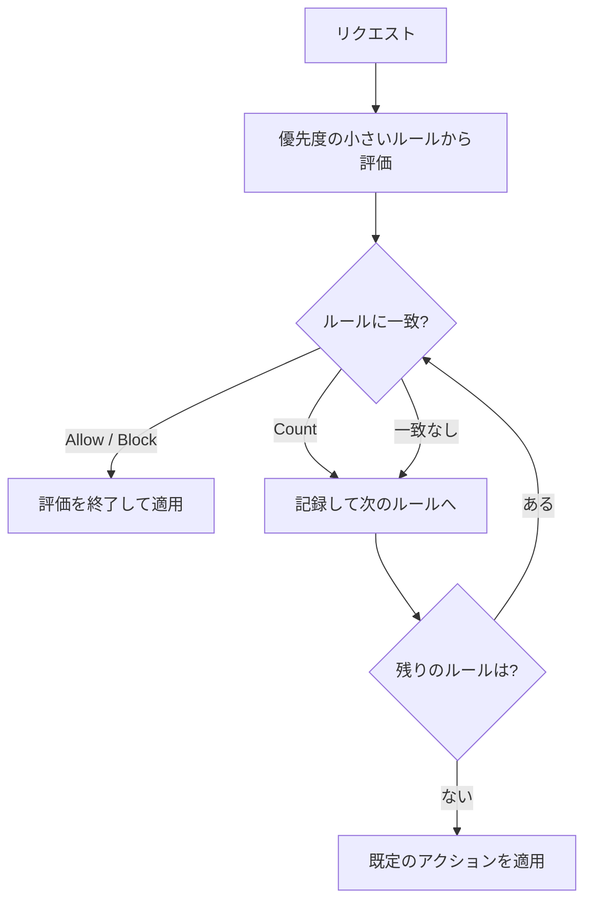

# 証明書と AWS WAF

[:material-sprout: CLF](../courses/clf/services.md){ .exam-badge .exam-foundational } [:material-certificate: SAA](../courses/saa/services.md){ .exam-badge .exam-associate } [:material-certificate: DVA](../courses/dva/services.md){ .exam-badge .exam-associate } [:material-certificate: SOA](../courses/soa/services.md){ .exam-badge .exam-associate } [:material-certificate: DEA](../courses/dea/services.md){ .exam-badge .exam-associate } [:material-star-circle: SAP](../courses/sap/services.md){ .exam-badge .exam-professional } [:material-star-circle: DOP](../courses/dop/services.md){ .exam-badge .exam-professional } [:material-star-circle: AIP](../courses/aip/services.md){ .exam-badge .exam-professional } [:material-target: ANS](../courses/ans/services.md){ .exam-badge .exam-specialty } [:material-target: SCS](../courses/scs/services.md){ .exam-badge .exam-specialty }

ACM と AWS Private CA は TLS 証明書を発行、管理するサービスで、AWS WAF は Web リクエストを検査して攻撃を防ぐサービスです。HTTPS の公開、社内向けの証明書の発行、開発用の鍵の作成、不正なリクエストの遮断といった場面で使います。

[](../assets/diagrams/certificates-tls.png)

## AWS Certificate Manager {#acm}

[:material-sprout: CLF](../courses/clf/services.md){ .exam-badge .exam-foundational } [:material-certificate: SAA](../courses/saa/services.md){ .exam-badge .exam-associate } [:material-certificate: DVA](../courses/dva/services.md){ .exam-badge .exam-associate } [:material-certificate: SOA](../courses/soa/services.md){ .exam-badge .exam-associate } [:material-star-circle: SAP](../courses/sap/services.md){ .exam-badge .exam-professional } [:material-star-circle: DOP](../courses/dop/services.md){ .exam-badge .exam-professional } [:material-target: SCS](../courses/scs/services.md){ .exam-badge .exam-specialty }

ACM は、公開証明書とプライベート証明書の発行、保存、更新を担います。統合サービスで使う限り、更新と配置を自動化できます。

**提供単位:** ACM の証明書はリージョンのリソースで、VPC の外にあります（[提供単位の一覧](resource-scope.md#scope-regional-outside)）。使うリソースと同じリージョンに作り、CloudFront 用は `us-east-1` に作ります。

| 観点 | 公開証明書 | プライベート証明書 |
| --- | --- | --- |
| 発行元 | Amazon の公開 CA | AWS Private CA のプライベート CA |
| 信頼される範囲 | ブラウザなど一般のクライアント | CA を信頼するよう設定したクライアントのみ |
| 所有権の確認 | ドメインの検証が必要 | 不要 |
| 用途 | 公開 Web サイト、公開 API | 社内サービス、サービス間通信 |
| 料金 | 統合サービスで使う証明書は追加料金なし（エクスポート可能な証明書と ACME の証明書は有料） | Private CA の料金がかかる |

- **公開証明書の例:** `www.example.com` を ALB で公開する。ブラウザは Amazon の CA を信頼しているので警告が出ない。
- **プライベート証明書の例:** 社内の `api.internal.example.com` を ALB で公開する。社員の PC と社内の API クライアントに、ルート CA を信頼させる。
- **誤ると:** プライベート証明書を一般向けのサイトに付けると、利用者のブラウザが CA を信頼しないので `NET::ERR_CERT_AUTHORITY_INVALID` のような警告が出る。

### ドメイン検証 {#domain-validation}

| 方式 | 手順 | 更新 |
| --- | --- | --- |
| DNS 検証（推奨） | ACM が示す CNAME レコードを DNS に追加 | レコードを残していれば自動 |
| メール検証 | ドメインの管理者にメールで承認を依頼 | メールでの承認が必要な場合がある |
| HTTP 検証 | ACM が示す URL へのリダイレクトを設定。CloudFront の Distribution Tenants でのみ利用可 | 自動 |

DNS 検証のポイントは次のとおりです。

- CNAME は 1 回追加すれば済み、削除すると自動更新が止まる。
- Route 53 ならコンソールから簡単にレコードを追加できる。
- 同じ CNAME が使えるので、別のリージョンでも再検証なしで同じドメインの証明書を作れる。
- メール検証で作った証明書は DNS 検証に切り替えられない。作り直す。

```bash
aws acm request-certificate \
  --domain-name example.com \
  --subject-alternative-names "*.example.com" \
  --validation-method DNS \
  --region us-east-1
```

ワイルドカードは一番左にだけ置け、1 階層だけを保護します。`*.example.com` は `www.example.com` を保護しますが、`a.www.example.com` や `example.com` 自体は保護しません。1 枚の証明書に入れられるドメインは既定で 10 個で、申請すると増やせます。

- **`--domain-name` と `--subject-alternative-names` の例:** 上のコマンドで `example.com` と `www.example.com` の両方が保護される。11 個のドメイン名を 1 枚に入れるには、既定の 10 個を超えるので引き上げを申請するか、ワイルドカードにまとめる。
- **例:** `*.example.com` と `example.com` の 2 つを申請しても、CNAME は `example.com` に対して同じ 1 組になることがある。ACM が示したレコードをそのまま追加する。
- **誤ると:** `*.*.example.com` は申請できない。`a.www.example.com` を守りたいなら `*.www.example.com` を足す。
- **誤ると:** Pending validation のまま 72 時間が過ぎると、検証はタイムアウトし、証明書は発行されない。同じ設定で要求し直す。

### 自動更新 {#auto-renewal}

ACM の公開証明書の有効期間は 198 日で、期限の 45 日前から更新を確認します。以前に発行された有効期間 395 日の証明書は、期限の 60 日前に更新され、更新後は 198 日になります。

| 証明書 | 自動更新 |
| --- | --- |
| 統合サービスに関連付けた Amazon 発行の証明書 | 対象 |
| エクスポート済みの Amazon 発行の証明書 | 対象 |
| ACM で要求し、関連付けまたはエクスポートしたプライベート証明書 | 対象 |
| Private CA の `IssueCertificate` API で発行した証明書 | 対象外 |
| インポートした証明書 | 対象外 |
| 期限切れの証明書 | 対象外 |

DNS 検証のものは自動で更新され、メール検証のものは更新の案内がメールで届きます。

- **計算の例:** 2026 年 1 月 1 日に発行した公開証明書は、198 日後の 7 月 18 日に切れる。45 日前の 6 月 3 日ごろから更新を確認する。ARN は変わらない。
- **誤ると:** CNAME を消したあとは、次の更新のときに検証できず、期限の日に HTTPS のエラーで全利用者に影響する。
- **誤ると:** ALB から外した証明書は「使っていない」ので自動更新されない。同じドメインで付け直す予定があるなら、期限を確認する。

### リージョンのルール {#region-rules}

ACM の証明書はリージョンのリソースです。リージョン間でコピーできないので、必要なリージョンごとに作ります。

| サービス | 証明書を置くリージョン |
| --- | --- |
| CloudFront | `us-east-1`（バージニア北部）のみ |
| API Gateway のエッジ最適化カスタムドメイン | `us-east-1`（内部で CloudFront を使用） |
| API Gateway のリージョナルカスタムドメイン | API と同じリージョン |
| ALB、NLB | ロードバランサーと同じリージョン |
| Elastic Beanstalk | 環境のロードバランサーと同じリージョン |

!!! tip "CloudFront の証明書が選択肢に出ない"
    多くの場合、証明書を `us-east-1` 以外で作っています。東京リージョンで動くアプリでも、CloudFront 用の証明書は `us-east-1` に作ります。

- **例:** 東京の ALB、東京の API（リージョナル）、CloudFront の 3 つで `www.example.com` を使うなら、証明書は東京に 1 枚、`us-east-1` に 1 枚の計 2 枚を作る。同じ CNAME で検証できる。
- **誤ると:** CloudFront の前に ALB を置き、両方を同じドメインにするときに、東京の証明書だけを作ると CloudFront に設定できない。

### 統合サービス {#integrated-services}

ACM と統合している主なサービスは次のとおりです。

- Elastic Load Balancing
- Amazon CloudFront
- Amazon API Gateway
- AWS Elastic Beanstalk
- AWS Amplify
- Amazon Cognito（カスタムドメイン）
- AWS App Runner
- Amazon OpenSearch Service
- AWS Network Firewall
- AWS Nitro Enclaves
- AWS CloudFormation（証明書をリソースとして定義）

EC2 上のサーバーに直接置くには、エクスポート可能な公開証明書か、ACME プロトコルを使います。

- **エクスポート可能な公開証明書**: 要求時に有効にする。2025 年 6 月 17 日より前に作った証明書はエクスポートできない。
- **ACME**: Web サーバー上で発行と更新を自動化する。ACM のマネージド更新の対象外で、ACME クライアントが更新を担う。

ただし、一般的には EC2 の前に ALB や CloudFront を置いて、そこに証明書を設定するほうが簡単です。

- **ALB の例:** HTTPS リスナーの `Certificates` に証明書の ARN を指定する。
- **EC2 の例:** nginx が使う `fullchain.pem` と `privkey.pem` をエクスポート可能な公開証明書から取り出す。更新されたら再度エクスポートして配置し直す。
- **誤ると:** 通常の公開証明書は秘密鍵を取り出せない。`ExportCertificate` が拒否される。

### 証明書のインポート {#import}

他の CA が発行した証明書は ACM にインポートできます。

```bash
aws acm import-certificate \
  --certificate fileb://cert.pem \
  --private-key fileb://key.pem \
  --certificate-chain fileb://chain.pem
```

- ACM は自動更新しないので、新しい証明書を取得して再インポートする。ARN と関連付けは維持される。
- 期限の管理は自分の責任。EventBridge で期限切れが近いイベントを受け取り、通知する。
- 同じリージョンのルールが適用される。CloudFront 用は `us-east-1` にインポートする。
- **例:** 2027 年 3 月 31 日に切れる証明書をインポートすると、インポートした証明書は 45 日前の 2 月 14 日から毎日 `ACM Certificate Approaching Expiration` が届く。
- **誤ると:** 再インポートを `--certificate-arn` なしで実行すると、新しい ARN の別の証明書になり、ALB は古い証明書を使い続ける。

## AWS Private CA {#private-ca}

[:material-certificate: DVA](../courses/dva/services.md){ .exam-badge .exam-associate } [:material-target: SCS](../courses/scs/services.md){ .exam-badge .exam-specialty }

ルート CA と下位 CA からなるプライベート CA の階層を、自前の設備なしで運用するサービスです。

**提供単位:** プライベート CA はリージョンのリソースで、VPC の外にあります。

| 用途 | 例 |
| --- | --- |
| 社内の TLS | 内部 API、内部 ALB |
| クライアント、デバイスの認証 | mTLS、IoT デバイス |
| コード署名 | 内部のソフトウェアの署名 |
| 失効の確認 | OCSP |

証明書の発行の方法で、管理のしかたが変わります。

| 発行の方法 | 使える場所 | 自動更新 |
| --- | --- | --- |
| ACM で要求（`--certificate-authority-arn`） | ACM の統合サービス。エクスポートすれば他でも可 | 対象 |
| Private CA の API（`IssueCertificate`） | どこでも | 対象外。自分で管理 |

```bash
aws acm request-certificate \
  --domain-name api.internal.example.com \
  --certificate-authority-arn arn:aws:acm-pca:ap-northeast-1:111122223333:certificate-authority/EXAMPLE
```

プライベート CA はリージョンのリソースで、リージョン間でコピーできません。クライアント側には、ルート CA 証明書を信頼するよう設定します。

- **ACM で要求する例:** 上のコマンドで作ると、ALB に付けられ、自動で更新される。
- **`IssueCertificate` の例:** mTLS のクライアントに配る証明書を 90 日の有効期間で発行する。更新の仕組みは自分で作る。
- **誤ると:** 自前で更新を作らずに `IssueCertificate` の証明書を使うと、期限の日に通信が止まる。
- **誤ると:** クライアントがルート CA を信頼していないと、TLS のハンドシェイクで `unable to get local issuer certificate` のようなエラーになる。

## 開発用の証明書と SSH キーの生成 {#dev-certs-ssh}

開発やテストでは、CA を使わずに自分で作れます。本番の公開サイトには使いません。

| 用途 | ツール |
| --- | --- |
| ローカルの HTTPS、テスト環境の TLS | `openssl` の自己署名証明書 |
| EC2 への SSH | EC2 キーペア、`ssh-keygen` |
| 内部で信頼する証明書を本格的に発行 | AWS Private CA |
| SSH キーの管理を避ける | Systems Manager Session Manager |

### 自己署名証明書 {#self-signed}

```bash
# 秘密鍵と自己署名証明書を 1 回で作る
openssl req -x509 -newkey rsa:2048 -nodes -sha256 -days 90 \
  -keyout key.pem -out cert.pem \
  -subj "/CN=localhost" \
  -addext "subjectAltName=DNS:localhost,IP:127.0.0.1"

# 内容の確認
openssl x509 -in cert.pem -noout -subject -dates -ext subjectAltName
```

CA に署名を依頼する場合は、CSR を作ります。

```bash
openssl req -new -newkey rsa:2048 -nodes \
  -keyout server.key -out server.csr \
  -subj "/CN=dev.example.com"
```

- 自己署名証明書はクライアントから信頼されないので、ブラウザに警告が出る。
- 秘密鍵をリポジトリにコミットしない。`.gitignore` に入れ、必要なら [Secrets Manager](secrets.md) に置く。
- ALB でテストするには、ACM にインポートする。自動更新はされない。
- **例:** 上の `-days 90` は 90 日。91 日目にローカルのアプリがブラウザで期限切れの警告を出す。
- **例:** `-nodes` は秘密鍵を暗号化しない指定。CI で使うならこのままで、持ち運ぶならパスフレーズを付ける。ACM にはパスフレーズなしの鍵しかインポートできない。
- **誤ると:** `subjectAltName` を省くと、現代のブラウザは CN だけでは名前を確認しないので、`localhost` でも一致しないと表示される。

### SSH キーと EC2 キーペア {#ssh-keys}

EC2 キーペアでは、公開鍵を EC2 が持ち、秘密鍵は自分で保管します。AWS は秘密鍵を保存しないので、なくすと取り戻せません。

- **例:** キーペアはリージョンのリソース。東京で作った `dev-key` は大阪では選べない。同じ公開鍵を大阪にも `import-key-pair` すれば、同じ秘密鍵で入れる。

| キーの種類 | Linux | Windows |
| --- | --- | --- |
| RSA 2048 ビット | 可 | 可 |
| ED25519 | 可 | 不可 |

AWS に作らせる方法です。秘密鍵はこの応答でしか得られません。

```bash
aws ec2 create-key-pair \
  --key-name dev-key \
  --key-type ed25519 \
  --query 'KeyMaterial' \
  --output text > dev-key.pem

chmod 400 dev-key.pem
ssh -i dev-key.pem ec2-user@<public-dns>
```

手元で作って公開鍵だけを登録する方法です。秘密鍵が AWS を通らないので、より安全です。

```bash
ssh-keygen -t ed25519 -f ~/.ssh/aws-dev -C "dev"

aws ec2 import-key-pair \
  --key-name aws-dev \
  --public-key-material fileb://~/.ssh/aws-dev.pub
```

| 症状 | 原因と対処 |
| --- | --- |
| `UNPROTECTED PRIVATE KEY FILE` | 秘密鍵の権限が広い。`chmod 400` にする |
| 秘密鍵をなくした | 取り戻せない。新しい公開鍵をインスタンスに追加する、または Session Manager で入る |
| Windows のパスワードが読めない | 秘密鍵で管理者パスワードを復号する |

- **`--key-type` の例:** Linux なら `ed25519`、Windows なら `rsa`。`ed25519` のキーペアは Windows インスタンスに指定できない。
- **`ssh-keygen -C` の例:** `-C "dev"` は公開鍵の末尾のコメント。誰の鍵かを示す。
- **誤ると:** `ssh -i dev-key.pem root@...` では入れない。Amazon Linux のユーザーは `ec2-user`。

## 転送時の TLS {#tls-in-transit}

TLS の終端の場所を決めるのが設計の中心です。

| 区間 | 設定 | 証明書 |
| --- | --- | --- |
| 利用者から CloudFront | ビューワープロトコルポリシー（HTTPS にリダイレクトなど） | ACM（`us-east-1`） |
| CloudFront からオリジン | オリジンプロトコルポリシー | オリジンの証明書 |
| 利用者から ALB | HTTPS リスナーとセキュリティポリシー | ACM（同じリージョン） |
| ALB からターゲット | ターゲットグループの HTTPS | 自己署名でも可 |
| 利用者から API Gateway | カスタムドメインに証明書を設定 | エッジ最適化なら `us-east-1` |
| アプリから RDS | TLS で接続 | RDS の CA を信頼 |

データの暗号化の全体は [KMS](kms.md) を参照してください。

- **例:** CloudFront のビューワープロトコルポリシーを `redirect-to-https` にすると、`http://` のリクエストは 301 で `https://` に転送される。
- **例:** ALB から EC2 の間を HTTPS にするとき、ターゲットの証明書は検証されないので、自己署名でも通る。
- **誤ると:** CloudFront のオリジンプロトコルを `https-only` にして、オリジンに自己署名の証明書を置くと、CloudFront は `502` を返す。オリジンには信頼された CA の証明書が要る。

### 相互 TLS（mTLS） {#mtls}

サーバーだけでなく、クライアントも証明書で認証します。API Gateway のカスタムドメインでは、次のように設定します。

1. クライアント証明書を信頼する CA のトラストストアを S3 に置く。
2. カスタムドメインで mutual TLS を有効にする。
3. 既定の `execute-api` エンドポイントを無効にし、迂回を防ぐ。

クライアント証明書の発行には、AWS Private CA を使えます。

- **例:** トラストストアを `s3://my-trust/truststore.pem` に置き、`aws apigateway create-domain-name --domain-name api.example.com --mutual-tls-authentication truststoreUri=s3://my-trust/truststore.pem` のように指定する。
- **誤ると:** `execute-api` のエンドポイントを残すと、そちらから mTLS なしで呼べてしまう。

## AWS WAF {#waf}

[:material-sprout: CLF](../courses/clf/services.md){ .exam-badge .exam-foundational } [:material-certificate: SAA](../courses/saa/services.md){ .exam-badge .exam-associate } [:material-certificate: DVA](../courses/dva/services.md){ .exam-badge .exam-associate } [:material-certificate: SOA](../courses/soa/services.md){ .exam-badge .exam-associate } [:material-certificate: DEA](../courses/dea/services.md){ .exam-badge .exam-associate } [:material-star-circle: SAP](../courses/sap/services.md){ .exam-badge .exam-professional } [:material-star-circle: DOP](../courses/dop/services.md){ .exam-badge .exam-professional } [:material-star-circle: AIP](../courses/aip/services.md){ .exam-badge .exam-professional } [:material-target: ANS](../courses/ans/services.md){ .exam-badge .exam-specialty } [:material-target: SCS](../courses/scs/services.md){ .exam-badge .exam-specialty }

HTTP(S) リクエストを検査して、許可、ブロック、カウントなどを行うファイアウォールです。ウェブ ACL は、現在のコンソールでは protection pack とも呼ばれます。

**提供単位:** ウェブ ACL は、CloudFront 用がグローバルで `us-east-1` に作り、それ以外はリージョンごとに作ります。どちらも VPC の外にあります（[提供単位の一覧](resource-scope.md#scope-global)）。

### アタッチできる場所 {#waf-resources}

| スコープ | リソース | 作成先 |
| --- | --- | --- |
| グローバル | CloudFront ディストリビューション | `us-east-1` |
| リージョナル | ALB | リソースと同じリージョン |
| リージョナル | API Gateway の REST API | 同上 |
| リージョナル | AppSync GraphQL API | 同上 |
| リージョナル | Cognito ユーザープール | 同上 |
| リージョナル | App Runner、Amplify、Verified Access、Bedrock AgentCore Gateway | 同上 |

対応一覧に、NLB、API Gateway の HTTP API、EC2 のインスタンスはありません。保護するには、前に CloudFront や ALB を置きます。

- **例:** HTTP API を守るなら、前に CloudFront を置いて、CloudFront のウェブ ACL で検査する。ALB の後ろの EC2 なら、ALB に付ければ足りる。
- **誤ると:** 東京の ALB に付けるウェブ ACL を `CLOUDFRONT` スコープで作ると、関連付けに失敗する。`REGIONAL` のスコープで東京に作る。

### ウェブ ACL の構成 {#web-acl}



| 要素 | 内容 |
| --- | --- |
| ルール | 検査の条件（ステートメント）とアクション |
| 優先度 | 数値。小さいものから順に評価 |
| 既定のアクション | どのルールでも終了しなかったときの動作。`Allow` または `Block` |
| ルールグループ | ルールの再利用可能なまとまり |
| マネージドルールグループ | AWS や販売者が管理するルール |
| WCU | ルールの処理に必要な容量。ウェブ ACL の上限は 5,000 で、1,500 を超えると追加料金 |

| アクション | 動作 | 終了するか |
| --- | --- | --- |
| Allow | 転送する。カスタムヘッダーを追加可能 | する |
| Block | 既定で HTTP 403 を返す。応答はカスタマイズ可能 | する |
| Count | 数えて記録するだけ | しない |
| CAPTCHA, Challenge | ボットかどうかを確認する。トークンが有効なら次のルールへ | 状況による |

| 検査できるもの | 例 |
| --- | --- |
| 送信元 IP | IP セットで許可、ブロック |
| 国 | 地理的一致 |
| 文字列、正規表現 | パス、ヘッダー、本文 |
| サイズ | 本文が大きすぎるリクエスト |
| SQL インジェクション、XSS | 専用のステートメント |
| リクエストのレート | レートベースルール |

新しいルールはまず `Count` で動かし、正常なリクエストを止めないことを確認してから `Block` にします。

- **優先度の例:** 優先度 0 で社内の IP を `Allow`、優先度 1 で国の制限を `Block`、優先度 2 でマネージドルールにする。社内の IP からは優先度 0 で評価が終わるので、後のルールで止まらない。
- **既定のアクションの例:** 公開サイトは `Allow`。特定の IP だけに使わせる社内向けは `Block` にして、その IP の `Allow` ルールを置く。
- **WCU の計算の例:** `AWSManagedRulesCommonRuleSet` の 700 WCU と、レートベースルールの基本 2 WCU で 702 WCU。5,000 の上限に収まり、1,500 以下なので追加料金もかからない。
- **Block の例:** `CustomResponse` で 403 の代わりに `429` と本文を返せる。
- **誤ると:** 優先度の小さい `Allow` が広すぎると、後の `Block` まで評価されない。SQL インジェクションのルールを Allow の後に置くと、社内の IP では検査されない。

### レートベースルール {#rate-based-rules}

一定時間のリクエスト数が上限を超えた送信元などを、一時的に制限します。

| 設定 | 内容 |
| --- | --- |
| 評価ウィンドウ | 60、120、300、600 秒。既定は 300 秒 |
| レート制限 | ウィンドウ内の上限のリクエスト数。最小 10 |
| 集約 | 送信元 IP、ヘッダー内の IP、カスタムキーなど。全リクエストのカウントも可 |
| アクション | Allow 以外 |
| スコープダウン | 対象を絞る条件。「すべてカウント」では必須 |

```json
{
  "Name": "ip-rate-limit",
  "Priority": 1,
  "Statement": {
    "RateBasedStatement": {
      "Limit": 100,
      "EvaluationWindowSec": 300,
      "AggregateKeyType": "IP"
    }
  },
  "Action": {"Block": {}},
  "VisibilityConfig": {
    "SampledRequestsEnabled": true,
    "CloudWatchMetricsEnabled": true,
    "MetricName": "ip-rate-limit"
  }
}
```

- `/login` だけを制限したいときは、`ScopeDownStatement` で対象を絞る。
- 上限の付近で制限されるが、正確な一致は保証されない。
- CloudFront の背後の ALB に WAF を置くと、送信元 IP が CloudFront になる。CloudFront に付けるか、`X-Forwarded-For` などの転送 IP を集約キーにする。
- **`Limit` の例:** `100` で `EvaluationWindowSec` が 300 なら、1 つの IP が 5 分間に約 100 回を超えると、それ以降のリクエストをブロックする。秒に直すと約 0.33 回/秒なので、普通の閲覧者にも当たりうる。
- **`ScopeDownStatement` の例:** `UriPath` が `/login` で始まるリクエストだけを数えるので、ログインの総当たりを止めつつ、画像の取得を数えない。
- **誤ると:** 反応には数分かかることがある。設定を変えるとカウントがリセットされ、最大 1 分ほど制限が止まる場合がある。短い間のスパイクを正確に止めたいなら、API Gateway のスロットリングを併用する。

### 似た機能との比較 {#waf-comparison}

| 機能 | 動作する層 | 使いどころ | 超過時の応答 |
| --- | --- | --- | --- |
| AWS WAF | HTTP（L7） | SQL インジェクション、XSS、IP やレートの制限 | 既定で HTTP 403 |
| API Gateway のスロットリング | API | API キーや使用量プランごとの呼び出し制限 | HTTP 429 |
| セキュリティグループ | IP とポート | インスタンスや ENI への通信制限 | 応答なしで破棄 |

ネットワーク側の制御は [ネットワーク](networking.md) を参照してください。

- **例:** 同じ `/orders` に WAF で 5 分 2,000 回の IP 制限を、API Gateway で秒間 100 回のスロットリングを設定する。前者は特定の IP を 403 で止め、後者は全体の負荷を 429 で止める。

### ウェブ ACL の関連付け {#waf-association}

```bash
# リージョナルリソースの関連付け
aws wafv2 associate-web-acl \
  --web-acl-arn arn:aws:wafv2:ap-northeast-1:111122223333:regional/webacl/app/EXAMPLE \
  --resource-arn arn:aws:elasticloadbalancing:ap-northeast-1:111122223333:loadbalancer/app/my-alb/EXAMPLE
```

CloudFront の場合は、ディストリビューション設定でウェブ ACL を指定します。CloudFormation でも、CloudFront のディストリビューション設定側に記述します。

- **`--scope` の例:** 一覧を見るときは `aws wafv2 list-web-acls --scope REGIONAL --region ap-northeast-1`、CloudFront 用は `--scope CLOUDFRONT --region us-east-1`。
- **誤ると:** `--region ap-northeast-1` で `--scope CLOUDFRONT` を指定すると、エラーになる。

## ACM の設定の詳細 {#acm-settings}

### 証明書の要求 {#request-settings}

| 項目 | 値 |
| --- | --- |
| `ValidationMethod` | `DNS`, `EMAIL`, `HTTP`（CloudFront の Distribution Tenants のみ）。後から変更できない |
| `KeyAlgorithm` | 既定は RSA。`RSA_2048`, `EC_prime256v1`, `EC_secp384r1` などから選ぶ |
| ドメイン名の数 | 既定 10 個。ACME で発行する証明書は 100 個で固定 |
| 有効期間 | 公開証明書は 198 日 |

連携先のサービスが対応するアルゴリズムしか使えません。証明書のキーが連携先に対応していないと、選択肢に出ないか、関連付けに失敗します。

- **`KeyAlgorithm` の例:** 応答を小さくしたいなら `EC_prime256v1`。`--key-algorithm EC_prime256v1` を付けて要求する。古いクライアントの互換性を優先するなら `RSA_2048`。
- **`ValidationMethod` の例:** Route 53 を使えるなら `DNS`。DNS を変更できず、`admin@example.com` のメールだけを受け取れるなら `EMAIL`。
- **誤ると:** `RSA_1024` は公開証明書には要求できない。

### DNS 検証の注意点 {#dns-validation-details}

- ACM はドメイン名ごとに CNAME を 1 つ指定する。`example.com` と `www.example.com` なら 2 つ。
- CNAME が残っていれば、同じドメインの別の証明書でも再検証は不要。
- CNAME のチェーンが 5 つを超えると解決に失敗する。それより長いチェーンが必要なら、メール検証を使う。
- **例:** `_a79865eb4cd1a6ab990a45779b4e0b96.example.com` のような名前に、`_424c7224e9b0146f9a8808af955727d0.acm-validations.aws.` のような値を持つ CNAME を追加する。Route 53 なら「Route 53 でレコードを作成」で足せる。
- **誤ると:** DNS の管理画面で名前の末尾にドメインが自動で付く場合、`example.com` まで入れると `...example.com.example.com` になり、検証が通らない。

### メール検証の注意点 {#email-validation-details}

送り先は `admin@`, `administrator@`, `hostmaster@`, `postmaster@`, `webmaster@` です。WHOIS の連絡先には送りません。古い教材の記述が残っているので注意します。

更新のメールも期限の 45 日前に届きます。リンクを選ばないと更新されません。

- **例:** `www.example.com` を申請すると、`www` を除いた `admin@example.com` などの 5 つに届く。`sub.example.com` のメールを受け取れないなら、検証ドメインに `example.com` を指定する。
- **例:** 検証メールのトークンは 72 時間で切れるので、切れたら再送する。
- **誤ると:** 担当者の退職で `admin@` を誰も見ていないと、更新の案内が届いても処理されず、198 日で切れる。

### 更新の監視 {#renewal-monitoring}

| 手段 | タイミングと内容 |
| --- | --- |
| `DaysToExpiry` メトリクス | 証明書ごとに 1 日 2 回。期限切れの後は発行しない |
| `ACM Certificate Approaching Expiration` | EventBridge のイベント。プライベートとインポートは 45 日前から、公開は 30 日前から毎日 |
| `ACM Certificate Expired` | 期限切れのイベント |
| 更新できないときの通知 | 期限の 30、15、7、3、1 日前に AWS Health と EventBridge に送る |

インポートした証明書を管理するなら、`DaysToExpiry` に CloudWatch アラームを付けるか、EventBridge から通知します。

- **`DaysToExpiry` の例:** しきい値を `30` にして、`DaysToExpiry < 30` で SNS に通知する。`AWS/CertificateManager` 名前空間の `CertificateArn` ディメンションで指定する。
- **EventBridge の例:** パターンの `detail-type` を `ACM Certificate Approaching Expiration` にして、Lambda で再インポートを自動化する。開始の日数は `PutAccountConfiguration` で変えられる。
- **誤ると:** 期限切れの後はメトリクスが出なくなるので、アラームの「データ不足」を無視すると、切れたことに気づけない。

自動更新は、統合サービスで使用中か、エクスポートされていること、DNS の CNAME が残っていることなどが条件です。使っていない証明書は更新されません。

### インポートの条件 {#import-requirements}

| 項目 | 条件 |
| --- | --- |
| 形式 | すべて PEM。DER はエラー |
| 秘密鍵 | 暗号化なしで、5 KB（5,120 バイト）まで |
| 証明書 | X.509 v3 |
| キー | RSA 1024, 2048, 3072, 4096、ECDSA 256, 384, 521 |
| 上限 | 2,500 枚。直近 365 日で 5,000 枚 |
| 更新 | 自動更新なし。再インポートで ARN と関連付けを維持 |

パスフレーズ付きの秘密鍵はそのままインポートできません。先に解除します。

- **例:** `openssl rsa -in encrypted.key -out key.pem` でパスフレーズを外し、インポートのあとで手元の平文の鍵を消す。
- **例:** DER 形式は `openssl x509 -inform der -in cert.der -out cert.pem` で PEM にする。
- **誤ると:** `--certificate-chain` を省くと、中間証明書が渡らず、クライアントによっては信頼できないと判断される。

## Private CA の設定の詳細 {#private-ca-settings}

| 設定 | 値 | 内容 |
| --- | --- | --- |
| CA の種類 | Root, Subordinate | 下位 CA には親の署名が必要。外部の CA に署名してもらうなら CSR を使う |
| モード | 汎用（既定）, 短期証明書 | 下の表 |
| キーのアルゴリズム | 既定 RSA 2048 | RSA 3072, 4096, ECDSA P256, P384 など |
| 失効 | CRL, OCSP | 短期証明書では省略できる場合がある |

| 観点 | 汎用 | 短期証明書 |
| --- | --- | --- |
| 証明書の期間 | 任意 | 最大 7 日 |
| 失効の仕組み | 通常は必要 | 短いので省略できる場合あり |
| 階層 | どこでも | 階層の最後に置く |
| 料金 | 高い | 低い |

CA 1 つあたりの証明書は累計 100 万枚です。Private CA の証明書は、ACM の枚数の上限には数えません。

- **種類の例:** ルート CA の下に、本番用と開発用の 2 つの下位 CA を作る。下位 CA が侵害されても、ルートは無事なので下位だけを失効できる。
- **`UsageMode` の例:** `SHORT_LIVED_CERTIFICATE` なら 7 日以内で発行し、サービスメッシュの mTLS のように頻繁に自動更新する用途に使う。
- **キーの例:** 規格の要件に合わせて、`RSA_2048` の代わりに `EC_prime256v1` を選ぶ。作成後は変えられない。
- **誤ると:** ACM は短期証明書モードの CA からは発行できない。ALB で ACM の自動更新と組み合わせたいなら、汎用モードを選ぶ。

## WAF の設定の詳細 {#waf-settings}

### スコープと関連付け {#waf-scope}

- 1 つのリソースには、1 つのウェブ ACL だけ付けられる。
- 1 つのウェブ ACL は複数のリソースに付けられる。
- CloudFront に付けたウェブ ACL は、他の種類のリソースに付けられない。
- **例:** 東京の ALB と API Gateway に同じウェブ ACL を付けられる。大阪の ALB には、大阪のウェブ ACL を別に作る。
- **誤ると:** 1 つの ALB に 2 つのウェブ ACL を同時に効かせることはできない。チームごとのルールも、1 つのウェブ ACL にまとめる。

### 容量と本文の検査 {#waf-capacity-body}

| 項目 | 値 |
| --- | --- |
| WCU の上限 | ウェブ ACL あたり 5,000 |
| 追加料金 | 1,500 WCU を超えた分 |
| レートベースルールの WCU | 基本 2。カスタム集約キーごとに 30 を加算 |
| 本文の検査の上限（ALB, AppSync） | 8 KB で固定 |
| 本文の検査の上限（CloudFront, API Gateway, Cognito, App Runner, Verified Access, AgentCore Gateway） | 既定 16 KB。16、32、48、64 KB から選べる |
| 検査対象 | 上限を超えた部分は検査しない。`Oversize handling` で扱いを決める |

16 KB より大きい本文を受ける API では、攻撃文字列を 16 KB より後ろに置かれると、SQL インジェクションのルールを通過してしまいます。サイズ制約のルールで大きいリクエストを止めるか、上限を引き上げます。

- **オーバーサイズの例:** 検査の `OversizeHandling` は `CONTINUE`（検査できた範囲で評価）、`MATCH`（一致として扱う）、`NO_MATCH`（一致しないとして扱う）から選ぶ。SQL インジェクションのルールでは `MATCH` にすると、20 KB の本文は Block になる。
- **計算の例:** ALB で 20 KB の本文を受けると、検査できるのは先頭の 8 KB だけで、残りの 12 KB は検査されない。
- **誤ると:** CloudFront で上限を 64 KB にすると、16 KB を超える本文の検査には追加料金がかかる。

### ルールのアクションの詳細 {#waf-actions-details}

| アクション | 応答の詳細 |
| --- | --- |
| Allow | カスタムヘッダーを追加できる。ヘッダー名には `x-amzn-waf-` が付く |
| Block | 既定 403。カスタムの応答コードと本文を設定できる |
| Count | 続きのルールを評価する。ラベルを付けられる |
| CAPTCHA | トークンが無効なら HTTP 405 でパズルを返す |
| Challenge | トークンが無効なら HTTP 202 でサイレントチャレンジを返す |

| イミュニティ時間 | 既定 | 範囲 |
| --- | --- | --- |
| CAPTCHA | 300 秒 | 60〜259,200 秒 |
| Challenge | 300 秒 | 300〜259,200 秒 |

CAPTCHA と Challenge は HTTPS でブラウザからアクセスするときにしか動きません。API クライアントのルールに付けると、正常なリクエストが拒否されます。追加料金もかかります。

- **イミュニティの例:** CAPTCHA のイミュニティを 3,600 秒にすると、1 回解いた人は 1 時間パズルが出ない。既定の 300 秒だと 5 分ごとに解くことになり、利用者が離れやすい。
- **誤ると:** Challenge の 60 秒は範囲外で設定できない。下限は 300 秒。

**ラベル**は、一致したリクエストに付けるメタデータです。同じウェブ ACL の後のルールが、ラベルで判定できます。

**マネージドルールグループ**のルールは、ルールアクションのオーバーライドで Count にして試せます。代表的なものは `AWSManagedRulesCommonRuleSet`, `AWSManagedRulesSQLiRuleSet`, `AWSManagedRulesKnownBadInputsRuleSet` です。

- **ラベルの例:** マネージドルールが一致すると `awswaf:managed:aws:core-rule-set:SizeRestrictions_Body` のラベルが付く。Count にしておき、後のルールで「このラベルかつ `/upload` 以外」のときだけ Block する。
- **マネージドの例:** `AWSManagedRulesCommonRuleSet` は 700 WCU で、8 KB を超える本文を `SizeRestrictions_BODY` で止める。ファイルのアップロードが 403 になるのはこのルールが多い。

### レートベースルールの詳細 {#rate-based-details}

| 設定 | 値 |
| --- | --- |
| `EvaluationWindowSec` | 60、120、300、600。既定 300 |
| `Limit` | 最小 10 |
| `AggregateKeyType` | `IP`, `FORWARDED_IP`, `CUSTOM_KEYS`, `CONSTANT` |
| 他のステートメントの中に入れる | 不可 |

`Limit=100`、`EvaluationWindowSec=60` のルールは、IP ごとに直近 60 秒のリクエストを数えます。100 回を超えると、ルールのアクションを適用します。ウィンドウはチェックの間隔ではなく、振り返る長さです。

`FORWARDED_IP` は、どのヘッダーを使うかと、IP がないときの動作（`MATCH` か `NO_MATCH`）を指定します。

同じ設定のルールでも、2 つのウェブ ACL に置くとカウントは別々です。

`CONSTANT` はすべての一致するリクエストをまとめて数えるので、スコープダウンステートメントが必須です。

- **`AggregateKeyType` の例:** `IP` は送信元ごと。`FORWARDED_IP` は `X-Forwarded-For` の先頭の IP。`CUSTOM_KEYS` は `x-api-key` ヘッダーごと、のように数える。カスタムキーは 1 つごとに 30 WCU を加える。
- **`FORWARDED_IP` の例:** 欠けたときの動作を `MATCH` にすると、ヘッダーのないリクエストも制限の対象に数える。
- **誤ると:** ウェブ ACL あたりのレートベースルールは 10 個まで。

### ログ {#waf-logging}

| 送信先 | 名前の条件 |
| --- | --- |
| CloudWatch Logs | ロググループ名が `aws-waf-logs-` で始まる |
| S3 | バケット名が `aws-waf-logs-` で始まる |
| Amazon Data Firehose | ストリーム名が `aws-waf-logs-` で始まる |

名前の接頭辞が違うと、送信先に選べません。これがよくある間違いです。

| 設定 | 内容 |
| --- | --- |
| フィールドの編集（redaction） | URI パス、クエリ文字列、単一のヘッダー、HTTP メソッドを隠せる |
| ログのフィルター | ルールのアクションや完全修飾ラベルで残すログを選ぶ |
| サンプルリクエスト | ログを有効にしなくても確認できる。ルールの `SampledRequestsEnabled` で設定 |

ログの redaction は、サンプルリクエストには影響しません。別に設定が必要です。

- **例:** 送信先に `arn:aws:logs:ap-northeast-1:111122223333:log-group:aws-waf-logs-prod` を指定する。CloudFront 用のウェブ ACL のログは `us-east-1` のロググループに送る。
- **redaction の例:** `authorization` ヘッダーを隠すと、ログには `REDACTED` と残る。トークンが漏れない。
- **フィルターの例:** `Block` のログだけを残すと、ログの量が減る。

### 監視 {#waf-monitoring}

ルールごとの `VisibilityConfig` で、CloudWatch のメトリクスとサンプルを有効にします。`CountedRequests`, `BlockedRequests`, `AllowedRequests` などのメトリクスで、ルールの影響を確認します。

新しいルールはまず Count で動かし、メトリクスと `CountedRequests` のサンプルを確認してから、Block に変えます。

- **例:** 新しいルールを 1 週間 Count にして、`CountedRequests` が 1 日 200 件、サンプルの中身がすべて攻撃なら Block に変える。正常な検索が混じっているなら、スコープダウンで除外する。
- **`MetricName` の例:** `ip-rate-limit` のように英数字とハイフンで書く。CloudWatch のメトリクス名になる。

## 既定値と上限のまとめ {#numbers}

| 項目 | 値 |
| --- | --- |
| ACM 公開証明書の有効期間 | 198 日 |
| 公開証明書の更新の開始 | 期限の 45 日前（旧 395 日のものは 60 日前） |
| ドメイン名の数 | 既定 10。ACME は 100 |
| 期限切れイベント | プライベート、インポートは 45 日前から。公開は 30 日前から |
| インポートした証明書の上限 | 2,500 枚 |
| インポートの秘密鍵 | 5 KB まで。暗号化なし |
| CNAME のチェーン | 5 つまで |
| 短期証明書モードの期間 | 最大 7 日 |
| Private CA あたりの証明書 | 累計 100 万枚 |
| ウェブ ACL の WCU | 5,000。1,500 超で追加料金 |
| ウェブ ACL の数 | 100（リージョンあたり） |
| ルールグループの数 | 100 |
| IP セットの数 | 100 |
| 正規表現パターンセット | 10 |
| ウェブ ACL の秒間リクエスト | 100,000 |
| レートベースルールのウィンドウ | 60、120、300、600 秒。既定 300 |
| レートベースルールの制限 | 最小 10 |
| 本文の検査 | ALB 8 KB。CloudFront など既定 16 KB、最大 64 KB |
| CAPTCHA のイミュニティ | 既定 300 秒。60〜259,200 秒 |
| Challenge のイミュニティ | 既定 300 秒。300〜259,200 秒 |

## 試験のポイント {#exam-points}

| こう問われたら | 答え |
| --- | --- |
| CloudFront 用の ACM 証明書のリージョン | `us-east-1` |
| ALB 用の ACM 証明書のリージョン | ALB と同じリージョン |
| エッジ最適化 API Gateway の証明書 | `us-east-1` |
| 証明書の更新を自動化する検証方法 | DNS 検証（CNAME を残す） |
| インポートした証明書の更新 | 自動ではない。再インポートする |
| インポートした証明書の期限の監視 | EventBridge のイベントで通知 |
| 社内サービス向けの証明書 | AWS Private CA |
| `*.example.com` で `example.com` は保護されるか | されない。SAN に追加する |
| 開発用の HTTPS の証明書を手元で作る | `openssl req -x509` の自己署名証明書 |
| EC2 用の SSH キーをなくした | 取り戻せない。新しい公開鍵を追加する |
| 既存の公開鍵を EC2 で使う | `aws ec2 import-key-pair` |
| Windows インスタンスのキーの種類 | RSA のみ |
| SQL インジェクションや XSS の遮断 | AWS WAF |
| 特定の IP からの大量アクセスを制限 | レートベースルール |
| WAF をアタッチできないもの | NLB、HTTP API、EC2 に直接など |
| CloudFront 用のウェブ ACL の作成先 | `us-east-1` |
| WAF の Block の既定の応答 | HTTP 403 |
| 新しいルールを影響なく試す | Count アクション |
| どのルールにも一致しないリクエスト | 既定のアクション |
| クライアントも証明書で認証する API | API Gateway の mutual TLS |
| WAF のログの送信先に選べない | 名前が `aws-waf-logs-` で始まっていない |
| ALB の本文で検査できるサイズ | 8 KB で固定 |
| 1 週間以内の証明書を発行し、失効を省く | Private CA の短期証明書モード |
| インポートする鍵の条件 | PEM で暗号化なし |

## 関連ページ {#related}

- [KMS](kms.md): 保存時と転送時の暗号化
- [ネットワーク](networking.md): CloudFront、ELB、Route 53
- [API Gateway](api-gateway.md): カスタムドメイン、スロットリング
- [EC2 と Elastic Beanstalk](ec2-beanstalk.md): インスタンスへの接続
- [IAM と STS](iam.md): サービス間の認証

## 参考 {#references}

- [What is AWS Certificate Manager?](https://docs.aws.amazon.com/acm/latest/userguide/acm-overview.html)
- [AWS Certificate Manager concepts](https://docs.aws.amazon.com/acm/latest/userguide/acm-concepts.html)
- [ACM certificate characteristics](https://docs.aws.amazon.com/acm/latest/userguide/acm-certificate-characteristics.html)
- [ACM DNS validation](https://docs.aws.amazon.com/acm/latest/userguide/dns-validation.html)
- [Managed certificate renewal](https://docs.aws.amazon.com/acm/latest/userguide/managed-renewal.html)
- [Renewal for domains validated by DNS](https://docs.aws.amazon.com/acm/latest/userguide/dns-renewal-validation.html)
- [Managed automation with integrated services](https://docs.aws.amazon.com/acm/latest/userguide/acm-services.html)
- [Import certificates into ACM](https://docs.aws.amazon.com/acm/latest/userguide/import-certificate.html)
- [Request a public certificate](https://docs.aws.amazon.com/acm/latest/userguide/acm-public-certificates.html)
- [Export an ACM public certificate](https://docs.aws.amazon.com/acm/latest/userguide/export-public-certificate.html)
- [ACM quotas](https://docs.aws.amazon.com/acm/latest/userguide/acm-limits.html)
- [What is AWS Private CA?](https://docs.aws.amazon.com/privateca/latest/userguide/PcaWelcome.html)
- [Using alternate domain names and HTTPS in CloudFront](https://docs.aws.amazon.com/AmazonCloudFront/latest/DeveloperGuide/cnames-and-https-requirements.html)
- [Edge-optimized custom domain names](https://docs.aws.amazon.com/apigateway/latest/developerguide/how-to-edge-optimized-custom-domain-name.html)
- [Regional custom domain names](https://docs.aws.amazon.com/apigateway/latest/developerguide/apigateway-regional-api-custom-domain-create.html)
- [Mutual TLS for REST APIs](https://docs.aws.amazon.com/apigateway/latest/developerguide/rest-api-mutual-tls.html)
- [Amazon EC2 key pairs](https://docs.aws.amazon.com/AWSEC2/latest/UserGuide/ec2-key-pairs.html)
- [Create a key pair for your EC2 instance](https://docs.aws.amazon.com/AWSEC2/latest/UserGuide/create-key-pairs.html)
- [What is AWS WAF?](https://docs.aws.amazon.com/waf/latest/developerguide/what-is-aws-waf.html)
- [Resources that you can protect with AWS WAF](https://docs.aws.amazon.com/waf/latest/developerguide/how-aws-waf-works-resources.html)
- [Configuring protection in AWS WAF](https://docs.aws.amazon.com/waf/latest/developerguide/web-acl.html)
- [Web ACL default action](https://docs.aws.amazon.com/waf/latest/developerguide/web-acl-default-action.html)
- [Setting rule priority](https://docs.aws.amazon.com/waf/latest/developerguide/web-acl-processing-order.html)
- [Using rule actions in AWS WAF](https://docs.aws.amazon.com/waf/latest/developerguide/waf-rule-action.html)
- [Rate-based rule statements](https://docs.aws.amazon.com/waf/latest/developerguide/waf-rule-statement-type-rate-based.html)
- [Rate-based rule high-level settings](https://docs.aws.amazon.com/waf/latest/developerguide/waf-rule-statement-type-rate-based-high-level-settings.html)
- [AWS WAF quotas](https://docs.aws.amazon.com/waf/latest/developerguide/limits.html)
