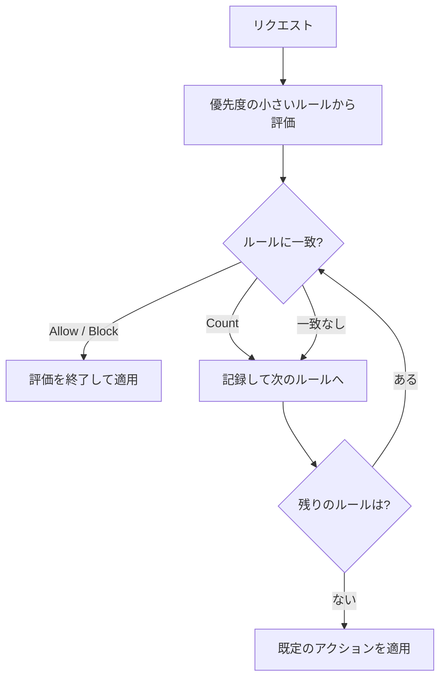

# 証明書と AWS WAF

ACM と AWS Private CA は TLS 証明書を発行、管理するサービスで、AWS WAF は Web リクエストを検査して攻撃を防ぐサービスです。HTTPS の公開、社内向けの証明書の発行、開発用の鍵の作成、不正なリクエストの遮断といった場面で使います。

[](../assets/diagrams/certificates-tls.png)

## AWS Certificate Manager {#acm}

ACM は、公開証明書とプライベート証明書の発行、保存、更新を担います。統合サービスで使う限り、更新と配置を自動化できます。

| 観点 | 公開証明書 | プライベート証明書 |
| --- | --- | --- |
| 発行元 | Amazon の公開 CA | AWS Private CA のプライベート CA |
| 信頼される範囲 | ブラウザなど一般のクライアント | CA を信頼するよう設定したクライアントのみ |
| 所有権の確認 | ドメインの検証が必要 | 不要 |
| 用途 | 公開 Web サイト、公開 API | 社内サービス、サービス間通信 |
| 料金 | 統合サービスで使う証明書は追加料金なし（エクスポート可能な証明書と ACME の証明書は有料） | Private CA の料金がかかる |

### ドメイン検証 {#domain-validation}

| 方式 | 手順 | 更新 |
| --- | --- | --- |
| DNS 検証（推奨） | ACM が示す CNAME レコードを DNS に追加 | レコードを残していれば自動 |
| メール検証 | ドメインの管理者にメールで承認を依頼 | メールでの承認が必要な場合がある |
| HTTP 検証 | ACM が示す URL へのリダイレクトを設定。CloudFront の Distribution Tenants でのみ利用可 | 自動 |

DNS 検証のポイントは次のとおりです。

- CNAME は 1 回追加すれば済み、削除すると自動更新が止まる。
- Route 53 ならコンソールから簡単にレコードを追加できる。
- 同じ CNAME が使えるので、別のリージョンでも再検証なしで同じドメインの証明書を作れる。
- メール検証で作った証明書は DNS 検証に切り替えられない。作り直す。

```bash
aws acm request-certificate \
  --domain-name example.com \
  --subject-alternative-names "*.example.com" \
  --validation-method DNS \
  --region us-east-1
```

ワイルドカードは一番左にだけ置け、1 階層だけを保護します。`*.example.com` は `www.example.com` を保護しますが、`a.www.example.com` や `example.com` 自体は保護しません。1 枚の証明書に入れられるドメインは既定で 10 個で、申請すると増やせます。

### 自動更新 {#auto-renewal}

ACM の公開証明書の有効期間は 198 日で、期限の 45 日前から更新を確認します。以前に発行された有効期間 395 日の証明書は、期限の 60 日前に更新され、更新後は 198 日になります。

| 証明書 | 自動更新 |
| --- | --- |
| 統合サービスに関連付けた Amazon 発行の証明書 | 対象 |
| エクスポート済みの Amazon 発行の証明書 | 対象 |
| ACM で要求し、関連付けまたはエクスポートしたプライベート証明書 | 対象 |
| Private CA の `IssueCertificate` API で発行した証明書 | 対象外 |
| インポートした証明書 | 対象外 |
| 期限切れの証明書 | 対象外 |

DNS 検証のものは自動で更新され、メール検証のものは更新の案内がメールで届きます。

### リージョンのルール {#region-rules}

ACM の証明書はリージョンのリソースです。リージョン間でコピーできないので、必要なリージョンごとに作ります。

| サービス | 証明書を置くリージョン |
| --- | --- |
| CloudFront | `us-east-1`（バージニア北部）のみ |
| API Gateway のエッジ最適化カスタムドメイン | `us-east-1`（内部で CloudFront を使用） |
| API Gateway のリージョナルカスタムドメイン | API と同じリージョン |
| ALB、NLB | ロードバランサーと同じリージョン |
| Elastic Beanstalk | 環境のロードバランサーと同じリージョン |

!!! tip "CloudFront の証明書が選択肢に出ない"
    多くの場合、証明書を `us-east-1` 以外で作っています。東京リージョンで動くアプリでも、CloudFront 用の証明書は `us-east-1` に作ります。

### 統合サービス {#integrated-services}

ACM と統合している主なサービスは次のとおりです。

- Elastic Load Balancing
- Amazon CloudFront
- Amazon API Gateway
- AWS Elastic Beanstalk
- AWS Amplify
- Amazon Cognito（カスタムドメイン）
- AWS App Runner
- Amazon OpenSearch Service
- AWS Network Firewall
- AWS Nitro Enclaves
- AWS CloudFormation（証明書をリソースとして定義）

EC2 上のサーバーに直接置くには、エクスポート可能な公開証明書か、ACME プロトコルを使います。

- **エクスポート可能な公開証明書**: 要求時に有効にする。2025 年 6 月 17 日より前に作った証明書はエクスポートできない。
- **ACME**: Web サーバー上で発行と更新を自動化する。ACM のマネージド更新の対象外で、ACME クライアントが更新を担う。

ただし、一般的には EC2 の前に ALB や CloudFront を置いて、そこに証明書を設定するほうが簡単です。

### 証明書のインポート {#import}

他の CA が発行した証明書は ACM にインポートできます。

```bash
aws acm import-certificate \
  --certificate fileb://cert.pem \
  --private-key fileb://key.pem \
  --certificate-chain fileb://chain.pem
```

- ACM は自動更新しないので、新しい証明書を取得して再インポートする。ARN と関連付けは維持される。
- 期限の管理は自分の責任。EventBridge で期限切れが近いイベントを受け取り、通知する。
- 同じリージョンのルールが適用される。CloudFront 用は `us-east-1` にインポートする。

## AWS Private CA {#private-ca}

ルート CA と下位 CA からなるプライベート CA の階層を、自前の設備なしで運用するサービスです。

| 用途 | 例 |
| --- | --- |
| 社内の TLS | 内部 API、内部 ALB |
| クライアント、デバイスの認証 | mTLS、IoT デバイス |
| コード署名 | 内部のソフトウェアの署名 |
| 失効の確認 | OCSP |

証明書の発行の方法で、管理のしかたが変わります。

| 発行の方法 | 使える場所 | 自動更新 |
| --- | --- | --- |
| ACM で要求（`--certificate-authority-arn`） | ACM の統合サービス。エクスポートすれば他でも可 | 対象 |
| Private CA の API（`IssueCertificate`） | どこでも | 対象外。自分で管理 |

```bash
aws acm request-certificate \
  --domain-name api.internal.example.com \
  --certificate-authority-arn arn:aws:acm-pca:ap-northeast-1:111122223333:certificate-authority/EXAMPLE
```

プライベート CA はリージョンのリソースで、リージョン間でコピーできません。クライアント側には、ルート CA 証明書を信頼するよう設定します。

## 開発用の証明書と SSH キーの生成 {#dev-certs-ssh}

開発やテストでは、CA を使わずに自分で作れます。本番の公開サイトには使いません。

| 用途 | ツール |
| --- | --- |
| ローカルの HTTPS、テスト環境の TLS | `openssl` の自己署名証明書 |
| EC2 への SSH | EC2 キーペア、`ssh-keygen` |
| 内部で信頼する証明書を本格的に発行 | AWS Private CA |
| SSH キーの管理を避ける | Systems Manager Session Manager |

### 自己署名証明書 {#self-signed}

```bash
# 秘密鍵と自己署名証明書を 1 回で作る
openssl req -x509 -newkey rsa:2048 -nodes -sha256 -days 90 \
  -keyout key.pem -out cert.pem \
  -subj "/CN=localhost" \
  -addext "subjectAltName=DNS:localhost,IP:127.0.0.1"

# 内容の確認
openssl x509 -in cert.pem -noout -subject -dates -ext subjectAltName
```

CA に署名を依頼する場合は、CSR を作ります。

```bash
openssl req -new -newkey rsa:2048 -nodes \
  -keyout server.key -out server.csr \
  -subj "/CN=dev.example.com"
```

- 自己署名証明書はクライアントから信頼されないので、ブラウザに警告が出る。
- 秘密鍵をリポジトリにコミットしない。`.gitignore` に入れ、必要なら [Secrets Manager](secrets.md) に置く。
- ALB でテストするには、ACM にインポートする。自動更新はされない。

### SSH キーと EC2 キーペア {#ssh-keys}

EC2 キーペアでは、公開鍵を EC2 が持ち、秘密鍵は自分で保管します。AWS は秘密鍵を保存しないので、なくすと取り戻せません。

| キーの種類 | Linux | Windows |
| --- | --- | --- |
| RSA 2048 ビット | 可 | 可 |
| ED25519 | 可 | 不可 |

AWS に作らせる方法です。秘密鍵はこの応答でしか得られません。

```bash
aws ec2 create-key-pair \
  --key-name dev-key \
  --key-type ed25519 \
  --query 'KeyMaterial' \
  --output text > dev-key.pem

chmod 400 dev-key.pem
ssh -i dev-key.pem ec2-user@<public-dns>
```

手元で作って公開鍵だけを登録する方法です。秘密鍵が AWS を通らないので、より安全です。

```bash
ssh-keygen -t ed25519 -f ~/.ssh/aws-dev -C "dev"

aws ec2 import-key-pair \
  --key-name aws-dev \
  --public-key-material fileb://~/.ssh/aws-dev.pub
```

| 症状 | 原因と対処 |
| --- | --- |
| `UNPROTECTED PRIVATE KEY FILE` | 秘密鍵の権限が広い。`chmod 400` にする |
| 秘密鍵をなくした | 取り戻せない。新しい公開鍵をインスタンスに追加する、または Session Manager で入る |
| Windows のパスワードが読めない | 秘密鍵で管理者パスワードを復号する |

## 転送時の TLS {#tls-in-transit}

TLS の終端の場所を決めるのが設計の中心です。

| 区間 | 設定 | 証明書 |
| --- | --- | --- |
| 利用者から CloudFront | ビューワープロトコルポリシー（HTTPS にリダイレクトなど） | ACM（`us-east-1`） |
| CloudFront からオリジン | オリジンプロトコルポリシー | オリジンの証明書 |
| 利用者から ALB | HTTPS リスナーとセキュリティポリシー | ACM（同じリージョン） |
| ALB からターゲット | ターゲットグループの HTTPS | 自己署名でも可 |
| 利用者から API Gateway | カスタムドメインに証明書を設定 | エッジ最適化なら `us-east-1` |
| アプリから RDS | TLS で接続 | RDS の CA を信頼 |

データの暗号化の全体は [KMS](kms.md) を参照してください。

### 相互 TLS（mTLS） {#mtls}

サーバーだけでなく、クライアントも証明書で認証します。API Gateway のカスタムドメインでは、次のように設定します。

1. クライアント証明書を信頼する CA のトラストストアを S3 に置く。
2. カスタムドメインで mutual TLS を有効にする。
3. 既定の `execute-api` エンドポイントを無効にし、迂回を防ぐ。

クライアント証明書の発行には、AWS Private CA を使えます。

## AWS WAF {#waf}

HTTP(S) リクエストを検査して、許可、ブロック、カウントなどを行うファイアウォールです。ウェブ ACL は、現在のコンソールでは protection pack とも呼ばれます。

### アタッチできる場所 {#waf-resources}

| スコープ | リソース | 作成先 |
| --- | --- | --- |
| グローバル | CloudFront ディストリビューション | `us-east-1` |
| リージョナル | ALB | リソースと同じリージョン |
| リージョナル | API Gateway の REST API | 同上 |
| リージョナル | AppSync GraphQL API | 同上 |
| リージョナル | Cognito ユーザープール | 同上 |
| リージョナル | App Runner、Amplify、Verified Access、Bedrock AgentCore Gateway | 同上 |

対応一覧に、NLB、API Gateway の HTTP API、EC2 のインスタンスはありません。保護するには、前に CloudFront や ALB を置きます。

### ウェブ ACL の構成 {#web-acl}



| 要素 | 内容 |
| --- | --- |
| ルール | 検査の条件（ステートメント）とアクション |
| 優先度 | 数値。小さいものから順に評価 |
| 既定のアクション | どのルールでも終了しなかったときの動作。`Allow` または `Block` |
| ルールグループ | ルールの再利用可能なまとまり |
| マネージドルールグループ | AWS や販売者が管理するルール |
| WCU | ルールの処理に必要な容量。ウェブ ACL の上限は 5,000 で、1,500 を超えると追加料金 |

| アクション | 動作 | 終了するか |
| --- | --- | --- |
| Allow | 転送する。カスタムヘッダーを追加可能 | する |
| Block | 既定で HTTP 403 を返す。応答はカスタマイズ可能 | する |
| Count | 数えて記録するだけ | しない |
| CAPTCHA, Challenge | ボットかどうかを確認する。トークンが有効なら次のルールへ | 状況による |

| 検査できるもの | 例 |
| --- | --- |
| 送信元 IP | IP セットで許可、ブロック |
| 国 | 地理的一致 |
| 文字列、正規表現 | パス、ヘッダー、本文 |
| サイズ | 本文が大きすぎるリクエスト |
| SQL インジェクション、XSS | 専用のステートメント |
| リクエストのレート | レートベースルール |

新しいルールはまず `Count` で動かし、正常なリクエストを止めないことを確認してから `Block` にします。

### レートベースルール {#rate-based-rules}

一定時間のリクエスト数が上限を超えた送信元などを、一時的に制限します。

| 設定 | 内容 |
| --- | --- |
| 評価ウィンドウ | 60、120、300、600 秒。既定は 300 秒 |
| レート制限 | ウィンドウ内の上限のリクエスト数。最小 10 |
| 集約 | 送信元 IP、ヘッダー内の IP、カスタムキーなど。全リクエストのカウントも可 |
| アクション | Allow 以外 |
| スコープダウン | 対象を絞る条件。「すべてカウント」では必須 |

```json
{
  "Name": "ip-rate-limit",
  "Priority": 1,
  "Statement": {
    "RateBasedStatement": {
      "Limit": 100,
      "EvaluationWindowSec": 300,
      "AggregateKeyType": "IP"
    }
  },
  "Action": {"Block": {}},
  "VisibilityConfig": {
    "SampledRequestsEnabled": true,
    "CloudWatchMetricsEnabled": true,
    "MetricName": "ip-rate-limit"
  }
}
```

- `/login` だけを制限したいときは、`ScopeDownStatement` で対象を絞る。
- 上限の付近で制限されるが、正確な一致は保証されない。
- CloudFront の背後の ALB に WAF を置くと、送信元 IP が CloudFront になる。CloudFront に付けるか、`X-Forwarded-For` などの転送 IP を集約キーにする。

### 似た機能との比較 {#waf-comparison}

| 機能 | 動作する層 | 使いどころ | 超過時の応答 |
| --- | --- | --- | --- |
| AWS WAF | HTTP（L7） | SQL インジェクション、XSS、IP やレートの制限 | 既定で HTTP 403 |
| API Gateway のスロットリング | API | API キーや使用量プランごとの呼び出し制限 | HTTP 429 |
| セキュリティグループ | IP とポート | インスタンスや ENI への通信制限 | 応答なしで破棄 |

ネットワーク側の制御は [ネットワーク](networking.md) を参照してください。

### ウェブ ACL の関連付け {#waf-association}

```bash
# リージョナルリソースの関連付け
aws wafv2 associate-web-acl \
  --web-acl-arn arn:aws:wafv2:ap-northeast-1:111122223333:regional/webacl/app/EXAMPLE \
  --resource-arn arn:aws:elasticloadbalancing:ap-northeast-1:111122223333:loadbalancer/app/my-alb/EXAMPLE
```

CloudFront の場合は、ディストリビューション設定でウェブ ACL を指定します。CloudFormation でも、CloudFront のディストリビューション設定側に記述します。

## 試験のポイント {#exam-points}

| こう問われたら | 答え |
| --- | --- |
| CloudFront 用の ACM 証明書のリージョン | `us-east-1` |
| ALB 用の ACM 証明書のリージョン | ALB と同じリージョン |
| エッジ最適化 API Gateway の証明書 | `us-east-1` |
| 証明書の更新を自動化する検証方法 | DNS 検証（CNAME を残す） |
| インポートした証明書の更新 | 自動ではない。再インポートする |
| インポートした証明書の期限の監視 | EventBridge のイベントで通知 |
| 社内サービス向けの証明書 | AWS Private CA |
| `*.example.com` で `example.com` は保護されるか | されない。SAN に追加する |
| 開発用の HTTPS の証明書を手元で作る | `openssl req -x509` の自己署名証明書 |
| EC2 用の SSH キーをなくした | 取り戻せない。新しい公開鍵を追加する |
| 既存の公開鍵を EC2 で使う | `aws ec2 import-key-pair` |
| Windows インスタンスのキーの種類 | RSA のみ |
| SQL インジェクションや XSS の遮断 | AWS WAF |
| 特定の IP からの大量アクセスを制限 | レートベースルール |
| WAF をアタッチできないもの | NLB、HTTP API、EC2 に直接など |
| CloudFront 用のウェブ ACL の作成先 | `us-east-1` |
| WAF の Block の既定の応答 | HTTP 403 |
| 新しいルールを影響なく試す | Count アクション |
| どのルールにも一致しないリクエスト | 既定のアクション |
| クライアントも証明書で認証する API | API Gateway の mutual TLS |

## 関連ページ {#related}

- [KMS](kms.md): 保存時と転送時の暗号化
- [ネットワーク](networking.md): CloudFront、ELB、Route 53
- [API Gateway](api-gateway.md): カスタムドメイン、スロットリング
- [EC2 と Elastic Beanstalk](ec2-beanstalk.md): インスタンスへの接続
- [IAM と STS](iam.md): サービス間の認証

## 参考 {#references}

- [What is AWS Certificate Manager?](https://docs.aws.amazon.com/acm/latest/userguide/acm-overview.html)
- [AWS Certificate Manager concepts](https://docs.aws.amazon.com/acm/latest/userguide/acm-concepts.html)
- [ACM certificate characteristics](https://docs.aws.amazon.com/acm/latest/userguide/acm-certificate-characteristics.html)
- [ACM DNS validation](https://docs.aws.amazon.com/acm/latest/userguide/dns-validation.html)
- [Managed certificate renewal](https://docs.aws.amazon.com/acm/latest/userguide/managed-renewal.html)
- [Renewal for domains validated by DNS](https://docs.aws.amazon.com/acm/latest/userguide/dns-renewal-validation.html)
- [Managed automation with integrated services](https://docs.aws.amazon.com/acm/latest/userguide/acm-services.html)
- [Import certificates into ACM](https://docs.aws.amazon.com/acm/latest/userguide/import-certificate.html)
- [Request a public certificate](https://docs.aws.amazon.com/acm/latest/userguide/acm-public-certificates.html)
- [Export an ACM public certificate](https://docs.aws.amazon.com/acm/latest/userguide/export-public-certificate.html)
- [ACM quotas](https://docs.aws.amazon.com/acm/latest/userguide/acm-limits.html)
- [What is AWS Private CA?](https://docs.aws.amazon.com/privateca/latest/userguide/PcaWelcome.html)
- [Using alternate domain names and HTTPS in CloudFront](https://docs.aws.amazon.com/AmazonCloudFront/latest/DeveloperGuide/cnames-and-https-requirements.html)
- [Edge-optimized custom domain names](https://docs.aws.amazon.com/apigateway/latest/developerguide/how-to-edge-optimized-custom-domain-name.html)
- [Regional custom domain names](https://docs.aws.amazon.com/apigateway/latest/developerguide/apigateway-regional-api-custom-domain-create.html)
- [Mutual TLS for REST APIs](https://docs.aws.amazon.com/apigateway/latest/developerguide/rest-api-mutual-tls.html)
- [Amazon EC2 key pairs](https://docs.aws.amazon.com/AWSEC2/latest/UserGuide/ec2-key-pairs.html)
- [Create a key pair for your EC2 instance](https://docs.aws.amazon.com/AWSEC2/latest/UserGuide/create-key-pairs.html)
- [What is AWS WAF?](https://docs.aws.amazon.com/waf/latest/developerguide/what-is-aws-waf.html)
- [Resources that you can protect with AWS WAF](https://docs.aws.amazon.com/waf/latest/developerguide/how-aws-waf-works-resources.html)
- [Configuring protection in AWS WAF](https://docs.aws.amazon.com/waf/latest/developerguide/web-acl.html)
- [Web ACL default action](https://docs.aws.amazon.com/waf/latest/developerguide/web-acl-default-action.html)
- [Setting rule priority](https://docs.aws.amazon.com/waf/latest/developerguide/web-acl-processing-order.html)
- [Using rule actions in AWS WAF](https://docs.aws.amazon.com/waf/latest/developerguide/waf-rule-action.html)
- [Rate-based rule statements](https://docs.aws.amazon.com/waf/latest/developerguide/waf-rule-statement-type-rate-based.html)
- [Rate-based rule high-level settings](https://docs.aws.amazon.com/waf/latest/developerguide/waf-rule-statement-type-rate-based-high-level-settings.html)
- [AWS WAF quotas](https://docs.aws.amazon.com/waf/latest/developerguide/limits.html)
