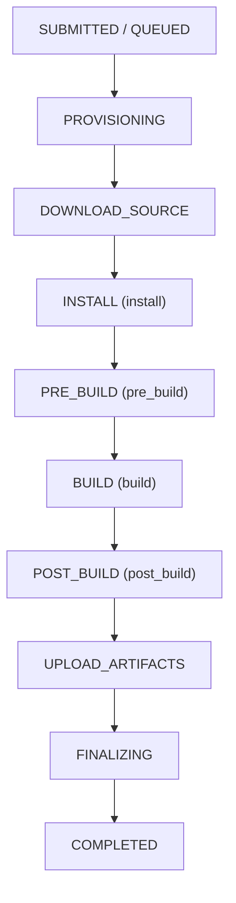
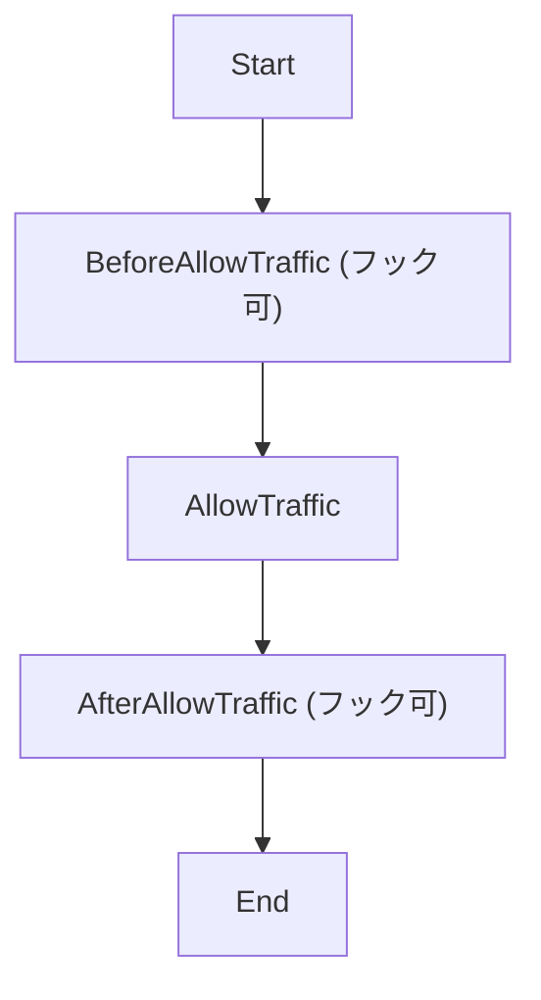
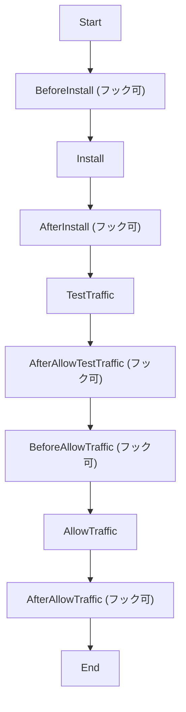
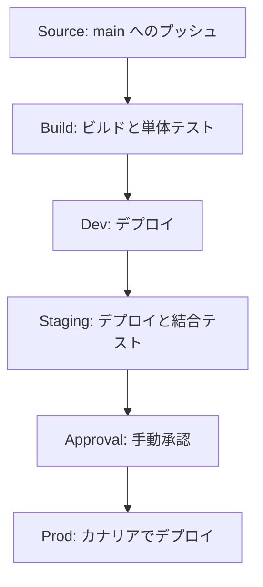

# CI/CD（CodeBuild / CodeDeploy / CodePipeline）

コードの変更をビルド、テスト、デプロイまで自動で進める AWS の開発者ツール群です。リリースを繰り返し安全に行いたいときに、パイプライン、デプロイ戦略、ロールバックを組み合わせて使います。

[](../assets/diagrams/cicd-pipeline.png)

## サービスの役割 {#overview}

| サービス | 役割 | 設定の中心 |
|---|---|---|
| CodePipeline | 各工程をつなぐオーケストレーター | ステージとアクション |
| CodeBuild | コンパイル、テスト、イメージ作成 | `buildspec.yml` |
| CodeDeploy | EC2、オンプレミス、Lambda、ECS へのデプロイ | `appspec.yml`、デプロイ設定 |
| CodeArtifact | npm や pip などの私設パッケージリポジトリ | ドメインとリポジトリ |
| Amplify Hosting | Web アプリのブランチ単位のビルドとホスティング | `amplify.yml`、ブランチ設定 |

CloudFormation や SAM によるデプロイは [IaC](iac.md) で説明します。

## ソース管理 {#source-control}

### デプロイ環境でコードリポジトリを使う {#repositories}

リポジトリを「デプロイの正」にします。手元で作った成果物ではなく、コミットから作った成果物を配布すれば、本番で動くものを必ずコミットまでたどれます。

CodePipeline のソースにできる代表的なものは次のとおりです。

| ソース | 接続方法 | 変更の検知 |
|---|---|---|
| GitHub、GitLab、Bitbucket | CodeConnections の接続（`CodeStarSourceConnection` アクション） | Webhook。ブランチ、タグ、PR などのトリガーを設定可能 |
| CodeCommit | IAM | EventBridge ルール |
| S3 | IAM | EventBridge ルール。バージョニングが必要 |
| ECR | IAM | EventBridge ルール |

### CodeCommit の現状 {#codecommit-status}

CodeCommit は 2024 年に新規受付を止めましたが、**2025 年 11 月に一般提供へ戻り、新規利用者も使えるようになりました**。「CodeCommit は新規利用できない」という古い記述は現在は誤りです。なお、DVA-C02 と DVA-C03 の試験ガイドの対象サービス一覧に CodeCommit は載っていません（一覧は網羅的ではないとされています）。

IAM、VPC エンドポイント、CloudTrail と統合できるため、AWS の中でソースを管理したい場合の選択肢です。Git リポジトリなので、頻繁に変わる大きなファイル、データベース、監査ログの置き場には向きません。

### ブランチとタグでバージョンとリリースを管理する {#branches-tags}

ブランチは「作業の流れ」、タグ（ラベル）は「特定の時点につける不変の名前」です。

| 使うもの | 用途 | 例 |
|---|---|---|
| ブランチ | 環境や開発の流れを分ける | `main` は本番、`develop` は結合テスト、`feature/*` は機能開発 |
| Git タグ | リリース版を固定する | `v1.4.2` |
| プルリクエスト | マージ前のレビューとテスト | PR で CodeBuild のテストを実行 |
| コンテナイメージタグ | デプロイするイメージを指定する | `1.4.2`、コミット SHA |
| Lambda のバージョンとエイリアス | 不変の版と、それを指す名前 | バージョン `7`、エイリアス `prod` |

```bash
git tag -a v1.4.2 -m "Release 1.4.2"
git push origin v1.4.2
```

パイプラインの起動条件に Git タグを指定すれば、タグを打ったときだけ本番へのリリースを始められます。

### コミットでビルド・テスト・デプロイを起動する {#commit-triggers}

流れは「コミットをプッシュする → トリガーが発火する → CodePipeline がその版を取得する → CodeBuild がビルドしてテストする → デプロイする」です。人がコマンドを実行する必要はありません。

CodeBuild だけで済む場合は、プロジェクトに Webhook を設定してプッシュや PR で直接ビルドを始めることもできます。承認や複数環境への展開が必要になったら CodePipeline を使います。

## CodeBuild {#codebuild}

フルマネージドのビルドサービスです。ビルドごとに新しい環境を用意するので、ビルドサーバーの管理が不要です。ビルド時の権限はプロジェクトのサービスロールで決まります。

### buildspec の構成 {#buildspec}

既定ではソースのルートにある `buildspec.yml` を読みます。別の名前や場所も指定できます。

```yaml
version: 0.2

env:
  variables:
    APP_ENV: "staging"
  parameter-store:
    API_URL: "/myapp/staging/api-url"
  secrets-manager:
    DB_PASSWORD: "myapp/staging/db:password"
  exported-variables:
    - IMAGE_TAG

phases:
  install:
    runtime-versions:
      python: 3.12
    commands:
      - pip install -r requirements.txt
  pre_build:
    commands:
      - pytest tests/unit --junitxml=reports/unit.xml
      - export IMAGE_TAG=$CODEBUILD_RESOLVED_SOURCE_VERSION
  build:
    commands:
      - sam build
    finally:
      - echo "build フェーズの後片付け"
  post_build:
    commands:
      - sam package --s3-bucket "$ARTIFACT_BUCKET" --output-template-file packaged.yaml

reports:
  unit-tests:
    files:
      - "unit.xml"
    base-directory: reports
    file-format: JUNITXML

artifacts:
  files:
    - packaged.yaml

cache:
  paths:
    - "/root/.cache/pip/**/*"
```

### ビルドフェーズ {#build-phases}

ビルドは次の順に進みます。



| 設定 | 動作 |
|---|---|
| `install` | パッケージの導入に使う。`runtime-versions` で実行環境の版を指定 |
| `pre_build` | ECR へのログインや依存関係の準備 |
| `build` | ビルドとテストの本体 |
| `post_build` | イメージのプッシュや通知など |
| `finally` | 同じフェーズの `commands` が失敗しても実行される |
| `on-failure` | フェーズ失敗時の動作。`ABORT`、`CONTINUE`、`RETRY` など（EC2 コンピュートのみ） |

`UPLOAD_ARTIFACTS` は `BUILD` が失敗しても試行されます。`post_build` などで成否を判定したいときは、環境変数 `CODEBUILD_BUILD_SUCCEEDING`（`1` は成功、`0` は失敗）を見ます。

### 環境変数とシークレット {#build-env}

| 定義先 | 向いているもの | 注意 |
|---|---|---|
| `env.variables` | 秘密でない設定値 | buildspec にそのまま残る |
| `env.parameter-store` | Parameter Store の値 | サービスロールに `ssm:GetParameters` が必要 |
| `env.secrets-manager` | パスワードや API キー | 形式は `シークレットID:JSONキー:ステージ:バージョン`。サービスロールに読み取り権限が必要 |
| `env.exported-variables` | 後続のパイプラインアクションへ渡す値 | `install` から `post_build` の間に更新できる |

Parameter Store と Secrets Manager から取得した値はログでマスクされます。ただしマスクは保存値との完全一致です。Base64 にするなど値を加工して出力すると隠れません。

### アーティファクト {#build-artifacts}

`artifacts` で、ビルドの成果物として保存するファイルを指定します。

| キー | 意味 |
|---|---|
| `files` | 出力するファイル。`**/*` で配下すべて |
| `base-directory` | 基準ディレクトリ |
| `discard-paths` | `yes` でディレクトリ構造を捨てる |
| `secondary-artifacts` | 複数の成果物を分けて出力する |

CodePipeline では、この成果物がパイプラインの S3 バケットを経由して次のアクションに渡ります。

### キャッシュ {#build-cache}

| 種類 | 保存先 | 向いている場面 |
|---|---|---|
| S3 キャッシュ | S3 バケット | 複数のビルドホストで共有したいとき |
| ローカル: ソース | ビルドホスト | Git メタデータの再利用 |
| ローカル: Docker レイヤー | ビルドホスト | イメージのビルド短縮（Linux のみ、特権モードが必要） |
| ローカル: カスタム | ビルドホスト | buildspec の `cache.paths` で指定した依存関係 |

Docker イメージをビルドするプロジェクトでは特権モード（privileged）を有効にします。

### テストレポート {#build-reports}

`reports` にレポートグループ名とファイルを書くと、テスト結果をコンソールで確認できます。グループは事前に作らなくても自動で作成されます。

- テスト形式: JUnit XML、Cucumber JSON、NUnit、TestNG、Visual Studio TRX
- コードカバレッジレポートも作成可能
- レポートは作成から 30 日で期限切れ。残すには生データを S3 へエクスポートする

### ログ {#build-logs}

ビルドログは CloudWatch Logs、S3、またはその両方に出力できます。失敗時は、コンソールのフェーズ詳細でどのフェーズが落ちたかを確認し、そのログを読みます。

VPC 内でビルドすると、インターネットへ出る経路がなければ依存関係の取得に失敗します。NAT ゲートウェイや VPC エンドポイントを確認します。

## CodeDeploy {#codedeploy}

アプリケーションのリビジョンを、EC2、オンプレミス、Lambda、ECS へ配布するサービスです。

### 構成要素 {#codedeploy-concepts}

| 用語 | 意味 |
|---|---|
| アプリケーション | デプロイの入れ物。コンピューティングプラットフォームを持つ |
| デプロイグループ | 配布先の集まり。EC2 はタグや Auto Scaling グループ、ECS はサービス、Lambda は関数で指定 |
| リビジョン | 配布する内容。EC2 は S3 や GitHub のバンドルと AppSpec、Lambda と ECS は AppSpec |
| デプロイ設定 | 進め方（一度に何台か、どの速度でトラフィックを移すか） |
| デプロイタイプ | インプレース（EC2 とオンプレミスのみ）または Blue/Green |

### AppSpec ファイル {#appspec}

プラットフォームごとに中身が違います。EC2 とオンプレミスでは `appspec.yml` という名前でリビジョンのルートに置きます。

**EC2 / オンプレミス**: ファイルの配置先とスクリプトを指定します。

```yaml
version: 0.0
os: linux
files:
  - source: /build
    destination: /var/www/app
hooks:
  ApplicationStop:
    - location: scripts/stop.sh
      timeout: 60
      runas: root
  AfterInstall:
    - location: scripts/configure.sh
  ApplicationStart:
    - location: scripts/start.sh
  ValidateService:
    - location: scripts/healthcheck.sh
      timeout: 120
```

`timeout` の既定値と上限はライフサイクルイベントごとに 3,600 秒です。

**Lambda**: どのエイリアスをどの版からどの版へ移すかを指定し、フックは Lambda 関数で書きます。

```yaml
version: 0.0
Resources:
  - MyFunction:
      Type: AWS::Lambda::Function
      Properties:
        Name: "my-function"
        Alias: "live"
        CurrentVersion: "6"
        TargetVersion: "7"
Hooks:
  - BeforeAllowTraffic: "PreTrafficCheck"
  - AfterAllowTraffic: "PostTrafficCheck"
```

**ECS**: 新しいタスク定義と、トラフィックを受けるコンテナを指定します。

```yaml
version: 0.0
Resources:
  - TargetService:
      Type: AWS::ECS::Service
      Properties:
        TaskDefinition: "<タスク定義の ARN>"
        LoadBalancerInfo:
          ContainerName: "web"
          ContainerPort: 8080
Hooks:
  - AfterAllowTestTraffic: "RunSmokeTest"
```

Lambda と ECS のフック関数は、結果を CodeDeploy に報告します。1 時間以内に報告がないとデプロイは失敗します。

```python
import boto3

codedeploy = boto3.client("codedeploy")

def handler(event, context):
    status = "Succeeded" if run_checks() else "Failed"
    codedeploy.put_lifecycle_event_hook_execution_status(
        deploymentId=event["DeploymentId"],
        lifecycleEventHookExecutionId=event["LifecycleEventHookExecutionId"],
        status=status,
    )
```

### ライフサイクルイベントの順序 {#lifecycle-hooks}

**EC2 / オンプレミスのインプレース**（ロードバランサーがある場合）

太字以外は AppSpec にスクリプトを書けません。ロードバランサーがなければ `Traffic` が付くイベントは実行されません。

| 順 | イベント | 用途 |
|---|---|---|
| 1 | Start | |
| 2 | **BeforeBlockTraffic** | ロードバランサーから外す前の処理 |
| 3 | BlockTraffic | 登録解除 |
| 4 | **AfterBlockTraffic** | 外した後の処理 |
| 5 | **ApplicationStop** | 旧版の停止 |
| 6 | DownloadBundle | リビジョンを一時領域へ取得 |
| 7 | **BeforeInstall** | バックアップや復号 |
| 8 | Install | ファイルを配置 |
| 9 | **AfterInstall** | 設定や権限の変更 |
| 10 | **ApplicationStart** | サービスの起動 |
| 11 | **ValidateService** | デプロイ成功の検証 |
| 12 | **BeforeAllowTraffic** | ロードバランサーへ戻す前の処理 |
| 13 | AllowTraffic | 登録 |
| 14 | **AfterAllowTraffic** | 戻した後の処理 |
| 15 | End | |

`ApplicationStop`、`BeforeBlockTraffic`、`AfterBlockTraffic` は、**前回成功したデプロイの AppSpec** のスクリプトを実行します。そのため初回デプロイでは `ApplicationStop` は動きません。旧版のスクリプトが壊れていると、新版を修正してもここで失敗します。

**EC2 の Blue/Green**: 置き換え先インスタンスで `ApplicationStop` から `AfterAllowTraffic` までを実行し、その後で元のインスタンスで `BeforeBlockTraffic`、`BlockTraffic`、`AfterBlockTraffic` を実行します。

**Lambda**



**ECS**



ECS では、テストリスナーへ流したトラフィックで検証してから本番トラフィックを移せます。

なお、AWS は現在、ECS のブルー/グリーンには CodeDeploy ではなく [ECS 組み込みのデプロイ](containers.md#ecs-blue-green) を勧めています。

### デプロイ設定 {#deployment-configs}

| プラットフォーム | 定義済みの設定 | 動作 |
|---|---|---|
| EC2 / オンプレミス | `CodeDeployDefault.AllAtOnce` | できるだけ多くの台へ同時に配布 |
| | `CodeDeployDefault.HalfAtATime` | 最大半数ずつ |
| | `CodeDeployDefault.OneAtATime` | 1 台ずつ。未指定時の既定 |
| Lambda | `CodeDeployDefault.LambdaCanary10Percent5Minutes` | 10% を移し、5 分後に残り 90%（10、15、30 分版もある） |
| | `CodeDeployDefault.LambdaLinear10PercentEvery1Minute` | 毎分 10% ずつ（2、3、10 分間隔版もある） |
| | `CodeDeployDefault.LambdaAllAtOnce` | 一度にすべて |
| ECS | `CodeDeployDefault.ECSCanary10Percent5Minutes` | 10% を移し、5 分後に残り 90%（15 分版もある） |
| | `CodeDeployDefault.ECSLinear10PercentEvery1Minutes` | 毎分 10% ずつ（3 分間隔版もある） |
| | `CodeDeployDefault.ECSAllAtOnce` | 一度にすべて |

Lambda と ECS のカナリアや線形は独自の設定も作成できます。EC2 は最小正常インスタンス数を指定して独自設定を作ります。Network Load Balancer を使う ECS では `ECSAllAtOnce` のみ使えます。

### CodeDeploy のロールバック {#codedeploy-rollback}

ロールバックは、以前のリビジョンを**新しいデプロイとして**配布する処理です。新しいデプロイ ID が振られます。

自動ロールバックはデプロイグループまたはデプロイで設定します。

- デプロイが失敗したとき
- 指定した CloudWatch アラームのしきい値を超えたとき

手動の場合は、以前のリビジョンを指定して新規にデプロイします。

### CodeDeploy エージェント {#codedeploy-agent}

エージェントが必要なのは EC2 とオンプレミスだけです。Lambda と ECS では不要です。

- インスタンスに CodeDeploy エージェントをインストールし、起動しておく
- インスタンスプロファイルに、リビジョンがある S3 などへのアクセス権を付ける
- エージェントは HTTPS（443 番）で外向きに通信する

| ログ（Linux） | 内容 |
|---|---|
| `/var/log/aws/codedeploy-agent/codedeploy-agent.log` | エージェント自体の動作 |
| `/opt/codedeploy-agent/deployment-root/<グループID>/<デプロイID>/logs/scripts.log` | フックスクリプトの出力 |
| `/opt/codedeploy-agent/deployment-root/deployment-logs/codedeploy-agent-deployments.log` | デプロイの記録 |

## CodePipeline {#codepipeline}

ソースから本番までの流れを定義し、自動で進めるサービスです。自身はビルドや配布を行わず、CodeBuild や CodeDeploy などを呼び出します。

### ステージとアクション {#pipeline-structure}

| 用語 | 意味 |
|---|---|
| ステージ | 環境や工程の単位。1 つのステージで同時に処理される実行は 1 つ |
| アクション | ステージ内の処理。種類は Source、Build、Test、Deploy、Approval、Invoke など |
| `runOrder` | 同じ値なら並列、違う値なら順に実行 |
| アーティファクト | アクション間で受け渡すファイル。S3 のアーティファクトバケットを経由 |
| 遷移 | ステージ間のつなぎ目。無効にすると次へ進まない |
| 変数 | アクションの出力を後続で参照する。CodeBuild の `exported-variables` もこれで渡す |

複数のリリースが同時に来たときの動きは実行モードで決まります。

| 実行モード | 動作 | パイプラインタイプ |
|---|---|---|
| `SUPERSEDED` | 待っている古い実行を新しい実行が置き換える | V1、V2 |
| `QUEUED` | 到着順に 1 つずつ処理 | V2 のみ |
| `PARALLEL` | 実行どうしが独立して同時に動く（ステージのロールバックは不可） | V2 のみ |

### リポジトリからの起動 {#pipeline-triggers}

GitHub、GitLab、Bitbucket などは **CodeConnections** の接続で連携します（旧称 CodeStar Connections）。シークレットをテンプレートに書かず、接続の ARN を参照できる点が利点です。CLI で作った接続は保留状態なので、コンソールで認可を完了させます。

トリガーのフィルターは V2 パイプラインで設定します。

| イベント | フィルターできる項目 |
|---|---|
| プッシュ | Git タグ、ブランチ、ブランチとファイルパス |
| プルリクエスト | ブランチ、ブランチとファイルパス |

たとえば、`release/**` へのプッシュと、`services/orders/**` の変更だけで起動する設定ができます。

### 手動承認 {#manual-approval}

Approval アクションを置くと、そこでパイプラインが止まります。

- 承認すると次へ進む
- 却下、または **7 日以内に応答がないと**アクション失敗と同じ扱いになる
- 同じリージョンの SNS トピックへ通知し、確認用 URL とコメントを付けられる
- 承認者には `codepipeline:PutApprovalResult` の権限が必要

### 複数環境への展開 {#multi-environment}

同じ成果物を、環境ごとのステージへ順に進めます。ステージごとにビルドし直すと、テストしたものと本番のものが変わるおそれがあるためです。



| 要件 | 方法 |
|---|---|
| 環境ごとの設定を変える | CloudFormation のパラメータ、パイプライン変数 |
| 別アカウントへデプロイ | 別アカウントの IAM ロールを引き受け、アーティファクトをカスタマー管理 KMS キーで暗号化 |
| 別リージョンへデプロイ | アクションにリージョンを指定。リージョンごとにアーティファクトバケットが必要 |
| 条件を満たしたときだけ進める | ステージ条件（CloudWatch アラームなどのルール） |

### ステージのロールバック {#pipeline-rollback}

CodePipeline は、以前に成功した実行の版を使ってステージを戻せます。

| 方法 | 内容 |
|---|---|
| 手動 | コンソールまたは `RollbackStage` API |
| 失敗時に自動 | ステージの On Failure 条件で結果を Rollback にする |
| 成功後の確認で戻す | On Success 条件のルールで結果を Rollback にする |

## CodeArtifact {#codeartifact}

npm、pip、Maven、NuGet などのパッケージを保管する私設リポジトリです。社内ライブラリの共有や、公開パッケージの取得元を一本化したいときに使います。

| 用語 | 意味 |
|---|---|
| ドメイン | リポジトリをまとめる単位。組織で 1 つが推奨 |
| リポジトリ | パッケージの保管場所。1 つで複数の形式を扱える |
| アップストリーム | 同じドメインの別リポジトリを参照する設定 |
| 外部接続 | npmjs や PyPI などから取得して保存する設定 |

```bash
aws codeartifact login --tool npm --domain my-org --repository shared
```

認証トークンの有効期間は既定で 12 時間です。15 分から 12 時間の範囲で指定できます。CodeBuild で使うときは `pre_build` でログインし、期限切れを避けます。リポジトリのパッケージを一般公開することはできません。

## Amplify Hosting とブランチ {#amplify}

Git リポジトリと接続し、ブランチごとに Web アプリをビルドしてホスティングします。ビルド設定はコンソールまたはリポジトリの `amplify.yml` に保存します。

| 機能 | 内容 |
|---|---|
| ブランチデプロイ | ブランチごとに別の URL。例: `https://dev.<アプリID>.amplifyapp.com` |
| 自動検出 | `release**` などのパターンに合うブランチを自動でデプロイ |
| Web プレビュー | PR ごとに一意の URL を発行。レビュー用 |
| 環境変数 | ブランチごとに値を変えられる |

典型的な使い方は、`main` を本番、`develop` を結合テスト用とする構成です。Web プレビューも含めて、ブランチ数はアプリあたり 50 のクォータがあるので、不要な PR は閉じます。

## アプリケーション環境の作成と管理 {#app-environments}

結合テストでは、**承認済みの同じ版**を環境ごとに名前で指す仕組みが役立ちます。

| 仕組み | 環境の分け方 | 詳細 |
|---|---|---|
| Lambda のエイリアス | `staging` をバージョン 7、`prod` をバージョン 6 へ向ける | [Lambda](lambda.md) |
| コンテナイメージタグ | 検証済みタグだけを本番のタスク定義で参照する | [コンテナ](containers.md) |
| Amplify のブランチ | ブランチごとに URL と環境変数を持つ | [上記](#amplify) |
| API Gateway のステージ | `dev`、`prod` のステージとステージ変数 | [API Gateway](api-gateway.md) |
| CloudFormation / SAM | 同じテンプレートをパラメータ違いで別スタックに | [IaC](iac.md) |
| Elastic Beanstalk の環境 | アプリケーションバージョンを環境へ割り当てる | [EC2 と Elastic Beanstalk](ec2-beanstalk.md) |

```bash
# ステージングで検証済みのバージョン 7 を本番へ昇格する
aws lambda update-alias --function-name orders --name prod --function-version 7
```

!!! warning "AWS Copilot のサポート終了"
    試験ガイドには AWS Copilot の環境が例として載っていますが、Copilot CLI は 2026 年 6 月 12 日にサポートを終了しました。新規の構成では ECS Express Mode や CDK が移行先として案内されています。

## デプロイ戦略の比較 {#deployment-strategies}

| 戦略 | 動き | ダウンタイム | 戻しやすさ | 追加コスト |
|---|---|---|---|---|
| 一括（all-at-once） | すべてを同時に更新 | ありうる | 再デプロイが必要で遅い | なし |
| ローリング（rolling） | 少しずつ順に更新 | なし（容量は一時的に減る） | 再度ローリングが必要 | なし、または少し |
| Blue/Green | 別環境を用意して切り替え | ほぼなし | 切り戻すだけで速い | 2 環境分の期間がある |
| カナリア（canary） | 一部へ流して確認後に残りを移す | なし | トラフィックを戻すだけ | 新旧の同時稼働 |
| 線形（linear） | 一定の割合と間隔で移す | なし | トラフィックを戻すだけ | 新旧の同時稼働 |

カナリアと線形は Blue/Green の一種として、新環境へのトラフィックの移し方を細かくしたものと考えると整理できます。

| 実現方法 | 戦略 |
|---|---|
| CodeDeploy（EC2） | `AllAtOnce`、`HalfAtATime`、`OneAtATime`、Blue/Green |
| CodeDeploy（Lambda） | カナリア、線形、一括 |
| CodeDeploy（ECS） | カナリア、線形、一括 |
| ECS の組み込みデプロイ | ローリング、Blue/Green、カナリア、線形（詳細は [コンテナ](containers.md)） |
| SAM の `DeploymentPreference` | Lambda のカナリア、線形、一括（詳細は [IaC](iac.md)） |
| API Gateway | ステージのカナリアリリース |
| Elastic Beanstalk | 一括、ローリング、追加バッチ、イミュータブル、トラフィック分割 |

選び方の目安は次のとおりです。

- 開発環境で速さ優先: 一括
- 追加コストを抑えつつ止めない: ローリング
- 本番で即座に戻したい: Blue/Green
- 少数の利用者で実データを確認したい: カナリア
- 問題を段階的に検知しながら広げたい: 線形

## ロールバックの方法 {#rollback}

| サービス | 自動 | 手動 |
|---|---|---|
| CodeDeploy | デプロイ失敗、アラーム発火 | 以前のリビジョンを再デプロイ |
| CodePipeline | ステージ条件の Rollback | `RollbackStage` |
| CloudFormation | 失敗時の自動ロールバック、ロールバックトリガー（[IaC](iac.md)） | 以前のテンプレートでスタックを更新 |
| SAM | `DeploymentPreference` の `Alarms` とフック | 以前のテンプレートを再デプロイ |
| Lambda | CodeDeploy 経由 | エイリアスを前のバージョンへ向ける |
| API Gateway | なし | ステージを以前のデプロイへ向ける |
| ECS | デプロイサーキットブレーカー | 以前のタスク定義でサービスを更新 |

「ロールバックを自動化する」問題では、**カナリアや線形でトラフィックを移し、CloudWatch アラームで発火させる**構成が定番です。データベースのスキーマ変更は戻せないことがあるので、新旧どちらの版でも動く形で進めます。

## デプロイ失敗の診断 {#troubleshooting-deployments}

まずどのサービスの、どの工程で落ちたかを確定し、その工程の出力ログを読みます。

| 症状 | 確認先 | よくある原因 |
|---|---|---|
| CodeBuild が失敗 | ビルドログ（フェーズ詳細） | テスト失敗、依存関係の取得失敗、権限不足、YAML の構文 |
| `docker` の実行で失敗 | ビルドログ | 特権モードが無効 |
| `Skipping install of runtimes` の警告 | ビルドログ | イメージが `runtime-versions` に未対応 |
| すべてのイベントが Skipped | インスタンス上のエージェント | エージェント未起動、インスタンスプロファイルなし、外向き通信不可 |
| `ApplicationStop` で失敗 | `scripts.log` | 前回の版のスクリプトが不正 |
| `DownloadBundle` で失敗 | エージェントログ | S3 の権限不足、リビジョンの場所が違う |
| `file already exists` | デプロイのイベント | `--file-exists-behavior` を `OVERWRITE` などにする |
| フックがタイムアウト | `scripts.log` | スクリプトがバックグラウンド処理を待ち続けている |
| `AllowTraffic` で失敗（ログに原因なし） | ターゲットグループ | ヘルスチェックの設定不備（[ネットワーク](networking.md)） |
| Lambda のカナリアが戻された | CloudWatch アラーム、関数のログ | 新版のエラー増加、フック関数の `Failed` 報告 |
| ECS のタスクが起動しない | ECS のサービスイベント、タスクの停止理由 | イメージ取得失敗、ヘルスチェック失敗 |
| CloudFormation のアクションが失敗 | スタックイベント | 最初の `CREATE_FAILED` または `UPDATE_FAILED` の理由 |
| パイプラインが起動しない | トリガー設定、接続の状態 | フィルターの不一致、接続が保留のまま |

EC2 へのデプロイのログは、インスタンスで直接見るか、CloudWatch エージェントで CloudWatch Logs に集約して見ます。CodeDeploy の **Lambda と ECS のデプロイにはこの種のログはない**ので、関数やタスク自体のログとデプロイのイベントを確認します。

!!! tip "切り分けの順序"
    コンソールで失敗したアクションを開く → リンク先のビルドやデプロイを開く → 失敗したフェーズやイベントのログを読む、という順に進めます。ログの検索は [オブザーバビリティ](observability.md) の Logs Insights が便利です。

## 試験のポイント {#exam-points}

| こう問われたら | 答え |
|---|---|
| ビルド手順を定義するファイルは | `buildspec.yml`（既定はソースのルート） |
| Lambda や ECS のデプロイ手順を定義するファイルは | AppSpec（`appspec.yml`） |
| ビルド中にシークレットを安全に使いたい | buildspec の `env.secrets-manager` |
| ビルドの依存関係取得を速くしたい | CodeBuild のキャッシュ（S3 またはローカル） |
| Docker レイヤーキャッシュの条件は | Linux 環境かつ特権モード |
| EC2 へのデプロイが全イベント Skipped | CodeDeploy エージェントとインスタンスプロファイルを確認 |
| 初回デプロイで動かないフックは | `ApplicationStop` |
| Lambda のデプロイで使えるフックは | `BeforeAllowTraffic` と `AfterAllowTraffic` |
| 新しい Lambda 版へ 10% 流し、5 分後に残りを移す | `LambdaCanary10Percent5Minutes` |
| 問題発生時に自動で戻したい | CodeDeploy の自動ロールバックと CloudWatch アラーム |
| CodeDeploy のロールバックの実体は | 以前のリビジョンの新規デプロイ（新しい ID） |
| 本番前に人の確認を入れたい | CodePipeline の Approval アクション（SNS で通知） |
| 承認されないまま放置すると | 7 日後に失敗扱い |
| GitHub からパイプラインを起動したい | CodeConnections の接続 |
| 特定のタグやパスの変更だけで起動したい | V2 パイプラインのトリガーフィルター |
| 別アカウントへデプロイしたい | クロスアカウントロールとカスタマー管理 KMS キー |
| ブランチごとにフロントエンドの環境が欲しい | Amplify Hosting のブランチデプロイ |
| PR ごとにプレビューしたい | Amplify の Web プレビュー |
| 社内 pip パッケージを共有したい | CodeArtifact |
| 追加コストなしで止めずに更新したい | ローリング |
| 即座に切り戻したい | Blue/Green |

## 関連ページ {#related}

- [IaC（CloudFormation / SAM / CDK）](iac.md)
- [オブザーバビリティ](observability.md)
- [Lambda](lambda.md)
- [コンテナ](containers.md)
- [EC2 と Elastic Beanstalk](ec2-beanstalk.md)
- [API Gateway](api-gateway.md)
- [ネットワーク](networking.md)

## 参考 {#references}

- [Build specification reference for CodeBuild](https://docs.aws.amazon.com/codebuild/latest/userguide/build-spec-ref.html)
- [Build phase transitions](https://docs.aws.amazon.com/codebuild/latest/userguide/view-build-details-phases.html)
- [Cache builds to improve performance](https://docs.aws.amazon.com/codebuild/latest/userguide/build-caching.html)
- [Test reports in AWS CodeBuild](https://docs.aws.amazon.com/codebuild/latest/userguide/test-reporting.html)
- [AppSpec 'hooks' section](https://docs.aws.amazon.com/codedeploy/latest/userguide/reference-appspec-file-structure-hooks.html)
- [AppSpec file examples](https://docs.aws.amazon.com/codedeploy/latest/userguide/reference-appspec-file-example.html)
- [Working with deployment configurations in CodeDeploy](https://docs.aws.amazon.com/codedeploy/latest/userguide/deployment-configurations.html)
- [Redeploy and roll back a deployment with CodeDeploy](https://docs.aws.amazon.com/codedeploy/latest/userguide/deployments-rollback-and-redeploy.html)
- [Working with the CodeDeploy agent](https://docs.aws.amazon.com/codedeploy/latest/userguide/codedeploy-agent.html)
- [Troubleshoot EC2/On-Premises deployment issues](https://docs.aws.amazon.com/codedeploy/latest/userguide/troubleshooting-deployments.html)
- [View log data for CodeDeploy EC2/On-Premises deployments](https://docs.aws.amazon.com/codedeploy/latest/userguide/deployments-view-logs.html)
- [CodePipeline concepts](https://docs.aws.amazon.com/codepipeline/latest/userguide/concepts.html)
- [Automate starting pipelines using triggers and filtering](https://docs.aws.amazon.com/codepipeline/latest/userguide/pipelines-triggers.html)
- [Add a manual approval action to a stage](https://docs.aws.amazon.com/codepipeline/latest/userguide/approvals.html)
- [Configure conditions for a stage](https://docs.aws.amazon.com/codepipeline/latest/userguide/stage-conditions.html)
- [What are connections?](https://docs.aws.amazon.com/dtconsole/latest/userguide/welcome-connections.html)
- [What is AWS CodeArtifact?](https://docs.aws.amazon.com/codeartifact/latest/ug/welcome.html)
- [The Future of AWS CodeCommit](https://aws.amazon.com/blogs/devops/aws-codecommit-returns-to-general-availability/)
- [Feature branch deployments and team workflows (Amplify)](https://docs.aws.amazon.com/amplify/latest/userguide/multi-environments.html)
- [Web previews for pull requests (Amplify)](https://docs.aws.amazon.com/amplify/latest/userguide/pr-previews.html)
- [Announcing the end-of-support for the AWS Copilot CLI](https://aws.amazon.com/blogs/containers/announcing-the-end-of-support-for-the-aws-copilot-cli/)
- [Amazon ECS linear deployments](https://docs.aws.amazon.com/AmazonECS/latest/developerguide/deployment-type-linear.html)
