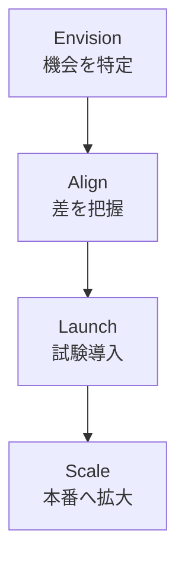

# クラウドの基礎

AWS を使う前提になる考え方と、設計の指針、インフラの構造、サポートの仕組みをまとめます。Cloud Practitioner の中心範囲で、上位の試験でも前提知識になります。

| 知りたいこと | 見るもの |
| --- | --- |
| 設計が良いかどうかの基準 | [Well-Architected Framework](#well-architected) |
| 移行に向けた組織の準備 | [Cloud Adoption Framework](#caf) |
| AWS と自分の責任の境界 | [責任共有モデル](#shared-responsibility) |
| どこで動かすか | [グローバルインフラストラクチャ](#global-infrastructure) |
| 困ったときの相談先 | [AWS Support プラン](#support-plans) |
| 環境の改善点、障害の影響 | [Trusted Advisor](#trusted-advisor)、[Health Dashboard](#health) |
| 監査用の証明書 | [AWS Artifact](#artifact) |

## クラウドの基本概念 {#cloud-concepts}

クラウドは、IT リソースをインターネット経由で必要な分だけ使い、使った分だけ払う形です。

### クラウドの 6 つの利点 {#six-advantages}

| 利点 | 意味 | 例 |
| --- | --- | --- |
| 固定費を変動費に変える | 先に設備を買わず、使った分を払う | 3 年分のサーバー購入が不要になる |
| 規模の経済の恩恵 | 多数の利用者の集約で単価が下がる | AWS の値下げの恩恵を受けられる |
| 容量の推測が不要 | 必要に応じて増減できる | セール時だけ台数を増やす |
| 速度と俊敏性の向上 | 数分でリソースを用意できる | 検証環境をすぐ作って捨てられる |
| データセンターの運用をやめる | ラックや電源の管理から解放される | 開発に人員を回せる |
| 数分で世界展開 | 複数リージョンに配置できる | 海外の利用者の近くに置く |

### 高可用性、弾力性、俊敏性 {#ha-elasticity-agility}

3 つは混同しやすいので区別します。

| 用語 | 意味 | AWS の例 |
| --- | --- | --- |
| 高可用性 | 一部が故障しても動き続ける | 複数 AZ への配置 |
| 弾力性 | 負荷に合わせて自動で増減する | Auto Scaling |
| 俊敏性 | 新しいことを短時間で試せる | 数分で環境を作成 |

### デプロイモデルとサービスモデル {#deployment-models}

| デプロイモデル | 内容 |
| --- | --- |
| クラウド | すべてをクラウドで動かす |
| ハイブリッド | オンプレミスとクラウドを接続して併用する |
| オンプレミス | 自社施設で動かす |

サービスモデルは、利用者が管理する範囲で分かれます。

| モデル | 利用者が管理するもの | 例 |
| --- | --- | --- |
| IaaS | OS より上 | EC2 |
| PaaS | アプリとデータ | Elastic Beanstalk |
| SaaS | 使い方とデータ | 完成したソフトウェア |

### クラウドの経済性 {#cloud-economics}

| 用語 | 意味 |
| --- | --- |
| TCO | 機器代だけでなく、電力、施設、人件費まで含めた総費用 |
| 適正サイズ（rightsizing） | 実際の使用率に合わせてリソースを小さくすること |
| BYOL | 手持ちのライセンスをクラウドに持ち込むこと。ライセンス込みの料金と比べて選ぶ |
| 自動化の効果 | 手作業の削減、ミスの減少、繰り返しの容易さ |

オンプレミスでは、機器、施設、電力、保守、運用の人員が費用になります。クラウドとの比較では、これらを含めて見積もります。

具体的な費用の道具は [コスト管理](cost-management.md) を、移行の戦略は [移行サービス](migration.md) を参照してください。

## Well-Architected Framework {#well-architected}

AWS 上のシステムを評価するための設計指針です。6 つの柱で構成されます。

| 柱 | 問うこと | 設計原則の例 |
| --- | --- | --- |
| 運用上の優秀性 | 運用を継続的に改善できるか | 小さく元に戻せる変更を頻繁に行う、運用手順をコード化して自動化する、障害を想定する |
| セキュリティ | データとシステムを守れるか | 強固な ID 基盤、追跡可能性、全層での防御、人をデータから遠ざける |
| 信頼性 | 障害から復旧し、期待どおり動くか | 自動復旧、復旧手順のテスト、水平スケール、容量の推測をやめる |
| パフォーマンス効率 | リソースを効率よく使えるか | サーバーレスの利用、数分で世界展開、頻繁な実験 |
| コスト最適化 | 不要な費用を避けられるか | 消費モデルの採用、費用の分析と配賦、価値を生まない作業に投資しない |
| サステナビリティ | 環境への影響を減らせるか | 影響の把握、使用率の最大化、効率の良い新しいハードウェアの採用 |

試験では、要件からどの柱の話かを判断させます。「復旧手順を試す」は信頼性、「使用率を上げて消費電力を減らす」はサステナビリティ、「人が直接データに触らない」はセキュリティです。

### Well-Architected Tool {#wa-tool}

ワークロードを質問形式でレビューするコンソールのツールです。追加料金はかかりません。

| 要素 | 内容 |
| --- | --- |
| ワークロード | レビューの単位。アプリやバックエンド処理など |
| レンズ | 質問と推奨事項のセット。Well-Architected Framework レンズは自動で適用される |
| Lens Catalog | AWS が管理する追加のレンズ。機械学習、サーバーレス、データ分析など |
| カスタムレンズ | 自社で定義する質問集 |
| マイルストーン | ある時点の状態の記録。改善前後を比べるために保存する |
| 改善計画 | 高リスク項目などを受けた改善の一覧 |

ツールは指摘と記録を行うものです。リソースを自動で修正はしません。

AWS Well-Architected Agent というエージェント機能もありますが、2026 年 10 月時点でプレビューです。

## Cloud Adoption Framework {#caf}

AWS CAF は、組織がクラウドに移行するための準備を整理した枠組みです。技術だけでなく、人や統治も扱います。

| パースペクティブ | 焦点 | 主な関係者 |
| --- | --- | --- |
| ビジネス | クラウド投資を事業の成果につなげる | CEO、CFO、COO、CIO、CTO |
| 人材 | 文化、組織構造、リーダーシップ、人材 | CIO、COO、CTO、クラウド責任者 |
| ガバナンス | 効果を最大化し、変革のリスクを抑える | CIO、CTO、CFO、CDO、CRO |
| プラットフォーム | スケールする基盤、既存の刷新、新規開発 | CTO、アーキテクト、エンジニア |
| セキュリティ | データとワークロードの機密性、完全性、可用性 | CISO、CCO、監査の責任者 |
| オペレーション | 事業の要求を満たすサービス提供 | インフラと運用の責任者、SRE、IT サービスマネージャー |

前半の 3 つは事業寄り、後半の 3 つは技術寄りと覚えると整理できます。

変革の進め方は、次の 4 フェーズです。



Cloud Practitioner の試験ガイドは、CAF で得られる成果の例として次の 4 つを挙げています。

- ビジネスリスクの低減
- 環境、社会、ガバナンス（ESG）の改善
- 収益の増加
- 運用効率の向上

## 責任共有モデル {#shared-responsibility}

セキュリティとコンプライアンスは、AWS と利用者で分担します。AWS は「クラウドのセキュリティ」、利用者は「クラウドの中のセキュリティ」を担当します。

| 担当 | 範囲 |
| --- | --- |
| AWS | 物理施設、ハードウェア、ネットワーク、仮想化層、マネージドサービスの基盤 |
| 利用者 | データ、IAM の権限、暗号化の設定、ネットワークのアクセス制御、アプリ |
| 共有 | パッチ管理、構成管理、教育（それぞれが自分の層を担当） |

### サービスごとの違い {#responsibility-by-service}

利用者の担当範囲は、サービスの種類で変わります。抽象度が高いほど減ります。

| 項目 | EC2 | RDS | Lambda |
| --- | --- | --- | --- |
| 物理とホスト | AWS | AWS | AWS |
| ゲスト OS のパッチ | 利用者 | AWS | AWS |
| ランタイム、DB エンジンの管理 | 利用者 | AWS がパッチを提供（メンテナンスの時間帯とメジャーバージョンの更新は利用者が決める） | AWS（ランタイムの選択は利用者） |
| ネットワークの制御 | 利用者（セキュリティグループ） | 利用者（セキュリティグループ） | 利用者（VPC 接続時） |
| データと権限 | 利用者 | 利用者 | 利用者 |
| アプリのコード | 利用者 | 利用者（SQL、スキーマ） | 利用者 |

症状の例として、S3 バケットを公開設定にして漏えいした場合、責任は利用者にあります。AWS がバケットの設定を代わりに判断することはありません。

コンプライアンスの資料も、AWS は自社のインフラについて提供します。自社のシステムを証明する資料は利用者が用意します（[Artifact](#artifact)）。

## グローバルインフラストラクチャ {#global-infrastructure}

[](../assets/diagrams/cloud-foundations-global-infra.png)

| 種類 | 場所 | 用途 | 使い始め方 |
| --- | --- | --- | --- |
| リージョン | 世界の地理的な地域 | 基本の配置先 | 既定で有効、または要オプトイン |
| アベイラビリティーゾーン | リージョン内の独立した区画 | 高可用性 | サブネットで指定 |
| Local Zones | 大都市や産業地域の近く | 利用者への低遅延、データ所在地の要件 | オプトインして、サブネットを作成 |
| Wavelength | 通信事業者の 5G ネットワーク内 | モバイル端末への超低遅延 | VPC を拡張し、キャリアゲートウェイを使用 |
| Outposts | 自社のデータセンターなど | オンプレミスで AWS と同じ API | 機器を設置 |
| エッジロケーション | 世界の多数の拠点 | コンテンツ配信、DNS | CloudFront などを使えば自動で利用 |

### リージョン {#regions}

すべてのリージョンに 3 つ以上の AZ があります。

2019 年 3 月 20 日より後に追加されたリージョンは、有効化してから使います。古いリージョンは既定で有効です。

```bash
aws account list-regions --region-opt-status-contains ENABLED_BY_DEFAULT ENABLED \
  --query 'Regions[*].RegionName'
```

無効なリージョンを指定すると、リソースを作成できません。

リージョンは次の観点で選びます。

| 観点 | 例 |
| --- | --- |
| データの所在地の規制 | 個人データを国内に置く必要がある |
| 利用者への遅延 | 主な利用者が日本なら東京 |
| サービスの提供状況 | 使いたいサービスや機能があるか |
| 料金 | リージョンで単価が異なる |

複数リージョンを使う主な理由は、災害復旧、事業継続、利用者への低遅延、データ主権です。

### アベイラビリティーゾーン {#availability-zones}

AZ は、1 つのリージョン内にある独立した区画です。互いに単一障害点を共有しないように設計されています。複数の AZ に配置すれば、1 つの AZ の障害でも動き続けられます。

AZ 名（`ap-northeast-1a` など）は、古いリージョンの一部で、2025 年 11 月より前に作られたアカウントごとに別の場所を指すことがあります。AZ ID（`apne1-az1` の形）はどのアカウントでも同じ物理的な場所を指します。

症状の例として、アカウントをまたいで同じ AZ に配置したいのに名前で揃えると、別の場所になって AZ 間の通信料が発生することがあります。AZ ID で揃えます。

### Local Zones {#local-zones}

リージョンを大都市の近くに拡張する場所です。リアルタイムのゲーム、ライブ配信、AR/VR、仮想ワークステーションのほか、データの所在地の要件にも使います。

オプトインしてから、親リージョンの VPC に Local Zone を指定したサブネットを作ります。

### Wavelength {#wavelength}

通信事業者のネットワークのエッジに、AWS のコンピューティングとストレージを置きます。VPC を Wavelength Zone に拡張し、キャリアゲートウェイで通信事業者のネットワークにつなぎます。

5G 端末向けに低遅延を求める場合に選びます。作成や管理には親リージョンを使います。

### Outposts {#outposts}

AWS が管理する機器を自社の施設に置き、リージョンと同じ API やツールを使えるサービスです。EC2、EBS、ECS、RDS などを Outpost のサブネットに作れます。

| 形態 | 状況 |
| --- | --- |
| Outposts ラック | 42U の業界標準ラック。ACE ラックは、コンピュートラックが 4 台以上のときに必須 |
| Outposts サーバー | 1U、2U とも販売終了 |

施設の電力、ネットワークの要件は利用者が満たします。親リージョンとの接続も必要です。低遅延やデータの所在地のために、オンプレミスに置く場合に選びます。

Local Zones との違いは、機器の置き場所です。Local Zones は AWS の施設で、Outposts は自社の施設です。

### エッジロケーション {#edge-locations}

CloudFront のキャッシュや Route 53 の応答などに使う拠点です。リージョンや AZ とは別の場所にあり、利用者に近い場所で処理して遅延を減らします。利用者が個別に配置するものではありません。

## AWS Support プラン {#support-plans}

プランの構成が変わっています。古い教材の Developer、Business、Enterprise On-Ramp は **2027 年 1 月 1 日に終了** します（AWS GovCloud (US) では継続）。Enterprise On-Ramp の利用者は Enterprise へ順次自動で移行します。

| プラン | 主な特徴 | 最短の応答目標（事業に重大な障害） | Trusted Advisor | 専任 TAM |
| --- | --- | --- | --- | --- |
| Basic | 全利用者に無料。アカウントと請求の問い合わせ、クォータの引き上げ、ドキュメント | なし（技術サポートのケースなし） | 一部のチェック | なし |
| Business Support+ | AI による支援と 24 時間の技術者対応。アカウントあたり月額最低 29 USD | 30 分未満 | 全チェック | なし |
| Enterprise | 上記に加え、専任 TAM、AWS Security Incident Response、戦略レビュー。最低 5,000 USD | 15 分未満 | 全チェック＋Priority | 専任 |
| Unified Operations | 専任 TAM、ドメインスペシャリストエンジニア、インシデント管理エンジニア、重要ワークロードのレビュー | インシデント管理エンジニアから 5 分 | 全チェック＋Priority | 専任 |

重大度ごとの応答時間です。最初の 4 行は有料の 3 プランで共通です。

| 重大度 | コード | 初回応答 |
| --- | --- | --- |
| 一般的なガイダンス | `low` | 24 時間 |
| システムの障害 | `normal` | 12 時間 |
| 本番システムの障害 | `high` | 4 時間 |
| 本番システムのダウン | `urgent` | 1 時間 |
| 事業に重大なシステムのダウン | `critical` | 上の表のとおり |

### サポートの情報源 {#support-resources}

| 情報源 | 使いどころ |
| --- | --- |
| AWS Support Center | ケースの作成と管理 |
| AWS re:Post | コミュニティの Q&A |
| AWS Knowledge Center | よくある質問と解決方法 |
| AWS Prescriptive Guidance | 移行や実装の具体的な手順 |
| AWS Security Center、AWS Security Blog | セキュリティの情報 |
| AWS Trust & Safety | AWS リソースの悪用の報告 |
| AWS Professional Services | AWS の専門チームによる有償の支援 |
| ソリューションアーキテクト | 設計の相談 |
| AWS Partner Network | 独立系ソフトウェアベンダーやシステムインテグレーターのパートナー。研修、イベントなどの特典がある |

## Trusted Advisor {#trusted-advisor}

環境を点検し、費用の節約、可用性と性能の改善、セキュリティの弱点に関する推奨を出すサービスです。

| カテゴリ | 例 |
| --- | --- |
| コスト最適化 | 使っていないリソース |
| パフォーマンス | 性能を改善できる設定 |
| セキュリティ | ルートの MFA、公開スナップショット |
| 耐障害性 | 冗長構成の不足 |
| サービスの制限 | クォータへの接近 |
| 運用上の優秀性 | 運用のベストプラクティス |

使えるチェックはプランで変わります。

| プラン | 使える範囲 | 更新 | API |
| --- | --- | --- | --- |
| Basic | サービスの制限の全チェックと、下記のチェック | 手動（Security カテゴリは Refresh ボタン） | 不可 |
| Business Support+ 以上 | 全チェック | 自動 | 可 |

Basic で使える Security、耐障害性のチェックは次のとおりです。

- EBS の公開スナップショット
- RDS の公開スナップショット
- S3 バケットの権限
- ルートアカウントの MFA
- セキュリティグループの特定ポートの無制限な開放
- STS グローバルエンドポイントの利用

結果の変化は EventBridge で検知できます。組織全体のレポートは Organizational view で作ります。

Trusted Advisor Priority は Enterprise 以上の機能で、AWS のアカウントチームが優先順位を付けた推奨を提示します。

Trusted Advisor は助言するサービスで、自動では修正しません。Compute Optimizer との違いは [コスト管理](cost-management.md#compute-optimizer) を参照してください。

## AWS Health Dashboard {#health}

AWS のサービス障害や予定されたメンテナンスが自分にどう影響するかを示します。

| 機能 | 対象 | 必要なプラン |
| --- | --- | --- |
| サインイン不要のサービス状態の表示 | 一般的な稼働状況 | なし |
| アカウント固有のイベント表示 | 影響を受ける自分のリソース | なし（全利用者無料、設定不要） |
| EventBridge への通知 | 自動対応 | なし（全利用者無料） |
| AWS Health API | 社内システムとの連携 | Business Support+、Enterprise、Unified Operations |
| Organizational view | 組織全体のイベント | すべての機能を有効にした組織（委任管理者を推奨） |

たとえば「EC2 の予定メンテナンスで影響を受けるインスタンスを検知して、担当に通知する」は、EventBridge ルールから SNS に送ります。

「自分のアカウントのどのリソースが影響を受けるか」を聞かれたら Health Dashboard です。CloudWatch は自分のリソースのメトリクスを見るもので、AWS 側の障害情報は分かりません。

## AWS Artifact {#artifact}

AWS のセキュリティとコンプライアンスの文書をオンデマンドでダウンロードするサービスです。

| 機能 | 内容 |
| --- | --- |
| レポート | ISO、PCI、SOC などの監査レポートや認証 |
| 契約 | AWS との契約を確認、承諾、追跡。組織の複数アカウントも対象 |
| ISV の文書 | Marketplace の出品者のセキュリティ文書（Vendor Insights） |
| Assurance Assistant | コンプライアンスの質問に AI が回答 |

「監査人に SOC レポートを渡したい」なら Artifact です。自社システムの準拠を示す文書は、利用者が別に用意します。

サービスごとの準拠状況は、公式の「コンプライアンスプログラム対象のサービス」のページで確認できます。要件はサービスごとに異なります。また、規制は国や業種で異なるので、選ぶリージョンと要件を合わせます。

## AWS Marketplace {#marketplace}

サードパーティのソフトウェア、データ、サービスを探して購入し、デプロイできるカタログです。

| 項目 | 内容 |
| --- | --- |
| 形式 | AMI、SaaS など。データ製品は AWS Data Exchange で提供 |
| 料金形態 | 無料トライアル、時間単位など |
| 支払い | AWS の請求書に合算され、AWS が出品者に支払う |
| 審査 | すべての製品が審査を通過している |
| ライセンス | License Manager と連携して権利を管理 |

セキュリティ製品などを、自分で調達や契約をせずに導入したいときに選びます。

## マネジメントコンソールとアクセス方法 {#access-methods}

| 方法 | 向いている場面 | 認証 |
| --- | --- | --- |
| マネジメントコンソール | 手作業の確認、一度きりの操作 | パスワードと MFA、Identity Center |
| CloudShell | ブラウザーから CLI。リージョンごとに 1 GB の永続ストレージが無料 | コンソールのセッション |
| AWS CLI | スクリプトと繰り返しの操作 | アクセスキー、SSO、ロール |
| SDK | アプリからの呼び出し | ロールなど |
| IaC（CloudFormation など） | 環境の再現と変更管理 | デプロイ用のロール |

一度きりならコンソール、繰り返すなら CLI や IaC を選びます。

ルートユーザーは日常の作業に使いません。MFA を設定し、アクセスキーを作らないようにします。詳細は [IAM](iam.md) を参照してください。

## Amazon Lightsail {#lightsail}

Web サイトや Web アプリを簡単に始めるためのサービスです。インスタンス、コンテナ、マネージドデータベース、ロードバランサー、コンテンツ配信をまとめて提供します。

| 観点 | Lightsail | EC2 |
| --- | --- | --- |
| 向く人 | クラウドの経験が少ない、小規模なサイト | 細かい制御や大規模な構成が必要 |
| 操作 | 数クリックで起動 | インスタンスタイプ、VPC などを細かく設定 |
| 料金の形 | 割り当てがセットになったプラン | 利用した分の従量制 |

「最小限の知識で WordPress をすぐ公開したい」なら Lightsail です。細かいネットワーク制御や Auto Scaling が必要なら EC2 を選びます。

研究者向けに、アプリを事前導入した Lightsail for Research もあります。

## 選び方の比較 {#choosing}

| 迷うもの | 使い分け |
| --- | --- |
| Local Zones / Wavelength / Outposts | 都市の近くなら Local Zones、5G 端末なら Wavelength、自社施設なら Outposts |
| エッジロケーション / Local Zones | キャッシュや DNS ならエッジ、計算やデータベースを近くに置くなら Local Zones |
| Trusted Advisor / Health Dashboard | 自分の設定の改善なら Trusted Advisor、AWS 側の障害や予定の影響なら Health Dashboard |
| Well-Architected Tool / Trusted Advisor | 質問形式の設計レビューなら WA Tool、環境の自動点検なら Trusted Advisor |
| Well-Architected / CAF | システムの設計なら Well-Architected、組織の移行準備なら CAF |
| Artifact / Config | AWS の監査レポートなら Artifact、自分のリソースの設定監査なら [Config](governance.md#config) |

## 既定値と上限のまとめ {#numbers}

| 項目 | 値 |
| --- | --- |
| リージョンあたりの AZ | 3 つ以上 |
| 既定で有効なリージョン | 2019 年 3 月 20 日以前に導入されたもの |
| Well-Architected の柱 | 6 |
| CAF のパースペクティブ | 6 |
| Business Support+ の最低料金 | 月額 29 USD（アカウントあたり） |
| Enterprise の最低料金 | 5,000 USD（従来の 15,000 USD から引き下げ） |
| 事業に重大な障害の応答目標 | Business Support+ 30 分未満、Enterprise 15 分未満、Unified Operations 5 分 |
| CloudShell の永続ストレージ | リージョンごとに 1 GB |
| 旧サポートプランの終了 | 2027 年 1 月 1 日 |

## 試験のポイント {#exam-points}

| こう問われたら | 答え |
| --- | --- |
| Well-Architected の柱を挙げる | 運用上の優秀性、セキュリティ、信頼性、パフォーマンス効率、コスト最適化、サステナビリティ |
| 環境負荷を減らす設計はどの柱か | サステナビリティ |
| ワークロードを質問形式でレビューしたい | Well-Architected Tool |
| 組織のスキルや文化の準備を整理したい | CAF の人材パースペクティブ |
| 物理施設のセキュリティの担当 | AWS |
| EC2 のゲスト OS のパッチの担当 | 利用者 |
| RDS の OS パッチの担当 | AWS |
| SOC レポートを入手したい | AWS Artifact |
| AZ の説明 | 単一障害点を共有しない、リージョン内の区画 |
| 高可用性を得る基本 | 複数 AZ への配置 |
| 複数リージョンを使う理由 | 災害復旧、低遅延、データ主権 |
| 自社データセンターで AWS の API を使いたい | Outposts |
| 5G 端末向けに超低遅延にしたい | Wavelength |
| 専任の TAM が必要 | Enterprise または Unified Operations |
| 全部の Trusted Advisor チェックが必要で費用は最小限 | Business Support+ |
| Developer プランを勧めてよいか | 終了予定なので、現在は Business Support+ を検討 |
| AWS Health API を使える条件 | Business Support+ 以上 |
| 悪用を報告する先 | AWS Trust & Safety |
| サードパーティ製品を請求書にまとめて買う | AWS Marketplace |
| 簡単に小さなサイトを公開したい | Lightsail |

## 関連ページ {#related}

- [ガバナンス](governance.md)
- [コスト管理](cost-management.md)
- [IAM](iam.md)
- [移行サービス](migration.md)
- [ネットワーク](networking.md)
- [レジリエンス](resilience.md)

## 参考 {#references}

- [The pillars of the framework](https://docs.aws.amazon.com/wellarchitected/latest/framework/the-pillars-of-the-framework.html)
- [What is AWS Well-Architected?](https://docs.aws.amazon.com/wellarchitected/latest/userguide/well-architected.html)
- [Using lenses in AWS WA Tool](https://docs.aws.amazon.com/wellarchitected/latest/userguide/lenses.html)
- [AWS CAF: Foundational capabilities](https://docs.aws.amazon.com/whitepapers/latest/overview-aws-cloud-adoption-framework/foundational-capabilities.html)
- [AWS CAF: Your cloud transformation journey](https://docs.aws.amazon.com/whitepapers/latest/overview-aws-cloud-adoption-framework/your-cloud-transformation-journey.html)
- [Six advantages of cloud computing](https://docs.aws.amazon.com/whitepapers/latest/aws-overview/six-advantages-of-cloud-computing.html)
- [Shared Responsibility Model](https://aws.amazon.com/compliance/shared-responsibility-model/)
- [AWS Regions](https://docs.aws.amazon.com/global-infrastructure/latest/regions/aws-regions.html)
- [AWS Availability Zones](https://docs.aws.amazon.com/global-infrastructure/latest/regions/aws-availability-zones.html)
- [What is AWS Local Zones?](https://docs.aws.amazon.com/local-zones/latest/ug/what-is-aws-local-zones.html)
- [What is AWS Wavelength?](https://docs.aws.amazon.com/wavelength/latest/developerguide/what-is-wavelength.html)
- [What is AWS Outposts?](https://docs.aws.amazon.com/outposts/latest/userguide/what-is-outposts.html)
- [AWS Support Plans](https://docs.aws.amazon.com/awssupport/latest/user/aws-support-plans.html)
- [Compare AWS Support plans](https://aws.amazon.com/premiumsupport/plans/)
- [Creating support cases and case management](https://docs.aws.amazon.com/awssupport/latest/user/case-management.html)
- [AWS Trusted Advisor](https://docs.aws.amazon.com/awssupport/latest/user/trusted-advisor.html)
- [What is AWS Health?](https://docs.aws.amazon.com/health/latest/ug/what-is-aws-health.html)
- [What is AWS Artifact?](https://docs.aws.amazon.com/artifact/latest/ug/what-is-aws-artifact.html)
- [What is AWS Marketplace?](https://docs.aws.amazon.com/marketplace/latest/buyerguide/what-is-marketplace.html)
- [What is Amazon Lightsail?](https://docs.aws.amazon.com/lightsail/latest/userguide/what-is-amazon-lightsail.html)
- [AWS CloudShell limits](https://docs.aws.amazon.com/cloudshell/latest/userguide/limits.html)
