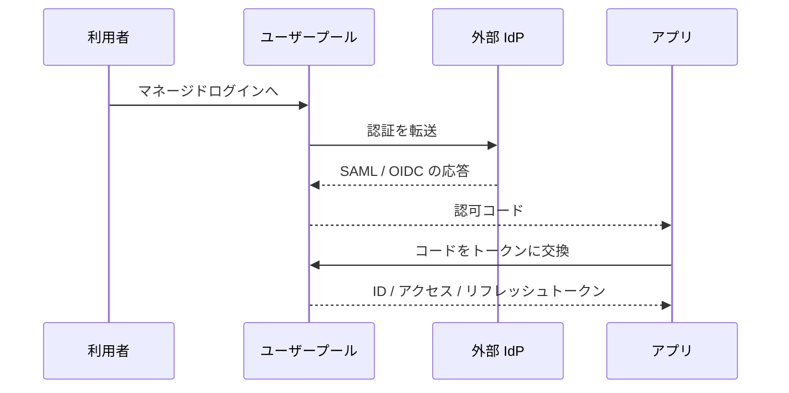
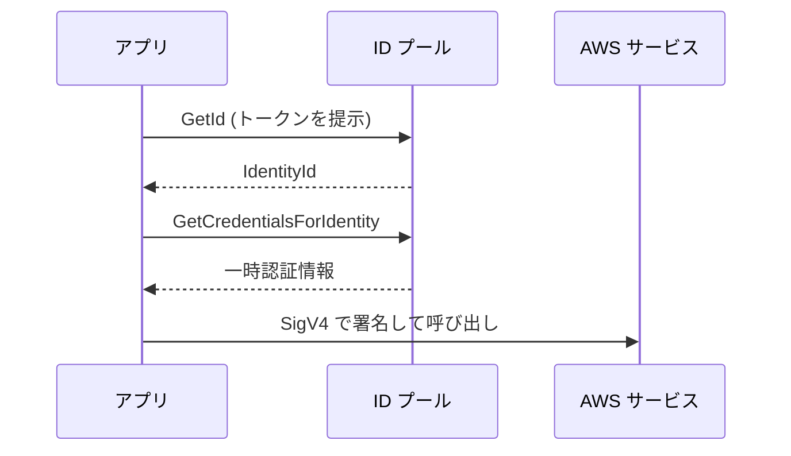

# Amazon Cognito

Web アプリやモバイルアプリの利用者を認証し、API や AWS リソースへのアクセスを制御するサービスです。サインイン機能を自作せず、JWT による認証や AWS 認証情報の発行を任せたいときに使います。

[](../assets/diagrams/cognito-pools.png)

## ユーザープールと ID プール {#user-vs-identity-pools}

名前が似ていますが、役割が違います。

| 観点 | ユーザープール | ID プール |
| --- | --- | --- |
| 役割 | 認証（誰か）。ユーザーディレクトリと OIDC プロバイダー | 認可の橋渡し。外部の ID を AWS 認証情報に交換 |
| 出力 | ID、アクセス、リフレッシュの各トークン（JWT） | 一時的な AWS 認証情報 |
| 使う先 | API Gateway、ALB、自作の API | S3、DynamoDB など AWS サービスへの直接アクセス |
| ゲストアクセス | なし | 未認証ロールで可能 |
| 入力 | ユーザー名とパスワード、ソーシャル、SAML、OIDC | ユーザープールのトークン、ソーシャル、SAML、OIDC |

判断の基準は単純です。自作 API を呼ぶならユーザープール、クライアントから AWS サービスを直接呼ぶなら ID プールも加えます。

## フェデレーション {#federation}

ユーザープールは、ソーシャル ID プロバイダー、SAML、OIDC と連携できます。連携したユーザーにも、ユーザープールの形式でトークンが発行されるので、アプリ側はプロバイダーの違いを意識せずに済みます。



連携ユーザーの認証は IdP 側に任されるので、Cognito の MFA は適用されません。MFA は IdP 側で設定します。

## マネージドログイン {#managed-login}

ユーザープールにドメインを設定すると、サインイン画面と OAuth 2.0 / OIDC のエンドポイントが使えるようになります。画面はマネージドログインと、第 1 世代のホスト UI（クラシック）から選びます。ドメインごとにどちらか一方です。

| エンドポイント | 用途 |
| --- | --- |
| `/oauth2/authorize` | サインインの開始 |
| `/oauth2/token` | コードやリフレッシュトークンをトークンに交換 |
| `/oauth2/userInfo` | アクセストークンでユーザー情報を取得 |

マネージドログインのブランディングエディタは、機能プランによって使えない場合があります。自前の画面にしたい場合は、SDK から `InitiateAuth` などの API を呼びます。ただし API での認証で発行されるアクセストークンのスコープは `aws.cognito.signin.user.admin` に限られます。

## OAuth フロー {#oauth-flows}

| グラント | 主な用途 | 発行されるトークン | 注意点 |
| --- | --- | --- | --- |
| 認可コード | Web、モバイル（第一の選択肢） | ID、アクセス、リフレッシュ | 公開クライアントでは PKCE を併用 |
| 暗黙的 | レガシー | ID、アクセス | トークンが URL に出る。新規には使わない |
| クライアント認証情報 | サービス間（M2M） | アクセスのみ | クライアントシークレット必須。追加料金あり |
| リフレッシュトークン | トークンの更新 | ID、アクセス（設定によりリフレッシュも） | トークンエンドポイントへ直接送る |

クライアント認証情報は、同じアプリクライアントで認可コードや暗黙的グラントと併用できません。また、アクセストークンのカスタムスコープは、リソースサーバーを定義して使います。

## トークン {#tokens}

| トークン | 形式 | 内容 | 使う場面 | 有効期間 |
| --- | --- | --- | --- | --- |
| ID トークン | JWT | `email` などのユーザー属性、`aud`、`cognito:groups` | アプリが本人情報を読む。ID プールとの交換 | 5 分〜1 日 |
| アクセストークン | JWT | `scope`、`client_id`、`cognito:groups` | API の認可、ユーザー自身の Cognito API | 5 分〜1 日 |
| リフレッシュトークン | 暗号化され、中身は不透明 | - | 新しいトークンの取得 | 既定 30 日。60 分〜10 年 |

有効期間はアプリクライアントごとに設定します。トークンは暗号化ではなく base64url エンコードなので、誰でも中身を読めます。秘密情報を入れないようにします。

- **リフレッシュトークンのローテーション**: 有効にすると更新のたびに新しいリフレッシュトークンが発行される。ただし有効期限は最初のトークンの期間のまま延びない。
- **失効**: `RevokeToken` で失効できる。

### JWT の検証 {#jwt-verification}

署名が正しくても、別のユーザープールやアプリ向けのトークンかもしれません。次のすべてを確認します。

1. JWT の形式（ヘッダー、ペイロード、署名の 3 部構成）を確認する。
2. ヘッダーの `kid` に一致する公開鍵を、ユーザープールの JWKS から取得する。
3. RS256 の署名を検証する。
4. `exp` で期限を確認する。
5. `iss` がユーザープールの URL と一致することを確認する。
6. ID トークンは `aud`、アクセストークンは `client_id` がアプリクライアント ID と一致することを確認する。
7. `token_use` が想定どおり（`id` または `access`）か確認する。

JWKS と発行者の URL は次の形式です。

```text
https://cognito-idp.<Region>.amazonaws.com/<userPoolId>/.well-known/jwks.json
https://cognito-idp.<Region>.amazonaws.com/<userPoolId>
```

Python の例です（PyJWT を使用）。Node.js なら、AWS が推奨する `aws-jwt-verify` が使えます。

```python
import jwt  # PyJWT

REGION = "ap-northeast-1"
POOL_ID = "ap-northeast-1_EXAMPLE"
CLIENT_ID = "1example23456789"
ISSUER = f"https://cognito-idp.{REGION}.amazonaws.com/{POOL_ID}"
jwks = jwt.PyJWKClient(f"{ISSUER}/.well-known/jwks.json")


def verify_access_token(token: str) -> dict:
    key = jwks.get_signing_key_from_jwt(token)
    claims = jwt.decode(
        token,
        key.key,
        algorithms=["RS256"],
        issuer=ISSUER,
        options={"verify_aud": False},  # アクセストークンには通常 aud がない
    )
    if claims.get("token_use") != "access" or claims.get("client_id") != CLIENT_ID:
        raise ValueError("invalid token")
    return claims
```

署名と期限の確認だけでは、失効したトークンを検出できません。失効をすぐ反映したいなら、アクセストークンの有効期間を短くするか、Cognito に問い合わせます。署名キーはローテーションされることがあるので、`kid` をキーに公開鍵をキャッシュし、未知の `kid` が来たら取り直します。

### ベアラートークンでの保護 {#bearer-tokens}

ベアラートークンは、持っている人なら誰でも使えるトークンです。次の点を守ります。

- 必ず HTTPS で送る。`Authorization: Bearer <token>` が一般的な形式。
- 受け取る側は毎回検証する。デコードしただけで信用しない。
- ログや URL に出さない。
- ブラウザやアプリでは、できるだけ安全な場所に保存する。トークンには個人情報が含まれる場合がある。
- 有効期間を短くし、リフレッシュトークンで更新する。
- 用途に合ったトークンを使う。API の認可にはアクセストークンとスコープ、本人情報には ID トークン。

## API Gateway との統合 {#api-gateway}

| API の種類 | オーソライザー | トークン | 検証の内容 |
| --- | --- | --- | --- |
| REST API | `COGNITO_USER_POOLS` | ID またはアクセストークン | スコープ未設定なら ID トークン、設定するとアクセストークン |
| HTTP API | JWT オーソライザー | JWT | `iss`、`aud` または `client_id`、`exp`、スコープ |
| どちらも | Lambda オーソライザー | 任意 | 独自ロジック。テナントや細かい権限の判定に |

REST API の場合、クライアントは既定で `Authorization` ヘッダーにトークンを入れて呼びます。ユーザーのクレームはマッピングテンプレートで `$context.authorizer.claims.sub` のように参照できます。

HTTP API の JWT オーソライザーでは、発行者にユーザープールの URL、オーディエンスにアプリクライアント ID を設定します。

ALB にもユーザープール認証の機能があります。その場合、ターゲットはクレームを `x-amzn-oidc-data` ヘッダーで受け取り、自分で署名を検証します。

## グループとカスタム属性 {#groups-attributes}

**グループ**はユーザーの集合です。

- メンバーシップは ID トークンとアクセストークンの `cognito:groups` に入る。
- グループに IAM ロールを割り当てると、ID プール経由でそのロールの認証情報を受け取れる。
- 複数のグループに属する場合は、`Precedence` の値が小さいグループのロールが `cognito:preferred_role` になる。

**カスタム属性**は、`custom:` が接頭辞の独自属性です。

- ユーザープールごとに最大 50 個、値は最大 2048 文字。
- 追加した後は、削除も名前の変更もできない。データ型や変更可否も変えられない。
- アプリクライアントごとに読み書きの権限を設定できる。

!!! warning "ユーザーが変更できる属性を権限判定に使わない"
    `custom:tenant_id` のような属性を権限に使うなら、利用者自身が書き換えられないように、アプリクライアントの書き込み権限から外します。

## Lambda トリガー {#lambda-triggers}

サインアップやサインインの途中で Lambda を呼び、動作をカスタマイズできます。カスタム送信者トリガーを除いて同期呼び出しで、Cognito は 5 秒以内の応答を求めます。応答がなければ、再試行することがあります。

| トリガー | タイミング | 用途の例 |
| --- | --- | --- |
| Pre sign-up | サインアップ前 | ドメインの制限、自動確認 |
| Post confirmation | 確認の後 | DB にプロフィールを作成 |
| Pre authentication | 認証の前 | サインインの拒否条件 |
| Post authentication | 認証の後 | ログ、分析 |
| Define / Create / Verify auth challenge | カスタム認証の中 | 独自のチャレンジ |
| Pre token generation | トークン発行の前 | クレームの追加、変更、抑制 |
| User migration | 不明なユーザーのサインイン時 | 既存の認証基盤からの移行 |
| Custom message, Custom sender | メッセージの送信時 | メールや SMS の本文、送信方法の変更 |
| Inbound federation | 連携ユーザーのサインイン時 | IdP の属性の加工 |

Pre token generation のイベントには版があります。

| 版 | カスタマイズできる範囲 | 条件 |
| --- | --- | --- |
| `V1_0` | ID トークン | 基本機能 |
| `V2_0` | ID トークンとアクセストークン（ユーザー認証） | Essentials または Plus プラン（高度なセキュリティ機能を有効にしていた旧 Lite のプールも可） |
| `V3_0` | V2_0 に加えて M2M のアクセストークン | Essentials または Plus プラン |

## MFA {#mfa}

ユーザープールの設定は 3 種類です。

| 設定 | 動作 |
| --- | --- |
| Required | 全ユーザーが MFA を完了する必要がある |
| Optional | 登録した人だけ。アダプティブ認証を使うならこの設定 |
| Off | MFA を使わない |

| 要素 | 必要なもの |
| --- | --- |
| TOTP（認証アプリ） | `AssociateSoftwareToken` と `VerifySoftwareToken` で登録 |
| SMS | 電話番号属性と SMS の設定（Amazon SNS） |
| メール | メール属性、自前の Amazon SES 設定、Essentials または Plus プラン |

- 管理者は `SetUserPoolMfaConfig` でプールの設定を、ユーザーは `SetUserMFAPreference` で自分の優先方法を設定する。
- MFA に使うのと同じ経路に、パスワードリセットのコードは送れない。回復手段を別に用意する。
- 脅威保護（threat protection）のアダプティブ認証を使うと、リスクが高いサインインにだけ MFA を要求できる。

## ID プールとロールマッピング {#identity-pools}

ID プールは、外部の ID を確認して一時的な AWS 認証情報を返します。拡張フローでは次のように呼びます。



基本（クラシック）フローを有効にすると、ロールの選択を迂回して `AssumeRoleWithWebIdentity` を直接呼べます。

ロールは次のいずれかで決まります。

| 方式 | 動作 |
| --- | --- |
| 既定のロール | 認証済みと未認証で別のロールを指定 |
| トークンから選択 | グループのロール（`cognito:preferred_role`、`cognito:roles`）を使う |
| ルールで選択 | クレームと一致したルールのロール。先頭から評価し、最初の一致を使う |

- ルールの一致条件は `Equals`、`NotEqual`、`StartsWith`、`Contains` で、プロバイダーごとに最大 25 個。
- ロールを決められないときは `AmbiguousRoleResolution` に従う（`AuthenticatedRole` または `Deny`）。
- 利用者が変更できるクレームを、強い権限のロールにマッピングしない。

ロールの信頼ポリシーでは、ID プールと認証状態を限定します。

```json
{
  "Effect": "Allow",
  "Principal": {"Federated": "cognito-identity.amazonaws.com"},
  "Action": "sts:AssumeRoleWithWebIdentity",
  "Condition": {
    "StringEquals": {
      "cognito-identity.amazonaws.com:aud": "ap-northeast-1:12345678-abcd-1234-abcd-123456789012"
    },
    "ForAnyValue:StringLike": {
      "cognito-identity.amazonaws.com:amr": "authenticated"
    }
  }
}
```

ユーザーごとにデータを分けるには、ポリシー変数を使います。次の例では、自分の ID で始まるパーティションキーの項目だけにアクセスできます。

```json
{
  "Effect": "Allow",
  "Action": ["dynamodb:GetItem", "dynamodb:PutItem", "dynamodb:Query"],
  "Resource": "arn:aws:dynamodb:*:*:table/UserData",
  "Condition": {
    "ForAllValues:StringEquals": {
      "dynamodb:LeadingKeys": ["${cognito-identity.amazonaws.com:sub}"]
    }
  }
}
```

ID プールの「アクセス制御の属性」を使うと、クレームをセッションタグにして `${aws:PrincipalTag/キー}` で参照できます。この場合、信頼ポリシーに `sts:TagSession` が必要です。

## アプリケーションレベルの認可 {#app-authorization}

IAM は AWS API の認可です。「この注文を編集できるのは作成者か管理者だけ」のような業務ルールは、アプリ側で判定します。

| 手法 | 判定の場所 | 向いている場面 |
| --- | --- | --- |
| スコープ | API Gateway（オーソライザー） | API 単位の粗い制御 |
| グループ（`cognito:groups`） | Lambda オーソライザー、アプリコード | ロールベースの制御 |
| クレーム（テナント ID など） | アプリコード | テナント、属性ベースの制御 |
| 所有者の確認 | アプリコード、データアクセス層 | リソース単位の制御 |
| ID プールと IAM 条件 | IAM | クライアントから AWS を直接呼ぶ場合 |

```python
def lambda_handler(event, context):
    claims = event["requestContext"]["authorizer"]["claims"]
    groups = claims.get("cognito:groups", "").strip("[]").replace(" ", "").split(",")
    order = load_order(event["pathParameters"]["id"])  # アプリ側の関数

    is_admin = "admin" in groups
    if not is_admin and order["owner"] != claims["sub"]:
        return {"statusCode": 403, "body": "forbidden"}
    return {"statusCode": 200, "body": serialize(order)}
```

`requestContext` の形はオーソライザーの種類で異なります。上記は Lambda プロキシ統合の REST API と Cognito オーソライザーの例です。

ポイントは次のとおりです。

- 認可の判定は、必ずサーバー側で行う。
- 主体の識別には、変更できない `sub` を使う。ユーザー名やメールは避ける。
- トークン内の情報は発行時点のものなので、権限の変更はすぐには反映されない。

!!! note "Amazon Verified Permissions"
    業務ルールをアプリから切り離して管理したい場合は、Cedar というポリシー言語を使う Amazon Verified Permissions があります。DVA-C03 の対象サービス一覧には載っていないので、存在を知っておく程度で十分です。

## 試験のポイント {#exam-points}

| こう問われたら | 答え |
| --- | --- |
| Web アプリのサインインと JWT の発行 | ユーザープール |
| モバイルアプリから S3 に直接アップロード | ID プール |
| ログイン前のゲストに限定的な権限を与える | ID プールの未認証ロール |
| サインイン画面を自作したくない | マネージドログイン |
| SPA やモバイルで安全にトークンを取得 | 認可コードグラントと PKCE |
| サービス間の認証 | クライアント認証情報グラント |
| JWT の署名の検証に使うもの | ユーザープールの JWKS と `kid` |
| アクセストークンがどのアプリ向けか確認するクレーム | `client_id`（ID トークンは `aud`） |
| REST API の認可にユーザープールを使う | `COGNITO_USER_POOLS` オーソライザー |
| REST API でスコープを使うときのトークン | アクセストークン |
| トークンに独自のクレームを追加 | Pre token generation トリガー |
| サインアップ時にメールのドメインを検証 | Pre sign-up トリガー |
| 既存のユーザー DB から順次移行 | User migration トリガー |
| グループごとに AWS の権限を変える | グループに IAM ロールを割り当て、ID プールで「トークンから選択」 |
| ユーザーが自分の DynamoDB 項目だけ操作 | `dynamodb:LeadingKeys` と `${cognito-identity.amazonaws.com:sub}` |
| カスタム属性を削除したい | できない |

## 関連ページ {#related}

- [IAM と STS](iam.md): ロール、フェデレーション、条件キー
- [API Gateway](api-gateway.md): オーソライザーの比較
- [Lambda](lambda.md): Lambda トリガーの実装
- [DynamoDB](dynamodb.md): きめ細かいアクセス制御
- [Secrets Manager と Parameter Store](secrets.md): マルチテナントのパターン

## 参考 {#references}

- [Understanding user pool JSON web tokens](https://docs.aws.amazon.com/cognito/latest/developerguide/amazon-cognito-user-pools-using-tokens-with-identity-providers.html)
- [Understanding the identity token](https://docs.aws.amazon.com/cognito/latest/developerguide/amazon-cognito-user-pools-using-the-id-token.html)
- [Understanding the access token](https://docs.aws.amazon.com/cognito/latest/developerguide/amazon-cognito-user-pools-using-the-access-token.html)
- [Refresh tokens](https://docs.aws.amazon.com/cognito/latest/developerguide/amazon-cognito-user-pools-using-the-refresh-token.html)
- [Verifying JSON web tokens](https://docs.aws.amazon.com/cognito/latest/developerguide/amazon-cognito-user-pools-using-tokens-verifying-a-jwt.html)
- [OAuth 2.0 grants](https://docs.aws.amazon.com/cognito/latest/developerguide/federation-endpoints-oauth-grants.html)
- [User pool managed login](https://docs.aws.amazon.com/cognito/latest/developerguide/cognito-user-pools-managed-login.html)
- [Adding groups to a user pool](https://docs.aws.amazon.com/cognito/latest/developerguide/cognito-user-pools-user-groups.html)
- [Working with user attributes](https://docs.aws.amazon.com/cognito/latest/developerguide/user-pool-settings-attributes.html)
- [Customizing user pool workflows with Lambda triggers](https://docs.aws.amazon.com/cognito/latest/developerguide/cognito-user-pools-working-with-lambda-triggers.html)
- [Pre token generation Lambda trigger](https://docs.aws.amazon.com/cognito/latest/developerguide/user-pool-lambda-pre-token-generation.html)
- [Adding MFA to a user pool](https://docs.aws.amazon.com/cognito/latest/developerguide/user-pool-settings-mfa.html)
- [Identity pools authentication flow](https://docs.aws.amazon.com/cognito/latest/developerguide/authentication-flow.html)
- [Using role-based access control](https://docs.aws.amazon.com/cognito/latest/developerguide/role-based-access-control.html)
- [Using attributes for access control](https://docs.aws.amazon.com/cognito/latest/developerguide/attributes-for-access-control.html)
- [Control access to REST APIs using Amazon Cognito user pools](https://docs.aws.amazon.com/apigateway/latest/developerguide/apigateway-integrate-with-cognito.html)
- [Control access to HTTP APIs with JWT authorizers](https://docs.aws.amazon.com/apigateway/latest/developerguide/http-api-jwt-authorizer.html)
- [What is Amazon Verified Permissions?](https://docs.aws.amazon.com/verifiedpermissions/latest/userguide/what-is-avp.html)
