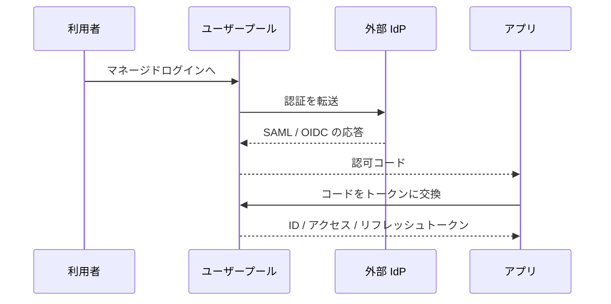
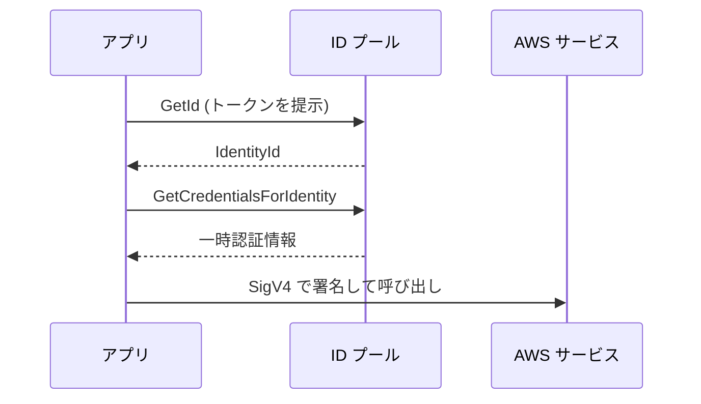

# Amazon Cognito

[:material-sprout: CLF](../courses/clf/services.md){ .exam-badge .exam-foundational } [:material-certificate: SAA](../courses/saa/services.md){ .exam-badge .exam-associate } [:material-certificate: DVA](../courses/dva/services.md){ .exam-badge .exam-associate } [:material-star-circle: SAP](../courses/sap/services.md){ .exam-badge .exam-professional } [:material-star-circle: DOP](../courses/dop/services.md){ .exam-badge .exam-professional } [:material-star-circle: AIP](../courses/aip/services.md){ .exam-badge .exam-professional } [:material-target: SCS](../courses/scs/services.md){ .exam-badge .exam-specialty }

Web アプリやモバイルアプリの利用者を認証し、API や AWS リソースへのアクセスを制御するサービスです。サインイン機能を自作せず、JWT による認証や AWS 認証情報の発行を任せたいときに使います。

[](../assets/diagrams/cognito-pools.png)

## ユーザープールと ID プール {#user-vs-identity-pools}

名前が似ていますが、役割が違います。

| 観点 | ユーザープール | ID プール |
| --- | --- | --- |
| 役割 | 認証（誰か）。ユーザーディレクトリと OIDC プロバイダー | 認可の橋渡し。外部の ID を AWS 認証情報に交換 |
| 出力 | ID、アクセス、リフレッシュの各トークン（JWT） | 一時的な AWS 認証情報 |
| 使う先 | API Gateway、ALB、自作の API | S3、DynamoDB など AWS サービスへの直接アクセス |
| ゲストアクセス | なし | 未認証ロールで可能 |
| 入力 | ユーザー名とパスワード、ソーシャル、SAML、OIDC | ユーザープールのトークン、ソーシャル、SAML、OIDC |

判断の基準は単純です。自作 API を呼ぶならユーザープール、クライアントから AWS サービスを直接呼ぶなら ID プールも加えます。

## フェデレーション {#federation}

ユーザープールは、ソーシャル ID プロバイダー、SAML、OIDC と連携できます。連携したユーザーにも、ユーザープールの形式でトークンが発行されるので、アプリ側はプロバイダーの違いを意識せずに済みます。



連携ユーザーの認証は IdP 側に任されるので、Cognito の MFA は適用されません。MFA は IdP 側で設定します。

## マネージドログイン {#managed-login}

ユーザープールにドメインを設定すると、サインイン画面と OAuth 2.0 / OIDC のエンドポイントが使えるようになります。画面はマネージドログインと、第 1 世代のホスト UI（クラシック）から選びます。ドメインごとにどちらか一方です。

| エンドポイント | 用途 |
| --- | --- |
| `/oauth2/authorize` | サインインの開始 |
| `/oauth2/token` | コードやリフレッシュトークンをトークンに交換 |
| `/oauth2/userInfo` | アクセストークンでユーザー情報を取得 |

マネージドログインのブランディングエディタは、機能プランによって使えない場合があります。自前の画面にしたい場合は、SDK から `InitiateAuth` などの API を呼びます。ただし API での認証で発行されるアクセストークンのスコープは `aws.cognito.signin.user.admin` に限られます。

## OAuth フロー {#oauth-flows}

| グラント | 主な用途 | 発行されるトークン | 注意点 |
| --- | --- | --- | --- |
| 認可コード | Web、モバイル（第一の選択肢） | ID、アクセス、リフレッシュ | 公開クライアントでは PKCE を併用 |
| 暗黙的 | レガシー | ID、アクセス | トークンが URL に出る。新規には使わない |
| クライアント認証情報 | サービス間（M2M） | アクセスのみ | クライアントシークレット必須。追加料金あり |
| リフレッシュトークン | トークンの更新 | ID、アクセス（設定によりリフレッシュも） | トークンエンドポイントへ直接送る |

クライアント認証情報は、同じアプリクライアントで認可コードや暗黙的グラントと併用できません。また、アクセストークンのカスタムスコープは、リソースサーバーを定義して使います。

## トークン {#tokens}

| トークン | 形式 | 内容 | 使う場面 | 有効期間 |
| --- | --- | --- | --- | --- |
| ID トークン | JWT | `email` などのユーザー属性、`aud`、`cognito:groups` | アプリが本人情報を読む。ID プールとの交換 | 5 分〜1 日 |
| アクセストークン | JWT | `scope`、`client_id`、`cognito:groups` | API の認可、ユーザー自身の Cognito API | 5 分〜1 日 |
| リフレッシュトークン | 暗号化され、中身は不透明 | - | 新しいトークンの取得 | 既定 30 日。60 分〜10 年 |

有効期間はアプリクライアントごとに設定します。トークンは暗号化ではなく base64url エンコードなので、誰でも中身を読めます。秘密情報を入れないようにします。

- **リフレッシュトークンのローテーション**: 有効にすると更新のたびに新しいリフレッシュトークンが発行される。ただし有効期限は最初のトークンの期間のまま延びない。
- **失効**: `RevokeToken` で失効できる。

### JWT の検証 {#jwt-verification}

署名が正しくても、別のユーザープールやアプリ向けのトークンかもしれません。次のすべてを確認します。

1. JWT の形式（ヘッダー、ペイロード、署名の 3 部構成）を確認する。
2. ヘッダーの `kid` に一致する公開鍵を、ユーザープールの JWKS から取得する。
3. RS256 の署名を検証する。
4. `exp` で期限を確認する。
5. `iss` がユーザープールの URL と一致することを確認する。
6. ID トークンは `aud`、アクセストークンは `client_id` がアプリクライアント ID と一致することを確認する。
7. `token_use` が想定どおり（`id` または `access`）か確認する。

JWKS と発行者の URL は次の形式です。

```text
https://cognito-idp.<Region>.amazonaws.com/<userPoolId>/.well-known/jwks.json
https://cognito-idp.<Region>.amazonaws.com/<userPoolId>
```

Python の例です（PyJWT を使用）。Node.js なら、AWS が推奨する `aws-jwt-verify` が使えます。

```python
import jwt  # PyJWT

REGION = "ap-northeast-1"
POOL_ID = "ap-northeast-1_EXAMPLE"
CLIENT_ID = "1example23456789"
ISSUER = f"https://cognito-idp.{REGION}.amazonaws.com/{POOL_ID}"
jwks = jwt.PyJWKClient(f"{ISSUER}/.well-known/jwks.json")


def verify_access_token(token: str) -> dict:
    key = jwks.get_signing_key_from_jwt(token)
    claims = jwt.decode(
        token,
        key.key,
        algorithms=["RS256"],
        issuer=ISSUER,
        options={"verify_aud": False},  # アクセストークンには通常 aud がない
    )
    if claims.get("token_use") != "access" or claims.get("client_id") != CLIENT_ID:
        raise ValueError("invalid token")
    return claims
```

署名と期限の確認だけでは、失効したトークンを検出できません。失効をすぐ反映したいなら、アクセストークンの有効期間を短くするか、Cognito に問い合わせます。署名キーはローテーションされることがあるので、`kid` をキーに公開鍵をキャッシュし、未知の `kid` が来たら取り直します。

### ベアラートークンでの保護 {#bearer-tokens}

ベアラートークンは、持っている人なら誰でも使えるトークンです。次の点を守ります。

- 必ず HTTPS で送る。`Authorization: Bearer <token>` が一般的な形式。
- 受け取る側は毎回検証する。デコードしただけで信用しない。
- ログや URL に出さない。
- ブラウザやアプリでは、できるだけ安全な場所に保存する。トークンには個人情報が含まれる場合がある。
- 有効期間を短くし、リフレッシュトークンで更新する。
- 用途に合ったトークンを使う。API の認可にはアクセストークンとスコープ、本人情報には ID トークン。

## API Gateway との統合 {#api-gateway}

| API の種類 | オーソライザー | トークン | 検証の内容 |
| --- | --- | --- | --- |
| REST API | `COGNITO_USER_POOLS` | ID またはアクセストークン | スコープ未設定なら ID トークン、設定するとアクセストークン |
| HTTP API | JWT オーソライザー | JWT | `iss`、`aud` または `client_id`、`exp`、スコープ |
| どちらも | Lambda オーソライザー | 任意 | 独自ロジック。テナントや細かい権限の判定に |

REST API の場合、クライアントは既定で `Authorization` ヘッダーにトークンを入れて呼びます。ユーザーのクレームはマッピングテンプレートで `$context.authorizer.claims.sub` のように参照できます。

HTTP API の JWT オーソライザーでは、発行者にユーザープールの URL、オーディエンスにアプリクライアント ID を設定します。

ALB にもユーザープール認証の機能があります。その場合、ターゲットはクレームを `x-amzn-oidc-data` ヘッダーで受け取り、自分で署名を検証します。

## グループとカスタム属性 {#groups-attributes}

**グループ**はユーザーの集合です。

- メンバーシップは ID トークンとアクセストークンの `cognito:groups` に入る。
- グループに IAM ロールを割り当てると、ID プール経由でそのロールの認証情報を受け取れる。
- 複数のグループに属する場合は、`Precedence` の値が小さいグループのロールが `cognito:preferred_role` になる。

**カスタム属性**は、`custom:` が接頭辞の独自属性です。

- ユーザープールごとに最大 50 個、値は最大 2048 文字。
- 追加した後は、削除も名前の変更もできない。データ型や変更可否も変えられない。
- アプリクライアントごとに読み書きの権限を設定できる。

!!! warning "ユーザーが変更できる属性を権限判定に使わない"
    `custom:tenant_id` のような属性を権限に使うなら、利用者自身が書き換えられないように、アプリクライアントの書き込み権限から外します。

## Lambda トリガー {#lambda-triggers}

サインアップやサインインの途中で Lambda を呼び、動作をカスタマイズできます。カスタム送信者トリガーを除いて同期呼び出しで、Cognito は 5 秒以内の応答を求めます。応答がなければ、再試行することがあります。

| トリガー | タイミング | 用途の例 |
| --- | --- | --- |
| Pre sign-up | サインアップ前 | ドメインの制限、自動確認 |
| Post confirmation | 確認の後 | DB にプロフィールを作成 |
| Pre authentication | 認証の前 | サインインの拒否条件 |
| Post authentication | 認証の後 | ログ、分析 |
| Define / Create / Verify auth challenge | カスタム認証の中 | 独自のチャレンジ |
| Pre token generation | トークン発行の前 | クレームの追加、変更、抑制 |
| User migration | 不明なユーザーのサインイン時 | 既存の認証基盤からの移行 |
| Custom message, Custom sender | メッセージの送信時 | メールや SMS の本文、送信方法の変更 |
| Inbound federation | 連携ユーザーのサインイン時 | IdP の属性の加工 |

Pre token generation のイベントには版があります。

| 版 | カスタマイズできる範囲 | 条件 |
| --- | --- | --- |
| `V1_0` | ID トークン | 基本機能 |
| `V2_0` | ID トークンとアクセストークン（ユーザー認証） | Essentials または Plus プラン（高度なセキュリティ機能を有効にしていた旧 Lite のプールも可） |
| `V3_0` | V2_0 に加えて M2M のアクセストークン | Essentials または Plus プラン |

## MFA {#mfa}

ユーザープールの設定は 3 種類です。

| 設定 | 動作 |
| --- | --- |
| Required | 全ユーザーが MFA を完了する必要がある |
| Optional | 登録した人だけ。アダプティブ認証を使うならこの設定 |
| Off | MFA を使わない |

| 要素 | 必要なもの |
| --- | --- |
| TOTP（認証アプリ） | `AssociateSoftwareToken` と `VerifySoftwareToken` で登録 |
| SMS | 電話番号属性と SMS の設定（Amazon SNS） |
| メール | メール属性、自前の Amazon SES 設定、Essentials または Plus プラン |

- 管理者は `SetUserPoolMfaConfig` でプールの設定を、ユーザーは `SetUserMFAPreference` で自分の優先方法を設定する。
- MFA に使うのと同じ経路に、パスワードリセットのコードは送れない。回復手段を別に用意する。
- 脅威保護（threat protection）のアダプティブ認証を使うと、リスクが高いサインインにだけ MFA を要求できる。

## ID プールとロールマッピング {#identity-pools}

ID プールは、外部の ID を確認して一時的な AWS 認証情報を返します。拡張フローでは次のように呼びます。



基本（クラシック）フローを有効にすると、ロールの選択を迂回して `AssumeRoleWithWebIdentity` を直接呼べます。

ロールは次のいずれかで決まります。

| 方式 | 動作 |
| --- | --- |
| 既定のロール | 認証済みと未認証で別のロールを指定 |
| トークンから選択 | グループのロール（`cognito:preferred_role`、`cognito:roles`）を使う |
| ルールで選択 | クレームと一致したルールのロール。先頭から評価し、最初の一致を使う |

- ルールの一致条件は `Equals`、`NotEqual`、`StartsWith`、`Contains` で、プロバイダーごとに最大 25 個。
- ロールを決められないときは `AmbiguousRoleResolution` に従う（`AuthenticatedRole` または `Deny`）。
- 利用者が変更できるクレームを、強い権限のロールにマッピングしない。

ロールの信頼ポリシーでは、ID プールと認証状態を限定します。

```json
{
  "Effect": "Allow",
  "Principal": {"Federated": "cognito-identity.amazonaws.com"},
  "Action": "sts:AssumeRoleWithWebIdentity",
  "Condition": {
    "StringEquals": {
      "cognito-identity.amazonaws.com:aud": "ap-northeast-1:12345678-abcd-1234-abcd-123456789012"
    },
    "ForAnyValue:StringLike": {
      "cognito-identity.amazonaws.com:amr": "authenticated"
    }
  }
}
```

ユーザーごとにデータを分けるには、ポリシー変数を使います。次の例では、自分の ID で始まるパーティションキーの項目だけにアクセスできます。

```json
{
  "Effect": "Allow",
  "Action": ["dynamodb:GetItem", "dynamodb:PutItem", "dynamodb:Query"],
  "Resource": "arn:aws:dynamodb:*:*:table/UserData",
  "Condition": {
    "ForAllValues:StringEquals": {
      "dynamodb:LeadingKeys": ["${cognito-identity.amazonaws.com:sub}"]
    }
  }
}
```

ID プールの「アクセス制御の属性」を使うと、クレームをセッションタグにして `${aws:PrincipalTag/キー}` で参照できます。この場合、信頼ポリシーに `sts:TagSession` が必要です。

## アプリケーションレベルの認可 {#app-authorization}

IAM は AWS API の認可です。「この注文を編集できるのは作成者か管理者だけ」のような業務ルールは、アプリ側で判定します。

| 手法 | 判定の場所 | 向いている場面 |
| --- | --- | --- |
| スコープ | API Gateway（オーソライザー） | API 単位の粗い制御 |
| グループ（`cognito:groups`） | Lambda オーソライザー、アプリコード | ロールベースの制御 |
| クレーム（テナント ID など） | アプリコード | テナント、属性ベースの制御 |
| 所有者の確認 | アプリコード、データアクセス層 | リソース単位の制御 |
| ID プールと IAM 条件 | IAM | クライアントから AWS を直接呼ぶ場合 |

```python
def lambda_handler(event, context):
    claims = event["requestContext"]["authorizer"]["claims"]
    groups = claims.get("cognito:groups", "").strip("[]").replace(" ", "").split(",")
    order = load_order(event["pathParameters"]["id"])  # アプリ側の関数

    is_admin = "admin" in groups
    if not is_admin and order["owner"] != claims["sub"]:
        return {"statusCode": 403, "body": "forbidden"}
    return {"statusCode": 200, "body": serialize(order)}
```

`requestContext` の形はオーソライザーの種類で異なります。上記は Lambda プロキシ統合の REST API と Cognito オーソライザーの例です。

ポイントは次のとおりです。

- 認可の判定は、必ずサーバー側で行う。
- 主体の識別には、変更できない `sub` を使う。ユーザー名やメールは避ける。
- トークン内の情報は発行時点のものなので、権限の変更はすぐには反映されない。

!!! note "Amazon Verified Permissions"
    業務ルールをアプリから切り離して管理したい場合は、Cedar というポリシー言語を使う Amazon Verified Permissions があります。DVA-C03 の対象サービス一覧には載っていないので、存在を知っておく程度で十分です。

## ユーザープールの設定 {#user-pool-settings}

作成後に変えられないものがあるので、作る前に決めます。

### 機能プラン {#feature-plans}

プランはユーザープールごとに選び、アプリクライアントごとには分けられません。新しいプールの既定は Essentials です。

| プラン | 主な機能 |
| --- | --- |
| Lite | 基本のサインイン、クラシックのホスト UI |
| Essentials | Lite に加えて、マネージドログインのビジュアルエディタ、メール MFA、パスワードレス、パスキー、アクセストークンのカスタマイズ、パスワード再利用の禁止 |
| Plus | Essentials に加えて、脅威保護（漏えい認証情報の検出、アダプティブ認証）、ユーザーアクティビティのログとエクスポート |

以前の「高度なセキュリティ機能」は、今は Essentials と Plus に分かれています。古い教材で高度なセキュリティ機能とされているものは、プランで読み替えます。

### サインイン属性 {#sign-in-attributes}

サインインに使う属性は 2 つの方式から選びます。**作成後は変更できません。**

| 要件 | エイリアス属性 | ユーザー名属性 |
| --- | --- | --- |
| 複数の属性でサインイン | 可（ユーザー名、`preferred_username`、メール、電話） | 不可 |
| サインインに使う前にメールや電話の確認が必要 | 必要 | 不要 |
| 同じメールや電話を別のユーザーに設定できる | 可 | 不可 |

メールアドレスでだけサインインさせたいなら、ユーザー名属性で `email` を選びます。

必須属性も作成後に変更できません。必須にした属性はサインアップで必要になり、値がないと登録に失敗します。

### 標準属性とカスタム属性 {#attribute-settings}

| 項目 | 内容 |
| --- | --- |
| 標準属性 | OIDC の仕様に基づく `email`, `phone_number`, `name` など。`sub` 以外は既定で任意。値は既定で最大 2,048 文字 |
| `sub` | ユーザーごとの固定の一意 ID。特定の UUID 形式ではないので、形式を検証しない |
| `email_verified`, `phone_number_verified` | 確認済みかどうか |
| カスタム属性 | 最大 50 個。文字列、数値、真偽値、日時を定義できる |

カスタム属性は値を文字列として保存、送信します。必須にはできません。削除、改名、型の変更もできません。

`custom:tier` を数値で定義しても、ID トークンでは `"3"` という文字列です。コードで数値と比較すると失敗します。

### パスワードポリシー {#password-policy}

| 設定 | 範囲、既定 |
| --- | --- |
| `MinimumLength` | 6〜99。値がいくつでも、利用者は 256 文字までのパスワードを使える |
| `RequireUppercase`, `RequireLowercase`, `RequireNumbers`, `RequireSymbols` | 各文字種の必須 |
| `TemporaryPasswordValidityDays` | 0〜365。既定 7 日。0 は既定値の扱い |
| `PasswordHistorySize` | 0〜24。Essentials 以上で利用可 |

`AdminCreateUser` で作った利用者が 7 日以内にサインインしないと、一時パスワードは使えなくなります。管理者が `AdminCreateUser` の `MessageAction=RESEND` で送り直すか、`AdminSetUserPassword` を使います。

### 確認コードの有効期間 {#confirmation-codes}

| コード | 有効期間 |
| --- | --- |
| サインアップ確認のコードまたはリンク | 24 時間 |
| パスワードリセットのコード | 1 時間 |

自分でサインアップした利用者は、確認するまでサインインできません。Pre sign-up トリガーの `autoConfirmUser` で自動確認にできます。

### MFA の設定 {#mfa-settings}

`Required` にして、MFA の要素を設定できない利用者は、サインインできなくなります。

- MFA を有効にして SMS やメールを選ぶと、確認していない属性にも送れる。完了後に確認済みになる。
- MFA を `Required` にして複数の要素を有効にすると、新規の利用者に選ばせる。
- パスキーは `FactorConfiguration` を `MULTI_FACTOR_WITH_USER_VERIFICATION` にすれば、ユーザー検証付きで MFA を満たせる。
- メール MFA を優先する利用者は、パスワードリセットのコードをメールで受け取れない。`AccountRecoverySetting` に別の経路を用意する。

### メールと SMS の送信 {#messaging-settings}

| 経路 | 内容 |
| --- | --- |
| 既定のメール | Cognito 内蔵。1 日の送信数に上限あり。差出人は `no-reply@verificationemail.com` か、SES で確認した自分のアドレス |
| SES のメール | 自分の SES を使う。メール MFA には必須（Essentials 以上） |
| SMS | Amazon SNS 経由、または AWS End User Messaging SMS の直接利用。同時に使えるのはどちらか一方。新しいプールには直接利用を推奨 |

SMS は最初はサンドボックスで、確認済みの番号にしか送れません。本番前に本番アクセスを申請します。

### アプリクライアント {#app-client-settings}

1 つのプールに、アプリごとのクライアントを作ります。

| 設定 | 既定、範囲 | 変更の効果 |
| --- | --- | --- |
| `GenerateSecret` | 既定はなし | 作成後に有無を変えられない |
| `ExplicitAuthFlows` | 未指定なら `ALLOW_REFRESH_TOKEN_AUTH`, `ALLOW_USER_SRP_AUTH`, `ALLOW_CUSTOM_AUTH` | 許可する認証フロー |
| `IdTokenValidity`, `AccessTokenValidity` | 既定 1 時間。5 分〜1 日 | `TokenValidityUnits` で単位を指定 |
| `RefreshTokenValidity` | 既定 30 日。60 分〜10 年 | 0 にすると 30 日になる |
| `AuthSessionValidity` | 3〜15 分 | チャレンジに応答するまでの時間 |
| `EnableTokenRevocation` | 既定で有効 | `RevokeToken` を使えるか |
| `PreventUserExistenceErrors` | API の既定は `LEGACY` | `ENABLED` でユーザーの存在を隠す |
| `ReadAttributes`, `WriteAttributes` | 未指定なら標準属性 | クライアントが読み書きできる属性 |
| `CallbackURLs`, `LogoutURLs` | クライアントごとに最大 100 | 許可するリダイレクト先 |
| `DefaultRedirectURI` | `CallbackURLs` の中から | IdP が 1 つのとき `redirect_uri` の代わりになる |
| `RefreshTokenRotation` | 既定は無効 | 更新のたびにリフレッシュトークンも発行 |

**認証フロー**の選び方です。

| フロー | 動作 | 向いている場面 |
| --- | --- | --- |
| `ALLOW_USER_SRP_AUTH` | SRP でパスワードを送らない | 通常のクライアント |
| `ALLOW_USER_PASSWORD_AUTH` | パスワードを平文のまま TLS で送る | User migration トリガー |
| `ALLOW_ADMIN_USER_PASSWORD_AUTH` | 管理者 API でパスワードを送る | サーバー側のアプリ |
| `ALLOW_CUSTOM_AUTH` | Lambda トリガーのカスタム認証 | 独自のチャレンジ |
| `ALLOW_USER_AUTH` | 選択式サインイン。パスワード、SRP、パスワードレス、パスキー | Essentials 以上 |
| `ALLOW_REFRESH_TOKEN_AUTH` | リフレッシュトークンでの更新 | ほぼ常に |

**クライアントシークレット**は、公開クライアント（ブラウザ、モバイル）には付けません。付けると、すべての API リクエストに `SECRET_HASH` が必要になり、ブラウザに秘密を置くことになります。

機密クライアントは同時に 2 つのシークレットを持てるので、停止せずにローテーションできます。

**トークンの更新**では、リフレッシュトークンのローテーションを有効にすると、`REFRESH_TOKEN_AUTH` フローと両立しません。`GetTokensFromRefreshToken` を使います。

更新後のリフレッシュトークンの有効期限は延びません。30 日に設定して毎日更新しても、最初のサインインから 30 日で切れ、再認証が必要です。

**アクセストークンの有効期間と失効**: 有効期間を 1 日にすると、権限を変えても最長 1 日は古いクレームのトークンが使えます。短いほど再発行の回数が増えます。

### OAuth の設定 {#oauth-settings}

| 設定 | 内容 |
| --- | --- |
| `AllowedOAuthFlows` | `code`, `implicit`, `client_credentials` |
| `AllowedOAuthFlowsUserPoolClient` | OAuth を使うには `true`。API で未指定なら無効 |
| `AllowedOAuthScopes` | `openid`, `email`, `phone`, `profile`, `aws.cognito.signin.user.admin`, カスタムスコープ。クライアントごとに最大 50 個 |
| `SupportedIdentityProviders` | `COGNITO` や連携先の IdP |

- `client_credentials` は、許可するフローの中で単独でなければならない。
- `redirect_uri` は `CallbackURLs` に登録したものと一致する必要がある。絶対 URI で、フラグメントは含められない。

M2M のアクセストークンは `/oauth2/token` の他に、`GetClientToken` API でも取得できます。この場合はドメイン不要で、クライアントのフローは `ALLOW_CLIENT_TOKEN_AUTH` だけにします。

### ドメイン {#domain-settings}

| 種類 | 形式 | 証明書 |
| --- | --- | --- |
| プレフィックスドメイン | `<prefix>.auth.<region>.amazoncognito.com` | 不要。プレフィックスに `aws`, `amazon`, `cognito` は使えない |
| カスタムドメイン | `auth.example.com` | ACM の証明書を `us-east-1` に用意する |

カスタムドメインの親ドメインには、有効な DNS の A レコードが必要です。Cognito は CloudFront ディストリビューションを作るので、プールが東京にあっても証明書は `us-east-1` です。

`jwks.json` と `openid-configuration` は、自分のドメインではなく `cognito-idp.<region>.amazonaws.com/<userPoolId>/` にあります。

### リソースサーバーとカスタムスコープ {#resource-servers}

リソースサーバーは、保護する API を表す識別子とスコープの定義です。

```bash
aws cognito-idp create-resource-server \
  --user-pool-id ap-northeast-1_EXAMPLE \
  --identifier orders-api --name Orders \
  --scopes ScopeName=read,ScopeDescription=read ScopeName=write,ScopeDescription=write
```

トークンの `scope` は `orders-api/read` になります。API Gateway のオーソライザーには、この完全な名前を設定します。

プールあたりのリソースサーバーは既定で 100 個で（最大 300）、スコープはサーバーあたり 100 個までです。

### グループ {#group-settings}

| 項目 | 内容 |
| --- | --- |
| `Precedence` | 0 以上の整数で、0 が最優先。既定は null で、優先度が最も低い |
| `RoleArn` | グループに割り当てる IAM ロール |
| 上限 | プールあたり 10,000、ユーザーあたり 100 |

`admin`（Precedence 1、管理ロール）と `staff`（Precedence 10、閲覧ロール）の両方に属すなら、`cognito:preferred_role` は管理ロールになります。

同じ `Precedence` で異なるロールだと、`cognito:preferred_role` は設定されず、`cognito:roles` だけになります。ID プール側の `AmbiguousRoleResolution` に従います。

### 脅威保護 {#threat-protection}

Plus プランの機能です。**監査のみ**で始めて 2 週間以上ログを見てから、**全機能**にするのが AWS の推奨です。

| 機能 | 動作 |
| --- | --- |
| 漏えい認証情報の検出 | サインイン、サインアップ、パスワード変更の際に確認。サインインをブロックまたは許可 |
| アダプティブ認証 | セッションにリスク（High, Medium, Low, No Risk）を付けて、レベルごとに応答を決める |
| IP の例外 | `Always block` と `Always allow`（全機能モード） |
| ログのエクスポート | ユーザーアクティビティのログを外部に送る |

| 応答 | 動作 |
| --- | --- |
| 許可 | そのまま通す |
| Optional MFA | 第 2 要素を設定した人だけチャレンジ。未設定でも通る |
| Require MFA | 第 2 要素を設定した人にチャレンジ。未設定ならブロック |
| Block | ブロック |

API でサインインするアプリは、`UserContextData` や `ContextData` で利用者の IP とデバイスの情報を渡します。公開クライアントで IP を含めるには、アプリクライアントの `EnablePropagateAdditionalUserContextData` を有効にします。

## Lambda トリガーの詳細 {#trigger-details}

共通の動作です。

- カスタム送信者以外は同期呼び出し。5 秒で固定で、変更できない。
- 再試行する場合があるが、`500`〜`599` の Invoke エラーは再試行しない。
- 応答に受け取ったイベントを返さない、またはエラーを返すと、その処理は失敗する。
- コンソール以外で設定すると、関数のリソースベースポリシーが作られない。関数のリソースベースポリシーで、自分のユーザープールからの呼び出しを許可しないと失敗する。
- トリガーに関数のバージョンは直接指定できない。エイリアスを指定する。

| トリガー | 呼ばれるとき | 応答でできること | 注意 |
| --- | --- | --- | --- |
| Pre sign-up | サインアップの前。`triggerSource` は `PreSignUp_SignUp`, `PreSignUp_AdminCreateUser`, `PreSignUp_ExternalProvider` | `autoConfirmUser`, `autoVerifyEmail`, `autoVerifyPhone`。エラーで拒否 | `AdminCreateUser` では 3 つの応答は無視される |
| Post confirmation | 確認の後（`ConfirmSignUp`、管理者の確認、パスワードリセットの確認） | 処理の追加 | 初回ウェルカム処理は `triggerSource` で分ける |
| Pre authentication | サインインの試行時 | エラーで拒否 | 存在しないユーザーでは呼ばれない（`PreventUserExistenceErrors` が `ENABLED` なら呼ばれる）。セッションの更新では呼ばれない |
| Post authentication | 認証の後 | ログなど | イベントを返さないと認証が完了しないことがある |
| Define auth challenge | カスタム認証の最初と各ステップ後 | `challengeName`, `issueTokens`, `failAuthentication` | `ALLOW_CUSTOM_AUTH` が必要 |
| Create auth challenge | `CUSTOM_CHALLENGE` のとき | `publicChallengeParameters`, `privateChallengeParameters` | 正解は private 側に置く |
| Verify auth challenge response | 回答を受けたとき | `answerCorrect` | |
| Pre token generation | トークン発行の前 | クレームとスコープの変更 | `sub` は変更不可 |
| User migration | 存在しないユーザーのサインイン時、パスワード忘れのとき | `finalUserStatus`, `messageAction` など | パスワード付きサインインのみ。パスワードレスでは呼ばれない |
| Custom message | メッセージの送信前 | `smsMessage`, `emailSubject`, `emailMessage` | `codeParameter` を本文に含める |
| Custom sender | メッセージの送信時 | 自前の送信経路 | コードは KMS で暗号化されて届く。関数で復号する |
| Inbound federation | 連携ユーザーのサインイン時 | `userAttributesToMap` | 省略した属性は消える。空の `{}` なら変更なし |

**User migration** の例です。既存の DB で確認できたら属性を返し、`finalUserStatus` を `CONFIRMED`、`messageAction` を `SUPPRESS` にすると、利用者に何も意識させず移行できます。`SRP` はパスワードを Cognito に渡さないので、移行中のクライアントは `USER_PASSWORD_AUTH` を使います。

**Pre token generation** の主な応答です。

| パラメータ | 内容 | 版 |
| --- | --- | --- |
| `claimsToAddOrOverride`, `claimsToSuppress` | クレームの追加、変更、削除 | すべて |
| `groupOverrideDetails` | `groupsToOverride`, `iamRolesToOverride`, `preferredRole` | すべて |
| `scopesToAdd`, `scopesToSuppress` | アクセストークンのスコープ | `V2_0`, `V3_0` |

既定で送られるのは `V1_0` です。`V2_0` にするには、コンソールで版を選ぶか、`LambdaVersion` を指定します。`V1_0` のままアクセストークンを変えようとしても、反映されません。

## ID プールの設定 {#identity-pool-settings}

### 認証の設定 {#identity-pool-auth}

| 設定 | 動作 |
| --- | --- |
| ゲストアクセス | 有効にすると未認証の ID を発行し、未認証ロールの認証情報を返す。無効なら未認証の ID は発行されない |
| 既定の認証済みロール、未認証ロール | ルールやトークンで決まらないときのロール |
| 基本フロー | `AllowClassicFlow`。有効にすると `GetOpenIdToken` と `AssumeRoleWithWebIdentity` を使える |

### 拡張フローと基本フロー {#enhanced-basic-flow}

| 観点 | 拡張フロー | 基本（クラシック）フロー |
| --- | --- | --- |
| API の順序 | `GetId`, `GetCredentialsForIdentity` | `GetId`, `GetOpenIdToken`, `AssumeRoleWithWebIdentity` |
| ロールの決定 | ID プールの設定 | アプリが `RoleArn` を指定 |
| ロールマッピング | 使える | 使えない |

ロールマッピングがあるプールで基本フローを呼ぶと、`Basic (classic) flow is not supported with RoleMappings, please use enhanced flow.` というエラーになります。

### ロールマッピング {#role-mapping}

| 設定 | 内容 |
| --- | --- |
| `Type` | `Token`（トークンから選択）または `Rules`（ルール） |
| `AmbiguousRoleResolution` | `AuthenticatedRole` または `Deny` |
| ルールの条件 | `Claim`, `MatchType`（`Equals`, `NotEqual`, `StartsWith`, `Contains`）, `Value`, `RoleARN` |
| ルールの数 | プロバイダーごとに 25 個。引き上げ不可 |

**トークンから選択**するときの順序です。

1. `GetCredentialsForIdentity` の `CustomRoleArn` があり、`cognito:roles` に含まれていればそれを使う。含まれていなければ拒否する。
2. `cognito:preferred_role` があれば使う。
3. どちらもなければ、`AmbiguousRoleResolution` に従う。

カスタム属性をルールで使うときは、`custom:` を付けます。マッピングに使うロールを登録する人には `iam:PassRole` が必要です。

### 開発者認証 {#developer-authenticated}

自前の認証基盤でログインした利用者に、ID プールの認証情報を発行します。

1. ID プールに開発者プロバイダー名を設定する。後から変更も削除もできない。
2. バックエンドが AWS の認証情報で `GetOpenIdTokenForDeveloperIdentity` を呼ぶ。`TokenDuration` は既定 15 分、最大 86,400 秒。
3. 返ったトークンで、クライアントが `GetCredentialsForIdentity` を呼ぶ。`Logins` のキーはトークンの `iss` と完全に一致させる。

一致しないと、`NotAuthorizedException: Invalid login token. Issuer doesn't match providerName` になります。

## API Gateway のオーソライザーの設定 {#authorizer-settings}

### REST API（COGNITO_USER_POOLS） {#rest-authorizer-settings}

| 設定 | 内容 |
| --- | --- |
| `providerARNs` | ユーザープールの ARN。1 つのオーソライザーに最大 1,000 個 |
| `identitySource` | トークンのヘッダー。`method.request.header.Authorization` |
| `identityValidationExpression` | トークンの `aud` を検証する正規表現。アクセストークンには `aud` がないので拒否される |
| メソッドの `authorizationScopes` | 設定するとアクセストークンを要求し、スコープを 1 つでも含めば通す |

- スコープ未設定で ID トークンの代わりにアクセストークンを送ると、拒否される。
- スコープが一致しなければ `401 Unauthorized`。
- コンソールのオーソライザーのテストには ID トークンを使う。アクセストークンでは試せない。

### HTTP API（JWT オーソライザー） {#http-authorizer-settings}

| 設定 | 値 |
| --- | --- |
| `identitySource` | `$request.header.Authorization` |
| `issuer`（CLI と CloudFormation では `Issuer`） | `https://cognito-idp.<region>.amazonaws.com/<userPoolId>` |
| `audience` | アプリクライアント ID |
| ルートの `authorizationScopes` | 少なくとも 1 つを含むこと |

API Gateway は `kid`, `iss`, `aud` または `client_id`, `exp`, `nbf`, `iat` を確認します。公開鍵はベストエフォートで最大 2 時間キャッシュします。使える署名は RSA 系だけです。

ID トークンとアクセストークンは、JWT の構造だけでは区別できません。ID トークンの利用が必須でなければ、スコープの設定を推奨します。

## 既定値と上限のまとめ {#numbers}

| 項目 | 値 |
| --- | --- |
| ID トークン、アクセストークン | 既定 1 時間。5 分〜1 日 |
| リフレッシュトークン | 既定 30 日。60 分〜10 年 |
| 認証セッション（`AuthSessionValidity`） | 3〜15 分 |
| 一時パスワード | 既定 7 日。最大 365 日 |
| パスワードの最小長 | 6〜99 |
| パスワード履歴 | 0〜24 |
| サインアップ確認のコード | 24 時間 |
| パスワードリセットのコード | 1 時間 |
| Lambda トリガーの応答 | 5 秒（変更不可） |
| カスタム属性 | 50 個。値は 2,048 文字まで |
| アプリクライアント | プールあたり 1,000（最大 10,000） |
| 同時に持てるクライアントシークレット | 2 つ |
| コールバック URL | クライアントあたり 100 |
| スコープ | リソースサーバーあたり 100、クライアントあたり 50 |
| リソースサーバー | プールあたり 100（最大 300） |
| グループ | プールあたり 10,000、ユーザーあたり 100 |
| ID プールのルール | プロバイダーあたり 25 |
| REST API オーソライザーのプール数 | 1,000 |
| 開発者トークンの `TokenDuration` | 既定 15 分。最大 86,400 秒 |

## 試験のポイント {#exam-points}

| こう問われたら | 答え |
| --- | --- |
| Web アプリのサインインと JWT の発行 | ユーザープール |
| モバイルアプリから S3 に直接アップロード | ID プール |
| ログイン前のゲストに限定的な権限を与える | ID プールの未認証ロール |
| サインイン画面を自作したくない | マネージドログイン |
| SPA やモバイルで安全にトークンを取得 | 認可コードグラントと PKCE |
| サービス間の認証 | クライアント認証情報グラント |
| JWT の署名の検証に使うもの | ユーザープールの JWKS と `kid` |
| アクセストークンがどのアプリ向けか確認するクレーム | `client_id`（ID トークンは `aud`） |
| REST API の認可にユーザープールを使う | `COGNITO_USER_POOLS` オーソライザー |
| REST API でスコープを使うときのトークン | アクセストークン |
| トークンに独自のクレームを追加 | Pre token generation トリガー |
| サインアップ時にメールのドメインを検証 | Pre sign-up トリガー |
| 既存のユーザー DB から順次移行 | User migration トリガー |
| グループごとに AWS の権限を変える | グループに IAM ロールを割り当て、ID プールで「トークンから選択」 |
| ユーザーが自分の DynamoDB 項目だけ操作 | `dynamodb:LeadingKeys` と `${cognito-identity.amazonaws.com:sub}` |
| カスタム属性を削除したい | できない |
| メールでのサインインを作成後に追加したい | できない。プールを作り直す |
| リフレッシュトークンの既定の有効期間 | 30 日 |
| Lambda トリガーの応答の期限 | 5 秒（変更不可） |
| 同じ Precedence で異なるロールのグループ | `cognito:preferred_role` が設定されない |
| ロールマッピングがある ID プールで基本フロー | エラー。拡張フローを使う |
| アダプティブ認証を試してから有効にする | 監査のみモードで 2 週間以上 |
| カスタムドメインの証明書の置き場所 | `us-east-1` |

## 関連ページ {#related}

- [IAM と STS](iam.md): ロール、フェデレーション、条件キー
- [API Gateway](api-gateway.md): オーソライザーの比較
- [Lambda](lambda.md): Lambda トリガーの実装
- [DynamoDB](dynamodb.md): きめ細かいアクセス制御
- [Secrets Manager と Parameter Store](secrets.md): マルチテナントのパターン

## 参考 {#references}

- [Understanding user pool JSON web tokens](https://docs.aws.amazon.com/cognito/latest/developerguide/amazon-cognito-user-pools-using-tokens-with-identity-providers.html)
- [Understanding the identity token](https://docs.aws.amazon.com/cognito/latest/developerguide/amazon-cognito-user-pools-using-the-id-token.html)
- [Understanding the access token](https://docs.aws.amazon.com/cognito/latest/developerguide/amazon-cognito-user-pools-using-the-access-token.html)
- [Refresh tokens](https://docs.aws.amazon.com/cognito/latest/developerguide/amazon-cognito-user-pools-using-the-refresh-token.html)
- [Verifying JSON web tokens](https://docs.aws.amazon.com/cognito/latest/developerguide/amazon-cognito-user-pools-using-tokens-verifying-a-jwt.html)
- [OAuth 2.0 grants](https://docs.aws.amazon.com/cognito/latest/developerguide/federation-endpoints-oauth-grants.html)
- [User pool managed login](https://docs.aws.amazon.com/cognito/latest/developerguide/cognito-user-pools-managed-login.html)
- [Adding groups to a user pool](https://docs.aws.amazon.com/cognito/latest/developerguide/cognito-user-pools-user-groups.html)
- [Working with user attributes](https://docs.aws.amazon.com/cognito/latest/developerguide/user-pool-settings-attributes.html)
- [Customizing user pool workflows with Lambda triggers](https://docs.aws.amazon.com/cognito/latest/developerguide/cognito-user-pools-working-with-lambda-triggers.html)
- [Pre token generation Lambda trigger](https://docs.aws.amazon.com/cognito/latest/developerguide/user-pool-lambda-pre-token-generation.html)
- [Adding MFA to a user pool](https://docs.aws.amazon.com/cognito/latest/developerguide/user-pool-settings-mfa.html)
- [Identity pools authentication flow](https://docs.aws.amazon.com/cognito/latest/developerguide/authentication-flow.html)
- [Using role-based access control](https://docs.aws.amazon.com/cognito/latest/developerguide/role-based-access-control.html)
- [Using attributes for access control](https://docs.aws.amazon.com/cognito/latest/developerguide/attributes-for-access-control.html)
- [Control access to REST APIs using Amazon Cognito user pools](https://docs.aws.amazon.com/apigateway/latest/developerguide/apigateway-integrate-with-cognito.html)
- [Control access to HTTP APIs with JWT authorizers](https://docs.aws.amazon.com/apigateway/latest/developerguide/http-api-jwt-authorizer.html)
- [What is Amazon Verified Permissions?](https://docs.aws.amazon.com/verifiedpermissions/latest/userguide/what-is-avp.html)
