# Amazon Cognito

[:material-sprout: CLF](../courses/clf/services.md){ .exam-badge .exam-foundational } [:material-certificate: SAA](../courses/saa/services.md){ .exam-badge .exam-associate } [:material-certificate: DVA](../courses/dva/services.md){ .exam-badge .exam-associate } [:material-star-circle: SAP](../courses/sap/services.md){ .exam-badge .exam-professional } [:material-star-circle: DOP](../courses/dop/services.md){ .exam-badge .exam-professional } [:material-star-circle: AIP](../courses/aip/services.md){ .exam-badge .exam-professional } [:material-target: SCS](../courses/scs/services.md){ .exam-badge .exam-specialty }

Web アプリやモバイルアプリの利用者を認証し、API や AWS リソースへのアクセスを制御するサービスです。サインイン機能を自作せず、JWT による認証や AWS 認証情報の発行を任せたいときに使います。

**提供単位:** ユーザープールと ID プールは、どちらもリージョンのリソースで、VPC の外にあります（[提供単位の一覧](resource-scope.md#scope-regional-outside)）。東京のプールの利用者は、東京のエンドポイントで認証します。

[](../assets/diagrams/cognito-pools.png)

## なぜ Cognito があるのか {#why}

サインインの機能は、見た目より作るのが大変です。パスワードを安全に保存し、総当たりを防ぎ、MFA、パスワードの再設定、ソーシャルログイン、トークンの発行と検証まで、すべてを正しく作る必要があります。1 か所の不備が、利用者全員のアカウントの乗っ取りにつながります。

| 困りごと | 自作すると起きがちなこと | Cognito の機能 |
| --- | --- | --- |
| パスワードの保存 | ハッシュの方式を誤り、漏えい時に解読される | ユーザープールが保存と検証を担う |
| ソーシャルや社内 IdP でのサインイン | IdP ごとに別の実装が要る | フェデレーションで、どれも同じ形のトークンになる |
| API の保護 | API ごとにセッションの確認を書く | JWT を API Gateway が検証する |
| アプリから S3 に直接アップロード | アプリにアクセスキーを埋め込む | ID プールが一時認証情報を発行する |
| 不正なサインイン | 漏えいしたパスワードでのサインインに気づけない | 脅威保護（Plus プラン） |

**会員制の施設にたとえる**と、2 つのプールの役割が分かりやすくなります。

| Cognito | 施設でのたとえ | 違う点（Cognito ならでは） |
| --- | --- | --- |
| ユーザープール | 会員の受付。本人を確認し、会員証（JWT）を発行する | 会員証は署名付きで、受け取った側が受付に問い合わせずに真偽を確かめられる |
| ID プール | 会員証を見せると、館内の設備用の一時入館証（AWS 認証情報）に交換する窓口 | 入館証は IAM ロールの権限で、期限付き。会員でない人にもゲスト用を出せる |
| アプリクライアント | 受付の窓口ごとの設定（Web 用、スマホ用） | 窓口ごとに、使えるサインイン方法やトークンの期限を変えられる |

利用者の認証を AWS に任せる代わりに、サインイン属性のように作成後に変えられない設定があります。作る前に決めておくことは [ユーザープールの設定](#user-pool-settings) にまとめています。

## 使いどころと具体例 {#use-cases}

Cognito を使うのは、「自分のアプリの利用者」を扱うときです。社員が AWS を操作する場面とは分けて考えます。

| 場面 | 具体例 | 使う機能 |
| --- | --- | --- |
| 会員のサインインを自作しない | 動画配信の Web とスマホのアプリで、会員がメールとパスワードでサインインする | [マネージドログイン](#managed-login) |
| 自作の API を守る | 視聴履歴の API を、有効なトークンを持つ会員だけが呼べるようにする | [API Gateway との統合](#api-gateway) |
| ソーシャルログイン | 料理レシピのアプリで、Google と Apple のアカウントでサインインさせる | [フェデレーション](#federation) |
| 取引先の社内 IdP でサインイン | 勤怠管理 SaaS の導入企業が、自社の Entra ID で入る | [フェデレーション](#federation) |
| アプリから S3 に直接送る | 健康管理アプリが、食事の写真を利用者ごとのフォルダーに置く | [ID プールとロールマッピング](#identity-pools) |
| サインイン前のゲスト | ゲームの体験版で、サインインなしにランキングの画像を読む | [認証の設定](#identity-pool-auth)（ゲストアクセス） |
| 人のいないサービス間の呼び出し | 工場のゲートウェイが、5 分ごとに集計 API へ稼働データを送る | [OAuth フロー](#oauth-flows)（クライアント認証情報） |
| 既存の会員を移す | ネットスーパーの旧会員 DB から、再登録なしで移る | [Lambda トリガーの詳細](#trigger-details)（User migration） |
| 不正なサインインを止める | ポイント決済アプリで、漏えいしたパスワードでのサインインを止める | [脅威保護](#threat-protection) |
| トークンにテナントやプランを入れる | 会員の `plan=pro` をアクセストークンに入れ、API で機能を分ける | [Lambda トリガー](#lambda-triggers)（Pre token generation） |
| 登録できる人を絞る | 社内のイベント予約で、`@example.com` のメールだけ登録させる | [Lambda トリガー](#lambda-triggers)（Pre sign-up） |

Cognito を選ばないほうがよい場面です。

| 場面 | 理由 | 代わりの選択肢 |
| --- | --- | --- |
| 社員が AWS のコンソールや CLI を使う | Cognito はアプリの利用者向けで、AWS アカウントへの SSO の仕組みではない | [IAM Identity Center](identity-directory.md#identity-center) |
| 「この注文を編集できるのは作成者だけ」の判定 | Cognito はトークンに属性を載せるだけで、業務データを見た判定はしない | [アプリケーションレベルの認可](#app-authorization)、[Verified Permissions](identity-directory.md#verified-permissions) |
| AWS の中のサービスが AWS の API を呼ぶ | 実行ロールの一時認証情報で足りる。クライアント認証情報は追加料金もかかる | [IAM の実行ロール](iam.md#programmatic-access) |
| Windows のドメインへのログオン | Cognito は OIDC と SAML のトークンを扱い、Kerberos や LDAP のドメインではない | [Directory Service](identity-directory.md#directory-service) |

### 例: 動画配信の会員サインインと視聴 API {#use-case-video-signin}

**状況:** 会員 200 万人、月間 1,000 万再生の動画配信サービスです。Web（SPA）、iOS、Android のアプリがあり、夜 21 時に視聴が集中します。開発者は 6 人で、認証の仕組みを自前で保守する余力はありません。

**構成:**

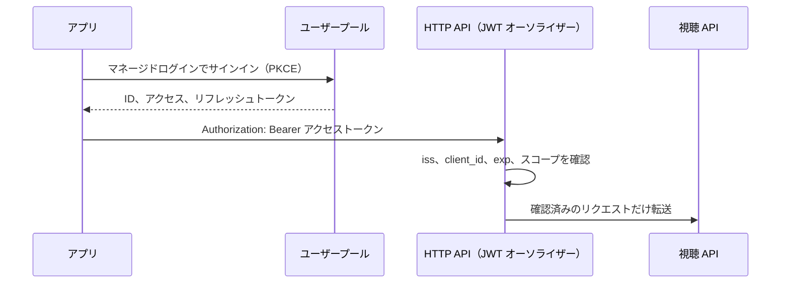

**設定値:**

| 項目 | 値 | 理由 |
| --- | --- | --- |
| アプリクライアント | `web`、`ios`、`android` の 3 つ。どれもシークレットなし | 公開クライアントに秘密は置けない。トークンの期限を端末ごとに変えられる |
| OAuth のグラント | 認可コードと PKCE | URL にトークンを出さない（[OAuth フロー](#oauth-flows)） |
| `AccessTokenValidity` | 15 分（`TokenValidityUnits` を `minutes`） | 解約や停止を最長 15 分で反映する |
| `RefreshTokenValidity` | 30 日 | 毎晩見る人が、1 か月はサインインし直さずに済む |
| カスタムスコープ | `video-api/watch` | 視聴 API だけに使えるトークンにする（[リソースサーバー](#resource-servers)） |
| JWT オーソライザーの `audience` | 3 つのクライアント ID | どれかのアプリ向けのトークンだけを通す |
| `PreventUserExistenceErrors` | `ENABLED` | メールアドレスが会員かどうかを調べられないようにする |

**なぜこのサービスか:** パスワードの保存、総当たり対策、パスワード再設定、トークンの署名を自作すると、1 か所の不備が 200 万人の乗っ取りにつながります（[なぜ Cognito があるのか](#why)）。API Gateway が JWT を検証するので、視聴 API のコードに検証の処理を書かずに済みます。

**つまずきやすい点:**

- 新しくタブレットのアプリ用のクライアントを足したのに、オーソライザーの `audience` に入れ忘れると、そのアプリだけ 401 になります。
- リフレッシュトークンは更新しても期限が延びません。30 日ごとにサインイン画面が出るので、「勝手にログアウトされた」という問い合わせを想定しておきます。

### 例: 健康管理アプリの写真を S3 に直接送る {#use-case-health-photo-upload}

**状況:** 利用者 30 万人の食事記録アプリです。1 日に約 100 万枚（1 枚約 300 KB）の写真が投稿されます。写真は本人と、本人が許可した栄養士だけが見られるようにします。

**構成:**

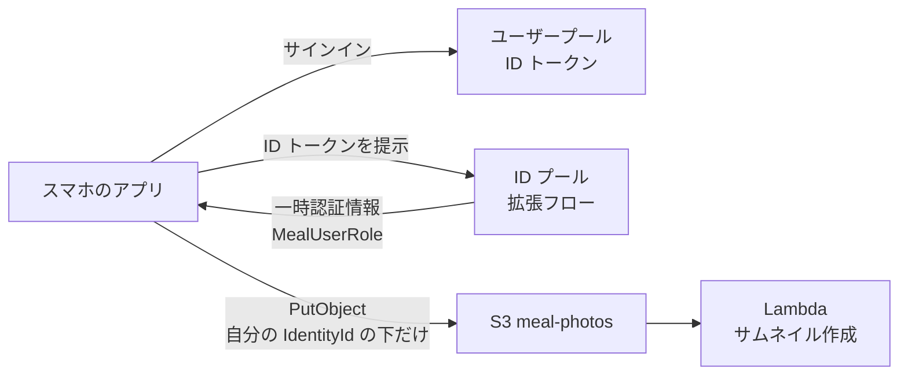

**設定値:**

| 項目 | 値 | 理由 |
| --- | --- | --- |
| ゲストアクセス | 無効 | 写真は個人の健康の情報。サインインした人だけにする |
| 認証済みロールの許可 | `s3:PutObject` と `s3:GetObject` を `arn:aws:s3:::meal-photos/${cognito-identity.amazonaws.com:sub}/*` に | 1 つのロールで、全員が自分のフォルダーにしか触れない |
| 信頼ポリシー | `aud` を ID プールの ID に、`amr` を `authenticated` に | 別の ID プールや未認証の ID からの引き受けを防ぐ（[ID プールとロールマッピング](#identity-pools)） |
| フロー | 拡張フロー | ロールの選択をアプリに任せない（[拡張フローと基本フロー](#enhanced-basic-flow)） |

**なぜこのサービスか:** 写真をいったん自社の API で受けると、1 日 100 万回の転送をサーバーが中継することになります。[署名付き URL](s3.md#presigned-urls) を API で発行する方法もありますが、ID プールなら SDK が直接アップロードでき、1 枚ごとに URL を発行する API が要りません。

**つまずきやすい点:**

- ポリシー変数の `${cognito-identity.amazonaws.com:sub}` は、ID プールの `IdentityId`（`ap-northeast-1:1111aaaa-...` の形）です。ユーザープールの `sub` でフォルダー名を作ると一致せず、`AccessDenied` になります。
- 栄養士に見せる処理を、利用者の認証情報で直接読ませようとするとポリシーが複雑になります。共有は自社の API を通し、サーバー側で判定します。

### 例: 勤怠管理 SaaS で導入企業の社内 IdP を使う {#use-case-saas-enterprise-saml}

**状況:** 導入企業 150 社の勤怠管理 SaaS です。そのうち 40 社が「社員には自社の Entra ID や Okta でサインインさせたい」と求めています。残りの 110 社は、SaaS のアカウント（メールとパスワード）を使います。

**構成:**

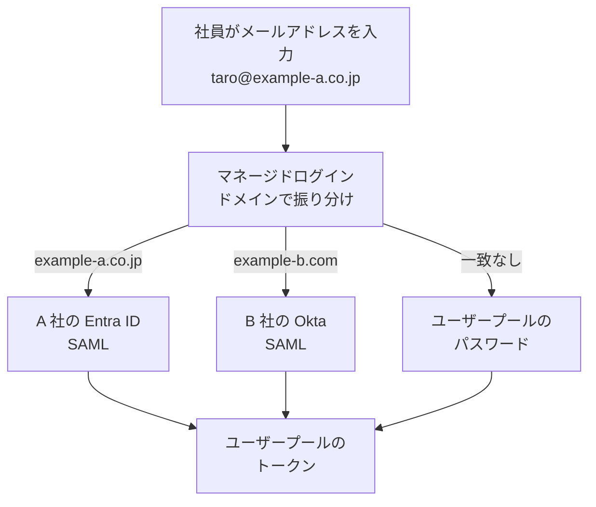

**設定値:**

| 項目 | 値 | 理由 |
| --- | --- | --- |
| SAML の IdP | 企業ごとに 1 つ（`CorpA`、`CorpB` …） | 企業ごとに証明書と属性の対応が違う |
| IdP 識別子 | その企業のメールのドメイン（1 つの IdP に 50 個まで） | 入力されたメールのドメインから、正しい IdP に自動で振り分ける |
| マネージドログイン | ブランディングエディタで「ドメイン検索の入力」を有効化 | IdP のボタンを 40 個並べずに済む |
| 属性のマッピング | IdP の `mail` を `email` に | どの IdP から来ても、アプリは同じクレームを読む |
| テナント ID | Pre token generation で、どの IdP から来たかで `tenant_id` を決める | 利用者が書き換えられる属性に頼らない（[グループとカスタム属性](#groups-attributes)） |

**なぜこのサービスか:** IdP ごとに SAML の処理をアプリに書くと、40 社分の実装と保守が要ります。ユーザープールが間に入るので、アプリが扱うのは Cognito の JWT だけです。

**つまずきやすい点:**

- 連携ユーザーには Cognito の MFA が効きません。「MFA 必須」を契約に書くなら、各社の IdP 側の設定で満たしてもらいます。
- 導入企業が IdP の署名証明書を更新したのに知らせてこないと、その会社の全員が突然サインインできなくなります。証明書の期限を管理表で追います。

### 例: ポイント決済アプリの不正サインインを止める {#use-case-fintech-threat-protection}

**状況:** 利用者 80 万人のポイント決済アプリです。他のサイトから漏れたパスワードを使う「リスト型攻撃」で、月に数百件の不正サインインの疑いが出ています。一方で、全員に毎回 MFA を求めると、買い物のたびの手間で利用が減ります。

**構成:**

| リスクの判定 | 応答 | 利用者から見た動き |
| --- | --- | --- |
| No Risk、Low | 許可 | いつもどおり入れる |
| Medium | Optional MFA | MFA を登録した人だけ確認される |
| High | Require MFA | MFA を登録していなければブロック |
| 漏えいした認証情報 | ブロック | パスワードの変更を求める |

**設定値:**

| 項目 | 値 | 理由 |
| --- | --- | --- |
| 機能プラン | Plus | 脅威保護は Plus の機能（[機能プラン](#feature-plans)） |
| 脅威保護のモード | 最初の 2 週間は監査のみ、その後に全機能 | 正常な利用者の何が「いつもと違う」かを先に確かめる（[脅威保護](#threat-protection)） |
| MFA | Optional。TOTP を推奨し、登録を促す画面をアプリに作る | 低リスクの人の手間を増やさない |
| `MinimumLength` と `PasswordHistorySize` | `12` と `5` | 短いパスワードと使い回しを減らす（[パスワードポリシー](#password-policy)） |
| `UserContextData` | サーバー側のサインインで利用者の IP と端末の情報を渡す | 渡さないと全員がサーバーの IP から来たように見える |

**なぜこのサービスか:** リスクの判定を自作するには、サインインの履歴、端末の特徴、漏えいしたパスワードの一覧が必要です。Plus プランなら、これをユーザープールの設定で使えます。

**つまずきやすい点:**

- SRP でサインインすると、パスワードが Cognito に渡らないので、サインイン時の漏えい認証情報の検出が効きません。サインアップとパスワード変更の時点で検出されます。
- 監査のみで始めずにいきなり High を Block にすると、海外出張中の正常な利用者が決済できなくなります。

### 例: 工場のゲートウェイから集計 API へ送る {#use-case-iot-m2m}

**状況:** 8 か所の工場に設備のゲートウェイが計 120 台あり、5 分ごとに稼働データを自社の集計 API（API Gateway の REST API）に送ります。同じ API に、設備の保守を請け負う 3 社のシステムからも書き込みます。保守会社は AWS の認証情報を持っていません。

**構成:**

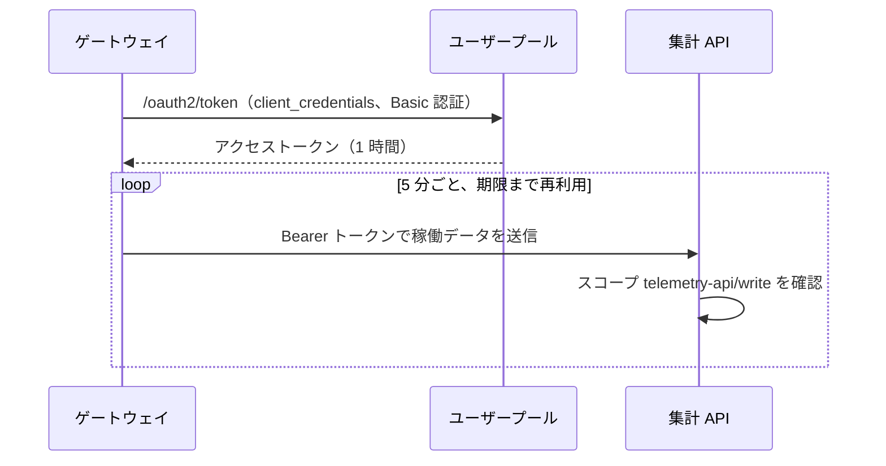

**設定値:**

| 項目 | 値 | 理由 |
| --- | --- | --- |
| アプリクライアント | 工場ごと、保守会社ごとに 1 つ。シークレットあり | 1 社の漏えいで、そのクライアントだけを止められる |
| `AllowedOAuthFlows` | `client_credentials` だけ | 認可コードと併用できない（[OAuth の設定](#oauth-settings)） |
| スコープ | 工場は `telemetry-api/write`、保守会社は `telemetry-api/write` と `telemetry-api/read` | 読み取りは保守会社だけに渡す |
| `AccessTokenValidity` | 1 時間 | 1 回のトークンで 12 回送れる |
| メソッドの `authorizationScopes` | `telemetry-api/write` | REST API の Cognito オーソライザーでスコープを確かめる（[REST API の設定](#rest-authorizer-settings)） |

**なぜこのサービスか:** 保守会社は AWS の認証情報を持たないので、IAM 認証（SigV4）は使えません。OAuth のクライアント認証情報なら、標準の HTTP ライブラリで扱えます。社内のゲートウェイだけなら、[IAM Roles Anywhere](iam.md#use-case-retail-roles-anywhere) も候補です。

**つまずきやすい点:**

- 送信のたびにトークンを取り直すと、トークンの発行が 120 台 × 12 回で 12 倍に増えます。クライアント認証情報はトークンの要求に応じて料金がかかるので、期限まで再利用します。
- 1 つのクライアントで `code` と `client_credentials` を両方許可しようとすると、設定が拒否されます。用途ごとにクライアントを分けます。

### 例: ネットスーパーの旧会員 DB から移行する {#use-case-ec-user-migration}

**状況:** 会員 50 万人のネットスーパーです。会員は自前の PostgreSQL にあり、パスワードはハッシュで保存しています。ハッシュは Cognito に取り込めず、全員にパスワードの再設定を求めると、多くの会員が離れてしまいます。

**構成:**

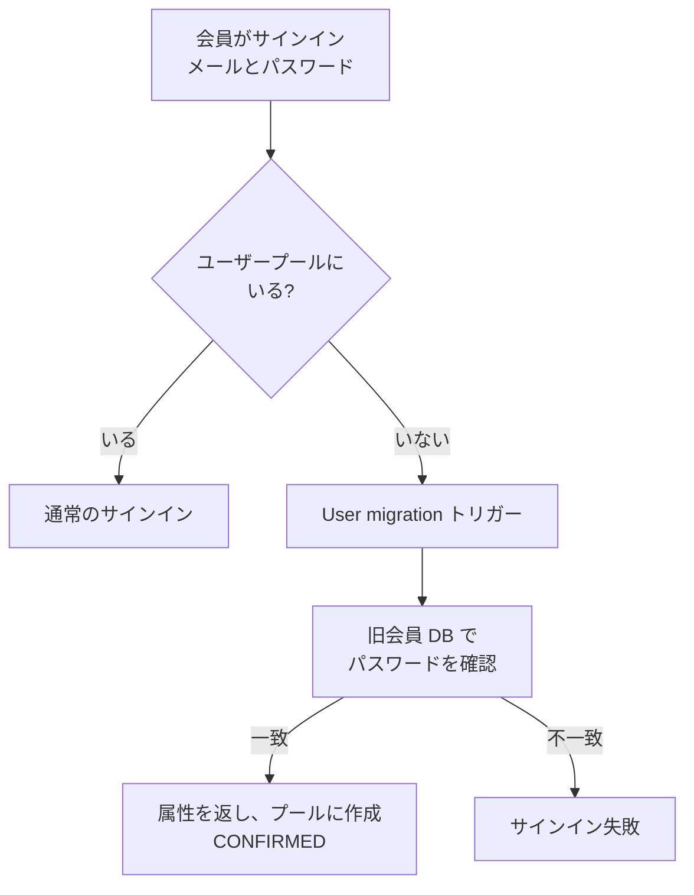

**設定値:**

| 項目 | 値 | 理由 |
| --- | --- | --- |
| サインイン属性 | `email` のユーザー名属性 | 旧サイトと同じくメールで入る。作成後は変えられない（[サインイン属性](#sign-in-attributes)） |
| 認証フロー | 移行の期間だけ `ALLOW_USER_PASSWORD_AUTH` | SRP ではパスワードが Cognito に渡らず、トリガーが旧 DB で確かめられない |
| トリガーの応答 | `finalUserStatus=CONFIRMED`、`messageAction=SUPPRESS` | 会員に何も意識させずに移す |
| トリガーの処理時間 | 旧 DB のメールの列に索引を張り、1 秒以内に返す | トリガーは 5 秒で打ち切られる |
| 移行の期間 | 6 か月。その後に `ALLOW_USER_PASSWORD_AUTH` を外す | 6 か月サインインしない会員は、パスワード忘れの手続きで移す（このときもトリガーが呼ばれる） |

**なぜこのサービスか:** 一括で移すとパスワードを持ち込めないので、全員の再設定が必要になります。User migration なら、会員が次にサインインしたときに 1 人ずつ移り、会員は移行に気づきません。

**つまずきやすい点:**

- 旧 DB が遅いと、トリガーが 5 秒を超えてサインインが失敗します。セールの日に旧 DB が混むと、その日だけ移行中の会員が入れなくなります。
- 移行が終わっても `ALLOW_USER_PASSWORD_AUTH` を残すと、パスワードを平文のまま TLS で送るフローが開いたままになります。

## ユーザープールと ID プール {#user-vs-identity-pools}

名前が似ていますが、役割が違います。

「誰か」を確かめること（認証）と、「AWS のリソースに触ってよいか」（AWS の認可）を分けているのが理由です。多くのアプリは自作の API を呼ぶだけなので、ユーザープールだけで足ります。AWS のサービスをクライアントから直接呼ぶときだけ、ID プールを足します。

| 観点 | ユーザープール | ID プール |
| --- | --- | --- |
| 役割 | 認証（誰か）。ユーザーディレクトリと OIDC プロバイダー | 認可の橋渡し。外部の ID を AWS 認証情報に交換 |
| 出力 | ID、アクセス、リフレッシュの各トークン（JWT） | 一時的な AWS 認証情報 |
| 使う先 | API Gateway、ALB、自作の API | S3、DynamoDB など AWS サービスへの直接アクセス |
| ゲストアクセス | なし | 未認証ロールで可能 |
| 入力 | ユーザー名とパスワード、ソーシャル、SAML、OIDC | ユーザープールのトークン、ソーシャル、SAML、OIDC |

判断の基準は単純です。自作 API を呼ぶならユーザープール、クライアントから AWS サービスを直接呼ぶなら ID プールも加えます。

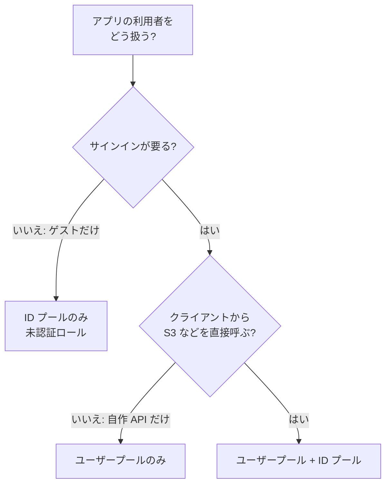

- **例（ユーザープールのみ）:** SPA がサインインしてアクセストークンを取り、自作の `GET /orders` を API Gateway 経由で呼ぶ。AWS の認証情報は要らない。
- **例（両方）:** モバイルアプリがサインインして ID トークンを取り、ID プールで交換した一時認証情報で S3 に写真を直接アップロードする。
- **例（ID プールのみ）:** ログイン前のゲストが、未認証ロールでカタログの画像だけを読む。
- **誤ると:** S3 に直接アップロードしたいのにユーザープールだけで作ると、JWT では S3 を呼べない。AWS の API は SigV4 の認証情報を求める。

## フェデレーション {#federation}

ユーザープールは、ソーシャル ID プロバイダー、SAML、OIDC と連携できます。連携したユーザーにも、ユーザープールの形式でトークンが発行されるので、アプリ側はプロバイダーの違いを意識せずに済みます。

Google、Apple、社内の Entra ID は、それぞれ違う形式の応答を返します。アプリがそれぞれに対応すると、IdP が増えるたびにコードが増えます。ユーザープールが間に入って翻訳するので、アプリは Cognito の JWT だけを扱えば済みます。提携先の会員証を見せた人にも、自分の施設の会員証を発行し直す形です。

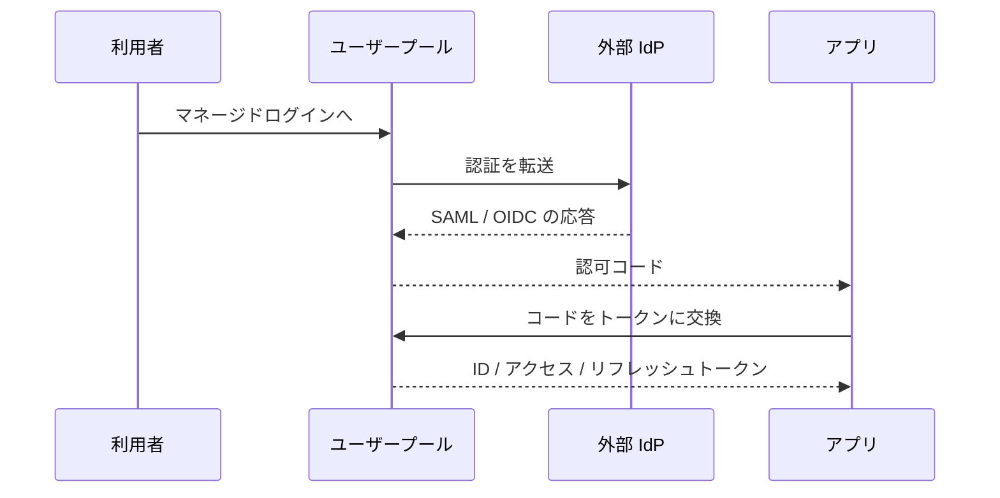

連携ユーザーの認証は IdP 側に任されるので、Cognito の MFA は適用されません。MFA は IdP 側で設定します。

- **例:** SAML で Entra ID と連携すると、利用者は `MyIdP_alice@example.com` のように、プロバイダー名が付いたユーザー名でプールに作られる。IdP の属性 `mail` を `email` にマッピングすると、ID トークンの `email` に入る。
- **誤ると:** Cognito の設定で MFA を `Required` にしても、連携ユーザーには求められない。監査で MFA を証明するなら、IdP 側の設定を確認する。

## マネージドログイン {#managed-login}

ユーザープールにドメインを設定すると、サインイン画面と OAuth 2.0 / OIDC のエンドポイントが使えるようになります。画面はマネージドログインと、第 1 世代のホスト UI（クラシック）から選びます。ドメインごとにどちらか一方です。

**使う場面:** 料理レシピのアプリで、メールのサインインと Google、Apple のボタンを 1 つの画面に並べ、画面の実装を持たない。

サインイン画面を Cognito が出すと、アプリはパスワードに一切触れません。アプリのコードに脆弱性があっても、パスワードは漏れません。その代わり、画面のデザインの自由度は下がります。

| 観点 | マネージドログイン | 自前の画面と API |
| --- | --- | --- |
| パスワードに触れるか | 触れない | アプリの画面が受け取る |
| ソーシャルや SAML | 設定だけで使える | 自分でリダイレクトを組む |
| デザイン | ブランディングの範囲 | 自由 |
| アクセストークンのスコープ | カスタムスコープを付けられる | `aws.cognito.signin.user.admin` に限られる |

| エンドポイント | 用途 |
| --- | --- |
| `/oauth2/authorize` | サインインの開始 |
| `/oauth2/token` | コードやリフレッシュトークンをトークンに交換 |
| `/oauth2/userInfo` | アクセストークンでユーザー情報を取得 |

マネージドログインのブランディングエディタは、機能プランによって使えない場合があります。自前の画面にしたい場合は、SDK から `InitiateAuth` などの API を呼びます。ただし API での認証で発行されるアクセストークンのスコープは `aws.cognito.signin.user.admin` に限られます。

- **例:** 利用者を次の URL に送ると、サインイン画面が開く。成功すると `https://app.example.com/callback?code=...` に戻るので、`/oauth2/token` でコードをトークンに交換する。

```text
https://myapp.auth.ap-northeast-1.amazoncognito.com/oauth2/authorize?response_type=code&client_id=1example23456789&redirect_uri=https://app.example.com/callback&scope=openid+email
```

- **誤ると:** `redirect_uri` が `CallbackURLs` に登録したものと 1 文字でも違うと、エラーになり画面に戻らない。`https://app.example.com/` と `https://app.example.com` は別の値として扱う。
- **誤ると:** `InitiateAuth` で得たトークンを `orders-api/read` のスコープを要求する API に送ると、スコープが足りず拒否される（REST API の Cognito オーソライザーなら 401）。API でのサインインでカスタムスコープは付かない。

## OAuth フロー {#oauth-flows}

グラントが複数あるのは、クライアントの種類で「秘密を安全に持てるか」が違うからです。サーバーはシークレットを隠せますが、ブラウザやスマホのアプリは中身を見られるので、シークレットを持てません。

認可コードのグラントでは、ブラウザの URL に載るのは使い捨てのコードだけで、トークンは裏の通信で受け取ります。PKCE を足すと、コードを横取りされても、最初にコードを頼んだアプリでなければ交換できません。

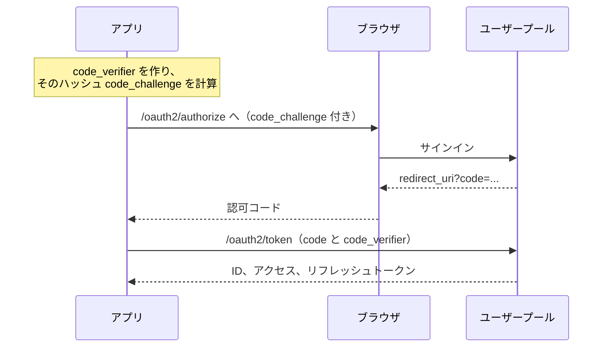

| グラント | 主な用途 | 発行されるトークン | 注意点 |
| --- | --- | --- | --- |
| 認可コード | Web、モバイル（第一の選択肢） | ID、アクセス、リフレッシュ | 公開クライアントでは PKCE を併用 |
| 暗黙的 | レガシー | ID、アクセス | トークンが URL に出る。新規には使わない |
| クライアント認証情報 | サービス間（M2M） | アクセスのみ | クライアントシークレット必須。追加料金あり |
| リフレッシュトークン | トークンの更新 | ID、アクセス（設定によりリフレッシュも） | トークンエンドポイントへ直接送る |

クライアント認証情報は、同じアプリクライアントで認可コードや暗黙的グラントと併用できません。また、アクセストークンのカスタムスコープは、リソースサーバーを定義して使います。

グラントごとの例です。

- **認可コードの例:** モバイルアプリが `code_challenge` を付けて `/oauth2/authorize` を呼び、`code_verifier` を付けて `/oauth2/token` を呼ぶ。コードを横取りされても、`code_verifier` がないと交換できない。
- **暗黙的の例:** `https://app.example.com/#access_token=...` のように URL にトークンが出る。ブラウザの履歴に残るので、新規には使わない。
- **クライアント認証情報の例:** 夜間のバッチが `grant_type=client_credentials&scope=orders-api/read` を `Authorization: Basic` で `/oauth2/token` に送る。返るのはアクセストークンだけで、ユーザーはいないので `sub` はクライアント ID になる。
- **リフレッシュトークンの例:** `grant_type=refresh_token&refresh_token=...&client_id=...` を送ると、新しい ID トークンとアクセストークンが返る。
- **誤ると:** `AllowedOAuthFlows` に `code` と `client_credentials` を同時に指定すると、リクエストが拒否される。M2M 用のクライアントを別に作る。

## トークン {#tokens}

| トークン | 形式 | 内容 | 使う場面 | 有効期間 |
| --- | --- | --- | --- | --- |
| ID トークン | JWT | `email` などのユーザー属性、`aud`、`cognito:groups` | アプリが本人情報を読む。ID プールとの交換 | 5 分〜1 日 |
| アクセストークン | JWT | `scope`、`client_id`、`cognito:groups` | API の認可、ユーザー自身の Cognito API | 5 分〜1 日 |
| リフレッシュトークン | 暗号化され、中身は不透明 | - | 新しいトークンの取得 | 既定 30 日。60 分〜10 年 |

有効期間はアプリクライアントごとに設定します。トークンは暗号化ではなく base64url エンコードなので、誰でも中身を読めます。秘密情報を入れないようにします。

トークンを 3 つに分けるのは、「よく使うものは短命に、めったに使わないものは長命に」するためです。API を呼ぶたびに送るアクセストークンは盗まれる機会が多いので短くし、更新にだけ使うリフレッシュトークンは長くして、サインインのし直しを減らします。

| トークン | 施設でのたとえ | 見せる相手 |
| --- | --- | --- |
| ID トークン | 名前や連絡先が書かれた会員証 | アプリ自身（本人情報を表示する） |
| アクセストークン | 当日の利用券。使える設備（スコープ）が書いてある | API |
| リフレッシュトークン | 利用券の再発行に使う控え。受付にだけ見せる | ユーザープールのトークンエンドポイント |

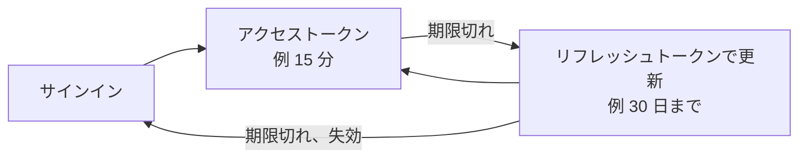

- **リフレッシュトークンのローテーション**: 有効にすると更新のたびに新しいリフレッシュトークンが発行される。ただし有効期限は最初のトークンの期間のまま延びない。
- **失効**: `RevokeToken` で失効できる。
- **例（期間）:** アクセストークン 15 分、リフレッシュトークン 30 日なら、利用者は 30 日間サインインし直さずに済み、権限の変更は最長 15 分で反映される。
- **例（ローテーション）:** `RefreshTokenValidity` を 30 日にして毎日更新しても、最初のサインインから 30 日で切れる。
- **例（失効）:** `RevokeToken` を呼ぶと、そのリフレッシュトークンと、それから発行したアクセストークンが無効になる。署名の検証だけのローカル検証では、この失効を検出できない。
- **誤ると:** リフレッシュトークンの期間を 60 分にすると、毎時サインイン画面が出る。ID トークンを `localStorage` に置いた SPA で 1 日にすると、XSS で盗まれたときに 1 日使われる。

### JWT の検証 {#jwt-verification}

JWT は署名付きなので、API は毎回ユーザープールに問い合わせなくても、公開鍵だけで本物かを確かめられます。問い合わせがないぶん速く、ユーザープールの負荷にもなりません。その代わり、発行した後の失効は、署名を見ただけでは分かりません。

署名が正しくても、別のユーザープールやアプリ向けのトークンかもしれません。次のすべてを確認します。

1. JWT の形式（ヘッダー、ペイロード、署名の 3 部構成）を確認する。
2. ヘッダーの `kid` に一致する公開鍵を、ユーザープールの JWKS から取得する。
3. RS256 の署名を検証する。
4. `exp` で期限を確認する。
5. `iss` がユーザープールの URL と一致することを確認する。
6. ID トークンは `aud`、アクセストークンは `client_id` がアプリクライアント ID と一致することを確認する。
7. `token_use` が想定どおり（`id` または `access`）か確認する。

JWKS と発行者の URL は次の形式です。

```text
https://cognito-idp.<Region>.amazonaws.com/<userPoolId>/.well-known/jwks.json
https://cognito-idp.<Region>.amazonaws.com/<userPoolId>
```

Python の例です（PyJWT を使用）。Node.js なら、AWS が推奨する `aws-jwt-verify` が使えます。

```python
import jwt  # PyJWT

REGION = "ap-northeast-1"
POOL_ID = "ap-northeast-1_EXAMPLE"
CLIENT_ID = "1example23456789"
ISSUER = f"https://cognito-idp.{REGION}.amazonaws.com/{POOL_ID}"
jwks = jwt.PyJWKClient(f"{ISSUER}/.well-known/jwks.json")


def verify_access_token(token: str) -> dict:
    key = jwks.get_signing_key_from_jwt(token)
    claims = jwt.decode(
        token,
        key.key,
        algorithms=["RS256"],
        issuer=ISSUER,
        options={"verify_aud": False},  # アクセストークンには通常 aud がない
    )
    if claims.get("token_use") != "access" or claims.get("client_id") != CLIENT_ID:
        raise ValueError("invalid token")
    return claims
```

署名と期限の確認だけでは、失効したトークンを検出できません。失効をすぐ反映したいなら、アクセストークンの有効期間を短くするか、Cognito に問い合わせます。署名キーはローテーションされることがあるので、`kid` をキーに公開鍵をキャッシュし、未知の `kid` が来たら取り直します。

**クレームの検証の例**です。次のアクセストークンは、期待する `client_id` と違うので拒否します。

```json
{
  "iss": "https://cognito-idp.ap-northeast-1.amazonaws.com/ap-northeast-1_EXAMPLE",
  "client_id": "another-app-client-id",
  "token_use": "access",
  "scope": "orders-api/read",
  "exp": 1793404800
}
```

- **誤ると:** `token_use` を確認しないと、ID トークンをアクセストークンの代わりに受け入れてしまう。
- **誤ると:** `iss` を確認しないと、複数のプールを受け入れる実装で、検証用プールのトークンが本番の API を通ってしまう。

### ベアラートークンでの保護 {#bearer-tokens}

ベアラートークンは、持っている人なら誰でも使えるトークンです。次の点を守ります。

- 必ず HTTPS で送る。`Authorization: Bearer <token>` が一般的な形式。
- 受け取る側は毎回検証する。デコードしただけで信用しない。
- ログや URL に出さない。
- ブラウザやアプリでは、できるだけ安全な場所に保存する。トークンには個人情報が含まれる場合がある。
- 有効期間を短くし、リフレッシュトークンで更新する。
- 用途に合ったトークンを使う。API の認可にはアクセストークンとスコープ、本人情報には ID トークン。
- **例:** `curl -H "Authorization: Bearer eyJ..." https://api.example.com/orders` のように送る。`?token=eyJ...` のようなクエリ文字列にすると、アクセスログに残る。
- **誤ると:** ログにリクエストヘッダーをそのまま書くと、有効期間の間はログを読めた人が本人になりすませる。

## API Gateway との統合 {#api-gateway}

トークンの検証を API Gateway に任せると、検証に失敗したリクエストは Lambda などのバックエンドに届きません。バックエンドごとに検証のコードを書く必要がなく、書き忘れも起きません。ビルの入口の警備員が入館証を確かめ、各部屋では確かめ直さなくてよい形です。

| API の種類 | オーソライザー | トークン | 検証の内容 |
| --- | --- | --- | --- |
| REST API | `COGNITO_USER_POOLS` | ID またはアクセストークン | スコープ未設定なら ID トークン、設定するとアクセストークン |
| HTTP API | JWT オーソライザー | JWT | `iss`、`aud` または `client_id`、`exp`、スコープ |
| どちらも | Lambda オーソライザー | 任意 | 独自ロジック。テナントや細かい権限の判定に |

REST API の場合、クライアントは既定で `Authorization` ヘッダーにトークンを入れて呼びます。ユーザーのクレームはマッピングテンプレートで `$context.authorizer.claims.sub` のように参照できます。

HTTP API の JWT オーソライザーでは、発行者にユーザープールの URL、オーディエンスにアプリクライアント ID を設定します。

ALB にもユーザープール認証の機能があります。その場合、ターゲットはクレームを `x-amzn-oidc-data` ヘッダーで受け取り、自分で署名を検証します。

- **例（REST API）:** メソッドに `authorizationScopes` として `orders-api/read` を設定すると、アクセストークンが必要になる。クライアントは `Authorization` ヘッダーにアクセストークンを入れて呼ぶ。
- **例（HTTP API）:** `audience` が `1example23456789` なら、`client_id` がそれ以外のアプリ向けのトークンは 401 になる。
- **例（マッピング）:** `$context.authorizer.claims.sub` を統合のヘッダー `x-user-id` に渡すと、バックエンドはトークンを読まずに利用者を知れる。
- **誤ると:** スコープを設定した REST API のメソッドに ID トークンを送ると 401 になる。ID トークンには `scope` がないからだ。

## グループとカスタム属性 {#groups-attributes}

グループもカスタム属性も、トークンに載せてアプリの判定に使う情報です。グループは「管理者」「一般」のような役割（RBAC）、カスタム属性は「テナント」「プラン」のような属性（ABAC）を表すのに向きます。

**使う場面:** オンライン英会話のアプリで、講師を `teacher` グループに入れ、予約の管理画面を講師だけに開く。

**グループ**はユーザーの集合です。

- メンバーシップは ID トークンとアクセストークンの `cognito:groups` に入る。
- グループに IAM ロールを割り当てると、ID プール経由でそのロールの認証情報を受け取れる。
- 複数のグループに属する場合は、`Precedence` の値が小さいグループのロールが `cognito:preferred_role` になる。

**カスタム属性**は、`custom:` が接頭辞の独自属性です。

- ユーザープールごとに最大 50 個、値は最大 2048 文字。
- 追加した後は、削除も名前の変更もできない。データ型や変更可否も変えられない。
- アプリクライアントごとに読み書きの権限を設定できる。

!!! warning "ユーザーが変更できる属性を権限判定に使わない"
    `custom:tenant_id` のような属性を権限に使うなら、利用者自身が書き換えられないように、アプリクライアントの書き込み権限から外します。

- **例（グループ）:** `admin` と `staff` を作り、alice を両方に入れる。アクセストークンには `"cognito:groups": ["admin", "staff"]` が入る。アプリはこの配列に `admin` があるかで判定する。
- **例（カスタム属性）:** `custom:tenant_id` に `tenant-a` を入れ、Pre token generation なしで ID トークンの `custom:tenant_id` から読む。
- **誤ると:** 利用者の書き込みを許したままだと、alice が `UpdateUserAttributes` で `custom:tenant_id` を `tenant-b` に変え、別のテナントのデータを読める。

## Lambda トリガー {#lambda-triggers}

サインアップやサインインの途中で Lambda を呼び、動作をカスタマイズできます。カスタム送信者トリガーを除いて同期呼び出しで、Cognito は 5 秒以内の応答を求めます。応答がなければ、再試行することがあります。

認証の本体は Cognito に任せつつ、業務ごとの規則（社員のメールだけ登録させる、DB にプロフィールを作る、トークンにプランを足す）を差し込むための「フック」です。同期で呼ばれるので、遅いトリガーはサインインそのものを遅くします。

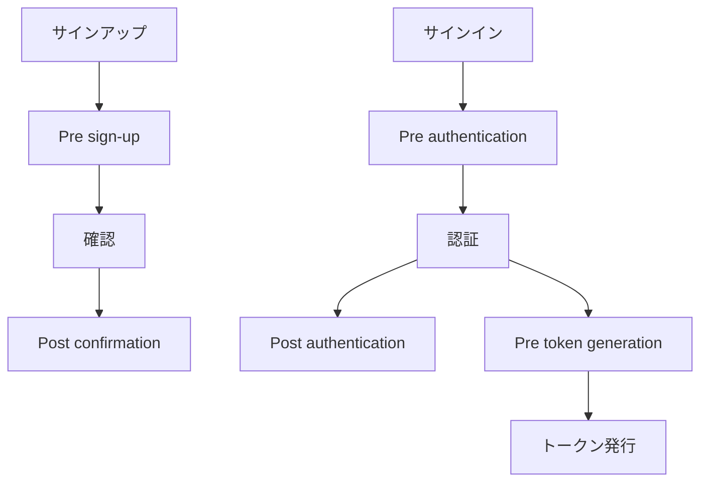

図は主なトリガーだけを示しています。カスタム認証、User migration、メッセージのトリガーは下の表を参照してください。

| トリガー | タイミング | 用途の例 |
| --- | --- | --- |
| Pre sign-up | サインアップ前 | ドメインの制限、自動確認 |
| Post confirmation | 確認の後 | DB にプロフィールを作成 |
| Pre authentication | 認証の前 | サインインの拒否条件 |
| Post authentication | 認証の後 | ログ、分析 |
| Define / Create / Verify auth challenge | カスタム認証の中 | 独自のチャレンジ |
| Pre token generation | トークン発行の前 | クレームの追加、変更、抑制 |
| User migration | 不明なユーザーのサインイン時 | 既存の認証基盤からの移行 |
| Custom message, Custom sender | メッセージの送信時 | メールや SMS の本文、送信方法の変更 |
| Inbound federation | 連携ユーザーのサインイン時 | IdP の属性の加工 |

- **例（Pre sign-up）:** メールが `@example.com` で終わらなければ、`throw Error("signup not allowed")` で拒否する。利用者には `UserLambdaValidationException` として返る。
- **例（Post confirmation）:** `triggerSource` が `PostConfirmation_ConfirmSignUp` のときだけ、DynamoDB にプロフィールを作る。
- **例（Pre token generation）:** DB からプランを読み、`claimsToAddOrOverride` に `{"plan": "pro"}` を入れる。
- **誤ると:** トリガーの処理に 6 秒かかると、5 秒の制限で失敗してサインインできない。DB の遅い処理は事前に済ませるか、キューに投げる。

Pre token generation のイベントには版があります。

| 版 | カスタマイズできる範囲 | 条件 |
| --- | --- | --- |
| `V1_0` | ID トークン | 基本機能 |
| `V2_0` | ID トークンとアクセストークン（ユーザー認証） | Essentials または Plus プラン（高度なセキュリティ機能を有効にしていた旧 Lite のプールも可） |
| `V3_0` | V2_0 に加えて M2M のアクセストークン | Essentials または Plus プラン |

- **例:** アクセストークンにテナント ID を入れて API Gateway で使うなら `V2_0`。client credentials のトークンにも入れるなら `V3_0`。
- **誤ると:** Lite のプールは原則 `V1_0` だけなので、アクセストークンをカスタマイズできない。プランを上げるか、ID トークンのカスタマイズに留める。

## MFA {#mfa}

パスワードは使い回され、漏れます。MFA は、パスワードが漏れても、手元の端末がなければ入れないようにする仕組みです。一方、全員に必須にすると、登録の手間で利用者が離れることもあります。Cognito で 3 つの設定から選べるのは、この安全と手軽さのトレードオフをアプリごとに決めるためです。

ユーザープールの設定は 3 種類です。

| 設定 | 動作 |
| --- | --- |
| Required | 全ユーザーが MFA を完了する必要がある |
| Optional | 登録した人だけ。アダプティブ認証を使うならこの設定 |
| Off | MFA を使わない |

- **Required の例:** 金融アプリの全利用者に TOTP を求める。最初のサインインでは、確認の完了が第 2 要素の扱いになり、次回以降の登録を促される。
- **Optional の例:** 登録した人だけ TOTP を使い、未登録の人はパスワードだけで入れる。マネージドログインは自動で登録を促さないので、登録画面をアプリに作る。
- **Off の例:** 社内の検証用プールで使う。本番では選ばない。

| 要素 | 必要なもの |
| --- | --- |
| TOTP（認証アプリ） | `AssociateSoftwareToken` と `VerifySoftwareToken` で登録 |
| SMS | 電話番号属性と SMS の設定（Amazon SNS） |
| メール | メール属性、自前の Amazon SES 設定、Essentials または Plus プラン |

- 管理者は `SetUserPoolMfaConfig` でプールの設定を、ユーザーは `SetUserMFAPreference` で自分の優先方法を設定する。
- MFA に使うのと同じ経路に、パスワードリセットのコードは送れない。回復手段を別に用意する。
- 脅威保護（threat protection）のアダプティブ認証を使うと、リスクが高いサインインにだけ MFA を要求できる。
- **TOTP の例:** `AssociateSoftwareToken` で得たシークレットを QR コードにして認証アプリに読み込み、表示された 6 桁を `VerifySoftwareToken` に渡す。
- **SMS の例:** `phone_number` は `+818012345678` のように E.164 形式で保存する。`080-1234-5678` は拒否される。
- **誤ると:** SMS MFA の利用者が同じ番号でパスワードをリセットしようとしても、コードは届かない。回復用にメールを別に持たせる。有効な回復手段がなければ `InvalidParameterException` になる。

## ID プールとロールマッピング {#identity-pools}

ID プールは、外部の ID を確認して一時的な AWS 認証情報を返します。

スマホのアプリや SPA は、利用者の端末で動くので、中に埋め込んだアクセスキーは誰でも取り出せます。ID プールは、サインインした人ごとに期限付きの認証情報を発行し、IAM ロールで権限を絞ります。キーが漏れても、その人の範囲で、期限までしか使えません。

| 観点 | アプリにアクセスキーを埋め込む | ID プール |
| --- | --- | --- |
| 認証情報の寿命 | 無効化するまで | 期限付き |
| 利用者ごとの区別 | できない。全員が同じキー | `IdentityId` ごとに分かれる |
| 権限の範囲 | キーの持ち主の権限すべて | ロールとポリシー変数で、本人のデータだけに絞れる |

拡張フローでは次のように呼びます。

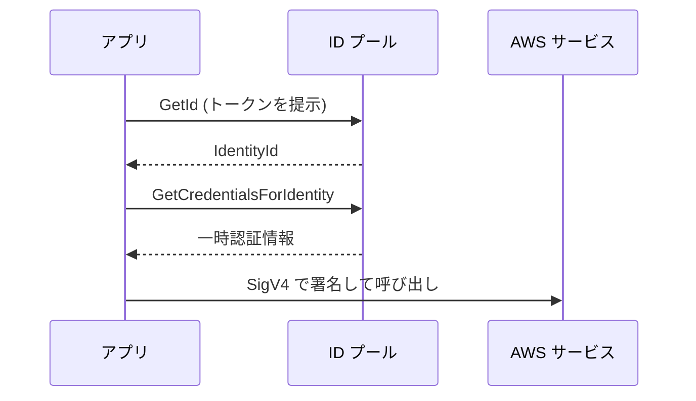

基本（クラシック）フローを有効にすると、ロールの選択を迂回して `AssumeRoleWithWebIdentity` を直接呼べます。

ロールは次のいずれかで決まります。

| 方式 | 動作 |
| --- | --- |
| 既定のロール | 認証済みと未認証で別のロールを指定 |
| トークンから選択 | グループのロール（`cognito:preferred_role`、`cognito:roles`）を使う |
| ルールで選択 | クレームと一致したルールのロール。先頭から評価し、最初の一致を使う |

- ルールの一致条件は `Equals`、`NotEqual`、`StartsWith`、`Contains` で、プロバイダーごとに最大 25 個。
- ロールを決められないときは `AmbiguousRoleResolution` に従う（`AuthenticatedRole` または `Deny`）。
- 利用者が変更できるクレームを、強い権限のロールにマッピングしない。
- **既定のロールの例:** 認証済みに `AppUserRole`、未認証に `AppGuestRole` を指定する。ゲストの `s3:GetObject` を `public/*` に絞る。
- **トークンの例:** `admin` グループのロールを ID トークンの `cognito:preferred_role` から選ぶ。
- **ルールの例:** 1 番目のルールを「`department` が `Equals` `finance`」で `FinanceRole`、2 番目を「`email` が `Contains` `@example.com`」で `StaffRole` にする。`department=finance` で `@example.com` の人は、先に一致した `FinanceRole` になる。
- **誤ると:** どのルールにも一致せず、`AmbiguousRoleResolution` が `Deny` だと、認証情報が返らない。`AuthenticatedRole` なら既定の認証済みロールになるので、権限の広いロールを既定にしない。

ロールの信頼ポリシーでは、ID プールと認証状態を限定します。

```json
{
  "Effect": "Allow",
  "Principal": {"Federated": "cognito-identity.amazonaws.com"},
  "Action": "sts:AssumeRoleWithWebIdentity",
  "Condition": {
    "StringEquals": {
      "cognito-identity.amazonaws.com:aud": "ap-northeast-1:12345678-abcd-1234-abcd-123456789012"
    },
    "ForAnyValue:StringLike": {
      "cognito-identity.amazonaws.com:amr": "authenticated"
    }
  }
}
```

ユーザーごとにデータを分けるには、ポリシー変数を使います。次の例では、自分の ID で始まるパーティションキーの項目だけにアクセスできます。

```json
{
  "Effect": "Allow",
  "Action": ["dynamodb:GetItem", "dynamodb:PutItem", "dynamodb:Query"],
  "Resource": "arn:aws:dynamodb:*:*:table/UserData",
  "Condition": {
    "ForAllValues:StringEquals": {
      "dynamodb:LeadingKeys": ["${cognito-identity.amazonaws.com:sub}"]
    }
  }
}
```

ID プールの「アクセス制御の属性」を使うと、クレームをセッションタグにして `${aws:PrincipalTag/キー}` で参照できます。この場合、信頼ポリシーに `sts:TagSession` が必要です。

- **例（信頼ポリシー）:** `aud` の条件がない信頼ポリシーは、ロールの作成や更新のときに `MalformedPolicyDocument` で拒否される。この検査の前からある同じ形のロールは、別の ID プールで認証した利用者も引き受けられる。`amr` を `unauthenticated` にすれば、未認証ロール用になる。
- **例（LeadingKeys）:** `${cognito-identity.amazonaws.com:sub}` が `ap-northeast-1:1111aaaa-22bb-33cc-44dd-555555eeeeee` の利用者は、そのパーティションキーの項目しか読めない。別の人の ID を指定した `GetItem` は `AccessDeniedException` になる。
- **例（タグ）:** クレーム `department` をタグ `department` に対応付けると、`aws:ResourceTag/department` が `${aws:PrincipalTag/department}` と一致するリソースだけ使える。

## アプリケーションレベルの認可 {#app-authorization}

IAM は AWS API の認可です。「この注文を編集できるのは作成者か管理者だけ」のような業務ルールは、アプリ側で判定します。

IAM が知っているのは「どの API を、どのリソースに」までで、注文の作成者が誰かは知りません。業務のデータを見て初めて分かる判定は、データを持つアプリでしか行えません。そのため、粗い判定を入口で、細かい判定を奥で、と段階を分けます。

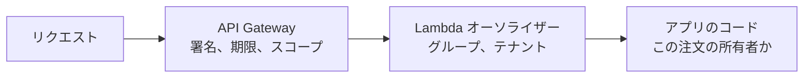

| 手法 | 判定の場所 | 向いている場面 |
| --- | --- | --- |
| スコープ | API Gateway（オーソライザー） | API 単位の粗い制御 |
| グループ（`cognito:groups`） | Lambda オーソライザー、アプリコード | ロールベースの制御 |
| クレーム（テナント ID など） | アプリコード | テナント、属性ベースの制御 |
| 所有者の確認 | アプリコード、データアクセス層 | リソース単位の制御 |
| ID プールと IAM 条件 | IAM | クライアントから AWS を直接呼ぶ場合 |

```python
def lambda_handler(event, context):
    claims = event["requestContext"]["authorizer"]["claims"]
    groups = claims.get("cognito:groups", "").strip("[]").replace(" ", "").split(",")
    order = load_order(event["pathParameters"]["id"])  # アプリ側の関数

    is_admin = "admin" in groups
    if not is_admin and order["owner"] != claims["sub"]:
        return {"statusCode": 403, "body": "forbidden"}
    return {"statusCode": 200, "body": serialize(order)}
```

`requestContext` の形はオーソライザーの種類で異なります。上記は Lambda プロキシ統合の REST API と Cognito オーソライザーの例です。

ポイントは次のとおりです。

- 認可の判定は、必ずサーバー側で行う。
- 主体の識別には、変更できない `sub` を使う。ユーザー名やメールは避ける。
- トークン内の情報は発行時点のものなので、権限の変更はすぐには反映されない。
- **例:** アクセストークンの有効期間が 1 時間なら、10:00 に `admin` から外しても、9:50 に発行したトークンのクレームは 10:50 まで `admin` のまま。すぐ止めたい操作は、DB の現在の権限を確認する。
- **例（スコープ）:** `orders-api/read` のトークンで `DELETE /orders/1` を呼ぶと、オーソライザーで拒否される。
- **例（所有者）:** 注文の `owner` が `11112222-...`、トークンの `sub` が `33334444-...` で、`admin` でもなければ、上のコードは 403 を返す。

!!! note "Amazon Verified Permissions"
    業務ルールをアプリから切り離して管理したい場合は、Cedar というポリシー言語を使う Amazon Verified Permissions があります。DVA-C03 の対象サービス一覧には載っていないので、存在を知っておく程度で十分です。

## ユーザープールの設定 {#user-pool-settings}

作成後に変えられないものがあるので、作る前に決めます。

ユーザープールは利用者のデータの正本なので、作り直すと全員に再登録やパスワードの再設定を求めることになります。特に次の設定は、作成後に変えられません（各項目の詳細は下の節）。

| 作成後に変えられない設定 | 決めるときの問い |
| --- | --- |
| サインイン属性（ユーザー名属性かエイリアス属性か） | メールだけで入るか、電話番号でも入れるか |
| 必須属性 | 本当に全員から集める必要があるか |
| カスタム属性の削除、改名、型 | 後から意味が変わらない名前か |
| アプリクライアントの `GenerateSecret` | サーバーのアプリか、ブラウザやスマホか |
| ID プールの開発者プロバイダー名 | 長く使える名前か |

### 機能プラン {#feature-plans}

プランは、使える機能と料金の組み合わせです。プールごとに選ぶので、パスキーや脅威保護が要るプールだけ上のプランにできます。

プランはユーザープールごとに選び、アプリクライアントごとには分けられません。新しいプールの既定は Essentials です。

| プラン | 主な機能 |
| --- | --- |
| Lite | 基本のサインイン、クラシックのホスト UI |
| Essentials | Lite に加えて、マネージドログインのビジュアルエディタ、メール MFA、パスワードレス、パスキー、アクセストークンのカスタマイズ、パスワード再利用の禁止 |
| Plus | Essentials に加えて、脅威保護（漏えい認証情報の検出、アダプティブ認証）、ユーザーアクティビティのログとエクスポート |

以前の「高度なセキュリティ機能」は、今は Essentials と Plus に分かれています。古い教材で高度なセキュリティ機能とされているものは、プランで読み替えます。

- **Lite の例:** 社内の小規模なツールで、パスワードのサインインとクラシックのホスト UI だけを使う。
- **Essentials の例:** パスキーでサインインさせ、アクセストークンに `tenant_id` を足したい。
- **Plus の例:** 漏えいしたパスワードでのサインインを止め、普段と違う場所からのサインインに MFA を求めたい。
- **誤ると:** Lite のプールでメール MFA を設定しようとしても選べない。同じプールの一部のアプリだけ Plus にすることもできない。

### サインイン属性 {#sign-in-attributes}

サインインに使う属性は 2 つの方式から選びます。**作成後は変更できません。**

| 要件 | エイリアス属性 | ユーザー名属性 |
| --- | --- | --- |
| 複数の属性でサインイン | 可（ユーザー名、`preferred_username`、メール、電話） | 不可 |
| サインインに使う前にメールや電話の確認が必要 | 必要 | 不要 |
| 同じメールや電話を別のユーザーに設定できる | 可 | 不可 |

メールアドレスでだけサインインさせたいなら、ユーザー名属性で `email` を選びます。

必須属性も作成後に変更できません。必須にした属性はサインアップで必要になり、値がないと登録に失敗します。

- **例:** サインイン属性を `email` のユーザー名属性にすると、`alice@example.com` でサインインし、`sub` が固定の ID になる。同じメールで 2 人目は作れない。
- **例:** エイリアス属性にすると、`alice`、`alice@example.com`、`+818012345678` のどれでもサインインできる。メールは確認するまでサインインに使えない。
- **誤ると:** 後から電話番号でのサインインを足したくても、プールを作り直して利用者を移行するしかない。パスワードは移せないので、User migration トリガーを使う。
- **誤ると:** `address` を必須にしたプールでは、値を渡さない `SignUp` が `InvalidParameterException` になる。

### 標準属性とカスタム属性 {#attribute-settings}

| 項目 | 内容 |
| --- | --- |
| 標準属性 | OIDC の仕様に基づく `email`, `phone_number`, `name` など。`sub` 以外は既定で任意。値は既定で最大 2,048 文字 |
| `sub` | ユーザーごとの固定の一意 ID。特定の UUID 形式ではないので、形式を検証しない |
| `email_verified`, `phone_number_verified` | 確認済みかどうか |
| カスタム属性 | 最大 50 個。文字列、数値、真偽値、日時を定義できる |

カスタム属性は値を文字列として保存、送信します。必須にはできません。削除、改名、型の変更もできません。

`custom:tier` を数値で定義しても、ID トークンでは `"3"` という文字列です。コードで数値と比較すると失敗します。

- **例:** `AttributesRequireVerificationBeforeUpdate` に `email` を入れると、新しいアドレスを確認するまで古い値が有効のまま残る。入れないと、確認前に値が置き換わる。
- **例:** `custom:tier` の `Mutable` を `false` にすると、作成時に入れた値を後から変えられない。プラン変更がある属性には使わない。
- **誤ると:** プロフィールの主キーに `email` を使うと、利用者がメールを変えたときに別人扱いになる。`sub` を使う。

### パスワードポリシー {#password-policy}

| 設定 | 範囲、既定 |
| --- | --- |
| `MinimumLength` | 6〜99。値がいくつでも、利用者は 256 文字までのパスワードを使える |
| `RequireUppercase`, `RequireLowercase`, `RequireNumbers`, `RequireSymbols` | 各文字種の必須 |
| `TemporaryPasswordValidityDays` | 0〜365。既定 7 日。0 は既定値の扱い |
| `PasswordHistorySize` | 0〜24。Essentials 以上で利用可 |

`AdminCreateUser` で作った利用者が 7 日以内にサインインしないと、一時パスワードは使えなくなります。管理者が `AdminCreateUser` の `MessageAction=RESEND` で送り直すか、`AdminSetUserPassword` を使います。

設定の例です。

```json
{
  "PasswordPolicy": {
    "MinimumLength": 12,
    "RequireUppercase": true,
    "RequireLowercase": true,
    "RequireNumbers": true,
    "RequireSymbols": false,
    "TemporaryPasswordValidityDays": 3,
    "PasswordHistorySize": 5
  }
}
```

- **`MinimumLength` の例:** `12` なら `Summer2026` は 10 文字なので拒否される。`InvalidPasswordException` が返る。
- **`PasswordHistorySize` の例:** `5` なら、直近 5 回のパスワードに戻せない。`0` は履歴の確認なしの意味になる。
- **`TemporaryPasswordValidityDays` の例:** `3` なら金曜に招待した人が火曜に入ろうとしても期限切れになる。`0` を送ると、0 日ではなく既定の 7 日になる。
- **誤ると:** Lite のプールでは `PasswordHistorySize` を使えない。

### 確認コードの有効期間 {#confirmation-codes}

| コード | 有効期間 |
| --- | --- |
| サインアップ確認のコードまたはリンク | 24 時間 |
| パスワードリセットのコード | 1 時間 |

自分でサインアップした利用者は、確認するまでサインインできません。Pre sign-up トリガーの `autoConfirmUser` で自動確認にできます。

- **例:** 月曜 10:00 にサインアップした人の確認コードは、火曜 10:00 で切れる。`ResendConfirmationCode` で送り直す。
- **例:** パスワードリセットのコードを 14:00 に送ると、15:00 で切れる。切れたコードの `ConfirmForgotPassword` は `ExpiredCodeException` になる。
- **誤ると:** 確認前の利用者が `InitiateAuth` を呼ぶと、`UserNotConfirmedException` になる。

### MFA の設定 {#mfa-settings}

`Required` にして、MFA の要素を設定できない利用者は、サインインできなくなります。

- MFA を有効にして SMS やメールを選ぶと、確認していない属性にも送れる。完了後に確認済みになる。
- MFA を `Required` にして複数の要素を有効にすると、新規の利用者に選ばせる。
- パスキーは `FactorConfiguration` を `MULTI_FACTOR_WITH_USER_VERIFICATION` にすれば、ユーザー検証付きで MFA を満たせる。
- メール MFA を優先する利用者は、パスワードリセットのコードをメールで受け取れない。`AccountRecoverySetting` に別の経路を用意する。
- **例:** `AccountRecoverySetting` を `verified_email` が優先度 1、`verified_phone_number` が優先度 2 にする。メール MFA の人には SMS でコードが届く。
- **例:** パスキーを第 1 要素にして MFA を満たす場合は、`WebAuthnConfiguration` の `FactorConfiguration` を設定する。
- **誤ると:** SMS とメールだけを第 2 要素にした `Required` のプールで、利用者の電話番号もメールもないと、第 2 要素を受け取れない。TOTP も有効なら、TOTP の登録を求められる。`email` と `phone_number` を必須属性にしておく。

### メールと SMS の送信 {#messaging-settings}

| 経路 | 内容 |
| --- | --- |
| 既定のメール | Cognito 内蔵。1 日の送信数に上限あり。差出人は `no-reply@verificationemail.com` か、SES で確認した自分のアドレス |
| SES のメール | 自分の SES を使う。メール MFA には必須（Essentials 以上） |
| SMS | Amazon SNS 経由、または AWS End User Messaging SMS の直接利用。同時に使えるのはどちらか一方。新しいプールには直接利用を推奨 |

SMS は最初はサンドボックスで、確認済みの番号にしか送れません。本番前に本番アクセスを申請します。

- **例:** 本番で毎日 5,000 通の確認メールを送るなら、既定のメールでは上限に当たるので、SES に切り替える。
- **例:** 差出人を `no-reply@example.com` にするには、SES でこのアドレスかドメインを確認し、Cognito に送信を許可する。
- **誤ると:** サンドボックスのまま公開すると、未確認の番号へのコードが届かず、利用者がサインアップを完了できない。

### アプリクライアント {#app-client-settings}

1 つのプールに、アプリごとのクライアントを作ります。

| 設定 | 既定、範囲 | 変更の効果 |
| --- | --- | --- |
| `GenerateSecret` | 既定はなし | 作成後に有無を変えられない |
| `ExplicitAuthFlows` | 未指定なら `ALLOW_REFRESH_TOKEN_AUTH`, `ALLOW_USER_SRP_AUTH`, `ALLOW_CUSTOM_AUTH` | 許可する認証フロー |
| `IdTokenValidity`, `AccessTokenValidity` | 既定 1 時間。5 分〜1 日 | `TokenValidityUnits` で単位を指定 |
| `RefreshTokenValidity` | 既定 30 日。60 分〜10 年 | 0 にすると 30 日になる |
| `AuthSessionValidity` | 3〜15 分 | チャレンジに応答するまでの時間 |
| `EnableTokenRevocation` | 既定で有効 | `RevokeToken` を使えるか |
| `PreventUserExistenceErrors` | API の既定は `LEGACY` | `ENABLED` でユーザーの存在を隠す |
| `ReadAttributes`, `WriteAttributes` | 未指定なら標準属性 | クライアントが読み書きできる属性 |
| `CallbackURLs`, `LogoutURLs` | クライアントごとに最大 100 | 許可するリダイレクト先 |
| `DefaultRedirectURI` | `CallbackURLs` の中から | IdP が 1 つのとき `redirect_uri` の代わりになる |
| `RefreshTokenRotation` | 既定は無効 | 更新のたびにリフレッシュトークンも発行 |

**認証フロー**の選び方です。

| フロー | 動作 | 向いている場面 |
| --- | --- | --- |
| `ALLOW_USER_SRP_AUTH` | SRP でパスワードを送らない | 通常のクライアント |
| `ALLOW_USER_PASSWORD_AUTH` | パスワードを平文のまま TLS で送る | User migration トリガー |
| `ALLOW_ADMIN_USER_PASSWORD_AUTH` | 管理者 API でパスワードを送る | サーバー側のアプリ |
| `ALLOW_CUSTOM_AUTH` | Lambda トリガーのカスタム認証 | 独自のチャレンジ |
| `ALLOW_USER_AUTH` | 選択式サインイン。パスワード、SRP、パスワードレス、パスキー | Essentials 以上 |
| `ALLOW_REFRESH_TOKEN_AUTH` | リフレッシュトークンでの更新 | ほぼ常に |

**クライアントシークレット**は、公開クライアント（ブラウザ、モバイル）には付けません。付けると、すべての API リクエストに `SECRET_HASH` が必要になり、ブラウザに秘密を置くことになります。

機密クライアントは同時に 2 つのシークレットを持てるので、停止せずにローテーションできます。

**トークンの更新**では、リフレッシュトークンのローテーションを有効にすると、`REFRESH_TOKEN_AUTH` フローと両立しません。`GetTokensFromRefreshToken` を使います。

更新後のリフレッシュトークンの有効期限は延びません。30 日に設定して毎日更新しても、最初のサインインから 30 日で切れ、再認証が必要です。

**アクセストークンの有効期間と失効**: 有効期間を 1 日にすると、権限を変えても最長 1 日は古いクレームのトークンが使えます。短いほど再発行の回数が増えます。

有効期間の設定例です。単位を省くと、ID とアクセスは時間、リフレッシュは日として扱われます。

```json
{
  "IdTokenValidity": 15,
  "AccessTokenValidity": 15,
  "RefreshTokenValidity": 30,
  "TokenValidityUnits": {
    "IdToken": "minutes",
    "AccessToken": "minutes",
    "RefreshToken": "days"
  }
}
```

- **誤ると:** `TokenValidityUnits` を付けずに `AccessTokenValidity` を `60` にすると、60 時間の指定になり、1 日を超えるので拒否される。60 分のつもりなら `1` か、単位を `minutes` にする。
- **`RefreshTokenValidity` の例:** 3,650 日（約 10 年）が上限。公開端末向けのアプリなら 1 日、家庭のアプリなら 30 日のように決める。
- **`AuthSessionValidity` の例:** `3` のままだと、SMS のコードを 4 分後に入力したときに `NotAuthorizedException: Invalid session` になる。電波の悪い地域の利用者が多いなら `10` にする。
- **`PreventUserExistenceErrors` の例:** `LEGACY` だと、存在しないユーザーには `UserNotFoundException`、パスワード違いには `NotAuthorizedException` が返り、メールが登録済みか調べられる。`ENABLED` なら両方とも同じ応答になる。
- **`ReadAttributes` の例:** モバイルアプリのクライアントから `phone_number` を外すと、そのクライアントのトークンや `GetUser` の応答に出ない。
- **`WriteAttributes` の例:** `custom:plan` を外すと、利用者は `UpdateUserAttributes` でプランを変えられない。サーバーは `AdminUpdateUserAttributes` で変える。
- **`CallbackURLs` の例:** 本番は `https://app.example.com/callback`。`http://` が許されるのは `http://localhost:3000/callback` のようなローカル確認だけ。
- **`DefaultRedirectURI` の例:** IdP が 1 つのクライアントで `https://app.example.com/callback` にすると、`redirect_uri` を省いても動く。
- **`GenerateSecret` の例:** サーバー側の Web アプリでは `true`。`SECRET_HASH` はユーザー名とクライアント ID を、シークレットを鍵に HMAC-SHA256 で計算した値を base64 にしたもの。
- **`EnableTokenRevocation` の例:** 無効にしたクライアントで `RevokeToken` を呼ぶとエラーになり、ログアウト時にトークンを無効にできない。

**認証フローの具体例**です。

- **`ALLOW_USER_SRP_AUTH`:** SPA に向く。パスワードの代わりに証明を送るので、脅威保護の漏えい認証情報の検出はサインイン時には働かない。
- **`ALLOW_USER_PASSWORD_AUTH`:** User migration の間だけ有効にし、移行が終わったら外す。
- **`ALLOW_ADMIN_USER_PASSWORD_AUTH`:** `AdminInitiateAuth` を呼ぶ管理画面のサーバーで使う。IAM の認証情報が要る。
- **`ALLOW_USER_AUTH`:** `AuthParameters` の `PREFERRED_CHALLENGE` に `WEB_AUTHN` を渡すパスキーのサインイン。
- **誤ると:** `ALLOW_USER_SRP_AUTH` しか許可しないクライアントで `USER_PASSWORD_AUTH` を呼ぶと、`InvalidParameterException: USER_PASSWORD_AUTH flow not enabled for this client` になる。

### OAuth の設定 {#oauth-settings}

| 設定 | 内容 |
| --- | --- |
| `AllowedOAuthFlows` | `code`, `implicit`, `client_credentials` |
| `AllowedOAuthFlowsUserPoolClient` | OAuth を使うには `true`。API で未指定なら無効 |
| `AllowedOAuthScopes` | `openid`, `email`, `phone`, `profile`, `aws.cognito.signin.user.admin`, カスタムスコープ。クライアントごとに最大 50 個 |
| `SupportedIdentityProviders` | `COGNITO` や連携先の IdP |

- `client_credentials` は、許可するフローの中で単独でなければならない。
- `redirect_uri` は `CallbackURLs` に登録したものと一致する必要がある。絶対 URI で、フラグメントは含められない。

M2M のアクセストークンは `/oauth2/token` の他に、`GetClientToken` API でも取得できます。この場合はドメイン不要で、クライアントのフローは `ALLOW_CLIENT_TOKEN_AUTH` だけにします。

- **例:** Web アプリのクライアントは `AllowedOAuthFlows=["code"]`、`AllowedOAuthScopes=["openid","email","orders-api/read"]`、`SupportedIdentityProviders=["COGNITO","MyIdP"]` にする。
- **誤ると:** `AllowedOAuthFlowsUserPoolClient` が `false` のまま `/oauth2/authorize` を呼ぶと、`unauthorized_client` のようなエラーになる。API で作ったクライアントで起きやすい。
- **誤ると:** `openid` を含めないと、`/oauth2/token` の応答に ID トークンが入らない。
- **誤ると:** `SupportedIdentityProviders` に `MyIdP` がないと、サインイン画面に IdP のボタンが出ない。

### ドメイン {#domain-settings}

| 種類 | 形式 | 証明書 |
| --- | --- | --- |
| プレフィックスドメイン | `<prefix>.auth.<region>.amazoncognito.com` | 不要。プレフィックスに `aws`, `amazon`, `cognito` は使えない |
| カスタムドメイン | `auth.example.com` | ACM の証明書を `us-east-1` に用意する |

**使う場面:** 旅行予約サイトが、サインイン画面の URL を `auth.example.com` にして、利用者に自社のドメインのまま入ってもらう。

カスタムドメインの親ドメインには、有効な DNS の A レコードが必要です。Cognito は CloudFront ディストリビューションを作るので、プールが東京にあっても証明書は `us-east-1` です。

`jwks.json` と `openid-configuration` は、自分のドメインではなく `cognito-idp.<region>.amazonaws.com/<userPoolId>/` にあります。

- **プレフィックスの例:** `myapp` を指定すると `https://myapp.auth.ap-northeast-1.amazoncognito.com` になる。同じリージョンで誰かが使っていれば使えない。
- **カスタムの例:** `auth.example.com` を作るには、`us-east-1` の ACM に `auth.example.com` か `*.example.com` の証明書を用意し、親の `example.com` に A レコードを置く。Cognito が示す CloudFront のエイリアスを Route 53 で指す。
- **誤ると:** 東京に作った証明書は選択肢に出ない。親に A レコードがないと、ドメインの作成に失敗する。

### リソースサーバーとカスタムスコープ {#resource-servers}

リソースサーバーは、保護する API を表す識別子とスコープの定義です。

**使う場面:** 注文 API に `orders-api/read` と `orders-api/write` を作り、閲覧だけの提携アプリには `read` しか渡さない。

```bash
aws cognito-idp create-resource-server \
  --user-pool-id ap-northeast-1_EXAMPLE \
  --identifier orders-api --name Orders \
  --scopes ScopeName=read,ScopeDescription=read ScopeName=write,ScopeDescription=write
```

トークンの `scope` は `orders-api/read` になります。API Gateway のオーソライザーには、この完全な名前を設定します。

プールあたりのリソースサーバーは既定で 100 個で（最大 300）、スコープはサーバーあたり 100 個までです。

- **例:** トークンの `scope` が `orders-api/read` のとき、`orders-api/write` を求めるメソッドは拒否される。
- **誤ると:** オーソライザーのスコープを `read` だけで設定すると、完全な名前の `orders-api/read` と一致しない。

### グループ {#group-settings}

| 項目 | 内容 |
| --- | --- |
| `Precedence` | 0 以上の整数で、0 が最優先。既定は null で、優先度が最も低い |
| `RoleArn` | グループに割り当てる IAM ロール |
| 上限 | プールあたり 10,000、ユーザーあたり 100 |

`admin`（Precedence 1、管理ロール）と `staff`（Precedence 10、閲覧ロール）の両方に属すなら、`cognito:preferred_role` は管理ロールになります。

同じ `Precedence` で異なるロールだと、`cognito:preferred_role` は設定されず、`cognito:roles` だけになります。ID プール側の `AmbiguousRoleResolution` に従います。

- **例:** `staff` の `Precedence` が null、`admin` が `0` なら `admin` が優先される。null は最も低い扱いになる。
- **例:** 1 人を 101 個のグループに入れようとすると、ユーザーあたり 100 の上限で失敗する。

### 脅威保護 {#threat-protection}

Plus プランの機能です。**監査のみ**で始めて 2 週間以上ログを見てから、**全機能**にするのが AWS の推奨です。

すべてのサインインに MFA を求めると安全ですが、利用者の負担が大きくなります。脅威保護は、銀行がいつもと違う国からの送金だけ追加の確認をするように、リスクの高いサインインにだけ追加の確認を求めます。監査のみで始めるのは、自分のアプリの利用者にとって何が「いつもと違う」かを先に確かめ、正常な利用者を締め出さないためです。

| 機能 | 動作 |
| --- | --- |
| 漏えい認証情報の検出 | サインイン、サインアップ、パスワード変更の際に確認。サインインをブロックまたは許可 |
| アダプティブ認証 | セッションにリスク（High, Medium, Low, No Risk）を付けて、レベルごとに応答を決める |
| IP の例外 | `Always block` と `Always allow`（全機能モード） |
| ログのエクスポート | ユーザーアクティビティのログを外部に送る |

| 応答 | 動作 |
| --- | --- |
| 許可 | そのまま通す |
| Optional MFA | 第 2 要素を設定した人だけチャレンジ。未設定でも通る |
| Require MFA | 第 2 要素を設定した人にチャレンジ。未設定ならブロック |
| Block | ブロック |

API でサインインするアプリは、`UserContextData` や `ContextData` で利用者の IP とデバイスの情報を渡します。公開クライアントで IP を含めるには、アプリクライアントの `EnablePropagateAdditionalUserContextData` を有効にします。

- **例（監査のみ）:** 2 週間動かし、ログで High の判定がほとんど正常な出張者なら、High で Block せず Require MFA にする。
- **例（応答）:** Low は許可、Medium は Optional MFA、High は Require MFA、とレベルごとに決める。
- **例（IP の例外）:** 社内ネットワークの `192.0.2.0/24` を `Always allow` に入れると、同じ範囲からの判定が抑えられる。
- **誤ると:** SRP でのサインインは、パスワードが Cognito に渡らないので、サインイン時の漏えい認証情報の検出が効かない。サインアップやパスワード変更の時点で検出する。
- **誤ると:** サーバー側でサインインするアプリが `UserContextData` を送らないと、全員がサーバーの IP からのサインインに見え、リスクの判定が正しくならない。

## Lambda トリガーの詳細 {#trigger-details}

共通の動作です。

- カスタム送信者以外は同期呼び出し。5 秒で固定で、変更できない。
- 再試行する場合があるが、`500`〜`599` の Invoke エラーは再試行しない。
- 応答に受け取ったイベントを返さない、またはエラーを返すと、その処理は失敗する。
- コンソール以外で設定すると、関数のリソースベースポリシーが作られない。関数のリソースベースポリシーで、自分のユーザープールからの呼び出しを許可しないと失敗する。
- トリガーに関数のバージョンは直接指定できない。エイリアスを指定する。
- **例:** プールの `LambdaConfig.PreSignUp` に `arn:aws:lambda:ap-northeast-1:111122223333:function:presignup:prod` のようにエイリアスの ARN を指定する。CLI で設定したら、`aws lambda add-permission --principal cognito-idp.amazonaws.com --source-arn <プールの ARN>` も実行する。
- **誤ると:** リソースベースポリシーがないと、サインアップが失敗する。関数が呼ばれないのでログも出ず、気づきにくい。

| トリガー | 呼ばれるとき | 応答でできること | 注意 |
| --- | --- | --- | --- |
| Pre sign-up | サインアップの前。`triggerSource` は `PreSignUp_SignUp`, `PreSignUp_AdminCreateUser`, `PreSignUp_ExternalProvider` | `autoConfirmUser`, `autoVerifyEmail`, `autoVerifyPhone`。エラーで拒否 | `AdminCreateUser` では 3 つの応答は無視される |
| Post confirmation | 確認の後（`ConfirmSignUp`、管理者の確認、パスワードリセットの確認） | 処理の追加 | 初回ウェルカム処理は `triggerSource` で分ける |
| Pre authentication | サインインの試行時 | エラーで拒否 | 存在しないユーザーでは呼ばれない（`PreventUserExistenceErrors` が `ENABLED` なら呼ばれる）。セッションの更新では呼ばれない |
| Post authentication | 認証の後 | ログなど | イベントを返さないと認証が完了しないことがある |
| Define auth challenge | カスタム認証の最初と各ステップ後 | `challengeName`, `issueTokens`, `failAuthentication` | `ALLOW_CUSTOM_AUTH` が必要 |
| Create auth challenge | `CUSTOM_CHALLENGE` のとき | `publicChallengeParameters`, `privateChallengeParameters` | 正解は private 側に置く |
| Verify auth challenge response | 回答を受けたとき | `answerCorrect` | |
| Pre token generation | トークン発行の前 | クレームとスコープの変更 | `sub` は変更不可 |
| User migration | 存在しないユーザーのサインイン時、パスワード忘れのとき | `finalUserStatus`, `messageAction` など | パスワード付きサインインのみ。パスワードレスでは呼ばれない |
| Custom message | メッセージの送信前 | `smsMessage`, `emailSubject`, `emailMessage` | `codeParameter` を本文に含める |
| Custom sender | メッセージの送信時 | 自前の送信経路 | コードは KMS で暗号化されて届く。関数で復号する |
| Inbound federation | 連携ユーザーのサインイン時 | `userAttributesToMap` | 省略した属性は消える。空の `{}` なら変更なし |

**User migration** の例です。既存の DB で確認できたら属性を返し、`finalUserStatus` を `CONFIRMED`、`messageAction` を `SUPPRESS` にすると、利用者に何も意識させず移行できます。`SRP` はパスワードを Cognito に渡さないので、移行中のクライアントは `USER_PASSWORD_AUTH` を使います。

- **Pre sign-up の例:** 招待コードが正しい社員だけ `event["response"]["autoConfirmUser"] = True` を返し、確認メールを省く。
- **Post confirmation の例:** `triggerSource` が `PostConfirmation_ConfirmForgotPassword` のときはウェルカムメールを送らない。
- **カスタム認証の例:** Create で 4 桁のコードをメールし、正解を `privateChallengeParameters` に置く。Verify で一致を確認し、Define が 3 回失敗で `failAuthentication=true` を返す。
- **Custom message の例:** `emailMessage` を `コードは {####} です` にする。`{####}` を含めないと、利用者にコードが届かない。
- **Inbound federation の例:** IdP の `department` を `custom:department` に変える。`userAttributesToMap` に書かなかった属性は消える。

**Pre token generation** の主な応答です。

| パラメータ | 内容 | 版 |
| --- | --- | --- |
| `claimsToAddOrOverride`, `claimsToSuppress` | クレームの追加、変更、削除 | すべて |
| `groupOverrideDetails` | `groupsToOverride`, `iamRolesToOverride`, `preferredRole` | すべて |
| `scopesToAdd`, `scopesToSuppress` | アクセストークンのスコープ | `V2_0`, `V3_0` |

既定で送られるのは `V1_0` です。`V2_0` にするには、コンソールで版を選ぶか、`LambdaVersion` を指定します。`V1_0` のままアクセストークンを変えようとしても、反映されません。

応答の例です。

```python
def lambda_handler(event, context):
    event["response"]["claimsAndScopeOverrideDetails"] = {
        "accessTokenGeneration": {
            "claimsToAddOrOverride": {"tenant_id": "tenant-a"},
            "scopesToAdd": ["orders-api/read"],
        }
    }
    return event
```

- **誤ると:** `return event` を忘れると、トリガーの応答が不正になりサインインが失敗する。

## ID プールの設定 {#identity-pool-settings}

### 認証の設定 {#identity-pool-auth}

| 設定 | 動作 |
| --- | --- |
| ゲストアクセス | 有効にすると未認証の ID を発行し、未認証ロールの認証情報を返す。無効なら未認証の ID は発行されない |
| 既定の認証済みロール、未認証ロール | ルールやトークンで決まらないときのロール |
| 基本フロー | `AllowClassicFlow`。有効にすると `GetOpenIdToken` と `AssumeRoleWithWebIdentity` を使える |

- **ゲストアクセスの例:** `AllowUnauthenticatedIdentities=true` にして、`AppGuestRole` に `s3:GetObject`（`arn:aws:s3:::catalog/public/*`）だけを許可する。
- **誤ると:** 無効のまま `Logins` なしで `GetId` を呼ぶと、`NotAuthorizedException` になる。有効のまま未認証ロールに広い権限を付けると、インターネットの誰でも使える。

### 拡張フローと基本フロー {#enhanced-basic-flow}

| 観点 | 拡張フロー | 基本（クラシック）フロー |
| --- | --- | --- |
| API の順序 | `GetId`, `GetCredentialsForIdentity` | `GetId`, `GetOpenIdToken`, `AssumeRoleWithWebIdentity` |
| ロールの決定 | ID プールの設定 | アプリが `RoleArn` を指定 |
| ロールマッピング | 使える | 使えない |

ロールマッピングがあるプールで基本フローを呼ぶと、`Basic (classic) flow is not supported with RoleMappings, please use enhanced flow.` というエラーになります。

- **例（拡張）:** アプリは `GetId` と `GetCredentialsForIdentity` を呼ぶだけで、どのロールかは ID プールが決める。
- **例（基本）:** アプリが `RoleArn` に `AppUserRole` を指定して STS を呼ぶ。アプリの改ざんでロールを変えられないよう、信頼ポリシーの `aud` で守る。

### ロールマッピング {#role-mapping}

| 設定 | 内容 |
| --- | --- |
| `Type` | `Token`（トークンから選択）または `Rules`（ルール） |
| `AmbiguousRoleResolution` | `AuthenticatedRole` または `Deny` |
| ルールの条件 | `Claim`, `MatchType`（`Equals`, `NotEqual`, `StartsWith`, `Contains`）, `Value`, `RoleARN` |
| ルールの数 | プロバイダーごとに 25 個。引き上げ不可 |

**トークンから選択**するときの順序です。

1. `GetCredentialsForIdentity` の `CustomRoleArn` があり、`cognito:roles` に含まれていればそれを使う。含まれていなければ拒否する。
2. `cognito:preferred_role` があれば使う。
3. どちらもなければ、`AmbiguousRoleResolution` に従う。

カスタム属性をルールで使うときは、`custom:` を付けます。マッピングに使うロールを登録する人には `iam:PassRole` が必要です。

`set-identity-pool-roles` の例です。キーはプロバイダー名とアプリクライアント ID です。

```json
{
  "cognito-idp.ap-northeast-1.amazonaws.com/ap-northeast-1_EXAMPLE:1example23456789": {
    "Type": "Rules",
    "AmbiguousRoleResolution": "Deny",
    "RulesConfiguration": {
      "Rules": [{
        "Claim": "custom:plan",
        "MatchType": "Equals",
        "Value": "pro",
        "RoleARN": "arn:aws:iam::111122223333:role/ProRole"
      }]
    }
  }
}
```

- **例:** `custom:plan` が `pro` の人は `ProRole`、`free` の人は一致なしで `Deny`。無料の人にもアクセスさせたいなら `AuthenticatedRole` にする。
- **誤ると:** `Claim` を `plan` と書くと、トークンのクレームは `custom:plan` なので一致しない。

### 開発者認証 {#developer-authenticated}

自前の認証基盤でログインした利用者に、ID プールの認証情報を発行します。

**使う場面:** 自前の会員システムを持つ電子書籍アプリが、会員システムはそのままに、購入した本のファイルを S3 から直接ダウンロードさせる。

既存の会員システムを捨てずに、S3 などへの直接アクセスだけ ID プールに任せたい場合の方式です。バックエンドが「この利用者は確認済み」と ID プールに伝える役を担うので、バックエンドの AWS 認証情報を厳重に守ります。

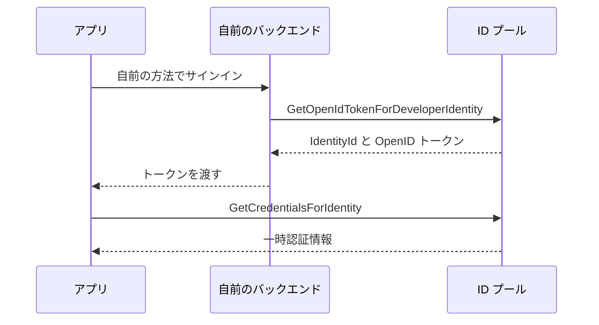

1. ID プールに開発者プロバイダー名を設定する。後から変更も削除もできない。
2. バックエンドが AWS の認証情報で `GetOpenIdTokenForDeveloperIdentity` を呼ぶ。`TokenDuration` は既定 15 分、最大 86,400 秒。
3. 返ったトークンで、クライアントが `GetCredentialsForIdentity` を呼ぶ。`Logins` のキーはトークンの `iss` と完全に一致させる。

一致しないと、`NotAuthorizedException: Invalid login token. Issuer doesn't match providerName` になります。

- **例:** プロバイダー名を `login.example.myapp` にし、`TokenDuration=3600`（1 時間）でトークンを発行する。上限の 86,400 秒は 24 時間で、盗まれると 1 日中 AWS の認証情報に交換できる。
- **誤ると:** プロバイダー名を変えたくなっても変更できない。ID プールを作り直すことになる。

## API Gateway のオーソライザーの設定 {#authorizer-settings}

### REST API（COGNITO_USER_POOLS） {#rest-authorizer-settings}

| 設定 | 内容 |
| --- | --- |
| `providerARNs` | ユーザープールの ARN。1 つのオーソライザーに最大 1,000 個 |
| `identitySource` | トークンのヘッダー。`method.request.header.Authorization` |
| `identityValidationExpression` | トークンの `aud` を検証する正規表現。アクセストークンには `aud` がないので拒否される |
| メソッドの `authorizationScopes` | 設定するとアクセストークンを要求し、スコープを 1 つでも含めば通す |

- スコープ未設定で ID トークンの代わりにアクセストークンを送ると、拒否される。
- スコープが一致しなければ `401 Unauthorized`。
- コンソールのオーソライザーのテストには ID トークンを使う。アクセストークンでは試せない。
- **`identitySource` の例:** `method.request.header.Authorization` なので、`X-Auth-Token` ヘッダーで送ると 401 になる。
- **`identityValidationExpression` の例:** `^1example23456789$` にすると、そのアプリ向けの ID トークンだけが通る。
- **`providerARNs` の例:** `arn:aws:cognito-idp:ap-northeast-1:111122223333:userpool/ap-northeast-1_EXAMPLE` を指定する。複数のプールを並べられる。

### HTTP API（JWT オーソライザー） {#http-authorizer-settings}

| 設定 | 値 |
| --- | --- |
| `identitySource` | `$request.header.Authorization` |
| `issuer`（CLI と CloudFormation では `Issuer`） | `https://cognito-idp.<region>.amazonaws.com/<userPoolId>` |
| `audience` | アプリクライアント ID |
| ルートの `authorizationScopes` | 少なくとも 1 つを含むこと |

API Gateway は `kid`, `iss`, `aud` または `client_id`, `exp`, `nbf`, `iat` を確認します。公開鍵はベストエフォートで最大 2 時間キャッシュします。使える署名は RSA 系だけです。

ID トークンとアクセストークンは、JWT の構造だけでは区別できません。ID トークンの利用が必須でなければ、スコープの設定を推奨します。

- **例（CLI）:** 次のように作成する。

```bash
aws apigatewayv2 create-authorizer --api-id abc123 --name cognito \
  --authorizer-type JWT --identity-source '$request.header.Authorization' \
  --jwt-configuration Audience=1example23456789,Issuer=https://cognito-idp.ap-northeast-1.amazonaws.com/ap-northeast-1_EXAMPLE
```

- **例（スコープ）:** ルートの `authorizationScopes` を `["orders-api/read", "orders-api/admin"]` にすると、どちらかを持つトークンが通る。
- **誤ると:** `Issuer` の末尾に `/` を付けると、トークンの `iss` と一致せず 401 になる。

## 既定値と上限のまとめ {#numbers}

| 項目 | 値 |
| --- | --- |
| ID トークン、アクセストークン | 既定 1 時間。5 分〜1 日 |
| リフレッシュトークン | 既定 30 日。60 分〜10 年 |
| 認証セッション（`AuthSessionValidity`） | 3〜15 分 |
| 一時パスワード | 既定 7 日。最大 365 日 |
| パスワードの最小長 | 6〜99 |
| パスワード履歴 | 0〜24 |
| サインアップ確認のコード | 24 時間 |
| パスワードリセットのコード | 1 時間 |
| Lambda トリガーの応答 | 5 秒（変更不可） |
| カスタム属性 | 50 個。値は 2,048 文字まで |
| アプリクライアント | プールあたり 1,000（最大 10,000） |
| 同時に持てるクライアントシークレット | 2 つ |
| コールバック URL | クライアントあたり 100 |
| スコープ | リソースサーバーあたり 100、クライアントあたり 50 |
| リソースサーバー | プールあたり 100（最大 300） |
| グループ | プールあたり 10,000、ユーザーあたり 100 |
| ID プールのルール | プロバイダーあたり 25 |
| REST API オーソライザーのプール数 | 1,000 |
| 開発者トークンの `TokenDuration` | 既定 15 分。最大 86,400 秒 |

## 試験のポイント {#exam-points}

| こう問われたら | 答え |
| --- | --- |
| Web アプリのサインインと JWT の発行 | ユーザープール |
| モバイルアプリから S3 に直接アップロード | ID プール |
| ログイン前のゲストに限定的な権限を与える | ID プールの未認証ロール |
| サインイン画面を自作したくない | マネージドログイン |
| SPA やモバイルで安全にトークンを取得 | 認可コードグラントと PKCE |
| サービス間の認証 | クライアント認証情報グラント |
| JWT の署名の検証に使うもの | ユーザープールの JWKS と `kid` |
| アクセストークンがどのアプリ向けか確認するクレーム | `client_id`（ID トークンは `aud`） |
| REST API の認可にユーザープールを使う | `COGNITO_USER_POOLS` オーソライザー |
| REST API でスコープを使うときのトークン | アクセストークン |
| トークンに独自のクレームを追加 | Pre token generation トリガー |
| サインアップ時にメールのドメインを検証 | Pre sign-up トリガー |
| 既存のユーザー DB から順次移行 | User migration トリガー |
| グループごとに AWS の権限を変える | グループに IAM ロールを割り当て、ID プールで「トークンから選択」 |
| ユーザーが自分の DynamoDB 項目だけ操作 | `dynamodb:LeadingKeys` と `${cognito-identity.amazonaws.com:sub}` |
| カスタム属性を削除したい | できない |
| メールでのサインインを作成後に追加したい | できない。プールを作り直す |
| リフレッシュトークンの既定の有効期間 | 30 日 |
| Lambda トリガーの応答の期限 | 5 秒（変更不可） |
| 同じ Precedence で異なるロールのグループ | `cognito:preferred_role` が設定されない |
| ロールマッピングがある ID プールで基本フロー | エラー。拡張フローを使う |
| アダプティブ認証を試してから有効にする | 監査のみモードで 2 週間以上 |
| カスタムドメインの証明書の置き場所 | `us-east-1` |

## 関連ページ {#related}

- [IAM と STS](iam.md): ロール、フェデレーション、条件キー
- [API Gateway](api-gateway.md): オーソライザーの比較
- [Lambda](lambda.md): Lambda トリガーの実装
- [DynamoDB](dynamodb.md): きめ細かいアクセス制御
- [Secrets Manager と Parameter Store](secrets.md): マルチテナントのパターン

## 参考 {#references}

- [Understanding user pool JSON web tokens](https://docs.aws.amazon.com/cognito/latest/developerguide/amazon-cognito-user-pools-using-tokens-with-identity-providers.html)
- [Understanding the identity token](https://docs.aws.amazon.com/cognito/latest/developerguide/amazon-cognito-user-pools-using-the-id-token.html)
- [Understanding the access token](https://docs.aws.amazon.com/cognito/latest/developerguide/amazon-cognito-user-pools-using-the-access-token.html)
- [Refresh tokens](https://docs.aws.amazon.com/cognito/latest/developerguide/amazon-cognito-user-pools-using-the-refresh-token.html)
- [Verifying JSON web tokens](https://docs.aws.amazon.com/cognito/latest/developerguide/amazon-cognito-user-pools-using-tokens-verifying-a-jwt.html)
- [OAuth 2.0 grants](https://docs.aws.amazon.com/cognito/latest/developerguide/federation-endpoints-oauth-grants.html)
- [User pool managed login](https://docs.aws.amazon.com/cognito/latest/developerguide/cognito-user-pools-managed-login.html)
- [Adding groups to a user pool](https://docs.aws.amazon.com/cognito/latest/developerguide/cognito-user-pools-user-groups.html)
- [Working with user attributes](https://docs.aws.amazon.com/cognito/latest/developerguide/user-pool-settings-attributes.html)
- [Customizing user pool workflows with Lambda triggers](https://docs.aws.amazon.com/cognito/latest/developerguide/cognito-user-pools-working-with-lambda-triggers.html)
- [Pre token generation Lambda trigger](https://docs.aws.amazon.com/cognito/latest/developerguide/user-pool-lambda-pre-token-generation.html)
- [Adding MFA to a user pool](https://docs.aws.amazon.com/cognito/latest/developerguide/user-pool-settings-mfa.html)
- [Identity pools authentication flow](https://docs.aws.amazon.com/cognito/latest/developerguide/authentication-flow.html)
- [Using role-based access control](https://docs.aws.amazon.com/cognito/latest/developerguide/role-based-access-control.html)
- [Using attributes for access control](https://docs.aws.amazon.com/cognito/latest/developerguide/attributes-for-access-control.html)
- [Control access to REST APIs using Amazon Cognito user pools](https://docs.aws.amazon.com/apigateway/latest/developerguide/apigateway-integrate-with-cognito.html)
- [Control access to HTTP APIs with JWT authorizers](https://docs.aws.amazon.com/apigateway/latest/developerguide/http-api-jwt-authorizer.html)
- [What is Amazon Verified Permissions?](https://docs.aws.amazon.com/verifiedpermissions/latest/userguide/what-is-avp.html)
