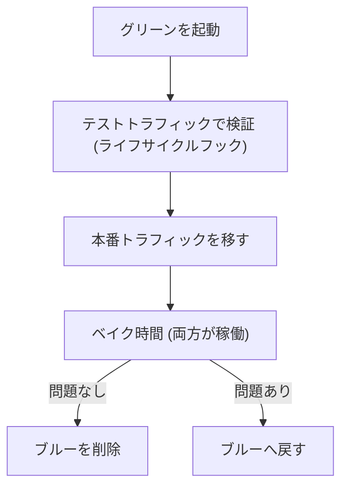

# コンテナ(ECR、ECS、EKS)

[:material-sprout: CLF](../courses/clf/services.md){ .exam-badge .exam-foundational } [:material-sprout: AIF](../courses/aif/services.md){ .exam-badge .exam-foundational } [:material-certificate: SAA](../courses/saa/services.md){ .exam-badge .exam-associate } [:material-certificate: DVA](../courses/dva/services.md){ .exam-badge .exam-associate } [:material-certificate: SOA](../courses/soa/services.md){ .exam-badge .exam-associate } [:material-certificate: DEA](../courses/dea/services.md){ .exam-badge .exam-associate } [:material-certificate: MLA](../courses/mla/services.md){ .exam-badge .exam-associate } [:material-star-circle: SAP](../courses/sap/services.md){ .exam-badge .exam-professional } [:material-star-circle: DOP](../courses/dop/services.md){ .exam-badge .exam-professional } [:material-star-circle: AIP](../courses/aip/services.md){ .exam-badge .exam-professional } [:material-target: ANS](../courses/ans/services.md){ .exam-badge .exam-specialty } [:material-target: SCS](../courses/scs/services.md){ .exam-badge .exam-specialty }

コンテナイメージを ECR に保存し、ECS か EKS で動かします。AWS のサービスと簡単に連携したいなら ECS、Kubernetes の API やエコシステムが必要なら EKS を選びます。

[](../assets/diagrams/containers-ecs-flow.png)

## Dockerfile の基本 {#dockerfile}

```dockerfile
FROM python:3.12-slim

WORKDIR /app

# 依存関係を先にコピーし、レイヤーキャッシュを活かす
COPY requirements.txt .
RUN pip install --no-cache-dir -r requirements.txt

COPY . .

USER 1000
EXPOSE 8080
CMD ["gunicorn", "--bind", "0.0.0.0:8080", "app:app"]
```

| 命令 | 役割 |
| --- | --- |
| `FROM` | ベースイメージ |
| `WORKDIR` | 作業ディレクトリ |
| `COPY` | ファイルをイメージに入れる |
| `RUN` | ビルド時に実行 |
| `ENV` | 環境変数 |
| `EXPOSE` | 使うポートの宣言(公開はしない) |
| `ENTRYPOINT`、`CMD` | 起動時に実行。`CMD` は上書きしやすい |

良いイメージを作るための要点は次のとおりです。

- 変わりにくい命令を先に書き、ビルドキャッシュを効かせます。
- マルチステージビルドで、ビルドツールを最終イメージから除きます。
- 小さなベースイメージを使うと、起動が速くなり脆弱性も減ります。
- シークレットをイメージに入れません。実行時に注入します。
- `.dockerignore` で不要なファイルを除きます。

### 命令の詳細 {#dockerfile-instructions}

| 命令 | 注意点 | 例 |
| --- | --- | --- |
| `FROM` | マルチステージでは `AS` で名前を付ける | `FROM golang:1.22 AS build` |
| `COPY` | ファイルのコピーだけ。`--from` で前のステージから取れる | `COPY --from=build /app /app` |
| `ADD` | `COPY` に加え、URL の取得とアーカイブの展開ができる | 必要なときだけ使う |
| `RUN` | ビルド時に 1 回実行し、結果がレイヤーになる | `RUN dnf install -y curl` |
| `ENV` | ビルド中と実行時の両方で使える環境変数 | `ENV LOG_LEVEL=info` |
| `ARG` | ビルド時だけの変数。実行時には残らない | `ARG VERSION=1.0` |
| `USER` | 以降の命令と実行時のユーザー | `USER 1000` |
| `EXPOSE` | ドキュメントとしての宣言。ポートを公開しない | `EXPOSE 8080` |
| `HEALTHCHECK` | Docker のヘルスチェック。ECS はタスク定義の `healthCheck` を使う | |
| `ENTRYPOINT` | 実行ファイルを固定する | `ENTRYPOINT ["python", "app.py"]` |
| `CMD` | 既定の引数やコマンド。`docker run` の引数で置き換わる | `CMD ["--port", "8080"]` |

`CMD` と `ENTRYPOINT` のどちらかは必要です。上の例を組み合わせると `python app.py --port 8080` が動きます。`docker run my-app --port 9090` なら `CMD` だけが置き換わります。

ECS のタスク定義では、`entryPoint` が `ENTRYPOINT` を、`command` が `CMD` を上書きします。Kubernetes では `command` が `ENTRYPOINT` を、`args` が `CMD` を上書きします。名前が違うので注意します。

**落とし穴**: `RUN pip install` の前に `COPY . .` を書くと、ソースを 1 行変えるだけで依存関係を入れ直します。シークレットを `ENV` や `ARG` に入れるとイメージの履歴に残ります。

各命令の使いどころを、値を入れて確かめます。

- **`FROM` と `AS`、`COPY --from` の例:** Go のビルドに `FROM golang:1.22 AS build` を使い、最終段を `FROM alpine:3.20` にして `COPY --from=build /app /app` とします。コンパイラは最終イメージに入りません。
- **`COPY` と `ADD` の例:** `ADD app.tar.gz /srv/` は展開して配置し、`COPY app.tar.gz /srv/` は圧縮ファイルのまま置きます。展開が要らなければ `COPY` にします。
- **`RUN` の例:** `RUN dnf install -y curl` はビルド時に 1 回だけ動きます。起動のたびに動かしたい処理を `RUN` に書くと、コンテナの起動時には実行されません。
- **`ENV` と `ARG` の例:** `ARG VERSION=1.0` は `docker build --build-arg VERSION=1.4.2` で変えられますが、実行中のコンテナからは読めません。`ENV LOG_LEVEL=info` は実行中も読めます。
- **`USER` の例:** `USER 1000` の後は UID 1000 で動きます。`RUN dnf install` をこの後に書くと、権限が足りずにビルドが失敗します。パッケージの導入は `USER` の前に書きます。
- **`EXPOSE` の例:** `EXPOSE 8080` だけでは外から接続できません。ECS ならタスク定義の `portMappings` に `containerPort: 8080` を書きます。
- **`WORKDIR` の例:** `WORKDIR /app` の後の `COPY requirements.txt .` は `/app/requirements.txt` に置かれます。`WORKDIR` を書き忘れると、ルートなどベースイメージの作業ディレクトリに置かれ、起動コマンドがファイルを見つけられません。
- **`.dockerignore` の例:** `.git`、`node_modules`、`.env` を書くと、`COPY . .` で入らなくなります。`.env` を書かないと、ローカルの `.env` までイメージに入るおそれがあります。

## ECR {#ecr}

[:material-sprout: CLF](../courses/clf/services.md){ .exam-badge .exam-foundational } [:material-certificate: SAA](../courses/saa/services.md){ .exam-badge .exam-associate } [:material-certificate: DVA](../courses/dva/services.md){ .exam-badge .exam-associate } [:material-certificate: SOA](../courses/soa/services.md){ .exam-badge .exam-associate } [:material-certificate: DEA](../courses/dea/services.md){ .exam-badge .exam-associate } [:material-certificate: MLA](../courses/mla/services.md){ .exam-badge .exam-associate } [:material-star-circle: SAP](../courses/sap/services.md){ .exam-badge .exam-professional } [:material-star-circle: DOP](../courses/dop/services.md){ .exam-badge .exam-professional } [:material-star-circle: AIP](../courses/aip/services.md){ .exam-badge .exam-professional } [:material-target: ANS](../courses/ans/services.md){ .exam-badge .exam-specialty }

**提供単位**: リポジトリはリージョン単位で、VPC の外にあります（[リソースの提供単位](resource-scope.md#scope-regional-outside)）。プライベートサブネットからは VPC エンドポイントか NAT 経由で使います。

### 認証とプッシュ、プル {#ecr-auth}

Docker CLI は IAM を直接扱えません。トークンを取得して `docker login` します。

```bash
aws ecr get-login-password --region ap-northeast-1 | \
  docker login --username AWS --password-stdin \
  123456789012.dkr.ecr.ap-northeast-1.amazonaws.com

docker build -t my-app .
docker tag my-app:latest 123456789012.dkr.ecr.ap-northeast-1.amazonaws.com/my-app:1.4.2
docker push 123456789012.dkr.ecr.ap-northeast-1.amazonaws.com/my-app:1.4.2
```

- トークンの有効期間は 12 時間です。ユーザー名は `AWS` です。
- `ecr:GetAuthorizationToken` はリソース `*` に対して許可します。
- プッシュには、`ecr:InitiateLayerUpload`、`ecr:UploadLayerPart`、`ecr:CompleteLayerUpload`、`ecr:BatchCheckLayerAvailability`、`ecr:PutImage`、`ecr:BatchGetImage` が必要です。
- プルには、`ecr:BatchGetImage`、`ecr:GetDownloadUrlForLayer` が必要です。
- ログインのエラーが出たら、AWS CLI の更新と権限を確認します。Docker 認証情報ヘルパーも使えますが、MFA には対応していません。

トークンの権限は、取得した IAM プリンシパルと同じです。そのプリンシパルがアクセスできる ECR レジストリなら使えます。

**症状**: 12 時間を超えたバッチでプッシュすると、`no basic auth credentials` や認証エラーになります。プッシュの直前に取り直します。別アカウントのレジストリなら、`docker login` の URI をそのレジストリにします。

- **`ecr:GetAuthorizationToken` の例:** 特定のリポジトリの ARN だけを `Resource` に書くと、`get-login-password` が拒否されます。この操作だけ `"Resource": "*"` にし、プッシュとプルの権限はリポジトリの ARN に絞ります。
- **プッシュとプルの権限の例:** CI のロールにプルの権限しか付けないと、`docker pull` は通りますが `docker push` は `denied` で失敗します。
- **トークンの時間の例:** 9 時に取得したトークンは 21 時に切れます。夜 22 時に動くジョブが 9 時のトークンを使い回すと、認証エラーになります。

### タグと不変タグ {#image-tags}

| 指定方法 | 例 | 特徴 |
| --- | --- | --- |
| 可変タグ | `latest` | 指す先が変わる。再現性が低い |
| バージョンやコミットのタグ | `1.4.2`、`git-abc123` | 環境ごとに承認済みの版を指定しやすい |
| ダイジェスト | `my-app@sha256:...` | 内容が完全に固定される |

**タグの不変性**はリポジトリの設定です。

| 設定 | 動作 |
| --- | --- |
| `MUTABLE` | 上書きできる |
| `IMMUTABLE` | 既存のタグへのプッシュは `ImageTagAlreadyExistsException` |
| `IMMUTABLE_WITH_EXCLUSION` | 不変とするが、指定のフィルターに一致するタグだけ上書き可 |
| `MUTABLE_WITH_EXCLUSION` | 可変とするが、指定のフィルターに一致するタグだけ上書き不可 |

本番の環境では不変タグを使うことで、同じタグの中身が変わる事故を防げます。プルスルーキャッシュを使うリポジトリは、更新のために可変にしておきます。

```bash
aws ecr put-image-tag-mutability --repository-name my-app \
  --image-tag-mutability IMMUTABLE
```

設定はすべてのタグに効きます。`latest` を毎回プッシュする CI が不変タグのリポジトリで失敗するのはこのためです。コミットのタグを使うか、`latest` だけ除外フィルターに入れます。

除外フィルターは `WILDCARD` で指定します。

```bash
aws ecr put-image-tag-mutability --repository-name my-app \
  --image-tag-mutability IMMUTABLE_WITH_EXCLUSION \
  --image-tag-mutability-exclusion-filters filterType=WILDCARD,filter=latest
```

- **`MUTABLE` の例:** `1.4.2` を 2 回プッシュすると、2 回目の中身でタグが上書きされます。1 回目のイメージはタグなしで残ります。
- **`IMMUTABLE` の例:** `1.4.2` を 2 回プッシュすると、2 回目は `ImageTagAlreadyExistsException` で失敗します。
- **`IMMUTABLE_WITH_EXCLUSION` の例:** 上のコマンドなら `1.4.2` は上書きできず、`latest` だけ上書きできます。
- **`MUTABLE_WITH_EXCLUSION` の例:** フィルターを `prod-*` にすると、`dev` は上書きでき、`prod-2026-10-31` は上書きできません。
- **ダイジェストの例:** `my-app@sha256:...` で指定すると、タグが移動しても同じ内容を取得します。タグの付け替えの影響を受けません。
- **誤ると:** 本番を `latest` で動かすと、同じタスク定義のまま別の内容を起動することがあります。障害時に、どの版が動いていたかを追いにくくなります。

### 環境とイメージタグ {#environments-image-tags}

統合テストに承認済みの版を使う場合は、CI でイメージをタグ付けし、環境ごとの設定でそのタグを指定します。

| 方法 | 内容 |
| --- | --- |
| 昇格 | テスト済みのイメージに `staging`、`prod-2026-10-31` などのタグを追加する |
| 不変な参照 | タスク定義やマニフェストでコミットタグかダイジェストを指定する |
| 環境の分離 | 環境ごとにタスク定義のリビジョンを分ける |

同じイメージを dev から prod に昇格させ、環境の違いは環境変数と Parameter Store で扱います。イメージを環境ごとにビルドし直しません。Lambda のエイリアスに相当するのがこの仕組みです。

ECS はデプロイ時にタグをダイジェストに解決するので、サービス内のタスクは同じイメージで動きます。ただし、後からタグの中身が変わっても、再デプロイを強制しない限り反映されません。

- **昇格の例:** テストに通った `git-abc123` に、同じイメージのまま `prod-2026-10-31` のタグを追加します。

```bash
MANIFEST=$(aws ecr batch-get-image --repository-name my-app \
  --image-ids imageTag=git-abc123 \
  --query 'images[0].imageManifest' --output text)
aws ecr put-image --repository-name my-app \
  --image-tag prod-2026-10-31 --image-manifest "$MANIFEST"
```

- **不変な参照の例:** タスク定義のリビジョン 12 は `my-app:git-abc123`、13 は `my-app:git-def456` を指します。リビジョン 12 に戻せば、前の版で動きます。
- **誤ると:** dev と prod でイメージを別々にビルドすると、依存関係の更新が紛れ込み、dev で試した内容と prod の内容が変わることがあります。

### ライフサイクルポリシー {#ecr-lifecycle}

古いイメージを自動で期限切れにします。適用前にプレビューで確認します。

```json
{
  "rules": [
    {
      "rulePriority": 1,
      "description": "タグなしを 14 日で削除",
      "selection": {
        "tagStatus": "untagged",
        "countType": "sinceImagePushed",
        "countUnit": "days",
        "countNumber": 14
      },
      "action": {"type": "expire"}
    },
    {
      "rulePriority": 2,
      "description": "prod は最新 10 個を残す",
      "selection": {
        "tagStatus": "tagged",
        "tagPrefixList": ["prod"],
        "countType": "imageCountMoreThan",
        "countNumber": 10
      },
      "action": {"type": "expire"}
    }
  ]
}
```

- `rulePriority` の数字が小さいほど優先されます。
- `countType` は主に `imageCountMoreThan`(個数)と `sinceImagePushed`(経過日数)です。
- 条件を満たしてから 24 時間以内に実行されます。

`selection` の項目は次のとおりです。

| キー | 値 | 注意 |
| --- | --- | --- |
| `rulePriority` | 整数 | 一意にする。小さいほど先 |
| `tagStatus` | `tagged`、`untagged`、`any` | `tagged` なら `tagPatternList` か `tagPrefixList` が必須 |
| `tagPatternList` | `prod*` のようなパターン | `*` が使える。推奨される指定方法 |
| `tagPrefixList` | `prod` のような接頭辞 | `tagPatternList` と同時に指定しない |
| `countType` | `imageCountMoreThan`、`sinceImagePushed`、`sinceImagePulled`、`sinceImageTransitioned` | |
| `countUnit` | `days` | 日数の `countType` だけで指定する。他で書くとエラー |
| `countNumber` | 正の整数 | 個数か日数 |
| `action.type` | `expire`、`transition` | `transition` はアーカイブへ移す |

評価の規則も問われます。

- すべてのルールを同時に評価し、優先度の順に適用します。
- 1 つのイメージを期限切れにするルールは 0 個か 1 個です。
- 高い優先度のルールのタグ条件に合うイメージは、低い優先度のルールでは期限切れになりません。
- 古いものから順に期限切れになります。

**計算例**: `prod*` のタグが 15 個あり、`imageCountMoreThan: 10` なら、古い 5 個が 24 時間以内に期限切れになります。

**落とし穴**: `tagStatus: tagged` だけで `tagPatternList` を書かないとエラーになります。`any` のルールは他のルールより低い優先度にします。ポリシーの長さは 30,720 文字までです。

キーごとの例です。

- **`rulePriority` の例:** 値は連番でなくてかまいません。`1` と `10` でも有効です。同じ値を 2 つのルールに付けると無効です。`tagStatus: any` のルールは最も大きい値にします。
- **`tagStatus` の例:** `untagged` はタグのないイメージだけが対象で、`tagPatternList` と `tagPrefixList` は書けません。`any` はすべてのイメージが対象です。
- **`tagPatternList` の例:** `["prod*"]` は `prod`、`prod1`、`prod-2026` に一致します。1 つの文字列に書けるワイルドカードは 4 個までなので、`test*1*2*3*4*5*6` は無効です。`["prod*", "*web"]` のように複数書くと、**両方に一致するタグを持つイメージだけ**が対象です。
- **`tagPrefixList` の例:** `["prod"]` は `prod` で始まるタグに一致します。複数書いたときの扱いは `tagPatternList` と同じです。
- **`imageCountMoreThan` の例:** 上の計算例のとおりです。`countUnit` を書くとエラーになります。
- **`sinceImagePushed` の例:** `countNumber: 14`、`countUnit: days` なら、プッシュから 14 日より古いイメージが対象です。
- **`sinceImagePulled` の例:** 90 日プルされていないイメージをアーカイブへ移します。`transition` と組み合わせます。`expire` では使えません。一度もプルされていないイメージは、プッシュの日時で判定します。
- **`sinceImageTransitioned` の例:** アーカイブして 365 日たったイメージを削除します。`storageClass: archive` が必須です。

```json
[
  {
    "rulePriority": 1,
    "selection": {"tagStatus": "any", "countType": "sinceImagePulled",
                  "countUnit": "days", "countNumber": 90},
    "action": {"type": "transition", "targetStorageClass": "archive"}
  },
  {
    "rulePriority": 2,
    "selection": {"tagStatus": "any", "storageClass": "archive",
                  "countType": "sinceImageTransitioned",
                  "countUnit": "days", "countNumber": 365},
    "action": {"type": "expire"}
  }
]
```

- **`action.type` の例:** `transition` には `targetStorageClass: archive` が必須です。`expire` には不要です。
- **誤ると:** 優先度 1 の `prod*` のルールに合うイメージは、優先度 2 の `any` のルールでは期限切れになりません。`prod` を消すつもりのルールを低い優先度に足しても、効かないことがあります。適用前にプレビューで対象を確認します。

### イメージスキャン {#ecr-scanning}

| 種類 | 対象 | タイミング | 仕組み |
| --- | --- | --- | --- |
| 基本 | OS の脆弱性 | プッシュ時か手動 | ECR |
| 拡張 | OS とプログラミング言語のパッケージ | プッシュ時と継続的 | Amazon Inspector と連携。結果は EventBridge に送られる |

結果は `DescribeImageScanFindings` で取得します。スキャンの設定はプライベートレジストリのレベルで行うのが推奨です。

基本スキャンは、スキャンオンプッシュのフィルターに合わないリポジトリでは手動です。同じイメージは 24 時間に 1 回までです。拡張スキャンでは、フィルターで継続スキャンかスキャンオンプッシュを選びます。料金は Inspector に発生します。

- **基本スキャンの例:** 10 時のプッシュでスキャンが動いたイメージは、同じ日の 15 時に手動でスキャンできません。24 時間の枠にはプッシュ時のスキャンも含まれます。
- **フィルターの例:** レジストリの設定で `prod-*` だけをスキャンオンプッシュにすると、`dev-api` は手動スキャンになります。拡張スキャンなら、フィルターに合わない `dev-api` はスキャンされません。
- **拡張スキャンの例:** `prod-*` を継続スキャン、`*` をスキャンオンプッシュにすると、`prod-api` は両方に一致します。この場合は継続スキャンが優先されます。
- **誤ると:** 拡張スキャンを有効にしたとき、Inspector が認識するのはプッシュから 14 日以内のイメージです。古いイメージは `SCAN_ELIGIBILITY_EXPIRED` になります。また、拡張スキャンでは手動スキャンを使えません。

### レプリケーション {#ecr-replication}

レプリケーションはリポジトリではなく、プライベートレジストリの設定です。リージョン間とアカウント間に対応します。

```bash
aws ecr put-replication-configuration --replication-configuration '{
  "rules": [{
    "destinations": [{"region": "us-west-2", "registryId": "111122223333"}],
    "repositoryFilters": [{"filter": "prod", "filterType": "PREFIX_MATCH"}]
  }]
}'
```

| 項目 | 内容 |
| --- | --- |
| 対象 | 既定では、設定後にプッシュ、または復元したイメージのみ。既存のものはレプリケーションバックフィルで複製する |
| 上限 | 宛先は全ルールで 25 個まで、ルールは 25 個まで、1 ルールのフィルターは 100 個まで |
| アカウント間の権限 | **宛先側**のレジストリ許可ポリシーのみ。送信元のリポジトリポリシーは不要 |
| 複製されないもの | リポジトリポリシー、ライフサイクルポリシー。設定は既定で複製されない(リポジトリ作成テンプレートで指定) |
| 連鎖 | 1 回のプッシュで 1 回だけ。`us-west-2` から `us-east-1`、`us-east-1` から `us-east-2` の設定でも、`us-east-2` には届かない |

**例**: 宛先に `ecr:CreateRepository` を許可しないと、同じ名前のリポジトリを事前に作る必要があります。

**落とし穴**: 宛先で不変タグが有効で同じタグが既にあると、イメージは複製されますがタグは付きません。タグなしになることがあります。

項目ごとの例です。

- **対象の例:** 設定前からある `my-app:1.4.2` は、自動では複製されません。複製するには宛先を 1 つ指定してバックフィルを開始します。宛先が 2 つなら 2 回開始します。
- **`repositoryFilters` の例:** `PREFIX_MATCH` で `prod` を指定すると、`prod-api` と `prod/web` が対象で、`dev-api` は対象外です。
- **上限の例:** 東京のレジストリから `us-west-2` と `eu-west-1` へ複製し、さらに別アカウントの `us-west-2` へ複製すると、宛先は 3 個です。全ルールで 25 個まで数えます。
- **連鎖の例:** `us-west-2` から `us-east-1` と `us-east-2` の両方へ届けるなら、`us-west-2` のルールに宛先を 2 つ書きます。
- **アカウント間の権限の例:** 宛先のレジストリ許可ポリシーで、送信元のアカウントに次のアクションを許可します。

```json
{
  "Effect": "Allow",
  "Principal": {"AWS": "arn:aws:iam::<送信元のアカウント ID>:root"},
  "Action": ["ecr:CreateRepository", "ecr:ReplicateImage"],
  "Resource": "arn:aws:ecr:us-west-2:111122223333:repository/*"
}
```

- **複製されないものの例:** 東京のリポジトリに「最新 10 個を残す」ライフサイクルポリシーがあっても、宛先には効きません。宛先で別に設定するか、リポジトリ作成テンプレートを使います。削除も伝わらないので、宛先のイメージは増え続けます。
- **誤ると:** リポジトリ名は宛先でも同じで、変更できません。パーティションをまたぐ複製もできないので、`us-west-2` から `cn-north-1` へは届きません。

## ECS {#ecs}

[:material-sprout: CLF](../courses/clf/services.md){ .exam-badge .exam-foundational } [:material-sprout: AIF](../courses/aif/services.md){ .exam-badge .exam-foundational } [:material-certificate: SAA](../courses/saa/services.md){ .exam-badge .exam-associate } [:material-certificate: DVA](../courses/dva/services.md){ .exam-badge .exam-associate } [:material-certificate: SOA](../courses/soa/services.md){ .exam-badge .exam-associate } [:material-certificate: DEA](../courses/dea/services.md){ .exam-badge .exam-associate } [:material-certificate: MLA](../courses/mla/services.md){ .exam-badge .exam-associate } [:material-star-circle: SAP](../courses/sap/services.md){ .exam-badge .exam-professional } [:material-star-circle: DOP](../courses/dop/services.md){ .exam-badge .exam-professional } [:material-star-circle: AIP](../courses/aip/services.md){ .exam-badge .exam-professional } [:material-target: ANS](../courses/ans/services.md){ .exam-badge .exam-specialty }

| 用語 | 意味 |
| --- | --- |
| クラスター | タスクを動かす論理的なグループ |
| タスク定義 | イメージ、CPU、メモリ、ロールなどの設計図。バージョン管理される(リビジョン) |
| タスク | タスク定義から起動した実体 |
| サービス | 指定した数のタスクを維持し、ロードバランサーと連携する |

**提供単位**: クラスターはリージョン単位です。タスクは AZ のサブネットに置き、VPC の中で動きます（[リソースの提供単位](resource-scope.md#scope-regional-vpc)）。

- **例:** 東京リージョンのクラスター `prod` に `desiredCount: 4` のサービスを作り、1a と 1c のサブネットを指定します。タスクは 2 つの AZ に分かれ、1a が止まっても 1c の 2 タスクが動き続けます。
- **誤ると:** サブネットを 1a だけにすると、クラスターはリージョン単位でも、1a の障害でタスクがすべて止まります。

### タスク定義 {#task-definition}

```json
{
  "family": "web",
  "requiresCompatibilities": ["FARGATE"],
  "networkMode": "awsvpc",
  "cpu": "512",
  "memory": "1024",
  "executionRoleArn": "arn:aws:iam::123456789012:role/ecsTaskExecutionRole",
  "taskRoleArn": "arn:aws:iam::123456789012:role/webTaskRole",
  "containerDefinitions": [{
    "name": "app",
    "image": "123456789012.dkr.ecr.ap-northeast-1.amazonaws.com/my-app:1.4.2",
    "portMappings": [{"containerPort": 8080}],
    "environment": [{"name": "LOG_LEVEL", "value": "info"}],
    "secrets": [{
      "name": "DB_PASSWORD",
      "valueFrom": "arn:aws:secretsmanager:ap-northeast-1:123456789012:secret:prod/db-AbCdEf:password::"
    }],
    "healthCheck": {
      "command": ["CMD-SHELL", "curl -f http://localhost:8080/health || exit 1"],
      "interval": 30,
      "timeout": 5,
      "retries": 3,
      "startPeriod": 60
    },
    "logConfiguration": {
      "logDriver": "awslogs",
      "options": {
        "awslogs-group": "/ecs/web",
        "awslogs-region": "ap-northeast-1",
        "awslogs-stream-prefix": "app"
      }
    }
  }]
}
```

### コンテナ定義のパラメータ {#container-definition}

| パラメータ | 既定値、範囲 | 意味と例 |
| --- | --- | --- |
| `cpu`(コンテナ) | 任意 | 共有の割り当て。1 vCPU は 1024 |
| `memory`(コンテナ) | 任意、MiB | **ハードリミット**。超えるとコンテナが強制終了される |
| `memoryReservation` | 任意、MiB | **ソフトリミット**。予約量で、競合がなければ超えてよい |
| `portMappings` | 任意 | `containerPort`、`hostPort`、`protocol` など |
| `environment` | 任意 | 平文の環境変数 |
| `environmentFiles` | 任意 | S3 の `.env` ファイルから読む |
| `secrets` | 任意 | Secrets Manager か Parameter Store の値 |
| `essential` | `true` | 落ちるとタスクの全コンテナが止まる |
| `dependsOn` | 任意 | 起動順の依存関係 |
| `startTimeout` | 任意、秒 | 依存を待つのをやめるまでの時間 |
| `stopTimeout` | 既定 30、最大 120 秒 | 終了の猶予。`SIGTERM` の後、これを過ぎると `SIGKILL` |
| `readonlyRootFilesystem` | `false` | ルートファイルシステムを読み取り専用に |
| `user` | 任意 | 実行ユーザー |
| `command`、`entryPoint` | 任意 | Dockerfile の `CMD`、`ENTRYPOINT` を上書き |
| `logConfiguration` | 任意 | ログドライバーの設定 |
| `healthCheck` | 任意 | 下記を参照 |

重要度の高くない項目を、値を入れて確かめます。

- **`cpu`(コンテナ)の例:** タスクの `cpu` が 1024 で、`app` に 768、サイドカーに 256 を割り当てます。合計はタスクの値を上回れません。Linux では、空いている CPU は割り当ての比で分け合います。
- **`environment` の例:** `{"name": "LOG_LEVEL", "value": "info"}` は `DescribeTaskDefinition` の結果に平文で見えます。パスワードは `secrets` に書きます。
- **`environmentFiles` の例:** `{"value": "arn:aws:s3:::my-config/prod.env", "type": "s3"}` と書きます。拡張子は `.env`、ファイルは 10 個までです。同じ名前の変数が `environment` にもあれば、`environment` が優先されます。
- **`essential` の例:** `app` が `true`、ログ転送のサイドカーが `false` なら、サイドカーが落ちても `app` は動き続けます。逆に `app` が落ちるとサイドカーも止まります。全コンテナを `false` にはできません。
- **`startTimeout` の例:** `migrate` に `startTimeout: 120` を付け、`app` が `migrate` の `SUCCESS` を待つとします。120 秒で条件を満たさないと `app` は起動しません。Fargate の上限は 120 秒です。
- **`stopTimeout` の例:** 処理中のリクエストを終えるのに 60 秒かかるアプリは `stopTimeout: 60` にします。既定の 30 秒のままだと、30 秒で `SIGKILL` され、処理が途中で切れます。
- **`readonlyRootFilesystem` の例:** `true` にすると、改ざんされてもルートに書き込めません。アプリが `/tmp` に書くなら、ボリュームを `/tmp` にマウントします。マウントしないと `Read-only file system` で失敗します。
- **`user` の例:** `"user": "1000:1000"` で UID と GID を指定します。形式は `user`、`user:group`、`uid`、`uid:gid` などです。Windows のコンテナでは使えません。
- **`command`、`entryPoint` の例:** イメージの `CMD` が `["--port", "8080"]` でも、タスク定義に `"command": ["--port", "9090"]` と書けば 9090 で起動します。イメージを作り直す必要はありません。

#### memory と memoryReservation {#memory-settings}

両方を指定するなら `memory` は `memoryReservation` より大きくします。タスクレベルのメモリがないなら、コンテナレベルで少なくともどちらかを指定します。

**例**: 普段 128 MiB で、ときどき 256 MiB まで使うアプリです。`memoryReservation: 128`、`memory: 300` にすると、インスタンスの空きから予約されるのは 128 MiB で、300 MiB を超えると強制終了されます。タスクの停止理由には `OutOfMemoryError` が出ます。

Docker 20.10 以降は最低 6 MiB を予約するので、これ未満は指定しません。

- **`memory` だけの例:** `memory: 512` のコンテナは、インスタンスの空きから 512 MiB を確保します。513 MiB 以上を使おうとすると強制終了されます。
- **配置の計算例:** 空きが 1,000 MiB のインスタンスに、`memoryReservation: 128` のタスクは 7 個まで置けます。1,000 ÷ 128 = 7.8 です。`memory: 300` だけなら、1,000 ÷ 300 = 3.3 で 3 個です。
- **誤ると:** `memory: 256`、`memoryReservation: 512` のように予約を上限より大きくすると、タスク定義は無効です。

#### portMappings とネットワークモード {#network-mode}

| `networkMode` | ポートの指定 | 特徴 |
| --- | --- | --- |
| `awsvpc` | `containerPort` を指定。`hostPort` は空か `containerPort` と同じ値 | タスクごとに ENI を持ち、セキュリティグループを付けられる。Fargate は必須 |
| `bridge` | `hostPort` を空にすると動的ポート | 同じホストで同じアプリを複数動かせる。ALB は動的ポートを登録できる |
| `host` | `hostPort` は未指定か `containerPort` と同じ | ホストのポートを直接使う。1 ホストに 1 タスク |
| `none` | 外部接続なし | |

**症状**: `host` モードで 2 つ目のタスクが配置されないのは、ポートの競合です。`bridge` なら `hostPort` を空にします。

- **`awsvpc` の計算例:** `/28` のサブネットで使える IP は 16 − 5 = 11 個です。`desiredCount: 10`、`maximumPercent: 200` のデプロイでは最大 20 タスクが動くので、1 つのサブネットでは足りません。`/28` を 2 つ指定すれば 22 個になります。
- **`awsvpc` の例:** タスクごとにセキュリティグループを付けられるので、`sg-app` への 8080 を `sg-alb` からだけ許可できます。
- **`bridge` の例:** `containerPort: 8080` で `hostPort` を空にすると、1 台に 3 タスク置いても、ホストのポートが別々に割り当てられます。ALB はターゲットをそのポートで登録します。
- **`host` の例:** `containerPort: 8080` のタスクは、ホストの 8080 を直接使います。4 タスクを動かすには 4 台必要です。
- **`none` の例:** 外部と通信しないバッチに使います。コンテナから S3 へは接続できません。Fargate では使えません。
- **`protocol` の例:** 既定は `tcp` で、DNS のように UDP を受けるなら `"protocol": "udp"` にします。同じ `containerPort` を複数のプロトコルで公開するとエラーです。

#### healthCheck {#ecs-healthcheck}

| 項目 | 既定値 | 範囲 |
| --- | --- | --- |
| `interval` | 30 秒 | 5〜300 |
| `timeout` | 5 秒 | 2〜60 |
| `retries` | 3 | 1〜10 |
| `startPeriod` | オフ | 0〜300 秒 |

`command` は `CMD` か `CMD-SHELL` で始めます。終了コード 0 が成功です。

**計算例**: `interval: 30`、`retries: 3` なら、失敗から異常の判定までおよそ 90 秒です。起動に 2 分かかるアプリは `startPeriod: 120` にします。`startPeriod` の間の失敗は回数に数えません。

**落とし穴**: イメージに `curl` がないと、`CMD-SHELL` の `curl -f` は常に失敗します。アプリが正常でもタスクが置き換えられます。

- **`interval` の例:** `interval: 10`、`retries: 3` なら、10 × 3 = 30 秒ほどで異常と判定します。既定の 30 秒間隔の 90 秒より速く気づきますが、確認の回数は 3 倍になります。
- **`timeout` の例:** 応答に 8 秒かかることがあるエンドポイントは `timeout: 10` にします。既定の 5 秒だと、遅いときだけ失敗として数えます。
- **`retries` の例:** `retries: 1` だと、1 回の失敗で異常になります。一時的な遅延でタスクが置き換えられるなら、既定の 3 に戻します。
- **`startPeriod` の例:** `startPeriod: 120` の間に一度でも成功すると、その時点で正常と判定し、以後の失敗を数えます。上限は 300 秒なので、起動に 6 分かかるアプリは起動を速くするか、サービスの `healthCheckGracePeriodSeconds` も使います。
- **`command` の例:** `["CMD", "/bin/check"]` はシェルを通さず直接実行します。`||` やパイプを使うなら `["CMD-SHELL", "curl -f http://localhost:8080/health || exit 1"]` にします。`CMD` で書くと、`||` はただの引数になります。

#### dependsOn {#depends-on}

| `condition` | 意味 |
| --- | --- |
| `START` | 依存先が起動した |
| `COMPLETE` | 依存先が終了した。必須コンテナには設定できない |
| `SUCCESS` | 依存先が終了コード 0 で終わった。必須コンテナには設定できない |
| `HEALTHY` | ヘルスチェックに通った。依存先に `healthCheck` が必要 |

```json
"dependsOn": [{"containerName": "migrate", "condition": "SUCCESS"}]
```

**例**: 初期化の `migrate` コンテナは `essential: false` にして、アプリを `SUCCESS` で待たせます。`essential: true` のままだと、`migrate` が正常に終わってもタスク全体が止まります。

- **`START` の例:** ログ転送のサイドカーを先に起動してからアプリを起動します。サイドカーの準備完了までは待ちません。
- **`COMPLETE` の例:** 設定ファイルを作るだけの `init` を待ちます。終了コード 1 で終わっても `app` は起動します。
- **`SUCCESS` の例:** `migrate` が終了コード 1 で終わると、`app` は起動しません。壊れたスキーマのまま動くのを防げます。
- **`HEALTHY` の例:** `proxy` に `healthCheck` を書き、`"condition": "HEALTHY"` で待ちます。`healthCheck` を書かないと条件を満たせません。
- **停止の順序:** 依存は停止時に逆になります。`app` が `proxy` に依存していれば、`app` が先に止まります。

#### logConfiguration {#log-configuration}

`awslogs` なら `awslogs-group`、`awslogs-region`、`awslogs-stream-prefix` を指定します。Fargate では `awslogs-stream-prefix` が必要です。ロググループを自動で作るには、`awslogs-create-group: "true"` と、実行ロールの `logs:CreateLogGroup` が要ります。実行ロールに `logs:CreateLogStream`、`logs:PutLogEvents` がないと、ログが出ないかタスクが起動しません。

- **例:** `awslogs-group: /ecs/web`、`awslogs-stream-prefix: app` で、コンテナ名が `app` なら、ログストリームは `app/app/<タスク ID>` です。タスク ID から該当のログをたどれます。
- **誤ると:** `/ecs/web` が存在せず `awslogs-create-group` もないと、ロググループが見つからずタスクが起動しません。

### タスクレベルのパラメータ {#task-level-parameters}

| パラメータ | 説明 |
| --- | --- |
| `family` | タスク定義の名前。登録ごとにリビジョンが増える |
| `cpu`、`memory` | タスク全体の割り当て。Fargate は必須 |
| `networkMode` | Fargate は `awsvpc` |
| `requiresCompatibilities` | `FARGATE`、`EC2` など。登録時に検証される |
| `taskRoleArn` | アプリが使うロール |
| `executionRoleArn` | エージェントが使うロール |
| `ephemeralStorage` | Fargate の一時ストレージ。既定は 20 GiB、`sizeInGiB` で 21〜200 GiB |
| `runtimePlatform` | `cpuArchitecture`(`X86_64`、`ARM64`)と OS |
| `volumes` | データボリューム |

**例**: 40 GB の動画を一時的に処理するタスクは、`"ephemeralStorage": {"sizeInGiB": 60}` にします。既定の 20 GiB のままだと、書き込みで `No space left on device` になります。

- **`family` の例:** `web` を 3 回登録すると、`web:1`、`web:2`、`web:3` になります。サービスを `web:2` に更新すれば、前の版に戻せます。
- **`cpu`、`memory` の例:** `"cpu": "512"`、`"memory": "1024"` は 0.5 vCPU と 1 GB です。合計が 2 GB 必要なコンテナ群を入れるなら、`memory` を `2048` にします。
- **`requiresCompatibilities` の例:** `FARGATE` を指定して `networkMode: bridge` で登録すると、登録時に検証エラーになります。
- **`runtimePlatform` の例:** `"cpuArchitecture": "ARM64"` なのに `x86_64` のイメージを指定すると、起動時に `exec format error` で止まります。イメージのアーキテクチャと合わせます。
- **`volumes` の例:** `{"name": "tmp"}` を定義し、コンテナの `mountPoints` で `/tmp` にマウントすると、同じタスクのコンテナでファイルを共有できます。タスクが止まると消えます。
- **`sizeInGiB` の範囲:** 20 は指定できません。既定のままにするか、21 以上を指定します。

### タスクロールと実行ロール {#task-role-vs-execution-role}

試験で最もよく問われる違いです。

| 観点 | タスクロール (`taskRoleArn`) | 実行ロール (`executionRoleArn`) |
| --- | --- | --- |
| 使うのは | コンテナの中のアプリ | ECS エージェント、Fargate エージェント |
| 用途 | S3、DynamoDB などアプリからの呼び出し | ECR からのプル、`awslogs` でのログ送信、`secrets` の取得 |
| 代表的なポリシー | アプリに必要な最小権限 | `AmazonECSTaskExecutionRolePolicy` |
| 信頼するプリンシパル | `ecs-tasks.amazonaws.com` | `ecs-tasks.amazonaws.com` |

判断の基準は、**タスクが起動する前に必要なら実行ロール、アプリのコードが呼ぶならタスクロール**です。Secrets Manager のカスタムキーを使うなら `kms:Decrypt` も実行ロールに付けます。

タスクロールを指定すると、SDK はタスクロールの認証情報だけを使い、EC2 のインスタンスプロファイルの権限は引き継ぎません。EC2 で動かす場合はタスク間の分離がないので、厳しい分離が必要なら Fargate を使います。

- **タスクロールの例:** アプリが `s3://reports/` を読むなら、タスクロールに `s3:GetObject` を付けます。実行ロールに付けても、アプリからは使えず `AccessDenied` になります。
- **実行ロールの例:** `secrets` に Secrets Manager の ARN を書いたら、実行ロールに `secretsmanager:GetSecretValue` を付けます。足りないと、タスクは `ResourceInitializationError` で起動に失敗し、アプリのコードは 1 行も動きません。
- **`environmentFiles` の例:** S3 の `.env` を読むのも起動前の処理なので、実行ロールに権限を付けます。
- **誤ると:** ECR からプルできず `CannotPullContainerError` が出たら、まず実行ロールとネットワークの経路を確認します。タスクロールを直しても解決しません。

### Fargate と EC2 {#fargate-vs-ec2}

[:material-sprout: CLF](../courses/clf/services.md){ .exam-badge .exam-foundational } [:material-certificate: SAA](../courses/saa/services.md){ .exam-badge .exam-associate } [:material-star-circle: SAP](../courses/sap/services.md){ .exam-badge .exam-professional } [:material-star-circle: DOP](../courses/dop/services.md){ .exam-badge .exam-professional } [:material-star-circle: AIP](../courses/aip/services.md){ .exam-badge .exam-professional } [:material-target: ANS](../courses/ans/services.md){ .exam-badge .exam-specialty }

| 観点 | Fargate | EC2 |
| --- | --- | --- |
| サーバーの管理 | 不要 | 必要(パッチ、スケール) |
| CPU、メモリの指定 | タスクレベルで必須。組み合わせが決まっている | コンテナレベルでも可 |
| ネットワークモード | `awsvpc` のみ | `awsvpc`、`bridge`、`host` など |
| 分離 | タスクごとに独立 | インスタンスの中で共有 |
| インスタンスプロファイル | コンテナからは使えない | あり |
| 特権コンテナ、GPU | 使えない | 使える |
| 向く場面 | 運用を減らしたい | 特殊な要件、コストの細かい最適化 |

**アプリの要件に合わせて CPU とメモリを決めます**。Fargate の有効な組み合わせの例です。

| CPU | メモリ |
| --- | --- |
| 256 (.25 vCPU) | 512 MiB、1 GB、2 GB |
| 512 (.5 vCPU) | 1〜4 GB |
| 1024 (1 vCPU) | 2〜8 GB |
| 2048 (2 vCPU) | 4〜16 GB(1 GB 単位) |
| 4096 (4 vCPU) | 8〜30 GB(1 GB 単位) |

上位のサイズもあります。ここまでの組み合わせ以外は登録時にエラーになります。

| CPU | メモリ |
| --- | --- |
| 8192 (8 vCPU) | 16〜60 GB(4 GB 単位) |
| 16384 (16 vCPU) | 32〜120 GB(8 GB 単位) |
| 32768 (32 vCPU) | 60 GB、120 GB、244 GB |

**例**: 1 vCPU で 16 GB は登録できません。16 GB が必要なら 2048 以上にします。`"cpu": "256"` と `"memory": "4096"` も無効です。

- **選び方の例:** メモリが 3 GB、CPU が 0.5 vCPU で足りるなら、`"cpu": "512"`、`"memory": "3072"` です。5 GB 必要なら `512` では足りないので `1024` にします。
- **単位の例:** CPU が `8192` のときのメモリは 4 GB 単位です。`16384`(16 GB)と `20480`(20 GB)は有効で、18 GB は無効です。
- **Fargate か EC2 かの例:** GPU を使う推論は Fargate では動かせないので EC2 にします。CPU 2 vCPU の Web アプリを少人数で運用するなら、パッチ作業のない Fargate を選びます。
- **誤ると:** Fargate のタスクで `placementConstraints` を指定しても使えません。AZ の分散は、指定したサブネットで決まります。

### 環境変数とシークレットの注入 {#env-and-secrets}

| 方法 | 指定 | 値の扱い |
| --- | --- | --- |
| 直接 | `environment` | タスク定義に平文で残る。機密でない値のみ |
| Secrets Manager | `secrets` の `valueFrom` に ARN | 起動時に環境変数へ注入。実行ロールで取得 |
| Parameter Store | `secrets` の `valueFrom` に ARN | 同上 |

ARN の末尾で、JSON のキーやバージョンを指定できます。

```text
arn:aws:secretsmanager:region:account:secret:name-AbCdEf:json-key:version-stage:version-id
```

!!! warning "ローテーションは自動で反映されない"
    シークレットは起動時に注入します。更新しても動いているコンテナには届きません。新しいタスクを起動するか、サービスの「新しいデプロイを強制」を実行します。

詳しくは [Secrets Manager と Parameter Store](secrets.md) を参照してください。

ARN の末尾の指定は次のように読みます。

- **JSON のキーの例:** `...:secret:prod/db-AbCdEf:password::` は、シークレットの JSON の `password` の値を取ります。末尾の `::` はステージと ID を省略した形です。
- **キーを省く例:** `...:secret:prod/db-AbCdEf` なら JSON 全体が 1 つの環境変数に入ります。`DB_PASSWORD` に `{"password":"..."}` が丸ごと入り、接続に失敗します。
- **Parameter Store の例:** `{"name": "API_URL", "valueFrom": "arn:aws:ssm:ap-northeast-1:111122223333:parameter/app/url"}` です。同じリージョンならパラメータ名だけでも指定できます。別のリージョンなら完全な ARN が必要です。
- **ローテーションの例:** 2 時にパスワードが変わっても、1 時に起動したタスクは古い値を持ち続けます。新しいデプロイを強制した後のタスクから新しい値を使います。

### デプロイ {#ecs-deployments}

| 種類 | 設定 | 動作 |
| --- | --- | --- |
| ローリング更新 | `deploymentController: ECS`(デフォルト) | タスクを順に置き換える |
| ブルー/グリーン | `deploymentController: ECS`、`strategy: BLUE_GREEN` | 新旧を並行して動かし、トラフィックを切り替える |
| 線形、カナリア | `deploymentController: ECS` と戦略の指定 | トラフィックを段階的に移す |
| CodeDeploy | `deploymentController: CODE_DEPLOY` | CodeDeploy が制御する従来のブルー/グリーン |
| 外部 | `deploymentController: EXTERNAL` | サードパーティのコントローラー |

- **選び方の例:** 希望数 4 の社内 API で切り戻しを急がないなら、ローリング更新で足ります。決済 API で 1 分以内に戻したいなら、旧版を残すブルー/グリーンにします。
- **線形の例:** `stepPercent: 20`、`stepBakeTimeInMinutes: 5` なら、20、40、60、80、100% と 5 回に分けて移します。待ち時間は 4 回で 5 × 4 = 20 分です。100% の後は待ちません。
- **カナリアの例:** `canaryPercent: 5.0`、`canaryBakeTimeInMinutes: 10` は既定値です。5% を移して 10 分見てから、残りの 95% を移します。
- **誤ると:** CodeDeploy のブルー/グリーンは 2 つのターゲットグループが必要です。1 つだけではデプロイグループを作れません。

### サービスの設定 {#service-settings}

| 設定 | 既定値 | 説明 |
| --- | --- | --- |
| `desiredCount` | `REPLICA` で必須 | 維持するタスク数。変えても新しいデプロイは始まらない |
| `schedulingStrategy` | `REPLICA` | `DAEMON` は各インスタンスに 1 つ |
| `launchType` | 未指定なら戦略を使う | `capacityProviderStrategy` と同時に指定できない |
| `capacityProviderStrategy` | クラスターの既定 | 下記を参照 |
| `healthCheckGracePeriodSeconds` | 0 | ELB、VPC Lattice、コンテナのヘルスチェックを起動後に無視する時間 |
| `minimumHealthyPercent` | `REPLICA` は 100 | ローリング更新の下限 |
| `maximumPercent` | `REPLICA` は 200 | ローリング更新の上限 |
| `placementStrategy`、`placementConstraints` | EC2 のみ | 配置の制御 |
| `enableExecuteCommand` | `false` | ECS Exec でコンテナに入る |

**例**: 起動に 90 秒かかるのに `healthCheckGracePeriodSeconds` が 0 だと、ALB のヘルスチェックに失敗して置き換えられ続けます。120 にします。

- **`desiredCount` の例:** 4 から 6 に変えると、タスク定義は同じまま 2 タスク増えます。デプロイは始まりません。Auto Scaling を使っているときに `desiredCount` を手で 2 に下げると、実際に 2 まで減ります。
- **`schedulingStrategy` の例:** ログ収集を全インスタンスで動かすなら `DAEMON` です。インスタンスが 5 台なら 5 タスクになり、`desiredCount` は要りません。Fargate では使えません。
- **`launchType` の例:** `launchType: FARGATE` と `capacityProviderStrategy` を同時に書くとエラーです。Spot と混ぜるなら戦略だけを書きます。
- **`healthCheckGracePeriodSeconds` の範囲:** 上限は 2,147,483,647 秒です。変更しても新しいデプロイは始まりません。
- **`enableExecuteCommand` の例:** `aws ecs execute-command --cluster prod --task <タスク ID> --container app --interactive --command "/bin/sh"` で入ります。既存のタスクには有効にできないので、`--enable-execute-command` を付けて更新した後、`--force-new-deployment` で新しいタスクに置き換えます。タスクロールに Session Manager の権限も必要です。

### キャパシティプロバイダー {#capacity-providers}

| 項目 | 内容 |
| --- | --- |
| `FARGATE` | 通常の Fargate |
| `FARGATE_SPOT` | 割安。2 分前の警告で中断されることがある |
| `base` | 最低限そのプロバイダーで動かすタスク数。戦略の中で 1 つだけに設定できる |
| `weight` | 残りのタスクの配分。API と CLI の既定は 0、コンソールは 1 |

```json
"capacityProviderStrategy": [
  {"capacityProvider": "FARGATE", "base": 2, "weight": 1},
  {"capacityProvider": "FARGATE_SPOT", "weight": 3}
]
```

**計算例**: `desiredCount` が 10 なら、先に `FARGATE` に 2 つ、残り 8 つを 1:3 に分けます。`FARGATE` は合計 4 つ、`FARGATE_SPOT` は 6 つです。

**落とし穴**: 複数を指定して全部の `weight` が 0 だとエラーです。Fargate Spot の中断では EventBridge のイベントと `SIGTERM` が届きます。処理しないと `stopTimeout`(既定 30 秒、最大 120 秒)の後で `SIGKILL` されます。

- **`base` の例:** 上の戦略で `desiredCount` が 2 なら、2 つとも `FARGATE` です。6 なら、先に 2 つ、残り 4 つを 1:3 に分けて、`FARGATE` が 3 つ、`FARGATE_SPOT` が 3 つです。
- **`weight` の例:** `base` なしで `FARGATE` が 1、`FARGATE_SPOT` が 4 なら、`desiredCount` が 10 のとき 2 つと 8 つです。10 ÷ (1 + 4) = 2 を 1 倍、4 倍します。
- **`FARGATE_SPOT` の例:** 中断できる夜間のバッチに向きます。需要が高いと起動が遅れます。通常の Fargate に自動で切り替わることはありません。
- **誤ると:** `base` を 2 つのプロバイダーに書くとエラーです。CLI で `weight` を省くと 0 です。`weight` が 0 のプロバイダーはタスクの配置に使われないので、`FARGATE_SPOT` だけ省くと Spot は動きません。

### タスクの配置 {#task-placement}

配置の戦略と制約は **EC2 だけ** です。Fargate では使えず、AZ に分散するよう最善が尽くされます。サービスの既定は AZ への `spread` です。

| 戦略 | 動作 | 目的 |
| --- | --- | --- |
| `binpack` | CPU かメモリの空きが最も少なくなるように詰める | インスタンス数を減らす |
| `spread` | 指定の属性で均等に分ける | 可用性 |
| `random` | 無作為 | 簡単なテスト |

| 制約 | 動作 |
| --- | --- |
| `distinctInstance` | 各タスクを別のインスタンスへ |
| `memberOf` | クラスタークエリ言語の式に合うインスタンスへ |

```json
"placementStrategy": [
  {"type": "spread", "field": "attribute:ecs.availability-zone"},
  {"type": "binpack", "field": "memory"}
],
"placementConstraints": [
  {"type": "memberOf", "expression": "attribute:ecs.instance-type =~ g4dn.*"}
]
```

AZ に分散した後で、各 AZ の中でメモリを詰めます。

**症状**: 制約に合うインスタンスがないと、タスクは配置されず、サービスイベントに `unable to place a task` が出ます。

- **`binpack` の例:** メモリの空きが 2 GB と 6 GB のインスタンスがあり、1 GB のタスクを置くなら、空きの少ない 2 GB の方に置きます。空いたインスタンスを減らせます。
- **`spread` の例:** `field: attribute:ecs.availability-zone` で 6 タスクなら、3 つの AZ に 2 つずつです。`field: instanceId` ならインスタンスごとに分けます。
- **`random` の例:** `{"type": "random"}` だけを書きます。`field` は使いません。
- **`distinctInstance` の例:** `{"type": "distinctInstance"}` で 5 タスクを 3 台のクラスターに置くと、3 タスクだけ動き、2 タスクは置けません。
- **`memberOf` の例:** 上の式なら `g4dn.xlarge` などに置きます。`t3.medium` だけのクラスターでは置けません。
- **誤ると:** 戦略はベストエフォートですが、制約は必ず守られます。`spread` は崩れても動きますが、`memberOf` を満たせないとタスクは起動しません。

### サービスの Auto Scaling {#service-auto-scaling}

ECS のサービスは Application Auto Scaling でタスク数を増減します。

```bash
aws application-autoscaling register-scalable-target \
  --service-namespace ecs \
  --resource-id service/prod/web \
  --scalable-dimension ecs:service:DesiredCount \
  --min-capacity 2 --max-capacity 20

aws application-autoscaling put-scaling-policy \
  --service-namespace ecs --resource-id service/prod/web \
  --scalable-dimension ecs:service:DesiredCount \
  --policy-name cpu60 --policy-type TargetTrackingScaling \
  --target-tracking-scaling-policy-configuration '{
    "TargetValue": 60.0,
    "PredefinedMetricSpecification": {"PredefinedMetricType": "ECSServiceAverageCPUUtilization"},
    "ScaleOutCooldown": 60,
    "ScaleInCooldown": 300
  }'
```

- 種類は、ターゲット追跡、ステップ、スケジュールです。
- スケールインは慎重に進み、クールダウンが終わるまで止まります。ただし、スケールアウトのアラームはクールダウン中のスケールインに割り込めます。
- `ALBRequestCountPerTarget` はブルー/グリーンのデプロイでは使えません。

- **`min-capacity`、`max-capacity` の例:** `2` と `20` なら、深夜に負荷がなくても 2 タスクを保ち、負荷が増えても 20 で止まります。
- **`TargetValue` の計算例:** 目標 60% で、4 タスクの平均 CPU が 90% なら、4 × 90 ÷ 60 = 6 タスクが目安です。実際は多めに丸めて増やします。
- **`ScaleOutCooldown`、`ScaleInCooldown` の例:** 既定はどちらも 300 秒です。上の設定では、増やすのは 60 秒ごと、減らすのは 300 秒ごとに判断します。
- **ステップの例:** CPU が 70〜85% で 2 タスク、85% 超で 4 タスク増やします。増減の量を自分で決めたいときに使います。
- **スケジュールの例:** 平日 9 時の前に `min-capacity` を 10 に上げ、19 時に 2 に戻します。時間の決まった増加に向きます。
- **誤ると:** デプロイ中はスケールインが止まります。メトリクスのデータが足りないときも、ターゲット追跡はスケールインしません。「減らない」ときはこの 2 つを確認します。

#### ローリング更新 {#rolling-update}

| パラメータ | 意味 | 例(希望数 4) |
| --- | --- | --- |
| `minimumHealthyPercent` | 動いていなければならない下限(切り上げ) | 50 なら 2 つまで止めてよい |
| `maximumPercent` | 同時に動かせる上限(切り捨て) | 200 なら 8 つまで増やせる |

少なくとも 1 タスクを止めるか起動できる値にしないと、デプロイが進みません。

- **`minimumHealthyPercent` の計算例:** 希望数 10 で 75 なら、10 × 0.75 = 7.5 を切り上げて 8 です。止められるのは 2 タスクまでです。
- **`maximumPercent` の計算例:** 希望数 10 で 150 なら、15 まで増やせます。希望数 3 で 125 なら、3.75 を切り捨てて 3 なので、1 つも増やせません。
- **進まない組み合わせの例:** 希望数 3、`minimumHealthyPercent: 75`、`maximumPercent: 125` です。下限は 2.25 を切り上げて 3、上限は 3 なので、止めることも増やすこともできません。サービスイベントに「`was unable to stop or start tasks`」と出ます。
- **費用を抑える例:** 希望数 4 で `minimumHealthyPercent: 50`、`maximumPercent: 100` なら、2 つ止めて 2 つ起動します。追加の容量は要りませんが、更新中の処理能力は半分です。

#### デプロイサーキットブレーカー {#circuit-breaker}

失敗を検知してデプロイを止めます。`rollback` を有効にすると、最後に `COMPLETED` になったデプロイに戻します。**ローリング更新(`ECS` コントローラー)でのみ使えます**。

```bash
aws ecs update-service --cluster prod --service web \
  --deployment-configuration "deploymentCircuitBreaker={enable=true,rollback=true}"
```

| 段階 | 確認内容 | 失敗 |
| --- | --- | --- |
| 1 | タスクが `RUNNING` になるか | なれないと失敗数を加算 |
| 2 | ELB、Cloud Map、コンテナのヘルスチェック | 失敗して置き換えられると加算 |

デフォルトのしきい値は、希望タスク数の 50% です。ただし最小は 3、最大は 200 です。`thresholdConfiguration` と `resetOnHealthyTask` で変更できます。失敗数が達すると `rolloutState` が `FAILED` になります。

| 希望数 | 計算 | しきい値 |
| --- | --- | --- |
| 1 | 0.5 × 1 = 0.5 | 3(最小値) |
| 25 | 0.5 × 25 = 12.5 | 13(切り上げ) |
| 400 | 0.5 × 400 = 200 | 200 |

- **`thresholdConfiguration` の例:** `type=COUNT,value=5` なら、希望数によらず 5 回で失敗です。`BOUNDED_PERCENT` は既定で最小 3、最大 200 です。`UNBOUNDED_PERCENT` は上限がないので、希望数 1,000 で 50 なら 500 です。
- **`resetOnHealthyTask` の例:** 既定の `true` は、タスクが正常になると失敗数を 0 に戻します。起動の失敗が時々混ざるサービスでも、連続で失敗しない限り止まりません。`false` なら、合計で数えます。
- **`rollback` の例:** `enable=true,rollback=false` だと、失敗で止まるだけで前の版に戻りません。
- **誤ると:** 希望数 1 でも、3 回失敗するまでデプロイは止まりません。起動に 5 分かかるタスクなら、失敗の判定まで 15 分ほどかかります。

CloudWatch アラームでの失敗検知は、アプリのメトリクスで判定したいときに使います。併用でき、どちらかの条件を満たすと失敗となります。

#### ブルー/グリーン {#ecs-blue-green}

現在は ECS 自体のブルー/グリーンが推奨されています。ライフサイクルフック(Lambda かポーズ)で検証を組み込めます。切り替え後のベイク時間中は両方が動き、問題があればすぐに戻せます。



- 一時的にリソースが約 2 倍になります。
- ロードバランサー、Service Connect、VPC Lattice を使うサービスでは ECS がトラフィックを切り替えます。
- CodeDeploy の場合は 2 つのターゲットグループが必要です。`CodeDeployDefault.ECSCanary10Percent5Minutes` などの設定を使います。詳しくは [CI/CD](cicd.md) を参照してください。

- **`bakeTimeInMinutes` の例:** 値が 30 なら、本番トラフィックを移した後も 30 分は旧版を残します。希望数 4 のサービスは、この間 8 タスク分の料金がかかります。`BLUE_GREEN` では指定が必須です。
- **ライフサイクルフックの例:** テスト用リスナーへの流入後に Lambda で疎通を確かめ、失敗を返すとロールバックします。ポーズにすると、`ContinueServiceDeployment` を呼ぶまで止まります。
- **誤ると:** ベイク時間を 0 にすると、切り替えの直後に旧版が消えます。切り替えの後で問題に気づいても、すぐには戻せません。

### 古いドキュメントとの違い {#deployment-changes}

以前は「ブルー/グリーンには CodeDeploy が必要」でした。現在は ECS の組み込み機能で、ブルー/グリーン、線形、カナリアが使えます。サービスの `deploymentConfiguration.strategy` に `ROLLING`、`BLUE_GREEN`、`LINEAR`、`CANARY` を指定し、`bakeTimeInMinutes` でベイク時間を決めます。

| 設定 | 既定値 | 範囲 |
| --- | --- | --- |
| `canaryPercent` | 5.0 | 0.1〜100.0(0.1 単位) |
| `canaryBakeTimeInMinutes` | 10 | 0〜1,440 分 |
| `stepPercent` | 10.0 | 3.0〜100.0(0.1 単位) |
| `stepBakeTimeInMinutes` | 6 | 0〜1,440 分 |

```json
"deploymentConfiguration": {
  "strategy": "CANARY",
  "bakeTimeInMinutes": 30,
  "canaryConfiguration": {"canaryPercent": 10.0, "canaryBakeTimeInMinutes": 15}
}
```

**例**: 10% を移して 15 分見て、残りの 90% を移し、さらに 30 分は旧版を残します。切り替えの開始から旧版の削除まで、15 + 30 = 45 分ほどかかります。

## EKS {#eks}

[:material-sprout: CLF](../courses/clf/services.md){ .exam-badge .exam-foundational } [:material-sprout: AIF](../courses/aif/services.md){ .exam-badge .exam-foundational } [:material-certificate: SAA](../courses/saa/services.md){ .exam-badge .exam-associate } [:material-certificate: DVA](../courses/dva/services.md){ .exam-badge .exam-associate } [:material-certificate: SOA](../courses/soa/services.md){ .exam-badge .exam-associate } [:material-certificate: DEA](../courses/dea/services.md){ .exam-badge .exam-associate } [:material-certificate: MLA](../courses/mla/services.md){ .exam-badge .exam-associate } [:material-star-circle: SAP](../courses/sap/services.md){ .exam-badge .exam-professional } [:material-star-circle: DOP](../courses/dop/services.md){ .exam-badge .exam-professional } [:material-star-circle: AIP](../courses/aip/services.md){ .exam-badge .exam-professional } [:material-target: ANS](../courses/ans/services.md){ .exam-badge .exam-specialty } [:material-target: SCS](../courses/scs/services.md){ .exam-badge .exam-specialty }

マネージドの Kubernetes です。アプリはマニフェストで宣言します。

**提供単位**: クラスターはリージョン単位です。ノードと Pod は AZ のサブネットに置き、VPC の中で動きます（[リソースの提供単位](resource-scope.md#scope-regional-vpc)）。

### マニフェストとローリング更新 {#eks-manifests}

```yaml
apiVersion: apps/v1
kind: Deployment
metadata:
  name: web
spec:
  replicas: 4
  strategy:
    type: RollingUpdate
    rollingUpdate:
      maxSurge: 1
      maxUnavailable: 0
  selector:
    matchLabels:
      app: web
  template:
    metadata:
      labels:
        app: web
    spec:
      serviceAccountName: web-sa
      containers:
        - name: app
          image: 123456789012.dkr.ecr.ap-northeast-1.amazonaws.com/my-app:1.4.2
          ports:
            - containerPort: 8080
          resources:
            requests:
              cpu: "250m"
              memory: "512Mi"
            limits:
              memory: "1Gi"
          startupProbe:
            httpGet:
              path: /healthz
              port: 8080
            failureThreshold: 30
            periodSeconds: 5
          livenessProbe:
            httpGet:
              path: /healthz
              port: 8080
            periodSeconds: 10
          readinessProbe:
            httpGet:
              path: /ready
              port: 8080
            periodSeconds: 5
```

| コマンド | 用途 |
| --- | --- |
| `kubectl apply -f deployment.yaml` | マニフェストを適用 |
| `kubectl rollout status deployment/web` | 進行状況を確認 |
| `kubectl rollout undo deployment/web` | 前の版に戻す |

| Kubernetes のリソース | 意味 |
| --- | --- |
| Pod | コンテナの最小単位 |
| Deployment | Pod の数と更新を管理 |
| Service | Pod への安定した接続先 |
| ServiceAccount | Pod の ID。IAM ロールと結びつける |

`maxSurge` は増やせる数、`maxUnavailable` は止めてよい数です。ECS の `maximumPercent`、`minimumHealthyPercent` に相当します。

- **`kubectl rollout undo` の例:** 新版のイメージで Pod が `CrashLoopBackOff` になったら、`kubectl rollout undo deployment/web` で 1 つ前の版に戻します。`--to-revision=3` で版を指定できます。
- **`Service` の例:** Pod の IP は再作成で変わります。`app: web` のラベルを選ぶ Service を作ると、接続先の名前が変わりません。

#### Deployment のフィールド {#deployment-fields}

| フィールド | 既定値 | 意味 |
| --- | --- | --- |
| `replicas` | 1 | Pod の数 |
| `strategy.type` | `RollingUpdate` | `Recreate` は全 Pod を消してから作る |
| `maxSurge` | 25% | 増やせる数。割合は**切り上げ** |
| `maxUnavailable` | 25% | 止めてよい数。割合は**切り捨て** |

`maxSurge` と `maxUnavailable` を両方 0 にはできません。

**計算例**: `replicas: 10`、既定の 25% なら、`maxSurge` は 3、`maxUnavailable` は 2 です。更新中の Pod は最大 13 個で、最低 8 個は利用可能です。

- **`maxSurge: 1`、`maxUnavailable: 0` の例:** 上のマニフェストは `replicas: 4` なので、5 個まで増やし、4 個は常に利用可能です。1 個ずつ置き換えるので遅いですが、処理能力は落ちません。
- **少ない Pod の計算例:** `replicas: 3`、25% なら、`maxSurge` は 0.75 を切り上げて 1、`maxUnavailable` は 0.75 を切り捨てて 0 です。
- **`Recreate` の例:** 新旧を同時に動かせないアプリに使います。全 Pod を消してから作るので、その間はサービスが止まります。
- **`replicas` の例:** 省略すると 1 です。その Pod が載るノードの障害で、再作成まで止まります。
- **誤ると:** `maxSurge: 0`、`maxUnavailable: 0` は検証で拒否されます。

#### resources {#k8s-resources}

| 項目 | 意味 | 超えると |
| --- | --- | --- |
| `requests.cpu`、`requests.memory` | スケジューリングに使う予約量 | 空きのあるノードがないと `Pending` |
| `limits.cpu` | CPU の上限 | 抑制される |
| `limits.memory` | メモリの上限 | `OOMKilled` で再起動 |

`250m` は 0.25 vCPU、`512Mi` は 512 MiB です。

- **`requests.cpu` の計算例:** 割り当て可能な CPU が 2 vCPU(2,000m)のノードに、`250m` の Pod は 2,000 ÷ 250 = 8 個まで置けます。9 個目は別のノードを待って `Pending` です。
- **`requests.memory` の例:** `512Mi` を要求する Pod は、実際の使用量が少なくても 512 MiB の枠を占めます。多めに書くと、ノードが空いていても置けなくなります。
- **`limits.cpu` の例:** `500m` なら、0.5 vCPU を超えると抑制されます。強制終了はされず、応答が遅くなります。
- **`limits.memory` の例:** `1Gi` を超えると `OOMKilled` で再起動します。`kubectl describe pod` の `Last State` で確認します。
- **誤ると:** メモリの上限を普段の使用量ぎりぎりにすると、負荷のたびに再起動を繰り返します。

### ヘルスチェックとプローブ {#probes}

| プローブ | 実行時期 | 失敗時の動作 | トラフィックへの影響 |
| --- | --- | --- | --- |
| スタートアップ | 起動時に成功するまで | コンテナを再起動 | 成功するまで他のプローブを止める |
| ライブネス | 稼働中ずっと | しきい値を超えるとコンテナを再起動 | 直接はなし |
| レディネス | 稼働中ずっと | Service の接続先から外す。再起動しない | 受けなくなる |

| 使いどころ | プローブ |
| --- | --- |
| デッドロックなど再起動で直る状態を検知 | ライブネス |
| 起動完了や DB 接続の確立までトラフィックを止める | レディネス |
| 一時的な過負荷の間だけトラフィックを止める | レディネス |
| 起動が遅いアプリ | スタートアップ |

- **ライブネスの例:** `/healthz` が `500` を 3 回続けて返すと、コンテナを再起動します。Pod は同じノードに残ります。
- **レディネスの例:** DB の接続が切れた Pod の `/ready` が `503` を返すと、Service の接続先から外れます。接続が戻れば、再起動なしで戻ります。
- **スタートアップの例:** 起動に 2 分かかる Java アプリでも、成功するまでライブネスが止まるので、起動中に再起動されません。

!!! warning "ライブネスに依存先を入れない"
    ライブネスで DB の確認をすると、DB の障害で全 Pod が再起動を繰り返します。依存先の確認はレディネスで行います。

ECS での対応関係は次のとおりです。Kubernetes のようにレディネスとライブネスを分ける仕組みはありません。

| 確認の場所 | 設定 | 失敗時の動作 |
| --- | --- | --- |
| コンテナ | タスク定義の `healthCheck` | タスクが異常になり置き換えられる |
| ロードバランサー | ターゲットグループのヘルスチェック | トラフィックを止め、ECS がタスクを置き換える |
| 起動中の猶予 | サービスの `healthCheckGracePeriodSeconds`、`startPeriod` | 猶予中は失敗を数えない |

- **ECS の例:** ALB のヘルスチェックがターゲットグループのしきい値の回数だけ続けて失敗すると、ALB はタスクへの送信を止め、ECS はタスクを置き換えます。Kubernetes のレディネスと違い、一時的に外すだけでは済みません。

#### プローブのタイミング {#probe-timing}

| フィールド | 既定値 | 意味 |
| --- | --- | --- |
| `initialDelaySeconds` | 0 | 最初の確認までの待ち時間 |
| `periodSeconds` | 10 | 確認の間隔(最小 1) |
| `timeoutSeconds` | 1 | 応答の待ち時間 |
| `successThreshold` | 1 | 失敗の後で成功と判定する回数。ライブネスとスタートアップは 1 のみ |
| `failureThreshold` | 3 | 失敗と判定する回数 |

**計算例**: 最長 5 分で起動するアプリなら、`startupProbe` を `failureThreshold: 30`、`periodSeconds: 10` にします。30 × 10 = 300 秒の間は失敗を許します。この間はライブネスが止まります。

**落とし穴**: `timeoutSeconds` の既定は 1 秒です。応答に 2 秒かかるエンドポイントでは失敗と判定され、再起動を繰り返します。

- **`failureThreshold` の計算例:** 既定の `periodSeconds: 10`、`failureThreshold: 3` なら、ライブネスは 10 × 3 = 30 秒ほどの失敗で再起動します。上のマニフェストのレディネスは `periodSeconds: 5` なので、5 × 3 = 15 秒ほどで接続先から外れます。
- **`initialDelaySeconds` の例:** 値が 30 なら、起動から 30 秒は確認しません。起動時間が読めないアプリには、長い遅延の代わりにスタートアッププローブを使います。
- **`periodSeconds` の例:** 上のマニフェストの `startupProbe` は `failureThreshold: 30`、`periodSeconds: 5` なので、5 × 30 = 150 秒まで待ちます。起動に 200 秒かかるなら足りず、再起動を繰り返します。
- **`successThreshold` の例:** レディネスを `successThreshold: 2`、`periodSeconds: 5` にすると、失敗の後に 2 回続けて成功するまで戻しません。少なくとも 5 秒以上、接続先から外れたままです。ライブネスとスタートアップで 2 にすると無効です。
- **`timeoutSeconds` の例:** 応答に 2 秒かかるなら `timeoutSeconds: 3` にします。

### Pod に IAM 権限を与える {#pod-identity}

| 観点 | EKS Pod Identity | IRSA |
| --- | --- | --- |
| 仕組み | EKS Auth サービスが認証情報を発行 | OIDC プロバイダーと `sts:AssumeRoleWithWebIdentity` |
| クラスター側の準備 | Pod Identity Agent(DaemonSet) | クラスターごとに IAM OIDC プロバイダー |
| 結び付け | アソシエーションを EKS API で作る | ServiceAccount に `eks.amazonaws.com/role-arn` の注釈 |
| 信頼ポリシー | `pods.eks.amazonaws.com` を信頼。クラスターごとの変更は不要 | クラスターごとの OIDC 発行者を指定 |
| Fargate の Pod | 使えない | 使える |

```bash
aws eks create-pod-identity-association \
  --cluster-name prod \
  --namespace default \
  --service-account web-sa \
  --role-arn arn:aws:iam::123456789012:role/webPodRole
```

```yaml
# IRSA の場合
apiVersion: v1
kind: ServiceAccount
metadata:
  name: web-sa
  annotations:
    eks.amazonaws.com/role-arn: arn:aws:iam::123456789012:role/webPodRole
```

どちらも Pod ごとに最小権限を実現します。ノードのロールを Pod に使わせないようにします。IMDS へのアクセスを制限しないと、Pod からノードのロールが取得できてしまいます。

**IRSA の信頼ポリシーの落とし穴**: `sub` の条件にある名前空間と ServiceAccount 名が Pod のものと違うと、`AccessDenied`(`sts:AssumeRoleWithWebIdentity`)になります。Pod Identity の信頼ポリシーでは、プリンシパルを `pods.eks.amazonaws.com`、アクションを `sts:AssumeRole` と `sts:TagSession` にします。Pod Identity は Linux の EC2 ノードの Pod で使えます。Fargate と Windows の Pod は対象外です。

- **IRSA の `sub` の例:** `system:serviceaccount:default:web-sa` と書きます。Pod を `prod` の名前空間へ移したら、`system:serviceaccount:prod:web-sa` に直します。
- **Pod Identity の例:** 同じロールを 3 つのクラスターで使っても、信頼ポリシーは `pods.eks.amazonaws.com` のままです。アソシエーションだけをクラスターごとに作ります。IRSA なら、3 つの OIDC 発行者を信頼ポリシーに書きます。
- **Fargate の Pod の例:** Fargate で動く `web` には Pod Identity を使えないので、IRSA にします。
- **誤ると:** ServiceAccount の注釈を変えても、動いている Pod には反映されません。Pod を作り直します。

## AWS Copilot について {#copilot}

[:material-star-circle: DOP](../courses/dop/services.md){ .exam-badge .exam-professional }

!!! warning "AWS Copilot CLI はサポートが終了しています"
    AWS Copilot CLI は **2026 年 6 月 12 日にサポートが終了** しました。以降は新機能、セキュリティ更新、技術サポートがありません。既存のデプロイは動き続けますが、保守はされません。AWS は移行先として Amazon ECS Express Mode と AWS CDK を挙げています。

C03 のスキル 3.2.4 と C02 のスキル 3.3.3 では、アプリケーション環境の例として Copilot 環境の名前が挙がっているので、概念を押さえておきます。

Copilot は ECS 向けの CLI です。アプリの中に `test`、`prod` などの環境を定義し、環境ごとに同じサービスをデプロイします。

| コマンド | 用途 |
| --- | --- |
| `copilot app init` | アプリの作成 |
| `copilot env init` | 環境の作成 |
| `copilot svc deploy --env test` | 環境へのサービスのデプロイ |

新しい構成には使わず、タスク定義のリビジョンと不変のイメージタグで環境を分ける方法か、[IaC](iac.md) を使います。

## 既定値と上限のまとめ {#numbers}

| 項目 | 値 |
| --- | --- |
| ECR 認証トークン | 12 時間 |
| ライフサイクルの実行 | 条件を満たしてから 24 時間以内 |
| ライフサイクルポリシーの長さ | 30,720 文字 |
| 基本スキャン | 同じイメージは 24 時間に 1 回 |
| レプリケーション | 宛先 25、ルール 25、1 ルールのフィルター 100 |
| リポジトリのイメージ数 | 100,000(引き上げ可能) |
| レイヤーの最大サイズ | 52,000 MiB |
| Fargate の一時ストレージ | 既定 20 GiB、最大 200 GiB |
| `healthCheck` | 間隔 30 秒、タイムアウト 5 秒、再試行 3、`startPeriod` 最大 300 秒 |
| `stopTimeout` | 既定 30 秒、最大 120 秒 |
| `essential` | 既定 `true` |
| `minimumHealthyPercent` / `maximumPercent` | `REPLICA` は 100 / 200 |
| `healthCheckGracePeriodSeconds` | 既定 0 |
| Fargate Spot の警告 | 2 分前 |
| サーキットブレーカーのしきい値 | 希望数の 50%、最小 3、最大 200 |
| `maxSurge` / `maxUnavailable` | 既定 25% |
| プローブ | 間隔 10 秒、タイムアウト 1 秒、失敗 3 回 |

## 試験のポイント {#exam-points}

| こう問われたら | 答え |
| --- | --- |
| ECR に `docker push` できない、認証エラー | `aws ecr get-login-password` で `docker login` |
| ECR のトークンの有効期間 | 12 時間 |
| 既存のタグを上書きできないように | タグの不変性 |
| `ImageTagAlreadyExistsException` | 不変タグに同じタグをプッシュした |
| 古いイメージを自動で削除 | ECR ライフサイクルポリシー |
| 言語パッケージの脆弱性も継続的に検査 | 拡張スキャン(Inspector) |
| コンテナのアプリが S3 を読めない | タスクロールを確認 |
| Fargate がイメージをプルできない、`awslogs` が動かない | 実行ロールを確認 |
| `secrets` の取得に失敗 | 実行ロールの `secretsmanager:GetSecretValue`、`kms:Decrypt` |
| シークレットの更新が反映されない | 新しいデプロイを強制 |
| サーバーを管理したくない | Fargate |
| Fargate のネットワークモード | `awsvpc` |
| 起動に失敗するデプロイを自動で戻す | サーキットブレーカーの `rollback` |
| メトリクスの悪化で自動で戻す | CloudWatch アラームの失敗検知 |
| 本番前に新版をテストトラフィックで検証 | ブルー/グリーン |
| デプロイ中に半分まで止めてよい | `minimumHealthyPercent: 50` |
| Pod を再起動せずにトラフィックだけ止める | レディネスプローブ |
| 固まった Pod を自動で再起動 | ライブネスプローブ |
| 起動の遅いアプリが再起動を繰り返す | スタートアッププローブ |
| Pod に IAM ロールを渡す、シンプルに | EKS Pod Identity |
| OIDC と注釈を使う方法 | IRSA |
| Fargate の Pod に IAM ロール | IRSA |
| Copilot を新規に使ってよいか | サポート終了済み。ECS Express Mode や CDK を検討 |

## 関連ページ {#related}

- [CI/CD](cicd.md)
- [IaC](iac.md)
- [IAM](iam.md)
- [Secrets Manager と Parameter Store](secrets.md)
- [ストレージの選び方](storage.md)
- [EC2 と Elastic Beanstalk](ec2-beanstalk.md)
- [監視](observability.md)
- [Lambda](lambda.md)

## 参考 {#references}

- [Private registry authentication in Amazon ECR](https://docs.aws.amazon.com/AmazonECR/latest/userguide/registry_auth.html)
- [IAM permissions for pushing an image](https://docs.aws.amazon.com/AmazonECR/latest/userguide/image-push-iam.html)
- [Preventing image tags from being overwritten](https://docs.aws.amazon.com/AmazonECR/latest/userguide/image-tag-mutability.html)
- [Automate the cleanup of images by using lifecycle policies](https://docs.aws.amazon.com/AmazonECR/latest/userguide/LifecyclePolicies.html)
- [Scan images for software vulnerabilities](https://docs.aws.amazon.com/AmazonECR/latest/userguide/image-scanning.html)
- [Amazon ECS task IAM role](https://docs.aws.amazon.com/AmazonECS/latest/developerguide/task-iam-roles.html)
- [Amazon ECS task execution IAM role](https://docs.aws.amazon.com/AmazonECS/latest/developerguide/task_execution_IAM_role.html)
- [Amazon ECS task definition differences for Fargate](https://docs.aws.amazon.com/AmazonECS/latest/developerguide/fargate-tasks-services.html)
- [Pass Secrets Manager secrets through Amazon ECS environment variables](https://docs.aws.amazon.com/AmazonECS/latest/developerguide/secrets-envvar-secrets-manager.html)
- [Deploy Amazon ECS services by replacing tasks](https://docs.aws.amazon.com/AmazonECS/latest/developerguide/deployment-type-ecs.html)
- [How the Amazon ECS deployment circuit breaker detects failures](https://docs.aws.amazon.com/AmazonECS/latest/developerguide/deployment-circuit-breaker.html)
- [Amazon ECS service deployment controllers and strategies](https://docs.aws.amazon.com/AmazonECS/latest/developerguide/ecs_service-options.html)
- [Amazon ECS blue/green deployments](https://docs.aws.amazon.com/AmazonECS/latest/developerguide/deployment-type-blue-green.html)
- [CodeDeploy blue/green deployments for Amazon ECS](https://docs.aws.amazon.com/AmazonECS/latest/developerguide/deployment-type-bluegreen.html)
- [Learn how EKS Pod Identity grants pods access to AWS services](https://docs.aws.amazon.com/eks/latest/userguide/pod-identities.html)
- [IAM roles for service accounts](https://docs.aws.amazon.com/eks/latest/userguide/iam-roles-for-service-accounts.html)
- [Kubernetes: Liveness, readiness, and startup probes](https://kubernetes.io/docs/concepts/configuration/liveness-readiness-startup-probes/)
- [AWS Copilot (ECS Developer Guide)](https://docs.aws.amazon.com/AmazonECS/latest/developerguide/AWS_Copilot.html)
- [Announcing the end of support for the AWS Copilot CLI](https://aws.amazon.com/blogs/containers/announcing-the-end-of-support-for-the-aws-copilot-cli/)
