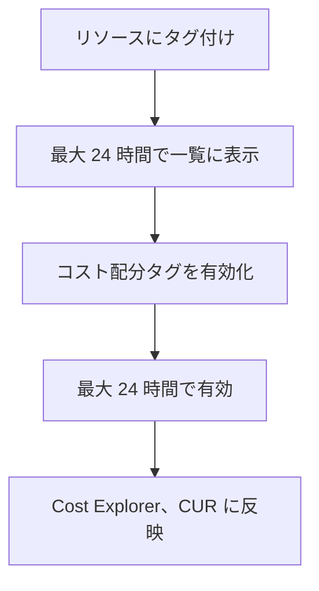
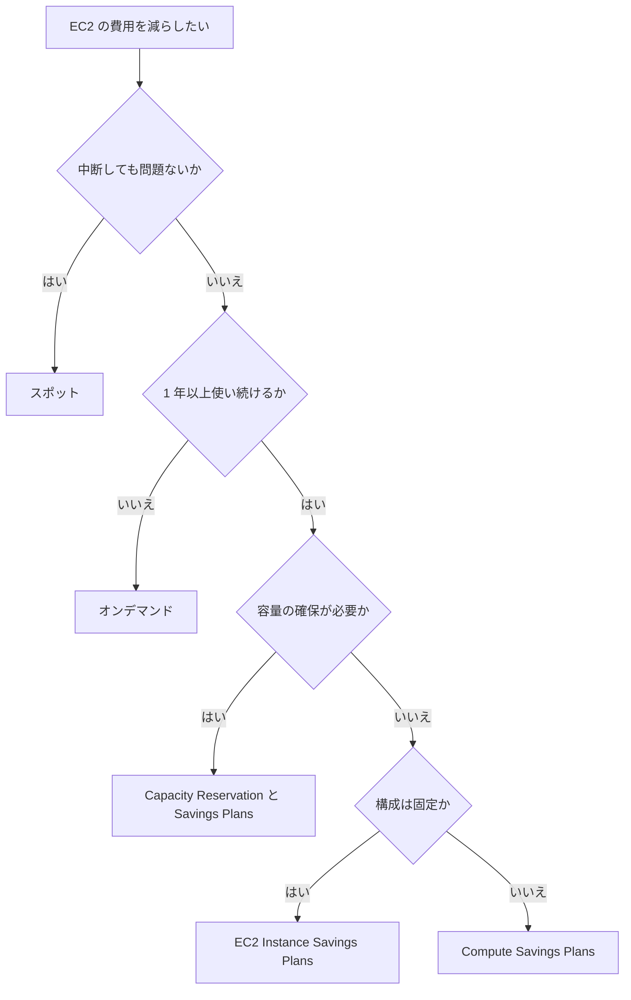

# コスト管理

[:material-sprout: CLF](../courses/clf/services.md){ .exam-badge .exam-foundational } [:material-sprout: AIF](../courses/aif/services.md){ .exam-badge .exam-foundational } [:material-sprout: AIB](../courses/aib/services.md){ .exam-badge .exam-foundational } [:material-certificate: SAA](../courses/saa/services.md){ .exam-badge .exam-associate } [:material-certificate: SOA](../courses/soa/services.md){ .exam-badge .exam-associate } [:material-certificate: DEA](../courses/dea/services.md){ .exam-badge .exam-associate } [:material-certificate: MLA](../courses/mla/services.md){ .exam-badge .exam-associate } [:material-star-circle: SAP](../courses/sap/services.md){ .exam-badge .exam-professional } [:material-star-circle: DOP](../courses/dop/services.md){ .exam-badge .exam-professional } [:material-star-circle: AIP](../courses/aip/services.md){ .exam-badge .exam-professional } [:material-target: ANS](../courses/ans/services.md){ .exam-badge .exam-specialty }

AWS の費用を把握し、予算を管理し、割引を使って減らすためのサービスと考え方をまとめます。

[](../assets/diagrams/cost-management-tools.png)

| 目的 | 道具 | 時間の向き |
| --- | --- | --- |
| 作る前に見積もる | [Pricing Calculator](#pricing-calculator) | 未来 |
| 傾向を分析する | [Cost Explorer](#cost-explorer) | 過去と予測 |
| 超過の前に知る | [Budgets](#budgets) | 現在と予測 |
| 想定外の増加を見つける | [Cost Anomaly Detection](#cost-anomaly-detection) | 現在 |
| 明細を細かく分析する | [Data Exports、CUR](#data-exports) | 過去 |
| 部署ごとに分ける | [コスト配分タグ](#cost-allocation-tags)、[Cost Categories](#cost-categories) | 全体 |
| 大きさを適正にする | [Compute Optimizer](#compute-optimizer) | 過去の使用から提案 |

## Billing and Cost Management {#billing}

[:material-certificate: MLA](../courses/mla/services.md){ .exam-badge .exam-associate }

請求、支払い、費用の分析をまとめたコンソールです。請求書の確認、支払い方法の設定、クレジットの確認ができます。

### 一括請求 {#consolidated-billing}

Organizations の管理アカウントが、メンバーアカウントの費用をまとめて支払います。追加料金はかかりません。

| 利点 | 内容 |
| --- | --- |
| 請求書の集約 | 1 つの請求書にまとまる |
| 追跡 | アカウントごとの費用を確認できる |
| 使用量の合算 | ボリューム割引を組織全体で共有できる |
| 割引の共有 | RI と Savings Plans の割引を他のアカウントでも使える |

割引の共有は、管理アカウントが制御します。組織全体、アカウントのグループ、アカウント単位で設定できます。

たとえば、規制上の理由で部門の費用を分けたいときは、その部門のアカウントの共有を止めます。

### 請求アラーム {#billing-alarms}

CloudWatch の請求メトリクス `EstimatedCharges` でアラームを作れます。

| 項目 | 内容 | 誤ったときの症状 |
| --- | --- | --- |
| リージョン | データは米国東部（バージニア北部）に保存される | 他のリージョンではメトリクスが見つからない |
| 有効化 | Billing の設定で「CloudWatch の請求アラートを受け取る」をオン | オフだとメトリクスが出ない |
| 内容 | 全世界の費用の見積もり | リージョン別の予算には向かない |

実績だけでなく予測でも通知したい、サービスやタグで絞りたい場合は Budgets を使います。

## Cost Explorer {#cost-explorer}

[:material-sprout: CLF](../courses/clf/services.md){ .exam-badge .exam-foundational } [:material-sprout: AIF](../courses/aif/services.md){ .exam-badge .exam-foundational } [:material-sprout: AIB](../courses/aib/services.md){ .exam-badge .exam-foundational } [:material-certificate: SAA](../courses/saa/services.md){ .exam-badge .exam-associate } [:material-certificate: SOA](../courses/soa/services.md){ .exam-badge .exam-associate } [:material-certificate: DEA](../courses/dea/services.md){ .exam-badge .exam-associate } [:material-certificate: MLA](../courses/mla/services.md){ .exam-badge .exam-associate } [:material-star-circle: SAP](../courses/sap/services.md){ .exam-badge .exam-professional } [:material-star-circle: AIP](../courses/aip/services.md){ .exam-badge .exam-professional } [:material-target: ANS](../courses/ans/services.md){ .exam-badge .exam-specialty }

費用と使用量をグラフで分析するツールです。

| 項目 | 内容 |
| --- | --- |
| 有効化 | コンソールで最初に開くと有効になる。API では有効化できない。無効化もできない |
| 料金 | 画面は無料。API はページ単位のリクエストごとに 0.01 USD |
| 過去のデータ | 当月と過去 13 か月 |
| 予測 | 今後 18 か月 |
| 更新頻度 | 少なくとも 24 時間に 1 回 |
| データの準備 | 有効化して当月分は約 24 時間、残りは数日 |

サービス、アカウント、リージョン、タグなどでフィルターとグループ化ができます。RI と Savings Plans の使用率、カバレッジのレポートもあります。

たとえば「先月から増えた EC2 の費用がどのアカウントのものか」は、サービスで EC2 に絞り、連結アカウントでグループ化します。

細かい粒度は、管理アカウントの設定で有効にします（複数年のデータ、リソース単位の日次データ、全サービスの時間単位のデータ、EC2 のリソース単位の時間データ）。

組織に参加したアカウントは、参加前のデータを見られなくなります。

## AWS Budgets {#budgets}

[:material-sprout: CLF](../courses/clf/services.md){ .exam-badge .exam-foundational } [:material-sprout: AIF](../courses/aif/services.md){ .exam-badge .exam-foundational } [:material-certificate: SAA](../courses/saa/services.md){ .exam-badge .exam-associate } [:material-certificate: DEA](../courses/dea/services.md){ .exam-badge .exam-associate } [:material-certificate: MLA](../courses/mla/services.md){ .exam-badge .exam-associate } [:material-star-circle: SAP](../courses/sap/services.md){ .exam-badge .exam-professional }

費用や使用量のしきい値を設定して、超えそうなときに通知や処理を行います。監視と通知は無料です。

### 予算の種類 {#budget-types}

| 種類 | 通知の条件 | 例 |
| --- | --- | --- |
| コスト | 額の超過、超過の予測 | 月 1,000 USD の 80% |
| 使用量 | 使用量の超過、超過の予測 | S3 のストレージ量 |
| RI 使用率 | 使用率の低下 | 80% を切ったら通知 |
| RI カバレッジ | カバー率の低下 | インスタンス時間の 70% を切ったら通知 |
| Savings Plans 使用率 | 使用率の低下 | 90% を切ったら通知 |
| Savings Plans カバレッジ | カバー率の低下 | 70% を切ったら通知 |

期間は日次、月次、四半期、年次のほか、カスタムの期間（例: 4 月 15 日から 7 月 15 日のプロジェクト）を選べます。

```bash
aws budgets create-budget --account-id 111122223333 \
  --budget '{"BudgetName":"monthly-total","BudgetType":"COST",
    "TimeUnit":"MONTHLY",
    "BudgetLimit":{"Amount":"1000","Unit":"USD"}}' \
  --notifications-with-subscribers '[{
    "Notification":{"NotificationType":"FORECASTED",
      "ComparisonOperator":"GREATER_THAN","Threshold":80,
      "ThresholdType":"PERCENTAGE"},
    "Subscribers":[{"SubscriptionType":"EMAIL","Address":"ops@example.com"}]}]'
```

| 設定 | 動作 | 誤ったときの症状 |
| --- | --- | --- |
| `NotificationType` | `ACTUAL` は実績、`FORECASTED` は予測 | `ACTUAL` だけだと、超えてから気づく |
| 通知先 | メール、SNS | SNS トピックが別アカウントだと使えない。トピックポリシーで Budgets の発行も許可が必要 |
| データの更新 | 1 日最大 3 回、前回から 8 から 12 時間程度 | 通知より先に費用が超えることがある |

通知が遅れる前提で、しきい値を低めに設定します。

### 予算アクション {#budget-actions}

しきい値に達したとき、自動または承認後に処理を実行します。

| アクション | 効果 | 範囲 |
| --- | --- | --- |
| IAM ポリシーの適用 | ユーザー、グループ、ロールに Deny を付ける | 同じアカウント |
| SCP の適用 | 新規リソースの作成を止める | 管理アカウントから他のアカウントにも可 |
| EC2、RDS の対象指定 | 特定のインスタンスを止める | 同じアカウントのみ |

例として、予測で月額の 90% に達したら、自動で EC2 の作成を拒否する IAM ポリシーを適用できます。

Budgets 用のサービスロールが必要です。ないとアクションが動きません。

料金は、アクションが有効な予算のうち最初の 2 個が無料で、3 個目から 1 予算につき 1 日 0.10 USD です。

## Data Exports と Cost and Usage Reports {#data-exports}

[:material-sprout: CLF](../courses/clf/services.md){ .exam-badge .exam-foundational } [:material-certificate: SAA](../courses/saa/services.md){ .exam-badge .exam-associate } [:material-certificate: SOA](../courses/soa/services.md){ .exam-badge .exam-associate } [:material-star-circle: SAP](../courses/sap/services.md){ .exam-badge .exam-professional }

Cost and Usage Reports（CUR）は、最も詳しい費用と使用量のデータです。S3 に配信し、Athena や Redshift、QuickSight で分析します。

現在の推奨は、Data Exports で作る **CUR 2.0** です。

| 観点 | CUR 2.0（Data Exports） | 従来の CUR |
| --- | --- | --- |
| 列 | 固定のスキーマ | 使い方で月ごとに変わる |
| タグなどの扱い | 入れ子の列にまとめる | 別々の列に展開 |
| 列の選択 | SQL で列と行を選べる | 全列 |
| アカウント名 | 列がある | なし |
| 形式 | Parquet、gzip CSV | CSV など |

Data Exports の標準エクスポートには、次のテーブルがあります。

- CUR 2.0
- Cost Optimization Hub の推奨事項
- FOCUS 1.2、1.0（AWS 列付き）

カーボン排出量のデータもエクスポートできます。

```sql
SELECT line_item_usage_account_id, line_item_product_code, line_item_unblended_cost
FROM COST_AND_USAGE_REPORT
```

Athena 向けの設定では Parquet で配信し、セットアップ用のスクリプトも配信されます。Redshift 向けの設定は gzip CSV です。

従来の CUR は、1 日に最大 3 回更新されます。

| 使い分け | 道具 |
| --- | --- |
| グラフでざっと見る | Cost Explorer |
| 行単位の分析や独自の BI | CUR 2.0 |

たとえば、データ転送料の内訳は `UsageType` で見ます。AZ 間の転送は `USE2-DataTransfer-Regional-Bytes` のような値になります。

## Cost Anomaly Detection {#cost-anomaly-detection}

[:material-star-circle: AIP](../courses/aip/services.md){ .exam-badge .exam-professional }

機械学習で通常と異なる費用を検出して通知します。週次や月次の季節性や自然な成長を考慮するので、誤検知を減らせます。

Cost Explorer を有効にすると、自動で設定されます。オプトアウトできます。

| モニターの種類 | 対象 |
| --- | --- |
| AWS のサービス | 全サービスを自動で追跡 |
| 連結アカウント | 全メンバーアカウント |
| コスト配分タグ | 指定したタグキーの値 |
| コストカテゴリ | 指定したカテゴリの値 |

連結アカウント、タグ、カテゴリのモニターは、管理アカウントでだけ作れます。

| 通知の頻度 | 内容 | 通知先 |
| --- | --- | --- |
| 個別 | 検出してすぐ。1 日に複数回もある | SNS が必要 |
| 日次のサマリー | 前日の上位 10 件 | メール |
| 週次のサマリー | 週の一覧 | メール |

| 動作 | 内容 |
| --- | --- |
| 実行の頻度 | 請求データの処理後、1 日に約 3 回 |
| 評価する費用 | ネットの非ブレンドコスト（割引の適用後） |
| 根本原因 | サービス、アカウント、リージョン、使用タイプで順位付け |
| 対象外 | Marketplace の製品（Bedrock のサードパーティモデルを除く）。これには Budgets を使う |

しきい値が高すぎると通知が来ません。低すぎると通知が多くなります。

Budgets との違いは、Budgets は自分で決めた額との比較で、異常検出は過去のパターンとの比較であることです。

## Cost Categories {#cost-categories}

[:material-star-circle: SAP](../courses/sap/services.md){ .exam-badge .exam-professional }

費用を、事業の構造に合わせた独自の分類にまとめる機能です。ルールを定義し、評価はルールの順に行います。

| ルール | 内容 | 例 |
| --- | --- | --- |
| グループ化 | アカウント、タグ、請求の種類、サービスなどで分類 | アカウント 1 から 3 を `Team=Team1` |
| 分割 | 共有の費用を複数のカテゴリに配分 | 共有基盤の費用を各チームへ割り振る |

作成や編集から、反映まで最大 24 時間かかります。結果は Cost Explorer、Budgets、Data Exports で使えます。

タグが揃っていなくても、アカウントなどを組み合わせて分類できます。

## コスト配分タグ {#cost-allocation-tags}

タグを費用の分類に使う仕組みです。リソースに付けるだけでは請求データに出ません。**有効化が必要です。**

| 種類 | 付ける主体 | 例 |
| --- | --- | --- |
| AWS 生成タグ | AWS や Marketplace の ISV | `aws:createdBy` |
| ユーザー定義タグ | 利用者 | `CostCenter` |



| 項目 | 内容 |
| --- | --- |
| 有効化の場所 | Billing and Cost Management の Cost allocation tags |
| 過去のデータ | 既定では遡らない。管理アカウントがバックフィルを依頼すると最大 12 か月遡れる |
| 予約プレフィックス | `aws:` |
| 組織 | 請求の担当である管理アカウントで管理する |

症状の例として、「タグを付けたのに Cost Explorer で選べない」場合は、有効化していないか、反映を待っている状態です。

タグ戦略は [ガバナンス](governance.md#tagging-strategy) を参照してください。

## Pricing Calculator {#pricing-calculator}

[:material-sprout: AIB](../courses/aib/services.md){ .exam-badge .exam-foundational }

構成の費用を作る前に見積もるツールです。

| 種類 | 特徴 |
| --- | --- |
| 公開の Web サイト | アカウント不要で無料。公開価格で試算 |
| コンソール内 | 自分の割引や購入済みのコミットメントを反映して試算 |

作った後の分析は Cost Explorer で行います。「移行前に費用を見積もる」は Pricing Calculator です。

## 購入オプション {#purchase-options}

| オプション | 割引の上限 | 確約 | 中断 | 容量の確保 | 向くもの |
| --- | --- | --- | --- | --- | --- |
| オンデマンド | なし | なし | なし | なし | 短期、予測できない負荷 |
| Compute Savings Plans | 66% | 1 年か 3 年、USD/時 | なし | なし | 構成が変わる定常負荷 |
| EC2 Instance Savings Plans | 72% | 1 年か 3 年、USD/時 | なし | なし | ファミリーが決まった定常負荷 |
| スタンダード RI | 72% | 1 年か 3 年、構成 | なし | ゾーナルのみ | 構成が変わらない負荷 |
| コンバーティブル RI | 66% | 1 年か 3 年、構成 | なし | ゾーナルのみ | 構成を交換する可能性 |
| スポット | 90% | なし | あり | なし | 中断できるバッチ、CI |
| Capacity Reservation | なし | なし | なし | あり | 容量の確保が必須 |
| Dedicated Hosts | - | - | なし | 物理ホスト | ソケットやコア単位の BYOL |
| Dedicated Instances | - | - | なし | なし | 単一テナントのハードウェア |

### Savings Plans {#savings-plans}

[:material-certificate: SAA](../courses/saa/services.md){ .exam-badge .exam-associate } [:material-certificate: SOA](../courses/soa/services.md){ .exam-badge .exam-associate } [:material-star-circle: SAP](../courses/sap/services.md){ .exam-badge .exam-professional }

1 時間あたりの利用額（USD/時）を 1 年か 3 年確約して、割引を受けます（Database は 1 年、前払いなしのみ）。公式は RI より Savings Plans を推奨しています。

| 種類 | 割引の上限 | 適用先 | 柔軟性 |
| --- | --- | --- | --- |
| Compute | 66% | EC2、Fargate、Lambda | ファミリー、サイズ、リージョン、OS、テナンシーを問わない |
| EC2 Instance | 72% | 選んだリージョンの EC2 ファミリー | サイズ、OS、テナンシーを問わない |
| Database | 35% | Aurora、RDS、DynamoDB、ElastiCache、DocumentDB、Timestream、Neptune、Keyspaces、DMS、OpenSearch Service | エンジン、ファミリー、サイズ、AZ、リージョンを問わない。サーバーレスにも適用 |
| SageMaker AI | 64% | SageMaker AI のインスタンス | ファミリー、サイズ、リージョン、コンポーネントを問わない |

| 項目 | 内容 |
| --- | --- |
| 適用の順序 | RI の後に Savings Plans |
| 対象外 | スポット、RI でカバー済みの使用 |
| 容量 | 確保しない。必要なら Capacity Reservation と併用 |
| 変更 | 購入後に確約は変更できず、期間中は解約できない |
| 返品 | 確約が 100 USD/時以下で、7 日以内かつ同じ暦月のもの |
| 組織 | 割引を組織内で共有できる |

使用率が低いと、確約した額を使わない分だけ損をします。Budgets の使用率の予算で監視します。確約額は、Cost Explorer の推奨を基に決めます。

### Reserved Instances {#reserved-instances}

[:material-star-circle: SAP](../courses/sap/services.md){ .exam-badge .exam-professional }

特定の構成を 1 年か 3 年確約する割引です。物理的なインスタンスではなく、条件の合う利用に自動で適用される請求上の割引です。

| 項目 | リージョナル | ゾーナル |
| --- | --- | --- |
| 容量の確保 | しない | 指定 AZ で確保 |
| AZ の柔軟性 | リージョン内のどの AZ でも割引 | 指定 AZ のみ |
| サイズの柔軟性 | ファミリー内で適用（Linux/Unix、デフォルトテナンシーのみ） | なし |
| 購入の予約 | 可 | 不可 |

| 項目 | スタンダード | コンバーティブル |
| --- | --- | --- |
| 割引 | 大きい | 小さい |
| 属性の変更（Modify） | 一部可 | 一部可 |
| 交換（Exchange） | 不可 | 可（ファミリー、タイプ、プラットフォーム、スコープ、テナンシー） |
| RI マーケットプレイスでの販売 | 可 | 不可 |

販売の条件は次のとおりです。

- アカウントで 30 日以上有効である。
- 残り期間が 1 か月以上ある。
- 前払い額の 12% が手数料としてかかる。
- RDS や ElastiCache の RI は販売できない。

組織では、購入したアカウントで使わない分は他のアカウントに適用されます。割引の共有をオフにしたアカウントには適用されません。

### スポットインスタンス {#spot}

EC2 の余剰容量を、最大 90% 引きで使います。AWS が容量を必要とすると中断されます。

| 項目 | 内容 |
| --- | --- |
| 中断の通知 | 2 分前に通知（インスタンスメタデータと EventBridge） |
| リバランス推奨 | 中断のリスクが高まると、より早く出る場合がある通知 |
| 中断時の動作 | 終了、停止、休止から指定 |
| 割り当て戦略 | `price-capacity-optimized` を推奨 |

複数のインスタンスタイプと AZ を指定すると、中断の影響を減らせます。

中断できない処理に使うと、処理が途中で失われます。状態を S3 などの外部に保存して、再実行できる形にします。

### 向いているものの選び方 {#purchase-choice}



定常の基盤には確約割引、変動分にはオンデマンド、中断できる部分にはスポットと、組み合わせるのが基本です。

## Compute Optimizer と適正サイズ {#compute-optimizer}

[:material-sprout: CLF](../courses/clf/services.md){ .exam-badge .exam-foundational } [:material-certificate: SAA](../courses/saa/services.md){ .exam-badge .exam-associate } [:material-certificate: SOA](../courses/soa/services.md){ .exam-badge .exam-associate } [:material-certificate: MLA](../courses/mla/services.md){ .exam-badge .exam-associate } [:material-star-circle: SAP](../courses/sap/services.md){ .exam-badge .exam-professional } [:material-star-circle: DOP](../courses/dop/services.md){ .exam-badge .exam-professional }

使用状況を分析して、適正サイズの推奨とアイドルリソースを示すサービスです。使うにはオプトインが必要です。

| 対象 | データの条件 |
| --- | --- |
| EC2、Auto Scaling グループ | 過去 14 日間に 30 時間以上の CloudWatch メトリクス |
| EBS | 稼働中のインスタンスに 30 時間以上連続でアタッチ |
| Lambda | 過去 14 日間に 50 回以上の呼び出し |
| Fargate の ECS サービス | 過去 14 日間に 24 時間以上のメトリクス |

このほか、RDS、Aurora、NAT ゲートウェイ、DynamoDB、ElastiCache、MemoryDB、DocumentDB、商用ソフトウェアのライセンスにも対応します。

拡張インフラストラクチャメトリクスは有料の機能で、分析の期間を 93 日に広げます。EC2、Auto Scaling グループ、RDS で使えます。

### Cost Optimization Hub {#cost-optimization-hub}

アカウントとリージョンをまたいで、適正サイズ、アイドルリソースの削除、Savings Plans、RI の推奨を集約します。割引を考慮した推定節約額で優先順位を付けられます。

### 推奨を出すサービスの違い {#recommendation-tools}

| サービス | 主な推奨 |
| --- | --- |
| Compute Optimizer | リソースのサイズとアイドル |
| Trusted Advisor | 費用、セキュリティ、耐障害性など幅広い点検 |
| Cost Explorer の推奨 | Savings Plans と RI の購入 |
| Cost Optimization Hub | 上記を集約して優先順位付け |
| S3 Storage Lens | S3 の使用状況と傾向 |

## S3 のストレージ費用 {#s3-cost}

アクセスの頻度で選びます。低いクラスほど保存料は安く、取り出し料がかかります。

| クラス | 向くデータ | 最低保存期間 | 最低課金サイズ | 取り出し料 |
| --- | --- | --- | --- | --- |
| Standard | 月 1 回以上のアクセス | なし | なし | なし |
| Intelligent-Tiering | アクセスパターンが不明 | なし | なし | なし（監視料あり） |
| Standard-IA | 月 1 回程度 | 30 日 | 128 KB | あり |
| One Zone-IA | 再作成できるデータ | 30 日 | 128 KB | あり |
| Glacier Instant Retrieval | 四半期に 1 回、ミリ秒で取得 | 90 日 | 128 KB | あり |
| Glacier Flexible Retrieval | 年 1 回、分から時間で取得 | 90 日 | - | あり |
| Glacier Deep Archive | 年 1 回未満、時間単位で取得 | 180 日 | - | あり |
| Express One Zone | 1 桁ミリ秒、単一 AZ | なし | なし | - |

費用の落とし穴は次のとおりです。

- 最低保存期間より前に削除すると、残りの期間分も課金される。
- 小さいオブジェクトは IA クラスで割高になる。128 KB 未満は既定でライフサイクルの移行対象外。
- Intelligent-Tiering では 128 KB 未満の小さなオブジェクトは自動階層化されない。
- アクセスが読めないなら Intelligent-Tiering を選ぶ。30 日アクセスがないと IA 層、90 日で Archive Instant Access 層に移る。

バケットの所有者ではなく、利用者に取得費用を払わせたいときは Requester Pays を使います。

詳細は [S3](s3.md#storage-classes) を参照してください。

## データ転送の費用 {#data-transfer}

通信の方向と場所で料金が変わります。

| 経路 | 料金 |
| --- | --- |
| インターネットから AWS へ（受信） | 無料 |
| 同じ AZ 内 | 無料 |
| AZ 間 | 有料。リソースごとに送受信の両方が課金される |
| リージョン間 | 送信元リージョンの送信分が有料。受信は無料 |
| AWS からインターネットへ | 有料。月 100 GB まで無料（全サービスとリージョンの合計、中国と GovCloud を除く） |
| Direct Connect の受信 | 無料 |
| Direct Connect の送信 | ポート料金に加えて送信データ分が有料 |

| 仕組み | 課金の基準 | 減らし方 |
| --- | --- | --- |
| NAT ゲートウェイ | 時間と処理データ量に加えて、通常の転送料 | リソースと同じ AZ に置く。S3、DynamoDB はゲートウェイエンドポイントを使う |
| ゲートウェイエンドポイント | 無料 | S3、DynamoDB のアクセスに使う |
| インターフェイスエンドポイント | 時間とデータ転送量 | 通信量が多ければ NAT と比較する |
| パブリック IPv4 | 1 個あたり 0.005 USD/時（使用中とアイドルで同額） | 使わないものを解放する。IPv6 を検討する |
| Site-to-Site VPN | 接続の時間と送信データ量 | 大量なら Direct Connect を検討する |

たとえば「プライベートサブネットから同じリージョンの S3 に大量のデータを転送して、NAT の費用が高い」場合は、S3 のゲートウェイエンドポイントを追加すれば解決します。

AZ 間の通信が多いアプリは、同じ AZ の中で処理を完結させると減らせます。ただし可用性とのトレードオフです。

## AI サービスの料金の構造 {#ai-pricing}

[:material-sprout: AIB](../courses/aib/services.md){ .exam-badge .exam-foundational }

AI サービスの課金の単位はさまざまです。金額は変わりやすいので、単位を覚えます。

### Amazon Bedrock {#bedrock-pricing}

テキストモデルは主に入力と出力のトークン数で課金されます。単価はモデルとプロバイダーで異なります。出力の単価は入力より高いのが一般的で、長い応答ほど費用が増えます。

| 方式 | 課金 | 向くもの |
| --- | --- | --- |
| オンデマンド（Standard ティア） | トークン単位 | 既定、日常の処理 |
| Priority ティア | Standard より割高 | 応答速度が重要な顧客向け |
| Flex ティア | Standard より割安 | 時間に余裕がある処理（評価、要約） |
| Reserved ティア | 確保した容量（入力 100,000 TPM、出力 10,000 TPM 以上）。アカウントチームに連絡 | ダウンタイムを許せない処理 |
| バッチ | 対象のモデルでオンデマンドの 50% 引き | 非同期の大量処理 |
| Provisioned Throughput | モデルユニット単位の時間課金。確約なし、1 か月、6 か月から選択 | 一定の大きな容量、カスタムモデル |

コストを下げる方法は次のとおりです。

| 方法 | 効果 |
| --- | --- |
| 小さいモデルを選ぶ | トークン単価が下がる |
| プロンプトを短くする | 入力トークンが減る |
| `maxTokens` を抑える | 出力トークンが減る |
| プロンプトキャッシュ | 繰り返す部分の読み取りが安くなる（TTL は多くのモデルで 5 分、失効すると再度書き込み） |
| バッチ、Flex | リアルタイムでない処理が安くなる |

| 付加機能 | 課金の単位 |
| --- | --- |
| Guardrails | テキスト単位（1 単位は最大 1,000 文字）。正規表現と単語フィルターは無料 |
| カスタマイズ | トレーニング（モデルで異なる）、月額のストレージ、推論 |
| Knowledge Bases | 種類で異なる。ベクトルストアなどの費用にも注意 |

トークンについては [AI の基礎](ai-fundamentals.md)、実装は [AI](ai.md) を参照してください。

### その他の AI サービス {#ai-service-units}

| サービス | 課金の単位 |
| --- | --- |
| SageMaker AI（ノートブック、トレーニング、リアルタイム推論） | インスタンスの稼働時間。推論はデータ処理料も |
| SageMaker AI Serverless Inference | ミリ秒単位のコンピュート（メモリで変動）とデータ処理量 |
| Textract | 処理したページ数（API と機能で単価が異なる） |
| Rekognition | 画像は枚数、動画は分数 |
| Transcribe | 音声の秒数 |
| Comprehend | 100 文字単位（1 リクエストの最小は 3 単位） |
| Amazon Q Business | ユーザーごとの月額（Lite、Pro）とインデックスの時間課金 |

SageMaker のエンドポイントは、リクエストがなくても稼働中は課金されます。使わないときは削除するか、サーバーレスを検討します。

## 選び方の比較 {#choosing}

| 迷うもの | 使い分け |
| --- | --- |
| Cost Explorer / Budgets | 過去の分析なら Cost Explorer、しきい値での通知なら Budgets |
| Budgets / Cost Anomaly Detection | 決めた額との比較なら Budgets、いつものパターンとの比較なら異常検出 |
| Budgets / CloudWatch の請求アラーム | 予測や絞り込みが必要なら Budgets、全体の実績の簡易な監視なら請求アラーム |
| Cost Explorer / CUR | グラフなら Cost Explorer、行単位の分析なら CUR 2.0 |
| Pricing Calculator / Cost Explorer | 作る前なら Calculator、作った後なら Cost Explorer |
| タグ / Cost Categories | リソース単位の印ならタグ、事業の構造への集約なら Cost Categories |
| Savings Plans / RI | 通常は Savings Plans。容量も確保したいならゾーナル RI、または Capacity Reservation を併用 |
| Compute SP / EC2 Instance SP | 柔軟性なら Compute、割引の大きさなら EC2 Instance |
| Standard-IA / One Zone-IA | 重要なデータなら Standard-IA、再作成できるなら One Zone-IA |
| Compute Optimizer / Trusted Advisor | サイズの詳しい推奨なら Compute Optimizer、幅広い点検なら Trusted Advisor |

## 既定値と上限のまとめ {#numbers}

| 項目 | 値 |
| --- | --- |
| Cost Explorer の過去データ、予測 | 13 か月、18 か月 |
| Cost Explorer API | リクエストあたり 0.01 USD |
| Budgets の更新 | 1 日最大 3 回 |
| 無料のアクション有効な予算 | 2 個。以降は 1 日 0.10 USD |
| 1 予算のアクション数 | 10 |
| 1 アカウントのアクション数 | 100 |
| コスト配分タグの反映 | 表示まで最大 24 時間、有効化に最大 24 時間 |
| タグのバックフィル | 最大 12 か月 |
| Cost Categories の反映 | 最大 24 時間 |
| Compute SP、EC2 Instance SP | 最大 66%、72% |
| Database SP、SageMaker AI SP | 最大 35%、64% |
| スポットの割引、通知 | 最大 90%、2 分前 |
| RI の期間 | 1 年、3 年 |
| RI 販売の手数料 | 前払い額の 12% |
| SP の返品 | 100 USD/時以下、7 日以内かつ同じ暦月 |
| インターネットへの送信の無料枠 | 月 100 GB |
| パブリック IPv4 | 0.005 USD/時 |

## 試験のポイント {#exam-points}

| こう問われたら | 答え |
| --- | --- |
| 構築前の費用を見積もる | Pricing Calculator |
| 過去の費用の傾向を見る | Cost Explorer |
| 予算の超過が予測されたら通知 | Budgets の `FORECASTED` |
| 超過時に新規作成を自動で止める | 予算アクション（IAM ポリシー、SCP） |
| いつもと違う費用の急増を見つける | Cost Anomaly Detection |
| 行単位の詳細な明細を Athena で分析 | Data Exports の CUR 2.0 |
| タグを付けたのに費用に出ない | コスト配分タグを有効化する |
| 部門別に費用を分ける | コスト配分タグ、Cost Categories |
| 複数アカウントの請求をまとめる | Organizations の一括請求 |
| RI の割引を組織で共有する | 一括請求の割引の共有 |
| EC2 と Lambda と Fargate をまとめて割り引く | Compute Savings Plans |
| 構成が固定で割引を最大にしたい | EC2 Instance Savings Plans |
| 容量を確保したい | Capacity Reservation、ゾーナル RI |
| 中断できるバッチを安く | スポット |
| スポットの中断の予告時間 | 2 分 |
| 使わなくなった RI を売りたい | スタンダード RI をマーケットプレイスで販売 |
| ソケット単位の BYOL | Dedicated Hosts |
| インスタンスサイズの推奨 | Compute Optimizer |
| アクセスパターンが不明な S3 | Intelligent-Tiering |
| S3 への NAT の費用を減らす | ゲートウェイエンドポイント |
| 受信のデータ転送料 | 無料 |
| Bedrock のリアルタイムでない処理を安く | バッチ、Flex ティア |
| 生成 AI の費用を決める主な単位 | 入力と出力のトークン |
| カスタムモデルの推論に必要なもの | Provisioned Throughput |

## 関連ページ {#related}

- [クラウドの基礎](cloud-foundations.md)
- [ガバナンス](governance.md)
- [S3](s3.md)
- [ストレージの応用](storage-advanced.md)
- [ネットワーク](networking.md)
- [AI](ai.md)
- [SageMaker](sagemaker.md)

## 参考 {#references}

- [What is AWS Billing and Cost Management?](https://docs.aws.amazon.com/awsaccountbilling/latest/aboutv2/billing-what-is.html)
- [Consolidating billing for AWS Organizations](https://docs.aws.amazon.com/awsaccountbilling/latest/aboutv2/consolidated-billing.html)
- [Reserved Instances and Savings Plans discount sharing](https://docs.aws.amazon.com/awsaccountbilling/latest/aboutv2/ri-turn-off.html)
- [Creating a billing alarm](https://docs.aws.amazon.com/AmazonCloudWatch/latest/monitoring/monitor_estimated_charges_with_cloudwatch.html)
- [Analyzing your costs with AWS Cost Explorer](https://docs.aws.amazon.com/cost-management/latest/userguide/ce-what-is.html)
- [Managing your costs with AWS Budgets](https://docs.aws.amazon.com/cost-management/latest/userguide/budgets-managing-costs.html)
- [Configuring budget actions](https://docs.aws.amazon.com/cost-management/latest/userguide/budgets-controls.html)
- [AWS Budgets pricing](https://aws.amazon.com/aws-cost-management/aws-budgets/pricing/)
- [What is AWS Data Exports?](https://docs.aws.amazon.com/cur/latest/userguide/what-is-data-exports.html)
- [Cost and Usage Report (CUR) 2.0](https://docs.aws.amazon.com/cur/latest/userguide/table-dictionary-cur2.html)
- [Understanding data transfer charges](https://docs.aws.amazon.com/cur/latest/userguide/cur-data-transfers-charges.html)
- [AWS Cost Anomaly Detection](https://docs.aws.amazon.com/cost-management/latest/userguide/manage-ad.html)
- [Organizing costs using AWS Cost Categories](https://docs.aws.amazon.com/awsaccountbilling/latest/aboutv2/manage-cost-categories.html)
- [Organizing and tracking costs using cost allocation tags](https://docs.aws.amazon.com/awsaccountbilling/latest/aboutv2/cost-alloc-tags.html)
- [Backfill cost allocation tags](https://docs.aws.amazon.com/awsaccountbilling/latest/aboutv2/cost-allocation-backfill.html)
- [What is AWS Pricing Calculator?](https://docs.aws.amazon.com/pricing-calculator/latest/userguide/what-is-pricing-calculator.html)
- [Savings Plans types](https://docs.aws.amazon.com/savingsplans/latest/userguide/plan-types.html)
- [Compute Savings Plans and Reserved Instances](https://docs.aws.amazon.com/savingsplans/latest/userguide/sp-ris.html)
- [Returning a purchased Savings Plan](https://docs.aws.amazon.com/savingsplans/latest/userguide/return-sp.html)
- [Reserved Instances for Amazon EC2 overview](https://docs.aws.amazon.com/AWSEC2/latest/UserGuide/ec2-reserved-instances.html)
- [Regional and zonal Reserved Instances](https://docs.aws.amazon.com/AWSEC2/latest/UserGuide/reserved-instances-scope.html)
- [Sell Reserved Instances](https://docs.aws.amazon.com/AWSEC2/latest/UserGuide/ri-market-general.html)
- [Spot Instances](https://docs.aws.amazon.com/AWSEC2/latest/UserGuide/using-spot-instances.html)
- [Spot Instance interruption notices](https://docs.aws.amazon.com/AWSEC2/latest/UserGuide/spot-instance-termination-notices.html)
- [What is AWS Compute Optimizer?](https://docs.aws.amazon.com/compute-optimizer/latest/ug/what-is-compute-optimizer.html)
- [Compute Optimizer resource requirements](https://docs.aws.amazon.com/compute-optimizer/latest/ug/requirements.html)
- [Cost Optimization Hub](https://docs.aws.amazon.com/cost-management/latest/userguide/cost-optimization-hub.html)
- [Understanding and managing Amazon S3 storage classes](https://docs.aws.amazon.com/AmazonS3/latest/userguide/storage-class-intro.html)
- [How S3 Intelligent-Tiering works](https://docs.aws.amazon.com/AmazonS3/latest/userguide/intelligent-tiering-overview.html)
- [Overview of Data Transfer Costs for Common Architectures](https://aws.amazon.com/blogs/architecture/overview-of-data-transfer-costs-for-common-architectures/)
- [Amazon EC2 On-Demand pricing](https://aws.amazon.com/ec2/pricing/on-demand/)
- [Amazon VPC pricing](https://aws.amazon.com/vpc/pricing/)
- [Service tiers for optimizing performance and cost](https://docs.aws.amazon.com/bedrock/latest/userguide/service-tiers-inference.html)
- [Provisioned Throughput in Amazon Bedrock](https://docs.aws.amazon.com/bedrock/latest/userguide/prov-throughput.html)
- [Prompt caching](https://docs.aws.amazon.com/bedrock/latest/userguide/prompt-caching.html)
- [Amazon Bedrock pricing](https://aws.amazon.com/bedrock/pricing/)
- [Amazon SageMaker AI pricing](https://aws.amazon.com/sagemaker/ai/pricing/)
