# コスト管理

[:material-sprout: CLF](../courses/clf/services.md){ .exam-badge .exam-foundational } [:material-sprout: AIF](../courses/aif/services.md){ .exam-badge .exam-foundational } [:material-sprout: AIB](../courses/aib/services.md){ .exam-badge .exam-foundational } [:material-certificate: SAA](../courses/saa/services.md){ .exam-badge .exam-associate } [:material-certificate: SOA](../courses/soa/services.md){ .exam-badge .exam-associate } [:material-certificate: DEA](../courses/dea/services.md){ .exam-badge .exam-associate } [:material-certificate: MLA](../courses/mla/services.md){ .exam-badge .exam-associate } [:material-star-circle: SAP](../courses/sap/services.md){ .exam-badge .exam-professional } [:material-star-circle: DOP](../courses/dop/services.md){ .exam-badge .exam-professional } [:material-star-circle: AIP](../courses/aip/services.md){ .exam-badge .exam-professional } [:material-target: ANS](../courses/ans/services.md){ .exam-badge .exam-specialty }

AWS の費用を把握し、予算を管理し、割引を使って減らすためのサービスと考え方をまとめます。

[](../assets/diagrams/cost-management-tools.png)

| 目的 | 道具 | 時間の向き |
| --- | --- | --- |
| 作る前に見積もる | [Pricing Calculator](#pricing-calculator) | 未来 |
| 傾向を分析する | [Cost Explorer](#cost-explorer) | 過去と予測 |
| 超過の前に知る | [Budgets](#budgets) | 現在と予測 |
| 想定外の増加を見つける | [Cost Anomaly Detection](#cost-anomaly-detection) | 現在 |
| 明細を細かく分析する | [Data Exports、CUR](#data-exports) | 過去 |
| 部署ごとに分ける | [コスト配分タグ](#cost-allocation-tags)、[Cost Categories](#cost-categories) | 全体 |
| 大きさを適正にする | [Compute Optimizer](#compute-optimizer) | 過去の使用から提案 |

## なぜ費用の管理が要るのか {#why}

オンプレミスでは、支出は機器を買うときに決まります。稟議で承認された額しか買えないので、使いすぎは調達の段階で止まります。

クラウドでは、権限のある人なら誰でも API で費用を増やせます。請求は使った後に来るので、気づいたときには使い終わっています。費用の管理の道具は、この「後から請求が来る」形に合わせて、見える化、通知、自動の歯止めを足すためのものです。

| 困りごと | 道具がないと起きること | 使う道具 |
| --- | --- | --- |
| どの部署がいくら使ったか分からない | 費用を配賦できず、削減の責任者が決まらない | コスト配分タグ、Cost Categories |
| 月末まで額が分からない | 請求書を見て初めて予算超過に気づく | Budgets の予測の通知 |
| 設定ミスで急に増える | 数日分の暴走が請求書に載る | Cost Anomaly Detection |
| 大きすぎる構成のまま使う | 使わない分を払い続ける | Compute Optimizer |
| 定常の負荷を定価で払う | 割引を受けずに払い続ける | Savings Plans、RI |

オンプレミスの財務管理と対応させると、次のようになります。

| オンプレミス | AWS | 違う点 |
| --- | --- | --- |
| 稟議と予算枠 | Budgets、予算アクション | 使う前ではなく、使いながら通知し、止める |
| 固定資産台帳の管理部門 | コスト配分タグ、アカウント | タグは有効化しないと請求データに出ない |
| 共通費の部門配賦 | Cost Categories の分割 | ルールで自動に配る |
| 請求書と明細の照合 | Data Exports（CUR 2.0） | 時間単位、リソース単位の行まで出る |
| 減価償却の期間 | Savings Plans、RI の期間（1 年か 3 年） | 物は残らない。請求上の割引だけ |

道具は、次の循環で使います。

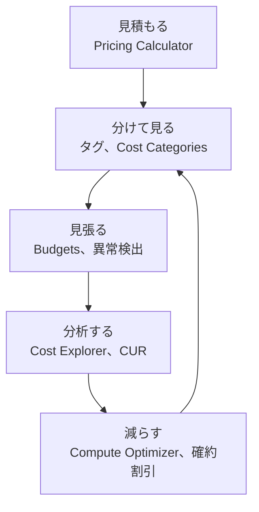

## 使いどころと具体例 {#use-cases}

費用の道具は、「いつの費用を見るか」と「誰が責任を持つか」で選びます。業種ごとの場面を並べます。

| 場面 | 具体例 | 使う機能 |
| --- | --- | --- |
| 作る前に予算の承認を取る | 物流会社の荷物追跡システムで、EC2 10 台と送信 500 GB を稟議の前に試算する | [Pricing Calculator](#pricing-calculator) |
| 月末の超過を前に知る | 学習塾の授業配信で、月 3,000 USD の予算に対し、予測が 80% を超えたら知らせる | [Budgets](#budgets) |
| 検証環境の使いすぎを止める | スタートアップの開発者ごとの検証アカウントで、予測が 90% を超えたら新しい EC2 の作成を拒否する | [予算アクション](#budget-actions) |
| 設定ミスの暴走に気づく | 写真共有アプリで、小さなサービスの費用が普段の 10 倍になったのを翌日に見つける | [Cost Anomaly Detection](#cost-anomaly-detection) |
| 部署ごとに請求を分ける | 電機メーカーの 8 事業部に、共有のネットワーク費用も含めて配る | [コスト配分タグ](#cost-allocation-tags)、[Cost Categories](#cost-categories) |
| 明細を社内の BI で分析する | 同じメーカーの経理が、製品ごとの原価に AWS の費用を 1 行ずつ載せる | [Data Exports、CUR 2.0](#data-exports) |
| 24 時間動く台数を安くする | 病院の予約システムで、常に動く 6 台に確約割引を当てる | [Savings Plans](#savings-plans) |
| 中断できる処理を安くする | ゲーム会社のビルドと、夜間のリプレイ解析をスポットで動かす | [スポットインスタンス](#spot) |
| 大きすぎる構成を見つける | 移行したばかりの EC2 で、CPU のピークが 15% のものを小さくする | [Compute Optimizer](#compute-optimizer) |
| ほとんど読まないデータを安く置く | ケーブルテレビ局の番組の元素材を、放送の 30 日後に安いクラスへ移す | [S3 のストレージ費用](#s3-cost) |
| 経路で増える費用を減らす | プライベートサブネットから S3 への大量の転送で、NAT の処理料を減らす | [データ転送の費用](#data-transfer) |
| 生成 AI の費用を抑える | 大学の研究室で、論文 1 万本の要約を夜間のバッチに回す | [Amazon Bedrock](#bedrock-pricing) |

**使わない方がよい場面:**

| 場面 | 理由 | 代わりの選択肢 |
| --- | --- | --- |
| 数時間前の急増を今すぐ止めたい | Budgets は 1 日最大 3 回の更新で、Cost Explorer も最大 24 時間遅れる | 台数や NAT の処理量など、リソースのメトリクスに [アラーム](observability.md#alarms) を付ける |
| 1 か月だけのキャンペーンに 1 年の Savings Plans を買う | 期間中は解約できず、使わない時間の確約分も払う | オンデマンド、中断できるならスポット |
| 中断できない DB や決済の処理をスポットで動かす | 2 分前の通知で中断される | オンデマンドと確約割引（[選び方](#purchase-choice)） |
| ピークの台数に合わせて確約する | 使わない時間の分も払い、オンプレミスでピークに合わせて買うのと同じ無駄が出る | 24 時間動く下の層だけを確約する |
| 10 KB のファイルを大量に Standard-IA に置く | 128 KB の最低課金サイズで、実際の量より多く課金される | Standard のまま置く、まとめて大きなファイルにする |
| Marketplace の製品の急増を異常検出で見張る | Marketplace の製品は Cost Anomaly Detection の対象外（Bedrock のサードパーティモデルを除く） | [Budgets](#budgets) |

### 例: SaaS スタートアップの検証アカウントの歯止め {#use-case-startup}

**状況:** 社員 25 人の請求書 SaaS のスタートアップです。AWS は本番、ステージング、開発者ごとの検証アカウント 10 個に分けています。以前、検証で起動した GPU のインスタンスを週末に消し忘れ、月の費用が 2 倍になりました。財務の担当はおらず、CTO が費用も見ています。

**構成:**

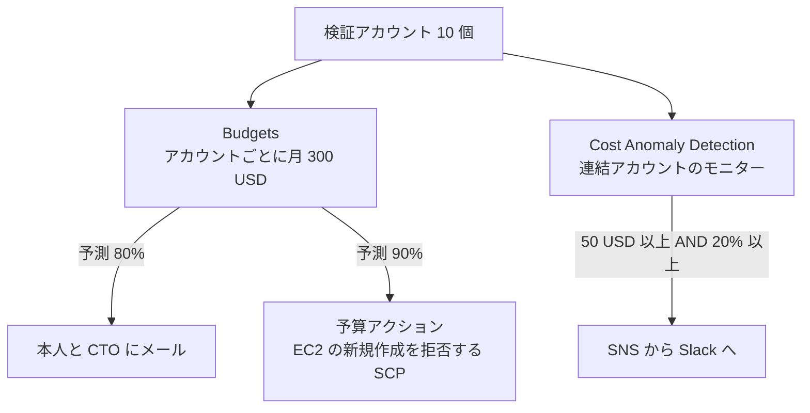

**設定値:**

| 項目 | 値 | 理由 |
| --- | --- | --- |
| 予算 | 検証アカウントごとに月 300 USD、`FORECASTED` 80% で通知 | 月末に超えてから気づくのではなく、ペースで早めに知る |
| 予算アクション | 予測 90% で、管理アカウントから SCP を自動で適用 | 検証環境なので、承認を待たずに止めてよい。本番は承認の後にする |
| 異常検出のしきい値 | 50 USD 以上 AND 20% 以上 | 小さな揺れの通知を除きつつ、消し忘れの GPU は拾う |
| 異常の通知 | SNS の個別通知 | 日次のサマリーでは、検出から最大 1 日待つ |

**なぜこのサービスか:** Budgets は「決めた額」を、異常検出は「いつもとの違い」を見ます。消し忘れは予算内でも起きるので、両方を組み合わせます（[選び方の比較](#choosing)）。

**つまずきやすい点:**

- SCP は新しい作成を止めるだけで、動いている GPU のインスタンスは止まりません。止めるには別の手段が要ります。
- 請求データの更新は 8〜12 時間おきです。毎時 50 USD の暴走なら、気づくまでに数百 USD 進みます（[予算の種類](#budget-types)）。
- アクションが有効な予算は、最初の 2 個を超えると有料です。10 個の検証アカウントすべてに付けるかは、費用と比べて決めます（[予算アクション](#budget-actions)）。

### 例: 電機メーカーの事業部別の配賦 {#use-case-chargeback}

**状況:** 社員 5,000 人の電機メーカーです。8 事業部が 60 のアカウントを使い、ネットワークと共通の監視は共有アカウントにまとめています。経営企画からは「事業部ごとの AWS の費用を、共有分も含めて毎月出すこと」を求められています。

**構成:**

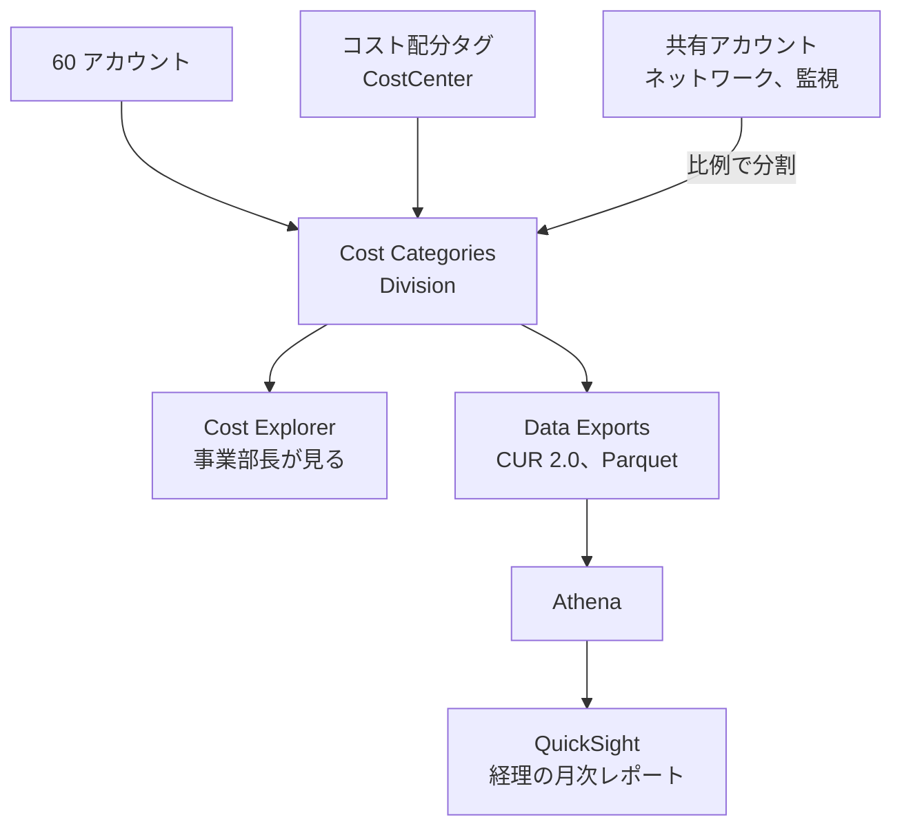

**設定値:**

| 項目 | 値 | 理由 |
| --- | --- | --- |
| タグのキー | `CostCenter` に統一し、IaC で付ける | `costcenter` と混ざると、費用が 2 つに分かれる |
| Cost Categories のルール | まずアカウントで事業部に分け、共有のアカウントは事業部の費用に比例して分割 | タグの付け忘れがあっても、アカウントの単位で漏れなく分けられる |
| Data Exports | CUR 2.0、Parquet、必要な列だけ | Athena のスキャン量を減らす |
| タグのバックフィル | 導入時に 12 か月分を依頼 | 前年同月との比較ができる |

**なぜこのサービスか:** Cost Explorer の画面だけでは、共有費用の配り方を経理の規則に合わせられません。Cost Categories で配り方を決め、CUR 2.0 で行単位のデータを社内の BI に渡します。

**つまずきやすい点:**

- タグは付けただけでは請求データに出ません。有効化してから、反映まで最大 24 時間かかります（[コスト配分タグ](#cost-allocation-tags)）。
- Cost Categories は上のルールから評価します。共有アカウントの分割より先に「全アカウントを事業部 A」のルールがあると、共有分が A に入ります（[Cost Categories](#cost-categories)）。
- 従来の CUR のタグの列を前提にしたクエリは、CUR 2.0 の入れ子の `resource_tags` に書き換えます（[Data Exports](#data-exports)）。

### 例: ケーブルテレビ局の見逃し配信の保管 {#use-case-broadcast}

**状況:** 地域のケーブルテレビ局の見逃し配信です。番組は年 3,000 本増え、元の素材は 1 本 50 GB、配信用の変換済みファイルは 1 本 5 GB です。元の素材は再編集のときだけ使い、配信は放送後 2 週間に集中します。変換のサーバーはプライベートサブネットにあります。

**構成:**

| データ | クラスの流れ | 理由 |
| --- | --- | --- |
| 元の素材 | Standard から、30 日後に Glacier Flexible Retrieval | 再編集は年に数回で、取り寄せに数時間かかってもよい |
| 配信用のファイル | Intelligent-Tiering | 人気の番組は長く見られ、どれが読まれるか予測できない |
| サムネイル（1 枚 30 KB） | Standard のまま | 128 KB 未満は IA の最低課金サイズで割高になる |
| 変換サーバーと S3 の通信 | S3 のゲートウェイエンドポイント | NAT を通すと、処理したデータ量の料金がかかる |

**設定値:**

- **ライフサイクル:** 元の素材は作成から 30 日で Glacier Flexible Retrieval に移します。再編集の多い放送後 1 か月は Standard に置きます。
- **エンドポイント:** 変換サーバーのサブネットのルートテーブルに、S3 のゲートウェイエンドポイントを足します。月 10 TB の読み書きの NAT の処理料がなくなります（[データ転送の費用](#data-transfer)）。

**なぜこのサービスか:** 全部を Standard に置くと、ほとんど読まない元の素材にも高い保管料を払います。テープ装置を持たずに、テープ並みの保管料に近づけられるのがクラスを分ける利点です（[S3 のストレージ費用](#s3-cost)）。

**つまずきやすい点:**

- Glacier Flexible Retrieval の最低保存期間は 90 日です。移した 40 日後に素材を消すと、残りの 50 日分も課金されます。
- Intelligent-Tiering でも、128 KB 未満のオブジェクトは自動で階層化されません。

### 例: オンラインゲームのサーバー費用の層分け {#use-case-game}

**状況:** 同時接続 10 万人の PC 向けオンラインゲームです。ゲームサーバーは深夜でも最低 20 台が動き、21 時のピークには 80 台になります。対戦中のサーバーを止めると、遊んでいる人の試合が切れます。別に、ビルドと夜間のリプレイの解析に毎日 40 台を使います。

**構成:**

| 層 | 台数 | 購入オプション | 理由 |
| --- | --- | --- | --- |
| 下の層 | 24 時間ずっと動く 20 台 | Compute Savings Plans | ロビーの Fargate も同じ確約で割り引ける |
| 中の層 | ピークに足す最大 60 台 | オンデマンド | 対戦中は中断できない。台数は日によって違う |
| 別の処理 | ビルドとリプレイ解析の 40 台 | スポット | やり直しがきく。中断しても翌朝までに終わればよい |

**設定値:**

- **確約額:** 過去 30 日で最も少なかった時間の使用額に合わせます。ピークの 80 台に合わせると、深夜の 60 台分の確約を使わずに払います（[向いているものの選び方](#purchase-choice)）。
- **見張り:** Budgets の Savings Plans 使用率の予算で 90% を切ったら通知します。ゲームの人気が落ちて台数が減ったときに気づけます（[予算の種類](#budget-types)）。
- **スポット:** `m5.large`、`m6i.large`、`m7i.large` を 3 AZ で指定し、9 個のプールから選ばせます。中断の通知を受けたら、解析の途中の結果を S3 に保存します（[スポットインスタンス](#spot)）。

**なぜこのサービスか:** 確約の割引は「必ず使う量」にだけ効きます。ゲームのように昼夜で台数が 4 倍違う負荷は、層に分けると割引を受けながら無駄を減らせます。

**つまずきやすい点:**

- Savings Plans は購入後に確約を変えられず、期間中は解約できません。新作の発売直後の台数で確約すると、落ち着いた後に使用率が下がります。
- スポットに中断できない対戦サーバーを混ぜると、2 分前の通知で試合が切れます。

### 例: 大学の研究室の AI の費用 {#use-case-university}

**状況:** 学生 1 万人の大学で、12 の研究室が 1 つの組織の中でアカウントを使っています。研究費は研究室ごとに年度で決まっています。ある研究室で、SageMaker AI の推論エンドポイントを夏休みの間ずっと動かしたままにしていました。

**構成:**

| 対策 | 使うもの | 内容 |
| --- | --- | --- |
| 研究室ごとの予算 | Budgets、Cost Categories | 研究室ごとに年度の予算を作り、`FORECASTED` 80% で教員に通知 |
| 置きっぱなしの防止 | SageMaker AI Serverless Inference | リクエストのない時間は計算の料金がかからない |
| 大量の要約 | Bedrock のバッチ推論 | 論文 1 万本の要約を、リアルタイムでなく夜間に回す |
| 出力の上限 | `maxTokens` | 要約を 250 トークンまでにし、出力の量を抑える |

**設定値:**

- **予算の期間:** カスタムの期間で 4 月 1 日から翌年 3 月 31 日にします。月次の予算では、年度の研究費と比べにくいからです（[予算の種類](#budget-types)）。
- **バッチ:** 対象のモデルではオンデマンドの 50% 引きです。翌朝までに結果があればよい処理なので、バッチを選びます（[Amazon Bedrock](#bedrock-pricing)）。

**なぜこのサービスか:** 研究室はアカウントで分かれているので、Cost Categories でアカウントを研究室にまとめれば、タグを付けていない古いリソースも漏れません。AI の費用は使った量で決まるので、呼び方を変えることがそのまま節約になります。

**つまずきやすい点:**

- リアルタイムのエンドポイントは、リクエストがなくても動いている間は課金されます。730 時間放置すれば 730 時間分です（[その他の AI サービス](#ai-service-units)）。
- `maxTokens` で切られた要約は `stopReason` が `max_tokens` です。途中で切れた要約を、そのまま使わないよう確かめます。

### 例: 病院グループの移行の見積もりと適正化 {#use-case-hospital}

**状況:** 5 つの病院を持つ医療法人です。予約、検査結果の照会、職員のポータルなど 40 台のサーバーを、データセンターの契約が切れる 1 年後までに AWS へ移します。理事会には、移行前の見積もりと、移行後の実績の比較を出す必要があります。

**構成:**

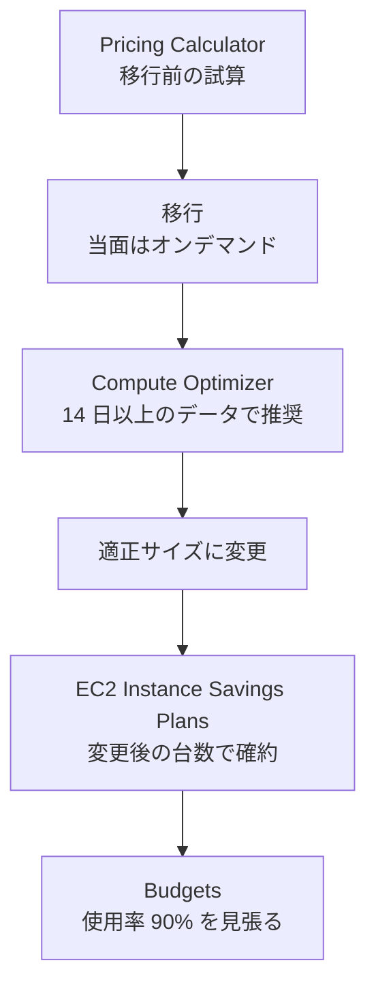

**設定値:**

| 段階 | 値 | 理由 |
| --- | --- | --- |
| 見積もり | オンプレミスの CPU とメモリの使用率から、1 段小さいサイズで試算 | オンプレミスは数年先を見込んで大きめに買っている |
| 推奨を待つ期間 | 移行後 14 日以上。月末の締めがある会計系は拡張メトリクスで 93 日 | 推奨は 30 時間分のデータで出るが、分析は直近 14 日分なので、2 週間待って平日と週末の波を入れる。月末だけの山は 14 日では見逃す |
| 確約の時期 | 適正サイズに変えた後 | 先に確約すると、小さくした後に確約が余る |
| 確約の種類 | EC2 Instance Savings Plans | 東京で同じファミリーを使い続ける。割引が Compute より大きい |

**なぜこのサービスか:** 見積もりの段階では実際の使用率が分からないので、Pricing Calculator で幅を持たせて試算します。移った後は Compute Optimizer の測定に基づいて直すので、理事会に「見積もりと実績の差の理由」を説明できます。

**つまずきやすい点:**

- 移行の直後に推奨を見ても、データが足りず `Insufficient data` です（[Compute Optimizer](#compute-optimizer)）。
- 移行の直後に 3 年の確約を買うと、適正化で台数が減ったときに確約が余ります。順番は「測る、直す、確約する」です。

## Billing and Cost Management {#billing}

[:material-certificate: MLA](../courses/mla/services.md){ .exam-badge .exam-associate }

[提供単位](resource-scope.md#two-axes): グローバル。リージョンを選ばず、VPC の外です。Cost Explorer、CUR、Cost Optimization Hub、Data Exports は `us-east-1` でだけ提供されます。

請求、支払い、費用の分析をまとめたコンソールです。請求書の確認、支払い方法の設定、クレジットの確認ができます。

### 一括請求 {#consolidated-billing}

Organizations の管理アカウントが、メンバーアカウントの費用をまとめて支払います。追加料金はかかりません。

**使う場面:** 飲食チェーンの持株会社で、3 つの子会社のアカウントの請求を 1 枚にまとめ、S3 の使用量を合算して階段料金の下の段に届かせる。

アカウントを分けるのは、権限や障害の影響を区切るためです。ただ、支払いまで分かれると、請求書の処理が増え、使うほど安くなる料金の恩恵も分散します。一括請求は、「管理は分け、支払いはまとめる」ための仕組みです。家族カードのまとめ払いに近く、利用明細は人ごとに見られます。

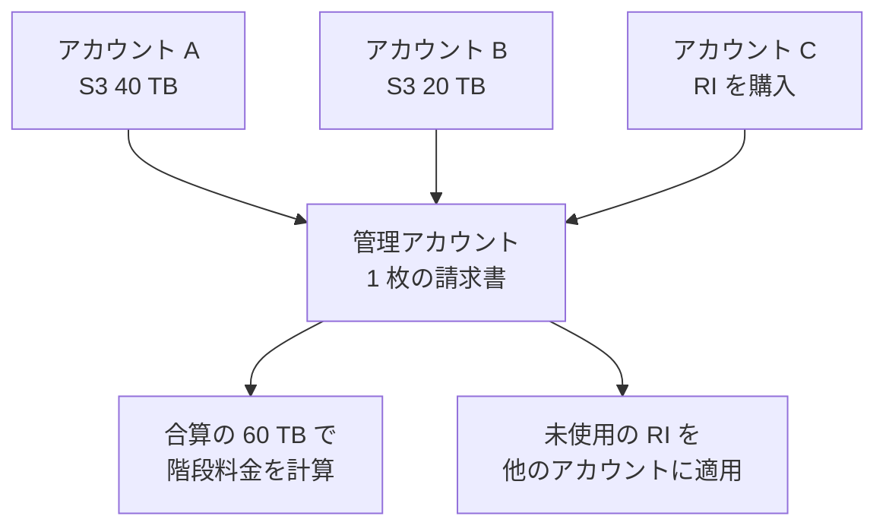

| 利点 | 内容 |
| --- | --- |
| 請求書の集約 | 1 つの請求書にまとまる |
| 追跡 | アカウントごとの費用を確認できる |
| 使用量の合算 | ボリューム割引を組織全体で共有できる |
| 割引の共有 | RI と Savings Plans の割引を他のアカウントでも使える |

割引の共有は、管理アカウントが制御します。組織全体、アカウントのグループ、アカウント単位で設定できます。

たとえば、規制上の理由で部門の費用を分けたいときは、その部門のアカウントの共有を止めます。

- **階段料金の例:** S3 の料金は使うほど単価が下がる階段です。アカウント A が 40 TB、B が 20 TB なら、合算の 60 TB で階段を計算します。別々の請求だと、どちらも最初の段にとどまります。
- **RI の共有の例:** A が買った未使用の RI は、同じファミリーを使う B に自動で適用されます。共有を止めた C には適用されません。

### 請求アラーム {#billing-alarms}

CloudWatch の請求メトリクス `EstimatedCharges` でアラームを作れます。

最も簡単な歯止めです。全体の見積額が 1 つのしきい値を超えたかだけを見ます。

**使う場面:** 個人で運営する料理レシピのサイトで、月の見積額が 50 USD を超えたら自分の携帯にメールを送る。予測や部署の区別は要らない。

| 項目 | 内容 | 誤ったときの症状 |
| --- | --- | --- |
| リージョン | データは米国東部（バージニア北部）に保存される | 他のリージョンではメトリクスが見つからない |
| 有効化 | Billing の設定で「CloudWatch の請求アラートを受け取る」をオン | オフだとメトリクスが出ない |
| 内容 | 全世界の費用の見積もり | リージョン別の予算には向かない |

実績だけでなく予測でも通知したい、サービスやタグで絞りたい場合は Budgets を使います。

```bash
aws cloudwatch put-metric-alarm --region us-east-1 \
  --alarm-name bill-over-500 \
  --namespace AWS/Billing --metric-name EstimatedCharges \
  --dimensions Name=Currency,Value=USD \
  --statistic Maximum --period 21600 --evaluation-periods 1 \
  --threshold 500 --comparison-operator GreaterThanThreshold \
  --alarm-actions arn:aws:sns:us-east-1:111122223333:billing
```

- **例:** 請求額の見積もりが 500 USD を超えるとアラームになります。月初にリセットされる累計の値です。
- **誤ると:** 東京の SNS トピックを指定しても、メトリクスが `us-east-1` にあるのでアラームを作れません。

## Cost Explorer {#cost-explorer}

[:material-sprout: CLF](../courses/clf/services.md){ .exam-badge .exam-foundational } [:material-sprout: AIF](../courses/aif/services.md){ .exam-badge .exam-foundational } [:material-sprout: AIB](../courses/aib/services.md){ .exam-badge .exam-foundational } [:material-certificate: SAA](../courses/saa/services.md){ .exam-badge .exam-associate } [:material-certificate: SOA](../courses/soa/services.md){ .exam-badge .exam-associate } [:material-certificate: DEA](../courses/dea/services.md){ .exam-badge .exam-associate } [:material-certificate: MLA](../courses/mla/services.md){ .exam-badge .exam-associate } [:material-star-circle: SAP](../courses/sap/services.md){ .exam-badge .exam-professional } [:material-star-circle: AIP](../courses/aip/services.md){ .exam-badge .exam-professional } [:material-target: ANS](../courses/ans/services.md){ .exam-badge .exam-specialty }

費用と使用量をグラフで分析するツールです。

**使う場面:** 不動産ポータルの運用チームで、月例の会議の前に「先月から増えた 1,200 USD は、どのアカウントのどのサービスか」を連結アカウントとサービスで切り分ける。

請求書の合計額だけでは、何が増えたのか分かりません。Cost Explorer は、費用をサービス、アカウント、タグなどの軸で切り分けて、増えた原因を探すためのものです。家計簿アプリで、費目別や月別にグラフを見るのに近い使い方です。

| 項目 | 内容 |
| --- | --- |
| 有効化 | コンソールで最初に開くと有効になる。API では有効化できない。無効化もできない |
| 料金 | 画面は無料。API はページ単位のリクエストごとに 0.01 USD |
| 過去のデータ | 当月と過去 13 か月 |
| 予測 | 今後 18 か月 |
| 更新頻度 | 少なくとも 24 時間に 1 回 |
| データの準備 | 有効化して当月分は約 24 時間、残りは数日 |

- **API の料金の例:** ページ単位で 0.01 USD なので、毎日 100 ページを取得するダッシュボードは 100 × 0.01 × 30 = 月 30 USD です。画面は無料です。
- **期間の例:** 2026 年 10 月に見られるのは、2025 年 9 月からのデータです（当月と過去 13 か月）。それより前は複数年のデータの設定が要ります。
- **誤ると:** 当日の費用は最大 24 時間遅れるので、数時間前の急増は見えません。

サービス、アカウント、リージョン、タグなどでフィルターとグループ化ができます。RI と Savings Plans の使用率、カバレッジのレポートもあります。

たとえば「先月から増えた EC2 の費用がどのアカウントのものか」は、サービスで EC2 に絞り、連結アカウントでグループ化します。

細かい粒度は、管理アカウントの設定で有効にします（複数年のデータ、リソース単位の日次データ、全サービスの時間単位のデータ、EC2 のリソース単位の時間データ）。

組織に参加したアカウントは、参加前のデータを見られなくなります。

## AWS Budgets {#budgets}

[:material-sprout: CLF](../courses/clf/services.md){ .exam-badge .exam-foundational } [:material-sprout: AIF](../courses/aif/services.md){ .exam-badge .exam-foundational } [:material-certificate: SAA](../courses/saa/services.md){ .exam-badge .exam-associate } [:material-certificate: DEA](../courses/dea/services.md){ .exam-badge .exam-associate } [:material-certificate: MLA](../courses/mla/services.md){ .exam-badge .exam-associate } [:material-star-circle: SAP](../courses/sap/services.md){ .exam-badge .exam-professional }

[提供単位](resource-scope.md#two-axes): グローバル。アカウントや組織に対して作り、リージョンを選びません。VPC の外です。

費用や使用量のしきい値を設定して、超えそうなときに通知や処理を行います。監視と通知は無料です。

オンプレミスの予算枠は、買う前に確かめるので超えられません。クラウドでは使ってから費用が決まるので、予算を「超えそうになったら知らせる」「超えたら新しく作れないようにする」形で守ります。

| オンプレミスの予算管理 | Budgets | 違う点 |
| --- | --- | --- |
| 稟議で購入を承認する | なし（作成は権限で決まる） | 費用そのものでは作成を止めない |
| 予算の残りを月次で確認 | 実績と予測の通知 | 1 日最大 3 回の更新で、自動で知らせる |
| 予算超過で購入を止める | 予算アクション（IAM ポリシー、SCP） | 新しい作成を拒否する。動いているものは別に止める |

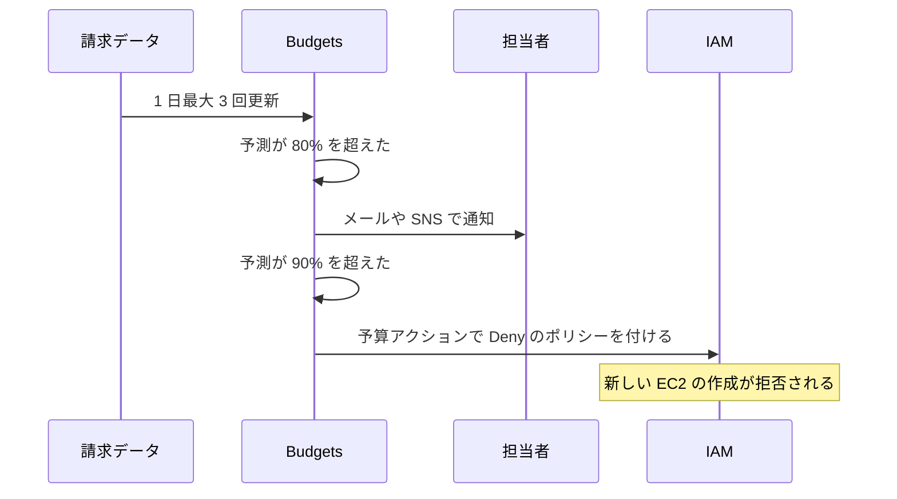

### 予算の種類 {#budget-types}

| 種類 | 通知の条件 | 例 |
| --- | --- | --- |
| コスト | 額の超過、超過の予測 | 月 1,000 USD の 80% |
| 使用量 | 使用量の超過、超過の予測 | S3 のストレージ量 |
| RI 使用率 | 使用率の低下 | 80% を切ったら通知 |
| RI カバレッジ | カバー率の低下 | インスタンス時間の 70% を切ったら通知 |
| Savings Plans 使用率 | 使用率の低下 | 90% を切ったら通知 |
| Savings Plans カバレッジ | カバー率の低下 | 70% を切ったら通知 |

期間は日次、月次、四半期、年次のほか、カスタムの期間（例: 4 月 15 日から 7 月 15 日のプロジェクト）を選べます。

計算の例です。

- **コストの例:** 月 1,000 USD の 80% は 800 USD です。10 日で 500 USD 使うと、ペースから月末の予測は 1,500 USD になり、`FORECASTED` の 80% を超えて通知が来ます。
- **RI 使用率の例:** 購入した 100 時間のうち使ったのが 76 時間なら 76% です。80% のしきい値を下回ります。
- **RI カバレッジの例:** 全 1,000 インスタンス時間のうち RI の適用が 650 時間なら 65% です。70% のしきい値を下回ります。
- **SP 使用率の例:** 確約 7 USD/時に対して 6 USD/時分しか使わないと 6 ÷ 7 ≒ 85.7% です。90% のしきい値を下回ります。

```bash
aws budgets create-budget --account-id 111122223333 \
  --budget '{"BudgetName":"monthly-total","BudgetType":"COST",
    "TimeUnit":"MONTHLY",
    "BudgetLimit":{"Amount":"1000","Unit":"USD"}}' \
  --notifications-with-subscribers '[{
    "Notification":{"NotificationType":"FORECASTED",
      "ComparisonOperator":"GREATER_THAN","Threshold":80,
      "ThresholdType":"PERCENTAGE"},
    "Subscribers":[{"SubscriptionType":"EMAIL","Address":"ops@example.com"}]}]'
```

| 設定 | 動作 | 誤ったときの症状 |
| --- | --- | --- |
| `NotificationType` | `ACTUAL` は実績、`FORECASTED` は予測 | `ACTUAL` だけだと、超えてから気づく |
| 通知先 | メール、SNS | SNS トピックが別アカウントだと使えない。トピックポリシーで Budgets の発行も許可が必要 |
| データの更新 | 1 日最大 3 回、前回から 8 から 12 時間程度 | 通知より先に費用が超えることがある |

通知が遅れる前提で、しきい値を低めに設定します。

- **遅れの計算の例:** 暴走で毎時 200 USD 増えると、更新の間隔 8 時間で 1,600 USD 進みます。しきい値が 1,000 USD の予算でも、気づくのは超えた後です。
- **`ThresholdType` の例:** `PERCENTAGE` で 80 は予算の 80%、`ABSOLUTE_VALUE` で 800 は 800 USD です。
- **誤ると:** SNS のトピックポリシーで `budgets.amazonaws.com` に `sns:Publish` を許可しないと、通知が届きません。

### 予算アクション {#budget-actions}

しきい値に達したとき、自動または承認後に処理を実行します。

| アクション | 効果 | 範囲 |
| --- | --- | --- |
| IAM ポリシーの適用 | ユーザー、グループ、ロールに Deny を付ける | 同じアカウント |
| SCP の適用 | 新規リソースの作成を止める | 管理アカウントから他のアカウントにも可 |
| EC2、RDS の対象指定 | 特定のインスタンスを止める | 同じアカウントのみ |

例として、予測で月額の 90% に達したら、自動で EC2 の作成を拒否する IAM ポリシーを適用できます。

Budgets 用のサービスロールが必要です。ないとアクションが動きません。

料金は、アクションが有効な予算のうち最初の 2 個が無料で、3 個目から 1 予算につき 1 日 0.10 USD です。

- **料金の計算の例:** アクションが有効な予算が 5 個なら、有料は 3 個で 3 × 0.10 × 30 日 = 月 9 USD です（2026 年 10 月時点の公式の料金。変わることがあります）。
- **自動と承認の例:** 検証用アカウントは自動で Deny を適用します。本番は承認のあとに適用します。
- **Auto Scaling の罠:** グループの EC2 をアクションで止めても、Auto Scaling が置き換えて費用は止まりません。グループの希望容量を下げる別の手段と組み合わせます。
- **SCP の例:** 管理アカウントからメンバーに SCP を適用できますが、別アカウントの EC2 と RDS は対象にできません。

## Data Exports と Cost and Usage Reports {#data-exports}

[:material-sprout: CLF](../courses/clf/services.md){ .exam-badge .exam-foundational } [:material-certificate: SAA](../courses/saa/services.md){ .exam-badge .exam-associate } [:material-certificate: SOA](../courses/soa/services.md){ .exam-badge .exam-associate } [:material-star-circle: SAP](../courses/sap/services.md){ .exam-badge .exam-professional }

[提供単位](resource-scope.md#two-axes): グローバル。設定は `us-east-1` で、配信先の S3 バケットはリージョンにあります。VPC の外です。

Cost and Usage Reports（CUR）は、最も詳しい費用と使用量のデータです。S3 に配信し、Athena や Redshift、QuickSight で分析します。

現在の推奨は、Data Exports で作る **CUR 2.0** です。

Cost Explorer の画面は、AWS が決めた軸でしか集計できません。社内の BI で独自の配賦をしたい、1 行ずつ監査したい、という場合は、元の明細そのものが要ります。CUR は、請求書の明細を機械で読める形で受け取るためのものです。

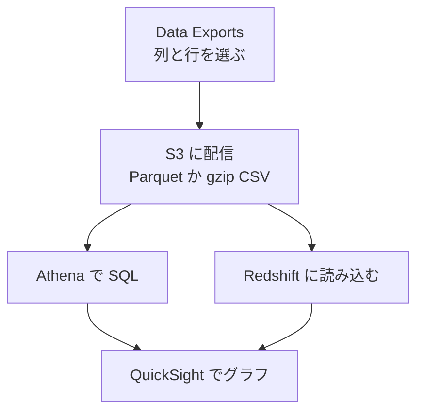

| 観点 | CUR 2.0（Data Exports） | 従来の CUR |
| --- | --- | --- |
| 列 | 固定のスキーマ | 使い方で月ごとに変わる |
| タグなどの扱い | 入れ子の列にまとめる | 別々の列に展開 |
| 列の選択 | SQL で列と行を選べる | 全列 |
| アカウント名 | 列がある | なし |
| 形式 | Parquet、gzip CSV | CSV など |

Data Exports の標準エクスポートには、次のテーブルがあります。

- CUR 2.0
- Cost Optimization Hub の推奨事項
- FOCUS 1.2、1.0（AWS 列付き）

カーボン排出量のデータもエクスポートできます。

```sql
SELECT line_item_usage_account_id, line_item_product_code, line_item_unblended_cost
FROM COST_AND_USAGE_REPORT
```

Athena 向けの設定では Parquet で配信し、セットアップ用のスクリプトも配信されます。Redshift 向けの設定は gzip CSV です。

従来の CUR は、1 日に最大 3 回更新されます。

| 使い分け | 道具 |
| --- | --- |
| グラフでざっと見る | Cost Explorer |
| 行単位の分析や独自の BI | CUR 2.0 |

- **列の選択の例:** 上の SQL の 3 列だけを配信すると、Athena のスキャン量が減ります。
- **形式の例:** Athena 向けは Parquet、Redshift 向けは gzip CSV を選びます。
- **タグの例:** CUR 2.0 ではタグは `resource_tags` の入れ子の列です。従来の CUR の `resource_tags_user_costcenter` という列を前提にしたクエリは、書き換えます。

たとえば、データ転送料の内訳は `UsageType` で見ます。AZ 間の転送は `USE2-DataTransfer-Regional-Bytes` のような値になります。

## Cost Anomaly Detection {#cost-anomaly-detection}

[:material-star-circle: AIP](../courses/aip/services.md){ .exam-badge .exam-professional }

[提供単位](resource-scope.md#two-axes): グローバル。アカウントや組織に対して動き、VPC の外です。

機械学習で通常と異なる費用を検出して通知します。週次や月次の季節性や自然な成長を考慮するので、誤検知を減らせます。

Budgets は、自分で決めた額を超えるまで知らせません。月 10,000 USD の予算に対して、ある小さなサービスが 50 USD から 500 USD に増えても、合計が予算内なら気づけません。異常検出は、額ではなく「いつもとの違い」で見るので、この種の増加を拾えます。クレジットカードの不正利用の検知に近い考え方です。

Cost Explorer を有効にすると、自動で設定されます。オプトアウトできます。

| モニターの種類 | 対象 |
| --- | --- |
| AWS のサービス | 全サービスを自動で追跡 |
| 連結アカウント | 全メンバーアカウント |
| コスト配分タグ | 指定したタグキーの値 |
| コストカテゴリ | 指定したカテゴリの値 |

連結アカウント、タグ、カテゴリのモニターは、管理アカウントでだけ作れます。

| 通知の頻度 | 内容 | 通知先 |
| --- | --- | --- |
| 個別 | 検出してすぐ。1 日に複数回もある | SNS が必要 |
| 日次のサマリー | 前日の上位 10 件 | メール |
| 週次のサマリー | 週の一覧 | メール |

| 動作 | 内容 |
| --- | --- |
| 実行の頻度 | 請求データの処理後、1 日に約 3 回 |
| 評価する費用 | ネットの非ブレンドコスト（割引の適用後） |
| 根本原因 | サービス、アカウント、リージョン、使用タイプで順位付け |
| 対象外 | Marketplace の製品（Bedrock のサードパーティモデルを除く）。これには Budgets を使う |

しきい値が高すぎると通知が来ません。低すぎると通知が多くなります。

しきい値には金額（絶対値）と割合があり、AND や OR で組み合わせられます。

- **計算の例:** 想定 100 USD、実績 180 USD の異常は、影響が 80 USD、80% です。「100 USD 以上」なら通知されません。「50% 以上」なら通知されます。
- **AND の例:** 「50 USD 以上 AND 20% 以上」なら、大きなサービスのわずかな増加と、小さなサービスの少額の増加の両方を除けます。
- **サマリーの例:** 1 月 14 日 04:30 UTC に検出した異常は、1 月 15 日 00:00 UTC の日次サマリーに入ります。すぐ知りたいなら SNS の個別通知です。
- **モニターの例:** タグのモニターで `team` の値を指定するなら、10 個までです。

Budgets との違いは、Budgets は自分で決めた額との比較で、異常検出は過去のパターンとの比較であることです。

## Cost Categories {#cost-categories}

[:material-star-circle: SAP](../courses/sap/services.md){ .exam-badge .exam-professional }

[提供単位](resource-scope.md#two-axes): グローバル。組織の請求データに対する設定で、VPC の外です。

費用を、事業の構造に合わせた独自の分類にまとめる機能です。ルールを定義し、評価はルールの順に行います。

タグはリソースに付ける印なので、付け忘れたリソースの費用は分類できません。組織の構造も、アカウントやタグの単位とは一致しないことがあります。Cost Categories は、アカウント、タグ、サービスなどを組み合わせて、事業部やプロダクトの単位にまとめ直すためのものです。オンプレミスの共通費の配賦ルールを、請求データの上で自動で回す形です。

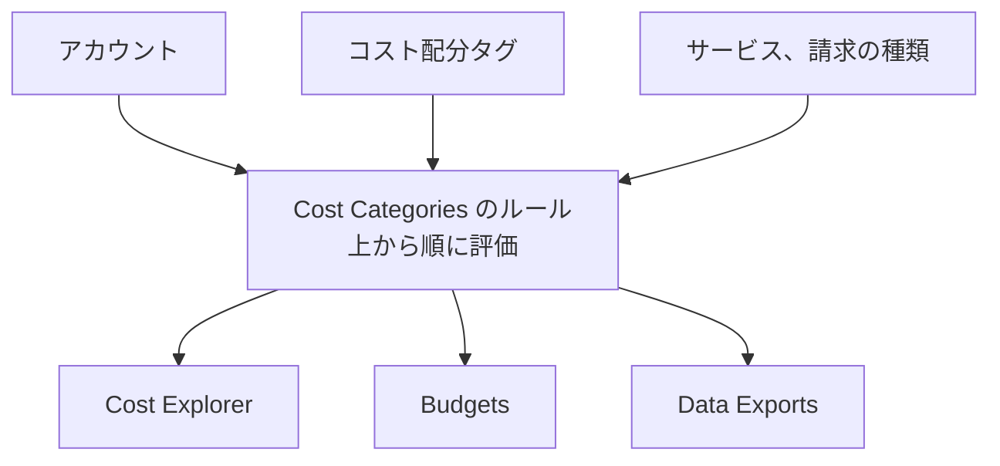

| ルール | 内容 | 例 |
| --- | --- | --- |
| グループ化 | アカウント、タグ、請求の種類、サービスなどで分類 | アカウント 1 から 3 を `Team=Team1` |
| 分割 | 共有の費用を複数のカテゴリに配分 | 共有基盤の費用を各チームへ割り振る |

作成や編集から、反映まで最大 24 時間かかります。結果は Cost Explorer、Budgets、Data Exports で使えます。

タグが揃っていなくても、アカウントなどを組み合わせて分類できます。

- **月の始まりの例:** ルールは当月の初日から効きます。10 月 15 日に変えると、10 月 1 日以降の費用が新しいルールで分類されます。
- **分割の例:** 共有基盤の 900 USD を、Team A（6,000 USD）と Team B（3,000 USD）に分けます。比例なら 600 USD と 300 USD、均等なら 450 USD ずつ、固定 70:30 なら 630 USD と 270 USD です。
- **誤ると:** ルールの順序を誤ると、先に一致したルールで分類され、後のルールは使われません。

## コスト配分タグ {#cost-allocation-tags}

タグを費用の分類に使う仕組みです。リソースに付けるだけでは請求データに出ません。**有効化が必要です。**

オンプレミスでは、固定資産台帳に管理部門のコードを書いて、どの部署の資産かを記録します。クラウドではリソースが毎日作られては消えるので、台帳を手で更新できません。そこで、リソース自体にタグを付けて、請求データの列として持たせます。

付けたタグのうち、費用の分類に使うものだけを選んで有効にします。運用のためのタグと、配賦のためのタグを分けて管理できます。

| 種類 | 付ける主体 | 例 |
| --- | --- | --- |
| AWS 生成タグ | AWS や Marketplace の ISV | `aws:createdBy` |
| ユーザー定義タグ | 利用者 | `CostCenter` |

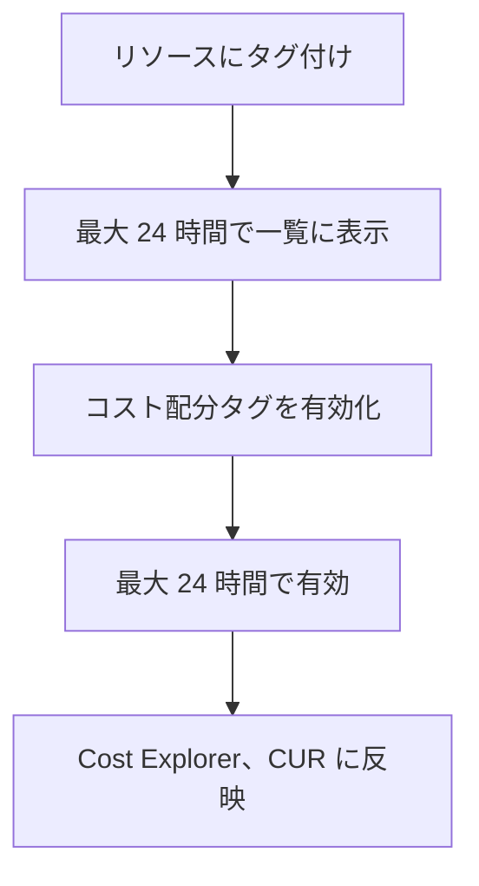

| 項目 | 内容 |
| --- | --- |
| 有効化の場所 | Billing and Cost Management の Cost allocation tags |
| 過去のデータ | 既定では遡らない。管理アカウントがバックフィルを依頼すると最大 12 か月遡れる |
| 予約プレフィックス | `aws:` |
| 組織 | 請求の担当である管理アカウントで管理する |

症状の例として、「タグを付けたのに Cost Explorer で選べない」場合は、有効化していないか、反映を待っている状態です。

- **時間の例:** 10 月 1 日にタグを付け、10 月 2 日に有効にすると、有効になった後の費用からタグが付きます。9 月の分を見るには、管理アカウントからバックフィルを依頼します（最大 12 か月）。
- **誤ると:** `costcenter` と `CostCenter` は別のタグです。大文字と小文字を揃えないと、費用が 2 つに分かれます。

タグ戦略は [ガバナンス](governance.md#tagging-strategy) を参照してください。

## Pricing Calculator {#pricing-calculator}

[:material-sprout: AIB](../courses/aib/services.md){ .exam-badge .exam-foundational }

構成の費用を作る前に見積もるツールです。

オンプレミスの見積もりは、ベンダーに依頼して数日待つことがあります。クラウドは単価が公開されているので、構成を入れれば自分で試算できます。予算の承認を取る段階で使います。

| 種類 | 特徴 |
| --- | --- |
| 公開の Web サイト | アカウント不要で無料。公開価格で試算 |
| コンソール内 | 自分の割引や購入済みのコミットメントを反映して試算 |

作った後の分析は Cost Explorer で行います。「移行前に費用を見積もる」は Pricing Calculator です。

- **例:** 移行前に `m7g.large` 10 台、EBS 1 TB、データ転送 500 GB を入れて試算します。コンソール内の版なら、自社の Savings Plans を反映します。

## 購入オプション {#purchase-options}

### なぜ選択肢が多いのか {#purchase-options-why}

「どれだけ先まで使い続けると約束できるか」と「どれだけ止められても困らないか」は、ワークロードで違います。購入オプションは、約束や制約を受け入れる代わりに割引を得る、という交換の組み合わせです。

| 受け入れるもの | 得られるもの | オプション |
| --- | --- | --- |
| なし | いつでも始めて、いつでもやめられる | オンデマンド |
| 1 年か 3 年の利用額の確約 | 最大 66〜72% の割引 | Savings Plans |
| 1 年か 3 年の構成の確約 | 最大 72% の割引、ゾーナルなら容量 | RI |
| 2 分前の通知で中断される | 最大 90% の割引 | スポット |
| 使わなくても予約分を払う | 容量の確保 | Capacity Reservation |

**身近な契約にたとえる**と、次のようになります。

| オプション | たとえ | 違う点 |
| --- | --- | --- |
| オンデマンド | タクシー。乗った分だけ払う | 秒単位などの細かい課金 |
| Savings Plans | 携帯電話の定額プラン。毎月の額を約束する | 約束するのは 1 時間あたりの額 |
| RI | 社用車の長期リース。車種を決めて借りる | 物は渡されない。条件の合う利用に割引が付く |
| スポット | 空いている倉庫の格安貸し。持ち主が使うときは退去する | 退去の予告は 2 分前 |
| Capacity Reservation | 席の予約。座らなくても予約料はかかる | 割引はない。Savings Plans と併用する |

オンプレミスでサーバーを買う場合と比べると、確約割引は「先に約束して安くする」点が似ています。違うのは、期間が終われば何も残らず、機器の廃棄や減価償却の処理が要らないことです。

| オプション | 割引の上限 | 確約 | 中断 | 容量の確保 | 向くもの |
| --- | --- | --- | --- | --- | --- |
| オンデマンド | なし | なし | なし | なし | 短期、予測できない負荷 |
| Compute Savings Plans | 66% | 1 年か 3 年、USD/時 | なし | なし | 構成が変わる定常負荷 |
| EC2 Instance Savings Plans | 72% | 1 年か 3 年、USD/時 | なし | なし | ファミリーが決まった定常負荷 |
| スタンダード RI | 72% | 1 年か 3 年、構成 | なし | ゾーナルのみ | 構成が変わらない負荷 |
| コンバーティブル RI | 66% | 1 年か 3 年、構成 | なし | ゾーナルのみ | 構成を交換する可能性 |
| スポット | 90% | なし | あり | なし | 中断できるバッチ、CI |
| Capacity Reservation | なし | なし | なし | あり | 容量の確保が必須 |
| Dedicated Hosts | - | - | なし | 物理ホスト | ソケットやコア単位の BYOL |
| Dedicated Instances | - | - | なし | なし | 単一テナントのハードウェア |

### Savings Plans {#savings-plans}

[:material-certificate: SAA](../courses/saa/services.md){ .exam-badge .exam-associate } [:material-certificate: SOA](../courses/soa/services.md){ .exam-badge .exam-associate } [:material-star-circle: SAP](../courses/sap/services.md){ .exam-badge .exam-professional }

[提供単位](resource-scope.md#two-axes): Compute はリージョンを問わず、EC2 Instance は選んだリージョンに効く請求上の割引です。VPC とは関係しません。

1 時間あたりの利用額（USD/時）を 1 年か 3 年確約して、割引を受けます（Database は 1 年、前払いなしのみ）。公式は RI より Savings Plans を推奨しています。

**使う場面:** 保険会社の契約管理システムで、EC2 と Lambda が 24 時間使う分を Compute Savings Plans で割り引き、来年の Graviton への切り替えでも割引を失わない。

| 種類 | 割引の上限 | 適用先 | 柔軟性 |
| --- | --- | --- | --- |
| Compute | 66% | EC2、Fargate、Lambda | ファミリー、サイズ、リージョン、OS、テナンシーを問わない |
| EC2 Instance | 72% | 選んだリージョンの EC2 ファミリー | サイズ、OS、テナンシーを問わない |
| Database | 35% | Aurora、RDS、DynamoDB、ElastiCache、DocumentDB、Timestream、Neptune、Keyspaces、DMS、OpenSearch Service | エンジン、ファミリー、サイズ、AZ、リージョンを問わない。サーバーレスにも適用 |
| SageMaker AI | 64% | SageMaker AI のインスタンス | ファミリー、サイズ、リージョン、コンポーネントを問わない |

| 項目 | 内容 |
| --- | --- |
| 適用の順序 | RI の後に Savings Plans |
| 対象外 | スポット、RI でカバー済みの使用 |
| 容量 | 確保しない。必要なら Capacity Reservation と併用 |
| 変更 | 購入後に確約は変更できず、期間中は解約できない |
| 返品 | 確約が 100 USD/時以下で、7 日以内かつ同じ暦月のもの |
| 組織 | 割引を組織内で共有できる |

使用率が低いと、確約した額を使わない分だけ損をします。Budgets の使用率の予算で監視します。確約額は、Cost Explorer の推奨を基に決めます。

計算の例です。割引率 30% は説明用の値です。

- **カバー範囲の例:** 確約 7 USD/時は、割引 30% なら 7 ÷ 0.7 = オンデマンド換算 10 USD/時の使用をカバーします。
- **超えた場合:** 使用がオンデマンド換算 12 USD/時なら、7 + 超過の 2 = 9 USD/時です。12 USD/時より安く済みます。
- **下回った場合:** 使用が 5 USD/時なら、確約の 7 USD/時を払います。オンデマンドの 5 USD/時より高くなります。
- **損益の分かれ目:** オンデマンド換算 7 USD/時です。このとき確約の 7 USD/時と同額です。
- **1 年の確約額:** 7 USD/時 × 8,760 時間 = 61,320 USD です。
- **返品の例:** 確約 120 USD/時は 100 USD/時を超えるので、7 日以内でも返品できません。
- **種類の例:** Fargate や Lambda も使うなら Compute、m7g を東京で使い続けるなら EC2 Instance です。Database は RDS と DynamoDB を混ぜても効きます。

### Reserved Instances {#reserved-instances}

[:material-star-circle: SAP](../courses/sap/services.md){ .exam-badge .exam-professional }

[提供単位](resource-scope.md#two-axes): リージョナルはリージョン、ゾーナルは AZ に効く請求上の割引です。VPC とは関係しません。

特定の構成を 1 年か 3 年確約する割引です。物理的なインスタンスではなく、条件の合う利用に自動で適用される請求上の割引です。

**使う場面:** 年末の繁忙期に必ず起動したい物流の倉庫管理システムで、ゾーナル RI を買って、指定した AZ の容量と割引を同時に得る。

| 項目 | リージョナル | ゾーナル |
| --- | --- | --- |
| 容量の確保 | しない | 指定 AZ で確保 |
| AZ の柔軟性 | リージョン内のどの AZ でも割引 | 指定 AZ のみ |
| サイズの柔軟性 | ファミリー内で適用（Linux/Unix、デフォルトテナンシーのみ） | なし |
| 購入の予約 | 可 | 不可 |

| 項目 | スタンダード | コンバーティブル |
| --- | --- | --- |
| 割引 | 大きい | 小さい |
| 属性の変更（Modify） | 一部可 | 一部可 |
| 交換（Exchange） | 不可 | 可（ファミリー、タイプ、プラットフォーム、スコープ、テナンシー） |
| RI マーケットプレイスでの販売 | 可 | 不可 |

販売の条件は次のとおりです。

- アカウントで 30 日以上有効である。
- 残り期間が 1 か月以上ある。
- 前払い額の 12% が手数料としてかかる。
- RDS や ElastiCache の RI は販売できない。

- **手数料の例:** 前払い 1,000 USD の RI を販売すると、手数料は 12% の 120 USD で、受け取りは 880 USD です。
- **スコープの例:** ゾーナル RI を `ap-northeast-1a` で買うと、その AZ の容量も確保されます。`1c` の使用には割引が効きません。リージョナルなら両方に効きます。
- **サイズの柔軟性の例:** リージョナルの Linux の RI `m5.xlarge` 1 個は、同じファミリーの `m5.large` 2 個に適用できます。
- **誤ると:** Windows の RI にはサイズの柔軟性がなく、`m5.large` に変えると割引が外れます。

組織では、購入したアカウントで使わない分は他のアカウントに適用されます。割引の共有をオフにしたアカウントには適用されません。

### スポットインスタンス {#spot}

[提供単位](resource-scope.md#two-axes): AZ。インスタンスはサブネット（VPC の中）で起動します。

EC2 の余剰容量を、最大 90% 引きで使います。AWS が容量を必要とすると中断されます。

| 項目 | 内容 |
| --- | --- |
| 中断の通知 | 2 分前に通知（インスタンスメタデータと EventBridge） |
| リバランス推奨 | 中断のリスクが高まると、より早く出る場合がある通知 |
| 中断時の動作 | 終了、停止、休止から指定 |
| 割り当て戦略 | `price-capacity-optimized` を推奨 |

複数のインスタンスタイプと AZ を指定すると、中断の影響を減らせます。

中断できない処理に使うと、処理が途中で失われます。状態を S3 などの外部に保存して、再実行できる形にします。

- **通知の取得の例:** インスタンスから IMDSv2 のトークンを付けて `http://169.254.169.254/latest/meta-data/spot/instance-action` を確かめ、あれば 2 分以内に作業を S3 に保存します。
- **分散の例:** `m5.large`、`m6i.large`、`m7i.large` を 3 AZ で指定すると、9 個のプールから選べます。1 種類だけより中断の影響が小さくなります。
- **割合の例:** 定常 10 台はオンデマンドか確約、ピークの 40 台はスポットにします。

### 向いているものの選び方 {#purchase-choice}

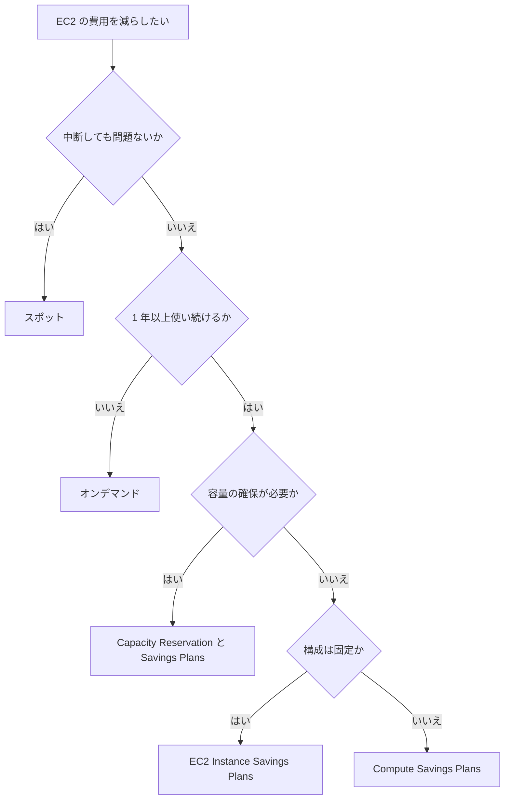

定常の基盤には確約割引、変動分にはオンデマンド、中断できる部分にはスポットと、組み合わせるのが基本です。

1 日の台数の変化に重ねると、次のような層になります。

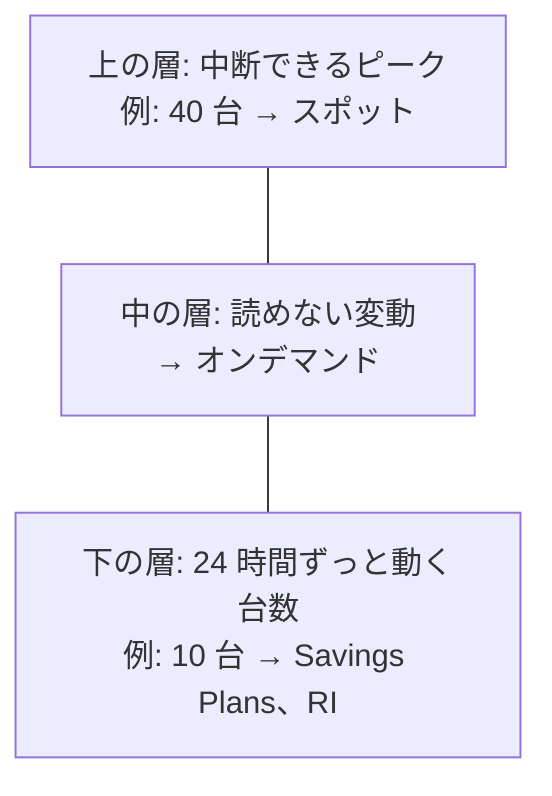

確約は、下の層の「必ず使う量」に合わせます。ピークに合わせて確約すると、使わない時間の分を払うことになり、オンプレミスでピークに合わせて買うのと同じ無駄が出ます。

## Compute Optimizer と適正サイズ {#compute-optimizer}

[:material-sprout: CLF](../courses/clf/services.md){ .exam-badge .exam-foundational } [:material-certificate: SAA](../courses/saa/services.md){ .exam-badge .exam-associate } [:material-certificate: SOA](../courses/soa/services.md){ .exam-badge .exam-associate } [:material-certificate: MLA](../courses/mla/services.md){ .exam-badge .exam-associate } [:material-star-circle: SAP](../courses/sap/services.md){ .exam-badge .exam-professional } [:material-star-circle: DOP](../courses/dop/services.md){ .exam-badge .exam-professional }

[提供単位](resource-scope.md#two-axes): リージョン。推奨はリージョンごとで、VPC の外です。

使用状況を分析して、適正サイズの推奨とアイドルリソースを示すサービスです。使うにはオプトインが必要です。

オンプレミスでは、一度買ったサーバーは小さくできないので、足りなくなるのを恐れて大きめに買います。クラウドに移ってもこの習慣が残り、大きすぎるインスタンスが使われ続けがちです。クラウドでは後からサイズを変えられるので、実際の使用率を測って合わせる方が得になります。Compute Optimizer は、その測定と提案を自動で行います。

| 対象 | データの条件 |
| --- | --- |
| EC2、Auto Scaling グループ | 過去 14 日間に 30 時間以上の CloudWatch メトリクス |
| EBS | 稼働中のインスタンスに 30 時間以上連続でアタッチ |
| Lambda | 過去 14 日間に 50 回以上の呼び出し |
| Fargate の ECS サービス | 過去 14 日間に 24 時間以上のメトリクス |

このほか、RDS、Aurora、NAT ゲートウェイ、DynamoDB、ElastiCache、MemoryDB、DocumentDB、商用ソフトウェアのライセンスにも対応します。

拡張インフラストラクチャメトリクスは有料の機能で、分析の期間を 93 日に広げます。EC2、Auto Scaling グループ、RDS で使えます。

- **データ不足の例:** 3 日前に起動した EC2 でメトリクスが 20 時間分なら、推奨は出ません。Lambda は 14 日で 49 回の呼び出しでは `Insufficient data` です。
- **Lambda の例:** メモリが 1,792 MB を超える関数は `Inconclusive` になることがあります。
- **93 日の例:** 四半期末にだけ負荷が上がるシステムは、14 日の分析ではピークを見逃して小さすぎる推奨になります。拡張メトリクスで 93 日を見ます。

### Cost Optimization Hub {#cost-optimization-hub}

アカウントとリージョンをまたいで、適正サイズ、アイドルリソースの削除、Savings Plans、RI の推奨を集約します。割引を考慮した推定節約額で優先順位を付けられます。

**使う場面:** 40 アカウントを持つ人材サービスの会社で、四半期ごとの削減の会議に、全アカウントの推奨を節約額の大きい順に並べて持っていく。

- **例:** Compute Optimizer のサイズ変更で月 100 USD、Savings Plans で月 300 USD の節約が見込めるとき、両方を実行すると足し算にはなりません。Hub は割引を考慮した額で比べるので、重複を見込んで優先順位を付けられます。

### 推奨を出すサービスの違い {#recommendation-tools}

| サービス | 主な推奨 |
| --- | --- |
| Compute Optimizer | リソースのサイズとアイドル |
| Trusted Advisor | 費用、セキュリティ、耐障害性など幅広い点検 |
| Cost Explorer の推奨 | Savings Plans と RI の購入 |
| Cost Optimization Hub | 上記を集約して優先順位付け |
| S3 Storage Lens | S3 の使用状況と傾向 |

## S3 のストレージ費用 {#s3-cost}

[提供単位](resource-scope.md#two-axes): リージョン。One Zone-IA と Express One Zone は AZ に置きます。VPC の外です。

アクセスの頻度で選びます。低いクラスほど保存料は安く、取り出し料がかかります。

すべてを同じ速さで取り出せる場所に置くと、ほとんど読まないデータにも高い保存料を払います。クラスが分かれているのは、「置いておく費用」と「取り出す費用と時間」を交換できるようにするためです。

**倉庫にたとえる**と、次のようになります。オンプレミスでは、ディスクの階層とテープ装置で同じことをしていました。

| クラス | たとえ | オンプレミスでの相当 |
| --- | --- | --- |
| Standard | 手元の棚。すぐ取れる | 高速なディスク |
| Standard-IA、Glacier Instant Retrieval | 奥の棚。すぐ取れるが、出すたびに手数料 | 容量重視のディスク |
| Glacier Flexible Retrieval | 別の倉庫。取り寄せに分から時間 | 社内のテープライブラリ |
| Glacier Deep Archive | 遠くの保管庫。取り寄せに時間単位 | 外部の保管業者に預けたテープ |

違う点は、オンプレミスのテープと違って、媒体の交換、装置の保守、保管業者との契約が要らないことです。

| クラス | 向くデータ | 最低保存期間 | 最低課金サイズ | 取り出し料 |
| --- | --- | --- | --- | --- |
| Standard | 月 1 回以上のアクセス | なし | なし | なし |
| Intelligent-Tiering | アクセスパターンが不明 | なし | なし | なし（監視料あり） |
| Standard-IA | 月 1 回程度 | 30 日 | 128 KB | あり |
| One Zone-IA | 再作成できるデータ | 30 日 | 128 KB | あり |
| Glacier Instant Retrieval | 四半期に 1 回、ミリ秒で取得 | 90 日 | 128 KB | あり |
| Glacier Flexible Retrieval | 年 1 回、分から時間で取得 | 90 日 | - | あり |
| Glacier Deep Archive | 年 1 回未満、時間単位で取得 | 180 日 | - | あり |
| Express One Zone | 1 桁ミリ秒、単一 AZ | なし | なし | - |

費用の落とし穴は次のとおりです。

- 最低保存期間より前に削除すると、残りの期間分も課金される。
- 小さいオブジェクトは IA クラスで割高になる。128 KB 未満は既定でライフサイクルの移行対象外。
- Intelligent-Tiering では 128 KB 未満の小さなオブジェクトは自動階層化されない。
- アクセスが読めないなら Intelligent-Tiering を選ぶ。30 日アクセスがないと IA 層、90 日で Archive Instant Access 層に移る。

計算の例です。

- **最低保存期間の例:** Standard-IA を 10 日で削除すると、残り 20 日分も課金されます。Deep Archive を 30 日で削除すると、残り 150 日分です。
- **最低課金サイズの例:** 10 KB のオブジェクト 1,000 個を Standard-IA に置くと、実際は 10 MB ですが、128 KB × 1,000 = 128 MB 分の課金です。
- **Intelligent-Tiering の例:** 30 日読まないオブジェクトは低頻度の層へ、90 日読まないと Archive Instant Access 層へ移ります。読むと高頻度の層へ戻ります。
- **Requester Pays の例:** 公開データセットを 1 TB 取得する利用者の転送料は、利用者が払います。

バケットの所有者ではなく、利用者に取得費用を払わせたいときは Requester Pays を使います。

詳細は [S3](s3.md#storage-classes) を参照してください。

## データ転送の費用 {#data-transfer}

通信の方向と場所で料金が変わります。

オンプレミスでは、社内 LAN の通信は無料で、インターネット回線は月額の定額契約が普通です。AWS では、通信は量に応じて課金されることが多く、構成図の線の 1 本ずつが費用になります。特に AZ 間とインターネットへの送信は、設計で量が大きく変わります。

| 観点 | オンプレミス | AWS |
| --- | --- | --- |
| 社内、VPC 内の通信 | 無料（スイッチを買えば終わり） | 同じ AZ 内は無料、AZ 間は有料 |
| 外への通信 | 回線の帯域で月額の定額 | 送信したデータ量で従量 |
| 拠点間の専用線 | 回線の月額 | Direct Connect のポート料金と送信データ量 |

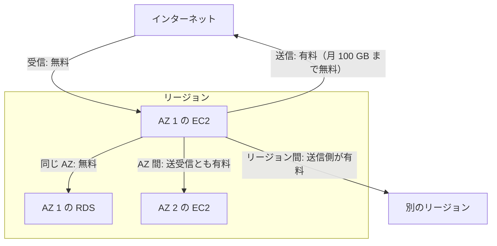

| 経路 | 料金 |
| --- | --- |
| インターネットから AWS へ（受信） | 無料 |
| 同じ AZ 内 | 無料 |
| AZ 間 | 有料。リソースごとに送受信の両方が課金される |
| リージョン間 | 送信元リージョンの送信分が有料。受信は無料 |
| AWS からインターネットへ | 有料。月 100 GB まで無料（全サービスとリージョンの合計、中国と GovCloud を除く） |
| Direct Connect の受信 | 無料 |
| Direct Connect の送信 | ポート料金に加えて送信データ分が有料 |

| 仕組み | 課金の基準 | 減らし方 |
| --- | --- | --- |
| NAT ゲートウェイ | 時間と処理データ量に加えて、通常の転送料 | リソースと同じ AZ に置く。S3、DynamoDB はゲートウェイエンドポイントを使う |
| ゲートウェイエンドポイント | 無料 | S3、DynamoDB のアクセスに使う |
| インターフェイスエンドポイント | 時間とデータ転送量 | 通信量が多ければ NAT と比較する |
| パブリック IPv4 | 1 個あたり 0.005 USD/時（使用中とアイドルで同額） | 使わないものを解放する。IPv6 を検討する |
| Site-to-Site VPN | 接続の時間と送信データ量 | 大量なら Direct Connect を検討する |

たとえば「プライベートサブネットから同じリージョンの S3 に大量のデータを転送して、NAT の費用が高い」場合は、S3 のゲートウェイエンドポイントを追加すれば解決します。

- **無料枠の例:** 月のインターネットへの送信が 150 GB なら、100 GB を引いた 50 GB が課金されます。
- **パブリック IPv4 の例:** 0.005 USD/時 × 730 時間 = 1 個で月 3.65 USD、10 個で月 36.5 USD です（2026 年 10 月時点の公式の料金。変わることがあります）。
- **AZ 間の例:** 1 TB の AZ 間の通信は、送信側と受信側の両方で 1 TB ずつ課金されます。
- **NAT の例:** 月 10 TB を NAT で S3 へ送ると、10 TB 分の処理料がかかります。ゲートウェイエンドポイントなら処理料は 0 です。

AZ 間の通信が多いアプリは、同じ AZ の中で処理を完結させると減らせます。ただし可用性とのトレードオフです。

## AI サービスの料金の構造 {#ai-pricing}

[:material-sprout: AIB](../courses/aib/services.md){ .exam-badge .exam-foundational }

AI サービスの課金の単位はさまざまです。金額は変わりやすいので、単位を覚えます。

自前で GPU サーバーを買えば、使っても使わなくても費用は同じです。マネージドの AI サービスは、処理した量（トークン、ページ、秒数）で払うので、使わなければ費用はかかりません。その代わり、プロンプトの長さや呼び出しの回数が、そのまま費用に出ます。

### Amazon Bedrock {#bedrock-pricing}

[提供単位](resource-scope.md#two-axes): リージョン。モデルの提供と単価はリージョンで異なり、VPC の外です。VPC からは PrivateLink で呼べます。

テキストモデルは主に入力と出力のトークン数で課金されます。単価はモデルとプロバイダーで異なります。出力の単価は入力より高いのが一般的で、長い応答ほど費用が増えます。

| 方式 | 課金 | 向くもの |
| --- | --- | --- |
| オンデマンド（Standard ティア） | トークン単位 | 既定、日常の処理 |
| Priority ティア | Standard より割高 | 応答速度が重要な顧客向け |
| Flex ティア | Standard より割安 | 時間に余裕がある処理（評価、要約） |
| Reserved ティア | 確保した容量（入力 100,000 TPM、出力 10,000 TPM 以上）。アカウントチームに連絡 | ダウンタイムを許せない処理 |
| バッチ | 対象のモデルでオンデマンドの 50% 引き | 非同期の大量処理 |
| Provisioned Throughput | モデルユニット単位の時間課金。確約なし、1 か月、6 か月から選択 | 一定の大きな容量、カスタムモデル |

コストを下げる方法は次のとおりです。

| 方法 | 効果 |
| --- | --- |
| 小さいモデルを選ぶ | トークン単価が下がる |
| プロンプトを短くする | 入力トークンが減る |
| `maxTokens` を抑える | 出力トークンが減る |
| プロンプトキャッシュ | 繰り返す部分の読み取りが安くなる（TTL は多くのモデルで 5 分、失効すると再度書き込み） |
| バッチ、Flex | リアルタイムでない処理が安くなる |

トークンの計算の例です。

- **日量の例:** 1 リクエストが入力 2,000、出力 500 トークンで 1 日 10,000 回なら、入力 2,000 万、出力 500 万トークンです。
- **`maxTokens` の例:** 出力を 500 から 250 に抑えると、出力は 1 日 250 万トークンに半減します。切り詰められた応答は `stopReason` が `max_tokens` です。
- **バッチの例:** 対象のモデルで 50% 引きなので、夜間の 2,000 万トークンの要約は、オンデマンドの半額です。
- **キャッシュの例:** 共通のシステムプロンプト 1,500 トークンを、5 分以内に繰り返すならキャッシュが効きます。1 時間に 1 回の呼び出しなら毎回失効し、書き込みの費用だけかかります。
- **Reserved の例:** 毎分 100 リクエストで入力 2,000 トークンなら 200,000 TPM で、Reserved の入力の最小 100,000 TPM に届きます。出力にも最小 10,000 TPM があります。

| 付加機能 | 課金の単位 |
| --- | --- |
| Guardrails | テキスト単位（1 単位は最大 1,000 文字）。正規表現と単語フィルターは無料 |
| カスタマイズ | トレーニング（モデルで異なる）、月額のストレージ、推論 |
| Knowledge Bases | 種類で異なる。ベクトルストアなどの費用にも注意 |

- **Guardrails の例:** 1 単位は最大 1,000 文字です。1,000 文字は 1 単位、1,001 文字は 2 単位、2,500 文字は 3 単位です。

トークンについては [AI の基礎](ai-fundamentals.md)、実装は [AI](ai.md) を参照してください。

### その他の AI サービス {#ai-service-units}

| サービス | 課金の単位 |
| --- | --- |
| SageMaker AI（ノートブック、トレーニング、リアルタイム推論） | インスタンスの稼働時間。推論はデータ処理料も |
| SageMaker AI Serverless Inference | ミリ秒単位のコンピュート（メモリで変動）とデータ処理量 |
| Textract | 処理したページ数（API と機能で単価が異なる） |
| Rekognition | 画像は枚数、動画は分数 |
| Transcribe | 音声の秒数 |
| Comprehend | 100 文字単位（1 リクエストの最小は 3 単位） |
| Amazon Q Business | ユーザーごとの月額（Lite、Pro）とインデックスの時間課金 |

SageMaker のエンドポイントは、リクエストがなくても稼働中は課金されます。使わないときは削除するか、サーバーレスを検討します。

- **SageMaker の例:** 1 インスタンスのエンドポイントを放置すると、730 時間分の課金です。1 日 8 時間だけ使うなら、残りの 16 時間は削除すれば約 3 分の 1 になります。
- **Comprehend の例:** 50 文字は最小の 3 単位（300 文字分）です。1,050 文字は 100 文字単位で切り上げて 11 単位です。

## 選び方の比較 {#choosing}

| 迷うもの | 使い分け |
| --- | --- |
| Cost Explorer / Budgets | 過去の分析なら Cost Explorer、しきい値での通知なら Budgets |
| Budgets / Cost Anomaly Detection | 決めた額との比較なら Budgets、いつものパターンとの比較なら異常検出 |
| Budgets / CloudWatch の請求アラーム | 予測や絞り込みが必要なら Budgets、全体の実績の簡易な監視なら請求アラーム |
| Cost Explorer / CUR | グラフなら Cost Explorer、行単位の分析なら CUR 2.0 |
| Pricing Calculator / Cost Explorer | 作る前なら Calculator、作った後なら Cost Explorer |
| タグ / Cost Categories | リソース単位の印ならタグ、事業の構造への集約なら Cost Categories |
| Savings Plans / RI | 通常は Savings Plans。容量も確保したいならゾーナル RI、または Capacity Reservation を併用 |
| Compute SP / EC2 Instance SP | 柔軟性なら Compute、割引の大きさなら EC2 Instance |
| Standard-IA / One Zone-IA | 重要なデータなら Standard-IA、再作成できるなら One Zone-IA |
| Compute Optimizer / Trusted Advisor | サイズの詳しい推奨なら Compute Optimizer、幅広い点検なら Trusted Advisor |

## 既定値と上限のまとめ {#numbers}

| 項目 | 値 |
| --- | --- |
| Cost Explorer の過去データ、予測 | 13 か月、18 か月 |
| Cost Explorer API | リクエストあたり 0.01 USD |
| Budgets の更新 | 1 日最大 3 回 |
| 無料のアクション有効な予算 | 2 個。以降は 1 日 0.10 USD |
| 1 予算のアクション数 | 10 |
| 1 アカウントのアクション数 | 100 |
| コスト配分タグの反映 | 表示まで最大 24 時間、有効化に最大 24 時間 |
| タグのバックフィル | 最大 12 か月 |
| Cost Categories の反映 | 最大 24 時間 |
| Compute SP、EC2 Instance SP | 最大 66%、72% |
| Database SP、SageMaker AI SP | 最大 35%、64% |
| スポットの割引、通知 | 最大 90%、2 分前 |
| RI の期間 | 1 年、3 年 |
| RI 販売の手数料 | 前払い額の 12% |
| SP の返品 | 100 USD/時以下、7 日以内かつ同じ暦月 |
| インターネットへの送信の無料枠 | 月 100 GB |
| パブリック IPv4 | 0.005 USD/時 |

## 試験のポイント {#exam-points}

| こう問われたら | 答え |
| --- | --- |
| 構築前の費用を見積もる | Pricing Calculator |
| 過去の費用の傾向を見る | Cost Explorer |
| 予算の超過が予測されたら通知 | Budgets の `FORECASTED` |
| 超過時に新規作成を自動で止める | 予算アクション（IAM ポリシー、SCP） |
| いつもと違う費用の急増を見つける | Cost Anomaly Detection |
| 行単位の詳細な明細を Athena で分析 | Data Exports の CUR 2.0 |
| タグを付けたのに費用に出ない | コスト配分タグを有効化する |
| 部門別に費用を分ける | コスト配分タグ、Cost Categories |
| 複数アカウントの請求をまとめる | Organizations の一括請求 |
| RI の割引を組織で共有する | 一括請求の割引の共有 |
| EC2 と Lambda と Fargate をまとめて割り引く | Compute Savings Plans |
| 構成が固定で割引を最大にしたい | EC2 Instance Savings Plans |
| 容量を確保したい | Capacity Reservation、ゾーナル RI |
| 中断できるバッチを安く | スポット |
| スポットの中断の予告時間 | 2 分 |
| 使わなくなった RI を売りたい | スタンダード RI をマーケットプレイスで販売 |
| ソケット単位の BYOL | Dedicated Hosts |
| インスタンスサイズの推奨 | Compute Optimizer |
| アクセスパターンが不明な S3 | Intelligent-Tiering |
| S3 への NAT の費用を減らす | ゲートウェイエンドポイント |
| 受信のデータ転送料 | 無料 |
| Bedrock のリアルタイムでない処理を安く | バッチ、Flex ティア |
| 生成 AI の費用を決める主な単位 | 入力と出力のトークン |
| カスタムモデルの推論に必要なもの | Provisioned Throughput |

## 関連ページ {#related}

- [クラウドの基礎](cloud-foundations.md)
- [ガバナンス](governance.md)
- [S3](s3.md)
- [ストレージの応用](storage-advanced.md)
- [ネットワーク](networking.md)
- [AI](ai.md)
- [SageMaker](sagemaker.md)

## 参考 {#references}

- [What is AWS Billing and Cost Management?](https://docs.aws.amazon.com/awsaccountbilling/latest/aboutv2/billing-what-is.html)
- [Consolidating billing for AWS Organizations](https://docs.aws.amazon.com/awsaccountbilling/latest/aboutv2/consolidated-billing.html)
- [Reserved Instances and Savings Plans discount sharing](https://docs.aws.amazon.com/awsaccountbilling/latest/aboutv2/ri-turn-off.html)
- [Creating a billing alarm](https://docs.aws.amazon.com/AmazonCloudWatch/latest/monitoring/monitor_estimated_charges_with_cloudwatch.html)
- [Analyzing your costs with AWS Cost Explorer](https://docs.aws.amazon.com/cost-management/latest/userguide/ce-what-is.html)
- [Managing your costs with AWS Budgets](https://docs.aws.amazon.com/cost-management/latest/userguide/budgets-managing-costs.html)
- [Configuring budget actions](https://docs.aws.amazon.com/cost-management/latest/userguide/budgets-controls.html)
- [AWS Budgets pricing](https://aws.amazon.com/aws-cost-management/aws-budgets/pricing/)
- [What is AWS Data Exports?](https://docs.aws.amazon.com/cur/latest/userguide/what-is-data-exports.html)
- [Cost and Usage Report (CUR) 2.0](https://docs.aws.amazon.com/cur/latest/userguide/table-dictionary-cur2.html)
- [Understanding data transfer charges](https://docs.aws.amazon.com/cur/latest/userguide/cur-data-transfers-charges.html)
- [AWS Cost Anomaly Detection](https://docs.aws.amazon.com/cost-management/latest/userguide/manage-ad.html)
- [Organizing costs using AWS Cost Categories](https://docs.aws.amazon.com/awsaccountbilling/latest/aboutv2/manage-cost-categories.html)
- [Organizing and tracking costs using cost allocation tags](https://docs.aws.amazon.com/awsaccountbilling/latest/aboutv2/cost-alloc-tags.html)
- [Backfill cost allocation tags](https://docs.aws.amazon.com/awsaccountbilling/latest/aboutv2/cost-allocation-backfill.html)
- [What is AWS Pricing Calculator?](https://docs.aws.amazon.com/pricing-calculator/latest/userguide/what-is-pricing-calculator.html)
- [Savings Plans types](https://docs.aws.amazon.com/savingsplans/latest/userguide/plan-types.html)
- [Compute Savings Plans and Reserved Instances](https://docs.aws.amazon.com/savingsplans/latest/userguide/sp-ris.html)
- [Returning a purchased Savings Plan](https://docs.aws.amazon.com/savingsplans/latest/userguide/return-sp.html)
- [Reserved Instances for Amazon EC2 overview](https://docs.aws.amazon.com/AWSEC2/latest/UserGuide/ec2-reserved-instances.html)
- [Regional and zonal Reserved Instances](https://docs.aws.amazon.com/AWSEC2/latest/UserGuide/reserved-instances-scope.html)
- [Sell Reserved Instances](https://docs.aws.amazon.com/AWSEC2/latest/UserGuide/ri-market-general.html)
- [Spot Instances](https://docs.aws.amazon.com/AWSEC2/latest/UserGuide/using-spot-instances.html)
- [Spot Instance interruption notices](https://docs.aws.amazon.com/AWSEC2/latest/UserGuide/spot-instance-termination-notices.html)
- [What is AWS Compute Optimizer?](https://docs.aws.amazon.com/compute-optimizer/latest/ug/what-is-compute-optimizer.html)
- [Compute Optimizer resource requirements](https://docs.aws.amazon.com/compute-optimizer/latest/ug/requirements.html)
- [Cost Optimization Hub](https://docs.aws.amazon.com/cost-management/latest/userguide/cost-optimization-hub.html)
- [Understanding and managing Amazon S3 storage classes](https://docs.aws.amazon.com/AmazonS3/latest/userguide/storage-class-intro.html)
- [How S3 Intelligent-Tiering works](https://docs.aws.amazon.com/AmazonS3/latest/userguide/intelligent-tiering-overview.html)
- [Overview of Data Transfer Costs for Common Architectures](https://aws.amazon.com/blogs/architecture/overview-of-data-transfer-costs-for-common-architectures/)
- [Amazon EC2 On-Demand pricing](https://aws.amazon.com/ec2/pricing/on-demand/)
- [Amazon VPC pricing](https://aws.amazon.com/vpc/pricing/)
- [Service tiers for optimizing performance and cost](https://docs.aws.amazon.com/bedrock/latest/userguide/service-tiers-inference.html)
- [Provisioned Throughput in Amazon Bedrock](https://docs.aws.amazon.com/bedrock/latest/userguide/prov-throughput.html)
- [Prompt caching](https://docs.aws.amazon.com/bedrock/latest/userguide/prompt-caching.html)
- [Amazon Bedrock pricing](https://aws.amazon.com/bedrock/pricing/)
- [Amazon SageMaker AI pricing](https://aws.amazon.com/sagemaker/ai/pricing/)
