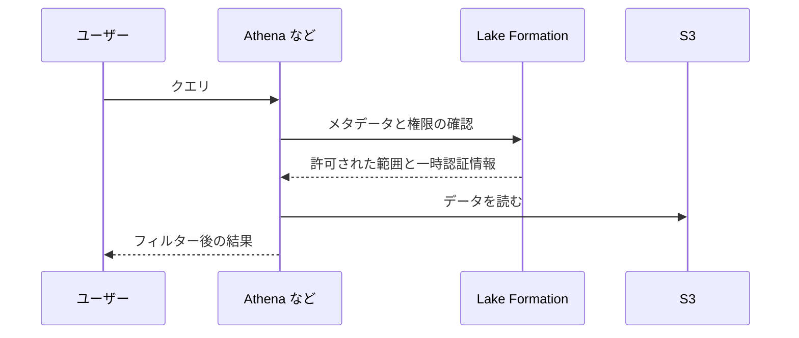
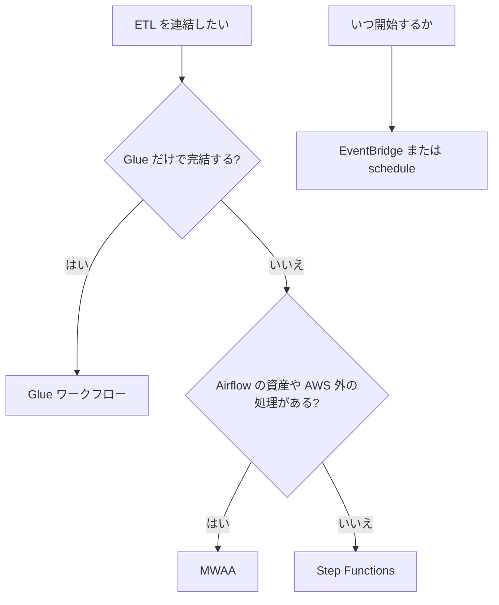

# データエンジニアリング（Glue、EMR、Redshift、Lake Formation ほか）

[:material-sprout: CLF](../courses/clf/services.md){ .exam-badge .exam-foundational } [:material-sprout: AIF](../courses/aif/services.md){ .exam-badge .exam-foundational } [:material-certificate: SAA](../courses/saa/services.md){ .exam-badge .exam-associate } [:material-certificate: DEA](../courses/dea/services.md){ .exam-badge .exam-associate } [:material-certificate: MLA](../courses/mla/services.md){ .exam-badge .exam-associate } [:material-star-circle: SAP](../courses/sap/services.md){ .exam-badge .exam-professional } [:material-star-circle: DOP](../courses/dop/services.md){ .exam-badge .exam-professional } [:material-star-circle: AIP](../courses/aip/services.md){ .exam-badge .exam-professional } [:material-target: SCS](../courses/scs/services.md){ .exam-badge .exam-specialty }

データを集め、変換し、保存し、権限を付けて分析に渡すためのサービスをまとめます。Data Engineer（DEA-C01）の中心範囲です。Kinesis、Firehose、Athena、OpenSearch は [ストリーミングと分析](streaming.md)、S3 自体は [S3](s3.md) を参照してください。

[](../assets/diagrams/data-engineering-pipeline.png)

| やりたいこと | 第一候補 | 補足 |
| --- | --- | --- |
| サーバーなしで Spark の ETL を動かす | [Glue](#glue) | クローラーと Data Catalog もここ |
| Spark、Hive、Presto などを細かく調整して動かす | [EMR](#emr) | EC2、EKS、Serverless から選ぶ |
| SQL で大量のデータを結合、集計する | [Redshift](#redshift) | 列指向の DWH |
| S3 上のデータに SQL を単発で投げる | [Athena](streaming.md#athena) | サーバーレス |
| データレイクの行、列、セル単位の権限 | [Lake Formation](#lake-formation) | Data Catalog が対象 |
| SaaS のデータをコードなしで取り込む | [AppFlow](#appflow) | Salesforce、Slack など |
| Kafka をそのまま使う | [MSK](#msk) | Provisioned と Serverless |
| ストリームをステートフルに処理する | [Managed Service for Apache Flink](#flink) | 旧 Kinesis Data Analytics |
| Python の DAG で依存関係を管理する | [MWAA](#mwaa) | マネージド Airflow |
| 組織横断でデータを検索、申請、共有する | [DataZone と SageMaker Catalog](#datazone-unified-studio) | ビジネスカタログ |
| ダッシュボードを作る | [Quick Sight](#quick-sight) | 旧 QuickSight |

## AWS Glue {#glue}

[:material-sprout: CLF](../courses/clf/services.md){ .exam-badge .exam-foundational } [:material-sprout: AIF](../courses/aif/services.md){ .exam-badge .exam-foundational } [:material-certificate: SAA](../courses/saa/services.md){ .exam-badge .exam-associate } [:material-certificate: DEA](../courses/dea/services.md){ .exam-badge .exam-associate } [:material-certificate: MLA](../courses/mla/services.md){ .exam-badge .exam-associate } [:material-star-circle: SAP](../courses/sap/services.md){ .exam-badge .exam-professional } [:material-star-circle: AIP](../courses/aip/services.md){ .exam-badge .exam-professional }

サーバーレスのデータ統合サービスです。メタデータのカタログ、スキーマの推定、Spark ベースの ETL、ワークフローをまとめて提供します。

提供単位はリージョンで、AZ は選びません。VPC の外のサービスです。VPC 内の RDS などを読むときは、Glue の接続に指定したサブネットへ ENI を置きます（[リソースの提供単位](resource-scope.md#two-axes)）。

| 部品 | 役割 |
| --- | --- |
| Data Catalog | テーブル定義などのメタデータの置き場 |
| クローラー | データを見てスキーマを推定し、カタログにテーブルを作る |
| ETL ジョブ | Spark などで変換を実行する |
| トリガー、ワークフロー | ジョブとクローラーの順序を制御する |
| Schema Registry | ストリームのスキーマを管理する |
| Data Quality | データの品質ルールを評価する |

### Data Catalog {#glue-data-catalog}

AWS アカウントのリージョンごとに 1 つある、永続的なメタデータストアです。

データベースとテーブルはメタデータだけを持ちます。データ本体は S3 などに残ります。そのため、テーブルを削除しても S3 のファイルは消えません。

Athena、EMR、Redshift Spectrum が同じカタログを参照できます。Apache Hive メタストアの代わりとして EMR から使うのが典型です。

**例**: Glue で作った `sales.orders` テーブルは、Athena でも Redshift の外部スキーマ経由でも、定義をコピーせずに使えます。

**落とし穴**: テキスト形式のデータは UTF-8 にします。他の文字コードの CSV は正しく処理されません。

**例（削除）**: `sales.orders` の `LOCATION` が `s3://lake/orders/` の外部テーブルを `DROP TABLE` しても、S3 の Parquet ファイルは残ります。同じ定義で作り直せば、そのまま読めます。

**例（文字コード）**: Shift_JIS の CSV をそのままクロールすると、日本語の列が文字化けします。取り込みの前に UTF-8 へ変換します。

### クローラー {#glue-crawlers}

データストアを読み、スキーマを推定して Data Catalog のテーブルとパーティションを作ります。ストリーミングのソースには使えません。ストリーミングのテーブルは手動で定義します。

| 設定 | 何が変わるか | 既定値 | 誤ったときの症状 |
| --- | --- | --- | --- |
| スキーマ変更ポリシー `UpdateBehavior` | スキーマの差分を更新するか、ログだけにするか | 更新する | 手で直した定義が次回の実行で上書きされる |
| `AddOrUpdateBehavior: MergeNewColumns` | 既存の列を変えず、新しい列だけ足す | 無効 | 列の型変更を拾えない |
| `AddOrUpdateBehavior: InheritFromTable` | パーティションのスキーマをテーブルに合わせる | 無効 | パーティションごとにスキーマがずれ、クエリが失敗する |
| 再クロールポリシー `CRAWL_NEW_FOLDERS_ONLY` | 新しいフォルダだけ見る | 全体を見る | 既存パーティションの変更と削除を検出できない |
| `TableGroupingPolicy: CombineCompatibleSchemas` | 互換性のあるデータを 1 つのテーブルにまとめる | 無効 | フォルダごとにテーブルが大量にできる |
| テーブルレベル | テーブルを作る S3 パスの深さを指定する | 自動判定 | 意図しない階層がテーブルやパーティションになる |
| テーブル数のしきい値 | 作成するテーブルの上限 | 指定なし | 未指定だと、想定外に多いテーブルができても気づきにくい |
| S3 イベント通知 | 変更のあったフォルダだけ一覧する | 無効 | 全件一覧で時間がかかる |

```bash
# 新しいフォルダだけ追加する増分クロール
aws glue update-crawler --name orders-crawler \
  --recrawl-policy RecrawlBehavior=CRAWL_NEW_FOLDERS_ONLY \
  --schema-change-policy UpdateBehavior=LOG,DeleteBehavior=LOG

# 互換性のあるスキーマを 1 つのテーブルにまとめる
aws glue update-crawler --name orders-crawler \
  --configuration '{"Version": 1.0, "Grouping": {"TableGroupingPolicy": "CombineCompatibleSchemas"}}'
```

`CRAWL_NEW_FOLDERS_ONLY` を有効にすると、更新と削除の動作は `LOG` に固定され、S3 のターゲットも編集できなくなります。大きなスキーマ変更があったときは、一時的に全件クロールに戻します。

**例**: `s3://lake/orders/dt=2026-10-31/` のように Hive 形式で日付のフォルダが増える場合、増分クロールを毎日実行すると新しい `dt` だけが追加されます。

**落とし穴**: パーティションの形が予測できるなら、毎回クローラーを動かす必要はありません。[パーティションの同期](#partition-sync)の別の方法のほうが速く済みます。

**例（テーブルレベル）**: `s3://lake/sales/orders/dt=2026-10-31/` で `orders` をテーブルにするなら、バケットを 1 と数えてレベルを 3 にします。自動判定では、ファイルの形が違うと `dt=` のフォルダごとに別のテーブルができることがあります。

```json
{
  "Version": 1.0,
  "Grouping": {
    "TableGroupingPolicy": "CombineCompatibleSchemas",
    "TableLevelConfiguration": 3
  },
  "CrawlerOutput": { "Tables": { "AddOrUpdateBehavior": "MergeNewColumns", "TableThreshold": 10 } }
}
```

**例（`TableThreshold`）**: 上の設定で 11 個以上のテーブルができそうな実行は、作成せずに失敗します。パスの設定を誤ったときに、1,000 個のテーブルができるのを防げます。

**例（`MergeNewColumns`）**: 既存の `amount DOUBLE` を手で `DECIMAL(12,2)` に直した後、新しいデータに `coupon` 列が現れると、`coupon` だけが増え、`amount` の型は保たれます。

**例（S3 イベント通知）**: 10,000 フォルダのうち毎日 5 フォルダだけが変わるなら、`RecrawlBehavior=CRAWL_EVENT_MODE` で変更のあった 5 フォルダだけを一覧します。S3 のイベントを受ける SQS が要ります。

**症状（`CRAWL_NEW_FOLDERS_ONLY`）**: 既存の `dt=2026-10-30/` の中身の列が変わっても、スキーマは更新されません。カタログと実データが食い違うので、一度全件クロールに戻して取り込み直します。

### ETL ジョブ {#glue-jobs}

ジョブの種類は、用途で選びます。

| 種類 | 実行環境 | 用途 |
| --- | --- | --- |
| Spark | Apache Spark | バッチの ETL。多くの場合はこれ |
| Spark Streaming | Spark のマイクロバッチ | Kinesis や Kafka のストリーム |
| Python shell | Python スクリプト | 小さな処理、SQL の発行 |
| Ray | Ray | 2026 年 3 月にメンテナンスへ移行すると発表された。新規に選ばない |

主な設定は次のとおりです。

| 設定 | 既定値と範囲 | 誤ったときの症状 |
| --- | --- | --- |
| Glue バージョン | 指定しなければ 5.1 | 古いジョブのコードが新バージョンで動かないことがある |
| ワーカータイプと数 | Glue 2.0 以降は `Maximum capacity` を指定できない | 不足すると遅い、または OOM |
| ジョブのタイムアウト | Glue 5.0 以降は 480 分、4.0 以前は 2,880 分。最大 10,080 分（7 日） | 長いジョブが途中で止まる。短いと費用の暴走を防げる |
| リトライ回数 | 0〜10 | タイムアウトしたジョブは再実行されない |
| 最大同時実行数 | 1 | 実行中に再度起動すると、上限超過でエラーになる |
| 実行クラス | Standard または Flex | Flex は開始が遅れることがあり、急ぎのジョブには向かない |
| Auto Scaling | Glue 3.0 以降で、最大ワーカー数を指定して有効化する | 使わないと並列度の低いステージでもワーカーの費用がかかる |

Flex は、試験環境のジョブや一度きりのロードなど、急がない処理の費用を下げます。Glue 3.0 以降の `G.1X` と `G.2X` で使えます。

```bash
aws glue create-job --name orders-etl \
  --role GlueOrdersRole \
  --command Name=glueetl,ScriptLocation=s3://lake-scripts/etl.py \
  --glue-version 5.0 \
  --worker-type G.2X --number-of-workers 10 \
  --timeout 60 --max-retries 1 \
  --execution-property MaxConcurrentRuns=1 \
  --execution-class FLEX \
  --default-arguments '{"--job-bookmark-option":"job-bookmark-enable"}'
```

**例（タイムアウト）**: 普段 20 分で終わるジョブを `--timeout 60` にします。無限ループが起きても 20 DPU × 1 時間 = 20 DPU 時間で止まります。既定の 480 分のままなら 20 × 8 = 160 DPU 時間まで使います。

**例（リトライ）**: `--max-retries 1` なら、失敗で 1 回だけ再実行します。タイムアウトしたジョブは再実行されません。書き込みが途中まで進むので、再実行しても重複しない作りにします。

**例（最大同時実行数）**: 毎時起動のジョブが 70 分かかると、次の起動は前の実行中なので `ConcurrentRunsExceededException` で失敗します。間隔を空けるか、ブックマークを使わないジョブなら値を増やします。

**例（Auto Scaling）**: `--enable-auto-scaling true` で最大 50 ワーカーにすると、シャッフルの重いステージでは 50 台に増え、読み込みだけのステージでは減ります。常に 50 台を確保するより、DPU 時間が減ります。

**例（Flex）**: 夜間の検証データのロードは、朝までに終わればよいので Flex にします。5 分以内に結果が要るジョブには使いません。`G.4X` では使えません。

#### DPU とワーカータイプ {#glue-dpu}

DPU は処理能力の単位です。1 DPU は 4 vCPU、16 GB メモリです。料金は DPU と実行時間で決まります。

| ワーカー | DPU | vCPU | メモリ | 用途 |
| --- | --- | --- | --- | --- |
| `G.025X` | 0.25 | 2 | 4 GB | 少量のストリーミング |
| `G.1X` | 1 | 4 | 16 GB | 通常の変換、結合 |
| `G.2X` | 2 | 8 | 32 GB | 通常の変換、結合 |
| `G.4X` | 4 | 16 | 64 GB | 重い集計、結合 |
| `G.8X` | 8 | 32 | 128 GB | 重い集計、結合 |
| `G.12X` | 12 | 48 | 192 GB | 非常に大きな処理 |
| `G.16X` | 16 | 64 | 256 GB | 最大の処理 |
| `R.1X`〜`R.8X` | 1〜8 | 4〜32 | 32〜256 GB | メモリ集約。OOM が頻発するとき |

`R` タイプと `G.12X`、`G.16X` は、起動に時間がかかることがあります。時間に厳しいワークフローでは、この遅れを見込みます。

**例**: 10 個の `G.2X` は 20 DPU です。30 分の実行なら 10 DPU 時間分の料金になります。

**例（タイプの選択）**: 20 GB の結合で `G.1X` のエグゼキューターが OOM になるなら、ワーカー数を増やす前に `G.2X` か `R.1X` にします。1 台のメモリが 16 GB から 32 GB になります。

**症状と対処**:

| 症状 | 原因の候補 | 対処 |
| --- | --- | --- |
| ドライバーの OOM | 小さなファイルが大量にあり、一覧だけでメモリを使う | `groupFiles` でまとめて読む |
| エグゼキューターの OOM | キャッシュ、シャッフル、集計が重い | `R` タイプへ変更、またはワーカーを大きくする |
| 全パーティションを読んで遅い | フィルターが読み込み後に適用されている | `push_down_predicate` を使う |
| 実行ごとに同じデータを処理する | ブックマークの設定不足 | 次節を確認する |

```python
# 小さなファイルをまとめて読み、必要なパーティションだけ読む
frame = glueContext.create_dynamic_frame.from_catalog(
    database="lake",
    table_name="orders",
    push_down_predicate="dt >= '2026-10-01'",
    additional_options={"groupFiles": "inPartition", "groupSize": "134217728"},
    transformation_ctx="orders_source",
)
```

ファイルが 50,000 個を超えると、グループ化は自動で有効になります。`groupSize` はバイト単位です。

**例（`groupSize`）**: 上の `134217728` は 128 MiB です。1 MiB のファイル 10,000 個なら、10,000 ÷ 128 ≈ 79 個のグループとして読みます。

**例（`push_down_predicate`）**: 3 年分のうち `dt >= '2026-10-01'` だけ読むと、カタログの段階で約 31 日分に絞られます。`frame.filter()` で後から絞ると、3 年分を読んでから捨てます。

#### ジョブのブックマーク {#glue-bookmarks}

前回までに処理した位置を覚え、新しいデータだけを処理する機能です。既定は無効で、毎回すべてのデータを処理します。

| 設定値 | 動作 |
| --- | --- |
| `job-bookmark-enable` | 実行後に状態を更新する。次回は続きから処理する |
| `job-bookmark-disable` | 既定。状態を使わず全件を処理する |
| `job-bookmark-pause` | 状態を読むが更新しない |

S3 ソースではオブジェクトの最終更新時刻で判定します。JDBC ソースでは主キーなどのブックマークキーで判定し、キーは単調に増加または減少している必要があります。

```python
job = Job(glueContext)
job.init(args["JOB_NAME"], args)         # 状態を読み込む
source = glueContext.create_dynamic_frame.from_catalog(
    database="lake", table_name="orders",
    transformation_ctx="orders_source",  # 状態のキーになる
)
# 変換と書き込み
job.commit()                             # 状態を更新する
```

| 症状 | 原因 | 対処 |
| --- | --- | --- |
| 有効なのに同じデータを再処理する | `job.commit()` がない、`transformation_ctx` がない、または変えた | スクリプトを直す |
| 有効なのに同じデータを再処理する | 最大同時実行数が 2 以上 | 1 にする。ブックマークは同時実行に対応していない |
| 同じファイルをまた処理した | 上流がファイルを上書きし、最終更新時刻が変わった | 上流を追記のみにする |
| 全件やり直したい | 状態が残っている | `aws glue reset-job-bookmark --job-name my-job` |

巻き戻しやリセットをしても、出力先のファイルは消えません。追跡するのはソース側だけです。再処理のときは出力先を分けないと、データが重複します。ジョブを削除するとブックマークも消えます。

**例（S3）**: 初回に 1,000 個のファイルを処理し、翌日 50 個が増えると、2 回目は 50 個だけを処理します。

**例（JDBC）**: `additional_options={"jobBookmarkKeys": ["order_id"], "jobBookmarkKeysSortOrder": "asc"}` で、`order_id` が増え続ける表の新しい行だけを読みます。既存の行の更新は検出できません。

**例（`job-bookmark-pause`）**: バグの調査で同じ範囲を試すときに使います。状態が進まないので、次回の本番の実行に影響しません。

### ワークフローとトリガー {#glue-workflows}

複数のジョブとクローラーを 1 つの単位として実行し、追跡します。

| トリガー | 発火の条件 | 例 |
| --- | --- | --- |
| スケジュール | cron | 毎日 2 時に開始する |
| 条件 | 監視するジョブやクローラーの完了状態 | J1 と J2 がともに成功したら J3 |
| オンデマンド | 手動または API | テスト実行 |
| EventBridge イベント | ワークフローの開始だけ。単一またはバッチのイベント | S3 にファイルが置かれたら開始 |

- 条件トリガーが監視できる状態は、ジョブが `SUCCEEDED`、`STOPPED`、`FAILED`、`TIMEOUT`、クローラーが `SUCCEEDED`、`FAILED`、`CANCELLED` です。
- EventBridge のバッチは、件数か時間の先に満たしたほうで開始します。件数だけ指定すると、ウィンドウは 15 分になります。
- 1 つのワークフローの部品は 100 個以下にします。超えると再開や停止でエラーになることがあります。
- 1 つのトリガーで起動できるクローラーは 2 個までです。
- ワークフロー実行プロパティで、ジョブの間で値を受け渡せます。
- 同時実行の上限を超えたイベントでは実行が始まらず、Glue は再試行しません。

**例**: 月次のワークフローで、スケジュールトリガーから重複除去ジョブと電話番号修正ジョブを起動し、両方が成功したら条件トリガーでクローラーを実行します。

**落とし穴**: 依存するジョブが起動するのは、前のジョブやクローラーがトリガーから起動された場合だけです。

**例（EventBridge のバッチ）**: 件数 100、時間 900 秒なら、100 個のファイルが届くか、最初のイベントから 15 分たつと開始します。小さなファイルが 1 個ずつ届く場合に、毎回ワークフローを起動せずに済みます。

**例（実行プロパティ）**: 最初のジョブが `run_date=2026-10-31` を設定し、次のジョブが同じ値を読みます。同じ日付を別々に計算して食い違うのを防げます。

### Schema Registry {#glue-schema-registry}

ストリーミングデータのスキーマを一元管理し、互換性を強制します。Avro、JSON Schema、Protobuf に対応します。MSK、Kinesis Data Streams、Flink、Lambda と連携します。

プロデューサーとコンシューマーの間でスキーマを契約にできます。互換性のない変更は登録の時点で拒否されるので、壊れたデータが流れる前に止まります。

| 互換性モード | 動作 |
| --- | --- |
| `BACKWARD` | 推奨。コンシューマーは現在と 1 つ前のバージョンを読める |
| `BACKWARD_ALL` | 現在と過去のすべてのバージョンを読める |
| `FORWARD` | 古いコンシューマーが新しいデータを読める |
| `FORWARD_ALL` | 過去のすべてのコンシューマーが新しいデータを読める |
| `FULL`、`FULL_ALL` | 前方と後方の両方 |
| `NONE` | 検査しない。開発向け |
| `DISABLED` | 新しいバージョンを追加できない |

**例**: Avro スキーマが `BACKWARD` のとき、必須列 `email` の削除は登録できます。必須列 `zip_code` の追加は、古いメッセージを読めなくなるので拒否されます。

**例（`BACKWARD` と任意列）**: 既定値付きの `coupon` 列の追加は登録できます。古いメッセージを読むときは既定値で補えるからです。コンシューマーを先に更新します。

**例（`FORWARD`）**: コンシューマーを止められないときに使います。列を足しても古いコンシューマーは無視できるので、プロデューサーを先に更新します。

**症状**: `DISABLED` にしたスキーマへ新しいバージョンを登録すると拒否されます。本番のスキーマを凍結するときに使います。

### Data Quality {#glue-data-quality}

[:material-certificate: MLA](../courses/mla/services.md){ .exam-badge .exam-associate }

Glue の機能なので、提供単位はリージョンで、VPC の外です。データの品質をルールで測るサーバーレスの機能です。オープンソースの Deequ を基盤とし、DQDL という言語でルールを書きます。25 種類以上の組み込みルールと、機械学習による異常検出があります。

| 入口 | タイミング | 使う人 |
| --- | --- | --- |
| Data Catalog | 保存済みデータを評価する | データスチュワード、アナリスト |
| ETL ジョブ | ロードの前に悪いデータを止める | データエンジニア |

```text
Rules = [
    IsComplete "order_id",
    Uniqueness "order_id" > 0.99,
    Completeness "email" > 0.95,
    ColumnValues "status" in ["NEW", "PAID", "SHIPPED"],
    RowCount > 1000
]
```

評価するとスコアが出て、スコアを下げたレコードを特定できます。ETL ジョブで使うと、不良レコードを隔離してから正常なデータだけを書き込めます。

**例（上のルールの判定）**: 10,000 行のうち `email` が 600 行欠けていると、Completeness は 0.94 で `> 0.95` を満たしません。行数が 800 なら `RowCount > 1000` も失敗します。5 個のルールで 3 個が合格なら、スコアは 60% です。

**例（入口の選び方）**: 他チームのテーブルを週 1 回点検するなら Data Catalog、毎日のロードで不良を止めたいなら ETL ジョブに組み込みます。

### DataBrew {#databrew}

[:material-sprout: AIF](../courses/aif/services.md){ .exam-badge .exam-foundational } [:material-certificate: DEA](../courses/dea/services.md){ .exam-badge .exam-associate } [:material-certificate: MLA](../courses/mla/services.md){ .exam-badge .exam-associate }

コードを書かずにデータを整形する、視覚的なツールです。アナリストやデータサイエンティストが主な利用者です。

提供単位はリージョンで、VPC の外のサービスです（[リソースの提供単位](resource-scope.md#two-axes)）。

| 用語 | 意味 |
| --- | --- |
| プロジェクト | データを格子状に表示して試す作業場 |
| レシピ | 変換手順の保存版。別のデータにも再利用できる。250 種類以上の変換がある |
| レシピジョブ | レシピを全データに適用して S3 へ出力する |
| プロファイルジョブ | 分布や欠損などの統計を出す |
| ルールセット | 品質ルールの集まり。プロファイルジョブで検証し、レポートを出す |

ルールの例は「列 `APY` の値は 0〜100」「列 `group_name` の欠損は 5% 以下」です。複合型（配列、構造体）の列には、列レベルのルールを定義できません。

| 観点 | DataBrew | Glue ETL | Glue Data Quality |
| --- | --- | --- | --- |
| 主な利用者 | アナリスト | データエンジニア | 両方 |
| 書き方 | 画面操作 | Python、Scala、Studio | DQDL |
| 向く場面 | 探索と整形 | 本番の大規模変換 | パイプラインの中の検査 |


**例（レシピ）**: 2026 年 10 月の売上 CSV で「日付の形式を統一」「`price` の欠損を 0 にする」のレシピを作り、毎月のファイルにレシピジョブで適用します。

**例（ルールセット）**: `APY` に `120` がある行があると「0〜100」のルールが失敗し、プロファイルジョブのレポートに出ます。

## Amazon EMR {#emr}

[:material-sprout: CLF](../courses/clf/services.md){ .exam-badge .exam-foundational } [:material-sprout: AIF](../courses/aif/services.md){ .exam-badge .exam-foundational } [:material-certificate: SAA](../courses/saa/services.md){ .exam-badge .exam-associate } [:material-certificate: DEA](../courses/dea/services.md){ .exam-badge .exam-associate } [:material-certificate: MLA](../courses/mla/services.md){ .exam-badge .exam-associate } [:material-star-circle: SAP](../courses/sap/services.md){ .exam-badge .exam-professional } [:material-star-circle: DOP](../courses/dop/services.md){ .exam-badge .exam-professional } [:material-star-circle: AIP](../courses/aip/services.md){ .exam-badge .exam-professional } [:material-target: SCS](../courses/scs/services.md){ .exam-badge .exam-specialty }

Spark、Hive、Presto、HBase などのオープンソースを動かすビッグデータ基盤です。Glue より設定の自由度が高く、アプリケーションやバージョンを細かく選べます。

提供単位はデプロイで異なります。EMR on EC2 のクラスターは VPC の 1 つのサブネットに置く AZ のリソースです。EMR on EKS は EKS のノードの配置に従います。EMR Serverless はリージョンのサービスで、VPC の外で動き、VPC のデータへはサブネットを指定して接続します（[リソースの提供単位](resource-scope.md#scope-zonal)）。

| デプロイ | 管理するもの | 向く場面 |
| --- | --- | --- |
| EMR on EC2 | クラスター、ノード、スケーリング | 細かな調整、SSH での確認、Spot の活用 |
| EMR on EKS | EKS クラスター（共用） | 他のコンテナと同じ基盤に集約する |
| EMR Serverless | アプリケーションと上限だけ | クラスターを運用したくない |


**例（選び方）**: GPU や独自の Spark 設定を試すなら on EC2、100 個のコンテナが動く EKS に相乗りするなら on EKS、月 2 回だけの Hive のジョブなら Serverless です。

### クラスターのノード {#emr-nodes}

| ノード | 役割 | HDFS を持つか | Spot の適否 |
| --- | --- | --- | --- |
| プライマリ | YARN ResourceManager、HDFS NameNode、ジョブの追跡 | NameNode のみ | 非推奨 |
| コア | タスクの実行と HDFS の DataNode | 持つ | 慎重に。終了で HDFS のデータを失う恐れ |
| タスク | タスクの実行のみ | 持たない | 向いている |

- プライマリは 1 台または 3 台です。3 台にすると単一障害点でなくなります。ただし、クラスターは 1 つの AZ またはサブネットに置きます。
- コアのインスタンスグループは 1 つです。タスクのインスタンスグループは最大 48 個まで増やせます。
- インスタンスフリートは、複数のインスタンスタイプと購入オプションを組み合わせられます。
- Application Master は、6.x 以降の既定ではタスクノードでも動きます。Spot の中断でジョブごと失敗させたくないときは、YARN ノードラベルで `CORE` か `ON_DEMAND` に制限します。

```yaml
# Application Master をコアノードに限定する（EMR 7.x の例）
yarn.node-labels.enabled: true
yarn.node-labels.am.default-node-label-expression: 'CORE'
```

**例**: コアに On-Demand を 4 台、タスクに Spot を 20 台置きます。Spot が中断しても、HDFS と Application Master は残ります。

**症状**: コアノードを Spot にして HDFS を使うと、中断でブロックを失い、ジョブが失敗します。

**例（プライマリ 3 台）**: 1 台が故障しても残りの 2 台で続行します。ただしサブネットは 1 つなので、AZ の障害には耐えません。AZ の障害に備えるなら、データを S3 に置き、別の AZ でクラスターを作り直します。

**例（インスタンスフリート）**: タスクに `m5.xlarge`、`m5a.xlarge`、`m6i.xlarge` を指定すると、Spot の容量が空いているタイプから確保できます。1 つのタイプに固定すると、そのタイプの中断の影響をまとめて受けます。

### スケーリングと終了 {#emr-scaling}

| 設定 | 何が変わるか | 誤ったときの症状 |
| --- | --- | --- |
| マネージドスケーリング `MinimumCapacityUnits`、`MaximumCapacityUnits` | コアとタスクの台数を自動調整する。プライマリは対象外 | 上限が低いとジョブが詰まる |
| `MaximumOnDemandCapacityUnits` | On-Demand の上限。超えた分は Spot | 未指定なら最大値と同じ値になる |
| 自動終了ポリシー | アイドルの時間が過ぎたらクラスターを終了する | 設定がないと、使っていないクラスターの課金が続く |
| 終了保護 | API やコンソールからの終了を拒否する | 長期クラスターで無効だと誤って終了する |

**長期クラスターと一時クラスター**: ジョブごとにクラスターを起動して終了する構成なら、データは S3 に置き、HDFS は中間データだけに使います。費用はジョブの時間分だけで済みます。

ログは S3 に出力できます。クラスターを終了した後も調査でき、Athena で分析できます。

```bash
aws emr put-managed-scaling-policy --cluster-id "$CLUSTER_ID" --managed-scaling-policy \
  'ComputeLimits={UnitType=Instances,MinimumCapacityUnits=5,MaximumCapacityUnits=30,MaximumOnDemandCapacityUnits=5}'

aws emr put-auto-termination-policy --cluster-id "$CLUSTER_ID" \
  --auto-termination-policy IdleTimeout=3600
```

**例（マネージドスケーリング）**: 上の設定は 5〜30 台で増減し、On-Demand は 5 台までです。30 台まで増えると、残りの 25 台は Spot になります。

**例（自動終了）**: `IdleTimeout=3600` なら 1 時間アイドルで終了します。範囲は 1 分〜7 日で、省略時は 1 時間です。

**例（終了保護）**: 24 時間稼働の HBase のクラスターでは `--termination-protected` を付けます。`terminate-clusters` は、保護を外すまで失敗します。

### HDFS と S3 {#emr-hdfs-vs-s3}

使うファイルシステムは URI の接頭辞で決まります。

| 観点 | HDFS（`hdfs://`） | S3（`s3://`） |
| --- | --- | --- |
| 実体 | コアノードのインスタンスストアと EBS | S3 |
| 永続性 | クラスターを終了すると消える | クラスターと独立して残る |
| 向くデータ | シャッフル、中間データ、頻繁に読む作業用データ | 入力、出力、長期保存 |
| 性能 | データの近くで処理できる | ネットワーク越し |
| スケール | コアノードの追加が必要 | 無制限に近い |

EMR にアタッチした EBS も一時的です。クラスターやインスタンスの終了で削除されます。EBS のスナップショットを EMR で復元することもできません。

現在のドキュメントでは、`s3://` の読み書きには S3A コネクターが使われると書かれています。古い資料には EMRFS と書かれていることがあります。

**`dfs.replication`** はブロックの複製数です。EMR はコアノードの数に応じて値を設定します。1 にすると 1 台の障害でデータを失うことがあるので、スケーリングやリサイズをするなら 2 以上にします。EMR はコアノードを `dfs.replication` の値より少なくしません。HDFS を使うならコアノードは 4 台以上が推奨です。

**例（容量の計算）**: 100 GB のデータを `dfs.replication=2` で置くと 200 GB を使います。コアノードが 1 台 100 GB なら、余裕も考えて 4 台以上にします。

### EMR on EKS {#emr-on-eks}

既存の EKS クラスターで EMR のコンテナを動かします。EKS の名前空間を仮想クラスターとして登録し、そこにジョブを送ります。

- 他のコンテナアプリと資源を共用でき、使用率が上がります。
- 同じ EKS クラスターで、異なるバージョンのフレームワークを並べられます。
- 実行は MWAA や自前の Airflow からスケジュールできます。

```bash
aws emr-containers create-virtual-cluster --name analytics \
  --container-provider '{"id":"shared-eks","type":"EKS","info":{"eksInfo":{"namespace":"spark"}}}'
```

**例**: `spark` 名前空間を仮想クラスター `analytics` として登録します。同じ EKS に EMR 6 系と 7 系のジョブを並べて、移行を段階的に進められます。

**選び方**: すでに EKS を運用している組織に向きます。EKS がなければ EMR Serverless のほうが簡単です。

### EMR Serverless {#emr-serverless}

クラスターの代わりにアプリケーションを作り、ジョブを送ります。ランタイム（Spark または Hive）と EMR のリリースを指定します。

| 用語 | 意味 |
| --- | --- |
| アプリケーション | ランタイムとリリースの単位。チームや環境ごとに分けられる |
| ジョブ実行 | 送信した処理。ランタイムロールを指定する |
| ワーカー | 実行の資源。自動で増減する |
| 事前初期化済み容量 | 秒単位で開始するためのウォームプール。アイドルでも課金される |

```bash
aws emr-serverless create-application \
  --type "SPARK" --name reports --release-label emr-7.0.0
```

アイドルのアプリケーションは自動で停止できます。既定は 15 分です。次のジョブで自動的に起動します。

```bash
aws emr-serverless update-application --application-id "$APP_ID" \
  --auto-stop-configuration enabled=true,idleTimeoutMinutes=15 \
  --maximum-capacity cpu=400vCPU,memory=1600GB
```

**例（上限）**: `update-application` は、アプリケーションが `STOPPED` か `CREATED` のときだけ実行できます。上の設定なら、1 台 4 vCPU のワーカーは 400 ÷ 4 = 100 台までです。悪いジョブが増え続けて費用が膨らむのを止められます。

**例（事前初期化）**: 対話的なレポートで開始の遅れを避けたいなら、ドライバー 1、エグゼキューター 4 を事前に確保します。ジョブがなくても、アプリケーションの起動中はこの 5 台の料金がかかります。

**症状**: `maximum-capacity` が小さいと、ワーカーが上限より増えないので、ジョブが遅くなることがあります。

**Glue との違い**: どちらもサーバーレスの Spark です。カタログと一体になった ETL、Data Quality、ブックマークを使うなら Glue、既存の Spark や Hive のコードと EMR のリリースをそのまま持ち込むなら EMR Serverless です。

## Amazon Redshift {#redshift}

[:material-sprout: CLF](../courses/clf/services.md){ .exam-badge .exam-foundational } [:material-sprout: AIF](../courses/aif/services.md){ .exam-badge .exam-foundational } [:material-certificate: SAA](../courses/saa/services.md){ .exam-badge .exam-associate } [:material-certificate: DEA](../courses/dea/services.md){ .exam-badge .exam-associate } [:material-certificate: MLA](../courses/mla/services.md){ .exam-badge .exam-associate } [:material-star-circle: SAP](../courses/sap/services.md){ .exam-badge .exam-professional } [:material-star-circle: DOP](../courses/dop/services.md){ .exam-badge .exam-professional }

列指向で超並列（MPP）のデータウェアハウスです。大きなテーブルの結合と集計に向きます。行単位の更新を大量に行う OLTP には向きません。

提供単位は形態で異なります。Provisioned のクラスターは VPC のクラスターサブネットグループに置き、既定では 1 つの AZ で動きます。Serverless のワークグループは 2 つ以上の AZ のサブネットを指定します（Enhanced VPC Routing なら 3 つ以上）。どちらも VPC の中に置きます（[リソースの提供単位](resource-scope.md#two-axes)）。

### 構成 {#redshift-architecture}

| 要素 | 役割 |
| --- | --- |
| リーダーノード | クライアントとの通信、実行計画の作成、結果の集約 |
| コンピュートノード | 計画を実行する。スライスに分かれる |
| Redshift Managed Storage（RMS） | RG と RA3 のデータの置き場。S3 上に広がるので、コンピュートと別にスケールできる |

| ノードタイプ | ストレージ | 位置づけ |
| --- | --- | --- |
| RG | RMS | 推奨。データレイクのクエリエンジンを内蔵する |
| RA3 | RMS | 推奨。データレイクのクエリは Redshift Spectrum を使う |
| DC2 | ローカル SSD | データが小さく、性能を重視する場合 |

AWS は新規構築に RG か RA3 を推奨しています。RMS があるので、データが増えてもノードを足す必要がありません。

**例（ノードの選択）**: データが 2 年で 10 TB から 50 TB に増えるなら、RA3 か RG にします。RMS が増えるだけで、計算の負荷が変わらなければノードは増やさずに済みます。DC2 ではローカル SSD の容量のためにノードを足すことになります。

**例（スライス）**: 1 ノードに 4 スライスで 2 ノードなら 8 スライスです。行は 8 スライスに分かれて並列に処理されます。

!!! warning "Python UDF の終了"
    Redshift の Python UDF は 2026 年 6 月 30 日で終了し、段階的に実行できなくなっています。古い教材の例は Lambda UDF か SQL UDF に置き換えて読みます。

### 分散スタイル {#redshift-distribution}

行をどのスライスに置くかを決めます。目的は、結合時のデータ移動を減らすことです。

| スタイル | 配置 | 向くテーブル | 誤ったときの症状 |
| --- | --- | --- | --- |
| `AUTO` | 既定。サイズに応じて変える（ALL、KEY、EVEN） | 迷ったらこれ | ほとんど問題にならない |
| `EVEN` | ラウンドロビン | 結合しないテーブル | 結合で再配布が起きる |
| `KEY` | 列の値で配置する | ファクトと大きなディメンションの結合 | 偏った列を選ぶと、一部のスライスに集中する |
| `ALL` | 全ノードにコピーする | 更新の少ない小さなディメンション | ストレージがノード数倍になり、更新が遅くなる |

選び方の要点は次のとおりです。

1. ファクトテーブルと、最もよく結合するディメンションの結合列を `DISTKEY` にします。
2. ファクトテーブルの `DISTKEY` は 1 つだけです。他のディメンションは `ALL` を検討します。
3. フィルター後のデータでもカーディナリティの高い列を選びます。日付列を `DISTKEY` にして狭い期間で絞ると、少数のスライスに処理が偏ります。

```sql
CREATE TABLE sales (
  sale_id     BIGINT,
  customer_id BIGINT,
  sold_at     TIMESTAMP,
  amount      DECIMAL(12, 2)
)
DISTSTYLE KEY DISTKEY (customer_id)
SORTKEY (sold_at);

CREATE TABLE customers (
  customer_id BIGINT,
  name        VARCHAR(100)
)
DISTSTYLE KEY DISTKEY (customer_id);
```

クエリプランに `DS_DIST_BOTH` や `DS_BCAST_INNER` が多いときは、再配布が起きています。`DS_DIST_NONE` になれば、データ移動なしで結合できています。

新しいテーブルでは、`DISTSTYLE AUTO` と `SORTKEY AUTO` による自動テーブル最適化が推奨です。Redshift がクエリを観察してキーを選びます。

**例（`ALL`）**: 10 GB の `regions` テーブルを 4 ノードのクラスターに `ALL` で置くと、10 × 4 = 40 GB を使います。その代わり、結合でのデータ移動はありません。

**例（`KEY` の偏り）**: `country` を `DISTKEY` にして 90% の行が `JP` なら、1 つのスライスに 90% が集まります。そのスライスの処理が終わるまでクエリは終わりません。`SVV_TABLE_INFO` の `skew_rows` で偏りを確認します。

**例（`EVEN`）**: どのテーブルとも結合しない生ログは `EVEN` で均等に置きます。

**症状**: `sales` を `customer_id`、`customers` を `name` で分散すると、同じ顧客の行が別々のスライスに置かれ、結合のたびに `DS_DIST_INNER` などの移動が起きます。

### ソートキー {#redshift-sort-keys}

ディスク上の並び順を決めます。Redshift は 1 MB のブロックごとに最小値と最大値を持つので、範囲の条件で読まないブロックを飛ばせます。

| 種類 | 効く条件 | 注意 |
| --- | --- | --- |
| `AUTO` | Redshift が選ぶ | 推奨 |
| `COMPOUND` | 先頭の列からの条件。既定 | 先頭列のない条件には効かない |
| `INTERLEAVED` | 任意の列に等しい重み。最大 8 列 | `VACUUM REINDEX` が重い。同時実行スケーリングの対象外 |

**例**: `COMPOUND SORTKEY (sold_at, region)` は、`sold_at` だけ、または `sold_at` と `region` の条件で効きます。`region` だけの条件ではほとんど効きません。

**VACUUM と ANALYZE**:

| 操作 | 目的 | 補足 |
| --- | --- | --- |
| `VACUUM` | 削除行の領域を回収し、並べ直す | 既定で 95% 以上ソート済みなら、並べ直しを飛ばす |
| `ANALYZE` | 統計情報を更新する | 統計が古いと実行計画が悪くなる |

どちらもバックグラウンドで自動実行されます。大量のロードの後は手動での実行を検討します。

**例（ブロックの読み飛ばし）**: 3 年分を `sold_at` でソートしておくと、1 日分の条件なら約 1,095 分の 1 のブロックだけを読みます。ソートキーがないと、全ブロックを読みます。

**例（`VACUUM`）**: 大量削除の後は `VACUUM DELETE ONLY sales;`、ソート順を優先するなら `VACUUM SORT ONLY sales TO 99 PERCENT;` を実行します。

**症状（`ANALYZE`）**: ロードで 10 倍に増えたテーブルの統計が古いと、小さいテーブルと誤認して悪い結合順を選びます。`ANALYZE sales;` の後で速くなるなら、これが原因です。

### COPY と UNLOAD {#redshift-copy}

大量ロードの標準は `COPY` です。`INSERT` を繰り返すより大幅に速くなります。

```sql
COPY sales
FROM 's3://lake/sales/dt=2026-10-31/'
IAM_ROLE 'arn:aws:iam::111122223333:role/RedshiftCopyRole'
FORMAT AS PARQUET;

-- CSV を gzip で読み、10 行までの不良を許す
COPY sales_raw
FROM 's3://lake/raw/sales_'
IAM_ROLE default
CSV GZIP IGNOREHEADER 1
MAXERROR 10
REGION 'ap-northeast-1';
```

| パラメータ | 動作 | 既定値 | 誤ったときの症状 |
| --- | --- | --- | --- |
| `FORMAT` | CSV、JSON、Avro、Parquet、ORC など | 区切り文字付きテキスト | 形式の不一致でロードエラー |
| `MANIFEST` | ロードするファイルを JSON で列挙する | なし | プレフィックスの一致で余分なファイルまで読む |
| `MAXERROR` | 許す不良行の数。上限 100,000 | 0 | 1 行の不良で全体が失敗する |
| `REGION` | バケットのリージョン | クラスターと同じ | 別リージョンのバケットでエラー |
| `COMPUPDATE` | 圧縮エンコーディングの自動適用 | 空のテーブルで未指定の列に適用 | 既存の設定を意図せず置き換える |
| `STATUPDATE` | ロード後に統計を更新する | 空のテーブルのときのみ | 空でないテーブルに大量ロードすると統計が古いまま |
| `NOLOAD` | 検証だけ行う | 無効 | 本番前に不良を発見できない |

速くするコツは次のとおりです。

- **1 回の COPY で複数ファイルを読みます。** 同時に複数の COPY を実行すると、直列のロードになって遅くなります。
- **圧縮ファイルは分割します。** ファイル数はスライス数の倍数にし、サイズをそろえます。4 スライスなら 4 ファイルか 8 ファイルです。
- **マニフェストで必須ファイルを明示します。** `mandatory` の既定は `false` です。マニフェストの上限は 100 MB です。

```json
{
  "entries": [
    {"url": "s3://lake/sales/part-0001.gz", "mandatory": true},
    {"url": "s3://lake/sales/part-0002.gz", "mandatory": true}
  ]
}
```

ロードのエラーは `SYS_LOAD_ERROR_DETAIL` や `STL_LOAD_ERRORS` で確認します。

**例（`MAXERROR`）**: `MAXERROR 10` で不良が 10 行なら、残りはロードされます。11 行目の不良で全体が失敗し、1 行も入りません。

**例（`NOLOAD`）**: `COPY sales FROM 's3://lake/sales/' IAM_ROLE default CSV NOLOAD;` は、データを入れずに不良だけを確認します。

**例（プレフィックスの罠）**: `FROM 's3://lake/raw/sales_'` は `sales_2026.csv` だけでなく `sales_backup_2019.csv` も読みます。避けたいならマニフェストを使います。

**例（`mandatory`）**: `mandatory: true` のファイルが届いていないと、`COPY` はエラーになります。既定の `false` だと、1 ファイル足りないまま成功します。

**例（スライス数とファイル数）**: 8 スライスなら、8 個か 16 個の同じ大きさのファイルに分けます。1 個の大きな gzip だと 1 スライスで読むので遅くなります。

**例（`COMPUPDATE`、`STATUPDATE`）**: 既に調整したテーブルへロードするなら `COMPUPDATE OFF`、空でないテーブルに大量ロードするなら `STATUPDATE ON` を指定します。

`UNLOAD` はクエリの結果を S3 に書き出します。既定はパイプ区切りのテキストです。

```sql
UNLOAD ('SELECT * FROM sales WHERE sold_at >= ''2026-01-01''')
TO 's3://lake/export/sales_'
IAM_ROLE default
FORMAT AS PARQUET
PARTITION BY (region)
MAXFILESIZE 256 MB;
```

クライアント側暗号化を使う COPY と UNLOAD は、2025 年 4 月 30 日から新規顧客に提供されていません。サーバー側暗号化（SSE-S3、SSE-KMS）を使います。

**例（`MAXFILESIZE`）**: 1 TB を 256 MB ずつ書くと、1,048,576 ÷ 256 = 4,096 個以上のファイルになります。ファイルが細かすぎると読みにくいので、下流のエンジンに合わせます。

**例（`PARTITION BY`）**: 上の `UNLOAD` は `s3://lake/export/sales_/region=jp/` のようなパスに書きます。Athena でそのままパーティションとして読めます。

### Spectrum とデータレイクのクエリ {#redshift-spectrum}

S3 のファイルをロードせずに、Redshift の SQL で読みます。ローカルのテーブルとも結合できます。

```sql
CREATE EXTERNAL SCHEMA lake
FROM DATA CATALOG
DATABASE 'lake'
IAM_ROLE 'arn:aws:iam::111122223333:role/SpectrumRole';

SELECT c.name, SUM(o.amount)
FROM lake.orders o
JOIN customers c ON o.customer_id = c.customer_id
WHERE o.dt = '2026-10-31'
GROUP BY c.name;
```

| 項目 | 内容 |
| --- | --- |
| 実行場所 | DC2、RA3 は Spectrum の専用フリート。RG と Serverless は内蔵のエンジン |
| カタログ | Glue Data Catalog、Athena のカタログ、Hive メタストア |
| 更新 | 外部テーブルは更新できない |
| 性能 | 列指向、パーティション、述語の押し下げで読む量を減らす |
| 権限 | IAM、または [Lake Formation](#lake-formation) |
| 注意 | Enhanced VPC Routing は Spectrum の経路には効かない。別の設定を確認する |

パーティションを定義すると、不要な範囲を読まなくなります。頻繁に使うクエリは、外部テーブルの上にマテリアライズドビューを作ると費用と時間を減らせます。

**例**: 直近 13 か月は Redshift のローカルに置き、それより古い 5 年分は S3 に残します。古い年を調べるときだけ Spectrum で結合します。

**症状（外部テーブル）**: 外部テーブルは `INSERT` で追記できますが、`UPDATE` や `DELETE` はできません。修正は S3 のファイルを書き直します。パーティションの登録を忘れると、結果は 0 件になります。

### データを取り込む他の方法 {#redshift-ingestion}

| 方法 | 動作 | 向く場面 |
| --- | --- | --- |
| `COPY` | S3 からロードする | バッチの大量ロード |
| Spectrum | S3 のまま読む | めったに使わないデータ、探索 |
| フェデレーテッドクエリ | RDS、Aurora の PostgreSQL と MySQL を直接読む | 運用データをそのまま参照する |
| ストリーミング取り込み | Kinesis、MSK からマテリアライズドビューへ直接入れる。S3 を経由しない | ほぼリアルタイムの分析 |
| ゼロ ETL 統合 | Aurora などのデータを自動で複製する | パイプラインを作らず運用データを分析する |
| DMS | データベースから複製する | 移行、CDC |

ストリーミング取り込みで 1 つのストリームに複数のマテリアライズドビューを作ることは推奨されていません。シャードごとにコンシューマーが増えるからです。

```sql
CREATE EXTERNAL SCHEMA kds FROM KINESIS
IAM_ROLE 'arn:aws:iam::111122223333:role/RedshiftStreamRole';

CREATE MATERIALIZED VIEW clicks_mv AUTO REFRESH YES AS
SELECT approximate_arrival_timestamp, JSON_PARSE(kinesis_data) AS payload
FROM kds."clicks";
```

**例（ストリーミング）**: 上の `clicks_mv` を更新すると、Kinesis の `clicks` が S3 を経由せず入ります。ダッシュボードの遅れを分単位より短くしたいときに使います。

**例（フェデレーテッドクエリ）**: 在庫は Aurora PostgreSQL の最新の値を読み、過去の売上は Redshift のテーブルと結合します。夜間の ETL を待たずに済みます。

**例（ゼロ ETL）**: Aurora MySQL の `orders` を数秒の遅れで Redshift へ複製します。`COPY` のジョブを作らずに分析できます。

### Redshift Serverless {#redshift-serverless}

クラスターを管理せずに使える形態です。ストレージとコンピュートを別の単位で管理します。

| 単位 | 持つもの |
| --- | --- |
| 名前空間 | データベース、スキーマ、ユーザー、KMS キー |
| ワークグループ | RPU、VPC、セキュリティグループ |

名前空間とワークグループは 1 対 1 です。

| 設定 | 値 | 誤ったときの症状 |
| --- | --- | --- |
| ベース容量 | 既定 128 RPU。最小 4、最大 512（一部リージョンは 1,024）。1 RPU は 16 GB | 低すぎると重いクエリが遅い。変更すると実行中のクエリがキャンセルされることがある |
| 最大 RPU | ワークグループの Limits で指定する | 指定しないと、負荷に応じて費用が増える |
| AI 主導のスケーリング | 性能とコストのバランスを指定する | 低コスト側に振ると遅くなる |

- 4 RPU は RMS 32 TB まで、8〜16 RPU は 128 TB までです。超えると下げられません。
- 課金は秒単位で、最小 60 秒です。キャンセルしたクエリも実行分は課金されます。
- 使っていない時間のコンピュート料金はかかりません。

**選び方**: 利用が断続的で読めないなら Serverless、常に負荷があり予約で安くしたいなら Provisioned です。

```bash
aws redshift-serverless create-workgroup --workgroup-name bi \
  --namespace-name sales \
  --base-capacity 32 --max-capacity 256
```

**例（ベース容量）**: 32 RPU は 32 × 16 GB = 512 GB のメモリです。既定の 128 RPU は 2,048 GB です。

**例（最小課金）**: 32 RPU のワークグループで 10 秒のクエリを 1 回だけ流しても 60 秒分の課金で、32 × 60 ÷ 3,600 ≈ 0.53 RPU 時間です。

**例（最大 RPU）**: `--max-capacity 256` で、急なクエリが来ても 256 RPU で止まります。1 時間で最大 256 RPU 時間までに費用を抑えられます。

**症状（4 RPU）**: RMS が 40 TB のワークグループは、4 RPU に下げられません。4 RPU の上限は 32 TB です。

### ワークロード管理 {#redshift-wlm}

クエリの実行枠と優先度を制御します。パラメータグループの `wlm_json_configuration` で設定します。

| 機能 | 内容 | 既定値、範囲 |
| --- | --- | --- |
| 自動 WLM | 同時実行数とメモリを Redshift が決める。推奨 | 既定のパラメータグループで有効 |
| 手動 WLM | キューごとにスロットとメモリを指定する | 合計 15 スロット以下を推奨。キューあたり最大 50 |
| キュー | 自動 WLM で最大 8 個。優先度を設定できる | ユーザーグループ、ロール、クエリグループで振り分け |
| クエリモニタリングルール | 実行時間などで打ち切り、記録、別キューへの移動を行う | 例: 60 秒超を中止 |
| ショートクエリアクセラレーション（SQA） | 機械学習で短いクエリを予測し、優先枠で実行する | 既定で有効。最大実行時間は動的、または 1〜20 秒 |
| 同時実行スケーリング | キューが詰まると一時クラスターを追加する | キューごとに有効化 |

同時実行スケーリングは読み取りと、COPY、INSERT、DELETE、UPDATE などの書き込みに使えます。インターリーブドソートキーのテーブル、一時テーブル、Lambda UDF を含むクエリは対象外です。

**例**: ETL 用と BI 用のキューを分け、BI に高い優先度を付けます。ダッシュボードの急増には BI のキューだけ同時実行スケーリングを有効にします。

**症状**: `stl_wlm_query` の `total_queue_time` が長いなら、実行前の待ちです。ノードを増やす前に、キューと同時実行スケーリングを確認します。

```json
[
  {
    "query_group": ["etl"],
    "auto_wlm": true,
    "priority": "low",
    "concurrency_scaling": "off",
    "rules": [
      {
        "rule_name": "abort_long",
        "predicate": [{ "metric_name": "query_execution_time", "operator": ">", "value": 3600 }],
        "action": "abort"
      }
    ]
  },
  { "user_group": ["bi"], "auto_wlm": true, "priority": "high", "concurrency_scaling": "auto" },
  { "auto_wlm": true, "priority": "normal" }
]
```

**例（クエリモニタリングルール）**: 上の `abort_long` は、ETL のキューで 1 時間を超えるクエリを止めます。ルールは全体で 25 個まで、1 ルールの条件は 3 個までです。WLM は 10 秒ごとに評価するので、ぴったり 3,600 秒では止まりません。`COPY` は `abort` で止まりません。

**例（手動 WLM）**: ETL に 5 スロットとメモリ 60%、BI に 10 スロットとメモリ 40% を割り当てると、合計 15 スロットです。BI の 1 クエリのメモリは 40% ÷ 10 = 4% になります。

**例（SQA）**: 最大実行時間を 5 秒にすると、5 秒以内と予測されたクエリが優先枠で動きます。1 時間の ETL の後ろで 2 秒の照会が待たされなくなります。

**症状（同時実行スケーリング）**: インターリーブドソートキーのテーブルへのクエリは、有効にしてもメインのクラスターで待ちます。

### マテリアライズドビュー {#redshift-materialized-views}

クエリの結果を事前計算して保存します。同じ結合や集計を繰り返すダッシュボードに向きます。

```sql
CREATE MATERIALIZED VIEW daily_sales
AUTO REFRESH YES
AS
SELECT sold_at::date AS day, region, SUM(amount) AS total
FROM sales
GROUP BY 1, 2;

REFRESH MATERIALIZED VIEW daily_sales;
```

| 項目 | 内容 |
| --- | --- |
| 更新 | 手動の `REFRESH`、または `AUTO REFRESH YES` |
| 更新方式 | 可能なら増分、無理なら全件。Redshift が選ぶ |
| 増分の対象 | `SELECT`、`FROM`、内部結合、`WHERE`、`GROUP BY`、`HAVING`、`SUM` などの集計 |
| 自動書き換え | ビュー名を書かないクエリでも、最新なら自動で使う |
| ネスト | 上位から `REFRESH ... CASCADE` |
| 保存先 | Iceberg テーブルとして S3 や table bucket にも保存できる |

**症状**: ビューが古い間は、自動書き換えが効かず遅くなります。自動更新はリソースに余裕のある時に動くので、鮮度の要件が厳しければスケジュールで更新します。

**例**: 100 億行の売上から、日別、地域別の合計を作ります。3 年分で 10 地域なら 1,095 × 10 = 10,950 行で済み、ダッシュボードはこの 1 万行を読むだけになります。

**例（増分）**: `SUM` と `GROUP BY` だけの上のビューは、新しい行の分だけ更新できます。`LEFT JOIN` を足すと全件更新になり、更新が遅くなることがあります。

### データ共有 {#redshift-data-sharing}

データをコピーせず、ライブのまま別のクラスターやワークグループと共有します。アカウントやリージョンをまたげます。Provisioned と Serverless の間でも共有できます。

```sql
-- プロデューサー側
CREATE DATASHARE sales_share;
ALTER DATASHARE sales_share ADD SCHEMA public;
ALTER DATASHARE sales_share ADD TABLE public.sales;
GRANT USAGE ON DATASHARE sales_share
  TO NAMESPACE '<consumer-namespace-id>';

-- コンシューマー側
CREATE DATABASE sales_db FROM DATASHARE sales_share
  OF NAMESPACE '<producer-namespace-id>';
```

- 共有の単位は、データベース、スキーマ、テーブル、ビュー、UDF などです。
- 既定の用途は読み取りの分離です。ETL クラスターと複数の BI クラスターを分け、計算資源を別々に計上できます。
- 書き込みの権限を共有することもできます。
- コンシューマーのトランザクションは、開始時点の状態を一貫して読みます。
- データ製品として [Data Exchange](#data-exchange) でライセンスできます。

**例**: ETL 用の 8 ノードで `sales` を更新し、BI 用と分析用の別の Serverless が `sales_share` を読みます。BI 側の重いクエリは ETL の性能に影響せず、計算の費用はチームごとに分かれます。

**例（別アカウント）**: `GRANT USAGE ON DATASHARE sales_share TO ACCOUNT '111122223333';` の後で、プロデューサー側の管理者が承認し、コンシューマー側の管理者が関連付けます。

**症状**: 共有に `ALTER DATASHARE ... ADD TABLE` していないテーブルは、コンシューマーから見えません。スキーマだけ足しても、テーブルは自動では入りません。

### 暗号化とセキュリティ {#redshift-security}

データベースは既定で暗号化されます。スナップショットも暗号化されます。

| 項目 | 内容 |
| --- | --- |
| 鍵の管理 | AWS KMS（AWS 所有キー、カスタマー管理キー）または HSM |
| 後からの暗号化 | 可能。Redshift がデータを新しい暗号化クラスターへ移行する |
| 転送時 | TLS。`require_ssl` で強制する |
| Enhanced VPC Routing | COPY と UNLOAD の通信を VPC 経由にする |
| 監査ログ | 接続ログ、ユーザーログ、ユーザーアクティビティログ。S3 か CloudWatch |
| データベース権限 | `GRANT` とロールベースのアクセス制御（RBAC） |
| 行レベルセキュリティ（RLS） | ユーザーやロールごとに見える行を制限する |
| 動的データマスキング | 列の値を、見る人によって隠す |

**症状**: カスタマー管理キーを無効にすると、クラスターは `inaccessible-kms-key` 状態になります。クエリもデータ共有も止まります。14 日以内にキーを戻せば復旧できます。

```sql
CREATE ROLE analyst;
GRANT SELECT ON TABLE sales TO ROLE analyst;
GRANT ROLE analyst TO alice;
```

自動スナップショットは、約 8 時間ごとまたはノードあたり 5 GB の変更ごとに作成されます。保持の既定は 1 日です。

**例（スナップショット）**: 4 ノードなら 4 × 5 GB = 20 GB の変更でも作成されます。既定の 1 日のままだと、2 日前の誤削除には戻れません。7 日にするなら保持期間を 7 にします。RG と RA3 は 1〜35 日で、無効にできません。それ以外のノードは 0 にすると自動スナップショットが止まり、既存の自動スナップショットも消えます。

**例（`require_ssl`）**: パラメータグループで `require_ssl=true` にすると、TLS を使わない接続は拒否されます。変更の反映に再起動が必要です。

**例（監査）**: ユーザーアクティビティログは、監査ログの有効化に加えて `enable_user_activity_logging=true` が要ります。これがないと、実行した SQL が記録されません。

```sql
-- 行レベルセキュリティ
CREATE RLS POLICY jp_only WITH (country VARCHAR(2)) USING (country = 'JP');
ATTACH RLS POLICY jp_only ON sales TO ROLE analyst;
ALTER TABLE sales ROW LEVEL SECURITY ON;

-- 動的データマスキング
CREATE MASKING POLICY mask_email WITH (email VARCHAR(256)) USING ('***'::VARCHAR(256));
ATTACH MASKING POLICY mask_email ON customers(email) TO ROLE analyst;
```

**例（RLS）**: `analyst` が `SELECT * FROM sales` を実行すると、`country = 'JP'` の行だけが返ります。`ROW LEVEL SECURITY ON` を忘れると、ポリシーは効きません。`ON` の後は、ポリシーが付いていないユーザーには 1 行も見えません。

**例（マスキング）**: `analyst` には `email` が `***` と表示されます。ポリシーのないロールには元の値が見えます。

### ロックと同時実行 {#redshift-locks}

Redshift の読み取りは、更新中でもコミット済みのスナップショットを読みます。`DROP TABLE` や `TRUNCATE` は排他ロックを取り、読み取りも止めます。

| 目的 | 方法 |
| --- | --- |
| 現在のロックを見る | `STV_LOCKS`（スーパーユーザーのみ）、`SVV_TRANSACTIONS` |
| 競合の履歴を見る | `STL_TR_CONFLICT` |
| 明示的に排他ロックを取る | トランザクション内で `LOCK table_name` |
| 詰まったセッションを切る | `SELECT pg_terminate_backend(pid);` |

RDS と Aurora でも考え方は同じです。PostgreSQL は `pg_locks` と `pg_stat_activity` で確認し、`pg_terminate_backend` で切ります。MySQL 8.0 以降は `performance_schema.data_locks` で確認し、`CALL mysql.rds_kill(スレッド ID)` で切ります。

**例**: 夜間の `TRUNCATE sales` が、朝まで残った長い `SELECT` を待って止まります。`SVV_TRANSACTIONS` で古いセッションの `pid` を探し、`SELECT pg_terminate_backend(12345);` で切ります。

**例（読み取りの一貫性）**: `INSERT` の途中で別のセッションが `SELECT` しても、コミット前の行は見えず、待たされもしません。

## AWS Lake Formation {#lake-formation}

[:material-sprout: AIF](../courses/aif/services.md){ .exam-badge .exam-foundational } [:material-certificate: SAA](../courses/saa/services.md){ .exam-badge .exam-associate } [:material-certificate: DEA](../courses/dea/services.md){ .exam-badge .exam-associate } [:material-certificate: MLA](../courses/mla/services.md){ .exam-badge .exam-associate } [:material-star-circle: SAP](../courses/sap/services.md){ .exam-badge .exam-professional }

Data Catalog と S3 上のデータに、データベースのような権限モデルを与えるサービスです。S3 バケットポリシーと IAM を組み合わせる代わりに、テーブル、列、行で権限を付けられます。

提供単位はリージョンで、AZ は選びません。VPC の外のサービスです（[リソースの提供単位](resource-scope.md#two-axes)）。



Athena、Glue、EMR、Redshift Spectrum などの統合エンジンが権限を守ります。統合していないエンジンには効きません。

### 始めるときの設定 {#lake-formation-setup}

| 手順 | 内容 | 忘れたときの症状 |
| --- | --- | --- |
| データレイク管理者の指定 | 権限を管理する主体を決める | 一元的に管理する主体がいない |
| S3 パスの登録 | `S3://bucket/path` を登録する。配下も対象になる | 基盤データのアクセスを Lake Formation で管理できない |
| IAM のみの設定の解除 | `IAMAllowedPrincipals` の `Super` を外す | Lake Formation の権限が事実上効かない |

後方互換のため、初期状態では `IAMAllowedPrincipals` グループに `Super` が付きます。つまり、IAM だけで制御されています。**「Lake Formation で権限を絞ったのに全員読める」のは、これが原因です。**

ハイブリッドアクセスモードを使うと、既存の IAM のアクセスを止めずに、選んだ主体だけ Lake Formation の権限へ移せます。

非構造データには、Lake Formation ではなく S3 Access Grants を検討します。

```bash
aws lakeformation register-resource \
  --resource-arn arn:aws:s3:::lake/sales \
  --use-service-linked-role
```

**例（`Super` を外す）**: `sales.orders` に `alice` の `SELECT` を付けただけでは、`IAMAllowedPrincipals` の `Super` が残る限り、IAM で S3 を読めるユーザー全員が読めます。`Super` を外すと、`alice` だけになります。

**例（ハイブリッド）**: 100 人が IAM で読んでいるテーブルで、新しい分析チーム 5 人だけを Lake Formation の権限に移します。残りの 95 人の接続は止まりません。

### 権限 {#lake-formation-permissions}

| 権限 | 対象の例 | 意味 |
| --- | --- | --- |
| `CREATE_DATABASE` | カタログ | データベースを作る |
| `CREATE_TABLE` | データベース | テーブルを作る |
| `SELECT` | テーブル、列 | 読む |
| `INSERT`、`DELETE` | テーブル | データを追加、削除する |
| `DESCRIBE` | データベース、テーブル | メタデータを見る |
| `ALTER`、`DROP` | データベース、テーブル | 定義を変える、削除する |
| `DATA_LOCATION_ACCESS` | 登録した S3 パス | そのパスを指すテーブルを作る |
| `Super` | データベース、テーブル | すべての操作 |


```bash
aws lakeformation grant-permissions \
  --principal DataLakePrincipalIdentifier=arn:aws:iam::111122223333:role/Analyst \
  --permissions SELECT \
  --resource '{"TableWithColumns":{"DatabaseName":"sales","Name":"customers",
    "ColumnWildcard":{"ExcludedColumnNames":["ssn"]}}}'
```

**例（列）**: 上の付与で `SELECT *` を実行すると、`ssn` 以外の列が返ります。

**例（`DATA_LOCATION_ACCESS`）**: `s3://lake/sales/` に新しいテーブルを作るには、`CREATE_TABLE` に加えてこの権限が要ります。ないと権限エラーになります。

**症状（`DESCRIBE`）**: `SELECT` だけでは足りない場面があります。データベースの `DESCRIBE` がないと、そのデータベースがコンソールに表示されません。

データフィルターを使うと、より細かく制限できます。フィルターは `SELECT` の付与にだけ使えます。

| レベル | 内容 | 例 |
| --- | --- | --- |
| 列 | 指定した列だけ | `ssn` を除く |
| 行 | 条件に合う行だけ | `country = 'JP'` |
| セル | 行と列の組み合わせ | `country = 'UK'` の行だけ `address` を隠す |

個人情報の検出には [Macie](threat-detection.md) を使い、結果に基づいて Lake Formation で列を制限する、という組み合わせがあります。

```json
{
  "TableCatalogId": "111122223333",
  "DatabaseName": "sales",
  "TableName": "customers",
  "Name": "jp_without_ssn",
  "RowFilter": { "FilterExpression": "country = 'JP'" },
  "ColumnWildcard": { "ExcludedColumnNames": ["ssn"] }
}
```

**例**: `create-data-cells-filter --table-data` に上の JSON を渡すと、`country = 'JP'` の行だけを、`ssn` を除いて読めるフィルターができます。フィルターを `analyst` への `SELECT` の付与に指定します。

### LF タグ {#lake-formation-lf-tags}

リソースにキーと値のタグを付け、タグの式で権限を付与します（LF-TBAC）。テーブルが多い環境で推奨される方法です。

**例**: 3 人の主体に 7 個のテーブルの権限を付けると、名前付きリソースの方式では 17 回の付与が必要です。`module=Sales` のようなタグにすれば、主体ごとのタグの付与だけで済み、新しいテーブルはタグを付けるだけで対象になります。

```bash
aws lakeformation grant-permissions \
  --principal DataLakePrincipalIdentifier=arn:aws:iam::111122223333:role/SalesAnalyst \
  --permissions SELECT DESCRIBE \
  --resource '{"LFTagPolicy": {"ResourceType": "TABLE",
    "Expression": [{"TagKey": "module", "TagValues": ["Sales"]}]}}'
```

| 手順 | 内容 |
| --- | --- |
| 1 | LF タグの作成者を決める |
| 2 | LF タグを作る |
| 3 | Data Catalog のリソースに割り当てる |
| 4 | タグの式で権限を付与する |
| 5 | 動作を確認したら、名前付きの権限を外す |

**LF タグと IAM タグは別物です。** IAM ポリシーの条件に LF タグを使うことはできません。

**例（式）**: `module=Sales` かつ `sensitivity=low` の式なら、両方のタグを持つテーブルだけが対象です。新しい `sales.refunds` に 2 つのタグを付けると、付与をやり直さなくても読めるようになります。

**症状**: IAM の条件キー `aws:ResourceTag/module` で絞っても、LF タグには効きません。LF タグの権限は Lake Formation の付与で行います。

### クロスアカウント共有 {#lake-formation-cross-account}

データをコピーせず、他のアカウント、組織、組織単位、別アカウントの IAM 主体に共有します。内部では AWS RAM を使います。

- LF-TBAC が推奨です。LF-TBAC の方法で組織や OU へ付与するには、クロスアカウントのバージョン設定を 3 以上にします。指定リソースの方法は、バージョンが異なっていても共有できます。
- 共有先では、リソースリンクを作ると自分のカタログのように参照できます。

**例**: 中央アカウントの `sales.orders` を部門アカウント `111122223333` に共有し、部門側で `orders_link` というリソースリンクを作ります。部門の Athena で `SELECT * FROM orders_link` を実行すると、データをコピーせずに読めます。

**症状**: LF タグの方法で組織へ付与しようとして失敗するなら、クロスアカウントのバージョン設定が 3 未満です。RAM の共有の招待を受け入れていないと、共有先にテーブルが現れません。

## Amazon AppFlow {#appflow}

[:material-certificate: SAA](../courses/saa/services.md){ .exam-badge .exam-associate } [:material-certificate: DEA](../courses/dea/services.md){ .exam-badge .exam-associate } [:material-star-circle: SAP](../courses/sap/services.md){ .exam-badge .exam-professional } [:material-star-circle: DOP](../courses/dop/services.md){ .exam-badge .exam-professional } [:material-star-circle: AIP](../courses/aip/services.md){ .exam-badge .exam-professional }

SaaS と AWS の間でデータを転送する、コード不要のサービスです。

提供単位はリージョンで、VPC の外のサービスです。PrivateLink に対応した SaaS とは非公開の経路で接続できます（[リソースの提供単位](resource-scope.md#two-axes)）。

| 項目 | 内容 |
| --- | --- |
| ソース、宛先の例 | Salesforce、Slack、Zendesk、Marketo、S3、Redshift、Snowflake |
| トリガー | オンデマンド、イベント、スケジュール |
| スケジュールの転送方式 | 全件または増分 |
| 変換 | マスク、フィルター、マッピング、検証 |
| ネットワーク | PrivateLink で非公開の経路を使える |
| カタログ | S3 へのデータを Glue Data Catalog に登録できる |
| 拡張 | Custom Connector SDK（Python、Java） |
| 上限 | フロー 1,000 個、1 回の実行は最大 48 時間 |

**例**: Salesforce の商談を、新規作成のイベントごとに Redshift のテーブルへ転送します。

**選び方**: 対応 SaaS からの定型的な転送なら AppFlow です。独自の API や複雑な変換が必要なら Glue か Lambda を使います。

**例（増分）**: Salesforce の 100 万件の取引先のうち毎時 5,000 件だけが変わるなら、スケジュールを 1 時間、転送方式を増分にします。全件転送の 200 分の 1 の件数で済みます。

**例（マスク）**: `phone` 列を転送時にマスクし、分析用のバケットには生の番号を置きません。

**症状**: 接続先の OAuth トークンが失効すると、フローは失敗します。スケジュールの失敗を EventBridge で検知して通知します。

## Amazon MSK {#msk}

[:material-certificate: SAA](../courses/saa/services.md){ .exam-badge .exam-associate } [:material-certificate: DEA](../courses/dea/services.md){ .exam-badge .exam-associate } [:material-star-circle: SAP](../courses/sap/services.md){ .exam-badge .exam-professional } [:material-star-circle: AIP](../courses/aip/services.md){ .exam-badge .exam-professional }

Apache Kafka を実行するマネージドサービスです。Kafka の API とツールをそのまま使えます。

提供単位は形態で異なります。Provisioned のブローカーは VPC のサブネットに置く AZ のリソースで、2 つか 3 つの AZ に分けます（Express は 3 AZ のみ）。Serverless はリージョンのサービスで、指定したサブネットからプライベートに接続します（[リソースの提供単位](resource-scope.md#two-axes)）。

| 形態 | 特徴 | 向く場面 |
| --- | --- | --- |
| Provisioned（Standard ブローカー） | 設定とストレージを細かく管理する | 既存の Kafka の調整を持ち込む |
| Provisioned（Express ブローカー） | ストレージ管理が不要。3 AZ 構成のみ。スケールが速い | 高スループットで運用を減らす |
| Serverless | 容量を自動で調整する。IAM 認証のみ | 負荷が読めない |

| 機能 | 内容 |
| --- | --- |
| MSK Connect | Kafka Connect のマネージド実行。ソースとシンクのコネクターを動かす |
| MSK Replicator | クラスター間の複製。同じリージョンでも別のリージョンでも |
| 階層型ストレージ | Standard ブローカーで、古いデータを安いストレージへ移す |
| Schema Registry | [Glue Schema Registry](#glue-schema-registry) と統合できる |

| 認証 | 内部のポート | 公開アクセスのポート | 補足 |
| --- | --- | --- | --- |
| IAM | 9098 | 9198 | 認可も IAM で行う。Serverless は必須 |
| SASL/SCRAM | 9096 | 9196 | Secrets Manager に `AmazonMSK_` で始まる名前で保存する |
| 相互 TLS | 9094 | 9194 | AWS Private CA が必要。認可は Kafka ACL |
| 平文 | 9092 | なし | 開発用 |

**症状**: SCRAM のシークレットを既定の KMS キーで暗号化すると、MSK に関連付けられません。カスタマー管理キーを使います。

**暗号化**: 保存時は常に暗号化されます。転送時は、ブローカー間が既定で TLS、クライアントとの間は TLS のみが既定です。

**例（ストレージの計算）**: 1 日 100 GB、保持 7 日、レプリケーション係数 3 なら 100 × 7 × 3 = 2,100 GB です。6 ブローカーなら 1 台 350 GB が目安で、余裕を足します。Standard ブローカーの範囲は 1〜16,384 GiB です。

**例（パーティションと消費者）**: 3 パーティションのトピックを 5 台のコンシューマーで読むと、同じコンシューマーグループでは 2 台が遊びます。増やすならパーティションも増やします。

**例（ポート）**: IAM 認証のクライアントはポート 9098 に接続します。セキュリティグループで 9094 だけ開けていると、接続がタイムアウトします。

**例（IAM の接続数）**: IAM 認証はブローカーあたり 3,000 接続までで、接続レートは `m5` などで毎秒 100 までです。多数のクライアントが一斉に再接続するなら、クライアントの `reconnect.backoff.ms` で間隔を空けます。

**例（SCRAM）**: シークレット名は `AmazonMSK_orders-app` のように始めます。`orders-app` では関連付けられません。

### Kinesis Data Streams と MSK の違い {#msk-vs-kinesis}

| 観点 | [Kinesis Data Streams](streaming.md#kinesis-data-streams) | MSK |
| --- | --- | --- |
| API | AWS 独自 | Apache Kafka |
| 単位 | シャード | トピックとパーティション |
| 運用 | サーバーレス | Provisioned はブローカーを選ぶ |
| 選ぶ理由 | AWS のサービスとの統合を簡単にしたい | 既存の Kafka のコードやエコシステムを使いたい |

**例（Kinesis）**: 新規の IoT の取り込みで、Lambda で読み、Firehose で S3 に流します。シャードの管理を減らすなら On-demand にします。

**例（MSK）**: 自社で動かしている Kafka Connect のコネクターとクライアント設定をほぼそのまま移します。

## Amazon Managed Service for Apache Flink {#flink}

[:material-certificate: DEA](../courses/dea/services.md){ .exam-badge .exam-associate } [:material-certificate: MLA](../courses/mla/services.md){ .exam-badge .exam-associate }

Apache Flink のアプリケーションを実行するサービスです。ウィンドウ集計や結合など、状態を持つストリーム処理に向きます。Java、Scala、Python、SQL を使えます。

提供単位はリージョンで、既定では VPC の外で動きます。VPC のリソースを読むときは、アプリケーションに VPC を設定し、サブネットに ENI を置きます（[リソースの提供単位](resource-scope.md#two-axes)）。

旧称は Kinesis Data Analytics です。旧 **Kinesis Data Analytics for SQL アプリケーション** は 2025 年 10 月に新規作成が停止され、2026 年 1 月 27 日からアプリケーションの削除が始まりました。SQL で書くなら Flink の Studio か Flink SQL を使います。

| 形態 | 向く場面 |
| --- | --- |
| Managed Service for Apache Flink | IDE で開発する長期稼働の ETL。CI/CD とテスト |
| Studio ノートブック | 対話的な探索、簡単なダッシュボード |

| 設定 | 既定値 | 効果 |
| --- | --- | --- |
| `Parallelism` | 1（既定の上限 256） | タスクの並列度 |
| `ParallelismPerKPU` | 1（最大 8） | 1 KPU あたりのタスク数。I/O 待ちが多いなら上げる |
| `AutoScalingEnabled` | 有効 | 負荷に応じて KPU を増減する |
| `CheckpointingEnabled` | 有効 | 障害時に状態を復元する |
| `CheckpointInterval` | 60,000 ミリ秒 | 短いと負荷が増える |
| `MinPauseBetweenCheckpoints` | 5,000 ミリ秒 | 連続実行を防ぐ |

1 KPU は 1 vCPU、4 GB メモリ、50 GB のストレージです。必要な KPU は `Parallelism ÷ ParallelismPerKPU` で計算します。KPU の既定の上限は 64 です。オーケストレーション用に 1 KPU が追加で課金されます。

**例**: `Parallelism=16`、`ParallelismPerKPU=4` なら 4 KPU で、課金は 5 KPU です。

**例（上限）**: `ParallelismPerKPU=1` で `Parallelism=64` なら 64 KPU で、KPU の既定の上限ちょうどです。課金は 65 KPU です。`Parallelism=100` にするなら、`ParallelismPerKPU=2` で 50 KPU に収めるか、上限の引き上げを申請します。

**例（`CheckpointInterval`）**: 60,000 ミリ秒なら、障害時に戻るのは最大で約 60 秒前です。その間のレコードは再処理されるので、出力先は重複を許す作りにします。

**例（`MinPauseBetweenCheckpoints`）**: チェックポイントに 70 秒かかると、60 秒の間隔では連続します。5,000 ミリ秒の間隔を置くことで、処理の時間を確保できます。

**例（使いどころ）**: 不正検知で「同じカードで 1 分間に 5 回以上」を判定するなら、1 分のウィンドウと状態を持つ Flink が向きます。Lambda ではバッチをまたぐ状態を自分で持つ必要があります。

**チェックポイントとスナップショット**: チェックポイントは自動で、障害復旧に使います。スナップショットは手動で、更新や移行の前に取ります。

## Amazon MWAA {#mwaa}

[:material-certificate: DEA](../courses/dea/services.md){ .exam-badge .exam-associate } [:material-certificate: MLA](../courses/mla/services.md){ .exam-badge .exam-associate }

Apache Airflow のマネージドサービスです。DAG（有向非巡回グラフ）を Python で書き、依存関係を定義します。

提供単位はリージョンで、VPC の中に置きます。2 つの AZ のプライベートサブネットを指定します（[リソースの提供単位](resource-scope.md#two-axes)）。

| ファイル | S3 上の場所 | 役割 |
| --- | --- | --- |
| DAG | `dags/` フォルダ | ワークフロー定義 |
| `requirements.txt` | バケット | Python の依存パッケージ |
| `plugins.zip` | バケット | カスタムプラグイン |

```python
from airflow import DAG
from airflow.providers.amazon.aws.operators.glue import GlueJobOperator
from datetime import datetime

with DAG("daily_orders", start_date=datetime(2026, 1, 1), schedule="0 2 * * *") as dag:
    transform = GlueJobOperator(task_id="transform", job_name="orders-etl")
```

| 環境クラス | DAG の目安 | 同時タスクの既定 |
| --- | --- | --- |
| `mw1.micro` | 25 | 3（自動スケーリングなし） |
| `mw1.small` | 50 | 5 |
| `mw1.medium` | 250 | 10 |
| `mw1.large` | 1,000 | 20 |
| `mw1.xlarge` | 2,000 | 40 |
| `mw1.2xlarge` | 4,000 | 80 |

- ワーカーは最小と最大を指定して自動で増減します。
- Web サーバーは公開アクセスと非公開アクセスから選べます。スケジューラーとワーカーは VPC の非公開サブネットに接続します。
- ログとメトリクスは CloudWatch に出ます。
- Airflow のバージョンは v2 と v3 に対応します。マイナーバージョンのアップグレードはできますが、メジャーバージョンの変更は新しい環境が必要です。v2.4.3、v2.5.1、v2.6.3 は 2025 年 12 月 30 日にサポートを終えました。
- MWAA Serverless は環境を持たない形態です。Airflow v3 を使い、実際の処理時間で課金されます。

**症状**: `requirements.txt` の依存が解決できないと、DAG がインポートエラーになります。インターネットへの経路がない VPC では PyPI に届かないので、依存を `plugins.zip` に同梱します。

**例（同時タスクの計算）**: `mw1.small` はワーカー 1 台あたり 5 タスクです。1 分かかるタスク 100 個は、1 台なら 100 ÷ 5 = 20 分です。最大ワーカーが 5 台なら同時に 25 タスクで、4 分で終わります。

**例（`schedule`）**: `schedule="0 2 * * *"` は UTC の 2 時で、日本時間の 11 時です。日本時間の 2 時に動かすなら、`pendulum` でタイムゾーン付きの `start_date` を渡します。

**例（ファイルの置き場）**: `s3://mwaa-dags/dags/daily_orders.py` に置くと、スケジューラーが読み込みます。`requirements.txt` と `plugins.zip` を更新したら、環境に新しいバージョンを指定します。S3 バケットはバージョニングを有効にします。

**例（依存の固定）**: `apache-airflow-providers-amazon` などは、Airflow のバージョンに合わせて制約ファイルで固定します。固定しないと、環境の更新時に依存の解決で失敗します。

## AWS Data Pipeline の現状 {#data-pipeline}

[:material-certificate: SAA](../courses/saa/services.md){ .exam-badge .exam-associate }

提供単位はリージョンで、サービス自体は VPC の外です。起動する EC2 や EMR は VPC のサブネットに置きます。

**新規顧客は利用できません。** 既存の顧客は使い続けられますが、メンテナンスモードで新機能はありません。

新規の要件には Glue、Step Functions、MWAA を選びます。試験で既存の Data Pipeline が出たら、移行先としてこれらを選ぶと考えます。

**例**: 日次で EMR を起動して S3 の変換をする既存のパイプラインなら、Step Functions で EMR のステップを呼ぶか、Glue ジョブに置き換えます。

## DataZone と SageMaker Unified Studio {#datazone-unified-studio}

どちらも「組織全体のデータを見つけ、申請し、使う」ためのものです。Glue Data Catalog は技術的なメタデータ、こちらはビジネスの文脈を扱います。

DataZone のドメインと Unified Studio はリージョンのサービスで、VPC の外にあります。Unified Studio のプロジェクトが使う計算資源には VPC を指定します（[リソースの提供単位](resource-scope.md#two-axes)）。

| 名前 | 位置づけ |
| --- | --- |
| Amazon DataZone | データを、カタログ化、検索、申請、共有するサービス |
| Amazon SageMaker（次世代） | データ、分析、AI の統合プラットフォームの総称 |
| SageMaker Unified Studio | 次世代 SageMaker の統合開発環境。プロジェクト単位で共同作業する |
| SageMaker Catalog | DataZone を基盤にしたカタログとガバナンス |
| SageMaker AI | 旧 Amazon SageMaker。ML モデルの構築、学習、デプロイ |

2024 年 12 月に、Amazon SageMaker は SageMaker AI に改称され、SageMaker は統合プラットフォームの名前になりました。ML の詳細は [SageMaker](sagemaker.md) を参照してください。

DataZone の流れは次のとおりです。

1. **プロデューサー** が Glue や Redshift のアセットをプロジェクトに取り込み、説明を付けて公開します。
2. **コンシューマー** がカタログを検索し、利用を申請します。
3. 所有者が承認すると、権限が付与されます。
4. Athena や Redshift のエディターで分析します。


**例**: マーケティング部が `sales.orders` を「注文データ」として公開します。分析部が検索して申請し、所有者が承認すると、Lake Formation 管理の Glue テーブルなら DataZone が権限を自動で付与し、Athena で読めるようになります。管理対象外のアセットは、EventBridge のイベントを受けて自分で付与します。

| 比較したいもの | 使い分け |
| --- | --- |
| Glue Data Catalog と DataZone | 前者はエンジン向けのメタデータ、後者は人向けのカタログと申請 |
| Lake Formation と DataZone | 前者は実際の権限の仕組み、後者はその上の申請の流れ |
| DataBrew と Unified Studio | 前者は単独の整形ツール、後者は分析と ML 全体の環境 |

**例（Glue と DataZone）**: Athena が `orders` の列の型を知るのが Glue Data Catalog で、担当者が「売上の定義と問い合わせ先」を調べるのが DataZone です。

## Amazon Quick Sight {#quick-sight}

[:material-star-circle: SAP](../courses/sap/services.md){ .exam-badge .exam-professional } [:material-star-circle: DOP](../courses/dop/services.md){ .exam-badge .exam-professional } [:material-star-circle: AIP](../courses/aip/services.md){ .exam-badge .exam-professional }

BI とダッシュボードのサービスです。**Amazon QuickSight は Amazon Quick に発展し、BI の機能は Amazon Quick Sight になりました。** API や SDK は従来どおり動きます。

アカウント単位で契約し、SPICE の容量はリージョンごとに持ちます。VPC の外のサービスで、VPC 内の RDS へは Enterprise Edition の VPC 接続で届きます（[リソースの提供単位](resource-scope.md#two-axes)）。

Amazon Quick は、Quick Sight のほか、AI エージェント、Quick Flows、Quick Automate、Quick Index、Quick Research などを含む製品です。

| データの読み方 | 動作 | 向く場面 |
| --- | --- | --- |
| SPICE | インメモリへ取り込む。再利用しても追加のクエリ料金がかからない | 速いダッシュボード、Athena の費用を抑える |
| 直接クエリ | 表示のたびにソースへ問い合わせる | 最新のデータが必須 |

- SPICE の容量はリージョンごとで、他のリージョンには自動で割り当てられません。
- 行レベルセキュリティで、ユーザーごとに見える行を制限できます。
- ソースは Athena、Redshift、S3、RDS など多数です。
- アプリにダッシュボードを埋め込めます。

**症状**: 更新したのにダッシュボードが古いなら、SPICE の更新スケジュールを確認します。容量が足りないと取り込みが失敗します。

**例（SPICE と費用）**: 100 GB をスキャンする Athena のクエリのダッシュボードを、キャッシュを考えず 1 日 1,000 回開くとします。1 TB あたり 5 USD の例では、直接クエリは 0.1 TB × 5 USD × 1,000 = 500 USD かかり、SPICE に毎日 1 回取り込めば 0.5 USD です。

**例（更新）**: 毎時の取り込みにすると、最大 1 時間古い値が表示されます。最新の在庫を見るダッシュボードは直接クエリにします。

**例（行レベルセキュリティ）**: `UserName`、`region` の列を持つルールのデータセットに `alice,JP` と書くと、`alice` には `JP` の行だけが表示されます。

**例（容量）**: 東京の SPICE に 10 GB の空きしかないと、バージニア北部に余っていても、20 GB のデータセットは東京で取り込めません。

## AWS Data Exchange {#data-exchange}

[:material-sprout: AIF](../courses/aif/services.md){ .exam-badge .exam-foundational } [:material-certificate: SAA](../courses/saa/services.md){ .exam-badge .exam-associate } [:material-certificate: DEA](../courses/dea/services.md){ .exam-badge .exam-associate }

他の組織とデータの利用権を交換するサービスです。

提供単位はリージョンで、VPC の外のサービスです（[リソースの提供単位](resource-scope.md#two-axes)）。

| 形 | 内容 |
| --- | --- |
| データグラント | 送信者が受信者へアクセスを許可する。AWS アカウントがあれば作れる |
| AWS Marketplace データ製品 | 公開または非公開で提供、販売する |
| Open Data on AWS | 公開データセット |

データセットの種類は Files、API、Amazon Redshift、Amazon S3、AWS Lake Formation（プレビュー）の 5 つです。

**例**: 気象データの提供者から購読し、自分の S3 に取り込む、または Redshift のデータ共有でコピーせずに参照します。

## AWS Clean Rooms {#clean-rooms}

[:material-star-circle: SAP](../courses/sap/services.md){ .exam-badge .exam-professional }

複数の組織が、元のデータを見せ合わずに共同で分析するサービスです。

提供単位はリージョンで、VPC の外のサービスです（[リソースの提供単位](resource-scope.md#two-axes)）。

| 項目 | 内容 |
| --- | --- |
| コラボレーション | 招待したアカウントが参加する場 |
| 構成済みテーブル | 各社が持ち込むデータへの参照。データはコピーしない |
| 制御 | 分析ルール（集計、リスト、カスタム）で許す分析を制限する。ルールのないテーブルにはクエリできない |
| 監査 | 実行されたクエリのログ |

**例**: 広告主と媒体社が、顧客の生データを渡さず、共通の顧客の数だけを集計します。

**例（分析ルール）**: 集計ルールで「`COUNT` と `SUM` のみ」「重複を除いて 100 人未満の行は出力しない」とすると、特定の個人を当てる小さな集計はできません。

**症状**: 分析ルールを設定していない構成済みテーブルにクエリすると拒否されます。

| 比較 | 違い |
| --- | --- |
| Data Exchange | データそのものへのアクセスを渡す |
| Clean Rooms | データを見せずに結果だけを得る |
| Redshift データ共有 | 信頼できる相手とライブのテーブルを共有する |

## S3 Tables と Apache Iceberg {#s3-tables-iceberg}

[:material-certificate: DEA](../courses/dea/services.md){ .exam-badge .exam-associate }

### Apache Iceberg {#iceberg}

提供単位は S3 と同じくリージョンで、VPC の外です（[リソースの提供単位](resource-scope.md#scope-regional-outside)）。

S3 のファイルの上に、テーブルの機能を載せるオープンテーブル形式です。

| 機能 | 効果 | Hive 形式との違い |
| --- | --- | --- |
| ACID トランザクション | 同時の読み書きで壊れない | ファイルの差し替え中に読むと不整合が出ることがある |
| スキーマの進化 | 列の追加や変更でファイルの書き直しが不要 | 列の順序などに依存して壊れやすい |
| パーティションの進化 | データを書き直さず粒度を変えられる | フォルダの作り直しが必要 |
| 隠しパーティション | クエリが区分の列を意識しない | `dt` の条件を書き忘れると全件を読む |
| スナップショット | 過去の時点を読むタイムトラベル、ロールバック | なし |
| 行レベルの更新 | `UPDATE`、`DELETE`、`MERGE` | パーティションの書き直し |

小さなファイルと古いスナップショットは溜まるので、保守が必要です。Glue の Iceberg テーブル最適化は、圧縮、スナップショットの保持、孤立ファイルの削除を自動化します。

```sql
-- Athena の例
CREATE TABLE orders (
  order_id bigint, amount double, sold_at timestamp
)
PARTITIONED BY (day(sold_at))
LOCATION 's3://lake/iceberg/orders/'
TBLPROPERTIES ('table_type' = 'ICEBERG');

SELECT * FROM orders FOR TIMESTAMP AS OF TIMESTAMP '2026-10-01 00:00:00 UTC';
```

**例（保守）**: Athena なら次のように実行します。`OPTIMIZE` で小さなファイルをまとめ、`VACUUM` で古いスナップショットと不要なファイルを消します。

```sql
OPTIMIZE orders REWRITE DATA USING BIN_PACK;
VACUUM orders;
```

**例（隠しパーティション）**: `WHERE sold_at >= TIMESTAMP '2026-10-01 00:00:00'` だけで、`day(sold_at)` の範囲に絞られます。別に `dt` の列を書かずに済みます。

**例（パーティションの進化）**: 最初は `day(sold_at)` で、データが増えて `hour(sold_at)` に変えても、古いファイルを書き直す必要はありません。

**症状**: `OPTIMIZE` を実行しないと小さなファイルが増えてクエリが遅くなり、`VACUUM` を実行しないと古いスナップショットと不要なファイルの分だけストレージが増えます。`VACUUM` で期限切れにしたスナップショットには、タイムトラベルで戻れません。


### S3 Tables {#s3-tables}

Iceberg テーブルの保存に特化した S3 です。テーブルバケットという新しい種類のバケットに保存します。

| 項目 | 内容 |
| --- | --- |
| 形式 | Apache Iceberg（V3 に対応） |
| サービス名前空間 | `s3tables`。`s3` とは別の権限が必要 |
| 公開 | テーブルバケットとテーブルは公開できない |
| 統合 | Glue Data Catalog の `s3tablescatalog` 経由で Athena、Redshift、EMR など |
| 権限 | IAM が既定。Lake Formation も選べる |
| 上限 | リージョンあたり 100 バケット、1 バケット 10,000 テーブル（既定） |

保守は既定で有効です。

| 保守 | 既定値 | 内容 |
| --- | --- | --- |
| 圧縮 | 有効。目標 512 MB（64〜512 MB） | 小さなファイルをまとめる。戦略は auto、binpack、sort、z-order |
| スナップショット管理 | 最小 1 個、最大 120 時間 | 古いスナップショットを失効させる |
| 参照されないファイルの削除 | 有効 | 不要なオブジェクトを消す |

```bash
aws s3tables put-table-maintenance-configuration \
  --table-bucket-arn arn:aws:s3tables:ap-northeast-1:111122223333:bucket/lake \
  --namespace sales --name orders \
  --type icebergCompaction \
  --value '{"status":"enabled","settings":{"icebergCompaction":{"targetFileSizeMB":256}}}'
```

**症状**: テーブル名や列名に大文字を含むと、Athena で `GENERIC_INTERNAL_ERROR` になり、見えないことがあります。すべて小文字にします。

**例（`targetFileSizeMB`）**: 上の設定は 256 MB を目標に圧縮します。1 日 10 GB の書き込みなら、10,240 ÷ 256 = 40 個前後のファイルになります。既定の 512 MB なら 20 個前後です。

**例（スナップショット）**: スナップショットの最大経過時間が既定の 120 時間なら、5 日より前のスナップショットには戻れません。30 日戻りたいなら 720 時間に延ばします。

**例（権限）**: `s3:GetObject` だけ持つロールは、テーブルバケットを読めません。`s3tables:GetTableData` などの権限を付けます。

**選び方**: 汎用バケットの Iceberg は自分で保守します。S3 Tables は保守を任せ、高い TPS を得られます。

## データ形式 {#data-formats}

| 形式 | 向き | 長所 | 向く場面 |
| --- | --- | --- | --- |
| CSV | 行 | 読みやすい。スキーマなし | 受け取り、交換 |
| JSON | 行 | 入れ子を表せる | ログ、API |
| Avro | 行 | スキーマ付き。スキーマ進化に強い。書き込みが速い | ストリーム、Kafka |
| Parquet | 列 | 圧縮率と列の絞り込みに優れる | 分析全般。迷ったらこれ |
| ORC | 列 | Hive に最適化。ファイルが小さくなりやすい | Hive 中心の環境 |

列指向の利点は次のとおりです。

- 必要な列だけ読むので、スキャン量が減ります。
- 列ごとに型に合った圧縮が効きます。
- 統計情報でブロックを飛ばせます（述語の押し下げ）。
- 分割して並列に読めます。

**変換の方法**: Athena の CTAS か Glue ジョブです。

```sql
CREATE TABLE orders_parquet
WITH (format = 'PARQUET',
      external_location = 's3://lake/curated/orders/',
      partitioned_by = ARRAY['dt'])
AS SELECT order_id, amount, dt FROM orders_csv;
```

```python
glueContext.write_dynamic_frame.from_options(
    frame=frame,
    connection_type="s3",
    connection_options={"path": "s3://lake/curated/orders/", "partitionKeys": ["dt"]},
    format="parquet",
)
```

**圧縮**: gzip は分割して読めないので、大きな 1 ファイルは避けます。Parquet の中で Snappy などの圧縮を使えば、列の単位で読めます。

**例（スキャン量）**: 100 列で 1 TB の CSV から 3 列を読むと、CSV では 1 TB を読みます。Parquet なら 3 列分の約 30 GB で、圧縮が効くとさらに減ります。

**例（gzip）**: 10 GB の 1 つの gzip は 1 つのタスクでしか読めません。Parquet で Snappy なら、128 MB 程度の単位で 80 個のタスクに分けられます。

**例（選び方）**: Kafka の注文イベントは書き込みとスキーマ進化を重視して Avro、分析のテーブルは Parquet に変換します。

## パーティション {#partitioning}

データをフォルダの値で分け、不要な範囲を読まないようにします。[Athena のパーティション](streaming.md#athena-partitions) も参照してください。

```text
s3://lake/orders/dt=2026-10-31/region=jp/part-0000.parquet
```

| 良い設計 | 悪い設計の症状 |
| --- | --- |
| よく絞る列（日付、リージョン）を選ぶ | クエリに使わない列では効果がない |
| カーディナリティが中程度 | `user_id` で分けると小さなファイルと多数のパーティションになり、遅くなる |
| 各ファイルをある程度の大きさに保つ | 小さなファイルが多いと一覧と起動の費用が増える |


**例（数の計算）**: `dt` が 365 種類、`region` が 5 種類なら、1 年で 365 × 5 = 1,825 パーティションです。`user_id` が 100 万種類なら、1 日で 100 万パーティションになり、一覧だけで時間がかかります。

**例（ファイルの大きさ）**: 1 日 100 GB なら、1 ファイル 128 MB〜1 GB 程度にそろえます。1 MB のファイル 10 万個より、S3 への要求が大幅に減ります。

### パーティションの同期 {#partition-sync}

S3 に新しいフォルダを作っても、カタログには自動で載りません。**「データはあるのにクエリの結果が空」の代表的な原因です。**

| 方法 | 動作 | 向く場面 |
| --- | --- | --- |
| クローラー | 新しいパーティションを見つける | 形が読めない、スキーマも変わる |
| `MSCK REPAIR TABLE` | Hive 形式のフォルダを走査する | 手動で少量。件数が多いと遅い |
| `ALTER TABLE ADD PARTITION` | 明示的に追加する | Hive 形式以外、数が分かっている |
| Glue ジョブの `enableUpdateCatalog` | 書き込みと同時に追加する | ETL の最後に確実に反映する |
| パーティション射影 | 値をテーブルのプロパティから計算する。カタログに載せない | 非常に多いパーティション |
| パーティションインデックス | カタログの検索を速くする | パーティションが多い |

```python
sink = glueContext.write_dynamic_frame_from_catalog(
    frame=frame, database="lake", table_name="orders",
    transformation_ctx="write_sink",
    additional_options={"enableUpdateCatalog": True, "partitionKeys": ["dt"]},
)
```

パーティション射影を有効にすると、Athena はカタログに登録されたパーティションを無視します。

**例（選び方）**: 毎日 1 パーティション増えるだけなら、ETL の最後に `enableUpdateCatalog` を使います。外部から予測できる日付のパスに毎時ファイルが届くなら、パーティション射影にします。形が変わり得る他社のデータならクローラーです。

**症状**: `ALTER TABLE ... ADD PARTITION` の `LOCATION` を間違えると、パーティションは登録されますが 0 件のままです。

## オーケストレーションの比較 {#orchestration}

| 観点 | Glue ワークフロー | [Step Functions](step-functions.md) | [MWAA](#mwaa) | [EventBridge](messaging.md#eventbridge) |
| --- | --- | --- | --- | --- |
| 役割 | Glue のジョブとクローラーの連結 | AWS サービス全般の状態機械 | Python の DAG | イベントのルーティングとスケジュール |
| 定義 | コンソール、API、ブループリント | ASL（JSON） | Python | ルールとパターン |
| 対象 | Glue のみ | 200 以上のサービス | プロバイダーで AWS 以外も | ターゲットへ転送 |
| 分岐、再試行 | 条件トリガーのみ | `Retry`、`Catch`、`Choice` | 豊富 | なし |
| サーバー | なし | なし | 環境の料金がかかる（Serverless もあり） | なし |
| 向く場面 | Glue だけで完結 | AWS で完結する混在処理 | 既存の Airflow、複雑な依存、AWS 外 | 開始のきっかけ |



Step Functions から Glue を呼ぶときは `.sync` で完了まで待ちます。

```json
{
  "Run Glue": {
    "Type": "Task",
    "Resource": "arn:aws:states:::glue:startJobRun.sync",
    "Parameters": {"JobName": "orders-etl"},
    "Next": "Load to Redshift"
  }
}
```

`.sync` を外すと、ジョブの起動だけで次へ進み、未完了のデータを次の処理が読みます。

**例**: S3 へのファイル到着を EventBridge が受け、Step Functions を起動します。状態機械は Glue ジョブ、Redshift Data API の `COPY`、SNS の通知を順に実行します。

```json
{
  "Retry": [
    { "ErrorEquals": ["States.ALL"], "IntervalSeconds": 60, "MaxAttempts": 2, "BackoffRate": 2.0 }
  ]
}
```

**例（`Retry`）**: 上の設定を Glue のステートに足すと、失敗後に 60 秒、さらに失敗すると 120 秒待って再実行します。

**例（選び方）**: Glue のジョブ 3 個とクローラーだけならワークフロー、Glue、Lambda、SNS を混ぜるなら Step Functions、Snowflake や社内のシステムを含む 200 タスクの依存なら MWAA です。

## SCT と DMS {#sct-dms}

データベースの移行に使います。詳しくは [移行](migration.md) を参照してください。

| ツール | 役割 | 実行場所 |
| --- | --- | --- |
| AWS SCT | スキーマとコードの変換。DWH の変換も | ローカルにインストール |
| DMS Schema Conversion | スキーマの評価と変換 | DMS のコンソール |
| AWS DMS | データの移行。全件ロード、キャッシュした変更の適用、CDC | レプリケーションインスタンスまたは Serverless |

**同種の移行**（Oracle から RDS for Oracle）はスキーマ変換が要りません。**異種の移行**（Oracle から Aurora PostgreSQL）は、先にスキーマを変換し、DMS でデータを移します。

DMS から Redshift へのロードは、CSV を中間の S3 に置いて `COPY` します。

DMS Fleet Advisor は 2025 年 5 月に終了予定が発表された機能です。新規には選びません。

**例（同種）**: オンプレミスの Oracle から RDS for Oracle へ、DMS の全件ロードと CDC で移します。

**例（異種）**: Oracle のプロシージャは SCT で PL/pgSQL に変換し、自動で変換できなかった部分を手で直します。その後、DMS でデータを Aurora PostgreSQL へ移します。

## 選び方の比較 {#choosing}

### 変換エンジン {#choosing-transform}

| 要件 | 選択 |
| --- | --- |
| 15 分以内の小さな変換 | [Lambda](lambda.md) |
| サーバーレスの Spark、カタログと連携 | Glue |
| 既存の Spark、Hive を移行、細かな調整 | EMR |
| EKS に集約したい | EMR on EKS |
| クラスターを持たない EMR | EMR Serverless |
| 画面操作で整形 | DataBrew |
| SQL で DWH 内の変換 | Redshift |
| S3 上で単発の SQL 変換 | Athena CTAS |
| ストリームの状態付き処理 | Managed Service for Apache Flink |


**例（Lambda と Glue）**: 1 ファイル 10 MB を 30 秒で変換するなら Lambda、500 GB のログを結合するなら Glue です。Lambda は 15 分で打ち切られます。

### データの置き場と SQL エンジン {#choosing-query}

| 観点 | Athena | Redshift | Redshift Spectrum |
| --- | --- | --- | --- |
| データの場所 | S3 | RMS | S3 |
| 料金 | スキャン量など | ノードまたは RPU | スキャン量など |
| 向く場面 | 単発、ログ分析 | 定常的な BI、複雑な結合 | DWH と S3 の結合 |
| 性能 | パーティションと形式に依存 | 分散キーとソートキーで調整 | パーティションと形式に依存 |


**例**: 週に数回の調査は Athena、毎朝 300 人が開く BI は Redshift、Redshift の売上と S3 の 5 年前のログを結合するなら Spectrum です。

### データの共有 {#choosing-sharing}

| 要件 | 選択 |
| --- | --- |
| Redshift のライブデータを別のクラスターへ | Redshift データ共有 |
| S3 データレイクを別のアカウントへ | Lake Formation のクロスアカウント共有 |
| 社外とデータを売買、交換する | Data Exchange |
| 生データを見せず共同で分析する | Clean Rooms |
| 社内でデータを検索、申請する | DataZone、SageMaker Catalog |


**例**: グループ会社の分析チームに最新の売上テーブルを読ませるなら Redshift データ共有です。提携先と共通顧客の数だけを出すなら Clean Rooms です。

## 既定値と上限のまとめ {#numbers}

| 項目 | 値 |
| --- | --- |
| Glue の 1 DPU | 4 vCPU、16 GB |
| Glue ジョブのタイムアウト | 既定 480 分（5.0 以降）、最大 10,080 分 |
| Glue のリトライ | 0〜10 |
| Glue の最大同時実行数 | 既定 1 |
| Glue のブックマーク | 既定で無効 |
| Glue の自動グループ化 | ファイル 50,000 個超 |
| Glue ワークフローの部品 | 100 個以下を推奨 |
| EMR のプライマリ | 1 台または 3 台 |
| EMR のタスクインスタンスグループ | 最大 48 個 |
| Redshift の `MAXERROR` | 既定 0、最大 100,000 |
| Redshift のマニフェスト | 最大 100 MB |
| Redshift のインターリーブドソートキー | 最大 8 列 |
| Redshift Serverless のベース容量 | 既定 128 RPU、最小 4、最大 512 または 1,024 |
| Redshift Serverless の課金 | 秒単位、最小 60 秒 |
| Redshift の SQA | 動的または 1〜20 秒 |
| Redshift の自動 WLM キュー | 最大 8 個 |
| Redshift の手動 WLM | 合計 15 スロット以下を推奨 |
| Redshift のスナップショット | 約 8 時間または 5 GB/ノードごと、保持の既定 1 日 |
| Redshift の KMS キー無効時 | `inaccessible-kms-key` で 14 日 |
| Flink の 1 KPU | 1 vCPU、4 GB、50 GB |
| Flink のチェックポイント | 既定 60 秒 |
| MSK のブローカー | クラスターあたり ZooKeeper 30、KRaft 60（既定） |
| MSK のポート | 平文 9092、TLS 9094、SCRAM 9096、IAM 9098 |
| AppFlow の実行時間 | 最大 48 時間 |
| S3 Tables のバケット | リージョンあたり 100 個 |
| S3 Tables の圧縮目標 | 既定 512 MB、64〜512 MB |
| S3 Tables のスナップショット | 最小 1 個、最大 120 時間 |

## 試験のポイント {#exam-points}

| こう問われたら | 答え |
| --- | --- |
| S3 のデータのスキーマを自動で登録したい | Glue クローラーと Data Catalog |
| 前回以降の新しいファイルだけ処理したい | Glue のジョブブックマーク |
| ブックマークが有効なのに再処理する | `job.commit()`、`transformation_ctx`、同時実行数 |
| 小さなファイルが多く Glue が遅い | `groupFiles` でグループ化 |
| Glue の OOM が頻発する | `R` タイプのワーカー、または大きなワーカー |
| 急がないジョブの費用を下げたい | Glue の Flex 実行 |
| ストリームのスキーマ変更を安全に管理したい | Glue Schema Registry |
| ロード前に不正なデータを止めたい | Glue Data Quality（DQDL） |
| コードなしでデータを整形、プロファイルしたい | DataBrew |
| Spark のジョブを安く動かしたい。中断は許容する | EMR のタスクノードに Spot |
| クラスターを消してもデータを残したい | EMR の入出力は HDFS ではなく S3 |
| EMR のプライマリの単一障害点をなくしたい | プライマリ 3 台 |
| 既存の EKS で Spark を動かしたい | EMR on EKS |
| クラスターを管理せず Spark を動かしたい | EMR Serverless または Glue |
| 頻繁に結合するファクトとディメンション | 結合列を `DISTKEY` |
| 小さく更新の少ないディメンション | `DISTSTYLE ALL` |
| 日付の範囲で絞るクエリを速くしたい | 日付を `SORTKEY` |
| S3 から Redshift へ大量ロード | `COPY`（複数ファイルを 1 コマンドで） |
| 必要なファイルだけ確実にロードしたい | `COPY` の `MANIFEST` |
| Redshift から S3 へ Parquet で出力 | `UNLOAD ... FORMAT AS PARQUET` |
| S3 のデータを Redshift にロードせず結合したい | Redshift Spectrum |
| RDS のデータを Redshift から直接読みたい | フェデレーテッドクエリ |
| Kinesis のデータを Redshift で低遅延に分析したい | ストリーミング取り込み |
| Aurora のデータを ETL なしで Redshift へ | ゼロ ETL 統合 |
| 同じ集計のダッシュボードを速くしたい | マテリアライズドビュー |
| 短いクエリが長いクエリに待たされる | SQA、自動 WLM |
| ピーク時だけ同時クエリが増える | 同時実行スケーリング |
| ETL と BI のクラスターを分けて同じデータを読む | Redshift データ共有 |
| 利用が断続的な DWH | Redshift Serverless |
| COPY の通信を VPC 内に通したい | Enhanced VPC Routing |
| データレイクの列や行で権限を分けたい | Lake Formation のデータフィルター |
| テーブルが多く権限の管理が大変 | LF タグ（LF-TBAC） |
| Lake Formation の権限が効かない | `IAMAllowedPrincipals` の `Super` |
| 既存の IAM を止めず段階的に移す | ハイブリッドアクセスモード |
| Salesforce のデータをコードなしで S3 へ | AppFlow |
| 既存の Kafka を移行する | MSK |
| Kafka のコネクターをマネージドで動かす | MSK Connect |
| ストリームの時間ウィンドウ集計 | Managed Service for Apache Flink |
| Airflow の DAG を移行する | MWAA |
| Data Pipeline の新規利用 | できない。Glue、Step Functions、MWAA |
| 分析に向いたファイル形式 | Parquet または ORC |
| Kafka のメッセージに向いたスキーマ付きの形式 | Avro |
| 新しいパーティションがクエリに出ない | クローラー、`MSCK REPAIR TABLE`、`ALTER TABLE ADD PARTITION` |
| パーティションが非常に多い | パーティション射影、またはインデックス |
| S3 のテーブルで更新とタイムトラベル | Apache Iceberg |
| Iceberg の保守を任せたい | S3 Tables |
| ダッシュボードの費用と速度を改善 | Quick Sight の SPICE |
| 社外から第三者データを購読 | Data Exchange |
| 相手に生データを見せず共同で分析 | Clean Rooms |
| 異種のデータベースのスキーマを変換 | SCT または DMS Schema Conversion |

## 関連ページ {#related}

- [ストリーミングと分析](streaming.md): Kinesis、Firehose、Athena、OpenSearch
- [データベースとキャッシュ](databases.md): RDS、Aurora、ElastiCache
- [専門データベース](databases-specialized.md): Neptune、DocumentDB など
- [DynamoDB](dynamodb.md): NoSQL のモデリング
- [S3](s3.md): ライフサイクル、ストレージクラス
- [Step Functions](step-functions.md): 状態機械
- [メッセージング](messaging.md): EventBridge、SQS、SNS
- [移行](migration.md): DMS、SCT、DataSync
- [KMS と暗号化](kms.md): キーの管理
- [SageMaker](sagemaker.md): ML

## 参考 {#references}

- [AWS Glue concepts](https://docs.aws.amazon.com/glue/latest/dg/components-key-concepts.html)
- [Customizing crawler behavior](https://docs.aws.amazon.com/glue/latest/dg/crawler-configuration.html)
- [Preventing a crawler from changing an existing schema](https://docs.aws.amazon.com/glue/latest/dg/crawler-schema-changes-prevent.html)
- [Scheduling incremental crawls](https://docs.aws.amazon.com/glue/latest/dg/incremental-crawls.html)
- [Configuring job properties for Spark jobs](https://docs.aws.amazon.com/glue/latest/dg/add-job.html)
- [AWS Glue worker types](https://docs.aws.amazon.com/glue/latest/dg/worker-types.html)
- [Using auto scaling for AWS Glue](https://docs.aws.amazon.com/glue/latest/dg/auto-scaling.html)
- [Reading input files in larger groups](https://docs.aws.amazon.com/glue/latest/dg/grouping-input-files.html)
- [Tracking processed data using job bookmarks](https://docs.aws.amazon.com/glue/latest/dg/monitor-continuations.html)
- [Using job bookmarks](https://docs.aws.amazon.com/glue/latest/dg/programming-etl-connect-bookmarks.html)
- [Overview of workflows in AWS Glue](https://docs.aws.amazon.com/glue/latest/dg/workflows_overview.html)
- [AWS Glue triggers](https://docs.aws.amazon.com/glue/latest/dg/about-triggers.html)
- [AWS Glue Schema registry](https://docs.aws.amazon.com/glue/latest/dg/schema-registry.html)
- [AWS Glue Data Quality](https://docs.aws.amazon.com/glue/latest/dg/glue-data-quality.html)
- [DQDL reference](https://docs.aws.amazon.com/glue/latest/dg/dqdl.html)
- [Optimizing Iceberg tables](https://docs.aws.amazon.com/glue/latest/dg/table-optimizers.html)
- [Updating the schema and adding new partitions](https://docs.aws.amazon.com/glue/latest/dg/update-from-job.html)
- [What is AWS Glue DataBrew?](https://docs.aws.amazon.com/databrew/latest/dg/what-is.html)
- [Validating data quality in DataBrew](https://docs.aws.amazon.com/databrew/latest/dg/profile.data-quality-rules.html)
- [EMR node types](https://docs.aws.amazon.com/emr/latest/ManagementGuide/emr-master-core-task-nodes.html)
- [EMR storage and file systems](https://docs.aws.amazon.com/emr/latest/ManagementGuide/emr-plan-file-systems.html)
- [EMR instance storage](https://docs.aws.amazon.com/emr/latest/ManagementGuide/emr-plan-storage.html)
- [EMR HDFS configuration](https://docs.aws.amazon.com/emr/latest/ReleaseGuide/emr-hdfs-config.html)
- [EMR managed scaling](https://docs.aws.amazon.com/emr/latest/ManagementGuide/emr-managed-scaling.html)
- [EMR auto-termination policy](https://docs.aws.amazon.com/emr/latest/ManagementGuide/emr-auto-termination-policy.html)
- [What is Amazon EMR on EKS?](https://docs.aws.amazon.com/emr/latest/EMR-on-EKS-DevelopmentGuide/emr-eks.html)
- [What is Amazon EMR Serverless?](https://docs.aws.amazon.com/emr/latest/EMR-Serverless-UserGuide/emr-serverless.html)
- [Redshift data warehouse system architecture](https://docs.aws.amazon.com/redshift/latest/dg/c_high_level_system_architecture.html)
- [Redshift clusters](https://docs.aws.amazon.com/redshift/latest/mgmt/working-with-clusters.html)
- [Distribution styles](https://docs.aws.amazon.com/redshift/latest/dg/c_choosing_dist_sort.html)
- [Choose the best distribution style](https://docs.aws.amazon.com/redshift/latest/dg/c_best-practices-best-dist-key.html)
- [Sort keys](https://docs.aws.amazon.com/redshift/latest/dg/t_Sorting_data.html)
- [Automatic table optimization](https://docs.aws.amazon.com/redshift/latest/dg/t_Creating_tables.html)
- [COPY](https://docs.aws.amazon.com/redshift/latest/dg/r_COPY.html)
- [COPY data load operations](https://docs.aws.amazon.com/redshift/latest/dg/copy-parameters-data-load.html)
- [Use a single COPY command](https://docs.aws.amazon.com/redshift/latest/dg/c_best-practices-single-copy-command.html)
- [UNLOAD](https://docs.aws.amazon.com/redshift/latest/dg/r_UNLOAD.html)
- [Redshift Spectrum overview](https://docs.aws.amazon.com/redshift/latest/dg/c-spectrum-overview.html)
- [Federated queries](https://docs.aws.amazon.com/redshift/latest/dg/federated-overview.html)
- [Streaming ingestion to a materialized view](https://docs.aws.amazon.com/redshift/latest/dg/materialized-view-streaming-ingestion.html)
- [Zero-ETL integrations](https://docs.aws.amazon.com/redshift/latest/mgmt/zero-etl-using.html)
- [Compute capacity for Redshift Serverless](https://docs.aws.amazon.com/redshift/latest/mgmt/serverless-capacity.html)
- [Redshift Serverless billing](https://docs.aws.amazon.com/redshift/latest/mgmt/serverless-billing.html)
- [Workgroups and namespaces](https://docs.aws.amazon.com/redshift/latest/mgmt/serverless-workgroup-namespace.html)
- [Workload management](https://docs.aws.amazon.com/redshift/latest/dg/cm-c-implementing-workload-management.html)
- [Implementing automatic WLM](https://docs.aws.amazon.com/redshift/latest/dg/automatic-wlm.html)
- [Short query acceleration](https://docs.aws.amazon.com/redshift/latest/dg/wlm-short-query-acceleration.html)
- [Concurrency scaling](https://docs.aws.amazon.com/redshift/latest/dg/concurrency-scaling.html)
- [Materialized views](https://docs.aws.amazon.com/redshift/latest/dg/materialized-view-overview.html)
- [Refreshing a materialized view](https://docs.aws.amazon.com/redshift/latest/dg/materialized-view-refresh.html)
- [Data sharing](https://docs.aws.amazon.com/redshift/latest/dg/datashare-overview.html)
- [Redshift database encryption](https://docs.aws.amazon.com/redshift/latest/mgmt/working-with-db-encryption.html)
- [Enhanced VPC routing](https://docs.aws.amazon.com/redshift/latest/mgmt/enhanced-vpc-routing.html)
- [Redshift snapshots](https://docs.aws.amazon.com/redshift/latest/mgmt/working-with-snapshots.html)
- [LOCK](https://docs.aws.amazon.com/redshift/latest/dg/r_LOCK.html)
- [STV_LOCKS](https://docs.aws.amazon.com/redshift/latest/dg/r_STV_LOCKS.html)
- [Role-based access control](https://docs.aws.amazon.com/redshift/latest/dg/t_Roles.html)
- [What is AWS Lake Formation?](https://docs.aws.amazon.com/lake-formation/latest/dg/what-is-lake-formation.html)
- [Lake Formation permissions reference](https://docs.aws.amazon.com/lake-formation/latest/dg/lf-permissions-reference.html)
- [Lake Formation tag-based access control](https://docs.aws.amazon.com/lake-formation/latest/dg/tag-based-access-control.html)
- [Data filtering and cell-level security](https://docs.aws.amazon.com/lake-formation/latest/dg/data-filtering.html)
- [Changing the default settings](https://docs.aws.amazon.com/lake-formation/latest/dg/change-settings.html)
- [Hybrid access mode](https://docs.aws.amazon.com/lake-formation/latest/dg/hybrid-access-mode.html)
- [Cross-account data sharing](https://docs.aws.amazon.com/lake-formation/latest/dg/cross-account-permissions.html)
- [What is Amazon AppFlow?](https://docs.aws.amazon.com/appflow/latest/userguide/what-is-appflow.html)
- [AppFlow quotas](https://docs.aws.amazon.com/appflow/latest/userguide/service-quotas.html)
- [Welcome to the Amazon MSK Developer Guide](https://docs.aws.amazon.com/msk/latest/developerguide/what-is-msk.html)
- [Amazon MSK Express brokers](https://docs.aws.amazon.com/msk/latest/developerguide/msk-broker-types-express.html)
- [What is MSK Serverless?](https://docs.aws.amazon.com/msk/latest/developerguide/serverless.html)
- [MSK port information](https://docs.aws.amazon.com/msk/latest/developerguide/port-info.html)
- [MSK encryption](https://docs.aws.amazon.com/msk/latest/developerguide/msk-encryption.html)
- [What is Managed Service for Apache Flink?](https://docs.aws.amazon.com/managed-flink/latest/java/what-is.html)
- [Flink application scaling](https://docs.aws.amazon.com/managed-flink/latest/java/how-scaling.html)
- [Flink fault tolerance](https://docs.aws.amazon.com/managed-flink/latest/java/how-fault.html)
- [Discontinuation of Kinesis Data Analytics for SQL](https://docs.aws.amazon.com/kinesisanalytics/latest/dev/discontinuation.html)
- [What is Amazon MWAA?](https://docs.aws.amazon.com/mwaa/latest/userguide/what-is-mwaa.html)
- [MWAA environment class](https://docs.aws.amazon.com/mwaa/latest/userguide/environment-class.html)
- [MWAA Apache Airflow versions](https://docs.aws.amazon.com/mwaa/latest/userguide/airflow-versions.html)
- [What is Amazon MWAA Serverless?](https://docs.aws.amazon.com/mwaa/latest/mwaa-serverless-userguide/what-is-mwaa-serverless.html)
- [What is AWS Data Pipeline?](https://docs.aws.amazon.com/datapipeline/latest/DeveloperGuide/what-is-datapipeline.html)
- [Migrating workloads from AWS Data Pipeline](https://docs.aws.amazon.com/datapipeline/latest/DeveloperGuide/migration.html)
- [What is Amazon DataZone?](https://docs.aws.amazon.com/datazone/latest/userguide/what-is-datazone.html)
- [What is Amazon SageMaker Unified Studio?](https://docs.aws.amazon.com/sagemaker-unified-studio/latest/userguide/what-is-sagemaker-unified-studio.html)
- [What is Amazon SageMaker AI?](https://docs.aws.amazon.com/sagemaker/latest/dg/whatis.html)
- [What is Amazon Quick?](https://docs.aws.amazon.com/quick/latest/userguide/what-is.html)
- [Importing data into SPICE](https://docs.aws.amazon.com/quicksuite/latest/userguide/spice.html)
- [What is AWS Data Exchange?](https://docs.aws.amazon.com/data-exchange/latest/userguide/what-is.html)
- [What is AWS Clean Rooms?](https://docs.aws.amazon.com/clean-rooms/latest/userguide/what-is.html)
- [Working with Amazon S3 Tables](https://docs.aws.amazon.com/AmazonS3/latest/userguide/s3-tables.html)
- [S3 Tables maintenance](https://docs.aws.amazon.com/AmazonS3/latest/userguide/s3-tables-maintenance.html)
- [Integrating S3 Tables with AWS analytics services](https://docs.aws.amazon.com/AmazonS3/latest/userguide/s3-tables-integrating-aws.html)
- [Use columnar storage formats](https://docs.aws.amazon.com/athena/latest/ug/columnar-storage.html)
- [Athena partitions](https://docs.aws.amazon.com/athena/latest/ug/partitions.html)
- [Partition projection](https://docs.aws.amazon.com/athena/latest/ug/partition-projection.html)
- [Query Apache Iceberg tables with Athena](https://docs.aws.amazon.com/athena/latest/ug/querying-iceberg.html)
- [Step Functions and AWS Glue](https://docs.aws.amazon.com/step-functions/latest/dg/connect-glue.html)
- [What is the AWS Schema Conversion Tool?](https://docs.aws.amazon.com/SchemaConversionTool/latest/userguide/CHAP_Welcome.html)
- [What is AWS Database Migration Service?](https://docs.aws.amazon.com/dms/latest/userguide/Welcome.html)
- [Using Amazon Redshift as a DMS target](https://docs.aws.amazon.com/dms/latest/userguide/CHAP_Target.Redshift.html)
- [AWS Service Availability Updates, March 2026](https://aws.amazon.com/about-aws/whats-new/2026/03/aws-service-availability/)
- [AWS service changes, May 2025](https://aws.amazon.com/about-aws/whats-new/2025/05/aws-service-changes/)
