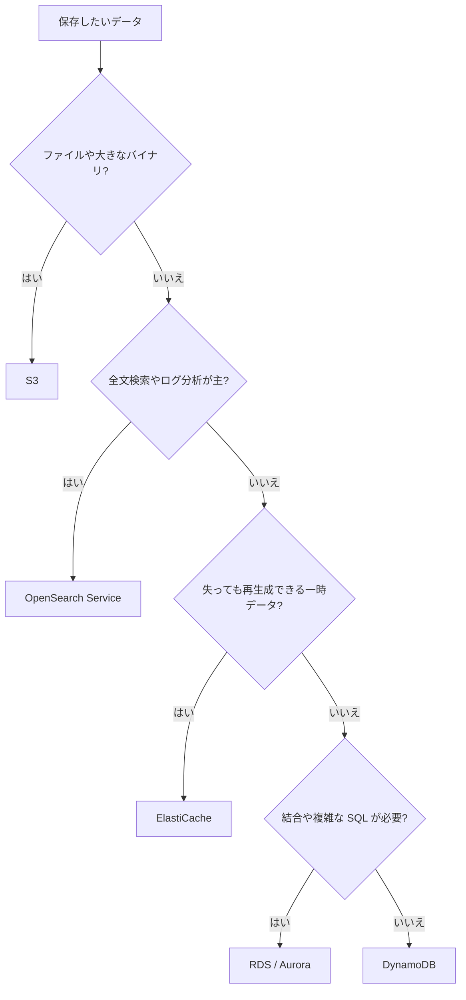
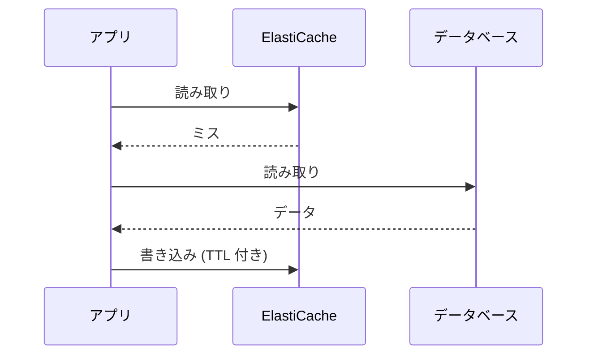

# データベースとキャッシュ

RDS、Aurora、ElastiCache の使い方と、アクセスパターンに合わせたデータストアとキャッシュの選び方をまとめます。DynamoDB 自体の詳細は [DynamoDB](dynamodb.md) を参照してください。

[](../assets/diagrams/databases-cache-layers.png)

## データストアの選び方 {#choosing-data-store}

まずアクセスパターンを確認します。どのキーで読むのか、どの程度の遅延を許すのか、結合やトランザクションが必要か、という点です。

| アクセスパターン | 候補 | 理由 |
| --- | --- | --- |
| キーで引く、遅延を一定にしたい、規模が読めない | [DynamoDB](dynamodb.md) | 規模によらず低レイテンシ。スキーマレス |
| 結合、複雑なクエリ、複数テーブルのトランザクション | RDS、Aurora | リレーショナルモデルと SQL |
| 読み取りが多い SQL ワークロードを高可用で | Aurora | 共有ストレージと最大 15 個のレプリカ |
| マイクロ秒で読みたい、データは再生成できる | ElastiCache | インメモリ |
| DynamoDB の読み取りだけを速くしたい | DAX | DynamoDB 専用でコード変更が少ない |
| 全文検索、ログ分析、柔軟な検索条件 | OpenSearch Service | 検索と分析のエンジン |
| 大きなファイル、静的コンテンツ、アーカイブ | [S3](s3.md) | オブジェクトストレージ |
| ファイルシステムとして共有したい | [EFS](storage.md) | NFS |



### OpenSearch Service {#opensearch}

OpenSearch クラスターを管理してくれるサービスです。AWS ではクラスターのことをドメインと呼びます。

- **向いている用途**: 全文検索、ログ分析、アプリケーションのリアルタイム監視、クリックストリーム分析。
- **データの投入**: S3、Kinesis、Data Firehose、DynamoDB、CloudWatch Logs などと連携できます。
- **よくある構成**: 主データは DynamoDB に置き、Streams と Lambda で OpenSearch に同期して検索だけを任せます。DynamoDB の `Scan` と `FilterExpression` で検索している構成を見たら、この形を検討します。

OpenSearch を主データストアと考えるのではなく、検索用の副データとして扱うのが基本です。

## RDS {#rds}

MySQL、PostgreSQL、MariaDB、Oracle、SQL Server、Db2 を実行するマネージドのリレーショナルデータベースです。

### リードレプリカと Multi-AZ {#read-replicas}

目的が違います。読み取りを増やすならリードレプリカ、可用性を高めるなら Multi-AZ です。

| 観点 | リードレプリカ | Multi-AZ のスタンバイ |
| --- | --- | --- |
| 目的 | 読み取りのスケール | 高可用性 |
| 複製 | 非同期 | 同期 |
| 読み取りに使えるか | 使える | 使えない |
| 接続先 | レプリカのエンドポイントをアプリで指定 | プライマリと同じエンドポイント |
| 自動スケール | なし。手動で作成と削除 | 該当なし |
| 別リージョン | 可能 | 同一リージョン内 |
| 昇格 | スタンドアロンの DB に昇格できる | 障害時に自動フェイルオーバー |

- レプリカは非同期なので、書いた直後の読み取りには古い値が返る可能性があります。整合性が必要な読み取りはプライマリに送ります。
- レポートのような重いクエリをレプリカに逃がすと、本番の負荷を下げられます。
- 両者は併用できます。

## Aurora {#aurora}

MySQL、PostgreSQL 互換のマネージドデータベースです。データは DB インスタンスから独立したクラスターボリュームに保存され、ライターとレプリカが共有します。

| エンドポイント | 接続先 | 用途 |
| --- | --- | --- |
| クラスター(ライター) | 現在のプライマリ | 書き込みと一般的な接続 |
| リーダー | Aurora レプリカ間で接続を分散 | 読み取り |
| カスタム | 指定したインスタンスのグループ | 性能の違うインスタンスの使い分け |
| インスタンス | 特定のインスタンス | 診断、チューニング |
| グローバルデータベースのライター | プライマリリージョンのクラスター | リージョンをまたぐ切り替え |

- レプリカは最大 15 個で、フェイルオーバー先にもなります。
- レプリカの遅延は通常 100 ミリ秒を大きく下回りますが、書き込みが多いと増えます。
- アプリはクラスターとリーダーのエンドポイントを使います。インスタンスのエンドポイントをコードに書くとフェイルオーバーに追従できません。

!!! tip "リーダーエンドポイントの分散"
    リーダーエンドポイントは接続を分散します。分散の単位はクエリではなく接続です。接続プールを使う場合は接続を作り直すタイミングも考慮します。

## 接続プーリングと RDS Proxy {#connection-pooling}

DB への接続の確立は CPU とメモリを消費します。接続を使い回す仕組みが接続プールです。

| 場所 | 実装 | 向く場面 |
| --- | --- | --- |
| アプリ内 | ライブラリのプール | EC2 やコンテナのように長く動くプロセス |
| 外部 | RDS Proxy | Lambda のように同時実行が急に増える構成、多数のアプリからの接続 |

**プールサイズの考え方**: プールの最大接続数 × アプリのインスタンス数が、DB の最大接続数を超えないようにします。Auto Scaling でインスタンスが増えると合計が増える点に注意します。

### RDS Proxy {#rds-proxy}

アプリと DB の間に入り、接続を共有します。

| 機能 | 内容 |
| --- | --- |
| 多重化 | トランザクションが終わるごとに DB 接続を他のクライアントが再利用 |
| 負荷保護 | 接続数を制御し、すぐに処理できない接続は待たせる。上限を超えると拒否 |
| フェイルオーバー | スタンバイへの切り替え時にアプリの接続を保持 |
| 認証 | クライアントは IAM 認証が可能。プロキシから DB へは IAM か Secrets Manager の認証情報 |

制約も押さえます。

- プロキシは DB と同じ VPC に置きます。パブリックアクセスはできません。
- レプリケーション構成の RDS では、関連付けられるのはライターだけです。リードレプリカには付けられません。
- デフォルトエンドポイントは 2 つの AZ に配置されます。

**ピン留め(pinning)**: セッションの状態が変わると、そのクライアント接続は特定の DB 接続に固定され、再利用の効果が下がります。

| エンジン | ピン留めの主な原因 |
| --- | --- |
| 共通 | 16 KB を超えるステートメント |
| MySQL、MariaDB | テーブルロック、`GET_LOCK`、一時テーブル、プリペアドステートメント、一部の変数設定 |
| PostgreSQL | `SET`、`PREPARE`、一時テーブル、カーソル、`LISTEN`、シーケンス操作、セッションレベルのアドバイザリロック |

CloudWatch の `DatabaseConnectionsCurrentlySessionPinned` で発生頻度を確認します。接続ごとに同じ `SET` を実行しているなら、プロキシの初期化クエリに移します。

Lambda では、接続をハンドラの外で作り、実行環境の再利用時に使い回します。

```python
import os
import pymysql

# 実行環境ごとに 1 回だけ実行される
conn = pymysql.connect(
    host=os.environ["PROXY_ENDPOINT"],
    user=os.environ["DB_USER"],
    password=get_password(),
    database="app",
    ssl={"ca": "/opt/global-bundle.pem"},
)

def handler(event, context):
    with conn.cursor() as cur:
        cur.execute("SELECT name FROM users WHERE id = %s", (event["id"],))
        return cur.fetchone()
```

## ElastiCache {#elasticache}

インメモリのキャッシュとデータストアです。運用形態は 2 つあります。

| 形態 | 特徴 |
| --- | --- |
| サーバーレス | 名前を指定するだけで作成でき、容量は自動で調整 |
| ノードベース | ノードタイプ、数、配置を自分で決める。細かい制御が可能 |

### Redis OSS、Valkey と Memcached {#engines}

| 機能 | Valkey / Redis OSS | Memcached |
| --- | --- | --- |
| データ型 | 文字列、ハッシュ、リスト、セット、ソート済みセットなど | シンプルな文字列とオブジェクト |
| レプリケーション、高可用性 | あり | なし |
| 自動フェイルオーバー | あり | なし |
| バックアップと復元 | あり | ノードベースではなし |
| Pub/Sub | あり | なし |
| ソート済みセット(ランキング) | あり | なし |
| 地理空間インデックス | あり | なし |
| マルチスレッド | なし(Valkey 8.0 以降は非同期 I/O スレッドに対応) | あり |
| 向く用途 | ランキング、セッション、高可用性が必要なキャッシュ | シンプルなオブジェクトキャッシュ、大きなマルチコアノード |

クラスターモードを有効にすると、Valkey と Redis OSS はデータをシャードに分割して水平にスケールできます。

!!! tip "選択の目安"
    データ構造、永続性、フェイルオーバーのいずれかが要件にあれば Valkey または Redis OSS。とにかく単純でマルチスレッドの性能が欲しければ Memcached です。

## キャッシュ戦略 {#caching-strategies}



| 戦略 | 動作 | 長所 | 短所 |
| --- | --- | --- | --- |
| 遅延読み込み(レイジーローディング) | ミスしたときだけ DB から読み、キャッシュに入れる | 使うデータだけ入る。ノード障害でも動き続ける | ミス時に 3 回の往復。データが古くなる |
| ライトスルー | DB への書き込みと同時にキャッシュも更新 | 常に最新 | 書き込みが遅くなる。読まれないデータも入る。新しいノードにはデータがない |
| TTL | 一定時間で期限切れにする | 古さの上限を決められる。不要なデータが消える | 期限切れのたびに DB にアクセスが発生 |

実際には組み合わせます。**遅延読み込みとライトスルーの両方を使い、すべての書き込みに TTL を付ける**形が基本です。

```python
import json
import redis

cache = redis.Redis(host=CACHE_ENDPOINT, port=6379, ssl=True)
TTL = 300

def get_user(user_id):
    key = f"user:{user_id}"
    cached = cache.get(key)
    if cached is not None:
        return json.loads(cached)
    user = db_select_user(user_id)
    cache.set(key, json.dumps(user), ex=TTL)
    return user

def save_user(user_id, values):
    user = db_update_user(user_id, values)
    cache.set(f"user:{user_id}", json.dumps(user), ex=TTL)
    return user
```

## DAX、ElastiCache、CloudFront の使い分け {#cache-comparison}

| 観点 | DAX | ElastiCache | CloudFront |
| --- | --- | --- | --- |
| キャッシュする場所 | VPC 内、DynamoDB の前 | VPC 内、アプリの横 | エッジロケーション |
| 対象 | DynamoDB の項目と Query、Scan の結果 | アプリが入れる任意のデータ | HTTP レスポンス |
| アプリの変更 | DAX クライアントへの差し替え | キャッシュのロジックを自分で実装 | 不要(ヘッダーやポリシーの設定) |
| データストア | DynamoDB のみ | RDS、DynamoDB、計算結果など | S3、ALB、API Gateway など |
| 無効化 | TTL、書き込み、LRU | TTL か明示的な削除 | TTL か invalidation |
| 代表的な用途 | DynamoDB の読み取り負荷と遅延の削減 | DB クエリ結果、セッション、ランキング | 静的ファイル、世界中のユーザーへの配信 |

選び方の例を示します。

| 要件 | 選択 |
| --- | --- |
| DynamoDB の読み取りを最小のコード変更で速くしたい | DAX |
| RDS のクエリ結果をキャッシュしたい | ElastiCache |
| 複数の EC2 でセッションを共有したい | ElastiCache |
| ランキングを実装したい | ElastiCache の Valkey / Redis OSS(ソート済みセット) |
| 世界中のユーザーに画像を速く配信したい | CloudFront |
| API の GET レスポンスをエッジでキャッシュしたい | CloudFront |

## アプリケーションレベルのキャッシュ {#application-caching}

キャッシュはアプリの外だけではありません。層ごとに特徴があります。

| 層 | 例 | 適した用途 | 注意点 |
| --- | --- | --- | --- |
| プロセス内 | 変数、LRU キャッシュ、Lambda のハンドラ外の変数 | 設定値、参照データ | インスタンス間で共有されない |
| 共有 | ElastiCache | セッション、クエリ結果 | ネットワーク往復が発生 |
| HTTP | CloudFront、API Gateway | GET レスポンス | キーと無効化の設計が必要 |

```python
import time

_config = None
_loaded_at = 0.0

def get_config():
    global _config, _loaded_at
    if _config is None or time.time() - _loaded_at > 60:
        _config = load_config_from_ssm()
        _loaded_at = time.time()
    return _config
```

設計で考えることは次のとおりです。

- **キーの設計**: テナント ID やユーザー ID など、結果に影響するものをすべてキーに含めます。漏れると他人のデータが返ります。
- **TTL**: データが古くても許される時間から決めます。
- **一斉失効**: 同じ TTL のキーが同時に切れると DB に負荷が集中します。TTL にばらつきを持たせます。
- **障害時**: キャッシュが落ちても DB を読んで動くようにします。ただし DB が受けられる負荷かどうかも確認します。

## マルチテナントのデータアクセス {#multi-tenant}

1 つのアプリで複数の顧客(テナント)を扱う場合の分離方法です。認証と認可だけでは分離になりません。データアクセスの層でもテナントの境界を強制します。

| モデル | 構成 | 長所 | 短所 |
| --- | --- | --- | --- |
| サイロ | テナントごとに専用のリソース | 分離が明確。規制に対応しやすい。ノイジーネイバーがない。障害範囲が狭い | 費用が高い。テナントが増えると運用が複雑 |
| プール | 全テナントでリソースを共有し、テナント ID で区別 | 費用効率と運用効率が高い | ノイジーネイバー、障害範囲の広さ、テナントごとの費用把握が難しい |
| ブリッジ | 一部を共有、一部を専用 | 要件に合わせて配分できる | 構成が複雑になる |

データストアごとの実装例は次のとおりです。

| データストア | サイロ | プール |
| --- | --- | --- |
| DynamoDB | テナントごとのテーブル | パーティションキーに `TENANT#123` を含める。`dynamodb:LeadingKeys` で強制 |
| RDS、Aurora | テナントごとのインスタンスやデータベース | 全テーブルに `tenant_id` 列を持つ。PostgreSQL の行レベルセキュリティ |
| S3 | テナントごとのバケット | プレフィックスで分離し、IAM の条件で制限 |
| ElastiCache | テナントごとのクラスター | キーの先頭にテナント ID |

分離の強制は、個々の開発者の注意に任せず、共通の仕組みにします。よく使われるのは次の方法です。

1. リクエストの JWT からテナント ID を取得します([Cognito](cognito.md) のカスタム属性など)。
2. テナント ID をセッションタグなどに入れて、STS で権限を絞った一時認証情報を取得します([IAM](iam.md))。
3. その認証情報でデータにアクセスします。IAM の条件で他のテナントのキーへのアクセスを拒否できます。

DynamoDB のプールモデルでは、テナント ID をパーティションキーの先頭に置きます。テナントごとのアクセスが自然に分散しますが、大きなテナントがホットキーになる場合はシャーディングを検討します。

## 試験のポイント {#exam-points}

| こう問われたら | 答え |
| --- | --- |
| RDS の読み取り負荷を減らしたい | リードレプリカ、または ElastiCache |
| RDS の可用性を高めたい | Multi-AZ |
| Multi-AZ のスタンバイで読み取れるか | 読めない(インスタンス配置の場合) |
| レプリカから古い値が返る | 非同期複製のため。最新が必須ならプライマリを読む |
| Aurora で読み取りを分散したい | リーダーエンドポイント |
| Lambda から RDS への接続が枯渇する | RDS Proxy |
| RDS Proxy の効果が出ない | ピン留めを確認。`DatabaseConnectionsCurrentlySessionPinned` |
| 全文検索を追加したい | OpenSearch Service |
| キャッシュに古いデータが残る | TTL、またはライトスルー |
| キャッシュが読まれないデータで埋まる | 遅延読み込みと TTL |
| 新しいノードのキャッシュが空でミスが多い | 遅延読み込みとライトスルーを併用 |
| ランキングを作りたい | ソート済みセット(Valkey / Redis OSS) |
| キャッシュに高可用性が必要 | Valkey / Redis OSS の Multi-AZ と自動フェイルオーバー |
| シンプルでマルチスレッドのキャッシュ | Memcached |
| マルチテナントで強い分離が必要、規制がある | サイロモデル |
| マルチテナントで費用効率を優先 | プールモデルと、テナント ID によるアクセス制御 |

## 関連ページ {#related}

- [DynamoDB](dynamodb.md)
- [S3](s3.md)
- [ストレージの選び方](storage.md)
- [Lambda](lambda.md)
- [Secrets Manager と Parameter Store](secrets.md)
- [IAM](iam.md)
- [Cognito](cognito.md)
- [監視](observability.md)

## 参考 {#references}

- [Working with DB instance read replicas](https://docs.aws.amazon.com/AmazonRDS/latest/UserGuide/USER_ReadRepl.html)
- [Amazon Aurora endpoint connections](https://docs.aws.amazon.com/AmazonRDS/latest/AuroraUserGuide/Aurora.Overview.Endpoints.html)
- [Replication with Amazon Aurora](https://docs.aws.amazon.com/AmazonRDS/latest/AuroraUserGuide/Aurora.Replication.html)
- [Amazon RDS Proxy](https://docs.aws.amazon.com/AmazonRDS/latest/UserGuide/rds-proxy.html)
- [Avoiding pinning an RDS Proxy](https://docs.aws.amazon.com/AmazonRDS/latest/UserGuide/rds-proxy-pinning.html)
- [What is Amazon ElastiCache?](https://docs.aws.amazon.com/AmazonElastiCache/latest/dg/WhatIs.html)
- [Comparing node-based Valkey, Memcached, and Redis OSS clusters](https://docs.aws.amazon.com/AmazonElastiCache/latest/dg/SelectEngine.html)
- [Caching strategies](https://docs.aws.amazon.com/AmazonElastiCache/latest/dg/Strategies.html)
- [What is Amazon OpenSearch Service?](https://docs.aws.amazon.com/opensearch-service/latest/developerguide/what-is.html)
- [DAX: How it works](https://docs.aws.amazon.com/amazondynamodb/latest/developerguide/DAX.concepts.html)
- [SaaS Tenant Isolation Strategies: The isolation mindset](https://docs.aws.amazon.com/whitepapers/latest/saas-tenant-isolation-strategies/the-isolation-mindset.html)
- [SaaS Tenant Isolation Strategies: Silo isolation](https://docs.aws.amazon.com/whitepapers/latest/saas-tenant-isolation-strategies/silo-isolation.html)
- [SaaS Tenant Isolation Strategies: Pool isolation](https://docs.aws.amazon.com/whitepapers/latest/saas-tenant-isolation-strategies/pool-isolation.html)
