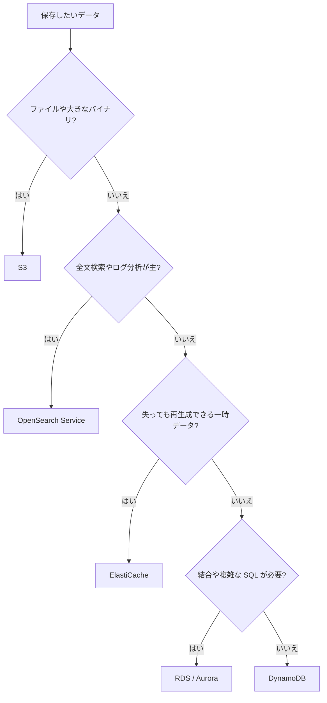
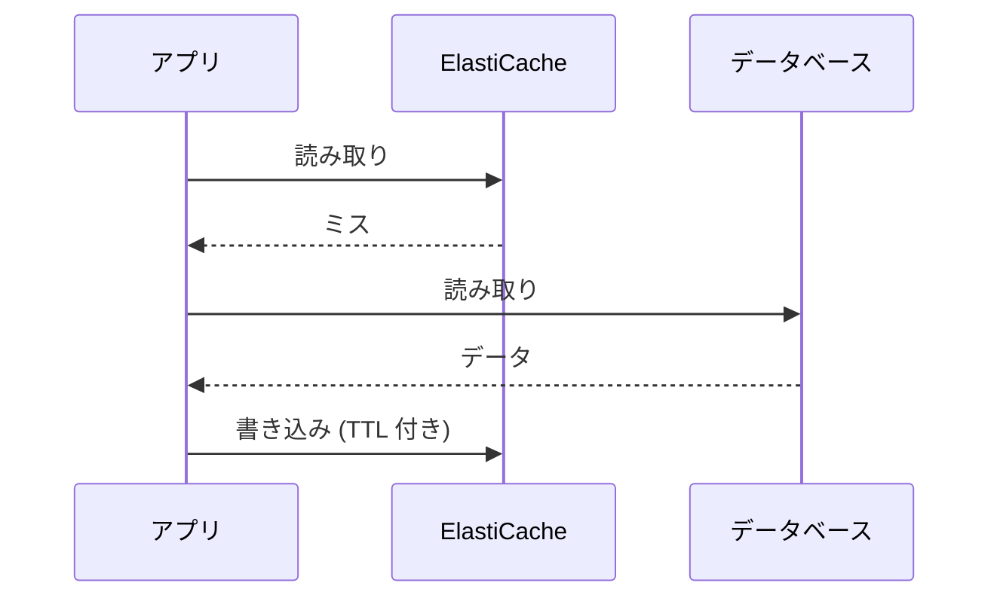

# データベースとキャッシュ

[:material-sprout: CLF](../courses/clf/services.md){ .exam-badge .exam-foundational } [:material-sprout: AIF](../courses/aif/services.md){ .exam-badge .exam-foundational } [:material-certificate: SAA](../courses/saa/services.md){ .exam-badge .exam-associate } [:material-certificate: DVA](../courses/dva/services.md){ .exam-badge .exam-associate } [:material-certificate: SOA](../courses/soa/services.md){ .exam-badge .exam-associate } [:material-certificate: DEA](../courses/dea/services.md){ .exam-badge .exam-associate } [:material-certificate: MLA](../courses/mla/services.md){ .exam-badge .exam-associate } [:material-star-circle: SAP](../courses/sap/services.md){ .exam-badge .exam-professional } [:material-star-circle: DOP](../courses/dop/services.md){ .exam-badge .exam-professional } [:material-star-circle: AIP](../courses/aip/services.md){ .exam-badge .exam-professional }

RDS、Aurora、ElastiCache の使い方と、アクセスパターンに合わせたデータストアとキャッシュの選び方をまとめます。DynamoDB 自体の詳細は [DynamoDB](dynamodb.md) を参照してください。

[](../assets/diagrams/databases-cache-layers.png)

## データストアの選び方 {#choosing-data-store}

まずアクセスパターンを確認します。どのキーで読むのか、どの程度の遅延を許すのか、結合やトランザクションが必要か、という点です。

| アクセスパターン | 候補 | 理由 |
| --- | --- | --- |
| キーで引く、遅延を一定にしたい、規模が読めない | [DynamoDB](dynamodb.md) | 規模によらず低レイテンシ。スキーマレス |
| 結合、複雑なクエリ、複数テーブルのトランザクション | RDS、Aurora | リレーショナルモデルと SQL |
| 読み取りが多い SQL ワークロードを高可用で | Aurora | 共有ストレージと最大 15 個のレプリカ |
| マイクロ秒で読みたい、データは再生成できる | ElastiCache | インメモリ |
| DynamoDB の読み取りだけを速くしたい | DAX | DynamoDB 専用でコード変更が少ない |
| 全文検索、ログ分析、柔軟な検索条件 | OpenSearch Service | 検索と分析のエンジン |
| 大きなファイル、静的コンテンツ、アーカイブ | [S3](s3.md) | オブジェクトストレージ |
| ファイルシステムとして共有したい | [EFS](storage.md) | NFS |



**選び方の例**:

- 商品 500 万件を商品 ID で引き、毎秒 2 万件まで増える可能性があるなら DynamoDB です。
- 「注文、顧客、商品を結合して月次の売上を出す」なら RDS か Aurora です。
- 集計済みのランキングを毎秒 5 万回読み、消えても計算し直せるなら ElastiCache です。
- 1 件 2 GB の動画なら S3 です。DynamoDB の項目は 400 KB までなので入りません。

### OpenSearch Service {#opensearch}

OpenSearch クラスターを管理してくれるサービスです。AWS ではクラスターのことをドメインと呼びます。

**提供単位**: ドメインはリージョン単位で、ノードは 2 つか 3 つの AZ に分けられます。VPC の中に置くか、パブリックエンドポイントにするかを選べます。

- **向いている用途**: 全文検索、ログ分析、アプリケーションのリアルタイム監視、クリックストリーム分析。
- **データの投入**: S3、Kinesis、Data Firehose、DynamoDB、CloudWatch Logs などと連携できます。
- **よくある構成**: 主データは DynamoDB に置き、Streams と Lambda で OpenSearch に同期して検索だけを任せます。DynamoDB の `Scan` と `FilterExpression` で検索している構成を見たら、この形を検討します。

OpenSearch を主データストアと考えるのではなく、検索用の副データとして扱うのが基本です。

**計算の例**: 1 KB の商品 100 万件を、DynamoDB の `Scan` と `contains(name, :q)` で検索します。1,000,000 KB ÷ 4 KB × 0.5 で、検索 1 回に 125,000 RCU かかります。OpenSearch へ同期すれば、この読み取りは DynamoDB から消えます。

**誤ると**: Streams からの同期処理が失敗したまま放置すると、検索結果とテーブルの内容がずれます。Streams の保持は 24 時間なので、それを超えると再同期が必要です。

## RDS {#rds}

[:material-sprout: CLF](../courses/clf/services.md){ .exam-badge .exam-foundational } [:material-sprout: AIF](../courses/aif/services.md){ .exam-badge .exam-foundational } [:material-certificate: SAA](../courses/saa/services.md){ .exam-badge .exam-associate } [:material-certificate: DVA](../courses/dva/services.md){ .exam-badge .exam-associate } [:material-certificate: SOA](../courses/soa/services.md){ .exam-badge .exam-associate } [:material-certificate: DEA](../courses/dea/services.md){ .exam-badge .exam-associate } [:material-certificate: MLA](../courses/mla/services.md){ .exam-badge .exam-associate } [:material-star-circle: SAP](../courses/sap/services.md){ .exam-badge .exam-professional } [:material-star-circle: DOP](../courses/dop/services.md){ .exam-badge .exam-professional } [:material-star-circle: AIP](../courses/aip/services.md){ .exam-badge .exam-professional }

MySQL、PostgreSQL、MariaDB、Oracle、SQL Server、Db2 を実行するマネージドのリレーショナルデータベースです。

**提供単位**: DB インスタンスは AZ 単位で、DB サブネットグループを通じて VPC の中に置きます。Multi-AZ はスタンバイを別の AZ に置きます([リソースの提供単位](resource-scope.md#scope-zonal))。

**保存時の暗号化**: 未暗号化の DB インスタンスは、ブルー/グリーンデプロイの作成時に `TargetKmsKeyId` を指定して暗号化されたグリーン環境を作り、切り替えることで暗号化できます。

### リードレプリカと Multi-AZ {#read-replicas}

目的が違います。読み取りを増やすならリードレプリカ、可用性を高めるなら Multi-AZ です。

| 観点 | リードレプリカ | Multi-AZ のスタンバイ |
| --- | --- | --- |
| 目的 | 読み取りのスケール | 高可用性 |
| 複製 | 非同期 | 同期 |
| 読み取りに使えるか | 使える | 使えない |
| 接続先 | レプリカのエンドポイントをアプリで指定 | プライマリと同じエンドポイント |
| 自動スケール | なし。手動で作成と削除 | 該当なし |
| 別リージョン | 可能 | 同一リージョン内 |
| 昇格 | スタンドアロンの DB に昇格できる | 障害時に自動フェイルオーバー |

- レプリカは非同期なので、書いた直後の読み取りには古い値が返る可能性があります。整合性が必要な読み取りはプライマリに送ります。
- レポートのような重いクエリをレプリカに逃がすと、本番の負荷を下げられます。
- 両者は併用できます。

Multi-AZ には 2 つの形態があります。「スタンバイは読めない」のは DB インスタンス配置のほうだけです。

| 観点 | Multi-AZ DB インスタンス | Multi-AZ DB クラスター |
| --- | --- | --- |
| 構成 | プライマリ 1 + スタンバイ 1 | ライター 1 + 読み取り可能なリーダー 2(3 つの AZ) |
| 複製 | 同期 | 準同期 |
| スタンバイ、リーダーの読み取り | 不可 | 可 |

| 設定 | 値 | 動作と落とし穴 |
| --- | --- | --- |
| フェイルオーバーの時間 | 通常 60〜120 秒 | DNS がスタンバイに切り替わる。接続は作り直す |
| JVM の DNS キャッシュ | TTL を 60 秒以下に推奨 | 長いと古い IP に接続し続ける |
| レプリカの数 | 1 つのインスタンスから同一リージョンに最大 15 個 | Auto Scaling はない |
| レプリカの前提 | 自動バックアップの有効化 | バックアップ保持期間が 0 だと作成できない |
| 遅延の監視 | `ReplicaLag` | 古い値が返る原因を確認する |
| 書き込みの遅延 | Multi-AZ は同期複製のぶん増えることがある | シングル AZ より遅いことがある |

**例**: 毎朝のレポートで本番が重いなら、リードレプリカを作りレポートをそちらに向けます。アプリの接続先を指定し直す必要があります。Multi-AZ に変更しても、読み取りの負荷は減りません。

```bash
aws rds create-db-instance-read-replica \
  --db-instance-identifier app-report \
  --source-db-instance-identifier app
aws rds modify-db-instance --db-instance-identifier app --multi-az --apply-immediately
```

設定ごとの値の例です。

- **`ReplicaLag`**: 30 なら、レプリカは約 30 秒前の状態です。注文の直後にレプリカを読むと、その注文がまだ見えません。
- **バックアップの保持**: `--backup-retention-period 0` のインスタンスでは、レプリカの作成に失敗します。1 以上にしてから作ります。
- **JVM の DNS キャッシュ**: `networkaddress.cache.ttl=60` にします。**誤ると**: 無期限にキャッシュすると、フェイルオーバーの後も古い IP に接続して失敗し続けます。
- **フェイルオーバー**: 60〜120 秒の間、書き込みは失敗します。アプリは再接続と再試行を入れます。**誤ると**: 接続プールが壊れた接続を持ち続け、DB は復旧したのにエラーが続きます。
- **Multi-AZ の形態**: DB クラスターならリーダー 2 台を読めるので、1 台のライターと 2 台の読み取りを同じ構成で賄えます。DB インスタンス配置では、スタンバイに接続できません。

### IAM データベース認証 {#rds-iam-auth}

パスワードの代わりに、AWS 署名バージョン 4 で作る認証トークンで接続します。MariaDB、MySQL、PostgreSQL で使えます。

| 項目 | 内容 |
| --- | --- |
| 有効化 | DB の設定で有効にする(`--enable-iam-database-authentication`) |
| トークンの寿命 | 15 分。接続の確立にだけ使い、既存の接続は切れない |
| 必要な権限 | `rds-db:connect`。`rds:` ではない |
| リソース | `arn:aws:rds-db:リージョン:アカウント:dbuser:リソース ID/DB ユーザー名` |
| DB 側のユーザー | MySQL は `AWSAuthenticationPlugin`、PostgreSQL は `rds_iam` ロール |
| 通信 | SSL/TLS を使う |

```bash
TOKEN=$(aws rds generate-db-auth-token \
  --hostname mydb.example.ap-northeast-1.rds.amazonaws.com \
  --port 3306 --username app_user --region ap-northeast-1)
mysql -h mydb.example.ap-northeast-1.rds.amazonaws.com -u app_user \
  --enable-cleartext-plugin --ssl-ca=global-bundle.pem --password="$TOKEN"
```

**落とし穴**:

- Route 53 のカスタム DNS 名でトークンを作ることはできません。DB のエンドポイントを使います。
- PostgreSQL では `rds_iam` を付けたユーザーは、パスワードで入れなくなります。
- CloudWatch と CloudTrail は IAM 認証を記録しません。

**トークンの寿命の例**: 10 時 00 分に作ったトークンで 10 時 14 分に接続すると成功し、その接続は 10 時 15 分を過ぎても使えます。10 時 16 分に同じトークンで新しい接続を開くと失敗します。接続ごとにトークンを作り直します。

**権限と DB ユーザーの例**:

```json
{
  "Effect": "Allow",
  "Action": "rds-db:connect",
  "Resource": "arn:aws:rds-db:ap-northeast-1:111122223333:dbuser:db-ABCDEFGHIJKL01234/app_user"
}
```

```sql
-- MySQL
CREATE USER app_user IDENTIFIED WITH AWSAuthenticationPlugin AS 'RDS';
-- PostgreSQL
CREATE USER app_user;
GRANT rds_iam TO app_user;
```

**誤ると**: `Action` を `rds:Connect` と書いたり、リソースに DB 識別子の `app` を書いたりすると、接続が拒否されます。必要なのはリソース ID(`db-` で始まる値)です。

### Secrets Manager との統合 {#rds-secrets-manager}

`--manage-master-user-password` を指定すると、RDS がマスターユーザーのパスワードを生成し、Secrets Manager で管理します。

| 項目 | 内容 |
| --- | --- |
| ローテーション | デフォルトで 7 日ごと。スケジュールは変更できる |
| 暗号化 | `aws/secretsmanager` かカスタマーマネージドキー(`MasterUserSecretKmsKeyId`)。管理を始めた後はキーを変更できない |
| DB の削除 | シークレットも削除される |
| 取得 | アプリは `GetSecretValue` で読む |

**例**: Lambda の環境変数にパスワードを書く代わりに、シークレットを読むようにします。ローテーションで値が変わるので、長時間キャッシュすると認証エラーになります。ローテーションの詳細は [Secrets Manager と Parameter Store](secrets.md) を参照してください。

```bash
aws rds modify-db-instance --db-instance-identifier app \
  --manage-master-user-password \
  --master-user-secret-kms-key-id alias/rds-secrets \
  --apply-immediately
```

**例**: 既定の 7 日ごとのローテーションで、アプリがパスワードを 30 日キャッシュすると、更新の後に新しい接続が認証エラーになります。認証エラーのときにシークレットを読み直すか、キャッシュを 1 時間程度にします。

### SSL/TLS {#rds-ssl}

| エンジン | 強制する設定 | デフォルト |
| --- | --- | --- |
| PostgreSQL | パラメータ `rds.force_ssl=1` | バージョン 15 以降は 1(有効)。それより前は 0 |
| MySQL | パラメータ `require_secure_transport=ON` | 無効 |

設定はカスタムのパラメータグループで変えます。PostgreSQL で強制を有効にすると、SSL を使わない接続は拒否されます。

クライアントは AWS の CA バンドル(`global-bundle.pem`)でサーバーを検証します。PostgreSQL の `sslmode=verify-full` はサーバー証明書とホスト名の両方を確認します。

```bash
psql "host=mydb.example.ap-northeast-1.rds.amazonaws.com dbname=app user=app_user \
  sslmode=verify-full sslrootcert=global-bundle.pem"
```

**例**: `rds.force_ssl=1` の PostgreSQL に `sslmode=disable` で接続すると拒否されます。`sslmode=require` なら暗号化はされますが、証明書を検証しないので接続先のなりすましは防げません。

**誤ると**: Route 53 の別名で接続して `verify-full` を使うと、証明書のホスト名と一致せず失敗します。

## Aurora {#aurora}

[:material-sprout: CLF](../courses/clf/services.md){ .exam-badge .exam-foundational } [:material-sprout: AIF](../courses/aif/services.md){ .exam-badge .exam-foundational } [:material-certificate: SAA](../courses/saa/services.md){ .exam-badge .exam-associate } [:material-certificate: DVA](../courses/dva/services.md){ .exam-badge .exam-associate } [:material-certificate: SOA](../courses/soa/services.md){ .exam-badge .exam-associate } [:material-certificate: DEA](../courses/dea/services.md){ .exam-badge .exam-associate } [:material-star-circle: SAP](../courses/sap/services.md){ .exam-badge .exam-professional } [:material-star-circle: DOP](../courses/dop/services.md){ .exam-badge .exam-professional } [:material-star-circle: AIP](../courses/aip/services.md){ .exam-badge .exam-professional }

MySQL、PostgreSQL 互換のマネージドデータベースです。データは DB インスタンスから独立したクラスターボリュームに保存され、ライターとレプリカが共有します。

**提供単位**: クラスターはリージョン単位で、ストレージは複数の AZ にまたがります。インスタンスは AZ 単位で、DB サブネットグループを通じて VPC の中に置きます([リソースの提供単位](resource-scope.md#scope-regional-vpc))。

| エンドポイント | 接続先 | 用途 |
| --- | --- | --- |
| クラスター(ライター) | 現在のプライマリ | 書き込みと一般的な接続 |
| リーダー | Aurora レプリカ間で接続を分散 | 読み取り |
| カスタム | 指定したインスタンスのグループ | 性能の違うインスタンスの使い分け |
| インスタンス | 特定のインスタンス | 診断、チューニング |
| グローバルデータベースのライター | プライマリリージョンのクラスター | リージョンをまたぐ切り替え |

- レプリカは最大 15 個で、フェイルオーバー先にもなります。
- レプリカの遅延は通常 100 ミリ秒を大きく下回りますが、書き込みが多いと増えます。
- アプリはクラスターとリーダーのエンドポイントを使います。インスタンスのエンドポイントをコードに書くとフェイルオーバーに追従できません。

!!! tip "リーダーエンドポイントの分散"
    リーダーエンドポイントは接続を分散します。分散の単位はクエリではなく接続です。接続プールを使う場合は接続を作り直すタイミングも考慮します。

**例**: アプリの書き込みは `app.cluster-xxxx.ap-northeast-1.rds.amazonaws.com`、読み取りは `app.cluster-ro-xxxx.ap-northeast-1.rds.amazonaws.com` に接続します。

**誤ると**: レプリカを 2 台から 4 台に増やしても、既存の接続プールは前の 2 台に接続したままです。新しい接続が作られるまで、増やした 2 台に負荷が移りません。

### エンドポイントの動作 {#aurora-endpoints}

| エンドポイント | 細かい動作 |
| --- | --- |
| クラスター | 書き込みができる唯一のエンドポイント。フェイルオーバーで指す先が変わる |
| リーダー | レプリカがなければプライマリに接続する。この場合は書き込みも通る |
| カスタム | 1 クラスターに最大 5 個。最初は 1 つもない。自分でインスタンスを選ぶ |

**例**: レポート用に大きなインスタンス 2 台、Web 用に小さなインスタンス 3 台がある場合、カスタムエンドポイントを 2 つ作ります。リーダーエンドポイントでは、レポートが小さなインスタンスに当たることがあります。

**落とし穴**: カスタムエンドポイントの中のインスタンスは性能をそろえます。接続がどれに行くか選べないからです。

### 昇格の優先度 {#aurora-failover-priority}

レプリカには 0(最優先)から 15(最低)の優先度を付けます。同じ優先度なら、サイズの大きいレプリカが昇格します。レプリカがないとインスタンスを作り直すので、復旧に時間がかかります。

データは 3 つの AZ にまたがる 6 つのストレージノードに同期して書き込まれます。

**例**: 次の構成でライターが落ちると、`r2` が昇格します。優先度 0 の 2 台のうち、サイズが大きいからです。

| レプリカ | 優先度 | サイズ |
| --- | --- | --- |
| `r1` | 0 | `db.r6g.large` |
| `r2` | 0 | `db.r6g.xlarge` |
| `r3` | 15 | `db.r6g.4xlarge` |

`r3` はレポート用なので、優先度を 15 にして昇格の候補の後ろへ回します。

```bash
aws rds modify-db-instance --db-instance-identifier r3 --promotion-tier 15
```

**誤ると**: ライターより小さい `db.r6g.large` だけを優先度 0 にすると、そのインスタンスが昇格して、書き込みの性能が足りなくなることがあります。レプリカがあれば復旧は通常 60 秒未満ですが、レプリカがないとインスタンスの作り直しになり、より長く止まります。

### Aurora Serverless v2 {#aurora-serverless-v2}

[:material-certificate: SAA](../courses/saa/services.md){ .exam-badge .exam-associate } [:material-certificate: SOA](../courses/soa/services.md){ .exam-badge .exam-associate } [:material-star-circle: DOP](../courses/dop/services.md){ .exam-badge .exam-professional }

容量を ACU という単位で自動調整します。1 ACU は約 2 GiB のメモリと、対応する CPU とネットワークです。

| 設定 | 値 | 動作 |
| --- | --- | --- |
| `MinCapacity` | 0 以上(0 は自動一時停止対応のバージョンのみ) | アイドル時の費用を決める。インスタンス数 × 最小 ACU が目安 |
| `MaxCapacity` | Aurora MySQL は最大 256、Aurora PostgreSQL は最大 384(エンジンのバージョンで異なる) | ピークの上限 |
| `SecondsUntilAutoPause` | 300〜86,400 秒、デフォルト 300 | 最小 0 のとき、接続がないまま経過すると一時停止する |
| スケーリング単位 | 0.5 ACU | インスタンスの追加なしで増減する |

```bash
aws rds modify-db-cluster --db-cluster-identifier my-cluster \
  --serverless-v2-scaling-configuration \
  MinCapacity=0,MaxCapacity=8,SecondsUntilAutoPause=600
```

**例**: 開発環境は夜間に接続がないので `MinCapacity=0` にします。朝の最初の接続は再開を待つため遅くなります。本番の Web アプリで同じ設定にすると、最初のリクエストがタイムアウトすることがあります。

**計算の例**:

- `MaxCapacity=8` は 8 × 2 GiB で約 16 GiB のメモリが上限です。
- ライターとリーダーの 2 台で `MinCapacity=2` なら、アイドルでも 2 × 2 で 4 ACU 分の課金が続きます。
- `SecondsUntilAutoPause=600` なら、接続がないまま 10 分で一時停止します。

**再開の例**: 再開は通常約 15 秒です。JDBC の `connectTimeout` が 5 秒だと、再開を待てずに接続が失敗します。15 秒より長くします。24 時間を超えて止まっていると、さらに時間がかかることがあります。

**誤ると**: `MinCapacity` を 0.5 のように小さくすると、バッファプールのキャッシュも小さくなり、負荷が来た直後の遅延が増えます。`MaxCapacity` が小さいと、ピークに CPU とメモリが張り付きます。優先度 0 と 1 のリーダーはライターと一緒に一時停止するので、リーダーに接続が残っていると全体が止まりません。

### Aurora グローバルデータベース {#aurora-global-database}

1 つのプライマリリージョンと、最大 10 の読み取り専用セカンダリリージョンで構成します。

**提供単位**: 複数のリージョンのクラスターをまとめる機能です。各クラスターは、それぞれのリージョンの VPC の中に置きます。

| 項目 | 内容 |
| --- | --- |
| 書き込み | プライマリのクラスターのみ。グローバルデータベースのライターエンドポイントで接続する |
| セカンダリの読み取り | 最大 16 個の読み取り専用インスタンス |
| 書き込み転送 | 有効にするとセカンダリに来た書き込みをプライマリに転送する |
| 切り替え(計画) | スイッチオーバー。リージョンのローテーションなどに使う |
| 切り替え(障害) | フェイルオーバー。プライマリのリージョン障害時に使う |
| 前提 | マネージドの切り替えには、同じメジャーとマイナーのエンジンバージョンが必要 |

DynamoDB のグローバルテーブルと違い、どのリージョンにも書き込めるわけではありません。

**例**: 東京をプライマリ、バージニアをセカンダリにします。米国のユーザーの読み取りはバージニアの読み取りインスタンスへ、書き込みはグローバルデータベースのライターエンドポイントへ送ります。書き込み転送を有効にすれば、バージニアへ来た `UPDATE` は東京に転送されます。

**例**: 年 2 回のリージョン切り替えの訓練はスイッチオーバーで行い、データを失いません。東京の障害ではフェイルオーバーを使い、未複製の分を失う可能性があります。

**誤ると**: 東京とバージニアのマイナーバージョンが違うと、マネージドの切り替えを実行できません。セカンダリのバージョンを先にそろえます。

## 接続プーリングと RDS Proxy {#connection-pooling}

DB への接続の確立は CPU とメモリを消費します。接続を使い回す仕組みが接続プールです。

| 場所 | 実装 | 向く場面 |
| --- | --- | --- |
| アプリ内 | ライブラリのプール | EC2 やコンテナのように長く動くプロセス |
| 外部 | RDS Proxy | Lambda のように同時実行が急に増える構成、多数のアプリからの接続 |

**プールサイズの考え方**: プールの最大接続数 × アプリのインスタンス数が、DB の最大接続数を超えないようにします。Auto Scaling でインスタンスが増えると合計が増える点に注意します。

**計算の例**: `max_connections` が 1,000 の DB に、プール 20 接続のコンテナが 30 台なら、20 × 30 で 600 接続です。Auto Scaling で 60 台になると 1,200 接続になり、DB の上限を超えます。プールを 15 に下げると、15 × 60 で 900 接続に収まります。

**誤ると**: ピーク時にだけ `Too many connections` が出て、新しいコンテナの起動やヘルスチェックに失敗します。

### RDS Proxy {#rds-proxy}

[:material-certificate: SOA](../courses/soa/services.md){ .exam-badge .exam-associate }

アプリと DB の間に入り、接続を共有します。

**提供単位**: プロキシはリージョン単位で、DB と同じ VPC の中に置きます。既定のエンドポイントは 2 つの AZ に配置されます。

**例**: Lambda の同時実行が 1,000 に増えると、関数ごとに 1 接続で 1,000 接続を開こうとします。`max_connections` が 500 の DB では枯渇します。RDS Proxy を挟めば、クライアントが 1,000 でも、DB 側はトランザクションの間だけ接続を使います。

| 機能 | 内容 |
| --- | --- |
| 多重化 | トランザクションが終わるごとに DB 接続を他のクライアントが再利用 |
| 負荷保護 | 接続数を制御し、すぐに処理できない接続は待たせる。上限を超えると拒否 |
| フェイルオーバー | スタンバイへの切り替え時にアプリの接続を保持 |
| 認証 | クライアントは IAM 認証が可能。プロキシから DB へは IAM か Secrets Manager の認証情報 |

制約も押さえます。

- プロキシは DB と同じ VPC に置きます。パブリックアクセスはできません。
- レプリケーション構成の RDS では、関連付けられるのはライターだけです。リードレプリカには付けられません。
- デフォルトエンドポイントは 2 つの AZ に配置されます。

**ピン留め(pinning)**: セッションの状態が変わると、そのクライアント接続は特定の DB 接続に固定され、再利用の効果が下がります。

| エンジン | ピン留めの主な原因 |
| --- | --- |
| 共通 | 16 KB を超えるステートメント |
| MySQL、MariaDB | テーブルロック、`GET_LOCK`、一時テーブル、プリペアドステートメント、一部の変数設定 |
| PostgreSQL | `SET`、`PREPARE`、一時テーブル、カーソル、`LISTEN`、シーケンス操作、セッションレベルのアドバイザリロック |

CloudWatch の `DatabaseConnectionsCurrentlySessionPinned` で発生頻度を確認します。接続ごとに同じ `SET` を実行しているなら、プロキシの初期化クエリに移します。

**例**: PostgreSQL のアプリが接続のたびに `SET TIME ZONE 'Asia/Tokyo'` を実行すると、200 のクライアント接続が 200 の DB 接続に固定され、多重化が効きません。この `SET` を `InitQuery` に移します。MySQL の `time_zone` は RDS Proxy が追跡する変数なので固定されず、同じ値の接続だけが再利用されます。20 KB の `INSERT` も 16 KB を超えるのでピン留めになります。文を分割します。

### RDS Proxy の設定 {#rds-proxy-settings}

| 設定 | デフォルト | 範囲 | 動作 |
| --- | --- | --- | --- |
| `MaxConnectionsPercent` | 100(SQL Server は 10) | 1〜100 | DB の `max_connections` に対する、プールの上限の割合 |
| `MaxIdleConnectionsPercent` | `MaxConnectionsPercent` の半分 | 0〜`MaxConnectionsPercent` | アイドル接続を残す割合。低いほど早く閉じる |
| `ConnectionBorrowTimeout` | 120 秒 | 0〜300 秒 | 空き接続を待つ時間。超えるとタイムアウトエラー |
| `IdleClientTimeout` | 1,800 秒(30 分) | - | アイドルのクライアント接続を閉じるまでの時間 |
| `InitQuery` | なし | - | 新しい DB 接続を開くときに実行する SQL。パスワードなどは書かない |
| `SessionPinningFilters` | なし | `EXCLUDE_VARIABLE_SETS` | 変数の `SET` によるピン留めを除外する。別の接続に変数が影響するおそれがある。PostgreSQL は非対応 |
| `RequireTLS` | - | true / false | クライアント接続に TLS を強制する |
| `DefaultAuthScheme` | `NONE` | `NONE`、`IAM_AUTH` | `IAM_AUTH` はプロキシから DB まで IAM で認証する |
| `DebugLogging` | - | true / false | 詳細ログ。費用と性能に影響するので常用しない |

**例**: `max_connections` が 1,000 の DB に、同じ DB を使うプロキシを 2 つ付けるなら、`MaxConnectionsPercent` をそれぞれ 40 にして、合計 800 接続にします。残りを管理者とほかの接続に残します。

```bash
aws rds modify-db-proxy-target-group --target-group-name default \
  --db-proxy-name app-proxy \
  --connection-pool-config \
  MaxConnectionsPercent=40,MaxIdleConnectionsPercent=5,ConnectionBorrowTimeout=5
```

設定ごとの値の例です。

- **`MaxIdleConnectionsPercent`**: 上の設定なら、1,000 × 5% で 50 接続までをアイドルで残します。指定しなければ 40 の半分の 20% で、200 接続です。夜間に DB の接続を減らしたいなら低くします。
- **`ConnectionBorrowTimeout`**: 5 秒なら、空きがなければ 5 秒でエラーを返します。既定の 120 秒のまま Lambda のタイムアウトが 30 秒だと、関数が先にタイムアウトしてエラーの原因が見えません。
- **`IdleClientTimeout`**: 300 なら、5 分使わないクライアント接続を閉じます。アプリのプールが接続を長く持つ設計なら、切られた接続でエラーになるので、プロキシより短い時間でアプリ側が閉じるようにします。
- **`InitQuery`**: `SET time_zone = '+09:00'` です。
- **`SessionPinningFilters`**: `EXCLUDE_VARIABLE_SETS` にすると、`SET` があっても接続を固定しません。**誤ると**: クライアント A の `SET` が同じ DB 接続を使うクライアント B に影響します。
- **`RequireTLS`**: `true` なら、TLS なしのクライアントは接続できません。
- **`DefaultAuthScheme`**: `IAM_AUTH` なら Secrets Manager のシークレットなしで DB まで IAM で認証します。
- **`DebugLogging`**: 問題の調査中だけ `true` にして、終わったら `false` に戻します。

**症状と対処**:

| 症状 | 原因と対処 |
| --- | --- |
| `Timed-out waiting to acquire database connection` | `ConnectionBorrowTimeout` 内に接続を取れない。ピン留めや長いトランザクションを確認し、`MaxConnectionsPercent` や DB の容量を増やす |
| `MaxDatabaseConnectionsAllowed` に張り付く | プールの上限に達している |
| 効果が出ない | ピン留めを確認する |

CloudFormation や CLI では、接続設定はターゲットグループ `default` に付きます。プロキシを作ると自動で作られます。

Secrets Manager で認証する場合は、プロキシの IAM ロールにシークレットの読み取りを許可します。ロールがシークレットを読めないと、プロキシは DB に接続できません。

IAM 認証については、プロキシに接続するアプリの権限は `rds-db:connect` です。

Lambda では、接続をハンドラの外で作り、実行環境の再利用時に使い回します。

```python
import os
import pymysql

# 実行環境ごとに 1 回だけ実行される
conn = pymysql.connect(
    host=os.environ["PROXY_ENDPOINT"],
    user=os.environ["DB_USER"],
    password=get_password(),
    database="app",
    ssl={"ca": "/opt/global-bundle.pem"},
)

def handler(event, context):
    with conn.cursor() as cur:
        cur.execute("SELECT name FROM users WHERE id = %s", (event["id"],))
        return cur.fetchone()
```

## ElastiCache {#elasticache}

[:material-sprout: CLF](../courses/clf/services.md){ .exam-badge .exam-foundational } [:material-sprout: AIF](../courses/aif/services.md){ .exam-badge .exam-foundational } [:material-certificate: SAA](../courses/saa/services.md){ .exam-badge .exam-associate } [:material-certificate: DVA](../courses/dva/services.md){ .exam-badge .exam-associate } [:material-certificate: SOA](../courses/soa/services.md){ .exam-badge .exam-associate } [:material-certificate: MLA](../courses/mla/services.md){ .exam-badge .exam-associate } [:material-star-circle: SAP](../courses/sap/services.md){ .exam-badge .exam-professional } [:material-star-circle: DOP](../courses/dop/services.md){ .exam-badge .exam-professional } [:material-star-circle: AIP](../courses/aip/services.md){ .exam-badge .exam-professional }

インメモリのキャッシュとデータストアです。運用形態は 2 つあります。

**提供単位**: ノードベースのノードは AZ 単位で、サブネットグループを通じて VPC の中に置きます。レプリカを別の AZ に置いて冗長化します([リソースの提供単位](resource-scope.md#scope-zonal))。

| 形態 | 特徴 |
| --- | --- |
| サーバーレス | 名前を指定するだけで作成でき、容量は自動で調整 |
| ノードベース | ノードタイプ、数、配置を自分で決める。細かい制御が可能 |

**例**: 負荷の増減が読めない新しいサービスならサーバーレスで始めます。パラメータグループで `maxmemory-policy` を調整したい、ノードタイプを固定して費用を見積もりたいならノードベースです。

### Redis OSS、Valkey と Memcached {#engines}

| 機能 | Valkey / Redis OSS | Memcached |
| --- | --- | --- |
| データ型 | 文字列、ハッシュ、リスト、セット、ソート済みセットなど | シンプルな文字列とオブジェクト |
| レプリケーション、高可用性 | あり | なし |
| 自動フェイルオーバー | あり | なし |
| バックアップと復元 | あり | ノードベースではなし |
| Pub/Sub | あり | なし |
| ソート済みセット(ランキング) | あり | なし |
| 地理空間インデックス | あり | なし |
| マルチスレッド | なし(Valkey 8.0 以降は非同期 I/O スレッドに対応) | あり |
| 向く用途 | ランキング、セッション、高可用性が必要なキャッシュ | シンプルなオブジェクトキャッシュ、大きなマルチコアノード |

クラスターモードを有効にすると、Valkey と Redis OSS はデータをシャードに分割して水平にスケールできます。

!!! tip "選択の目安"
    データ構造、永続性、フェイルオーバーのいずれかが要件にあれば Valkey または Redis OSS。とにかく単純でマルチスレッドの性能が欲しければ Memcached です。

一度作ったキャッシュのエンジンバージョンは、上げることはできますが、下げることはできません。

**例**: ゲームのランキングはソート済みセットで作ります。Memcached にはこの型がありません。

```text
ZADD ranking 1200 user:42
ZADD ranking 980 user:7
ZREVRANGE ranking 0 9 WITHSCORES
```

**誤ると**: セッションを Memcached のノードに置くと、そのノードが落ちたときにセッションが消え、該当するユーザーがログアウトします。

### クラスターモード {#cluster-mode}

| 観点 | 無効 | 有効 |
| --- | --- | --- |
| シャード | 1 | 1〜500 |
| 読み取りレプリカ | 0〜5 | シャードごとに 0〜5 |
| データの分割 | しない | シャードに分割 |
| 自動フェイルオーバー | 任意 | 必須 |
| オンラインのリシャード | なし | あり |
| バックアップ | 1 つの .rdb | シャードごとの .rdb |
| 接続先 | プライマリエンドポイント、リーダーエンドポイント | 設定エンドポイント |

**例**: データが 1 ノードのメモリに収まらない、または書き込みが 1 ノードの限界を超えるならクラスターモードを有効にします。読み取りだけが足りないなら、無効のままレプリカを増やします。

**計算の例**: データが 300 GiB で、メモリ 100 GiB のノードを `reserved-memory-percent` 25 で使います。1 ノードに置けるのは 100 × 0.75 で 75 GiB です。300 ÷ 75 で 4 シャードが必要です。各シャードにレプリカを 1 台付けると、4 × 2 で 8 ノードです。

**落とし穴**: クラスターモードで使うクライアントは、クラスターに対応したものにします。クラスターモードを無効のまま読み取りをノードのエンドポイントに固定すると、ノードの増減で接続先を直す必要があります。リーダーエンドポイントはロードバランサーではなく、接続単位で DNS が振り分けるだけです。

### レプリケーションと Multi-AZ {#elasticache-replication}

複製は非同期です。プライマリが障害を起こすと、Multi-AZ が有効ならレプリカが自動で昇格し、プライマリエンドポイントの DNS が切り替わります。

| 落とし穴 | 内容 |
| --- | --- |
| レプリカ 0 でノードが故障 | データをすべて失う |
| フェイルオーバー直後 | 非同期複製のため、少量のデータを失うことがある |
| Memcached | レプリケーションがない。ノードが落ちるとそのノードのデータは消える |

Memcached のノードベースのクラスターでは、自動検出対応のクライアントが設定エンドポイントからノード一覧を取得します。

**例**: プライマリ 1 台とレプリカ 2 台を別の AZ に置き、Multi-AZ を有効にします。切り替えは `TestFailover` で試せます。

```bash
aws elasticache create-replication-group --replication-group-id app-cache \
  --replication-group-description "app" --engine valkey \
  --cache-node-type cache.r7g.large --num-cache-clusters 3 \
  --automatic-failover-enabled --multi-az-enabled
aws elasticache test-failover --replication-group-id app-cache --node-group-id 0001
```

**誤ると**: アプリがノードのエンドポイントに接続していると、昇格の後も古いノードへ書こうとして失敗します。プライマリエンドポイントを使います。

### 認証と暗号化 {#elasticache-security}

| 項目 | 内容 | 落とし穴 |
| --- | --- | --- |
| 転送中の暗号化 | `TransitEncryptionEnabled=true`。サーバーレスは常に有効 | クライアントでも TLS を有効にする。既存クラスターの変更は Valkey 7.2 以降、Redis OSS 7 以降 |
| 保存時の暗号化 | `AtRestEncryptionEnabled=true`。Valkey ではデフォルト `true`。サーバーレスは常に有効 | ノードベースの Valkey と Redis OSS は作成時のみ。後から有効にするならバックアップから作り直す |
| キー | サービス管理か、対称のカスタマーマネージドキー | - |
| AUTH トークン | `--auth-token` で指定。16〜128 文字の印字可能文字 | 転送中の暗号化が必須。ノードベース専用 |
| RBAC | ユーザーとユーザーグループで ACL を割り当てる | サーバーレスでは RBAC が必須。AUTH より優先して検討する |
| IAM 認証 | 一時的な認証情報で接続する | パブリックエンドポイントのサーバーレスでは必須 |
| mTLS | 非対応 | - |

使えるのは、AUTH トークンでは次の記号だけです: `!`、`&`、`#`、`$`、`^`、`<`、`>`、`-`。

トークンを無停止で変えるには、`ModifyReplicationGroup` を 2 段階で呼びます。

```bash
# 1. ROTATE: 新旧両方のトークンで接続できる
aws elasticache modify-replication-group --replication-group-id app-cache \
  --auth-token "$NEW_TOKEN" --auth-token-update-strategy ROTATE --apply-immediately
# 2. アプリを新しいトークンに切り替えた後、SET: 新しいトークンだけにする
aws elasticache modify-replication-group --replication-group-id app-cache \
  --auth-token "$NEW_TOKEN" --auth-token-update-strategy SET --apply-immediately
```

設定ごとの例です。

- **転送中の暗号化**: `TransitEncryptionEnabled=true` のクラスターに `redis-cli` を `--tls` なしで接続すると、応答が返らず接続が切れます。
- **保存時の暗号化**: 既存のノードベースのクラスターを暗号化するなら、バックアップを取り、`AtRestEncryptionEnabled=true` の新しいクラスターへ復元します。
- **AUTH トークン**: 15 文字は短すぎ、`@` を含むトークンは使えない記号なので、どちらも拒否されます。
- **RBAC**: アプリ用のユーザーに、`app:` で始まるキーの読み書きだけを許可します。

```bash
aws elasticache create-user --user-id app-user --user-name app-user \
  --engine valkey --access-string "on ~app:* +@read +@write" \
  --authentication-mode Type=iam
```

### 追い出しとメモリ {#eviction}

メモリが一杯になったときの動作は `maxmemory-policy` で決まります。デフォルトは `volatile-lru` です。

| 値 | 動作 | 使いどころ |
| --- | --- | --- |
| `volatile-lru` | TTL 付きのキーから、最近使っていないものを消す | TTL を付けるキャッシュとデータの混在 |
| `allkeys-lru` | すべてのキーから、最近使っていないものを消す | 純粋なキャッシュ |
| `volatile-lfu`、`allkeys-lfu` | 使う頻度の低いものを消す | 頻度の偏りが大きい |
| `volatile-random`、`allkeys-random` | ランダムに消す | - |
| `volatile-ttl` | TTL が短いものから消す | - |
| `noeviction` | 消さず、書き込みをエラーにする | データを失いたくない |

**落とし穴**: デフォルトの `volatile-lru` で TTL を付けていないと、追い出せるキーがなくなり書き込みが失敗することがあります。TTL を付けるか、`allkeys-lru` にします。

| メトリクスと設定 | 見方 |
| --- | --- |
| `Evictions` | 増え続けるならメモリ不足。スケールアップやシャードの追加を考える |
| `CacheHitRate` | 低いなら TTL やキーの設計を見直す |
| `DatabaseMemoryUsagePercentage` | 使用メモリの割合 |
| `reserved-memory-percent` | データ以外に確保するメモリの割合。デフォルト 25 |

**例**:

- **`allkeys-lru`**: 全キーがキャッシュで、DB から作り直せるならこれにします。TTL のないキーも古い順に消えます。
- **`volatile-ttl`**: TTL 30 秒の在庫と TTL 3,600 秒の説明文が混在すると、残り時間の短い在庫から消えます。
- **`noeviction`**: カートのように消せないデータなら、メモリが一杯のときに書き込みを失敗させ、アラームで気づきます。
- **`CacheHitRate`**: 1,000 回の読み取りのうち 950 回がヒットなら 95% です。
- **`reserved-memory-percent`**: メモリ 100 GiB のノードで 25 なら、データに使えるのは 75 GiB です。0 にするとバックアップやフェイルオーバーの時にメモリが足りなくなることがあります。

```bash
aws elasticache modify-cache-parameter-group \
  --cache-parameter-group-name app-valkey \
  --parameter-name-values ParameterName=maxmemory-policy,ParameterValue=allkeys-lru
```

## キャッシュ戦略 {#caching-strategies}



| 戦略 | 動作 | 長所 | 短所 |
| --- | --- | --- | --- |
| 遅延読み込み(レイジーローディング) | ミスしたときだけ DB から読み、キャッシュに入れる | 使うデータだけ入る。ノード障害でも動き続ける | ミス時に 3 回の往復。データが古くなる |
| ライトスルー | DB への書き込みと同時にキャッシュも更新 | 常に最新 | 書き込みが遅くなる。読まれないデータも入る。新しいノードにはデータがない |
| TTL | 一定時間で期限切れにする | 古さの上限を決められる。不要なデータが消える | 期限切れのたびに DB にアクセスが発生 |

実際には組み合わせます。**遅延読み込みとライトスルーの両方を使い、すべての書き込みに TTL を付ける**形が基本です。

```python
import json
import redis

cache = redis.Redis(host=CACHE_ENDPOINT, port=6379, ssl=True)
TTL = 300

def get_user(user_id):
    key = f"user:{user_id}"
    cached = cache.get(key)
    if cached is not None:
        return json.loads(cached)
    user = db_select_user(user_id)
    cache.set(key, json.dumps(user), ex=TTL)
    return user

def save_user(user_id, values):
    user = db_update_user(user_id, values)
    cache.set(f"user:{user_id}", json.dumps(user), ex=TTL)
    return user
```

TTL は秒数です。Valkey と Redis OSS はミリ秒でも指定できます。`ex=300` のキーは 5 分後に期限切れになり、次の読み取りはキャッシュミスになります。

**値の決め方の例**:

| データ | TTL の例 | 理由 |
| --- | --- | --- |
| 商品の説明 | 3,600 秒 | ほとんど変わらない。更新時はライトスルーで上書きする |
| 在庫数 | 30 秒 | 古いと困るが、毎回 DB を読むと重い |
| 価格の決済時の確認 | キャッシュしない | 古い値を使えない |

ここでの秒数は説明のための例です。どこまで古くても許せるかで決めます。

**ヒット率の計算**: キャッシュの往復が 1 ミリ秒、DB が 20 ミリ秒だとします。遅延読み込みのミスは、キャッシュ確認、DB、キャッシュ書き込みで 22 ミリ秒です。ヒット率 90% の平均は、0.9 × 1 + 0.1 × 22 で 3.1 ミリ秒です。

**DB の負荷の計算**: 毎秒 10,000 回の読み取りでヒット率 90% なら、DB へは毎秒 1,000 回です。キャッシュのノードが全滅すると、DB へは 10 倍の毎秒 10,000 回が届きます。DB の容量は、この場合も考えて決めます。

**落とし穴**:

- 遅延読み込みだけだと、DB を更新しても TTL まで古い値を返します。
- ライトスルーだけだと、新しいノードやフェイルオーバーの後に、書かれるまでデータがありません。
- すべてのキーを同じ TTL にすると一斉に切れて、DB に負荷が集中します。`ex=300 + random.randint(0, 60)` のように散らします。

## DAX、ElastiCache、CloudFront の使い分け {#cache-comparison}

| 観点 | DAX | ElastiCache | CloudFront |
| --- | --- | --- | --- |
| キャッシュする場所 | VPC 内、DynamoDB の前 | VPC 内、アプリの横 | エッジロケーション |
| 対象 | DynamoDB の項目と Query、Scan の結果 | アプリが入れる任意のデータ | HTTP レスポンス |
| アプリの変更 | DAX クライアントへの差し替え | キャッシュのロジックを自分で実装 | 不要(ヘッダーやポリシーの設定) |
| データストア | DynamoDB のみ | RDS、DynamoDB、計算結果など | S3、ALB、API Gateway など |
| 無効化 | TTL、書き込み、LRU | TTL か明示的な削除 | TTL か invalidation |
| 代表的な用途 | DynamoDB の読み取り負荷と遅延の削減 | DB クエリ結果、セッション、ランキング | 静的ファイル、世界中のユーザーへの配信 |

選び方の例を示します。

| 要件 | 選択 |
| --- | --- |
| DynamoDB の読み取りを最小のコード変更で速くしたい | DAX |
| RDS のクエリ結果をキャッシュしたい | ElastiCache |
| 複数の EC2 でセッションを共有したい | ElastiCache |
| ランキングを実装したい | ElastiCache の Valkey / Redis OSS(ソート済みセット) |
| 世界中のユーザーに画像を速く配信したい | CloudFront |
| API の GET レスポンスをエッジでキャッシュしたい | CloudFront |

**例**: 商品ページの画像は CloudFront で 1 日、価格の API は ElastiCache で 30 秒、DynamoDB の商品項目は DAX で 5 分のように、層ごとに古さの許容を変えて組み合わせます。

**誤ると**: DAX を RDS の前に置こうとしても動きません。CloudFront に認証付きの API をキーの設計なしでキャッシュさせると、別のユーザーの応答を返します。

## アプリケーションレベルのキャッシュ {#application-caching}

キャッシュはアプリの外だけではありません。層ごとに特徴があります。

| 層 | 例 | 適した用途 | 注意点 |
| --- | --- | --- | --- |
| プロセス内 | 変数、LRU キャッシュ、Lambda のハンドラ外の変数 | 設定値、参照データ | インスタンス間で共有されない |
| 共有 | ElastiCache | セッション、クエリ結果 | ネットワーク往復が発生 |
| HTTP | CloudFront、API Gateway | GET レスポンス | キーと無効化の設計が必要 |

```python
import time

_config = None
_loaded_at = 0.0

def get_config():
    global _config, _loaded_at
    if _config is None or time.time() - _loaded_at > 60:
        _config = load_config_from_ssm()
        _loaded_at = time.time()
    return _config
```

設計で考えることは次のとおりです。

- **キーの設計**: テナント ID やユーザー ID など、結果に影響するものをすべてキーに含めます。漏れると他人のデータが返ります。
- **TTL**: データが古くても許される時間から決めます。
- **一斉失効**: 同じ TTL のキーが同時に切れると DB に負荷が集中します。TTL にばらつきを持たせます。
- **障害時**: キャッシュが落ちても DB を読んで動くようにします。ただし DB が受けられる負荷かどうかも確認します。

**例**:

- **プロセス内**: 上のコードは 60 秒ごとに読み直します。10 台のコンテナがそれぞれ別の時刻に読むので、設定を変えた後の最大 60 秒は、台によって値が違います。
- **キーの設計**: `price:123` というキーをテナント間で共有すると、テナント A の価格がテナント B に返ります。`tenant:7:price:123` にします。
- **一斉失効**: 10 万キーを同じ `ex=300` で入れると、5 分後に同時に切れます。`300 + random.randint(0, 60)` なら、切れる時刻が 60 秒に分散します。

## マルチテナントのデータアクセス {#multi-tenant}

1 つのアプリで複数の顧客(テナント)を扱う場合の分離方法です。認証と認可だけでは分離になりません。データアクセスの層でもテナントの境界を強制します。

| モデル | 構成 | 長所 | 短所 |
| --- | --- | --- | --- |
| サイロ | テナントごとに専用のリソース | 分離が明確。規制に対応しやすい。ノイジーネイバーがない。障害範囲が狭い | 費用が高い。テナントが増えると運用が複雑 |
| プール | 全テナントでリソースを共有し、テナント ID で区別 | 費用効率と運用効率が高い | ノイジーネイバー、障害範囲の広さ、テナントごとの費用把握が難しい |
| ブリッジ | 一部を共有、一部を専用 | 要件に合わせて配分できる | 構成が複雑になる |

データストアごとの実装例は次のとおりです。

| データストア | サイロ | プール |
| --- | --- | --- |
| DynamoDB | テナントごとのテーブル | パーティションキーに `TENANT#123` を含める。`dynamodb:LeadingKeys` で強制 |
| RDS、Aurora | テナントごとのインスタンスやデータベース | 全テーブルに `tenant_id` 列を持つ。PostgreSQL の行レベルセキュリティ |
| S3 | テナントごとのバケット | プレフィックスで分離し、IAM の条件で制限 |
| ElastiCache | テナントごとのクラスター | キーの先頭にテナント ID |

分離の強制は、個々の開発者の注意に任せず、共通の仕組みにします。よく使われるのは次の方法です。

1. リクエストの JWT からテナント ID を取得します([Cognito](cognito.md) のカスタム属性など)。
2. テナント ID をセッションタグなどに入れて、STS で権限を絞った一時認証情報を取得します([IAM](iam.md))。
3. その認証情報でデータにアクセスします。IAM の条件で他のテナントのキーへのアクセスを拒否できます。

DynamoDB のプールモデルでは、テナント ID をパーティションキーの先頭に置きます。テナントごとのアクセスが自然に分散しますが、大きなテナントがホットキーになる場合はシャーディングを検討します。

**DynamoDB のプールの例**: セッションタグ `tenant` が `123` のロールは、`TENANT#123` のキーだけを読み書きできます。

```json
{
  "ForAllValues:StringEquals": {
    "dynamodb:LeadingKeys": ["TENANT#${aws:PrincipalTag/tenant}"]
  }
}
```

**PostgreSQL の例**: 行レベルセキュリティで、接続ごとに設定したテナントの行だけを見せます。

```sql
ALTER TABLE orders ENABLE ROW LEVEL SECURITY;
CREATE POLICY tenant_only ON orders
  USING (tenant_id = current_setting('app.tenant_id')::bigint);
```

**ノイジーネイバーの例**: 1,000 WCU のテーブルで、テナント A が 900 WCU を使うと、他のテナントは 100 WCU を奪い合います。サイロへ移すか、API のレート制限をテナントごとに付けます。

**誤ると**: アプリの `WHERE tenant_id = ?` だけに頼ると、1 つのクエリの書き忘れで全テナントのデータが返ります。

## 既定値と上限のまとめ {#numbers}

| 項目 | 値 |
| --- | --- |
| RDS のリードレプリカ(同一リージョン) | 1 つのインスタンスから最大 15 個 |
| Multi-AZ のフェイルオーバー | 通常 60〜120 秒 |
| IAM 認証トークンの寿命 | 15 分 |
| マスターユーザーのシークレットのローテーション | デフォルト 7 日 |
| `rds.force_ssl` | PostgreSQL 15 以降は 1 がデフォルト |
| Aurora レプリカ | 最大 15 個 |
| Aurora の昇格優先度 | 0〜15 |
| Aurora のカスタムエンドポイント | 1 クラスターに最大 5 個 |
| Serverless v2 の容量 | 1 ACU は約 2 GiB。最小 0、0.5 単位 |
| `SecondsUntilAutoPause` | 300〜86,400 秒 |
| グローバルデータベースのセカンダリ | 最大 10 リージョン |
| RDS Proxy の `ConnectionBorrowTimeout` | デフォルト 120 秒、最大 300 秒 |
| RDS Proxy の `IdleClientTimeout` | デフォルト 1,800 秒 |
| RDS Proxy の `MaxConnectionsPercent` | デフォルト 100(SQL Server は 10) |
| RDS Proxy のピン留め | 16 KB を超えるステートメント |
| ElastiCache のシャード | クラスターモード有効で最大 500 |
| ElastiCache のレプリカ | シャードごとに最大 5 |
| AUTH トークン | 16〜128 文字 |
| `maxmemory-policy` | デフォルト `volatile-lru` |
| `reserved-memory-percent` | デフォルト 25 |

## 試験のポイント {#exam-points}

| こう問われたら | 答え |
| --- | --- |
| RDS の読み取り負荷を減らしたい | リードレプリカ、または ElastiCache |
| RDS の可用性を高めたい | Multi-AZ |
| Multi-AZ のスタンバイで読み取れるか | 読めない(インスタンス配置の場合) |
| レプリカから古い値が返る | 非同期複製のため。最新が必須ならプライマリを読む |
| Aurora で読み取りを分散したい | リーダーエンドポイント |
| Lambda から RDS への接続が枯渇する | RDS Proxy |
| RDS Proxy の効果が出ない | ピン留めを確認。`DatabaseConnectionsCurrentlySessionPinned` |
| 全文検索を追加したい | OpenSearch Service |
| キャッシュに古いデータが残る | TTL、またはライトスルー |
| キャッシュが読まれないデータで埋まる | 遅延読み込みと TTL |
| 新しいノードのキャッシュが空でミスが多い | 遅延読み込みとライトスルーを併用 |
| ランキングを作りたい | ソート済みセット(Valkey / Redis OSS) |
| キャッシュに高可用性が必要 | Valkey / Redis OSS の Multi-AZ と自動フェイルオーバー |
| シンプルでマルチスレッドのキャッシュ | Memcached |
| マルチテナントで強い分離が必要、規制がある | サイロモデル |
| マルチテナントで費用効率を優先 | プールモデルと、テナント ID によるアクセス制御 |
| DB のパスワードをアプリに持たせたくない | IAM データベース認証、または Secrets Manager |
| IAM 認証で必要な権限 | `rds-db:connect` |
| Aurora で用途別にインスタンスを分けたい | カスタムエンドポイント |
| 夜間に Aurora の費用を下げたい | Serverless v2 の最小 0 ACU と自動一時停止 |
| RDS Proxy で接続待ちのタイムアウト | `ConnectionBorrowTimeout`、ピン留め、`MaxConnectionsPercent` |
| キャッシュのデータが 1 ノードに収まらない | クラスターモード有効 |
| AUTH を有効にできない | 転送中の暗号化が必須 |
| AUTH トークンを無停止で変えたい | `ROTATE` の後に `SET` |
| `Evictions` が増える | メモリ不足。スケールするか TTL を見直す |

## 関連ページ {#related}

- [DynamoDB](dynamodb.md)
- [S3](s3.md)
- [ストレージの選び方](storage.md)
- [Lambda](lambda.md)
- [Secrets Manager と Parameter Store](secrets.md)
- [IAM](iam.md)
- [Cognito](cognito.md)
- [監視](observability.md)

## 参考 {#references}

- [Working with DB instance read replicas](https://docs.aws.amazon.com/AmazonRDS/latest/UserGuide/USER_ReadRepl.html)
- [Amazon Aurora endpoint connections](https://docs.aws.amazon.com/AmazonRDS/latest/AuroraUserGuide/Aurora.Overview.Endpoints.html)
- [Replication with Amazon Aurora](https://docs.aws.amazon.com/AmazonRDS/latest/AuroraUserGuide/Aurora.Replication.html)
- [Amazon RDS Proxy](https://docs.aws.amazon.com/AmazonRDS/latest/UserGuide/rds-proxy.html)
- [Avoiding pinning an RDS Proxy](https://docs.aws.amazon.com/AmazonRDS/latest/UserGuide/rds-proxy-pinning.html)
- [What is Amazon ElastiCache?](https://docs.aws.amazon.com/AmazonElastiCache/latest/dg/WhatIs.html)
- [Comparing node-based Valkey, Memcached, and Redis OSS clusters](https://docs.aws.amazon.com/AmazonElastiCache/latest/dg/SelectEngine.html)
- [Caching strategies](https://docs.aws.amazon.com/AmazonElastiCache/latest/dg/Strategies.html)
- [Multi-AZ DB instance deployments](https://docs.aws.amazon.com/AmazonRDS/latest/UserGuide/Concepts.MultiAZSingleStandby.html)
- [Multi-AZ DB cluster deployments](https://docs.aws.amazon.com/AmazonRDS/latest/UserGuide/multi-az-db-clusters-concepts.html)
- [IAM database authentication](https://docs.aws.amazon.com/AmazonRDS/latest/UserGuide/UsingWithRDS.IAMDBAuth.html)
- [Password management with Secrets Manager](https://docs.aws.amazon.com/AmazonRDS/latest/UserGuide/rds-secrets-manager.html)
- [ConnectionPoolConfiguration](https://docs.aws.amazon.com/AmazonRDS/latest/APIReference/API_ConnectionPoolConfiguration.html)
- [Aurora Serverless v2: how it works](https://docs.aws.amazon.com/AmazonRDS/latest/AuroraUserGuide/aurora-serverless-v2.how-it-works.html)
- [Scaling to zero ACUs](https://docs.aws.amazon.com/AmazonRDS/latest/AuroraUserGuide/aurora-serverless-v2-auto-pause.html)
- [Aurora Global Database](https://docs.aws.amazon.com/AmazonRDS/latest/AuroraUserGuide/aurora-global-database.html)
- [Cluster mode disabled vs enabled](https://docs.aws.amazon.com/AmazonElastiCache/latest/dg/Replication.Redis-RedisCluster.html)
- [AUTH command](https://docs.aws.amazon.com/AmazonElastiCache/latest/dg/auth.html)
- [In-transit encryption](https://docs.aws.amazon.com/AmazonElastiCache/latest/dg/in-transit-encryption.html)
- [At-rest encryption](https://docs.aws.amazon.com/AmazonElastiCache/latest/dg/at-rest-encryption.html)
- [Engine-specific parameters](https://docs.aws.amazon.com/AmazonElastiCache/latest/dg/ParameterGroups.Engine.html)
- [What is Amazon OpenSearch Service?](https://docs.aws.amazon.com/opensearch-service/latest/developerguide/what-is.html)
- [DAX: How it works](https://docs.aws.amazon.com/amazondynamodb/latest/developerguide/DAX.concepts.html)
- [SaaS Tenant Isolation Strategies: The isolation mindset](https://docs.aws.amazon.com/whitepapers/latest/saas-tenant-isolation-strategies/the-isolation-mindset.html)
- [SaaS Tenant Isolation Strategies: Silo isolation](https://docs.aws.amazon.com/whitepapers/latest/saas-tenant-isolation-strategies/silo-isolation.html)
- [SaaS Tenant Isolation Strategies: Pool isolation](https://docs.aws.amazon.com/whitepapers/latest/saas-tenant-isolation-strategies/pool-isolation.html)
