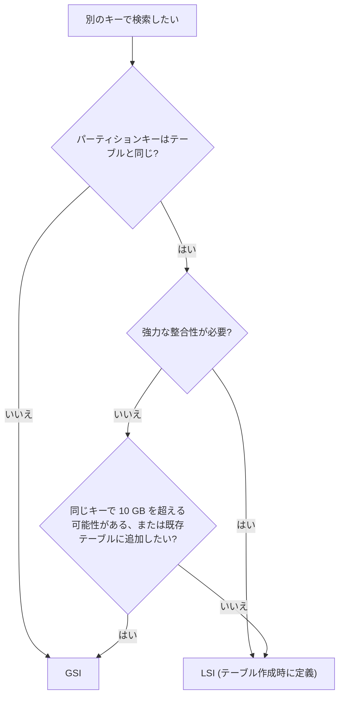
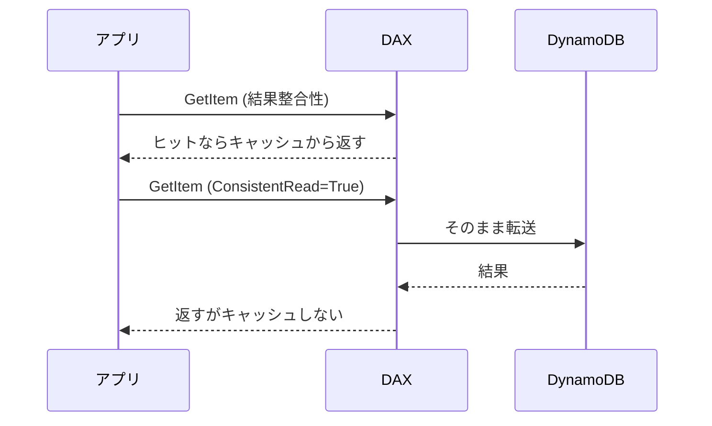

# Amazon DynamoDB

フルマネージドのキーバリュー型 NoSQL データベースです。アクセスパターンが決まっていて、規模が変わっても一定の低レイテンシで読み書きしたいときに使います。

[](../assets/diagrams/dynamodb-read-write.png)

## キーの設計 {#keys}

テーブルの主キーは次の 2 種類です。テーブル作成後に変更できないので、最初にアクセスパターンから決めます。

| 種類 | 構成 | 特徴 |
| --- | --- | --- |
| シンプル | パーティションキーのみ | キーの値で項目を 1 つ特定する |
| 複合 | パーティションキー + ソートキー | 同じパーティションキーの項目がソートキー順に並び、範囲検索できる |

キー属性に使える型は文字列 (S)、数値 (N)、バイナリ (B) だけです。サイズ上限はパーティションキーが 2,048 バイト、ソートキーが 1,024 バイトです。

### 高カーディナリティのパーティションキー {#high-cardinality}

パーティションキーの値はハッシュされ、データの配置先が決まります。1 パーティションの上限は 1 秒あたり 3,000 読み込みユニットと 1,000 書き込みユニットです。テーブル全体に余裕があっても、特定のキーにアクセスが集中するとスロットリングが起きます。

値の種類が多く、アクセスが均等に分散するキーを選びます。

| 良い例 | 避けたい例 | 理由 |
| --- | --- | --- |
| `userId`、`orderId`、`deviceId` | `status`、`gender` | 値の種類が少ないと、同じキーに書き込みが集中する |
| `date#3`(サフィックスで分散) | `date` | 当日分にだけ書き込みが集まるホットキーになる |

時系列データのように偏りを避けられない場合は、キーに乱数や計算したサフィックスを付けて分散させます。これを書き込みシャーディングと呼びます。

### 属性とデータ型 {#attributes}

キー以外の属性はスキーマレスで、項目ごとに違っていても構いません。項目の最大サイズは 400 KB です。

| 区分 | 型 |
| --- | --- |
| スカラー | String、Number、Binary、Boolean、Null |
| ドキュメント | List、Map |
| セット | String Set、Number Set、Binary Set |

### 単一テーブル設計の基本 {#single-table}

関連するエンティティを 1 つのテーブルに入れ、`Query` 1 回でまとめて取得する設計です。開発者として押さえるのは次の点です。

- `PK` と `SK` のような汎用名のキーを使い、`USER#42`、`ORDER#2026-10-31` のような接頭辞で種類を区別します。
- 先にアクセスパターンを洗い出し、それに合わせてキーと GSI を決めます。
- 結合がないため、まとめて読みたいデータは同じパーティションキーに置きます。

## 読み取りの整合性 {#read-consistency}

| モデル | 指定 | 消費 RCU | 使える場所 |
| --- | --- | --- | --- |
| 結果整合性 | デフォルト | 4 KB あたり 0.5 | テーブル、LSI、GSI、Streams |
| 強力な整合性 | `ConsistentRead=True` | 4 KB あたり 1 | テーブル、LSI のみ |
| トランザクション | `TransactGetItems` | 4 KB あたり 2 | テーブル |

結果整合性の読み取りは、直前の書き込みを反映していない可能性があります。書いた直後に必ず最新を読みたいときだけ強力な整合性を選びます。

!!! warning "GSI は強力な整合性を使えない"
    GSI に `ConsistentRead=True` を指定することはできません。最新の値が必須ならテーブルか LSI を読みます。

## Query と Scan {#query-vs-scan}

| 観点 | Query | Scan |
| --- | --- | --- |
| 対象 | 1 つのパーティションキーの値 | テーブルまたはインデックス全体 |
| 必須の指定 | パーティションキーの等価条件 | なし |
| 順序 | ソートキー順(`ScanIndexForward=False` で降順) | パーティション間は順不同 |
| 消費 | 読んだ分のみで効率的 | 全項目を評価するため大きい |

Scan は大きなテーブルでは遅く、高コストです。定常的なアクセスには、GSI を作って Query に置き換えます。

### 並列スキャン {#parallel-scan}

通常の Scan は順番に処理するため、大きなテーブルでは時間がかかります。並列スキャンは複数のワーカーがそれぞれ次のパラメータを指定して Scan します。

- `TotalSegments`: 全体のセグメント数(ワーカー数と同じ値)
- `Segment`: そのワーカーが担当する番号(0 始まり)

```python
import boto3

# このページの例の table はこのリソースを指す
table = boto3.resource("dynamodb").Table("Orders")
resp = table.scan(Segment=worker_no, TotalSegments=4, Limit=100)
```

プロビジョンドスループットを使い切りやすいので、本番トラフィックがあるときは `Limit` で 1 リクエストの量を抑えます。セグメントはパーティションキーのハッシュで決まるため偏ることがあり、セグメントを増やしても速くなるとは限りません。

### 射影式とフィルター式 {#expressions}

| 式 | 役割 | 消費 RCU への影響 |
| --- | --- | --- |
| `KeyConditionExpression` | Query で読む範囲をキーで絞る | 読む量が減るので下がる |
| `FilterExpression` | 読んだ後に結果を絞る | 変わらない |
| `ProjectionExpression` | 返す属性を絞る | 変わらない |
| `ConditionExpression` | 書き込みの実行条件 | 不成立でも WCU を消費する |

!!! tip "フィルターは節約にならない"
    1 MB の上限と `Limit` は、フィルターを適用する前の読み取り量に対して働きます。そのため `FilterExpression` を付けると、結果が 0 件なのに `LastEvaluatedKey` が返るページが発生します。

予約語と同じ名前の属性は `ExpressionAttributeNames` で置き換えます(`#s` に `status` を割り当てるなど)。値は `ExpressionAttributeValues` で渡します(`:v` など)。

### ページネーション {#pagination}

1 回の Query または Scan で返せるのは最大 1 MB です。続きがあると応答に `LastEvaluatedKey` が含まれるので、次のリクエストの `ExclusiveStartKey` に渡します。

```python
from boto3.dynamodb.conditions import Key

kwargs = {
    "KeyConditionExpression": Key("PK").eq("USER#42") & Key("SK").begins_with("ORDER#"),
    "ScanIndexForward": False,
}
while True:
    resp = table.query(**kwargs)
    handle(resp["Items"])
    last_key = resp.get("LastEvaluatedKey")
    if not last_key:
        break
    kwargs["ExclusiveStartKey"] = last_key
```

- 最後のページかどうかの判定は、`LastEvaluatedKey` が無いことだけで行います。
- `Count` はフィルター後の件数、`ScannedCount` はフィルター前に評価した件数です。差が大きいなら非効率なアクセスです。
- `ReturnConsumedCapacity` を `TOTAL` または `INDEXES` にすると、消費したキャパシティを確認できます。

## LSI と GSI {#indexes}

| 観点 | LSI(ローカルセカンダリインデックス) | GSI(グローバルセカンダリインデックス) |
| --- | --- | --- |
| キー | パーティションキーはテーブルと同じ、ソートキーが別 | パーティションキーもソートキーも自由 |
| 作成時期 | テーブル作成時のみ。後から追加も削除もできない | いつでも追加、削除できる |
| 数の上限 | 1 テーブル 5 個 | デフォルトで 1 テーブル 20 個 |
| 整合性 | 結果整合性と強力な整合性を選べる | 結果整合性のみ |
| キャパシティ | テーブルのものを消費 | インデックス独自 |
| 射影外の属性 | テーブルから自動で取得する(RCU を追加消費) | 取得できない |
| サイズ制限 | パーティションキーの値ごとに 10 GB | なし |
| クエリ範囲 | 1 つのパーティションキーの値 | テーブル全体 |

射影の種類は `KEYS_ONLY`、`INCLUDE`、`ALL` の 3 つです。よく読む属性だけを `INCLUDE` で射影すると、ストレージと書き込みの費用を抑えられます。`INCLUDE` で指定する非キー属性は、テーブルのセカンダリインデックス全体で合計 100 個までです。



押さえておきたい動作は次のとおりです。

- **スパースインデックス**: インデックスのキー属性を持たない項目はインデックスに入りません。未処理の注文にだけ `pendingAt` を付ければ、未処理分だけを効率よく検索できます。
- **LSI の 10 GB 上限**: 超えると `ItemCollectionSizeLimitExceededException` が発生します。
- **GSI のキーは一意でなくて構いません**: 同じキー値を持つ項目が複数入ります。
- **複数属性キー**: GSI はパーティションキーとソートキーをそれぞれ最大 4 属性で構成できます。文字列を連結した合成キーを作らずに済みます。

## キャパシティモードと RCU/WCU {#capacity}

| 観点 | オンデマンド | プロビジョンド |
| --- | --- | --- |
| 位置付け | デフォルトで推奨 | 明示的に選択 |
| 課金 | リクエスト数 | 確保したキャパシティの時間数 |
| 容量計画 | 不要 | 必要(Auto Scaling を併用可能) |
| 向く負荷 | 予測しにくい、増減が大きい | 安定して予測できる |
| 上限 | テーブル単位のデフォルトクォータと任意の最大スループット | 設定値とアカウントのクォータ |

テーブルと GSI の 1 テーブルあたりのデフォルトクォータは、どちらのモードでも読み書き各 40,000 ユニットです。引き上げを申請できます。

### 計算方法 {#capacity-calculation}

| 操作 | 1 ユニットあたりの単位 | 消費量 |
| --- | --- | --- |
| 強力な整合性の読み取り | 4 KB | 1 RCU |
| 結果整合性の読み取り | 4 KB | 0.5 RCU |
| トランザクション読み取り | 4 KB | 2 RCU |
| 標準の書き込み | 1 KB | 1 WCU |
| トランザクション書き込み | 1 KB | 2 WCU |

**手順**: 項目サイズを単位の倍数に切り上げ、単位で割り、整合性の係数と 1 秒あたりの件数を掛けます。

| 問題 | 計算 | 答え |
| --- | --- | --- |
| 6 KB の項目を強力な整合性で毎秒 100 件読む | 8 KB に切り上げ、2 RCU × 100 | 200 RCU |
| 同じ条件で結果整合性 | 200 ÷ 2 | 100 RCU |
| 同じ条件でトランザクション | 200 × 2 | 400 RCU |
| 2.5 KB の項目を毎秒 50 件書く | 3 KB に切り上げ、3 WCU × 50 | 150 WCU |
| 同じ条件でトランザクション | 150 × 2 | 300 WCU |

操作によって切り上げ方が異なります。

| 操作 | 切り上げの単位 | 例(強力な整合性) |
| --- | --- | --- |
| `GetItem` | 項目ごと | 10 KB は 12 KB 扱いで 3 RCU |
| `BatchGetItem` | 項目ごとに切り上げてから合計 | 1.5 KB と 6.5 KB は 4 + 8 = 12 KB で 3 RCU |
| `Query` | 全項目の合計を切り上げ | 合計 40.8 KB は 44 KB 扱いで 11 RCU |
| `Scan` | 評価した項目の合計 | 返した量ではなく読んだ量で決まる |
| `UpdateItem` | 更新前後の大きい方 | 一部の属性だけの更新でも項目全体のサイズで消費 |
| `BatchWriteItem` | 項目ごとに切り上げてから合計 | 500 バイトと 3.5 KB は 1 + 4 = 5 WCU |

GSI への反映はインデックスの WCU を別途消費します。インデックスのキー値を A から B に変える更新は、削除と追加の 2 回の書き込みになります。

## スロットリング {#throttling}

| 原因 | 主なエラー | 対処 |
| --- | --- | --- |
| プロビジョンドの設定値を超えた | `ProvisionedThroughputExceededException` | キャパシティ増強、Auto Scaling |
| 特定のパーティションに集中した | 同上、または `ThrottlingException` | キー設計の見直し、シャーディング |
| アカウントやテーブルのクォータを超えた | `RequestLimitExceeded`、`ThrottlingException` | クォータ引き上げの申請 |
| オンデマンドの最大スループット設定を超えた | `ThrottlingException` | 設定値の見直し |
| GSI の書き込みが足りない | ベーステーブルの書き込みも抑制される | GSI の WCU をテーブル以上にする |

例外の `ThrottlingReason` フィールドで理由と対象リソースを確認できます。AWS SDK はこの種のエラーを自動で再試行しますが、応答しきれないほどの負荷なら、再試行の前にリクエスト頻度を下げます。再試行の設定は [SDK とレジリエンス](sdk-resilience.md) を参照してください。

## 条件付き書き込み {#conditional-writes}

`PutItem`、`UpdateItem`、`DeleteItem` に `ConditionExpression` を指定すると、条件が成立したときだけ書き込みます。不成立なら `ConditionalCheckFailedException` が発生し、WCU は消費されます。

```python
from botocore.exceptions import ClientError

# 新規作成のみ許可する(上書き防止)
table.put_item(
    Item={"PK": "USER#42", "SK": "PROFILE", "name": "Aiko"},
    ConditionExpression="attribute_not_exists(PK)",
)

# バージョン番号による楽観的ロック
try:
    table.update_item(
        Key={"PK": "ORDER#123", "SK": "META"},
        UpdateExpression="SET #s = :new, #v = :next",
        ConditionExpression="#v = :cur",
        ExpressionAttributeNames={"#s": "status", "#v": "version"},
        ExpressionAttributeValues={":new": "SHIPPED", ":cur": 3, ":next": 4},
    )
except ClientError as e:
    if e.response["Error"]["Code"] != "ConditionalCheckFailedException":
        raise
    # 他の処理が先に更新した。読み直して再試行する
```

数を増やすだけなら `UpdateExpression="ADD #c :n"` のようなアトミックカウンターも使えます。ただしリクエストの再試行で二重に加算される可能性があり、厳密な数が必要な用途には向きません。

## トランザクション {#transactions}

複数の項目をすべて成功またはすべて失敗として処理します。複数テーブルにまたがれますが、同じアカウントかつ同じリージョン内に限ります。

| 項目 | `TransactWriteItems` | `TransactGetItems` |
| --- | --- | --- |
| アクション | `Put`、`Update`、`Delete`、`ConditionCheck` | `Get` |
| 上限 | 100 アクション、合計 4 MB | 100 アクション、合計 4 MB |
| 消費 | 項目ごとに 2 倍 | 項目ごとに 2 倍 |

```python
import boto3

client = boto3.client("dynamodb")
client.transact_write_items(
    ClientRequestToken=order_id,
    TransactItems=[
        {"Update": {
            "TableName": "Stock",
            "Key": {"sku": {"S": "A-1"}},
            "UpdateExpression": "SET qty = qty - :n",
            "ConditionExpression": "qty >= :n",
            "ExpressionAttributeValues": {":n": {"N": "1"}},
        }},
        {"Put": {
            "TableName": "Orders",
            "Item": {"orderId": {"S": order_id}},
            "ConditionExpression": "attribute_not_exists(orderId)",
        }},
    ],
)
```

- **冪等性**: `ClientRequestToken` は完了から 10 分間有効です。同じトークンで別のパラメータを送ると `IdempotentParameterMismatch` になります。AWS SDK を使う場合は自動で付与されます。
- **失敗**: `TransactionCanceledException` の `CancellationReasons` に、項目の順番どおりに理由が入ります。条件不成立は `ConditionalCheckFailed` です。
- **競合**: 実行中のトランザクションと競合した標準の書き込みは `TransactionConflictException` になります。
- **キャパシティ**: 条件不成立でキャンセルされても消費します。
- **制約**: 同じ項目を 1 つのトランザクションで 2 回指定できません。インデックスを対象にできません。Streams や GSI への反映は順次行われるため、消費側でアトミック性を前提にしないでください。

## バッチ操作 {#batch}

| 項目 | `BatchGetItem` | `BatchWriteItem` |
| --- | --- | --- |
| 上限 | 100 項目、16 MB | 25 件、16 MB |
| 操作 | 取得 | `Put` と `Delete` のみ。Update は不可 |
| 条件式 | 指定不可 | 指定不可 |
| 未処理分 | `UnprocessedKeys` | `UnprocessedItems` |
| 原子性 | なし | なし(各項目の操作だけが原子的) |

バッチの呼び出しが成功しても、一部が未処理のまま返ることがあります。未処理分は指数バックオフを挟んで再送します。

```python
import random
import time

request = {"Orders": [{"PutRequest": {"Item": item}} for item in chunk]}
attempt = 0
while request:
    resp = client.batch_write_item(RequestItems=request)
    request = resp.get("UnprocessedItems", {})
    if request:
        time.sleep(random.uniform(0, 2 ** attempt * 0.1))
        attempt += 1
```

全件が処理できないときは `ProvisionedThroughputExceededException` などが返ります。次の場合はバッチ全体が拒否されます。テーブルが存在しない、キーがスキーマに合わない、同じ項目を複数回指定した、25 件を超えた、1 項目が 400 KB を超えた、全体が 16 MB を超えた、のいずれかです。

boto3 の `table.batch_writer()` は分割と未処理分の再送を自動で行います。

## TTL {#ttl}

項目ごとの期限切れ時刻を指定すると、DynamoDB が自動で削除します。WCU を消費しません。

```python
import time

client.update_time_to_live(
    TableName="Sessions",
    TimeToLiveSpecification={"Enabled": True, "AttributeName": "expiresAt"},
)
table.put_item(Item={"PK": "SESSION#1", "expiresAt": int(time.time()) + 3600})
```

- 属性は Number 型で、秒単位の Unix エポック時刻にします。ミリ秒や文字列は期待どおりに動きません。Number 以外の型は無視されます。
- 削除は期限後すぐではなく、通常は数日以内です。期限切れでも削除前の項目は読めるので、正確さが必要ならフィルター式で除外します。
- 削除前なら更新で期限を延ばせます。
- GSI と LSI からも削除され、Streams にはサービスによる削除として記録されます。グローバルテーブルでは他のリージョンへの複製分の書き込み費用が発生します。

TTL で削除された項目を S3 に保存するには、Streams と Lambda を組み合わせ、`userIdentity.type` が `Service`、`principalId` が `dynamodb.amazonaws.com` のレコードだけを処理します。

## DynamoDB Streams {#streams}

項目の変更を時系列で記録します。テーブルの性能には影響しません。

| 特性 | 内容 |
| --- | --- |
| 保持期間 | 24 時間 |
| 重複 | 各レコードはストリームに 1 度だけ現れる |
| 順序 | 同じ項目への変更の順序を保証する(パーティションや項目コレクション全体では保証しない) |
| 整合性 | 読み取りは結果整合性 |
| 同時読み取り | 1 シャードあたり 2 プロセスまで(グローバルテーブルでは 1 を推奨) |

`StreamViewType` は次の 4 つです。作成後に変えるには、ストリームを無効にして作り直します。

| 値 | 記録する内容 |
| --- | --- |
| `KEYS_ONLY` | キー属性のみ |
| `NEW_IMAGE` | 変更後の項目全体 |
| `OLD_IMAGE` | 変更前の項目全体 |
| `NEW_AND_OLD_IMAGES` | 変更前後の両方 |

データを変更しない `PutItem` や `UpdateItem` はレコードを作りません。Lambda はイベントソースマッピングで読み取り、シャードの親子関係も順序も処理してくれます。詳しくは [Lambda](lambda.md) と [ストリーミング](streaming.md) を参照してください。

## DAX {#dax}

DynamoDB 専用のインメモリキャッシュで、VPC 内で動きます。アプリケーションは DAX クライアントに切り替えるだけで、ほぼ同じ API で使えます。

| キャッシュ | 保存するもの | 更新 |
| --- | --- | --- |
| 項目キャッシュ | `GetItem`、`BatchGetItem` の結果 | デフォルトの TTL は 5 分。DAX 経由の書き込みで更新 |
| クエリキャッシュ | `Query`、`Scan` の結果セット | TTL まで更新されない。項目の更新では無効化されない |



注意点は次のとおりです。

- **強力な整合性の読み取りと `TransactGetItems`** は素通りし、キャッシュされません。DAX は結果整合性の読み取りを速くする仕組みです。
- **書き込みはライトスルー**です。DynamoDB への書き込みが成功した後にキャッシュを更新します。書き込みが失敗すればキャッシュされません。
- **DAX を経由しない更新**は検知されず、TTL が切れるまで古い値を返します。
- **ネガティブキャッシュ**: 存在しないという結果もキャッシュします。
- **`TransactWriteItems` を DAX 経由で実行**すると、キャッシュ更新のために読み取りの RCU を追加で消費します。
- テーブルの作成など管理系の API は DynamoDB に直接送ります。
- 高可用性のために、複数の AZ に 3 ノード以上を置くことが推奨されています。

ElastiCache や CloudFront との使い分けは [データベースとキャッシュ](databases.md) にまとめています。

## グローバルテーブル {#global-tables}

複数リージョンにレプリカを持つマルチアクティブのテーブルです。どのレプリカにも読み書きできます。

| モード | 複製 | 整合性 | 補足 |
| --- | --- | --- | --- |
| MREC(マルチリージョン結果整合性) | 非同期。通常は 1 秒以内 | リージョン間は結果整合性 | デフォルト。競合は最後の書き込みが優先 |
| MRSC(マルチリージョン強整合性) | 応答前に別リージョンへ同期 | どのレプリカでも強力な整合性の読み取りで最新 | 同一アカウントのみ |

モードはテーブル作成時に決まり、後から変更できません。トランザクションの ACID 保証は書き込んだリージョン内だけです。他のリージョンでは途中の状態が見えることがあります。

## 暗号化 {#encryption}

保存データは常に暗号化されていて、無効にはできません。対象はプライマリキー、インデックス、Streams、グローバルテーブル、バックアップです。

| キーの種類 | 保管場所 | 費用 | 使いどころ |
| --- | --- | --- | --- |
| AWS 所有キー | DynamoDB 側(デフォルト) | 追加なし | 特に要件がない |
| AWS マネージドキー | 自分のアカウントの KMS | KMS の料金 | 利用状況を監査したい |
| カスタマーマネージドキー | 自分のアカウントの KMS | KMS の料金 | キーの制御が必要 |

キーの種類は後からでも切り替えられます。詳しくは [KMS](kms.md) を参照してください。

## 細かいアクセス制御 {#fine-grained-access}

IAM ポリシーの条件キーで、項目と属性の単位までアクセスを制限できます。

| 条件キー | 制限する対象 |
| --- | --- |
| `dynamodb:LeadingKeys` | パーティションキーの値(項目単位) |
| `dynamodb:Attributes` | アクセスできる最上位の属性 |
| `dynamodb:Select` | `Select` パラメータの値 |
| `dynamodb:ReturnValues` | `ReturnValues` パラメータの値 |

次のポリシーは、Cognito の ID とパーティションキーが一致する項目だけを許可します。

```json
{
  "Version": "2012-10-17",
  "Statement": [{
    "Effect": "Allow",
    "Action": [
      "dynamodb:GetItem",
      "dynamodb:Query",
      "dynamodb:PutItem",
      "dynamodb:UpdateItem",
      "dynamodb:DeleteItem"
    ],
    "Resource": "arn:aws:dynamodb:ap-northeast-1:123456789012:table/UserData",
    "Condition": {
      "ForAllValues:StringEquals": {
        "dynamodb:LeadingKeys": ["${cognito-identity.amazonaws.com:sub}"]
      }
    }
  }]
}
```

- `LeadingKeys` には `ForAllValues` 修飾子が必須です。
- `Scan` は `LeadingKeys` に関係なく全項目を返すので、許可しません。
- `dynamodb:Attributes` は、リクエストに書かれた属性だけを評価します。`ProjectionExpression` を省略すると全属性が返るため、`dynamodb:Select` を `SPECIFIC_ATTRIBUTES` に制限し、`dynamodb:ReturnValues` も併せて制限します。
- `dynamodb:Attributes` を使うときは、テーブルとインデックスのキー属性もリストに含めます。

## 試験のポイント {#exam-points}

| こう問われたら | 答え |
| --- | --- |
| 特定のキーでスロットリングする | パーティションキーを高カーディナリティにする、書き込みシャーディング |
| 書いた直後に最新を読みたい | `ConsistentRead=True`(テーブルか LSI) |
| GSI を強力な整合性で読みたい | できない |
| 既存テーブルに別のソートキーを追加したい | LSI は不可なので GSI を追加 |
| Scan が遅く RCU を食う | GSI を作って Query に変える。全件処理なら並列スキャン |
| フィルターしたのに RCU が減らない | フィルターは読み取り後に適用される |
| `ProjectionExpression` で RCU を減らせるか | 減らない |
| 次のページの取り方 | `LastEvaluatedKey` を `ExclusiveStartKey` に渡す |
| 同時更新の上書きを防ぎたい | バージョン属性と条件付き書き込み(楽観的ロック) |
| 複数項目をすべて成功か全失敗にしたい | `TransactWriteItems` |
| `UnprocessedItems` が返った | 指数バックオフで再送する |
| 古いセッションを費用をかけずに消したい | TTL(Number 型のエポック秒) |
| 変更をトリガーに処理したい | Streams と Lambda |
| 変更前後の値が必要 | `NEW_AND_OLD_IMAGES` |
| 読み取りをマイクロ秒単位で返したい、コード変更は最小にしたい | DAX |
| DAX で最新を読みたい | できない。強力な整合性はキャッシュされず DynamoDB へ転送される |
| マルチリージョンで読み書きしたい | グローバルテーブル |
| ユーザーは自分の項目だけ操作できるように | `dynamodb:LeadingKeys` と Cognito の ID |
| GSI の書き込み不足でテーブルも遅い | GSI の WCU をテーブル以上にする |

## 関連ページ {#related}

- [データベースとキャッシュ](databases.md)
- [Lambda](lambda.md)
- [ストリーミング](streaming.md)
- [SDK とレジリエンス](sdk-resilience.md)
- [IAM](iam.md)
- [Cognito](cognito.md)
- [KMS](kms.md)

## 参考 {#references}

- [Quotas in Amazon DynamoDB](https://docs.aws.amazon.com/amazondynamodb/latest/developerguide/ServiceQuotas.html)
- [DynamoDB read and write operations](https://docs.aws.amazon.com/amazondynamodb/latest/developerguide/read-write-operations.html)
- [DynamoDB read consistency](https://docs.aws.amazon.com/amazondynamodb/latest/developerguide/HowItWorks.ReadConsistency.html)
- [Scanning tables in DynamoDB](https://docs.aws.amazon.com/amazondynamodb/latest/developerguide/Scan.html)
- [Paginating table query results](https://docs.aws.amazon.com/amazondynamodb/latest/developerguide/Query.Pagination.html)
- [Secondary indexes](https://docs.aws.amazon.com/amazondynamodb/latest/developerguide/SecondaryIndexes.html)
- [Local secondary indexes](https://docs.aws.amazon.com/amazondynamodb/latest/developerguide/LSI.html)
- [Using Global Secondary Indexes](https://docs.aws.amazon.com/amazondynamodb/latest/developerguide/GSI.html)
- [DynamoDB throughput capacity](https://docs.aws.amazon.com/amazondynamodb/latest/developerguide/capacity-mode.html)
- [Troubleshooting throttling](https://docs.aws.amazon.com/amazondynamodb/latest/developerguide/TroubleshootingThrottling.html)
- [Partition key best practices](https://docs.aws.amazon.com/amazondynamodb/latest/developerguide/bp-partition-key-design.html)
- [Transactions: how it works](https://docs.aws.amazon.com/amazondynamodb/latest/developerguide/transaction-apis.html)
- [BatchWriteItem](https://docs.aws.amazon.com/amazondynamodb/latest/APIReference/API_BatchWriteItem.html)
- [BatchGetItem](https://docs.aws.amazon.com/amazondynamodb/latest/APIReference/API_BatchGetItem.html)
- [Time to live (TTL)](https://docs.aws.amazon.com/amazondynamodb/latest/developerguide/TTL.html)
- [DynamoDB Streams and TTL](https://docs.aws.amazon.com/amazondynamodb/latest/developerguide/time-to-live-ttl-streams.html)
- [Change data capture for DynamoDB Streams](https://docs.aws.amazon.com/amazondynamodb/latest/developerguide/Streams.html)
- [DAX: How it works](https://docs.aws.amazon.com/amazondynamodb/latest/developerguide/DAX.concepts.html)
- [DAX and DynamoDB consistency models](https://docs.aws.amazon.com/amazondynamodb/latest/developerguide/DAX.consistency.html)
- [Global tables](https://docs.aws.amazon.com/amazondynamodb/latest/developerguide/GlobalTables.html)
- [Encryption at rest](https://docs.aws.amazon.com/amazondynamodb/latest/developerguide/EncryptionAtRest.html)
- [Using IAM policy conditions for fine-grained access control](https://docs.aws.amazon.com/amazondynamodb/latest/developerguide/specifying-conditions.html)
