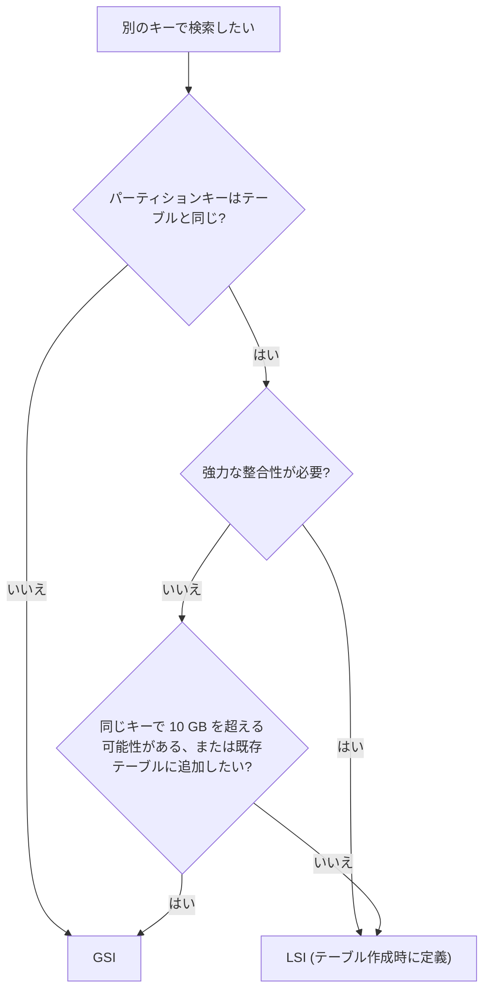
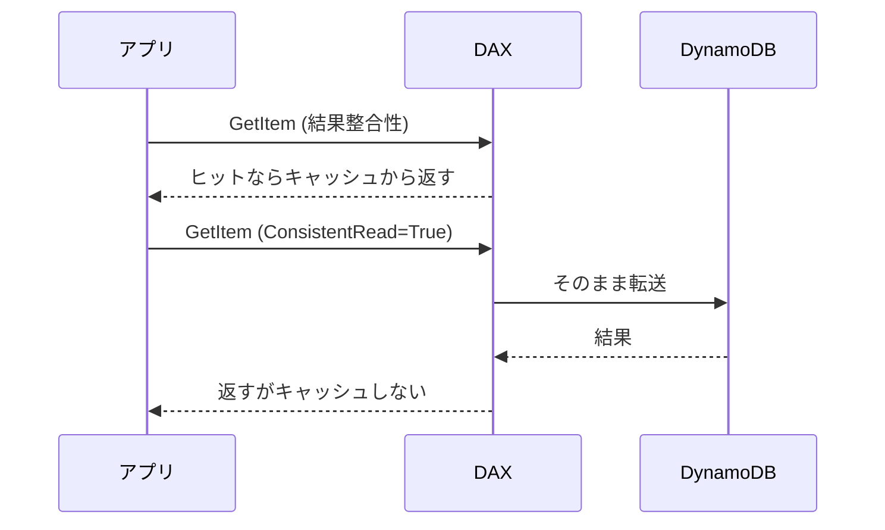

# Amazon DynamoDB

[:material-sprout: CLF](../courses/clf/services.md){ .exam-badge .exam-foundational } [:material-sprout: AIF](../courses/aif/services.md){ .exam-badge .exam-foundational } [:material-certificate: SAA](../courses/saa/services.md){ .exam-badge .exam-associate } [:material-certificate: DVA](../courses/dva/services.md){ .exam-badge .exam-associate } [:material-certificate: SOA](../courses/soa/services.md){ .exam-badge .exam-associate } [:material-certificate: DEA](../courses/dea/services.md){ .exam-badge .exam-associate } [:material-certificate: MLA](../courses/mla/services.md){ .exam-badge .exam-associate } [:material-star-circle: SAP](../courses/sap/services.md){ .exam-badge .exam-professional } [:material-star-circle: DOP](../courses/dop/services.md){ .exam-badge .exam-professional } [:material-star-circle: AIP](../courses/aip/services.md){ .exam-badge .exam-professional }

フルマネージドのキーバリュー型 NoSQL データベースです。アクセスパターンが決まっていて、規模が変わっても一定の低レイテンシで読み書きしたいときに使います。

[](../assets/diagrams/dynamodb-read-write.png)

## キーの設計 {#keys}

テーブルの主キーは次の 2 種類です。テーブル作成後に変更できないので、最初にアクセスパターンから決めます。

| 種類 | 構成 | 特徴 |
| --- | --- | --- |
| シンプル | パーティションキーのみ | キーの値で項目を 1 つ特定する |
| 複合 | パーティションキー + ソートキー | 同じパーティションキーの項目がソートキー順に並び、範囲検索できる |

キー属性に使える型は文字列 (S)、数値 (N)、バイナリ (B) だけです。サイズ上限はパーティションキーが 2,048 バイト、ソートキーが 1,024 バイトです。

### 高カーディナリティのパーティションキー {#high-cardinality}

パーティションキーの値はハッシュされ、データの配置先が決まります。1 パーティションの上限は 1 秒あたり 3,000 読み込みユニットと 1,000 書き込みユニットです。テーブル全体に余裕があっても、特定のキーにアクセスが集中するとスロットリングが起きます。

値の種類が多く、アクセスが均等に分散するキーを選びます。

| 良い例 | 避けたい例 | 理由 |
| --- | --- | --- |
| `userId`、`orderId`、`deviceId` | `status`、`gender` | 値の種類が少ないと、同じキーに書き込みが集中する |
| `date#3`(サフィックスで分散) | `date` | 当日分にだけ書き込みが集まるホットキーになる |

時系列データのように偏りを避けられない場合は、キーに乱数や計算したサフィックスを付けて分散させます。これを書き込みシャーディングと呼びます。

### 属性とデータ型 {#attributes}

キー以外の属性はスキーマレスで、項目ごとに違っていても構いません。項目の最大サイズは 400 KB です。

| 区分 | 型 |
| --- | --- |
| スカラー | String、Number、Binary、Boolean、Null |
| ドキュメント | List、Map |
| セット | String Set、Number Set、Binary Set |

型には次の細かい決まりがあります。

| 項目 | 内容 |
| --- | --- |
| Number の精度 | 最大 38 桁。超えると例外になるので、それ以上は文字列で持つ |
| ネスト | List と Map は 32 階層まで |
| 空の値 | 空の String と Binary はキー以外なら可。空のセットは不可。空の List と Map は可 |
| セット | 要素は同じ型で一意。順序は保たれない |

### 項目サイズの数え方 {#item-size}

項目のサイズは、属性名と値の長さの合計です。1 KB は 1,024 バイトで数えます。

| 型 | サイズ |
| --- | --- |
| String | 属性名の UTF-8 バイト数 + 値の UTF-8 バイト数 |
| Number | 属性名 + 有効桁 2 桁につき約 1 バイト + 1 バイト |
| Binary | 属性名 + 元のバイト数(base64 後の長さではない) |
| Boolean、Null | 属性名 + 1 バイト |
| List、Map | 属性名 + 要素の合計 + 3 バイト |
| セット | 属性名 + 要素の合計 |

**例**: `customerEmailAddressVerified` という 28 バイトの属性名を `cev` に変えると、1 項目あたり 25 バイト減ります。1,010 バイトの項目に 28 バイトの属性名の Boolean を足すと 1,039 バイトになり、1 回の書き込みは 1 WCU から 2 WCU に増えます。

**落とし穴**: 属性名はすべての項目で繰り返し保存され、400 KB の上限にも数えられます。上限を超える書き込みは拒否されます。大きなデータは S3 に置き、項目にはキーだけを持たせます。

### 単一テーブル設計の基本 {#single-table}

関連するエンティティを 1 つのテーブルに入れ、`Query` 1 回でまとめて取得する設計です。開発者として押さえるのは次の点です。

- `PK` と `SK` のような汎用名のキーを使い、`USER#42`、`ORDER#2026-10-31` のような接頭辞で種類を区別します。
- 先にアクセスパターンを洗い出し、それに合わせてキーと GSI を決めます。
- 結合がないため、まとめて読みたいデータは同じパーティションキーに置きます。

## 読み取りの整合性 {#read-consistency}

| モデル | 指定 | 消費 RCU | 使える場所 |
| --- | --- | --- | --- |
| 結果整合性 | デフォルト | 4 KB あたり 0.5 | テーブル、LSI、GSI、Streams |
| 強力な整合性 | `ConsistentRead=True` | 4 KB あたり 1 | テーブル、LSI のみ |
| トランザクション | `TransactGetItems` | 4 KB あたり 2 | テーブル |

結果整合性の読み取りは、直前の書き込みを反映していない可能性があります。書いた直後に必ず最新を読みたいときだけ強力な整合性を選びます。

!!! warning "GSI は強力な整合性を使えない"
    GSI に `ConsistentRead=True` を指定することはできません。指定すると `ValidationException` になります。最新の値が必須ならテーブルか LSI を読みます。

### ConsistentRead の指定 {#consistent-read}

`GetItem`、`Query`、`Scan` に指定します。デフォルトは `false`(結果整合性)です。`BatchGetItem` はテーブルごとに指定します。

**例**: 注文を確定した直後に、同じ人が画面で注文を読むなら `ConsistentRead=True` にします。4 KB 以下の項目を毎秒 100 件読むと、消費は 50 RCU から 100 RCU に倍増します。必要な画面だけに絞ります。

**落とし穴**: 存在しない項目を読んでも RCU は消費されます。

## Query と Scan {#query-vs-scan}

| 観点 | Query | Scan |
| --- | --- | --- |
| 対象 | 1 つのパーティションキーの値 | テーブルまたはインデックス全体 |
| 必須の指定 | パーティションキーの等価条件 | なし |
| 順序 | ソートキー順(`ScanIndexForward=False` で降順) | パーティション間は順不同 |
| 消費 | 読んだ分のみで効率的 | 全項目を評価するため大きい |

Scan は大きなテーブルでは遅く、高コストです。定常的なアクセスには、GSI を作って Query に置き換えます。

### Query のパラメータ {#query-params}

| パラメータ | 値とデフォルト | 動作 | 落とし穴 |
| --- | --- | --- | --- |
| `KeyConditionExpression` | パーティションキーの等価条件は必須 | ソートキーには `=`、`<`、`<=`、`>`、`>=`、`BETWEEN`、`begins_with` が使える | キー以外の属性は書けない。Number のソートキーに `begins_with` は使えない |
| `FilterExpression` | 省略可 | 読んだ後、返す前に絞る | キー属性は書けない。RCU は減らない |
| `ProjectionExpression` | 省略可 | 返す属性を絞る | RCU は減らない。1 MB の計算にも影響しない |
| `Limit` | 1 以上 | 評価する項目の最大数 | 一致する件数の上限ではない |
| `ExclusiveStartKey` | 省略可 | 前回の `LastEvaluatedKey` を渡す | 自分で組み立てず、応答の値をそのまま渡す |
| `ScanIndexForward` | デフォルト `true`(昇順) | `false` で降順 | Query 専用。Scan にはない |
| `ConsistentRead` | デフォルト `false` | 強力な整合性で読む | GSI では `ValidationException` |
| `ReturnConsumedCapacity` | `NONE`(デフォルト)、`TOTAL`、`INDEXES` | 消費した RCU を応答に含める | `INDEXES` でインデックスごとの内訳が出る |
| `Select` | 下の表を参照 | 返す内容を選ぶ | `COUNT` でも読んだ分の RCU を消費する |
| `IndexName` | 省略可 | テーブルの代わりにインデックスを読む | キー条件はインデックスのキーで書く |

`Select` の値は次の 4 つです。

| 値 | 返すもの | 補足 |
| --- | --- | --- |
| `ALL_ATTRIBUTES` | 項目の全属性 | テーブルのデフォルト。LSI では親テーブルから取得することがある |
| `ALL_PROJECTED_ATTRIBUTES` | 射影された属性 | インデックスのデフォルト。インデックス専用 |
| `SPECIFIC_ATTRIBUTES` | `ProjectionExpression` で指定した属性 | `ProjectionExpression` と併用できる唯一の値 |
| `COUNT` | 件数のみ | 項目を返すときと同じ量の RCU を消費する |

**例**: 1 人のユーザーの注文から、最新の配送済みを 10 件取りたいとします。

```python
from boto3.dynamodb.conditions import Attr, Key

resp = table.query(
    KeyConditionExpression=Key("PK").eq("USER#42") & Key("SK").begins_with("ORDER#"),
    FilterExpression=Attr("status").eq("SHIPPED"),
    ScanIndexForward=False,
    Limit=10,
    ReturnConsumedCapacity="TOTAL",
)
```

`Limit=10` はフィルター前の 10 件を意味します。その中に配送済みが 3 件しかなければ、`Items` は 3 件で、`LastEvaluatedKey` が付いて返ります。10 件そろうまでページを読み進めるか、配送済みだけをスパースインデックスに入れます。

### 並列スキャン {#parallel-scan}

通常の Scan は順番に処理するため、大きなテーブルでは時間がかかります。並列スキャンは複数のワーカーがそれぞれ次のパラメータを指定して Scan します。

- `TotalSegments`: 全体のセグメント数(ワーカー数と同じ値)
- `Segment`: そのワーカーが担当する番号(0 始まり)

```python
import boto3

# このページの例の table はこのリソースを指す
table = boto3.resource("dynamodb").Table("Orders")
resp = table.scan(Segment=worker_no, TotalSegments=4, Limit=100)
```

プロビジョンドスループットを使い切りやすいので、本番トラフィックがあるときは `Limit` で 1 リクエストの量を抑えます。セグメントはパーティションキーのハッシュで決まるため偏ることがあり、セグメントを増やしても速くなるとは限りません。

| パラメータ | 範囲 | 注意 |
| --- | --- | --- |
| `TotalSegments` | 1〜1,000,000 | 1 なら順次スキャンと同じ |
| `Segment` | 0 以上、`TotalSegments` 未満 | 片方だけの指定はできない |

**Scan の RCU の例**: 1 KB の項目を 1,000 件評価する場合、合計 1,000 KB を 4 KB で割って 250 とし、結果整合性なので半分の 125 RCU です。`FilterExpression` で 1 件に絞っても 125 RCU のままです。Scan も強力な整合性を指定できます(GSI を除く)。その場合は 250 RCU です。

### 射影式とフィルター式 {#expressions}

| 式 | 役割 | 消費 RCU への影響 |
| --- | --- | --- |
| `KeyConditionExpression` | Query で読む範囲をキーで絞る | 読む量が減るので下がる |
| `FilterExpression` | 読んだ後に結果を絞る | 変わらない |
| `ProjectionExpression` | 返す属性を絞る | 変わらない |
| `ConditionExpression` | 書き込みの実行条件 | 不成立でも WCU を消費する |

!!! tip "フィルターは節約にならない"
    1 MB の上限と `Limit` は、フィルターを適用する前の読み取り量に対して働きます。そのため `FilterExpression` を付けると、結果が 0 件なのに `LastEvaluatedKey` が返るページが発生します。

予約語と同じ名前の属性は `ExpressionAttributeNames` で置き換えます(`#s` に `status` を割り当てるなど)。値は `ExpressionAttributeValues` で渡します(`:v` など)。

### ページネーション {#pagination}

1 回の Query または Scan で返せるのは最大 1 MB です。続きがあると応答に `LastEvaluatedKey` が含まれるので、次のリクエストの `ExclusiveStartKey` に渡します。

```python
from boto3.dynamodb.conditions import Key

kwargs = {
    "KeyConditionExpression": Key("PK").eq("USER#42") & Key("SK").begins_with("ORDER#"),
    "ScanIndexForward": False,
}
while True:
    resp = table.query(**kwargs)
    handle(resp["Items"])
    last_key = resp.get("LastEvaluatedKey")
    if not last_key:
        break
    kwargs["ExclusiveStartKey"] = last_key
```

- 最後のページかどうかの判定は、`LastEvaluatedKey` が無いことだけで行います。
- `Count` はフィルター後の件数、`ScannedCount` はフィルター前に評価した件数です。差が大きいなら非効率なアクセスです。
- `ReturnConsumedCapacity` を `TOTAL` または `INDEXES` にすると、消費したキャパシティを確認できます。

## LSI と GSI {#indexes}

| 観点 | LSI(ローカルセカンダリインデックス) | GSI(グローバルセカンダリインデックス) |
| --- | --- | --- |
| キー | パーティションキーはテーブルと同じ、ソートキーが別 | パーティションキーもソートキーも自由 |
| 作成時期 | テーブル作成時のみ。後から追加も削除もできない | いつでも追加、削除できる |
| 数の上限 | 1 テーブル 5 個 | デフォルトで 1 テーブル 20 個 |
| 整合性 | 結果整合性と強力な整合性を選べる | 結果整合性のみ |
| キャパシティ | テーブルのものを消費 | インデックス独自 |
| 射影外の属性 | テーブルから自動で取得する(RCU を追加消費) | 取得できない |
| サイズ制限 | パーティションキーの値ごとに 10 GB | なし |
| クエリ範囲 | 1 つのパーティションキーの値 | テーブル全体 |

射影の種類は `KEYS_ONLY`、`INCLUDE`、`ALL` の 3 つです。よく読む属性だけを `INCLUDE` で射影すると、ストレージと書き込みの費用を抑えられます。`INCLUDE` で指定する非キー属性は、テーブルのセカンダリインデックス全体で合計 100 個までです。



押さえておきたい動作は次のとおりです。

- **スパースインデックス**: インデックスのキー属性を持たない項目はインデックスに入りません。未処理の注文にだけ `pendingAt` を付ければ、未処理分だけを効率よく検索できます。
- **LSI の 10 GB 上限**: 超えると `ItemCollectionSizeLimitExceededException` が発生します。
- **GSI のキーは一意でなくて構いません**: 同じキー値を持つ項目が複数入ります。
- **複数属性キー**: GSI はパーティションキーとソートキーをそれぞれ最大 4 属性で構成できます。文字列を連結した合成キーを作らずに済みます。

### 射影とフェッチ {#projection}

`ProjectionType` で、インデックスにコピーする属性を決めます。

| 値 | コピーする属性 | 向く場面 |
| --- | --- | --- |
| `KEYS_ONLY` | インデックスのキーとテーブルのキー | 属性は後で `GetItem` すればよい。最も安い |
| `INCLUDE` | 上に加えて `NonKeyAttributes` で指定した属性 | 読む属性が決まっている |
| `ALL` | すべての属性 | テーブルと同じように読みたい。ストレージと書き込みが最も高い |

`NonKeyAttributes` は 1 インデックスで最大 20 個、テーブルの全インデックス合計で最大 100 個です。同じ属性を 2 つのインデックスに射影すると 2 個に数えます。この上限は `INCLUDE` のときだけで、`ALL` には関係しません。

射影されていない属性を読もうとしたときの動作が、LSI と GSI で違います。

| 対象 | 動作 | 影響 |
| --- | --- | --- |
| LSI | 親テーブルから自動で取得する(フェッチ) | 追加の RCU と遅延が発生する |
| GSI | 取得できない | 属性は返らない。別途 `GetItem` する |

**例**: 注文の一覧画面で `orderedAt` と `total` だけを表示するなら、GSI を `INCLUDE` にして `NonKeyAttributes=["total"]` とします。後から `address` も必要になると、射影は作成後に変更できないので、GSI を作り直します。

### GSI のキャパシティとバックプレッシャー {#gsi-backpressure}

GSI はテーブルとは別のキャパシティを持ちます。テーブルへの書き込みは非同期で GSI に反映されますが、GSI の書き込み容量が足りないと **テーブルの書き込みまで抑制** されます。これをバックプレッシャーと呼びます。

**例**: テーブルが 1,000 WCU、GSI が 200 WCU のプロビジョンドで、毎秒 500 件を書くとします。テーブルには余裕があるのに、GSI の不足でテーブルへの書き込みが `ProvisionedThroughputExceededException` になります。GSI をテーブル以上の WCU にします。

GSI への書き込み回数は、更新の内容で変わります。

| テーブルの更新 | GSI の消費 |
| --- | --- |
| 新しい項目を追加(キー属性あり) | 1 回の書き込み |
| インデックスのキー値を変更 | 削除と追加の 2 回 |
| 射影された属性だけを変更 | 1 回 |
| 射影もキーも関係ない属性だけを変更 | 消費しない |

GSI の消費は、項目全体ではなくインデックスの項目サイズで計算します。8 KB の項目でも、GSI に 500 バイトだけ射影していれば GSI への書き込みは 1 WCU です。

既存のテーブルに GSI を追加すると、状態は `CREATING` になり、既存データをコピーするバックフィルが行われます。この間はクエリできません。

- 進捗は CloudWatch の `OnlineIndexPercentageProgress` で確認します。
- ベーステーブルの `WriteThrottleEvents` と `ThrottledRequests` を監視します。
- 作成中の GSI には Auto Scaling が効きません。`ACTIVE` になるまでは手動で容量を管理します。
- キーの型が合わない既存項目はインデックスに入りません。新しい書き込みで型が合わないと `ValidationException` になります。

LSI はテーブルのキャパシティを消費するので、独自の設定はありません。`ReturnItemCollectionMetrics=SIZE` を指定すると、項目コレクションの推定サイズが応答に含まれ、10 GB の上限に近づいていないか確認できます。

## キャパシティモードと RCU/WCU {#capacity}

| 観点 | オンデマンド | プロビジョンド |
| --- | --- | --- |
| 位置付け | デフォルトで推奨 | 明示的に選択 |
| 課金 | リクエスト数 | 確保したキャパシティの時間数 |
| 容量計画 | 不要 | 必要(Auto Scaling を併用可能) |
| 向く負荷 | 予測しにくい、増減が大きい | 安定して予測できる |
| 上限 | テーブル単位のデフォルトクォータと任意の最大スループット | 設定値とアカウントのクォータ |

テーブルと GSI の 1 テーブルあたりのデフォルトクォータは、どちらのモードでも読み書き各 40,000 ユニットです。引き上げを申請できます。

### オンデマンドの設定と動作 {#on-demand}

`BillingMode=PAY_PER_REQUEST` で選びます。単位は RRU と WRU ですが、数え方は RCU と WCU と同じです。

| 項目 | 値 |
| --- | --- |
| 新しいテーブルの初期性能 | 毎秒 4,000 書き込み、12,000 読み取りまで |
| 瞬時に対応できる範囲 | 過去のピークの 2 倍まで |
| ピークの 2 倍を超える増加 | 30 分以内に超えるとスロットリングの可能性がある |
| 任意の上限 | `OnDemandThroughput` の `MaxReadRequestUnits`、`MaxWriteRequestUnits` |
| モード切り替え | プロビジョンドからオンデマンドへは 24 時間で 4 回まで。逆方向はいつでも |

**例**: 過去のピークが毎秒 50,000 読み取りなら、100,000 までは瞬時に対応できます。セールで 300,000 に増えるなら、30 分以上かけて増やすか事前にウォームアップします。

上限を毎秒 1,000 WRU に設定すると、超えた分は `ThrottlingException` になり、`ThrottlingReason` は `IndexWriteMaxOnDemandThroughputExceeded` のような形式になります。費用の暴走を防げますが、低すぎると正常な負荷でも失敗します。

!!! note "切り替え回数は緩和された"
    古い資料には切り替えは 24 時間に 1 回とあります。現在はプロビジョンドからオンデマンドへの切り替えは 24 時間で 4 回まで、逆方向は制限なしです。

### プロビジョンドと Auto Scaling {#provisioned-auto-scaling}

`BillingMode=PROVISIONED` で、`ReadCapacityUnits` と `WriteCapacityUnits` を指定します。最小は各 1 です。使わなくても確保した分が課金されます。

| 設定 | 値 | 動作 |
| --- | --- | --- |
| 増やす | 制限なし | 必要なだけ何度でも |
| 減らす | 1 日最大 27 回 | UTC の 1 日の始めに 4 回分あり、1 時間ごとに 1 回分増える。テーブルと GSI で別に数える |
| アカウント上限 | デフォルト 80,000 ずつ | 全テーブルと GSI の合計 |
| 目標使用率 | 20〜90%、推奨 70% | Auto Scaling が維持する、消費/確保 の割合 |
| バーストキャパシティ | 未使用分を最大 5 分(300 秒)保持 | 短い急増を吸収する。将来変わる可能性がある |

Auto Scaling は Application Auto Scaling の機能です。コンソールで作るとデフォルトで有効ですが、CLI や CloudFormation では自分で設定します。テーブルと GSI、読み取りと書き込みはそれぞれ別に設定します。

```bash
aws application-autoscaling register-scalable-target \
  --service-namespace dynamodb \
  --resource-id table/Orders \
  --scalable-dimension dynamodb:table:WriteCapacityUnits \
  --min-capacity 100 --max-capacity 1000

aws application-autoscaling put-scaling-policy \
  --service-namespace dynamodb \
  --resource-id table/Orders \
  --scalable-dimension dynamodb:table:WriteCapacityUnits \
  --policy-name orders-write \
  --policy-type TargetTrackingScaling \
  --target-tracking-scaling-policy-configuration \
    '{"TargetValue": 70, "PredefinedMetricSpecification": {"PredefinedMetricType": "DynamoDBWriteCapacityUtilization"}}'
```

**例**: 確保 200 WCU で消費が 150 WCU だと使用率は 75% です。目標の 70% を超えているので、150 ÷ 0.7 で約 215 WCU に増やします。

**落とし穴**:

- 消費が目標を 2 分続けて超えてから動きます。数秒の急増には間に合わないので、バーストかオンデマンドで吸収します。
- GSI に同じ設定をしないと、テーブルだけ増えて GSI がバックプレッシャーを起こします。コンソールには同じ設定を GSI に適用するオプションがあります。
- テーブルを削除しても、スケーリングターゲット、ポリシー、アラームは自動で消えません。

### 計算方法 {#capacity-calculation}

| 操作 | 1 ユニットあたりの単位 | 消費量 |
| --- | --- | --- |
| 強力な整合性の読み取り | 4 KB | 1 RCU |
| 結果整合性の読み取り | 4 KB | 0.5 RCU |
| トランザクション読み取り | 4 KB | 2 RCU |
| 標準の書き込み | 1 KB | 1 WCU |
| トランザクション書き込み | 1 KB | 2 WCU |

**手順**: 項目サイズを単位の倍数に切り上げ、単位で割り、整合性の係数と 1 秒あたりの件数を掛けます。

| 問題 | 計算 | 答え |
| --- | --- | --- |
| 6 KB の項目を強力な整合性で毎秒 100 件読む | 8 KB に切り上げ、2 RCU × 100 | 200 RCU |
| 同じ条件で結果整合性 | 200 ÷ 2 | 100 RCU |
| 同じ条件でトランザクション | 200 × 2 | 400 RCU |
| 2.5 KB の項目を毎秒 50 件書く | 3 KB に切り上げ、3 WCU × 50 | 150 WCU |
| 同じ条件でトランザクション | 150 × 2 | 300 WCU |

操作によって切り上げ方が異なります。

| 操作 | 切り上げの単位 | 例(強力な整合性) |
| --- | --- | --- |
| `GetItem` | 項目ごと | 10 KB は 12 KB 扱いで 3 RCU |
| `BatchGetItem` | 項目ごとに切り上げてから合計 | 1.5 KB と 6.5 KB は 4 + 8 = 12 KB で 3 RCU |
| `Query` | 全項目の合計を切り上げ | 合計 40.8 KB は 44 KB 扱いで 11 RCU |
| `Scan` | 評価した項目の合計 | 返した量ではなく読んだ量で決まる |
| `UpdateItem` | 更新前後の大きい方 | 一部の属性だけの更新でも項目全体のサイズで消費 |
| `BatchWriteItem` | 項目ごとに切り上げてから合計 | 500 バイトと 3.5 KB は 1 + 4 = 5 WCU |

GSI への反映はインデックスの WCU を別途消費します。インデックスのキー値を A から B に変える更新は、削除と追加の 2 回の書き込みになります。

3 つの読み方を同じ条件で比べた計算と、複合の例です。

| 条件 | 結果整合性 | 強力な整合性 | トランザクション |
| --- | --- | --- | --- |
| 3 KB を毎秒 80 件 | 40 RCU | 80 RCU | 160 RCU |
| 10 KB を毎秒 20 件 | 12 KB なので 30 RCU | 60 RCU | 120 RCU |
| 500 バイトを毎秒 100 件 | 50 RCU | 100 RCU | 200 RCU |

| 問題 | 計算 | 答え |
| --- | --- | --- |
| 512 バイトを毎秒 100 件書く | 1 KB に切り上げ、1 WCU × 100 | 100 WCU |
| 1.6 KB の項目を削除する | 2 KB に切り上げ | 2 WCU |
| 1.5 KB、2 KB、500 バイトを 1 つのトランザクションで書く | (2 + 2 + 1) × 2 | 10 WCU |
| 5 KB を `TransactGetItems` で 3 件読む | 8 KB なので 2 × 3 × 2 | 12 RCU |
| 50 KB の項目 1 件を `Query` で結果整合性 | 52 KB ÷ 4 × 0.5 | 6.5 RCU |

トランザクションの 2 倍は、準備とコミットの 2 段階を行うためです。条件不成立で書き込みが失敗しても、WCU は消費されます。

## スロットリング {#throttling}

| 原因 | 主なエラー | 対処 |
| --- | --- | --- |
| プロビジョンドの設定値を超えた | `ProvisionedThroughputExceededException` | キャパシティ増強、Auto Scaling |
| 特定のパーティションに集中した | 同上、または `ThrottlingException` | キー設計の見直し、シャーディング |
| アカウントやテーブルのクォータを超えた | `RequestLimitExceeded`、`ThrottlingException` | クォータ引き上げの申請 |
| オンデマンドの最大スループット設定を超えた | `ThrottlingException` | 設定値の見直し |
| GSI の書き込みが足りない | ベーステーブルの書き込みも抑制される | GSI の WCU をテーブル以上にする |

例外の `ThrottlingReason` フィールドで理由と対象リソースを確認できます。AWS SDK はこの種のエラーを自動で再試行しますが、応答しきれないほどの負荷なら、再試行の前にリクエスト頻度を下げます。再試行の設定は [SDK とレジリエンス](sdk-resilience.md) を参照してください。

### エラー名の一覧 {#error-names}

| エラー | 状態 | 再試行 | 意味と対処 |
| --- | --- | --- | --- |
| `ProvisionedThroughputExceededException` | 400 | 可 | テーブルやインデックスの容量超過。SDK が自動で再試行する |
| `ThrottlingException` | 400 | 可 | オンデマンドの上限超過や、管理系 API の呼びすぎ |
| `RequestLimitExceeded` | 400 | 可 | アカウントのスループット上限を超えた |
| `LimitExceededException` | 400 | 可 | `CREATING`、`DELETING`、`UPDATING` のテーブルとインデックスが合計 500 を超えた |
| `ItemCollectionSizeLimitExceededException` | 400 | 可 | LSI がある項目コレクションが 10 GB を超えた |
| `ConditionalCheckFailedException` | 400 | 不可 | 条件式が偽。読み直して判断する |
| `ValidationException` | 400 | 不可 | 必須パラメータの不足、型の不一致、GSI の強力な整合性など |
| `ResourceNotFoundException` | 400 | 不可 | テーブルがない、または `CREATING` の初期段階 |
| `ResourceInUseException` | 400 | 不可 | 既存のテーブルを作ろうとした、`CREATING` 中のテーブルを消そうとしたなど |
| `AccessDeniedException` | 400 | 不可 | 権限不足。IAM を確認する |
| `ReplicatedWriteConflictException` | 400 | 可 | MRSC で同じ項目を別リージョンが更新中 |
| `InternalServerError` | 500 | 可 | 書き込みは成否が不明。単一項目の書き込みは冪等にしてから再試行する |
| `ServiceUnavailable` | 503 | 可 | 一時的な障害 |

## 条件付き書き込み {#conditional-writes}

`PutItem`、`UpdateItem`、`DeleteItem` に `ConditionExpression` を指定すると、条件が成立したときだけ書き込みます。不成立なら `ConditionalCheckFailedException` が発生し、WCU は消費されます。

```python
from botocore.exceptions import ClientError

# 新規作成のみ許可する(上書き防止)
table.put_item(
    Item={"PK": "USER#42", "SK": "PROFILE", "name": "Aiko"},
    ConditionExpression="attribute_not_exists(PK)",
)

# バージョン番号による楽観的ロック
try:
    table.update_item(
        Key={"PK": "ORDER#123", "SK": "META"},
        UpdateExpression="SET #s = :new, #v = :next",
        ConditionExpression="#v = :cur",
        ExpressionAttributeNames={"#s": "status", "#v": "version"},
        ExpressionAttributeValues={":new": "SHIPPED", ":cur": 3, ":next": 4},
    )
except ClientError as e:
    if e.response["Error"]["Code"] != "ConditionalCheckFailedException":
        raise
    # 他の処理が先に更新した。読み直して再試行する
```

数を増やすだけなら `UpdateExpression="ADD #c :n"` のようなアトミックカウンターも使えます。ただしリクエストの再試行で二重に加算される可能性があり、厳密な数が必要な用途には向きません。

### UpdateExpression {#update-expression}

| 句 | 動作 | 例 | 注意 |
| --- | --- | --- | --- |
| `SET` | 属性を追加または上書き | `SET price = :p` | 加算、`if_not_exists`、`list_append` も使える |
| `REMOVE` | 属性を削除 | `REMOVE tags[1]` | リストの要素も消せる |
| `ADD` | 数値を加算、セットに追加 | `ADD views :one` | Number とセットのみ。属性がなければ作る |
| `DELETE` | セットから要素を削除 | `DELETE colors :c` | セット専用 |

各句は 1 回ずつ使えます。順序は自由です。

| 関数 | 用途 | 例 |
| --- | --- | --- |
| `if_not_exists(path, value)` | 属性がなければ既定値を使う | `SET views = if_not_exists(views, :zero) + :one` |
| `list_append(a, b)` | リストを連結 | `SET hist = list_append(hist, :new)` で末尾に追加 |

**落とし穴**: `SET views = views + :one` は、`views` がない項目では失敗します。初回も考えるなら `if_not_exists` を付けるか `ADD` を使います。予約語と同じ属性名は `ExpressionAttributeNames` で置き換えないと `ValidationException` になります。

### ConditionExpression {#condition-expression}

使える演算子は比較、`BETWEEN`、`IN`、`AND`、`OR`、`NOT` です。関数は次の 6 つです。

| 関数 | 真になる条件 | 用途 |
| --- | --- | --- |
| `attribute_exists(a)` | 属性がある | 既存の項目だけ更新する |
| `attribute_not_exists(a)` | 属性がない | 新規作成のみ許可する |
| `attribute_type(a, t)` | 属性の型が一致 | 型の確認 |
| `contains(a, s)` | 文字列を含む、セットの要素にある | 重複の確認 |
| `begins_with(a, s)` | 文字列で始まる | 接頭辞の確認 |
| `size(a)` | 長さを返す。比較と組み合わせる | `size(items) < :max` |

**例**: `attribute_not_exists(PK)` を付けた `PutItem` は、同じキーの項目があるときに `ConditionalCheckFailedException` になります。条件がなければ既存の項目を丸ごと上書きします。`PutItem` は部分更新ではないので、一部の属性だけ変えたいなら `UpdateItem` を使います。

### ReturnValues {#return-values}

| API | 使える値 | 補足 |
| --- | --- | --- |
| `UpdateItem` | `NONE`(デフォルト)、`ALL_OLD`、`UPDATED_OLD`、`ALL_NEW`、`UPDATED_NEW` | 更新前後の値を取れる |
| `PutItem`、`DeleteItem` | `NONE`(デフォルト)、`ALL_OLD` | 上書き前、削除前の項目を取れる |

`ReturnValues` で RCU は消費しません。**例**: カウンターを増やして新しい値を使うなら、`UpdateItem` に `ReturnValues="UPDATED_NEW"` を付けます。読み直すと、その間に他の処理が増やした値を読むおそれがあります。

`ReturnValuesOnConditionCheckFailure=ALL_OLD` を指定すると、条件不成立のときに現在の項目を例外に含めて返します。読み直しの RCU を節約できます。

### アトミックカウンター {#atomic-counter}

`UpdateItem` の `SET n = n + :inc` や `ADD n :inc` は、他の書き込みと干渉せずに値を増やします。読み取りは不要です。

ただし冪等ではありません。応答を受け取れずに再試行すると 2 回加算される可能性があります。

| 用途 | 向くもの |
| --- | --- |
| ページビュー、いいね数(多少の誤差を許せる) | アトミックカウンター |
| 残高、在庫(誤差を許せない) | 条件付き書き込み、トランザクション |

### 楽観的ロック {#optimistic-locking}

ロックを取らず、更新時にバージョンが変わっていないことを確認します。

1. 項目を読み、`version` を覚えます(例: 3)。
2. `ConditionExpression="version = :cur"` を付けて、`version` を 4 に更新します。
3. `ConditionalCheckFailedException` なら、他の処理が先に更新しています。読み直して、値を計算し直してから再試行します。

**落とし穴**: 同じ値のまま再送すると、また失敗します。失敗しても WCU は消費されるので、競合が多い項目では費用も増えます。

## トランザクション {#transactions}

複数の項目をすべて成功またはすべて失敗として処理します。複数テーブルにまたがれますが、同じアカウントかつ同じリージョン内に限ります。

| 項目 | `TransactWriteItems` | `TransactGetItems` |
| --- | --- | --- |
| アクション | `Put`、`Update`、`Delete`、`ConditionCheck` | `Get` |
| 上限 | 100 アクション、合計 4 MB | 100 アクション、合計 4 MB |
| 消費 | 項目ごとに 2 倍 | 項目ごとに 2 倍 |

```python
import boto3

client = boto3.client("dynamodb")
client.transact_write_items(
    ClientRequestToken=order_id,
    TransactItems=[
        {"Update": {
            "TableName": "Stock",
            "Key": {"sku": {"S": "A-1"}},
            "UpdateExpression": "SET qty = qty - :n",
            "ConditionExpression": "qty >= :n",
            "ExpressionAttributeValues": {":n": {"N": "1"}},
        }},
        {"Put": {
            "TableName": "Orders",
            "Item": {"orderId": {"S": order_id}},
            "ConditionExpression": "attribute_not_exists(orderId)",
        }},
    ],
)
```

- **冪等性**: `ClientRequestToken` は完了から 10 分間有効です。同じトークンで別のパラメータを送ると `IdempotentParameterMismatch` になります。AWS SDK を使う場合は自動で付与されます。
- **失敗**: `TransactionCanceledException` の `CancellationReasons` に、項目の順番どおりに理由が入ります。条件不成立は `ConditionalCheckFailed` です。
- **競合**: 実行中のトランザクションと競合した標準の書き込みは `TransactionConflictException` になります。
- **キャパシティ**: 条件不成立でキャンセルされても消費します。
- **制約**: 同じ項目を 1 つのトランザクションで 2 回指定できません。インデックスを対象にできません。Streams や GSI への反映は順次行われるため、消費側でアトミック性を前提にしないでください。

### ClientRequestToken {#client-request-token}

長さは 1〜36 文字です。**例**: `ClientRequestToken=order_id` で送信し、ネットワークエラーで 3 分後に同じ内容を再送しても、書き込みは 1 回だけです。10 分を過ぎると新しいリクエストとして扱われます。

| 状況 | 結果 |
| --- | --- |
| 10 分以内に同じトークンと同じパラメータ | 成功として扱われ、書き込みは繰り返されない |
| 10 分以内に同じトークンと別のパラメータ | `IdempotentParameterMismatchException` |
| 最初のリクエストが実行中に再送 | `TransactionInProgressException` |
| 10 分経過後に同じトークン | 新しいリクエスト。二重実行のおそれ |

### 分離レベル {#transaction-isolation}

| 組み合わせ | 分離レベル |
| --- | --- |
| トランザクションと `GetItem`、`PutItem`、`UpdateItem`、`DeleteItem` | SERIALIZABLE |
| `TransactWriteItems` と `TransactGetItems` | SERIALIZABLE |
| トランザクションと `BatchWriteItem`、`BatchGetItem` の個々の項目 | SERIALIZABLE |
| トランザクションと `BatchGetItem`、`Query`、`Scan` の全体 | READ-COMMITTED |
| トランザクションと `BatchWriteItem` の全体 | 直列化されない |

複数の項目を一貫した状態で読みたいなら、`BatchGetItem` ではなく `TransactGetItems` を使います。

## バッチ操作 {#batch}

| 項目 | `BatchGetItem` | `BatchWriteItem` |
| --- | --- | --- |
| 上限 | 100 項目、16 MB | 25 件、16 MB |
| 操作 | 取得 | `Put` と `Delete` のみ。Update は不可 |
| 条件式 | 指定不可 | 指定不可 |
| 未処理分 | `UnprocessedKeys` | `UnprocessedItems` |
| 原子性 | なし | なし(各項目の操作だけが原子的) |

バッチの呼び出しが成功しても、一部が未処理のまま返ることがあります。未処理分は指数バックオフを挟んで再送します。

```python
import random
import time

request = {"Orders": [{"PutRequest": {"Item": item}} for item in chunk]}
attempt = 0
while request:
    resp = client.batch_write_item(RequestItems=request)
    request = resp.get("UnprocessedItems", {})
    if request:
        time.sleep(random.uniform(0, 2 ** attempt * 0.1))
        attempt += 1
```

全件が処理できないときは `ProvisionedThroughputExceededException` などが返ります。次の場合はバッチ全体が拒否されます。テーブルが存在しない、キーがスキーマに合わない、同じ項目を複数回指定した、25 件を超えた、1 項目が 400 KB を超えた、全体が 16 MB を超えた、のいずれかです。

boto3 の `table.batch_writer()` は分割と未処理分の再送を自動で行います。

**例**: 300 KB の項目を `BatchGetItem` で 100 件要求すると、16 MB を超えないように 52 件だけ返り、残りは `UnprocessedKeys` に入ります。呼び出し自体は成功するので、`UnprocessedKeys` を見ないと 48 件が消えたように見えます。

`BatchGetItem` はデフォルトで結果整合性です。強力な整合性はテーブルごとに `ConsistentRead=True` で指定します。

バッチの呼び出しは原子的ではありません。呼び出しが成功しても、途中までしか処理されていない場合があります。

## TTL {#ttl}

項目ごとの期限切れ時刻を指定すると、DynamoDB が自動で削除します。WCU を消費しません。

```python
import time

client.update_time_to_live(
    TableName="Sessions",
    TimeToLiveSpecification={"Enabled": True, "AttributeName": "expiresAt"},
)
table.put_item(Item={"PK": "SESSION#1", "expiresAt": int(time.time()) + 3600})
```

- 属性は Number 型で、秒単位の Unix エポック時刻にします。ミリ秒や文字列は期待どおりに動きません。Number 以外の型は無視されます。
- 削除は期限後すぐではなく、通常は数日以内です。期限切れでも削除前の項目は読めるので、正確さが必要ならフィルター式で除外します。
- 値が 5 年以上過去の時刻だと、削除の対象になりません。
- `UpdateTimeToLive` は冪等ではありません。既に有効な場合や、同じテーブルに 1 時間以内にもう一度呼んだ場合は `ValidationException` になります。
- 削除前なら更新で期限を延ばせます。属性を消せば期限切れではなくなります。
- GSI と LSI からも削除され、Streams にはサービスによる削除として記録されます。グローバルテーブルでは他のリージョンへの複製分の書き込み費用が発生します。

TTL で削除された項目を S3 に保存するには、Streams と Lambda を組み合わせ、`userIdentity.type` が `Service`、`principalId` が `dynamodb.amazonaws.com` のレコードだけを処理します。

**例**: セッションを 1 時間で切りたいなら、書き込むときに現在時刻 + 3,600 秒を入れ、読むときに次のフィルターで期限切れを除きます。

```python
import time
from boto3.dynamodb.conditions import Attr, Key

resp = table.query(
    KeyConditionExpression=Key("PK").eq("SESSION#1"),
    FilterExpression=Attr("expiresAt").gt(int(time.time())),
)
```

**落とし穴**: `Date.now()` のミリ秒をそのまま入れると、必要な秒単位の形式にならず、期待した時刻に削除されません。`2026-10-31T00:00:00Z` のような文字列は無視されます。

## DynamoDB Streams {#streams}

[:material-star-circle: AIP](../courses/aip/services.md){ .exam-badge .exam-professional }

項目の変更を時系列で記録します。テーブルの性能には影響しません。

| 特性 | 内容 |
| --- | --- |
| 保持期間 | 24 時間 |
| 重複 | 各レコードはストリームに 1 度だけ現れる |
| 順序 | 同じ項目への変更の順序を保証する(パーティションや項目コレクション全体では保証しない) |
| 整合性 | 読み取りは結果整合性 |
| 同時読み取り | 1 シャードあたり 2 プロセスまで(グローバルテーブルでは 1 を推奨) |

`StreamViewType` は次の 4 つです。作成後に変えるには、ストリームを無効にして作り直します。

| 値 | 記録する内容 |
| --- | --- |
| `KEYS_ONLY` | キー属性のみ |
| `NEW_IMAGE` | 変更後の項目全体 |
| `OLD_IMAGE` | 変更前の項目全体 |
| `NEW_AND_OLD_IMAGES` | 変更前後の両方 |

データを変更しない `PutItem` や `UpdateItem` はレコードを作りません。Lambda はイベントソースマッピングで読み取り、シャードの親子関係も順序も処理してくれます。詳しくは [Lambda](lambda.md) と [ストリーミング](streaming.md) を参照してください。

### StreamSpecification {#stream-specification}

`CreateTable` または `UpdateTable` で指定します。

```bash
aws dynamodb update-table --table-name Orders \
  --stream-specification StreamEnabled=true,StreamViewType=NEW_AND_OLD_IMAGES
```

| 操作 | 結果 |
| --- | --- |
| 既にストリームがあるのに有効化 | `ValidationException` |
| ストリームがないのに無効化 | `ValidationException` |
| `StreamViewType` の変更 | できない。無効化して作り直す |
| 無効化 | 開いているシャードは閉じる。データは 24 時間読める |
| 無効化して再度有効化 | 新しいストリームになり、ARN が変わる |

**例**: 価格の変更を通知するなら、変更前後を比べるので `NEW_AND_OLD_IMAGES` が必要です。`KEYS_ONLY` を選ぶと、Lambda が項目を読み直す必要があり、その時点では既に別の値になっているかもしれません。

**落とし穴**: 処理の遅れが 24 時間を超えるとレコードは失われます。Streams の有効化はテーブルの性能に影響しません。

## DAX {#dax}

[:material-certificate: SOA](../courses/soa/services.md){ .exam-badge .exam-associate }

DynamoDB 専用のインメモリキャッシュで、VPC 内で動きます。アプリケーションは DAX クライアントに切り替えるだけで、ほぼ同じ API で使えます。

| キャッシュ | 保存するもの | 更新 |
| --- | --- | --- |
| 項目キャッシュ | `GetItem`、`BatchGetItem` の結果 | デフォルトの TTL は 5 分。DAX 経由の書き込みで更新 |
| クエリキャッシュ | `Query`、`Scan` の結果セット | デフォルトの TTL は 5 分。TTL まで更新されない。項目の更新では無効化されない |



注意点は次のとおりです。

- **強力な整合性の読み取りと `TransactGetItems`** は素通りし、キャッシュされません。DAX は結果整合性の読み取りを速くする仕組みです。
- **書き込みはライトスルー**です。DynamoDB への書き込みが成功した後にキャッシュを更新します。書き込みが失敗すればキャッシュされません。
- **DAX を経由しない更新**は検知されず、TTL が切れるまで古い値を返します。
- **ネガティブキャッシュ**: 存在しないという結果もキャッシュします。
- **`TransactWriteItems` を DAX 経由で実行**すると、キャッシュ更新のために読み取りの RCU を追加で消費します。
- テーブルの作成など管理系の API は DynamoDB に直接送ります。
- 高可用性のために、複数の AZ に 3 ノード以上を置くことが推奨されています。

### DAX の設定 {#dax-settings}

| 設定 | 値 | 動作と落とし穴 |
| --- | --- | --- |
| `record-ttl-millis` | デフォルト 5 分(300,000 ミリ秒) | 項目キャッシュの TTL。0 にすると、LRU か書き込みでしか更新されない |
| `query-ttl-millis` | デフォルト 5 分(300,000 ミリ秒) | クエリキャッシュの TTL。0 にするとキャッシュしない |
| ノード数(レプリケーション係数) | 1〜11(プライマリ + 最大 10 のレプリカ) | 稼働中に増減できる。読み取りをスケールする |
| ノードタイプ | 作成時に指定 | 稼働中のクラスターでは変更できない。新しいクラスターを作る |
| 保存時の暗号化 | 作成時に指定 | AWS マネージドキーのみ。カスタマーマネージドキーは使えない |
| 転送中の暗号化 | 作成時に指定 | 既存のクラスターでは有効にできない。エンドポイントは `daxs://` |
| ポート | 8111 | セキュリティグループのインバウンドで TCP を許可する |
| パラメータグループ | `default.dax.1.0` は変更不可 | TTL を変えるならカスタムのグループを作る |

TTL は次のように設定します。

```bash
aws dax create-parameter-group --parameter-group-name custom-ttl
aws dax update-parameter-group --parameter-group-name custom-ttl \
  --parameter-name-values "ParameterName=record-ttl-millis,ParameterValue=600000"
aws dax update-parameter-group --parameter-group-name custom-ttl \
  --parameter-name-values "ParameterName=query-ttl-millis,ParameterValue=180000"
```

**例**: アプリが DAX 経由で `DocId=101` を `Query` した後に `PutItem` で新しい版を追加しても、同じ `Query` は古い結果を返します。`query-ttl-millis` が 3 分なら、最大 3 分は古いままです。一方、`GetItem` の結果は項目キャッシュが書き込みで更新されるので新しくなります。

| 動作 | 内容 |
| --- | --- |
| ノード間の整合性 | プライマリからレプリカへ非同期。通常 1 秒未満。読むノードで値が違うことがある |
| ネガティブキャッシュ | 項目がないという結果も TTL までキャッシュする |
| LRU | 常に有効で設定できない。満杯なら TTL 前でも追い出す |
| 過負荷 | `ThrottlingException` を返す。`ThrottledRequestCount` を監視し、ノードを増やす |
| 管理系 API | `CreateTable` などは認識しない。DynamoDB に直接送る |

ElastiCache や CloudFront との使い分けは [データベースとキャッシュ](databases.md) にまとめています。

## グローバルテーブル {#global-tables}

複数リージョンにレプリカを持つマルチアクティブのテーブルです。どのレプリカにも読み書きできます。

| モード | 複製 | 整合性 | 補足 |
| --- | --- | --- | --- |
| MREC(マルチリージョン結果整合性) | 非同期。通常は 1 秒以内 | リージョン間は結果整合性 | デフォルト。競合は最後の書き込みが優先 |
| MRSC(マルチリージョン強整合性) | 応答前に別リージョンへ同期 | どのレプリカでも強力な整合性の読み取りで最新 | 同一アカウントのみ |

モードはテーブル作成時に決まり、後から変更できません。トランザクションの ACID 保証は書き込んだリージョン内だけです。他のリージョンでは途中の状態が見えることがあります。

| 設定や動作 | 内容 |
| --- | --- |
| 競合の解決(MREC) | 項目ごとに内部タイムスタンプが最新のものが残る(最後の書き込みが優先) |
| 競合のエラー(MRSC) | 別リージョンが同じ項目を更新中だと `ReplicatedWriteConflictException`。再試行できる |
| Streams | MREC は複製に使うのでデフォルトで有効。MRSC はデフォルトで無効 |
| アカウント構成 | 同一アカウントか複数アカウント。MRSC は同一アカウントのみ |
| TTL | 削除は全レプリカに複製され、複製先では書き込みとして課金される |

**例**: 東京とバージニアで同じ項目をほぼ同時に更新すると、MREC では最新のタイムスタンプの更新だけが残り、もう片方は消えます。在庫の増減のように両方を反映したいなら、書き込むリージョンを 1 つに決めるか、MRSC を検討します。

## テーブルクラス {#table-classes}

| 値 | 特徴 | 向く場面 |
| --- | --- | --- |
| `STANDARD`(デフォルト) | スループットが安い | ほとんどのテーブル |
| `STANDARD_INFREQUENT_ACCESS` | ストレージが安い。リクエストは高い | ストレージ費用が中心のテーブル |

性能、耐久性、API は同じで、セカンダリインデックスも同じクラスになります。変更は 30 日間に 2 回までで、バックグラウンドで行われ、その間もテーブルは使えます。

**例**: ストレージ費用が、Standard でのスループット費用の 50% を超えるなら Standard-IA を検討します。過去の注文履歴やログのようなテーブルです。

## バックアップと復元 {#backup}

| 方式 | 内容 | 設定 |
| --- | --- | --- |
| PITR | 秒単位で過去の状態に復元。デフォルトは無効 | `RecoveryPeriodInDays` は 1〜35 日 |
| オンデマンドバックアップ | 手動の完全バックアップ。削除するまで保持 | `CreateBackup` または AWS Backup |

```bash
aws dynamodb update-continuous-backups --table-name Orders \
  --point-in-time-recovery-specification \
  PointInTimeRecoveryEnabled=true,RecoveryPeriodInDays=7
```

| 動作 | 内容 |
| --- | --- |
| 復元先 | 常に新しいテーブル。同じ名前のまま上書きはできない |
| 復元できる最新の時点 | `LatestRestorableDateTime`。通常は現在の約 5 分前 |
| 引き継ぐもの | データ、GSI、LSI、プロビジョンドキャパシティ、暗号化の設定 |
| 手動で再設定するもの | Auto Scaling、IAM ポリシー、CloudWatch のメトリクスとアラーム、タグ、Streams、TTL、PITR |
| PITR を有効にしたテーブルの削除 | システムバックアップ `テーブル名$DeletedTableBackup` を 35 日間無料で保持 |
| 費用 | テーブルサイズで決まる。期間を 35 日から 1 日にしても安くならない |
| 性能 | バックアップも PITR も読み書きの性能に影響しない |

**例**: テストスクリプトが本番テーブルを 10 時 05 分に壊したら、10 時 04 分を指定して `Orders-restored` に復元します。アプリの接続先を変えるか、データを戻します。Streams や TTL は引き継がれないので、付け直さないとトリガーが動かず、期限切れの項目も消えません。

## 暗号化 {#encryption}

保存データは常に暗号化されていて、無効にはできません。対象はプライマリキー、インデックス、Streams、グローバルテーブル、バックアップです。

| キーの種類 | 保管場所 | 費用 | 使いどころ |
| --- | --- | --- | --- |
| AWS 所有キー | DynamoDB 側(デフォルト) | 追加なし | 特に要件がない |
| AWS マネージドキー | 自分のアカウントの KMS | KMS の料金 | 利用状況を監査したい |
| カスタマーマネージドキー | 自分のアカウントの KMS | KMS の料金 | キーの制御が必要 |

キーの種類は後からでも切り替えられます。詳しくは [KMS](kms.md) を参照してください。

**例**: CloudTrail で「誰がいつキーを使ったか」を監査し、キーを自分で無効化できるようにしたいなら、カスタマーマネージドキーを指定します。AWS 所有キーでは自分のアカウントの CloudTrail に使用記録が残りません。

**注意**: 新しい DAX クラスターの保存時の暗号化は AWS マネージドキーを使います。ソートキーのうち範囲の境界を示す一部の値は、平文でテーブルのメタデータに保存されます。機密データをソートキーに入れないようにします。

## 細かいアクセス制御 {#fine-grained-access}

IAM ポリシーの条件キーで、項目と属性の単位までアクセスを制限できます。

| 条件キー | 制限する対象 |
| --- | --- |
| `dynamodb:LeadingKeys` | パーティションキーの値(項目単位) |
| `dynamodb:Attributes` | アクセスできる最上位の属性 |
| `dynamodb:Select` | `Select` パラメータの値 |
| `dynamodb:ReturnValues` | `ReturnValues` パラメータの値 |

次のポリシーは、Cognito の ID とパーティションキーが一致する項目だけを許可します。

```json
{
  "Version": "2012-10-17",
  "Statement": [{
    "Effect": "Allow",
    "Action": [
      "dynamodb:GetItem",
      "dynamodb:Query",
      "dynamodb:PutItem",
      "dynamodb:UpdateItem",
      "dynamodb:DeleteItem"
    ],
    "Resource": "arn:aws:dynamodb:ap-northeast-1:123456789012:table/UserData",
    "Condition": {
      "ForAllValues:StringEquals": {
        "dynamodb:LeadingKeys": ["${cognito-identity.amazonaws.com:sub}"]
      }
    }
  }]
}
```

- `LeadingKeys` には `ForAllValues` 修飾子が必須です。
- `Scan` は `LeadingKeys` に関係なく全項目を返すので、許可しません。
- `dynamodb:Attributes` は、リクエストに書かれた属性だけを評価します。`ProjectionExpression` を省略すると全属性が返るため、`dynamodb:Select` を `SPECIFIC_ATTRIBUTES` に制限し、`dynamodb:ReturnValues` も併せて制限します。
- `dynamodb:Attributes` を使うときは、テーブルとインデックスのキー属性もリストに含めます。
- `dynamodb:FirstPartitionKeyValues` は `LeadingKeys` と同じ意味で使えます。複数属性のキーには `dynamodb:SecondPartitionKeyValues` なども用意されています。

**例**: ID プールで認証したユーザー `us-east-1:abc` は、パーティションキーが同じ値の項目だけを読めます。別のユーザーのキーで `GetItem` すると `AccessDeniedException` です。パーティションキーに Cognito の `sub` を使わず、メールアドレスなどを使っていると、この方法では制御できません。

## 既定値と上限のまとめ {#numbers}

| 項目 | 値 |
| --- | --- |
| 項目サイズの上限 | 400 KB(属性名を含む) |
| パーティションキー、ソートキーの長さ | 2,048 バイト、1,024 バイト |
| Number の精度、ネストの深さ | 38 桁、32 階層 |
| 1 パーティションの上限 | 毎秒 3,000 読み込みユニット、1,000 書き込みユニット |
| 1 RCU | 4 KB を強力な整合性で 1 回、結果整合性で 2 回 |
| 1 WCU | 1 KB を 1 回 |
| トランザクションの係数 | 読み書きとも 2 倍 |
| テーブル上限(デフォルト) | 各 40,000 ユニット |
| アカウント上限(プロビジョンド) | 各 80,000 ユニット |
| 新しいオンデマンドテーブル | 毎秒 4,000 書き込み、12,000 読み取り |
| オンデマンドへの切り替え | 24 時間で 4 回 |
| 容量の減少 | 1 日最大 27 回 |
| Auto Scaling の目標使用率 | 20〜90%(推奨 70%) |
| バーストキャパシティ | 最大 300 秒分 |
| GSI、LSI の数 | デフォルト 20 個、5 個 |
| 射影の非キー属性 | インデックスあたり 20 個、全インデックスの合計 100 個 |
| LSI の項目コレクション | 10 GB |
| Query、Scan の 1 回の読み取り | 1 MB |
| `TotalSegments` | 1〜1,000,000 |
| `BatchGetItem` | 100 項目、16 MB |
| `BatchWriteItem` | 25 件、16 MB |
| トランザクション | 100 アクション、4 MB |
| `ClientRequestToken` | 1〜36 文字、10 分間有効 |
| TTL の属性 | Number 型のエポック秒。5 年より古い値は対象外 |
| Streams の保持 | 24 時間 |
| DAX の TTL | 項目、クエリとも 5 分 |
| DAX のノード | 最大 11 |
| PITR の期間 | 1〜35 日 |
| テーブルクラスの変更 | 30 日間に 2 回 |

## 試験のポイント {#exam-points}

| こう問われたら | 答え |
| --- | --- |
| 特定のキーでスロットリングする | パーティションキーを高カーディナリティにする、書き込みシャーディング |
| 書いた直後に最新を読みたい | `ConsistentRead=True`(テーブルか LSI) |
| GSI を強力な整合性で読みたい | できない |
| 既存テーブルに別のソートキーを追加したい | LSI は不可なので GSI を追加 |
| Scan が遅く RCU を食う | GSI を作って Query に変える。全件処理なら並列スキャン |
| フィルターしたのに RCU が減らない | フィルターは読み取り後に適用される |
| `ProjectionExpression` で RCU を減らせるか | 減らない |
| 次のページの取り方 | `LastEvaluatedKey` を `ExclusiveStartKey` に渡す |
| 同時更新の上書きを防ぎたい | バージョン属性と条件付き書き込み(楽観的ロック) |
| 複数項目をすべて成功か全失敗にしたい | `TransactWriteItems` |
| `UnprocessedItems` が返った | 指数バックオフで再送する |
| 古いセッションを費用をかけずに消したい | TTL(Number 型のエポック秒) |
| 変更をトリガーに処理したい | Streams と Lambda |
| 変更前後の値が必要 | `NEW_AND_OLD_IMAGES` |
| 読み取りをマイクロ秒単位で返したい、コード変更は最小にしたい | DAX |
| DAX で最新を読みたい | できない。強力な整合性はキャッシュされず DynamoDB へ転送される |
| マルチリージョンで読み書きしたい | グローバルテーブル |
| ユーザーは自分の項目だけ操作できるように | `dynamodb:LeadingKeys` と Cognito の ID |
| GSI の書き込み不足でテーブルも遅い | GSI の WCU をテーブル以上にする |
| `Limit=10` なのに 10 件未満しか返らない | `Limit` はフィルター前の評価件数 |
| LSI で射影外の属性を読むと RCU が増える | フェッチが発生する。射影に加える |
| 新規作成のみ許可したい | `attribute_not_exists(PK)` |
| 更新後の値を読み直さず取りたい | `ReturnValues=UPDATED_NEW` または `ALL_NEW` |
| トランザクションを安全に再試行したい | 同じ `ClientRequestToken` を 10 分以内に送る |
| DAX の `Query` が更新後も古い | クエリキャッシュは書き込みで無効化されない。`query-ttl-millis` を短くする |
| ストレージ費用が中心のテーブル | `STANDARD_INFREQUENT_ACCESS` |
| 誤って更新したデータを戻す | PITR で新しいテーブルに復元する |
| 復元後に Streams が動かない | Streams や TTL は引き継がれない |

## 関連ページ {#related}

- [データベースとキャッシュ](databases.md)
- [Lambda](lambda.md)
- [ストリーミング](streaming.md)
- [SDK とレジリエンス](sdk-resilience.md)
- [IAM](iam.md)
- [Cognito](cognito.md)
- [KMS](kms.md)

## 参考 {#references}

- [Quotas in Amazon DynamoDB](https://docs.aws.amazon.com/amazondynamodb/latest/developerguide/ServiceQuotas.html)
- [DynamoDB read and write operations](https://docs.aws.amazon.com/amazondynamodb/latest/developerguide/read-write-operations.html)
- [DynamoDB read consistency](https://docs.aws.amazon.com/amazondynamodb/latest/developerguide/HowItWorks.ReadConsistency.html)
- [Scanning tables in DynamoDB](https://docs.aws.amazon.com/amazondynamodb/latest/developerguide/Scan.html)
- [Paginating table query results](https://docs.aws.amazon.com/amazondynamodb/latest/developerguide/Query.Pagination.html)
- [Secondary indexes](https://docs.aws.amazon.com/amazondynamodb/latest/developerguide/SecondaryIndexes.html)
- [Local secondary indexes](https://docs.aws.amazon.com/amazondynamodb/latest/developerguide/LSI.html)
- [Using Global Secondary Indexes](https://docs.aws.amazon.com/amazondynamodb/latest/developerguide/GSI.html)
- [DynamoDB throughput capacity](https://docs.aws.amazon.com/amazondynamodb/latest/developerguide/capacity-mode.html)
- [Troubleshooting throttling](https://docs.aws.amazon.com/amazondynamodb/latest/developerguide/TroubleshootingThrottling.html)
- [Partition key best practices](https://docs.aws.amazon.com/amazondynamodb/latest/developerguide/bp-partition-key-design.html)
- [Transactions: how it works](https://docs.aws.amazon.com/amazondynamodb/latest/developerguide/transaction-apis.html)
- [BatchWriteItem](https://docs.aws.amazon.com/amazondynamodb/latest/APIReference/API_BatchWriteItem.html)
- [BatchGetItem](https://docs.aws.amazon.com/amazondynamodb/latest/APIReference/API_BatchGetItem.html)
- [Time to live (TTL)](https://docs.aws.amazon.com/amazondynamodb/latest/developerguide/TTL.html)
- [DynamoDB Streams and TTL](https://docs.aws.amazon.com/amazondynamodb/latest/developerguide/time-to-live-ttl-streams.html)
- [Change data capture for DynamoDB Streams](https://docs.aws.amazon.com/amazondynamodb/latest/developerguide/Streams.html)
- [DAX: How it works](https://docs.aws.amazon.com/amazondynamodb/latest/developerguide/DAX.concepts.html)
- [DAX and DynamoDB consistency models](https://docs.aws.amazon.com/amazondynamodb/latest/developerguide/DAX.consistency.html)
- [Global tables](https://docs.aws.amazon.com/amazondynamodb/latest/developerguide/GlobalTables.html)
- [Encryption at rest](https://docs.aws.amazon.com/amazondynamodb/latest/developerguide/EncryptionAtRest.html)
- [Using IAM policy conditions for fine-grained access control](https://docs.aws.amazon.com/amazondynamodb/latest/developerguide/specifying-conditions.html)
- [DynamoDB item sizes and formats](https://docs.aws.amazon.com/amazondynamodb/latest/developerguide/CapacityUnitCalculations.html)
- [Query API reference](https://docs.aws.amazon.com/amazondynamodb/latest/APIReference/API_Query.html)
- [DynamoDB on-demand capacity mode](https://docs.aws.amazon.com/amazondynamodb/latest/developerguide/on-demand-capacity-mode.html)
- [Managing throughput capacity with auto scaling](https://docs.aws.amazon.com/amazondynamodb/latest/developerguide/AutoScaling.html)
- [Using update expressions](https://docs.aws.amazon.com/amazondynamodb/latest/developerguide/Expressions.UpdateExpressions.html)
- [Error handling with DynamoDB](https://docs.aws.amazon.com/amazondynamodb/latest/developerguide/Programming.Errors.html)
- [Managing DAX clusters](https://docs.aws.amazon.com/amazondynamodb/latest/developerguide/DAX.cluster-management.html)
- [Backup and restore for DynamoDB](https://docs.aws.amazon.com/amazondynamodb/latest/developerguide/Backup-and-Restore.html)
- [Enable point-in-time recovery](https://docs.aws.amazon.com/amazondynamodb/latest/developerguide/PointInTimeRecovery_Howitworks.html)
- [Considerations when choosing a table class](https://docs.aws.amazon.com/amazondynamodb/latest/developerguide/WorkingWithTables.tableclasses.html)
