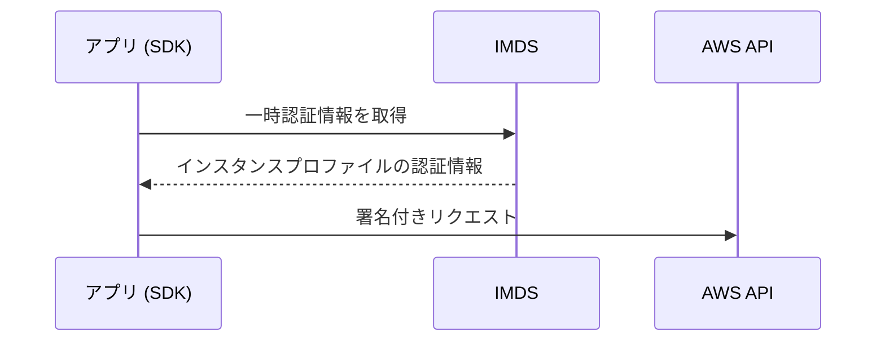
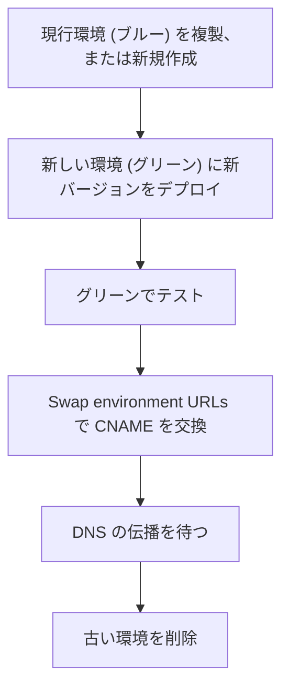
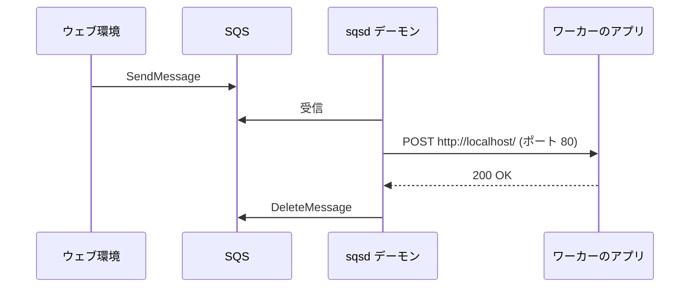

# EC2 と Elastic Beanstalk

EC2 は仮想サーバーで、OS から自分で管理します。Elastic Beanstalk はコードをアップロードするだけで EC2、Auto Scaling、ロードバランサーなどを構成してくれるサービスです。

[](../assets/diagrams/ec2-beanstalk-tiers.png)

## EC2 から AWS を呼ぶ {#instance-profile}

アクセスキーをインスタンスに置かず、IAM ロールを使います。ロールはインスタンスプロファイルとして EC2 にアタッチします。



SDK のデフォルトの認証情報チェーンが自動で取得、更新してくれるので、コードに認証情報を書く必要はありません。詳しくは [IAM](iam.md) を参照してください。

## インスタンスメタデータサービス (IMDS) {#imds}

インスタンスの中から `169.254.169.254` にアクセスし、自身の情報を取得します。

| 観点 | IMDSv1 | IMDSv2 |
| --- | --- | --- |
| 方式 | リクエストと応答のみ | セッションベース |
| トークン | 不要 | `PUT` で取得し、`GET` のヘッダーに付ける |
| 安全性 | SSRF などの影響を受けやすい | 対策されている |

```bash
TOKEN=$(curl -s -X PUT "http://169.254.169.254/latest/api/token" \
  -H "X-aws-ec2-metadata-token-ttl-seconds: 21600")
curl -s -H "X-aws-ec2-metadata-token: $TOKEN" \
  http://169.254.169.254/latest/meta-data/instance-id
```

- トークンの有効期間は最長 6 時間(21,600 秒)です。発行したインスタンスでのみ有効です。
- `HttpTokens` を `required` にすると IMDSv1 は無効になり、トークンなしのリクエストは `401` になります。
- `PUT` の応答のホップ制限はデフォルトで 1 です。コンテナからアクセスするなら 2 にします。アカウントのデフォルトや `ImdsSupport: v2.0` の AMI の設定で、新しいインスタンスに IMDSv2 必須を適用できます。

## ユーザーデータ {#user-data}

インスタンスの初回起動時に実行するスクリプトです。

```bash
#!/bin/bash
dnf install -y httpd
systemctl enable --now httpd
```

| 項目 | 内容 |
| --- | --- |
| 実行ユーザー | root(`sudo` は不要) |
| 実行タイミング | デフォルトでは初回起動時のみ |
| サイズ | base64 エンコード前で 16 KB まで |
| 形式 | シェルスクリプト(`#!` で始める)か cloud-init の設定(`#cloud-config`) |
| ログ | `/var/log/cloud-init-output.log` |
| AWS API の利用 | インスタンスプロファイルが必要 |
| 変更 | インスタンスを停止してから可能。AMI には含まれない |

対話的な入力はできないので、`yum` や `dnf` には `-y` を付けます。起動を速くしたいなら、依存関係を入れた AMI を作っておきます。

## インスタンスタイプとメモリ、CPU の要件 {#instance-types}

アプリに必要な最小のメモリと CPU を見積もり、そこからタイプを選びます。

| ファミリー | 特徴 | 向く処理 |
| --- | --- | --- |
| T | バースト可能。CPU クレジットを消費 | 負荷の低い Web、開発環境 |
| M | バランス型 | 一般的なアプリ |
| C | CPU 重視 | バッチ、エンコード |
| R、X | メモリ重視 | インメモリキャッシュ、大きなヒープ |
| I、D | ストレージ重視 | 高 IOPS のローカルストレージ |
| P、G | GPU | 機械学習、グラフィックス |

### 最小のメモリとコンピューティングを決める {#sizing}

| 手順 | 内容 |
| --- | --- |
| 1. 計測する | 負荷テストで CPU、メモリ、I/O、ネットワークを観察 |
| 2. ボトルネックを特定 | CloudWatch の `CPUUtilization` が飽和しているか、メモリが足りないか |
| 3. 余裕を見て選ぶ | ピーク時と障害時の負荷でも足りるサイズ |
| 4. 本番で見直す | メトリクスを確認し、サイズを調整 |

- メモリ使用率は EC2 の標準メトリクスにありません。CloudWatch エージェントで収集します([監視](observability.md))。
- T 系で `CPUCreditBalance` が尽きると CPU が制限されます。常に高負荷なら M や C に変えます。
- メモリを増やすと自動で CPU が増える Lambda と違い、EC2 はタイプで組み合わせが決まります。
- 同じ考え方はコンテナにも当てはまります。[コンテナ](containers.md) のタスクサイズも参照してください。

## EC2 Auto Scaling {#auto-scaling}

負荷に応じてインスタンス数を増減します。`最小`、`最大`、`希望` の容量の範囲で動きます。

| ポリシー | 動作 | 使いどころ |
| --- | --- | --- |
| ターゲット追跡 | メトリクスを目標値に保つ(サーモスタットのイメージ) | 第一候補として強く推奨 |
| ステップ | アラームの超過量に応じて段階的に増減 | 細かい制御 |
| シンプル | 1 回の調整とクールダウン | 古い方式 |
| スケジュール | 決まった時刻に容量を変更 | 予定された負荷変動 |
| 予測 | 過去のパターンから先回りして増やす | 周期的な負荷 |

```bash
aws autoscaling put-scaling-policy \
  --auto-scaling-group-name web-asg \
  --policy-name cpu50 \
  --policy-type TargetTrackingScaling \
  --target-tracking-configuration '{
    "PredefinedMetricSpecification": {"PredefinedMetricType": "ASGAverageCPUUtilization"},
    "TargetValue": 50.0
  }'
```

- **メトリクスの選び方**: インスタンスを 2 倍にすると半分になるものが適切です。平均 CPU 使用率やターゲットあたりのリクエスト数です。
- **SQS の処理**: インスタンスあたりのバックログをカスタムメトリクスにして、ターゲット追跡します。
- **複数のポリシー**: スケールアウトでもインでも、容量が最も大きくなるものが選ばれます。
- **ステートレスにする**: インスタンスはいつでも削除されます。セッションは ElastiCache や DynamoDB に、ファイルは S3 に置きます。
- **接続数**: インスタンスが増えると DB の接続も増えます。接続プールの上限を確認します([データベースとキャッシュ](databases.md))。

## Elastic Beanstalk の環境 {#beanstalk-environments}

| 用語 | 意味 |
| --- | --- |
| アプリケーション | 環境とバージョンをまとめる入れ物 |
| アプリケーションバージョン | デプロイ可能なソースバンドル |
| 環境 | バージョンを動かすリソース一式(dev、staging、prod など) |
| 環境枠(ティア) | ウェブサーバーかワーカーか |
| プラットフォーム | 言語、OS、Web サーバーの組み合わせ |

| 環境の種類 | 構成 | 向く場面 |
| --- | --- | --- |
| 単一インスタンス | EC2 を 1 台 | 開発、低コスト |
| ロードバランス | ALB と Auto Scaling | 本番 |

環境を分けることで、同じアプリの異なるバージョンを開発、検証、本番で同時に動かせます。EB CLI を使うなら `eb create`、`eb deploy`、`eb swap` で操作できます。

環境の種類には、EC2 上で動く Beanstalk Standard に加えて、EKS 上で動きコンテナイメージをデプロイする Beanstalk Cluster があります。この後の `.ebextensions`、不変デプロイ、トラフィック分割は Standard の機能です。

RDS を環境の中で作ると、環境の削除で一緒に消えるおそれがあります。本番の DB は環境の外に作るのが基本です。

## デプロイポリシー {#deployment-policies}

| ポリシー | 値 | 失敗時の影響 | 所要時間 | ダウンタイムなし | DNS 変更なし | ロールバック | デプロイ先 |
| --- | --- | --- | --- | --- | --- | --- | --- |
| 一度にすべて | `AllAtOnce` | ダウンタイム | 最短 | いいえ | はい | 手動で再デプロイ | 既存 |
| ローリング | `Rolling` | 1 バッチが停止。完了バッチは新版のまま | 中 | はい | はい | 手動で再デプロイ | 既存 |
| 追加バッチ付きローリング | `RollingWithAdditionalBatch` | 最初のバッチなら軽微。それ以降はローリングと同様 | やや長い | はい | はい | 手動で再デプロイ | 新規と既存 |
| 不変 | `Immutable` | 軽微 | 長い | はい | はい | 新インスタンスを終了 | 新規 |
| トラフィック分割 | `TrafficSplitting` | 新版に流した割合のクライアントのみ一時的に影響 | 長い | はい | はい | トラフィックを戻して新インスタンスを終了 | 新規 |
| ブルー/グリーン | (環境のスワップ) | 軽微 | 長い | はい | いいえ | URL をスワップで戻す | 新規 |

環境の種類による制約は次のとおりです。

| ポリシー | ロードバランス環境 | 単一インスタンス環境 |
| --- | --- | --- |
| 一度にすべて、不変 | 可 | 可 |
| ローリング、追加バッチ付き | 可 | 不可 |
| トラフィック分割 | 可(ALB) | 不可 |

```yaml
# .ebextensions/deploy.config
option_settings:
  aws:elasticbeanstalk:command:
    DeploymentPolicy: Immutable
  aws:autoscaling:updatepolicy:rollingupdate:
    RollingUpdateType: Immutable
```

### 選び方 {#choosing-policy}

| 要件 | 選択 |
| --- | --- |
| 開発環境で最速に | 一度にすべて |
| ダウンタイムなし、追加費用なし、キャパシティが減ってもよい | ローリング |
| キャパシティを落とせない | 追加バッチ付きローリング |
| 失敗時にすぐ戻したい、新しいインスタンスで検証したい | 不変 |
| 一部のトラフィックだけで試したい(カナリア) | トラフィック分割 |
| 環境ごと切り替えたい、互換性のないプラットフォーム更新 | ブルー/グリーン |

### 不変デプロイの流れ {#immutable}

1. 一時的な Auto Scaling グループを作り、新しいインスタンスを 1 台起動します。
2. ヘルスチェックに通ると、既存と同じ数まで新しいインスタンスを増やします。
3. すべて正常なら元の Auto Scaling グループに移し、古いインスタンスと一時グループを削除します。
4. 失敗なら一時グループを終了するだけで戻ります。

一時的にキャパシティが 2 倍になるので、インスタンスのクォータを確認します。拡張ヘルスレポートが必要です。リソース設定の変更とは同時に実行できません。

### ブルー/グリーンと CNAME スワップ {#blue-green}



- 環境単位で独立しているので、DB は環境の外に置きます。
- スワップは DNS を変えます。キャッシュされた DNS があるので、**古い環境は TTL が切れるまで消しません**。
- 互換性のないプラットフォームのバージョンへの更新にも使います。

## 設定ファイルとディレクトリ構成 {#directory-structure}

ソースバンドルのルートに設定を置きます。ZIP にする際、ドットで始まるフォルダーが含まれているか確認します。

```text
my-app.zip
├── app.py
├── requirements.txt
├── Procfile                 # アプリの起動コマンド
├── Buildfile                # ビルドのコマンド
├── cron.yaml                # ワーカー環境の定期タスク
├── .ebextensions/
│   └── options.config       # 環境の設定、リソース追加
└── .platform/
    ├── hooks/
    │   ├── prebuild/
    │   ├── predeploy/
    │   └── postdeploy/
    ├── confighooks/
    └── nginx/               # リバースプロキシの設定
```

### .ebextensions {#ebextensions}

ファイルの拡張子は `.config` で、YAML か JSON で書きます。同じファイルの中で同じキーを 2 回使うと片方が無視されます。

| セクション | 用途 |
| --- | --- |
| `option_settings` | 環境の設定オプション |
| `Resources` | CloudFormation のリソースを追加 |
| `packages`、`sources`、`files`、`users`、`groups`、`services` | インスタンスの設定 |
| `commands` | アプリ展開前に実行 |
| `container_commands` | アプリ展開後、デプロイ前に実行 |

```yaml
option_settings:
  aws:elasticbeanstalk:application:environment:
    LOG_LEVEL: info

container_commands:
  01_migrate:
    command: "python manage.py migrate"
    leader_only: true
```

`leader_only: true` は 1 台だけで実行します。DB のマイグレーションに使います。

### プラットフォームフック {#platform-hooks}

| ディレクトリ | 実行のタイミング |
| --- | --- |
| `.platform/hooks/prebuild` | ソースの展開後、アプリの設定前(`commands` の後、`Buildfile` の前) |
| `.platform/hooks/predeploy` | アプリの設定後、配置前(`container_commands` の後、`Procfile` の前) |
| `.platform/hooks/postdeploy` | デプロイの最後 |
| `.platform/confighooks/*` | インスタンスを作り直さない設定変更時(環境プロパティの変更など) |

ファイル名の辞書順に root で実行します。0 以外で終わると、デプロイが失敗します。`#!` で始めるスクリプトか実行ファイルにします。Amazon Linux 2 以降で使えます。

## ワーカー環境 {#worker-tier}

時間のかかる処理をウェブ環境から切り離します。



| 応答 | 動作 |
| --- | --- |
| `200 OK` | デーモンがメッセージを削除 |
| それ以外 | `ErrorVisibilityTimeout` の後にキューに戻る |
| 応答なし | `InactivityTimeout` の後にキューに戻る |

- ポート 80 は変更できません。パスと MIME タイプは変更できます。
- `MaxRetries`(デフォルト 10)を超えたメッセージは、デッドレターキューに送られます。自動生成のキューならデフォルトで有効です。
- メッセージは少なくとも 1 回届くので、処理は冪等にします。
- スケールは、デフォルトでは CPU 使用率が基準です。

**定期タスク**: `cron.yaml` で設定します。FIFO キューでは使えません。

```yaml
version: 1
cron:
  - name: "nightly-report"
    url: "/tasks/report"
    schedule: "0 15 * * *"
```

## 試験のポイント {#exam-points}

| こう問われたら | 答え |
| --- | --- |
| EC2 からアクセスキーなしで S3 を読みたい | インスタンスプロファイル(IAM ロール) |
| インスタンス ID をスクリプトで取得 | IMDSv2。`PUT` でトークンを取得 |
| コンテナから IMDSv2 が使えない | ホップ制限を 2 にする |
| 起動時にパッケージを入れたい | ユーザーデータ |
| ユーザーデータで `sudo` は必要か | 不要。root で実行 |
| ユーザーデータのデバッグ | `/var/log/cloud-init-output.log` |
| メモリ使用率を監視したい | CloudWatch エージェント |
| 負荷に応じて台数を調整、設定は簡単に | ターゲット追跡スケーリング |
| キュー長で EC2 をスケール | インスタンスあたりのバックログでターゲット追跡 |
| コードを置くだけで Web アプリを動かす | Elastic Beanstalk |
| 開発環境で最速のデプロイ | 一度にすべて |
| デプロイ中もキャパシティを維持 | 追加バッチ付きローリング |
| 失敗時に最速で安全に戻す | 不変、ブルー/グリーン |
| 一部のユーザーだけに新版を試す | トラフィック分割 |
| URL を切り替えてデプロイ | CNAME スワップ |
| 環境と一緒に DB が消えないように | RDS を環境の外に作る |
| 環境に DynamoDB テーブルなどを追加 | `.ebextensions` の `Resources` |
| マイグレーションを 1 台だけで | `container_commands` の `leader_only` |
| デプロイの前後に独自スクリプト | `.platform/hooks` |
| 重い処理をウェブから切り離す | ワーカー環境 |
| 定期実行 | ワーカー環境の `cron.yaml` |

## 関連ページ {#related}

- [IAM](iam.md)
- [コンテナ](containers.md)
- [ストレージの選び方](storage.md)
- [データベースとキャッシュ](databases.md)
- [メッセージング](messaging.md)
- [CI/CD](cicd.md)
- [監視](observability.md)

## 参考 {#references}

- [Use the Instance Metadata Service to access instance metadata](https://docs.aws.amazon.com/AWSEC2/latest/UserGuide/configuring-instance-metadata-service.html)
- [Configure instance metadata options for new instances](https://docs.aws.amazon.com/AWSEC2/latest/UserGuide/configuring-IMDS-new-instances.html)
- [Run commands when you launch an EC2 instance with user data](https://docs.aws.amazon.com/AWSEC2/latest/UserGuide/user-data.html)
- [Dynamic scaling for Amazon EC2 Auto Scaling](https://docs.aws.amazon.com/autoscaling/ec2/userguide/as-scale-based-on-demand.html)
- [Deploying applications to Elastic Beanstalk environments](https://docs.aws.amazon.com/elasticbeanstalk/latest/dg/using-features.deploy-existing-version.html)
- [Immutable environment updates](https://docs.aws.amazon.com/elasticbeanstalk/latest/dg/environmentmgmt-updates-immutable.html)
- [Blue/Green deployments with Elastic Beanstalk](https://docs.aws.amazon.com/elasticbeanstalk/latest/dg/using-features.CNAMESwap.html)
- [Advanced environment customization with configuration files](https://docs.aws.amazon.com/elasticbeanstalk/latest/dg/ebextensions.html)
- [Extending Elastic Beanstalk Linux platforms](https://docs.aws.amazon.com/elasticbeanstalk/latest/dg/platforms-linux-extend.html)
- [Platform hooks](https://docs.aws.amazon.com/elasticbeanstalk/latest/dg/platforms-linux-extend.hooks.html)
- [Elastic Beanstalk worker environments](https://docs.aws.amazon.com/elasticbeanstalk/latest/dg/using-features-managing-env-tiers.html)
