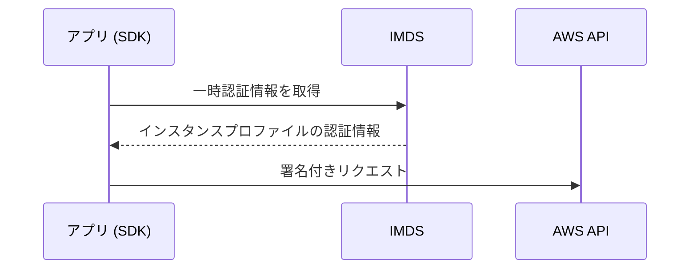
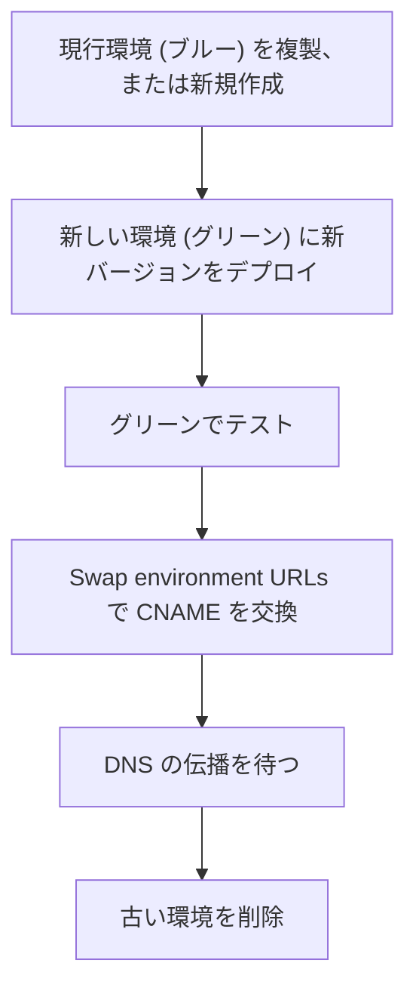
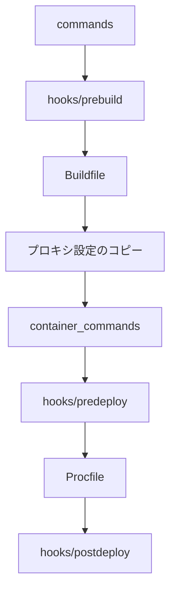
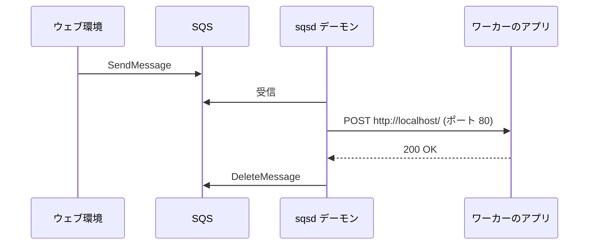

# EC2 と Elastic Beanstalk

[:material-sprout: CLF](../courses/clf/services.md){ .exam-badge .exam-foundational } [:material-sprout: AIF](../courses/aif/services.md){ .exam-badge .exam-foundational } [:material-certificate: SAA](../courses/saa/services.md){ .exam-badge .exam-associate } [:material-certificate: DVA](../courses/dva/services.md){ .exam-badge .exam-associate } [:material-certificate: SOA](../courses/soa/services.md){ .exam-badge .exam-associate } [:material-certificate: DEA](../courses/dea/services.md){ .exam-badge .exam-associate } [:material-certificate: MLA](../courses/mla/services.md){ .exam-badge .exam-associate } [:material-star-circle: SAP](../courses/sap/services.md){ .exam-badge .exam-professional } [:material-star-circle: DOP](../courses/dop/services.md){ .exam-badge .exam-professional } [:material-star-circle: AIP](../courses/aip/services.md){ .exam-badge .exam-professional } [:material-target: ANS](../courses/ans/services.md){ .exam-badge .exam-specialty } [:material-target: SCS](../courses/scs/services.md){ .exam-badge .exam-specialty }

EC2 は仮想サーバーで、OS から自分で管理します。Elastic Beanstalk はコードをアップロードするだけで EC2、Auto Scaling、ロードバランサーなどを構成してくれるサービスです。

**提供単位**: EC2 インスタンスは AZ の単位で、1 台だけなら、その AZ の障害で止まります。**VPC**: インスタンスはサブネットに置くので VPC の中です。Auto Scaling と Beanstalk は各節の冒頭に書きます([リソースの提供単位](resource-scope.md#scope-zonal))。

[](../assets/diagrams/ec2-beanstalk-tiers.png)

## EC2 から AWS を呼ぶ {#instance-profile}

アクセスキーをインスタンスに置かず、IAM ロールを使います。ロールはインスタンスプロファイルとして EC2 にアタッチします。

**提供単位**: IAM のロールとインスタンスプロファイルはグローバルで、VPC の外です([リソースの提供単位](resource-scope.md#scope-global))。東京でも大阪でも、同じプロファイルをインスタンスに付けられます。



SDK のデフォルトの認証情報チェーンが自動で取得、更新してくれるので、コードに認証情報を書く必要はありません。詳しくは [IAM](iam.md) を参照してください。

### インスタンスプロファイルの設定 {#instance-profile-settings}

インスタンスプロファイルは IAM ロールを入れる入れ物です。1 つのプロファイルに入るロールは 1 つだけで、この上限は増やせません。コンソールで EC2 用のロールを作ると、同じ名前のプロファイルが自動で作られます。CLI で作る場合は、プロファイルも別に作ります。

```bash
aws iam create-instance-profile --instance-profile-name web-profile
aws iam add-role-to-instance-profile \
  --instance-profile-name web-profile --role-name web-role
aws ec2 associate-iam-instance-profile \
  --instance-id i-0123456789abcdef0 \
  --iam-instance-profile Name=web-profile
```

| 操作 | 動作 |
| --- | --- |
| 起動時の指定 | `run-instances` の `--iam-instance-profile` |
| 起動後の付与 | `associate-iam-instance-profile`。停止中でも実行中でも可能 |
| 権限の変更 | ロールのポリシーを変えるか、プロファイルを置き換える |
| 認証情報の場所 | IMDS の `iam/security-credentials/<ロール名>`。SDK が自動で読む |

**例**: 実行中のインスタンスに S3 の読み取りを許可するなら、必要なバケットだけを許可するロールを作り、`associate-iam-instance-profile` で付けます。インスタンスの作り直しは要りません。

**落とし穴**: プロファイルからロールを外す方法は勧められていません。反映まで最大 1 時間かかることがあります。権限を変えるならプロファイルを置き換えます。

**例(置き換え)**: 付いているプロファイルを別のものに替えるには、関連付けの ID を指定します。

```bash
aws ec2 describe-iam-instance-profile-associations \
  --filters Name=instance-id,Values=i-0123456789abcdef0
aws ec2 replace-iam-instance-profile-association \
  --association-id iip-assoc-0123456789abcdef0 \
  --iam-instance-profile Name=web-profile-v2
```

**誤ると**: プロファイルがないと、AWS CLI や SDK は認証情報を見つけられず、API を呼べません。ロールはあっても権限が足りないと、`AccessDenied` になります。

## インスタンスメタデータサービス (IMDS) {#imds}

インスタンスの中から `169.254.169.254` にアクセスし、自身の情報を取得します。

| 観点 | IMDSv1 | IMDSv2 |
| --- | --- | --- |
| 方式 | リクエストと応答のみ | セッションベース |
| トークン | 不要 | `PUT` で取得し、`GET` のヘッダーに付ける |
| 安全性 | SSRF などの影響を受けやすい | 対策されている |

```bash
TOKEN=$(curl -s -X PUT "http://169.254.169.254/latest/api/token" \
  -H "X-aws-ec2-metadata-token-ttl-seconds: 21600")
curl -s -H "X-aws-ec2-metadata-token: $TOKEN" \
  http://169.254.169.254/latest/meta-data/instance-id
```

- トークンの有効期間は最長 6 時間(21,600 秒)です。発行したインスタンスでのみ有効です。
- `HttpTokens` を `required` にすると IMDSv1 は無効になり、トークンなしのリクエストは `401` になります。
- `PUT` の応答のホップ制限はデフォルトで 1 です。コンテナからアクセスするなら 2 にします。アカウントのデフォルトや `ImdsSupport: v2.0` の AMI の設定で、新しいインスタンスに IMDSv2 必須を適用できます。

**取得できる値の例**:

| パス(`latest/meta-data/` の後) | 値の例 |
| --- | --- |
| `instance-id` | `i-0123456789abcdef0` |
| `placement/availability-zone` | `ap-northeast-1a` |
| `instance-type` | `t3.micro` |
| `iam/security-credentials/web-role` | 一時的な認証情報の JSON |

**例(トークンの期間)**: `ttl-seconds: 300` で取得したトークンは、5 分後の `GET` で `401` になります。長く動くスクリプトは、取り直すか、21,600 秒で取得します。

### メタデータオプションの設定 {#imds-options}

`run-instances` の `--metadata-options` か、起動後の `modify-instance-metadata-options` で変えます。

| 設定 | 値 | 変更すると |
| --- | --- | --- |
| `HttpTokens` | `optional`、`required` | `required` で IMDSv2 のみ。トークンなしは `401` |
| `HttpPutResponseHopLimit` | 1〜64 | トークン応答が通れるネットワークのホップ数 |
| `HttpEndpoint` | `enabled`、`disabled` | `disabled` で IMDS 自体が使えない |
| `InstanceMetadataTags` | `enabled`、`disabled` | `enabled` でインスタンスのタグをメタデータから読める |

```bash
aws ec2 modify-instance-metadata-options \
  --instance-id i-0123456789abcdef0 \
  --http-tokens required --http-put-response-hop-limit 2
```

値は、起動時の指定、アカウントのデフォルト、AMI の設定の順に優先されます。AMI の `ImdsSupport: v2.0` で起動すると、`HttpTokens` は `required`、ホップ制限は 2 になります。ただし、アカウントでホップ制限を 1 にしていれば 1 が優先されます。

**例**: EC2 上の Docker コンテナから IMDSv2 を使うと、ホストからコンテナへの転送で 1 ホップ増えます。ホップ制限が 1 だとトークンが届かず、SDK は認証情報の取得に失敗します。2 に上げると解決します。

| 症状 | 原因 |
| --- | --- |
| `401 Unauthorized` | トークンが無効。取り直す |
| `403 Forbidden` | IMDS が無効。または `/2021-03-23/api/token` のようにバージョン付きパスへ `PUT` した |
| 認証情報の取得が時々失敗 | 取得のしすぎによるスロットリング。リンクローカルのサービスには合計で毎秒 1,024 パケットの上限がある。認証情報はキャッシュする |

**例(`HttpEndpoint`)**: IMDS を使わないインスタンスは `disabled` にします。SDK はインスタンスプロファイルの認証情報を取れなくなるので、それに頼るアプリでは無効にできません。

**例(`InstanceMetadataTags`)**: `enabled` にすると、`Env=prod` のタグを中から読めます。アプリの設定の切り替えに使えます。

```bash
curl -H "X-aws-ec2-metadata-token: $TOKEN" \
  http://169.254.169.254/latest/meta-data/tags/instance/Env
```

**計算例(パケットの上限)**: 1 回の取得が 10 パケットなら、毎秒 100 回の取得で 1,000 パケットです。毎秒 1,024 パケットの上限に近づくので、値を変数に保存して使い回します。

## ユーザーデータ {#user-data}

インスタンスの初回起動時に実行するスクリプトです。

```bash
#!/bin/bash
dnf install -y httpd
systemctl enable --now httpd
```

| 項目 | 内容 |
| --- | --- |
| 実行ユーザー | root(`sudo` は不要) |
| 実行タイミング | デフォルトでは初回起動時のみ |
| サイズ | base64 エンコード前で 16 KB まで |
| 形式 | シェルスクリプト(`#!` で始める)か cloud-init の設定(`#cloud-config`) |
| ログ | `/var/log/cloud-init-output.log` |
| AWS API の利用 | インスタンスプロファイルが必要 |
| 変更 | インスタンスを停止してから可能。AMI には含まれない |

対話的な入力はできないので、`yum` や `dnf` には `-y` を付けます。起動を速くしたいなら、依存関係を入れた AMI を作っておきます。

**例**: ユーザーデータの `aws s3 cp` だけが失敗するなら、インスタンスプロファイルの付け忘れを疑います。`/var/log/cloud-init-output.log` に出力が残っています。

**落とし穴**: サイズの上限は base64 エンコード前で 16 KB です。実行中のインスタンスのユーザーデータは変更できず、停止してから変えます。内容はインスタンスの中からメタデータとして読めるので、パスワードを入れてはいけません。

**計算例(サイズ)**: 16 KB(16,384 バイト)のスクリプトは、base64 で 21,848 バイトになります(5,462 × 4)。上限は変換前の値で判定します。20 KB のスクリプトは入らないので、本体を S3 に置き、ユーザーデータでは `aws s3 cp` と実行だけを書きます。

**例(形式)**: cloud-init の設定なら、次のように書きます。

```yaml
#cloud-config
packages:
  - httpd
runcmd:
  - systemctl enable --now httpd
```

**例(停止中の変更)**:

```bash
aws ec2 stop-instances --instance-ids i-0123456789abcdef0
aws ec2 modify-instance-attribute --instance-id i-0123456789abcdef0 \
  --attribute userData --value file://new-script.b64
```

**誤ると**: 1 行目の `#!/bin/bash` がないと、スクリプトとして実行されません。ユーザーデータを直して再起動しても、既定では初回の起動でしか動かないので、変更は反映されません。

## インスタンスタイプとメモリ、CPU の要件 {#instance-types}

アプリに必要な最小のメモリと CPU を見積もり、そこからタイプを選びます。

| ファミリー | 特徴 | 向く処理 |
| --- | --- | --- |
| T | バースト可能。CPU クレジットを消費 | 負荷の低い Web、開発環境 |
| M | バランス型 | 一般的なアプリ |
| C | CPU 重視 | バッチ、エンコード |
| R、X | メモリ重視 | インメモリキャッシュ、大きなヒープ |
| I、D | ストレージ重視 | 高 IOPS のローカルストレージ |
| P、G | GPU | 機械学習、グラフィックス |

**名前の読み方**: `m6i.large` は、ファミリー `m`、世代 `6`、Intel の `i`、サイズ `large` です。

**選び方の例**:

| 処理 | 選択 | 理由 |
| --- | --- | --- |
| 開発用の Web で、CPU はほぼ 5% | `t3.micro` | 低い平均とたまのバースト |
| 動画のエンコード | `c7g.xlarge` | CPU が主なボトルネック |
| Java のヒープが 60 GB | `r6i.4xlarge` | メモリが主なボトルネック |
| ローカルの NVMe で高 IOPS | `i4i.large` | インスタンスストアの性能 |
| 深層学習の学習 | `p5.48xlarge` | GPU が要る |

### 最小のメモリとコンピューティングを決める {#sizing}

| 手順 | 内容 |
| --- | --- |
| 1. 計測する | 負荷テストで CPU、メモリ、I/O、ネットワークを観察 |
| 2. ボトルネックを特定 | CloudWatch の `CPUUtilization` が飽和しているか、メモリが足りないか |
| 3. 余裕を見て選ぶ | ピーク時と障害時の負荷でも足りるサイズ |
| 4. 本番で見直す | メトリクスを確認し、サイズを調整 |

- メモリ使用率は EC2 の標準メトリクスにありません。CloudWatch エージェントで収集します([監視](observability.md))。
- T 系で `CPUCreditBalance` が尽きると CPU が制限されます。常に高負荷なら M や C に変えます。
- メモリを増やすと自動で CPU が増える Lambda と違い、EC2 はタイプで組み合わせが決まります。
- 同じ考え方はコンテナにも当てはまります。[コンテナ](containers.md) のタスクサイズも参照してください。

**計算例(障害時の余裕)**: 3 台で平均 CPU 60% のアプリは、1 台落ちると 2 台で受けるので、60 × 3 ÷ 2 = 90% になります。AZ の障害まで見込むなら、1 台あたりの平均を 60% 以下に抑えます。

**計算例(T 系のクレジット)**: 1 クレジットは、1 vCPU を 100% で 1 分使う量です。`t3.micro` は 2 vCPU、ベースライン 10%、毎時 12 クレジットを得て、最大 288 まで貯まります。

- 使用率 30% を続けると、消費は 0.3 × 2 × 60 = 36 クレジット/時間です。
- 収支は 12 - 36 = -24 クレジット/時間で、満タンの 288 クレジットが 12 時間で尽きます。
- 尽きると Standard モードではベースラインの 10% まで徐々に下がり、遅くなります。

**誤ると**: メモリが足りないと、`CPUUtilization` は低いのにアプリが落ちます。CPU のメトリクスだけでは分からないので、CloudWatch エージェントを入れます。

## EC2 Auto Scaling {#auto-scaling}

[:material-certificate: SAA](../courses/saa/services.md){ .exam-badge .exam-associate } [:material-star-circle: DOP](../courses/dop/services.md){ .exam-badge .exam-professional } [:material-target: ANS](../courses/ans/services.md){ .exam-badge .exam-specialty }

負荷に応じてインスタンス数を増減します。`最小`、`最大`、`希望` の容量の範囲で動きます。

**提供単位**: Auto Scaling グループはリージョンのリソースです。指定したサブネットの AZ にインスタンスを分けて置きます。**VPC**: インスタンスは指定したサブネットの中です([リソースの提供単位](resource-scope.md#scope-regional-vpc))。

| ポリシー | 動作 | 使いどころ |
| --- | --- | --- |
| ターゲット追跡 | メトリクスを目標値に保つ(サーモスタットのイメージ) | 第一候補として強く推奨 |
| ステップ | アラームの超過量に応じて段階的に増減 | 細かい制御 |
| シンプル | 1 回の調整とクールダウン | 古い方式 |
| スケジュール | 決まった時刻に容量を変更 | 予定された負荷変動 |
| 予測 | 過去のパターンから先回りして増やす | 周期的な負荷 |

```bash
aws autoscaling put-scaling-policy \
  --auto-scaling-group-name web-asg \
  --policy-name cpu50 \
  --policy-type TargetTrackingScaling \
  --target-tracking-configuration '{
    "PredefinedMetricSpecification": {"PredefinedMetricType": "ASGAverageCPUUtilization"},
    "TargetValue": 50.0
  }'
```

- **メトリクスの選び方**: インスタンスを 2 倍にすると半分になるものが適切です。平均 CPU 使用率やターゲットあたりのリクエスト数です。
- **SQS の処理**: インスタンスあたりのバックログをカスタムメトリクスにして、ターゲット追跡します。
- **複数のポリシー**: スケールアウトでもインでも、容量が最も大きくなるものが選ばれます。
- **ステートレスにする**: インスタンスはいつでも削除されます。セッションは ElastiCache や DynamoDB に、ファイルは S3 に置きます。
- **接続数**: インスタンスが増えると DB の接続も増えます。接続プールの上限を確認します([データベースとキャッシュ](databases.md))。

**ポリシーごとの例**:

- **ターゲット追跡**: 目標の CPU が 50% で、4 台の平均が 80% なら、4 × 80 ÷ 50 = 6.4 で、おおよそ 7 台に増やす方向に動きます。
- **`ALBRequestCountPerTarget`**: 全体で毎分 10,000 リクエスト、目標が 1 台あたり毎分 1,000 なら、10 台が目安です。
- **スケジュール**: 平日の 9 時(日本時間)に 10 台へ増やします。

```bash
aws autoscaling put-scheduled-update-group-action \
  --auto-scaling-group-name web-asg --scheduled-action-name weekday-open \
  --recurrence "0 9 * * 1-5" --time-zone "Asia/Tokyo" \
  --desired-capacity 10
```

- **予測**: 毎朝 9 時に負荷が上がるアプリで、前もって台数を増やします。まず `ForecastOnly` で予測だけを見て、合っていれば `ForecastAndScale` に変えます。
- **複数のポリシーの計算例**: CPU のポリシーが 8 台、リクエスト数のポリシーが 12 台を求めたら、12 台になります。スケールインも、最も多い台数を保つほうを選びます。

**SQS のバックログの計算例**: キューに 1,500 件で 10 台なら、バックログは 1 台あたり 150 件です。

- 許容する遅延が 10 秒、1 件の処理が 0.1 秒なら、目標値は 10 ÷ 0.1 = 100 件です。
- 150 件は 100 件より多いので、15 台(1,500 ÷ 100)へ増やす方向に動きます。

**誤ると**: `ApproximateNumberOfMessages` そのものを目標にすると、台数が考慮されないので、キューが減っていく間も増やしすぎます。

### 容量の設定 {#asg-capacity}

| 設定 | 意味 | 制約 |
| --- | --- | --- |
| `MinSize` | 下限。スケールインでこれより減らない | |
| `MaxSize` | 上限。スケールアウトでこれより増えない | |
| `DesiredCapacity` | 今維持する台数 | `MinSize` 以上、`MaxSize` 以下 |

**例**: 最小 2、最大 10、希望 4 のグループで 1 台が故障すると、Auto Scaling は 4 台に戻します。

**落とし穴**: 最小と最大が同じ値だと、スケーリングポリシーを作っても台数は変わりません。

```bash
aws autoscaling create-auto-scaling-group --auto-scaling-group-name web-asg \
  --launch-template LaunchTemplateName=web,Version='$Latest' \
  --min-size 2 --max-size 10 --desired-capacity 4 \
  --vpc-zone-identifier "subnet-0a1b2c3d,subnet-0e5f6a7b"
```

**例(AZ の配分)**: 上の設定で、2 つの AZ に 2 台ずつ置きます。AZ の 1 つが止まると、残りの AZ で 4 台に戻します。

**誤ると(`MaxSize`)**: 上限が 4 のグループは、ピークで 8 台必要でも 4 台で止まります。`GroupDesiredCapacity` が `MaxSize` に張り付いていないか見ます。

**誤ると(手動の変更)**: `DesiredCapacity` を手で 6 にしても、ターゲット追跡が 4 台で足りると判断すれば、また減らします。

### スケーリングクールダウン {#asg-cooldown}

クールダウンは、スケーリングの後で次の動作を待つ時間です。既定値は **300 秒** です。

| 動作 | クールダウンの影響 |
| --- | --- |
| シンプルスケーリング | 終わるまで次のスケーリングを始めない |
| ターゲット追跡、ステップのスケールアウト | 待たずに開始できる。代わりにウォームアップを使う |
| ターゲット追跡、ステップのスケールイン | 遅れることがある |
| スケジュールアクション | 待たずに開始できる |
| 異常なインスタンスの置き換え | 待たない |

AWS はシンプルスケーリングとクールダウンを勧めていません。ターゲット追跡を第一に選びます。

**例**: 起動に 5 分かかるアプリで、シンプルスケーリングのクールダウンを 60 秒にします。新しいインスタンスが負荷を受ける前にアラームがまた発火し、台数が増えすぎます。起動の所要時間に合わせて 300 秒以上にします。

```bash
aws autoscaling update-auto-scaling-group --auto-scaling-group-name web-asg \
  --default-cooldown 300
```

### インスタンスのウォームアップ {#instance-warmup}

`DefaultInstanceWarmup` は、`InService` になったインスタンスのメトリクスを集計に入れるまでの時間です。既定では**有効になっていません**が、ターゲット追跡とステップでは設定が強く勧められています。

スケールアウトの途中は、ウォームアップが終わるまでスケールインが止まります。

**例**: 起動後の 2 分間に CPU が 100% になるアプリで、設定しないと、この値が平均に入ってさらに台数が増えます。`--default-instance-warmup 120` にすると防げます。

**計算例**: 4 台が平均 50% の所に、起動直後で 100% の 1 台が入ると、平均は (4 × 50 + 100) ÷ 5 = 60% に見えます。目標が 50% なら、実際には足りていても増やそうとします。

### ステップスケーリングの調整 {#step-adjustments}

アラームのしきい値からの超過量に応じて、増減の量を変えます。CLI や SDK では、上限と下限を**しきい値からの差**で書きます。コンソールでは絶対値で書きます。

```bash
aws autoscaling put-scaling-policy \
  --auto-scaling-group-name web-asg --policy-name step-out \
  --policy-type StepScaling --adjustment-type ChangeInCapacity \
  --step-adjustments \
    MetricIntervalLowerBound=0,MetricIntervalUpperBound=20,ScalingAdjustment=1 \
    MetricIntervalLowerBound=20,ScalingAdjustment=3
```

しきい値が CPU 50% なら、50〜70% で 1 台、70% 以上で 3 台増やします。`--adjustment-type` には、台数の差の `ChangeInCapacity`、割合の `PercentChangeInCapacity`、台数を直接指定する `ExactCapacity` があります。

**`--adjustment-type` の例**: 現在が 10 台のときの動きです。

| タイプ | `ScalingAdjustment` | 結果 |
| --- | --- | --- |
| `ChangeInCapacity` | 3 | 13 台 |
| `PercentChangeInCapacity` | 25 | 2.5 を切り捨てて 2 台増、12 台 |
| `ExactCapacity` | 8 | 8 台 |

割合で 0〜1 の間の値になったら 1 台に切り上げます(10% を 3 台にかけた 0.3 は 1 台)。`MinAdjustmentMagnitude` を 2 にすると、割合で計算した増加が 1 台でも、2 台増やします。

### ヘルスチェック {#asg-health-checks}

| 種類 | 既定 | 見ているもの |
| --- | --- | --- |
| EC2 ステータスチェック | 常に有効 | インスタンスとハードウェアの状態 |
| ELB | 有効にする必要がある | ターゲットグループのヘルスチェック |
| VPC Lattice | 有効にする必要がある | VPC Lattice のヘルスチェック |
| EBS | 有効にする必要がある | ボリュームの状態 |
| カスタム | `set-instance-health` で通知 | 自分の判定 |

**ヘルスチェックの猶予期間**は、新しいインスタンスを異常と判定して終了するまでの最小の時間です。**コンソールで作ると既定は 300 秒、CLI や SDK で作ると既定は 0 秒** です。0 は猶予なしを意味します。

**例**: アプリの起動に 4 分かかるのに CLI で猶予を 0 のまま ELB ヘルスチェックを有効にすると、起動中に異常と判定され、終了と起動を繰り返します。`--health-check-grace-period 300` にします。

**落とし穴**: ELB ヘルスチェックを有効にしないと、アプリが 500 を返し続けても、EC2 のステータスが正常である限りインスタンスは置き換えられません。

```bash
aws autoscaling update-auto-scaling-group --auto-scaling-group-name web-asg \
  --health-check-type ELB --health-check-grace-period 300
```

**例(カスタム)**: アプリの監視スクリプトが異常を見つけたら、次を実行して置き換えさせます。

```bash
aws autoscaling set-instance-health --instance-id i-0123456789abcdef0 \
  --health-status Unhealthy
```

**例(猶予の長さ)**: 起動に 4 分かかるアプリは 300 秒にします。1 時間にすると、アプリの起動に失敗してヘルスチェックに通らないインスタンスも、1 時間は置き換えられません(EC2 の状態が `running` でなくなった場合は、猶予の間でもすぐ置き換えます)。起動時のライフサイクルフックを使うなら、0 にできます。

### ライフサイクルフックと終了ポリシー {#lifecycle-hooks}

ライフサイクルフックは、起動や終了の途中でインスタンスを待機状態にして、独自の処理を行う機能です。

| 設定 | 値 |
| --- | --- |
| ハートビートタイムアウト | 既定は 1 時間 |
| 待機の上限 | 48 時間か、ハートビートの 100 倍の短いほう |
| 結果 | `CONTINUE`、`ABANDON` |

**例**: 起動時に設定ファイルを取得してから `complete-lifecycle-action` で `CONTINUE` を返せば、準備が済むまで `InService` になりません。起動時の結果が `ABANDON` なら、そのインスタンスは終了します。終了時のフックは最善努力で、タイムアウトしても終了は進みます。

**既定の終了ポリシー**は、次の順に終了するインスタンスを選びます。

1. 保護されていないインスタンスが最も多い AZ を選ぶ
2. 古い設定のものを選ぶ(別の起動テンプレート、または現在のテンプレートの古いバージョン)
3. 次の課金時間に最も近いものを選ぶ
4. それでも複数なら無作為に選ぶ

**例(AZ の選択)**: 1a に 3 台、1c に 2 台のとき、スケールインでは 1a の中から選びます。

**ライフサイクルフックの計算例**: 待機の上限は、ハートビートと比べて次のようになります。

| ハートビート | 100 倍 | 待機の上限 |
| --- | --- | --- |
| 300 秒 | 30,000 秒(約 8.3 時間) | 約 8.3 時間 |
| 3,600 秒 | 360,000 秒(100 時間) | 48 時間 |

```bash
aws autoscaling put-lifecycle-hook --auto-scaling-group-name web-asg \
  --lifecycle-hook-name drain --heartbeat-timeout 300 --default-result CONTINUE \
  --lifecycle-transition autoscaling:EC2_INSTANCE_TERMINATING
# 処理が長引くときに待機を延ばす
aws autoscaling record-lifecycle-action-heartbeat --auto-scaling-group-name web-asg \
  --lifecycle-hook-name drain --instance-id i-0123456789abcdef0
# 処理が終わったら進める
aws autoscaling complete-lifecycle-action --auto-scaling-group-name web-asg \
  --lifecycle-hook-name drain --instance-id i-0123456789abcdef0 \
  --lifecycle-action-result CONTINUE
```

**例(終了前の処理)**: 終了時のフックでログを S3 へ送ってから `complete-lifecycle-action` を呼びます。

**誤ると(起動時の既定の結果)**: 起動時のフックで `--default-result ABANDON` のままスクリプトが止まると、タイムアウトのたびに終了と起動を繰り返します。

**終了ポリシーの変更の例**: 新しいインスタンスタイプへ移る間は、古いものから消すように指定します。

```bash
aws autoscaling update-auto-scaling-group --auto-scaling-group-name web-asg \
  --termination-policies OldestInstance
```

| ポリシー | 終了するもの |
| --- | --- |
| `OldestInstance` | 最も古いインスタンス |
| `NewestInstance` | 最も新しいインスタンス |
| `OldestLaunchTemplate` | 最も古い起動テンプレートのもの |
| `ClosestToNextInstanceHour` | 次の課金時間に最も近いもの |

**例(保護)**: 処理中のインスタンスをスケールインから守るには、スケールイン保護を使います。

```bash
aws autoscaling set-instance-protection --auto-scaling-group-name web-asg \
  --instance-ids i-0123456789abcdef0 --protected-from-scale-in
```

## Elastic Beanstalk の環境 {#beanstalk-environments}

| 用語 | 意味 |
| --- | --- |
| アプリケーション | 環境とバージョンをまとめる入れ物 |
| アプリケーションバージョン | デプロイ可能なソースバンドル |
| 環境 | バージョンを動かすリソース一式(dev、staging、prod など) |
| 環境枠(ティア) | ウェブサーバーかワーカーか |
| プラットフォーム | 言語、OS、Web サーバーの組み合わせ |

| 環境の種類 | 構成 | 向く場面 |
| --- | --- | --- |
| 単一インスタンス | EC2 を 1 台 | 開発、低コスト |
| ロードバランス | ALB と Auto Scaling | 本番 |

環境を分けることで、同じアプリの異なるバージョンを開発、検証、本番で同時に動かせます。EB CLI を使うなら `eb create`、`eb deploy`、`eb swap` で操作できます。

環境の種類には、EC2 上で動く Beanstalk Standard に加えて、EKS 上で動きコンテナイメージをデプロイする Beanstalk Cluster があります。この後の `.ebextensions`、不変デプロイ、トラフィック分割は Standard の機能です。

RDS を環境の中で作ると、環境の削除で一緒に消えるおそれがあります。本番の DB は環境の外に作るのが基本です。

**提供単位**: アプリケーションと環境はリージョンのリソースです。**VPC**: 環境の EC2 はサブネットの中です。ALB はサブネットを 2 つ以上の AZ で指定します([リソースの提供単位](resource-scope.md#scope-regional-vpc))。

**用語の例**:

| 用語 | 値の例 |
| --- | --- |
| アプリケーション | `shop` |
| アプリケーションバージョン | `v42`(`shop-v42.zip` から作る) |
| 環境 | `shop-prod`、`shop-staging` |
| 環境枠 | ウェブサーバー、またはワーカー |
| プラットフォーム | Python を動かす Amazon Linux 2023 のもの |

```bash
eb create shop-staging --single   # 単一インスタンス
eb create shop-prod --elb-type application  # ロードバランス
eb deploy shop-prod
eb swap shop-prod --destination_name shop-green
```

**例(環境の種類)**: 開発は `--single` で 1 台にして費用を抑えます。本番は 1 台の故障で止まらないよう、ロードバランス環境にします。

### 環境の主な設定 {#environment-settings}

| 名前空間 | オプション | 既定値 | 範囲、値 |
| --- | --- | --- | --- |
| `aws:elasticbeanstalk:environment` | `EnvironmentType` | `LoadBalanced` | `SingleInstance` も可 |
| 同上 | `LoadBalancerType` | `classic`(API の既定) | `application`、`network` |
| `aws:autoscaling:asg` | `MinSize` | 1 | 1〜10000 |
| 同上 | `MaxSize` | 4 | 1〜10000 |
| 同上 | `Cooldown` | 360 秒 | 0〜10000 |
| `aws:autoscaling:trigger` | `MeasureName` | `NetworkOut` | `CPUUtilization`、`RequestCount` など |
| 同上 | `UpperThreshold` | 6000000 | 0〜20000000 |
| 同上 | `LowerThreshold` | 2000000 | 0〜20000000 |
| 同上 | `BreachDuration` | 5 分 | 1〜600 |
| 同上 | `Period` | 5 分 | 1〜600 |
| 同上 | `EvaluationPeriods` | 1 | 1〜600 |
| `aws:elasticbeanstalk:environment:process:default` | `HealthCheckPath` | `/` | パス |
| 同上 | `HealthCheckInterval` | 15 秒(CLB、ALB) | 5〜300 |
| 同上 | `HealthCheckTimeout` | 5 秒 | 1〜60 |
| 同上 | `HealthyThresholdCount` | 3(CLB、ALB) | 2〜10 |
| 同上 | `DeregistrationDelay` | 20 秒 | 0〜3600 |
| 同上 | `MatcherHTTPCode` | 200 | ALB は 200〜499 |
| `aws:autoscaling:launchconfiguration` | `DisableIMDSv1` | AL2023 は `true`、AL2 は `false` | `true`、`false` |

トリガーの既定の指標は CPU ではなく `NetworkOut` です。**CPU で増減したいなら `MeasureName` を変え**、`Unit` を `Percent` に、しきい値を CPU の値にします。`BreachDuration` は `Period` × `EvaluationPeriods` と一致させます。

```yaml
option_settings:
  aws:autoscaling:trigger:
    MeasureName: CPUUtilization
    Unit: Percent
    UpperThreshold: 70
    LowerThreshold: 30
```

**落とし穴**: ヘルスチェックのパスが `/` のままで、`/` がログイン画面へリダイレクトすると、異常と判定されます。`/health` を `HealthCheckPath` に指定します。

**計算例(既定のトリガー)**: `NetworkOut` の 5 分の平均が 6,000,000 バイトを超えると、`UpperBreachScaleIncrement` の既定の 1 台が増えます。平均が 2,000,000 バイトを下回ると、`LowerBreachScaleIncrement` の既定の -1 で 1 台減ります。その後の 360 秒は `Cooldown` で待ちます。

**計算例(`BreachDuration`)**: `Period: 1`、`EvaluationPeriods: 5` なら、`BreachDuration` は 1 × 5 = 5 分です。CPU 70% 超えが 5 分続いて増えます。

**計算例(ヘルスチェック)**: `HealthCheckInterval: 15`、`UnhealthyThresholdCount: 5`(既定)なら、落ちたインスタンスを異常と判定するまで 15 × 5 = 75 秒です。`HealthyThresholdCount: 3` なら、復帰に 15 × 3 = 45 秒かかります。

**その他の項目の例**:

- **`EnvironmentType`**: `SingleInstance` にすると ALB がなくなり、URL はインスタンスを直接指します。
- **`LoadBalancerType`**: API や CloudFormation で作るときは `application` を明記します。省くと API の既定の `classic` になります。
- **`MinSize`、`MaxSize`**: 本番は `MinSize: 2`、`MaxSize: 8` のようにして、AZ の障害でも 1 台が残るようにします。
- **`HealthCheckTimeout`**: 既定の 5 秒に対して、`/health` の DB 確認に 8 秒かかると、毎回失敗して異常と判定されます。
- **`DeregistrationDelay`**: 最大 60 秒のダウンロードがあるなら 60 にします。既定の 20 秒だと、スケールインやデプロイで接続が切れます。
- **`MatcherHTTPCode`**: `/health` が 204 を返すなら `200,204` にします。既定の `200` だと、正常でも異常と判定されます。
- **`DisableIMDSv1`**: 古いライブラリが IMDSv1 しか使えないと、`true` では認証情報を取れません。ライブラリを更新してから有効にします。

### 環境プロパティ(環境変数) {#environment-properties}

`aws:elasticbeanstalk:application:environment` に書くと、アプリから環境変数として読めます。名前空間を省略した `option_settings` もここに入ります。

```yaml
option_settings:
  aws:elasticbeanstalk:application:environment:
    API_URL: https://api.example.com
```

```bash
aws elasticbeanstalk update-environment --environment-name prod \
  --option-settings Namespace=aws:elasticbeanstalk:application:environment,OptionName=LOG_LEVEL,Value=debug
```

- キーと値の合計は、`キー=値` の形で **4,096 バイト** までです。
- 互換性のためにキーは `[A-Z_][A-Z0-9_]*` に揃えます。
- パスワードは平文で入れず、Secrets Manager や Parameter Store を指定します。コンソールの **Source** で選べます。

**例**: `.ebextensions` に `LOG_LEVEL: info` と書き、後からコンソールで `debug` にすると、環境への直接の設定が優先されて `debug` になります。優先順位は [設定の優先順位](#option-precedence) を参照してください。

**計算例**: 1 組 200 バイトのプロパティを 25 個入れると 5,000 バイトで、4,096 バイトを超えます。設定は S3 や Parameter Store に置き、環境プロパティには場所だけを入れます。

**キー名の例**: `API_URL` はどの言語からも読めます。`api.url` は Beanstalk には入りますが、プラットフォームによっては環境変数の名前として使えません。

**誤ると**: `DB_PASSWORD` を平文で入れると、環境の設定を読める人全員に見えます。

### アプリケーションバージョンのライフサイクル {#version-lifecycle}

バージョンを消さないと、リージョン全体のクォータに達し、新しいバージョンを作れなくなります。ライフサイクルポリシーで古いものを消します。

| 条件 | 内容 |
| --- | --- |
| 総数で制限 | 指定の数を超えた古いものを削除 |
| 経過日数で制限 | 指定の日数を超えたものを削除 |
| 実行時期 | 新しいバージョンを作るたび。1 回で最大 100 個まで |
| 消さないもの | 環境で使用中のもの、終了して 10 週間以内の環境に配置したもの |
| ソースバンドル | 既定では S3 に残る。削除するよう設定できる |

```bash
aws elasticbeanstalk update-application-resource-lifecycle \
  --application-name my-app \
  --resource-lifecycle-config '{
    "ServiceRole": "arn:aws:iam::111122223333:role/aws-elasticbeanstalk-service-role",
    "VersionLifecycleConfig": {
      "MaxCountRule": {"Enabled": true, "MaxCount": 200, "DeleteSourceFromS3": true}
    }
  }'
```

**落とし穴**: クォータはアプリケーションごとではなくリージョン全体です。アプリが 10 個あれば、それぞれの上限の合計がクォータを超えないようにします。

**計算例**: クォータが 1,000 でアプリが 10 個なら、各アプリの `MaxCount` は 99 にします。合計 990 で収まります。上の例の 200 を 10 個のアプリすべてに使うと、合計 2,000 で超えます。

**例(経過日数)**: 180 日より古いものを消すなら、次のように書きます。

```json
{ "MaxAgeRule": { "Enabled": true, "MaxAgeInDays": 180, "DeleteSourceFromS3": true } }
```

**誤ると**: クォータに達すると、新しいバージョンの作成が `TooManyApplicationVersions` で失敗し、デプロイが止まります。

### 結合された RDS の注意 {#rds-coupling}

環境と一緒に RDS を作ると、接続情報が `RDS_HOSTNAME` などの環境プロパティで渡されて便利です。しかし、DB の寿命が環境に結び付きます。

| 削除ポリシー | 環境を終了、または DB を切り離したとき |
| --- | --- |
| `Snapshot` | スナップショットを取ってから DB を消す |
| `Delete` | DB を消す |
| `Retain` | DB を残す。外部の DB として使い続ける |

**例**: ブルー/グリーンで両方の環境から同じ DB を使うには、DB が環境から独立している必要があります。結合された DB を切り離し(`Retain`)、外部の RDS として接続情報を渡します。

**設定の例**: 名前空間は `aws:rds:dbinstance` です。

```yaml
option_settings:
  aws:rds:dbinstance:
    HasCoupledDatabase: "false"
    DBDeletionPolicy: Retain
```

**誤ると**: `Delete` のまま環境を終了すると、DB が消えて、バックアップから戻すまでサービスが止まります。

## デプロイポリシー {#deployment-policies}

| ポリシー | 値 | 失敗時の影響 | 所要時間 | ダウンタイムなし | DNS 変更なし | ロールバック | デプロイ先 |
| --- | --- | --- | --- | --- | --- | --- | --- |
| 一度にすべて | `AllAtOnce` | ダウンタイム | 最短 | いいえ | はい | 手動で再デプロイ | 既存 |
| ローリング | `Rolling` | 1 バッチが停止。完了バッチは新版のまま | 中 | はい | はい | 手動で再デプロイ | 既存 |
| 追加バッチ付きローリング | `RollingWithAdditionalBatch` | 最初のバッチなら軽微。それ以降はローリングと同様 | やや長い | はい | はい | 手動で再デプロイ | 新規と既存 |
| 不変 | `Immutable` | 軽微 | 長い | はい | はい | 新インスタンスを終了 | 新規 |
| トラフィック分割 | `TrafficSplitting` | 新版に流した割合のクライアントのみ一時的に影響 | 長い | はい | はい | トラフィックを戻して新インスタンスを終了 | 新規 |
| ブルー/グリーン | (環境のスワップ) | 軽微 | 長い | はい | いいえ | URL をスワップで戻す | 新規 |

環境の種類による制約は次のとおりです。

| ポリシー | ロードバランス環境 | 単一インスタンス環境 |
| --- | --- | --- |
| 一度にすべて、不変 | 可 | 可 |
| ローリング、追加バッチ付き | 可 | 不可 |
| トラフィック分割 | 可(ALB) | 不可 |

**計算例(所要時間)**: 8 台で、1 台の更新に 3 分かかる(架空の値)とします。

| ポリシー | 流れ | 目安 |
| --- | --- | --- |
| `AllAtOnce` | 全台を同時に更新。その間は止まる | 3 分 |
| `Rolling`(2 台ずつ) | 4 バッチ × 3 分 | 12 分 |
| `RollingWithAdditionalBatch`(2 台ずつ) | 先に 2 台を起動してから、順に更新 | 12 分 + 起動の時間 |
| `Immutable` | 新しい 1 台、続いて残りの 7 台を起動 | 起動 2 回分 + 古い台の削除 |

**例(単一インスタンス)**: `Rolling` を指定しても使えません。1 台の環境で止めたくないなら、`Immutable` にします。

```yaml
# .ebextensions/deploy.config
option_settings:
  aws:elasticbeanstalk:command:
    DeploymentPolicy: Immutable
  aws:autoscaling:updatepolicy:rollingupdate:
    RollingUpdateType: Immutable
```

### バッチと健全性の設定 {#batch-settings}

名前空間は `aws:elasticbeanstalk:command` です。**API の既定は `AllAtOnce`** ですが、EB CLI で作ったスケーラブルな環境は `Rolling` になります。

| オプション | 既定値 | 範囲 | 意味 |
| --- | --- | --- | --- |
| `DeploymentPolicy` | `AllAtOnce` | 表の 5 種類 | デプロイの方法 |
| `BatchSizeType` | `Percentage` | `Percentage`、`Fixed` | `BatchSize` の単位 |
| `BatchSize` | 100 | `Percentage` は 1〜100、`Fixed` は 1〜`MaxSize` | 1 回に更新する数 |
| `Timeout` | 600 秒 | 1〜3600 | コマンド完了を待つ時間。内部で 240 秒足すので、実効は 840 秒 |
| `IgnoreHealthCheck` | `false` | | `true` で健全性の失敗でも止めない |

`HealthCheckSuccessThreshold`(名前空間は `aws:elasticbeanstalk:healthreporting:system`)は、既定で `Ok` です。`Warning`、`Degraded`、`Severe` に下げられます。

**例(`BatchSizeType: Fixed`)**: `BatchSize: 3` なら、8 台は 3、3、2 台のバッチになります。

**例(`Timeout`)**: 起動に 20 分かかるアプリなら、`Timeout: 1500` にします。既定の 600 だと実効 840 秒(14 分)で、デプロイがタイムアウトになります。

**例(`IgnoreHealthCheck`)**: `true` にすると、壊れたバージョンでも全バッチへ進みます。本番では `false` のままにします。

**例(`HealthCheckSuccessThreshold`)**: 外部 API の不調で常に `Warning` になる環境は、`Ok` のままだとデプロイが進みません。`Warning` に下げると進みますが、本当の問題も見逃しやすくなります。

**計算例**: 8 台の環境で `BatchSizeType: Percentage`、`BatchSize: 25` なら、1 バッチは 2 台です。

| ポリシー | デプロイ中に動く台数 | 動き |
| --- | --- | --- |
| `Rolling` | 6 台(一時的に 25% 減) | 2 台ずつ外して更新 |
| `RollingWithAdditionalBatch` | 8 台を維持 | 先に 2 台増やして 10 台にし、終わったら余分を消す |
| `Immutable` | 8 台 + 新しい 8 台 | 別の Auto Scaling グループに新しい 8 台 |
| `TrafficSplitting` | 8 台 + 新しい 8 台 | 新しい 8 台に一部のトラフィック |

**健全性の判定**: バッチの全インスタンスが正常になると次へ進みます。拡張ヘルスレポートでは、ウェブ環境は 2 分以内に連続 12 回、ワーカー環境は 3 分以内に 18 回、`Ok` が必要です。

**失敗時の動き**: ローリングが途中で失敗すると、完了したバッチは新版のまま、残りは旧版のままです。自動では戻りません。正常なバージョンをもう一度デプロイします。

!!! warning "コンソールで作った環境では設定ファイルが無視される"
    コンソールや EB CLI は `DeploymentPolicy`、`BatchSize`、`BatchSizeType` などに推奨値を API で直接設定します。直接の設定は `.ebextensions` より優先されるので、設定ファイルに書いても効きません。AWS CLI や EB CLI で直接の設定を消すか、コンソールで変えます。

### トラフィック分割の設定 {#traffic-splitting}

名前空間は `aws:elasticbeanstalk:trafficsplitting` です。ALB が必要です。

| オプション | 既定値 | 範囲 |
| --- | --- | --- |
| `NewVersionPercent` | 10 | 1〜100 |
| `EvaluationTime` | 5 分 | 3〜600 |

```yaml
option_settings:
  aws:elasticbeanstalk:command:
    DeploymentPolicy: TrafficSplitting
  aws:elasticbeanstalk:trafficsplitting:
    NewVersionPercent: "15"
    EvaluationTime: "10"
```

15% を新しいインスタンスへ流し、10 分間正常なら残りも移します。異常があると、トラフィックを戻して新しいインスタンスを終了します。「現在の操作を中止」(`AbortEnvironmentUpdate`)でも同じように戻せます。

**計算例**: 毎分 1,000 リクエストなら、毎分 150 件が新版へ流れます。10 分で 1,500 件の結果を見てから、全面に切り替えます。

**誤ると**: 毎分 10 リクエストの環境で `NewVersionPercent: 1` にすると、新版に届くのは 10 分で 1 件ほどで、問題を検出できません。`EvaluationTime` の下限は 3 分です。

### 設定変更のローリング更新 {#rolling-update-config}

インスタンスの置き換えが必要な設定変更(インスタンスタイプなど)は、デプロイポリシーではなく `aws:autoscaling:updatepolicy:rollingupdate` で制御します。

| オプション | 既定値 | 範囲 |
| --- | --- | --- |
| `RollingUpdateEnabled` | `false` | |
| `RollingUpdateType` | `Time` | `Time`、`Health`、`Immutable` |
| `MaxBatchSize` | 最小サイズの 3 分の 1(切り上げ) | 1〜10000 |
| `MinInstancesInService` | 最小サイズか「最大サイズ - 1」の小さいほう | 0〜9999 |
| `PauseTime` | 自動計算 | `PT0S`〜`PT1H` |
| `Timeout` | `PT30M` | `PT5M`〜`PT1H` |

**落とし穴**: この `Timeout` は ISO 8601 の期間で書きます。`aws:elasticbeanstalk:command` の `Timeout`(秒)と混同しないようにします。

**計算例(既定値)**: `MinSize: 4`、`MaxSize: 8` なら、`MaxBatchSize` は 4 ÷ 3 を切り上げて 2 台です。`MinInstancesInService` は、4 と 7(8 - 1)の小さいほうで 4 台です。

**`RollingUpdateType` の例**:

| 値 | 次のバッチへ進む条件 | 例 |
| --- | --- | --- |
| `Time` | `PauseTime` が過ぎた | `PauseTime: PT5M` なら 5 分ごと |
| `Health` | 新しいインスタンスがヘルスチェックに通った | 起動の時間がばらつくアプリ |
| `Immutable` | 新しいインスタンスを別に起動して検証した | 失敗時にすぐ戻したい本番 |

```yaml
option_settings:
  aws:autoscaling:updatepolicy:rollingupdate:
    RollingUpdateEnabled: true
    RollingUpdateType: Health
    MaxBatchSize: 2
    MinInstancesInService: 2
    Timeout: PT30M
```

**誤ると**: `RollingUpdateEnabled` が `false` のままインスタンスタイプを変えると、全台が同時に置き換わり、その間は止まる場合があります。

### 選び方 {#choosing-policy}

| 要件 | 選択 |
| --- | --- |
| 開発環境で最速に | 一度にすべて |
| ダウンタイムなし、追加費用なし、キャパシティが減ってもよい | ローリング |
| キャパシティを落とせない | 追加バッチ付きローリング |
| 失敗時にすぐ戻したい、新しいインスタンスで検証したい | 不変 |
| 一部のトラフィックだけで試したい(カナリア) | トラフィック分割 |
| 環境ごと切り替えたい、互換性のないプラットフォーム更新 | ブルー/グリーン |

**例**: 開発環境なら `AllAtOnce`。8 台の本番で 6 台に減っても耐えられるなら `Rolling`。ピークで 8 台が必要なら `RollingWithAdditionalBatch`。決済を含む本番で、失敗時にすぐ戻すなら `Immutable`。新しい推薦ロジックを 10% のアクセスで試すなら `TrafficSplitting`。Python のメジャー更新で、プラットフォームのブランチが変わるならブルー/グリーンです。

### 不変デプロイの流れ {#immutable}

1. 一時的な Auto Scaling グループを作り、新しいインスタンスを 1 台起動します。
2. ヘルスチェックに通ると、既存と同じ数まで新しいインスタンスを増やします。
3. すべて正常なら元の Auto Scaling グループに移し、古いインスタンスと一時グループを削除します。
4. 失敗なら一時グループを終了するだけで戻ります。

一時的にキャパシティが 2 倍になるので、インスタンスのクォータを確認します。拡張ヘルスレポートが必要です。リソース設定の変更とは同時に実行できません。

**計算例**: 20 台の環境なら、デプロイ中は 40 台になります。インスタンスのクォータの残りが 20 台分ないと、起動に失敗してデプロイも失敗します。

**落とし穴**: アプリケーションのデプロイだけ不変にして設定変更は不変にしていないと、インスタンスタイプなどを変えるバージョンのデプロイでエラーになることがあります。リソース設定の変更とコードの変更は 2 回に分けるか、ブルー/グリーンにします。

### ブルー/グリーンと CNAME スワップ {#blue-green}



- 環境単位で独立しているので、DB は環境の外に置きます。
- スワップは DNS を変えます。キャッシュされた DNS があるので、**古い環境は TTL が切れるまで消しません**。
- 互換性のないプラットフォームのバージョンへの更新にも使います。

```bash
aws elasticbeanstalk swap-environment-cnames \
  --source-environment-name shop-blue --destination-environment-name shop-green
```

**例**: スワップの直後に `shop-blue` を消すと、古い DNS を持つクライアントが接続できなくなります。古い環境は、TTL が切れてアクセスがなくなるのを確かめてから消します。

## 設定ファイルとディレクトリ構成 {#directory-structure}

ソースバンドルのルートに設定を置きます。ZIP にする際、ドットで始まるフォルダーが含まれているか確認します。

```text
my-app.zip
├── app.py
├── requirements.txt
├── Procfile                 # アプリの起動コマンド
├── Buildfile                # ビルドのコマンド
├── cron.yaml                # ワーカー環境の定期タスク
├── .ebextensions/
│   └── options.config       # 環境の設定、リソース追加
└── .platform/
    ├── hooks/
    │   ├── prebuild/
    │   ├── predeploy/
    │   └── postdeploy/
    ├── confighooks/
    └── nginx/               # リバースプロキシの設定
```

### 設定の優先順位 {#option-precedence}

同じオプションを複数の場所で設定すると、次の順に優先されます。

| 順位 | 場所 | 例 |
| --- | --- | --- |
| 1 | 環境への直接の設定(コンソール、CLI、API) | `update-environment --option-settings` |
| 2 | 保存された設定 | `eb config save` で作ったもの |
| 3 | 設定ファイル | `.ebextensions/*.config`。アルファベット順に処理 |
| 4 | 既定値 | |

**例**: 環境の作成時に `MinSize` を 5 に設定し、`.ebextensions` では 2 にしています。実際の値は 5 です。直接の設定を消すと 2 になり、設定ファイルも消して再デプロイすると既定の 1 になります。

環境マニフェスト(`env.yaml`)は、ソースバンドルのルートに置き、環境名、プラットフォーム、環境枠、環境リンクを指定します。ワーカー環境なら `EnvironmentTier` を書きます。

**例(`.ebextensions` の順序)**: ファイルはアルファベット順に処理され、`01-a.config` が `02-b.config` より先です。同じオプションを複数のファイルに書いたときの扱いは公式に明記がないので、1 つのファイルにまとめます。

**誤ると**: ZIP を作るときに親フォルダーごと圧縮すると、最上位にフォルダーを含めないというソースバンドルの要件を満たしません。`.ebextensions` もルートに来ないので、親フォルダーではなく中身を選んで圧縮します。

### .ebextensions {#ebextensions}

ファイルの拡張子は `.config` で、YAML か JSON で書きます。同じファイルの中で同じキーを 2 回使うと片方が無視されます。

| セクション | 用途 |
| --- | --- |
| `option_settings` | 環境の設定オプション |
| `Resources` | CloudFormation のリソースを追加 |
| `packages`、`sources`、`files`、`users`、`groups`、`services` | インスタンスの設定 |
| `commands` | アプリ展開前に実行 |
| `container_commands` | アプリ展開後、デプロイ前に実行 |

```yaml
option_settings:
  aws:elasticbeanstalk:application:environment:
    LOG_LEVEL: info

container_commands:
  01_migrate:
    command: "python manage.py migrate"
    leader_only: true
```

`leader_only: true` は 1 台だけで実行します。DB のマイグレーションに使います。

`commands` と `container_commands` の主なオプションは次のとおりです。どちらも root で、名前のアルファベット順に実行します。

| オプション | 対象 | 意味 |
| --- | --- | --- |
| `command` | 両方 | 実行するコマンド |
| `cwd` | 両方 | 作業ディレクトリ |
| `env` | 両方 | 環境変数 |
| `test` | 両方 | 結果が真のときだけ実行 |
| `ignoreErrors` | 両方 | `true` なら失敗してもデプロイを止めない |
| `leader_only` | `container_commands` | 環境の作成時とデプロイ時に 1 台だけで実行 |

**落とし穴**: 検証エラーがある設定ファイルは、キーが 1 つ不正なだけでファイル全体が無視されます。イベントに警告が出るので確認します。インデントにタブは使えません。Amazon Linux 2 以降では、`.ebextensions` のコマンドより `Buildfile`、`Procfile`、フックが勧められています。

**セクションごとの例**:

```yaml
packages:
  yum:
    jq: []
files:
  "/etc/myapp/app.conf":
    mode: "000644"
    owner: root
    group: root
    content: |
      level=info
commands:
  01_mkdir:
    command: mkdir -p /var/myapp
    test: "[ ! -d /var/myapp ]"
Resources:
  OrdersTable:
    Type: AWS::DynamoDB::Table
    Properties:
      BillingMode: PAY_PER_REQUEST
      AttributeDefinitions:
        - { AttributeName: id, AttributeType: S }
      KeySchema:
        - { AttributeName: id, KeyType: HASH }
```

- **`test` の例**: 上の例は、フォルダーがないときだけ `mkdir` を実行します。
- **`commands` と `container_commands` の違いの例**: アプリのコードを使うマイグレーションは、展開後の `container_commands` に書きます。`commands` では、新しいコードがまだ展開されていません。
- **`ignoreErrors` の例**: 任意のキャッシュ削除の失敗でデプロイを止めたくないなら `true` にします。マイグレーションでは使いません。
- **`leader_only` の例**: 8 台の環境でも、`migrate` は 1 台だけで実行します。付け忘れると 8 台が同時に実行し、同じ変更でエラーになる場合があります。
- **誤ると(`Resources`)**: ここで作ったリソースは環境の一部です。環境を終了すると、`OrdersTable` も消えます。

### プラットフォームフック {#platform-hooks}

| ディレクトリ | 実行のタイミング |
| --- | --- |
| `.platform/hooks/prebuild` | ソースの展開後、アプリの設定前(`commands` の後、`Buildfile` の前) |
| `.platform/hooks/predeploy` | アプリの設定後、配置前(`container_commands` の後、`Procfile` の前) |
| `.platform/hooks/postdeploy` | デプロイの最後 |
| `.platform/confighooks/*` | インスタンスを作り直さない設定変更時(環境プロパティの変更など) |

ファイル名の辞書順に root で実行します。0 以外で終わると、デプロイが失敗します。`#!` で始めるスクリプトか実行ファイルにします。Amazon Linux 2 以降で使えます。

**補足**: 2022 年 4 月 29 日以降にリリースされた Amazon Linux 2 と 2023 のプラットフォームでは、フックに実行権限が自動で付きます。それより古い版では `chmod +x` が必要です。

**例**: `.platform/hooks/predeploy/01_check.sh` と `02_clean.sh` は、名前の順に動きます。

```bash
#!/bin/bash
set -e
python manage.py check
```

**誤ると**: `check` が失敗して 0 以外で終わると、デプロイも失敗します。環境プロパティだけの変更では `hooks` は動かないので、同じ処理が要るなら `.platform/confighooks/predeploy/` にも置きます。

### インスタンスのデプロイの順序 {#deployment-workflow}



設定だけのデプロイでは、`hooks` の代わりに `confighooks` の同じ名前のディレクトリが使われます。

**使い分けの例**: Nginx の設定を置き換えるのは「プロキシ設定のコピー」、依存関係のビルドは `Buildfile`、マイグレーションは `container_commands`、デプロイ完了の通知は `hooks/postdeploy` です。

### Procfile と Buildfile {#procfile}

| ファイル | 用途 | 監視 |
| --- | --- | --- |
| `Procfile` | 動き続けるプロセスの起動 | 落ちると再起動される |
| `Buildfile` | すぐ終わるビルドの処理 | 監視しない |

どちらもソースのルートに置き、ファイル名は大文字小文字を区別します。各行は `名前: コマンド` の形です。`Procfile` の例では `web` がメインのウェブアプリです。

```text
web: bin/myserver
worker: bin/queue-consumer
```

**落とし穴**: `Buildfile` に常駐するプロセスを書くのは誤りです。逆に `Procfile` にすぐ終わるコマンドを書くと、終了のたびに再起動されます。

**`Buildfile` の例**:

```text
make: ./build.sh
```

**誤ると**: ファイル名を `procfile` と小文字にすると読まれません。

### ログと X-Ray の設定 {#logs-xray}

| 種類 | 内容 | 保存先 |
| --- | --- | --- |
| テールログ | 主要なログの最後の 100 行 | S3 に保存し、署名付き URL を発行。15 分で削除 |
| バンドルログ | 全ログを ZIP に | 同上 |
| ローテート済みログ | `LogPublicationControl: true` で公開 | S3 に永続 |
| CloudWatch Logs | `StreamLogs: true` で配信 | ロググループ |

| 名前空間 | オプション | 既定値 |
| --- | --- | --- |
| `aws:elasticbeanstalk:hostmanager` | `LogPublicationControl` | `false` |
| `aws:elasticbeanstalk:cloudwatch:logs` | `StreamLogs` | `false` |
| 同上 | `DeleteOnTerminate` | `false` |
| 同上 | `RetentionInDays` | 7 |
| `aws:elasticbeanstalk:cloudwatch:logs:health` | `HealthStreamingEnabled` | `false` |
| `aws:elasticbeanstalk:healthreporting:system` | `SystemType` | `basic` |
| `aws:elasticbeanstalk:xray` | `XRayEnabled` | `false` |

```yaml
option_settings:
  aws:elasticbeanstalk:cloudwatch:logs:
    StreamLogs: true
    RetentionInDays: 30
  aws:elasticbeanstalk:xray:
    XRayEnabled: true
```

`XRayEnabled` は X-Ray デーモンを動かす設定です。アプリ側の計装は別に必要です。デーモンに必要な権限を、Beanstalk のドキュメントは `AWSXrayWriteOnlyAccess` と記載し、X-Ray のドキュメントは `AWSXRayDaemonWriteAccess` と記載しています。どちらの管理ポリシーも許可するアクションは同じです。既定のインスタンスプロファイルには `AWSElasticBeanstalkWebTier` で同じ権限が含まれます。独自のプロファイルなら自分で追加します。

**項目ごとの例**:

- **`StreamLogs`**: `true` にすると、インスタンスが終了してもログを CloudWatch Logs で読めます。
- **`RetentionInDays`**: 1、3、5、7、14、30、60、90 などの決まった値から選びます。10 は指定できません。監査で 1 年残すなら 365 にします。
- **`DeleteOnTerminate`**: `false` なら、環境を終了しても `RetentionInDays` の日数はログが残ります。
- **`LogPublicationControl`**: `true` にすると、ローテートしたログをアプリの S3 バケットにコピーします。
- **`HealthStreamingEnabled`**: `true` にすると、環境のヘルスの変化をロググループに記録します。
- **`SystemType`**: `enhanced` にすると、ヘルスの理由やインスタンスごとのメトリクスが増えます。`Immutable` などで必要です。
- **テールログの例**: `eb logs` で最後の 100 行を見ます。デプロイの直後に失敗したインスタンスの原因を確認するときに使います。

**誤ると**: Auto Scaling で消えたインスタンスのログは、`StreamLogs` も `LogPublicationControl` も `false` だと残りません。

## ワーカー環境 {#worker-tier}

時間のかかる処理をウェブ環境から切り離します。



| 応答 | 動作 |
| --- | --- |
| `200 OK` | デーモンがメッセージを削除 |
| それ以外 | `ErrorVisibilityTimeout` の後にキューに戻る |
| 応答なし | `InactivityTimeout` の後にキューに戻る |

- ポート 80 は変更できません。パスと MIME タイプは変更できます。
- `MaxRetries`(デフォルト 10)を超えたメッセージは、デッドレターキューに送られます。自動生成のキューならデフォルトで有効です。
- メッセージは少なくとも 1 回届くので、処理は冪等にします。
- スケールは、デフォルトでは CPU 使用率が基準です。

**提供単位**: SQS のキューはリージョンのリソースで、VPC の外です。デーモンはキューへ外向きに接続するので、プライベートサブネットなら NAT か VPC エンドポイントが要ります。

### ワーカーデーモンの設定 {#sqsd-settings}

名前空間は `aws:elasticbeanstalk:sqsd` です。

| オプション | 既定値 | 範囲 | 意味 |
| --- | --- | --- | --- |
| `WorkerQueueURL` | 自動生成の標準キュー | URL | 読むキュー |
| `HttpPath` | `/` | | POST 先のパス |
| `MimeType` | `application/json` | | POST の Content-Type |
| `HttpConnections` | 50 | 1〜100 | アプリへの同時接続数 |
| `ConnectTimeout` | 5 秒 | 1〜60 | 接続の待ち時間 |
| `InactivityTimeout` | 299 秒 | 1〜36000 | 応答の待ち時間 |
| `VisibilityTimeout` | 300 秒 | 0〜43200 | メッセージのロック時間 |
| `ErrorVisibilityTimeout` | 2 秒 | 0〜43200 | 明示的なエラー後に戻すまでの時間 |
| `RetentionPeriod` | 345600 秒 | 60〜1209600 | メッセージの有効期間 |
| `MaxRetries` | 10 | 1〜100 | DLQ に送るまでの試行回数 |

**例**: 1 件の処理に 10 分かかるジョブなら、`InactivityTimeout` と `VisibilityTimeout` を 600 秒より長くします。既定のままだと 299 秒で切断され、同じメッセージが別の実行に再配信されます。

**計算例(`HttpConnections`)**: 1 件 1 秒のジョブで 50 接続なら、1 台で毎秒 50 件です。1 件で 200 MB 使うと、200 × 50 = 10,000 MB が必要になります。4 GB のインスタンスなら、`HttpConnections` を 10(2,000 MB)程度に下げます。

**計算例(`ErrorVisibilityTimeout`)**: 500 を返したメッセージは、既定の 2 秒で戻ります。`MaxRetries: 10` なら約 20 秒で 10 回を使い切り、DLQ へ移ります。外部 API の復旧を待つなら 60 秒にすると、約 10 分かけて試せます。

**換算例(`RetentionPeriod`)**: 既定の 345,600 秒は 4 日で、上限の 1,209,600 秒は 14 日です。

**その他の項目の例**:

- **`WorkerQueueURL`**: 既存のキューを読むなら、`https://sqs.ap-northeast-1.amazonaws.com/111122223333/jobs` を指定します。
- **`HttpPath`**: `/worker` にすると、`POST http://localhost/worker` で届きます。
- **`MimeType`**: アプリが XML を読むなら `application/xml` にします。
- **`ConnectTimeout`**: アプリが起動中で接続できないと、既定の 5 秒で諦めて、メッセージは後で再配信されます。
- **ヘッダーの例**: `X-Aws-Sqsd-Receive-Count` が `3` なら 3 回目の受信です。`X-Aws-Sqsd-Msgid` を重複の検出に使えます。

**誤ると**: `VisibilityTimeout` を `InactivityTimeout` より短くすると、処理の途中で同じメッセージが別の実行に渡ります。

**定期タスク**: `cron.yaml` で設定します。FIFO キューでは使えません。

```yaml
version: 1
cron:
  - name: "nightly-report"
    url: "/tasks/report"
    schedule: "0 15 * * *"
```

`cron.yaml` の補足です。

- `name` はタスクごとに一意にします。`url` は POST 先のパスです。`schedule` は UTC の cron 式です。
- どのインスタンスがキューに入れるかは、DynamoDB テーブルを使ったリーダー選出で決まります。リーダーが落ちると別のインスタンスが引き継ぎます。
- 既存の SQS キューを指定する場合、FIFO キューだと定期タスクは使えません。

- **計算例(`schedule`)**: 上の例の `0 15 * * *` は UTC の 15 時で、日本時間の 0 時です。
- **誤ると**: 日本時間の 9 時のつもりで `0 9 * * *` と書くと、日本時間の 18 時に動きます。

## 既定値と上限のまとめ {#numbers}

| 項目 | 値 |
| --- | --- |
| IMDSv2 トークンの有効期間 | 最長 21,600 秒(6 時間) |
| ホップ制限 | 1〜64。既定は 1。`ImdsSupport: v2.0` の AMI は 2 |
| リンクローカルの上限 | 毎秒 1,024 パケット |
| ユーザーデータ | base64 前で 16 KB |
| 1 つのインスタンスプロファイルのロール | 1 個 |
| Auto Scaling の既定のクールダウン | 300 秒 |
| 猶予期間の既定 | コンソール 300 秒、CLI や SDK 0 秒 |
| ライフサイクルフックの待機 | 既定 1 時間。上限は 48 時間か 100 倍の短いほう |
| Beanstalk の `DeploymentPolicy` | 既定 `AllAtOnce` |
| Beanstalk の `Timeout` | 既定 600 秒(実効 840 秒)、1〜3600 |
| `NewVersionPercent` / `EvaluationTime` | 既定 10% / 5 分 |
| Beanstalk の `MinSize` / `MaxSize` / `Cooldown` | 1 / 4 / 360 秒 |
| Beanstalk の環境プロパティ | 合計 4,096 バイト |
| テールログ | 最後の 100 行、15 分で削除 |
| `RetentionInDays` | 既定 7 |
| ライフサイクルポリシー | 1 回で最大 100 個を削除 |
| ワーカー `MaxRetries` | 既定 10 |
| ワーカー `InactivityTimeout` / `VisibilityTimeout` | 既定 299 秒 / 300 秒 |

## 試験のポイント {#exam-points}

| こう問われたら | 答え |
| --- | --- |
| EC2 からアクセスキーなしで S3 を読みたい | インスタンスプロファイル(IAM ロール) |
| インスタンス ID をスクリプトで取得 | IMDSv2。`PUT` でトークンを取得 |
| コンテナから IMDSv2 が使えない | ホップ制限を 2 にする |
| 起動時にパッケージを入れたい | ユーザーデータ |
| ユーザーデータで `sudo` は必要か | 不要。root で実行 |
| ユーザーデータのデバッグ | `/var/log/cloud-init-output.log` |
| メモリ使用率を監視したい | CloudWatch エージェント |
| 負荷に応じて台数を調整、設定は簡単に | ターゲット追跡スケーリング |
| キュー長で EC2 をスケール | インスタンスあたりのバックログでターゲット追跡 |
| コードを置くだけで Web アプリを動かす | Elastic Beanstalk |
| 開発環境で最速のデプロイ | 一度にすべて |
| デプロイ中もキャパシティを維持 | 追加バッチ付きローリング |
| 失敗時に最速で安全に戻す | 不変、ブルー/グリーン |
| 一部のユーザーだけに新版を試す | トラフィック分割 |
| URL を切り替えてデプロイ | CNAME スワップ |
| 環境と一緒に DB が消えないように | RDS を環境の外に作る |
| 環境に DynamoDB テーブルなどを追加 | `.ebextensions` の `Resources` |
| マイグレーションを 1 台だけで | `container_commands` の `leader_only` |
| デプロイの前後に独自スクリプト | `.platform/hooks` |
| 重い処理をウェブから切り離す | ワーカー環境 |
| 定期実行 | ワーカー環境の `cron.yaml` |

## 関連ページ {#related}

- [IAM](iam.md)
- [コンテナ](containers.md)
- [ストレージの選び方](storage.md)
- [データベースとキャッシュ](databases.md)
- [メッセージング](messaging.md)
- [CI/CD](cicd.md)
- [監視](observability.md)

## 参考 {#references}

- [Use the Instance Metadata Service to access instance metadata](https://docs.aws.amazon.com/AWSEC2/latest/UserGuide/configuring-instance-metadata-service.html)
- [Configure instance metadata options for new instances](https://docs.aws.amazon.com/AWSEC2/latest/UserGuide/configuring-IMDS-new-instances.html)
- [Run commands when you launch an EC2 instance with user data](https://docs.aws.amazon.com/AWSEC2/latest/UserGuide/user-data.html)
- [Dynamic scaling for Amazon EC2 Auto Scaling](https://docs.aws.amazon.com/autoscaling/ec2/userguide/as-scale-based-on-demand.html)
- [Deploying applications to Elastic Beanstalk environments](https://docs.aws.amazon.com/elasticbeanstalk/latest/dg/using-features.deploy-existing-version.html)
- [Immutable environment updates](https://docs.aws.amazon.com/elasticbeanstalk/latest/dg/environmentmgmt-updates-immutable.html)
- [Blue/Green deployments with Elastic Beanstalk](https://docs.aws.amazon.com/elasticbeanstalk/latest/dg/using-features.CNAMESwap.html)
- [Advanced environment customization with configuration files](https://docs.aws.amazon.com/elasticbeanstalk/latest/dg/ebextensions.html)
- [Extending Elastic Beanstalk Linux platforms](https://docs.aws.amazon.com/elasticbeanstalk/latest/dg/platforms-linux-extend.html)
- [Platform hooks](https://docs.aws.amazon.com/elasticbeanstalk/latest/dg/platforms-linux-extend.hooks.html)
- [Elastic Beanstalk worker environments](https://docs.aws.amazon.com/elasticbeanstalk/latest/dg/using-features-managing-env-tiers.html)
