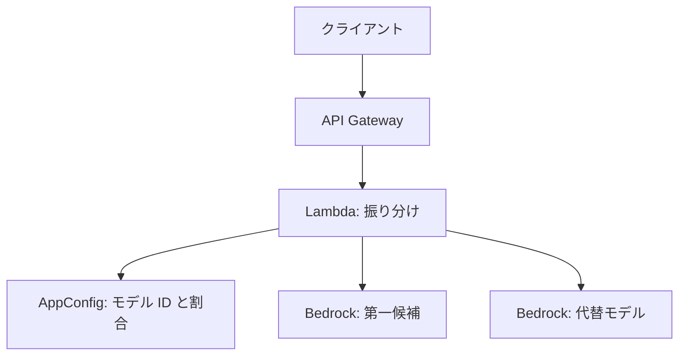
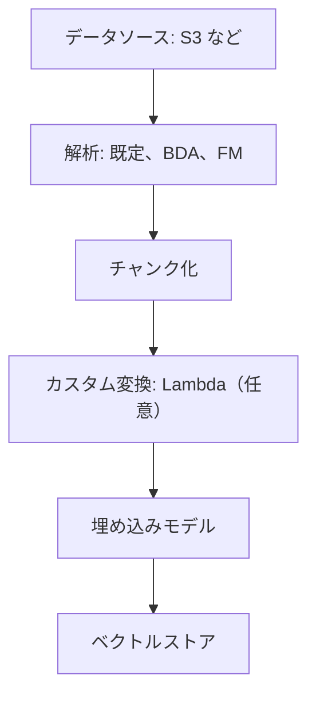
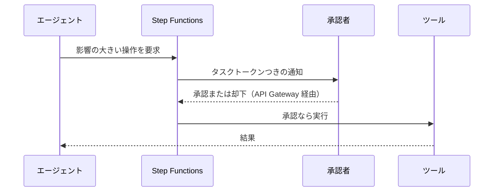
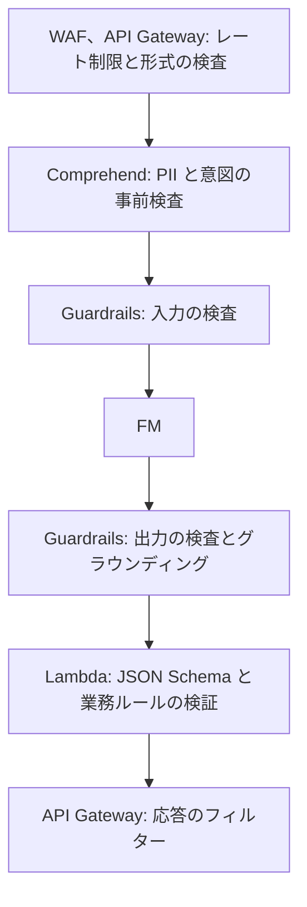

# 生成 AI アプリの設計と運用

[:material-sprout: AIF](../courses/aif/services.md){ .exam-badge .exam-foundational } [:material-sprout: AIB](../courses/aib/services.md){ .exam-badge .exam-foundational } [:material-certificate: DVA](../courses/dva/services.md){ .exam-badge .exam-associate } [:material-certificate: SOA](../courses/soa/services.md){ .exam-badge .exam-associate } [:material-certificate: DEA](../courses/dea/services.md){ .exam-badge .exam-associate } [:material-certificate: MLA](../courses/mla/services.md){ .exam-badge .exam-associate } [:material-star-circle: SAP](../courses/sap/services.md){ .exam-badge .exam-professional } [:material-star-circle: AIP](../courses/aip/services.md){ .exam-badge .exam-professional } [:material-target: SCS](../courses/scs/services.md){ .exam-badge .exam-specialty }

Amazon Bedrock と AgentCore で本番の生成 AI アプリを作るための、設計、最適化、評価のページです。AIP-C01 の中心で、MLA-C02 の FM、RAG、エージェントの範囲にも対応します。

[](../assets/diagrams/genai-apps-rag.png)

API の呼び方、IAM、基本的なエラー処理は [AI サービスと AI 開発ツール](ai.md)にあります。このページでは繰り返さず、リンクします。概念は [AI の基礎](ai-fundamentals.md#genai) を参照してください。

| AIP-C01 の分野 | このページの節 | 詳しい既存の節 |
|---|---|---|
| 1. FM の統合、データ、コンプライアンス | [FM の選択](#fm-selection)、[Knowledge Bases](#knowledge-bases)、[ベクトルストア](#vector-stores)、[プロンプト](#prompt-management) | [Bedrock の呼び方](ai.md#bedrock-runtime) |
| 2. 実装と統合 | [エージェント](#agent-patterns)、[AgentCore](#agentcore)、[デプロイ](#deployment)、[統合](#integration) | [ツール利用](ai.md#tool-use-flow)、[ストリーム](ai.md#stream-events) |
| 3. 安全、セキュリティ、ガバナンス | [Guardrails](#guardrails-depth)、[多層防御](#defense-in-depth)、[ガバナンス](#governance) | [Guardrails の設定](ai.md#guardrails)、[データプライバシー](ai.md#data-privacy) |
| 4. 運用の効率と最適化 | [コストと遅延](#optimization)、[キャッシュ](#caching)、[監視](#observability) | [スループット](ai.md#throughput-options)、[メトリクス](ai.md#bedrock-metrics) |
| 5. テストと検証、トラブルシューティング | [評価](#evaluation)、[テスト](#testing)、[トラブルシューティング](#troubleshooting) | [エラー](ai.md#errors-throttling) |

!!! warning "提供状況（2026 年 10 月時点）"
    | 対象 | 状況 |
    |---|---|
    | Bedrock Agents | **Agents Classic に改称。2026-07-30 から新規受付終了**。新規は AgentCore |
    | Knowledge Bases | 提供中。公式は Managed Knowledge Base を推奨 |
    | Nova Canvas、Reel、Sonic（v1） | **2026 年 9 月に EOL 到達** |
    | Latency Optimized Inference | プレビュー |
    | Clarify の FM 評価 | 新規受付終了。Bedrock Evaluations へ |
    | Kendra | 新規受付終了。[Managed Knowledge Base へ](ai-managed-services.md#kendra) |

    試験ガイドの「Prompt Flows」は、現在のドキュメントでは **Amazon Bedrock Flows** です。

## FM の選択と切り替え {#fm-selection}

### 選定の観点 {#fm-criteria}

| 観点 | 確認すること | 例 |
|---|---|---|
| モダリティ | テキスト、画像、動画、音声 | 図表を読むならマルチモーダル |
| コンテキスト長 | 入出力の長さ | 長い契約書なら長いモデル |
| 遅延 | `TimeToFirstToken` | 対話なら小さなモデルとストリーミング |
| コスト | トークン単価 | 大量の分類なら安いモデル |
| 言語 | 対応言語 | 日本語の品質を評価する |
| カスタマイズ | 調整の可否 | ファインチューニングできるモデルは限られる |
| 機能 | ツール、キャッシュ、構造化出力 | モデルカードで確認 |
| コンプライアンス | リージョン、データの所在 | クロスリージョンの可否 |
| ライフサイクル | Active、Legacy、EOL | 長期運用なら EOL の日付を確認 |

**PoC の進め方:** 数個のモデルを同じプロンプトと評価データで比較し、品質、遅延、コストを表にします。比較には [Bedrock Evaluations](#evaluation) を使います。

### Nova と Titan {#nova-titan}

[:material-sprout: AIF](../courses/aif/services.md){ .exam-badge .exam-foundational } [:material-star-circle: AIP](../courses/aip/services.md){ .exam-badge .exam-professional }

| ファミリー | モデル | 用途 |
|---|---|---|
| Nova 2 | Nova 2 Lite | テキスト、画像、動画、文書を入力。速度とコスト重視 |
| Nova 2 | Nova 2 Sonic | 音声の対話 |
| Nova 2 | Nova Multimodal Embeddings | テキスト、画像、文書、動画、音声の埋め込み |
| Nova（v1） | Premier、Pro、Lite、Micro | テキストと画像。Micro はテキストのみで最低遅延 |
| Titan | Text Embeddings V2 | テキストの埋め込み |
| Titan | Multimodal Embeddings G1 | 画像とテキストの埋め込み |
| Titan | Image Generator G1 v2 | 画像の生成 |

- Nova 2 のモデルは最大 100 万トークンの文脈と、1 回の応答で最大 65,536 トークンに対応します。
- Nova v1 の Canvas と Reel は 2026-09-30、Sonic は 2026-09-14 に EOL に達しました。後継を確認します。
- Titan の現在の概要に載るのは上の 3 つです。テキスト生成の Titan Text は載っていません。

**Titan Text Embeddings V2:**

| 項目 | 値 |
|---|---|
| モデル ID | `amazon.titan-embed-text-v2:0` |
| 最大入力 | 8,192 トークン、50,000 文字 |
| 出力の次元 | 1,024（既定）、512、256 |
| クォータ | TPM ではなく RPM |

### モデルのライフサイクル {#model-lifecycle}

| 状態 | 動作 |
|---|---|
| Active | 利用できる |
| Legacy | EOL の日付が通知される。新規顧客は使えず、既存の顧客も 15 日使わないと権限を失うことがある。新しいファインチューニングと Provisioned Throughput は作れない |
| EOL | リージョンから削除され、リクエストは失敗する。自動移行はない |

2026-09-07 以降に公開されたモデルの Legacy 期間は 6 か月（多くのモデル）か 45 日です。

**運用:** `ListFoundationModels` で状態を定期的に確認し、モデル ID を設定で変えられるようにしておきます。

### 動的なモデル切り替え {#dynamic-model-selection}

モデル ID をコードに直書きせず、設定から読みます。



```json
{"routes": {"default": {"modelId": "<推論プロファイル ID>", "maxTokens": 1000},
            "complex": {"modelId": "<上位モデルの ID>", "maxTokens": 4000}}}
```

| 方式 | 内容 | 使いどころ |
|---|---|---|
| 静的 | アプリの設定で固定 | 単純 |
| AppConfig | デプロイなしで変更、段階的に展開 | モデルの更新 |
| 内容による振り分け | Step Functions や Lambda で分類して分ける | 専門のモデルに分担 |
| Intelligent Prompt Routing | 同じ系統のモデル間で Bedrock が応答品質を予測して選ぶ | コストと品質の均衡 |
| モデルカスケード | 小さなモデルで処理し、難しいものだけ上位へ | コスト削減 |

**`Converse` を使うと、モデルごとの本文の違いを吸収できます。** 切り替えが簡単になります。

**Intelligent Prompt Routing の制約:** 同じモデル系統の中だけで振り分けます。英語のプロンプトに最適化されています。既定のルーターと自分で設定するルーターがあり、後者は代替モデルと基準を指定します。

### 耐障害の設計 {#fm-resilience}

| 障害 | 対策 |
|---|---|
| スロットリング | 指数バックオフとジッター（[SDK と耐障害性](sdk-resilience.md)） |
| リージョンの容量不足 | [クロスリージョン推論](#inference-profiles) |
| モデルの障害 | 別モデルへのフォールバック |
| 継続的な失敗 | サーキットブレーカー |
| 全体の障害 | キャッシュ済みの回答、「後ほどお答えします」など段階的な縮退 |

**Step Functions でのフォールバック:**

```json
{
  "Primary": {
    "Type": "Task",
    "Resource": "arn:aws:states:::bedrock:invokeModel",
    "Parameters": {"ModelId": "<第一候補>", "Body": {"...": "..."}},
    "Retry": [{"ErrorEquals": ["States.ALL"], "MaxAttempts": 2, "BackoffRate": 2, "IntervalSeconds": 1}],
    "Catch": [{"ErrorEquals": ["States.ALL"], "Next": "Fallback"}],
    "End": true
  }
}
```

サーキットブレーカーは、失敗の回数を DynamoDB に記録し、しきい値を超えたら第一候補を呼ばずに代替へ進めます。[Step Functions](step-functions.md) を参照してください。

## Knowledge Bases {#knowledge-bases}

[:material-star-circle: AIP](../courses/aip/services.md){ .exam-badge .exam-professional }

呼び出しの API とパラメータは [Knowledge Bases を呼ぶ](ai.md#knowledge-bases)にあります。ここでは取り込みと検索の設計を扱います。

### Managed と Customer-managed {#managed-kb}

| 観点 | Managed Knowledge Base（公式の推奨） | Customer-managed |
|---|---|---|
| データストア | Bedrock が完全に管理、自動スケール | 自分でベクトルストアを用意、運用 |
| 検索 | エージェント型検索とハイブリッド検索 | 自分で選ぶ |
| 埋め込み | 組み込みモデル（追加料金なし）。独自なら float32、1024 次元 | 任意の Bedrock の埋め込みモデル |
| リランク | 組み込み（追加料金なし）。Bedrock のモデルも可 | Bedrock のモデルを選ぶ |
| コネクタ | S3、SharePoint、Confluence、Web Crawler、Google Drive、OneDrive、Custom | S3、Custom |
| 解析 | 組み込みのマルチモーダル解析 | 既定、FM、Data Automation から選ぶ |
| AgentCore Gateway 連携、Amazon Quick 連携 | あり | なし（Quick は自分で統合） |
| 向いている場面 | 管理を減らしたい | ベクトル DB を細かく制御したい |

**注意:** Managed では `RetrieveAndGenerate` を使えません（[詳細](ai.md#knowledge-bases)）。

**その他の種類:**

| 種類 | 内容 | 使いどころ |
|---|---|---|
| 構造化データストア | 自然文を SQL に変換（`GenerateQuery`） | データウェアハウスへの質問 |
| Kendra GenAI インデックス | Kendra をそのまま使う | 既存の Kendra 資産 |
| Neptune Analytics グラフ | GraphRAG | 関係をたどる質問 |

### 取り込みの流れ {#kb-ingestion}



**解析の選択肢:**

| パーサー | 内容 | 料金 | 使いどころ |
|---|---|---|---|
| 既定 | テキストだけ（txt、md、html、doc、xls、pdf） | なし | 文字だけの文書 |
| Data Automation | 図、表、グラフも抽出 | ページ数 | プロンプトなしで構造化 |
| FM | 図、表、グラフも抽出。プロンプトを調整できる | トークン | 独自の解釈が必要。合計 100 GB まで |

**落とし穴:** BDA や FM を選ぶと、文字だけの PDF にもそのパーサーが適用され、課金されます。既定のパーサーは図の内容を取り出せません。

### チャンク化の戦略 {#chunking}

| 戦略 | 動作 | 向いている文書 | 注意 |
|---|---|---|---|
| 既定 | 約 300 トークン、文の境界を保つ | まず試す | |
| 固定サイズ | `maxTokens` と重なりの割合を指定 | 均質な文書 | 文の途中で切れることがある |
| 階層 | 子で検索し、親に置き換えて返す | マニュアル、規定集 | 返る件数が指定より少なくなる。S3 Vectors では非推奨 |
| セマンティック | 意味の切れ目で分ける | 話題が変わる文書 | FM を使うので追加料金 |
| なし | 1 文書を 1 チャンク | 事前に分割済み | ページ番号の引用やフィルターが使えない |
| カスタム | Lambda で独自に分ける | 独自の構造（FAQ など） | チャンクなしと組み合わせる |

| API の設定 | 範囲 | 例 |
|---|---|---|
| 固定サイズの `maxTokens` | 1〜8,192 | 512 |
| 固定サイズの `overlapPercentage` | 1〜99 | 20 |
| 階層の `maxTokens`（親、子） | 1〜8,192 | 親 1,500、子 300 |
| 階層の `overlapTokens` | 親子間の重なり（トークン） | 60 |
| セマンティックの `maxTokens` | 1〜8,192 | 300 |
| セマンティックの `bufferSize` | 0〜1 | 1 なら前後 1 文を含めて埋め込む |
| セマンティックの `breakpointPercentileThreshold` | 50〜99 | 95。高いほどチャンクが大きく少ない |

```json
{
  "chunkingConfiguration": {
    "chunkingStrategy": "FIXED_SIZE",
    "fixedSizeChunkingConfiguration": {"maxTokens": 512, "overlapPercentage": 20}
  }
}
```

| 症状 | 原因 | 対応 |
|---|---|---|
| 回答に必要な文脈が足りない | チャンクが小さい | 階層チャンク、サイズを大きく |
| 関係のない文が多い | チャンクが大きい | サイズを小さく、セマンティック |
| 表が崩れる | 既定のパーサー | BDA か FM のパーサー |
| 埋め込みでエラー | モデルの入力上限を超える | `maxTokens` を下げる |

**表や図の文脈:** Markdown として処理された文書では、一致したチャンクの代わりに、ページ全体や表全体（10,000 文字以下）が返ることがあります。そのため `numberOfResults` より少なくなります。

**マルチモーダルの内容:** 音声、動画、画像のチャンク化は、埋め込みモデルの側で行われます。テキストの戦略は適用されません。S3 と Custom のデータソースで使えます。

### メタデータ {#kb-metadata}

文書と同じ場所に `<ファイル名>.metadata.json` を置きます。ファイル名は拡張子まで元の名前と揃えます。

```json
{"metadataAttributes": {"dept": "support", "year": 2026, "lang": "ja"}}
```

検索時に `filter` で絞ります。[演算子の一覧](ai.md#kb-params)を参照してください。

| 要素 | 例 | 効果 |
|---|---|---|
| 時刻 | 更新日 | 古い規定を除く |
| 著者、部署 | `dept` | 権限や部署で絞る |
| 分類タグ | 製品名 | 精度の向上 |

**落とし穴:**

- OpenSearch Serverless のインデックスが `nmslib` エンジンだと、メタデータファイルが無視されます。`faiss` を使います。
- Aurora では、カスタムメタデータ列にまとめて、そこにインデックスを作るのが推奨です。
- チャンク単位のメタデータは Lambda で付けられ、ファイル単位より優先されます。

### 同期と鮮度 {#kb-sync}

| 項目 | 内容 |
|---|---|
| 同期 | `StartIngestionJob`。**差分だけを処理する** |
| 自動では動かない | ファイルを変えたら同期を実行する |
| `dataDeletionPolicy` | `RETAIN` または `DELETE`。データソースを消したときのベクトルの扱い |

| 更新の方法 | 実装 | 鮮度 |
|---|---|---|
| 定期 | EventBridge のスケジュールで Lambda から `StartIngestionJob` | 1 日など |
| 変更の検知 | S3 イベント → EventBridge → Lambda | 数分 |
| RAG 更新のパイプライン | Step Functions で同期、評価、切り替え | 品質を確認して反映 |

**症状:** 更新した文書が回答に出ないなら、同期を忘れている可能性があります。ジョブの統計と失敗の理由を確認します。

### 検索の改善 {#retrieval-optimization}

| 手法 | 内容 | 設定 |
|---|---|---|
| ハイブリッド検索 | ベクトルとキーワードの両方 | `overrideSearchType: HYBRID`。RDS、OpenSearch Serverless、MongoDB でフィルター可能なテキスト列があるとき |
| リランク | 検索結果を質問との関連度で並べ替える。テキストのみ | Amazon Rerank 1.0、Cohere Rerank 3.5 |
| クエリ分解 | 複雑な質問を小さな質問に分ける | `RetrieveAndGenerate` の設定 |
| メタデータフィルター | 候補を絞る | `filter` |
| 暗黙のフィルター | 質問から FM がフィルターを作る | `implicitFilterConfiguration` |
| クエリ拡張 | FM で同義語や言い換えを足す | Lambda や Step Functions で実装 |

**具体例:** 製品番号「AB-123」はベクトル検索で外れやすいので、ハイブリッド検索にします。上位 20 件を取ってリランクで 5 件に絞ると、精度とトークンコストの両方が改善します。

**クエリ分解の例:** 「A 社と B 社で売上が高いのは?」を「A 社の売上は?」「B 社の売上は?」に分けます。

### 埋め込みの選び方 {#embedding-selection}

| 観点 | 判断 |
|---|---|
| 次元数 | 大きいと精度が上がる傾向で、保存と検索のコストが増える |
| 言語 | 多言語なら対応モデルを確認する |
| モダリティ | 画像や音声ならマルチモーダルのモデル |
| 変更 | 埋め込みモデルを変えると、全データの再埋め込みが必要 |

**計算例:** 100 万チャンク、float32（4 バイト）の場合です。

| 次元 | 生データの大きさ |
|---|---|
| 1,024 | 100 万 × 1,024 × 4 = 約 4.1 GB |
| 256 | 100 万 × 256 × 4 = 約 1.0 GB |

**大量の生成:** 埋め込みは RPM で制限されるので、SQS と Lambda で流量を制御するか、[バッチ推論](ai.md#throughput-options)を使います。

## ベクトルストア {#vector-stores}

| ストア | 特徴 | 向いている場面 | 注意 |
|---|---|---|---|
| OpenSearch Serverless | 容量の管理不要。ハイブリッド検索。Knowledge Bases で作成できる | 既定の選択、高い検索品質 | OCU の課金を確認する |
| OpenSearch Service（ドメイン） | k-NN、Neural プラグイン、シャードを制御 | 細かい調整、既存のドメイン | 運用が必要 |
| Aurora / RDS PostgreSQL + pgvector | SQL と結合できる。pgvector 0.5.0 以上 | 既に PostgreSQL を使っている | サイズの設計が必要 |
| S3 Vectors | 低コスト、大容量 | アクセスが少ない、大量 | ハイブリッド不可 |
| Neptune Analytics | グラフとベクトル。1 グラフに 1 インデックス、次元は作成時に固定 | GraphRAG | |
| MemoryDB | インメモリ、低遅延 | セマンティックキャッシュ | |
| DocumentDB | ドキュメントと一緒に検索 | 既存の MongoDB 互換 | |
| Pinecone、Redis Enterprise Cloud、MongoDB Atlas | 第三者。Secrets Manager に認証情報 | 既存の契約 | |

### OpenSearch {#opensearch-vectors}

```json
{
  "settings": {"index": {"knn": true}},
  "mappings": {"properties": {
    "embedding": {
      "type": "knn_vector", "dimension": 1024,
      "method": {"name": "hnsw", "engine": "faiss", "space_type": "l2"}
    },
    "text": {"type": "text"},
    "metadata": {"type": "text", "index": false}
  }}
}
```

| 項目 | 内容 | 誤ったときの症状 |
|---|---|---|
| `dimension` | 埋め込みモデルの次元と一致させる | 取り込みエラー |
| `engine` | Knowledge Bases のメタデータには `faiss` | メタデータが無視される |
| 距離 | ユークリッド、コサイン、内積 | 精度の低下 |
| 次元の上限 | 最大 16,000 | |

| 大規模化の手法 | 内容 |
|---|---|
| シャード | データを分散する。多すぎると無駄、少なすぎると遅い |
| マルチインデックス | 分野ごとに分け、問い合わせを振り分ける |
| 階層インデックス | 大分類 → 小分類の順に検索 |
| Neural プラグイン | OpenSearch の中から ML コネクタで Bedrock を呼び、埋め込みを作る |

### pgvector {#pgvector}

```sql
CREATE EXTENSION IF NOT EXISTS vector;
CREATE TABLE bedrock_integration.bedrock_kb (
  id uuid PRIMARY KEY, embedding vector(1024),
  chunks text, metadata json, custom_metadata jsonb
);
CREATE INDEX ON bedrock_integration.bedrock_kb
  USING hnsw (embedding vector_cosine_ops) WITH (ef_construction=256);
CREATE INDEX ON bedrock_integration.bedrock_kb
  USING gin (to_tsvector('simple', chunks));
```

- HNSW には pgvector 0.5.0 以上が必要です。`ef_construction=256` は 0.6.0 以上の並列ビルドでの推奨値です。
- GIN インデックスはハイブリッド検索に使います。
- Knowledge Bases からは Data API と Secrets Manager で接続します。
- `vector(n)` の `n` はモデルの次元と揃えます。

詳しくは[データベース](databases.md)と[専門データベース](databases-specialized.md)を参照してください。

### S3 Vectors {#s3-vectors}

| 項目 | 値 |
|---|---|
| ベクトルバケット | リージョンあたり 10,000 |
| インデックス | バケットあたり 10,000 |
| ベクトル | インデックスあたり最大 20 億 |
| 次元 | 1〜4,096 |
| メタデータ | 合計 40 KB、フィルター可能 2 KB、キー 50 個 |
| フィルターしないキー | インデックスあたり 10 個 |
| 書き込み | インデックスあたり最大 1,000 リクエスト / 秒、2,500 ベクトル / 秒 |
| `PutVectors` | 1 回 500 ベクトル、20 MiB |
| `QueryVectors` | Top-K 最大 10,000 |
| 遅延 | 頻度が低い問い合わせは 1 秒未満、頻度が高いと 100 ms 程度まで |
| 一貫性 | 書き込みは強い整合性 |

**Knowledge Bases で使うときの制約:**

- セマンティック検索だけで、ハイブリッド検索はできません。
- 浮動小数のベクトルだけで、バイナリは使えません。
- 階層チャンクで合計 8,000 トークンを超えると、メタデータの上限に達することがあります。
- インデックスを作るとき、`AMAZON_BEDROCK_TEXT` と `AMAZON_BEDROCK_METADATA` を非フィルターのキーにします。

**具体例:** 10 億件の古い文書をアクセス頻度の低い検索に使うなら S3 Vectors、頻繁に検索する最新の文書は OpenSearch にします。S3 Vectors を OpenSearch と組み合わせることもできます。

### 運用 {#vector-operations}

| 監視 | 内容 |
|---|---|
| 検索の遅延 | p95、p99 を追う |
| メモリとディスク | インデックスの増加 |
| 鮮度 | 最終同期の時刻 |
| 品質 | [取得の評価](#evaluation)を定期的に実行 |

## Bedrock Agents と Flows {#agents-flows}

### Bedrock Agents（Classic） {#agents-classic}

**Agents Classic は新規受付を終了しました。** 呼び出し方と制限は[既存の節](ai.md#agents)を参照してください。新規は [AgentCore](#agentcore) か Strands などで作ります。AIP-C01 ではエージェントのトレースが推論過程の表示の例として挙がっています。

### Bedrock Flows {#flows}

[:material-star-circle: AIP](../courses/aip/services.md){ .exam-badge .exam-professional }

プロンプト、モデル、ナレッジベース、Lambda を画面でつないでワークフローを作ります。

| ノード | 役割 |
|---|---|
| Flow input / output | 入口と出口 |
| Condition | 条件分岐 |
| Iterator / Collector | 配列の処理とまとめ |
| DoWhile loop | 繰り返し |
| Prompt | プロンプトの実行 |
| Agent | エージェントの呼び出し |
| Knowledge base | 検索 |
| S3 storage / retrieval | 保存と取得 |
| Lambda function | 任意の処理 |
| Inline code | 短いコード |
| Lex | ボットの呼び出し |

| 用語 | 内容 |
|---|---|
| `DRAFT` | 作業中の版。テストのエイリアス `TSTALIASID` が指す |
| バージョン | 変更できない版。1 から順に番号が付く |
| エイリアス | バージョンを指す名前。`InvokeFlow` で呼ぶ |

**デプロイ:** 新しいバージョンを作り、エイリアスの向きを変えます。アプリの変更は不要で、戻すのも簡単です。

**使い分け:**

| ツール | 向いている場面 |
|---|---|
| Flows | プロンプト中心の流れを画面で作る |
| Step Functions | AWS サービス全般、複雑なエラー処理、人の承認 |
| AgentCore / Strands | モデルが手順を自分で決める |
| アプリのコード | 単純な連鎖 |

### Bedrock Data Automation {#bda}

文書、画像、動画、音声を生成 AI で構造化データにします。Knowledge Bases のパーサーとしても使えます。

## プロンプトの管理 {#prompt-management}

[:material-star-circle: AIP](../courses/aip/services.md){ .exam-badge .exam-professional }

| 機能 | 内容 |
|---|---|
| プロンプト | モデル、推論設定、`{{変数}}` を含むテンプレート |
| バリアント | 別案を作って出力を比較する |
| バージョン | 変更できない版を作る |
| 最適化 | プロンプトの改善案を作らせる |
| 呼び出し | `Converse` の `modelId` にプロンプトの ARN、`promptVariables` に値 |
| Flows | Prompt ノードで使う |

```python
resp = client.converse(
    modelId="arn:aws:bedrock:us-east-1:111122223333:prompt/PROMPT12345:3",
    promptVariables={"customer_name": {"text": "佐藤"}},
)
```

**ガバナンスの構成:**

| 目的 | 手段 |
|---|---|
| 定型化 | パラメータ化したテンプレート |
| 承認 | CI/CD でのレビューと評価の通過を条件にバージョンを昇格 |
| 保管 | S3 やリポジトリにテンプレートを置く |
| 利用の追跡 | CloudTrail、CloudWatch Logs |
| 回帰の検出 | 期待する出力を Lambda で検証し、CloudWatch に指標を送る |
| A/B テスト | バリアントや Flows で分けて比較 |

**指示の工夫:** 役割を定める、出力形式を指定する、Chain-of-thought を使う、例を示す。詳しくは[プロンプトエンジニアリング](ai-fundamentals.md#prompt-engineering)を参照してください。

**会話の文脈:** 履歴は DynamoDB に保存し、古いものを要約して渡します。意図の判定には Comprehend も使えます。

### 構造化出力 {#structured-output}

Bedrock の構造化出力は、応答を JSON Schema やツールの定義に合わせます。パースのエラーを減らし、決定的な処理につなげられます。

**text-to-SQL で安全に:** FM に SQL を作らせ、実行はアプリの権限で行い、結果を返します。答えが決定的になり、ハルシネーションを減らせます。読み取り専用の権限にします。

## モデルカスタマイズ {#customization}

概念の比較は[モデルを業務に合わせる方法](ai-fundamentals.md#customization-options)を参照してください。

| 方法 | データ | 仕組み | 使いどころ |
|---|---|---|---|
| 教師ありファインチューニング | ラベル付き（入力と出力の組） | 重みを調整 | 形式や文体 |
| 強化ファインチューニング | プロンプトと報酬関数（Lambda）、呼び出しログも可 | スコアから学ぶ | 正解を決めにくいが評価はできる |
| 蒸留 | プロンプト（呼び出しログも可） | 教師モデルの応答で生徒モデルを調整 | 精度を保ちコストを下げる |
| Custom Model Import | 外部で作った重み | モデルを持ち込む | 自前で学習済み |

**現在の Bedrock の一覧にあるのは、教師あり、強化、蒸留の 3 つです。** 試験ガイドは継続的な事前学習にも触れています。これはラベルのないデータで学習を続ける手法として理解しておきます。

**料金:** 学習は「トークン数 × エポック数」、モデルの保存は月額です。

**対応モデル:** ファインチューニングできるモデルは限られます（例: Nova 2 Lite）。モデルカードで確認します。

### データの準備 {#fine-tuning-data}

`.jsonl` で、1 行が 1 件です。

```json
{"prompt": "社内規定の要点は?", "completion": "申請は 3 日前までです。"}
```

会話形式は `schemaVersion: bedrock-conversation-2024` を使います。

| 確認項目 | 理由 |
|---|---|
| 代表性 | 本番の質問に似ている |
| 質問と回答の正しさ | 誤りも学習する |
| 機密情報 | 学習前に除く、マスクする |
| 有害な内容 | 検査する（ポイズニング対策） |
| 検証用データ | 過学習の確認 |

### カスタムモデルの実行 {#custom-model-deploy}

| 方式 | 内容 |
|---|---|
| Provisioned Throughput | モデルユニットを購入 |
| カスタムモデルのデプロイ | オンデマンドで推論。2025 年 7 月 16 日以降にカスタマイズしたモデルが対象で、基盤モデルとリージョンが限られる（Nova は us-east-1、Llama 3.3 70B は us-west-2） |
| バージョン管理 | ジョブ名とモデル ARN を記録し、エイリアス相当の設定を AppConfig に置く |

Legacy になった基盤モデルでは、新しいファインチューニングと Provisioned Throughput を作れません。

### Custom Model Import {#custom-model-import}

| 項目 | 内容 |
|---|---|
| 形式 | Hugging Face の重みの形式を S3 から |
| 対応アーキテクチャ | Mistral、Llama、Flan、Qwen など |
| 呼び出し | `InvokeModel`、`InvokeModelWithResponseStream`。オンデマンド |
| 対応しないもの | バッチ推論、CloudFormation |
| リージョン | us-east-1、us-east-2、us-west-2、eu-central-1 |

### SageMaker AI での FM {#sagemaker-fm}

| 手法 | 内容 |
|---|---|
| [JumpStart](sagemaker.md#jumpstart) | FM のデプロイとファインチューニング |
| [LoRA アダプター](sagemaker.md#multi-model) | 基盤モデルを共有し、差分だけ載せる。アダプター推論コンポーネント |
| [Model Registry](sagemaker.md#model-registry) | 版の管理、承認、ロールバック |

**LoRA の利点:** 全重みを再学習せず、小さな追加の重みで調整します。用途別のモデルを、少ない GPU で提供できます。

## 推論の容量とプロファイル {#inference-profiles}

| プロファイル | 内容 | 使いどころ |
|---|---|---|
| クロスリージョン（システム定義） | 複数のリージョンへ振り分け | 容量の確保、耐障害 |
| アプリケーション | 自分で作り、タグを付ける | アプリごとのコストと利用の追跡 |

- 地理的（`us`、`eu` など）とグローバルの違いは[既存の節](ai.md#model-identifiers)を参照してください。
- 推論プロファイルは Provisioned Throughput に対応しません。
- クロスリージョンでは、データがリージョンをまたぎます。Knowledge Bases でも同じです。

| 選択肢 | 内容 | 使いどころ |
|---|---|---|
| オンデマンド | トークン課金 | 変動する負荷 |
| サービスティア（Priority、Flex、Reserved） | [料金と優先度](ai.md#throughput-options) | 重要度で使い分ける |
| Provisioned Throughput | モデルユニットの時間課金 | 固定の大きな処理量、オンデマンドのデプロイが使えないカスタムモデル |
| バッチ | 非同期 | 大量で急がない |

**モデルユニットの見積もり:** 1 MU は、1 分あたりの入力と出力のトークン数で決まります。実際の値はアカウントマネージャーに確認します。`InputTokenCount` と `OutputTokenCount` のピークから必要な数を見積もります。

**使用率が低いと無駄です。** 常に高い負荷がないなら、オンデマンドか Reserved を検討します。

## コストと遅延の最適化 {#optimization}

### トークンの削減 {#token-efficiency}

| 手法 | 効果 | 具体例 |
|---|---|---|
| トークンの見積もり | 事前に上限を判定 | `CountTokens` |
| 文脈の削減 | 入力を減らす | 履歴を要約、関係ない部分を除く |
| 応答の制限 | 出力を減らす | `maxTokens` を実態に合わせる |
| プロンプトの圧縮 | 共通部分を短く | 不要な説明を削る |
| RAG の絞り込み | チャンクを減らす | リランクで 5 件に |
| 階層的なモデル利用 | 安いモデルを優先 | 分類は小さなモデル、難しい質問は上位 |
| バッチ | 急がない処理 | 夜間の要約 |

**`maxTokens` の注意:** 大きすぎるとクォータの予約が増えます。[計算例](ai.md#quotas-detail)を参照してください。

### キャッシュの種類 {#caching}

| 種類 | 仕組み | 効く場面 | 実装 |
|---|---|---|---|
| プロンプトキャッシュ | 入力の前半を再利用 | 長い固定の指示や文書 | Bedrock |
| 完全一致 | リクエストのハッシュで検索 | 同じ質問 | DynamoDB、ElastiCache |
| セマンティックキャッシュ | 埋め込みが近ければ過去の回答を返す | 言い換えの質問 | MemoryDB、OpenSearch |
| 事前計算 | 予想できる質問を先に作る | FAQ | S3、DynamoDB |
| エッジ | 配信ネットワークで返す | 公開の固定の回答 | CloudFront |

**プロンプトキャッシュ:**

| 種類 | 動作 |
|---|---|
| 暗黙 | 指定なしで Bedrock が前半の一致を試みる。ベストエフォート |
| 明示 | `cachePoint`（チェックポイント）を置く。最小トークン数と個数はモデルごと |

- 固定の内容を先に、変わる内容を後に置きます。順番が変わると一致しません。
- TTL はヒットごとに延びます。多くのモデルは 5 分です。
- 使用量の確認は [cacheReadInputTokens](ai.md#quotas-detail) です。

**セマンティックキャッシュの落とし穴:** しきい値が低いと別の質問に古い答えを返します。利用者ごとの権限や個人情報を含む回答は、キャッシュしないか、キーを分けます。

### 遅延の短縮 {#latency}

| 手法 | 効果 |
|---|---|
| ストリーミング | 体感の待ち時間を減らす |
| 小さなモデル | 処理が速い |
| Latency Optimized Inference | `performanceConfig: {"latency": "optimized"}`。プレビュー |
| 並列呼び出し | 独立した処理を同時に |
| 事前計算、キャッシュ | モデルを呼ばない |
| 検索の最適化 | インデックス、次元の削減 |

**指標の見方:** `TimeToFirstToken` は最初の応答まで、`InvocationLatency` は全体です（[一覧](ai.md#bedrock-metrics)）。

### パラメータの調整 {#parameter-tuning}

| 用途 | temperature | 備考 |
|---|---|---|
| 抽出、分類、SQL | 0〜0.2 | 再現性を優先 |
| 一般の質問応答 | 0.2〜0.5 | |
| 文案、アイデア | 0.7 以上 | 多様性 |

temperature と top-p の説明は[推論パラメータ](ai-fundamentals.md#inference-parameters)にあります。変更の効果は A/B テストで確かめます。

### スループット {#throughput}

| 課題 | 手法 |
|---|---|
| スパイク | SQS でならす |
| 同時実行の管理 | Lambda の予約済み同時実行、Step Functions の Map の並列度 |
| 容量の計画 | 入力 + `maxTokens` の合計で見積もる |
| 自前のホスト | [`ConcurrentRequestsPerModel` で自動スケーリング](sagemaker.md#autoscaling) |

## デプロイ戦略 {#deployment}

| 方式 | 向いている場面 |
|---|---|
| Lambda から Bedrock | 小さく始める、断続的 |
| Bedrock の Provisioned Throughput | 大きく安定した負荷 |
| SageMaker AI のエンドポイント | 独自モデル、GPU の細かい制御 |
| ハイブリッド | 通常は Bedrock、特定の処理は自前 |

**LLM の自前ホストの注意点（従来の ML との違い）:**

| 課題 | 対応 |
|---|---|
| モデルが大きく、起動が遅い | 事前に読み込む、モデルのストリーミング、早めのスケールアウト |
| GPU メモリ | 量子化、適切なインスタンス |
| 同時リクエスト数で性能が変わる | 同時実行の指標で制御 |
| 高価なアイドル | 推論コンポーネントで共有、0 まで縮小 |

**データの所在とエッジ:** データを外に出せないなら Outposts、低遅延のエッジには Wavelength を使い、クラウドとは安全な経路でつなぎます。

**設計の標準化:** Well-Architected Tool の Generative AI Lens で確認します。

## エージェントのパターンと MCP {#agent-patterns}

[:material-sprout: AIF](../courses/aif/services.md){ .exam-badge .exam-foundational }

### 構造のパターン {#workflow-patterns}

| パターン | 内容 | 例 |
|---|---|---|
| プロンプトチェーン | 前の出力を次の入力に | 抽出 → 要約 → 翻訳 |
| ルーティング | 分類して専門の処理へ | 請求か技術かで分ける |
| 並列化 | 同時に実行して統合 | 複数の観点でレビュー |
| オーケストレーター / ワーカー | 計画役が分担する | 調査のタスク分解 |
| 評価と改善 | 別のモデルが採点して直す | 文案の品質チェック |
| ReAct | 考える、行動する、観察するを繰り返す | ツールで調べながら答える |

### マルチエージェント {#multi-agent}

| 手法 | 内容 |
|---|---|
| Agents as Tools | 上位のエージェントが、他のエージェントをツールとして呼ぶ |
| Swarm | エージェント同士が仕事を引き継ぐ |
| Graph | 決まった流れの DAG |
| Workflow | タスクの依存関係で進める |
| A2A | 別々の基盤のエージェントがプロトコルで通信 |

**Strands Agents** は AWS が公開するオープンソースの SDK です。

```python
from strands import Agent, tool

@tool
def get_order(order_id: str) -> dict:
    """注文の状態を取得する"""
    return {"orderId": order_id, "status": "shipped"}

agent = Agent(system_prompt="注文の問い合わせに答えてください。", tools=[get_order])
result = agent("注文 A-123 の状態は?")
```

ツールの説明文はモデルがツールを選ぶ材料です。具体的に書きます。

**Agent Squad** はマルチエージェントのルーティングのフレームワークです。問い合わせを適切なエージェントへ振り分けて文脈を保ちます。リポジトリは `awslabs/agent-squad` から `2fastlabs/agent-squad` へ移りました。

### 安全な自律動作 {#agent-safeguards}

| リスク | 対策 | 実装 |
|---|---|---|
| 無限ループ | 繰り返しの上限 | Step Functions のカウンタ |
| 時間超過 | タイムアウト | Lambda、`TimeoutSeconds` |
| コストの暴走 | トークンの予算 | 累計を記録して停止 |
| 権限の乱用 | 最小権限 | IAM、[AgentCore Policy](#agentcore-policy) |
| ツールの失敗 | 再試行、サーキットブレーカー | |
| 不正な引数 | 検証 | Lambda で検査。[ツールの認可](ai.md#tool-authorization) |
| 影響の大きい操作 | 人の承認 | [下の節](#human-in-the-loop) |

### 人による確認 {#human-in-the-loop}



Step Functions の `waitForTaskToken` で待ちます。[エージェントの保護](ai.md#human-in-the-loop)も参照してください。信頼度が低い回答を人に回す、評価の結果をフィードバックに使う、といった形でも人を組み込みます。

### MCP {#mcp}

エージェント（クライアント）と、ツールやデータ（サーバー）をつなぐ標準プロトコルです。

| 用語 | 内容 |
|---|---|
| ツール | モデルが呼べる機能 |
| リソース | 読めるデータ |
| プロンプト | 再利用できるテンプレート |
| トランスポート | stdio（ローカル）、Streamable HTTP（リモート） |

| サーバーの置き場所 | 向いている場面 |
|---|---|
| Lambda | ステートレスで軽いツール |
| ECS / Fargate | 複雑なツール、長い処理、状態を持つ |
| AgentCore Runtime | マネージド。ポート 8000、パス `/mcp` |
| AgentCore Gateway | 既存の API や Lambda を MCP ツールに変換してまとめる |

**関数呼び出しとの違い:** `Converse` の `toolConfig` はアプリとモデルの間の仕組みです。MCP はツールの提供側を標準化し、複数のアプリで再利用できます。

**ベクトル検索をツールにする:** 検索をツールや MCP サーバーとして公開すれば、モデルが必要なときに検索できます。

## AgentCore のアーキテクチャ {#agentcore}

[:material-sprout: AIF](../courses/aif/services.md){ .exam-badge .exam-foundational } [:material-certificate: DVA](../courses/dva/services.md){ .exam-badge .exam-associate } [:material-certificate: MLA](../courses/mla/services.md){ .exam-badge .exam-associate } [:material-star-circle: AIP](../courses/aip/services.md){ .exam-badge .exam-professional }

[](../assets/diagrams/genai-apps-agentcore.png)

各サービスの設定値と上限は [AgentCore の構成要素と設定](ai.md#agentcore-components)にあります。ここでは組み合わせ方を説明します。

| 層 | サービス | 役割 |
|---|---|---|
| 実行 | Harness、Runtime | ループを任せる / 自分のエージェントを動かす |
| 記憶 | Memory | 短期と長期 |
| ツール | Gateway、Code Interpreter、Browser | 外部接続と実行 |
| 統制 | Identity、Policy | 誰が何をできるか |
| 品質 | Observability、Evaluations、Optimization | 監視、採点、改善 |
| 発見 | AWS Agent Registry | エージェントとツールのカタログ |
| 決済 | Payments | 有料 API への少額の支払い |

### Runtime の選び方 {#agentcore-runtime}

| | microVM | Instances |
|---|---|---|
| 管理 | サーバーレス | 自分のアカウントの EC2 |
| セッションの上限 | 8 時間 | 14 日 |
| 分離 | セッションごとの microVM | |
| 使いどころ | 通常のエージェント | 複数日の長時間処理 |

| プロトコル | ポート | パス |
|---|---|---|
| HTTP | 8080 | `/invocations` |
| MCP | 8000 | `/mcp` |
| A2A | 9000 | `/` |

**Harness か Runtime か:** モデル、プロンプト、ツールを指定するだけでよいなら Harness です。独自のフレームワークやコードを使うなら Runtime です。

**配信:** コンテナイメージを ECR に置くか、コードを直接デプロイします。CI/CD でビルド、テスト、更新を自動化し、IaC で管理します。

### Memory の設計 {#agentcore-memory}

| 種類 | 内容 | 例 |
|---|---|---|
| 短期 | 1 セッションの生のやり取り（`CreateEvent`） | 今の会話 |
| 長期 | 短期から抽出した知識 | 好み、過去の事実 |

組み込みのストラテジーは、抽出、統合、振り返りの手順でメモリレコードを作ります。複数を組み合わせられます。

自前で作るなら、会話履歴を DynamoDB、長期の知識をベクトルストアに置きます。

### Gateway {#agentcore-gateway}

ツール、他のエージェント、LLM への単一の入口です。

| ターゲット | 動作 |
|---|---|
| MCP | 複数を 1 つの仮想 MCP サーバーにまとめる |
| HTTP | そのまま転送 |
| 推論 | モデル別に LLM へ振り分ける |

- **セマンティック検索** で、多数のツールから適切なものを探せます。
- **認証** は受信（エージェントの検証）と送信（OAuth、資格情報の管理）の両方を扱います。

**GenAI ゲートウェイとして:** モデルへの通信を集約すれば、認証、制限、監視を 1 か所にまとめられます。API Gateway と Lambda で自作する方法もあります。

### Policy {#agentcore-policy}

Gateway を通るエージェントの通信を、エージェントのコードの外で検査します。

| 項目 | 内容 |
|---|---|
| 言語 | Cedar、Dogwood。自然文からも作れる |
| 条件 | 利用者の ID、ツールの入力値 |
| 関連付け | ポリシーエンジンをゲートウェイに付ける |
| 判定 | 決定的。モデルの判断に頼らない |

**具体例:** 「返金ツールは金額 10,000 円以下のときだけ許可」のように書きます。プロンプトで「してはいけない」と書くより確実です。AIF-C01 も Policy in AgentCore と AgentCore Identity を名指ししています。

### Evaluations と Optimization {#agentcore-evaluations}

| 機能 | 内容 |
|---|---|
| Evaluations | トレースを LLM-as-a-Judge で採点する。組み込みの評価項目（例: `Builtin.Helpfulness`）。Strands、LangGraph に対応 |
| Optimization | トレースから改善案を作り、設定のバンドルを A/B テストする |

## Guardrails の実践 {#guardrails-depth}

フィルターの種類、パラメータ、API は [Guardrails](ai.md#guardrails) にあります。ここでは設計を扱います。

### 層の選び方 {#guardrail-tiers}

| 項目 | Standard | Classic |
|---|---|---|
| コンテンツフィルター、プロンプト攻撃 | より堅牢 | 従来の性能 |
| 拒否トピックの定義 | 1,000 文字 | 200 文字 |
| グラウンディング | 推論や会話的な内容も扱う | 厳密な判定のみ |
| 言語 | 多言語 | 英語、フランス語、スペイン語 |
| クロスリージョン推論 | 必要 | 非対応 |
| プロンプト漏えいの検出 | あり | なし |
| コード関連の入力 | 強化 | なし |

**日本語を扱うなら Standard です。** 層を変えるとグラウンディングのスコアも変わるので、しきい値を再確認します。

### ストリーミングでの動作 {#guardrail-streaming}

| モード | 動作 | トレードオフ |
|---|---|---|
| 同期（既定） | チャンクをためて検査してから返す | 少し遅い。安全 |
| 非同期 | すぐ返し、裏で検査する | 遅延なし。不適切な内容が一時的に見える可能性 |

**PII のマスクが必要なら、非同期は避けます。** マスク前の内容が届く可能性があるためです。

### コンテキストグラウンディング {#contextual-grounding}

| スコア | 意味 |
|---|---|
| グラウンディング | 応答が参照元に基づくか |
| 関連性 | 応答が質問に答えているか |

| 例 | グラウンディング | 関連性 |
|---|---|---|
| 正しい文書を使い、質問に答える | 高 | 高 |
| 質問に答えるが、文書と違う | 低 | 高 |
| 文書の内容だが、質問に答えない | 高 | 低 |

しきい値（0〜0.99）を下回るとブロックします。自分のデータで試して決めます。設定は[既存の節](ai.md#guardrail-policy-settings)にあります。

### Automated Reasoning {#automated-reasoning}

自然文の規定から論理ルールを作り、応答が矛盾しないかを形式的に検証します。

| コンテンツフィルター | Automated Reasoning |
|---|---|
| ブロックか許可 | 誤り、暗黙の前提、正しい理由を返す |
| パターンの一致 | 形式論理 |

**使いどころ:** 医療、人事、金融のように、誤りの影響が大きく根拠を示す必要がある場面です。返された理由をモデルに戻して修正させることもできます。

### 組織での強制 {#guardrail-org-enforcement}

| 範囲 | 方法 |
|---|---|
| 組織、OU、アカウント | AWS Organizations の Bedrock ポリシー |
| アカウント | 特定のバージョンのガードレールを全呼び出しに適用 |
| 重ね合わせ | 組織とアプリの両方が適用され、同じ項目は厳しい方が優先 |

[IAM の条件キーによる強制](ai.md#guardrail-enforcement)と違い、呼び出し側が指定しなくても適用できます。

### 多層防御 {#defense-in-depth}



| 脅威 | 対策 |
|---|---|
| プロンプトインジェクション | プロンプト攻撃フィルター、入力の無害化、ツールの権限制限 |
| ジェイルブレイク | Standard 層、敵対的テスト |
| 間接インジェクション（文書内の指示） | データソースの管理、外部の内容をデータとして区切る |
| データ漏えい | 機密情報フィルター、最小権限 |
| ハルシネーション | [対策の一覧](ai-fundamentals.md#hallucinations) |

**敵対的テスト:** 既知の攻撃プロンプトの集合を定期的に流し、遮断率を CloudWatch に記録します。カスタムのモデレーションが必要なら Step Functions と Lambda で組みます。

## セキュリティとガバナンス {#governance}

### データの保護 {#data-protection}

| 段階 | 対策 | サービス |
|---|---|---|
| 発見 | S3 の PII を検出 | Macie |
| 入力前 | PII のマスク | Comprehend、Guardrails |
| 接続 | 閉域 | [VPC エンドポイント](ai.md#privatelink) |
| データのアクセス | 細かい権限 | Lake Formation |
| 保持 | 自動削除 | S3 ライフサイクル |
| ログ | マスク | [CloudWatch Logs のデータ保護](ai.md#cloudwatch-data-protection) |

**アクセス管理:** IAM ロールを基本にします。[API キー](ai.md#api-keys)の扱いと[モデルの権限](ai.md#iam-scope)も確認します。利用者の権限による検索結果の絞り込みは、メタデータフィルターで行います。

### 統治の仕組み {#governance-controls}

| 要件 | 実装 |
|---|---|
| モデルの文書化 | [SageMaker Model Cards](sagemaker.md#model-cards) を API で作成 |
| データの系譜 | Glue Data Catalog、メタデータタグ |
| 出所の明示 | 引用、チャンクのメタデータ |
| 判断の記録 | CloudWatch Logs、[呼び出しログ](ai.md#invocation-logging) |
| API の監査 | CloudTrail |
| 継続的な監視 | 不正利用、ドリフト、ポリシー違反を検知し自動で通知 |

### 透明性と公平性 {#transparency-fairness}

| 目的 | 手段 |
|---|---|
| 推論の説明 | エージェントのトレース、理由の表示 |
| 根拠の提示 | 引用 |
| 不確実さ | 信頼度の指標を CloudWatch に |
| 公平性の評価 | 属性を変えたプロンプトの比較、LLM-as-a-judge、[Stereotyping の指標](#evaluation) |
| 限界の文書化 | モデルカード |

## 統合とアプリのパターン {#integration}

### リアルタイムの応答 {#streaming-patterns}

| 手段 | 内容 |
|---|---|
| Bedrock のストリーミング API | `ConverseStream` など。[イベント](ai.md#stream-events) |
| Lambda のレスポンスストリーミング | `InvokeMode: RESPONSE_STREAM`（[Lambda](lambda.md)） |
| API Gateway のレスポンスストリーミング | [`responseTransferMode: STREAM`](api-gateway.md#response-streaming) |
| API Gateway の WebSocket API | 双方向 |
| AppSync | GraphQL のサブスクリプション |

### 非同期と統合 {#async-integration}

| 要件 | 構成 |
|---|---|
| 応答を待てない | API → SQS → Lambda → Bedrock → 結果を DynamoDB や通知で |
| 疎結合 | EventBridge でイベント駆動 |
| 既存システムとの連携 | API Gateway のマイクロサービス統合、Webhook を Lambda で受ける |
| レート制限 | API Gateway の使用量プラン |
| 入力の検証 | API Gateway のリクエスト検証 |
| CRM の強化 | Lambda で業務システムに組み込む |
| 文書の処理 | Step Functions と BDA |
| UI | Amplify、OpenAPI で API 先行の開発 |
| 開発の効率化 | [Kiro、Q Developer](ai.md#ai-dev-tools) |

**入力データの整形:** モデルが要求する形式に合わせます。`Converse` のメッセージ、SageMaker AI エンドポイント用の構造など。品質を上げるなら、Comprehend で固有表現を抽出したり、Lambda で正規化したりしてから渡します。

**データの検証:** Glue Data Quality や Lambda で検査し、結果を CloudWatch に送ります。音声は Transcribe、複雑な形式はマルチモーダルモデルで処理します。

### GenAI ゲートウェイと CI/CD {#genai-gateway}

| 要素 | 内容 |
|---|---|
| 抽象化 | アプリは共通 API を呼ぶ。モデルの選択は裏で行う |
| 統制 | 認証、Guardrails の適用、コスト配分 |
| 観測 | 全呼び出しを記録 |
| CI/CD | CodePipeline、CodeBuild で評価、セキュリティスキャン、ロールバック |

## 監視とオブザーバビリティ {#observability}

### CloudWatch の生成 AI オブザーバビリティ {#genai-observability}

| 対象 | 内容 |
|---|---|
| 範囲 | モデルの呼び出し、エージェント、ナレッジベース、ガードレール、ツール |
| トレース | プロンプトをエンドツーエンドで追う。第三者のモデルも ADOT SDK で送れる |
| 組み合わせ | Application Signals、アラーム |

**AgentCore Observability:** メトリクス、スパン、ログは CloudWatch に保存されます。OpenTelemetry に対応します。

### 見るべき指標 {#genai-metrics}

| 区分 | 指標 | 手段 |
|---|---|---|
| 運用 | 遅延、エラー、スロットリング | [`AWS/Bedrock`](ai.md#bedrock-metrics) |
| トークン | 入出力、キャッシュの利用率 | メトリクス、異常検知 |
| コスト | 急増 | Cost Anomaly Detection、Cost Explorer、タグ |
| 品質 | ハルシネーション率、応答の品質 | 評価のカスタムメトリクス |
| 安全 | ガードレールの介入率 | ログ |
| ツール | 呼び出し回数、失敗率、遅延 | カスタムメトリクス、トレース |
| エージェント | タスク完了率、繰り返し回数 | トレース |
| 業務 | 解決率、満足度 | ダッシュボード |
| RAG | 関連性、取得の遅延 | 評価、ログ |

**呼び出しログの分析（CloudWatch Logs Insights）:**

```text
fields @timestamp, modelId, input.inputTokenCount, output.outputTokenCount
| filter input.inputTokenCount > 10000
| sort input.inputTokenCount desc
| limit 20
```

ログの設定は[モデル呼び出しログ](ai.md#invocation-logging)を参照してください。

**X-Ray:** サービス間の呼び出しと FM の API をつなげて遅い箇所を探します。

**ダッシュボード:** CloudWatch、Managed Grafana、Quick Sight で、運用と事業の指標を並べます。CloudWatch Synthetics で定期的にユーザーの操作を再現します。

## 評価 {#evaluation}

### Bedrock Evaluations {#bedrock-evaluations}

| ジョブ | 方法 | 対象 |
|---|---|---|
| プログラム | 自動の指標、組み込みまたは自前のデータ | モデルのタスク別 |
| 人 | 自社の従業員や専門家が評価 | 主観的な品質 |
| 判定モデル（LLM-as-a-judge） | 別の LLM が採点と説明 | 品質全般 |
| RAG | 取得のみ、または取得と生成 | ナレッジベース、外部の RAG |

対象は、基盤モデル、Marketplace モデル、カスタムモデル、インポートしたモデル、プロンプトルーターです。

**判定モデルの指標:**

| 区分 | 指標 |
|---|---|
| 品質 | Correctness、Completeness、Faithfulness、Helpfulness、Coherence、Relevance、FollowingInstructions、ProfessionalStyleAndTone |
| 安全 | Harmfulness、Stereotyping、Refusal |

**RAG の指標:**

| ジョブ | 指標 |
|---|---|
| 取得のみ | ContextRelevance（関連性）、ContextCoverage（網羅性） |
| 取得と生成 | Correctness、Completeness、Helpfulness、LogicalCoherence、Faithfulness、CitationPrecision、CitationCoverage、Harmfulness など |

**読み方:**

| 結果 | 原因の候補 |
|---|---|
| ContextRelevance が低い | チャンク、埋め込み、検索の問題 |
| ContextCoverage が低い | 取得件数が少ない、文書がない |
| 取得はよいが Faithfulness が低い | 生成の問題。プロンプトやモデルを変更 |

翻訳や要約の指標である BLEU や ROUGE は[計算例](ai-fundamentals.md#nlp-metrics)を参照してください。

### エージェントの評価 {#agent-evaluation}

| 指標 | 内容 |
|---|---|
| タスク完了率 | 目的を達成した割合 |
| ツールの選択 | 正しいツールと引数か |
| 推論の品質 | 手順は妥当か |
| 効率 | ステップ数、トークン、時間 |

[AgentCore Evaluations](#agentcore-evaluations) を使います。

### 利用者からの評価 {#user-feedback}

評価ボタンや 5 段階の評価を API Gateway と Lambda で集め、DynamoDB に保存します。低評価の例をレビューし、ゴールデンデータセットやプロンプトの改善に使います。

## テスト {#testing}

| テスト | 内容 | 実装 |
|---|---|---|
| ゴールデンデータセット | 質問と正解の固定の集合 | 定期的に評価してハルシネーションを検出 |
| 回帰テスト | プロンプトやモデルの変更で悪化しないか | CodeBuild でしきい値を判定 |
| 出力の差分 | 同じ入力で応答の一貫性を比較 | 意味的類似度 |
| A/B テスト | 本番で 2 案を比較 | AppConfig、Flows |
| カナリア | 一部のトラフィックで新モデルを試す | CloudWatch アラームで戻す |
| 合成監視 | 定期的にユーザーの操作を再現 | CloudWatch Synthetics |
| 敵対的テスト | 攻撃プロンプトで検査 | 自動のワークフロー |
| 取得のテスト | 関連性、遅延 | [RAG の評価](#bedrock-evaluations) |

**品質ゲート:** 新しいプロンプトで `Faithfulness` が 0.8 未満なら昇格しない、のように CI/CD に組み込みます。

## トラブルシューティング {#troubleshooting}

| 症状 | 調べるもの | 対応 |
|---|---|---|
| 応答が途中で切れる | `stopReason` が `max_tokens` | `maxTokens` を増やす |
| `model_context_window_exceeded` | トークン数 | 履歴の要約、チャンクを減らす |
| 文脈が足りない回答 | 取得したチャンク | [チャンク化](#chunking)の見直し |
| 無関係な文書が返る | `Retrieve` の単体テスト | ハイブリッド検索、リランク、メタデータ |
| 更新した内容が出ない | 同期ジョブ | `StartIngestionJob` |
| メタデータで絞れない | `.metadata.json` の名前、エンジン | `faiss` を使う |
| 急に検索精度が落ちた | 埋め込みモデルの変更 | 全データの再埋め込み |
| `ValidationException` | リクエストの形式 | スキーマで検証 |
| `ThrottlingException` | クォータ | [手順](ai.md#errors-throttling) |
| `AccessDeniedException` | モデルの利用条件、権限 | [アクセス](ai.md#access) |
| プロンプト変更後に品質が低下 | バージョンの比較 | 戻して回帰テスト |
| JSON で返らない | 指示の形式 | [構造化出力](#structured-output) |
| ストリームが途中で止まる | ループ内の例外 | [エラー処理](ai.md#streaming) |
| ツールが呼ばれない | ツールの説明、`toolChoice` | 説明を具体的に |
| エージェントが同じ操作を繰り返す | トレース | 上限と停止条件 |
| コストが急増 | トークンの指標、呼び出しログ | 原因のプロンプトを特定 |
| ガードレールの誤検知 | トレース | 検出モードで調整 |

**ハルシネーションの調査の順序:** 取得は正しいか → 取得した文書に答えがあるか → 生成が文書に従っているか。順に分ければ、検索と生成のどちらの問題かが分かります。

## 選び方の比較 {#choosing}

| 要件 | 選択 |
|---|---|
| RAG を素早く、管理を減らす | Managed Knowledge Base |
| ベクトル DB を自分で制御 | Customer-managed と OpenSearch など |
| 既存の PostgreSQL と統合 | pgvector |
| 大量で低頻度、低コスト | S3 Vectors |
| キーワードも重要 | ハイブリッド検索（S3 Vectors は不可） |
| 関係をたどる質問 | Neptune Analytics の GraphRAG |
| 構造化データへの質問 | Knowledge Bases の構造化データストア |
| 情報が頻繁に更新 | RAG（ファインチューニングではない） |
| 精度を保って安くする | 蒸留、モデルカスケード |
| 同じ前半のプロンプトが長い | プロンプトキャッシュ |
| 似た質問が多い | セマンティックキャッシュ |
| 急がない大量処理 | バッチ推論 |
| 大きく安定した処理量 | Provisioned Throughput |
| 新しいエージェント | AgentCore（Agents Classic ではない） |
| 画面でプロンプトの流れを作る | Flows |
| ツールの実行を決定的に制御 | AgentCore Policy |
| 組織全体に安全策を強制 | Guardrails の組織の適用 |

## 既定値と上限のまとめ {#numbers}

| 項目 | 値 |
|---|---|
| 既定のチャンク | 約 300 トークン |
| チャンクの `maxTokens` | 1〜8,192 |
| 固定サイズの重なり | 1〜99% |
| セマンティックのバッファ | 0〜1 |
| セマンティックのしきい値 | 50〜99 |
| Titan Embeddings V2 の入力 | 8,192 トークン、50,000 文字 |
| Titan Embeddings V2 の次元 | 1,024、512、256 |
| FM パーサーの合計 | 100 GB |
| 表や図の文脈 | 10,000 文字以下 |
| S3 Vectors のベクトル数 | インデックスあたり 20 億 |
| S3 Vectors の次元 | 1〜4,096 |
| OpenSearch の次元 | 最大 16,000 |
| 拒否トピックの定義 | Standard 1,000 文字、Classic 200 文字 |
| グラウンディングのしきい値 | 0〜0.99 |
| Runtime のセッション | microVM 8 時間、Instances 14 日 |
| Legacy 期間 | 6 か月または 45 日（2026-09-07 以降のモデル） |

## 試験のポイント {#exam-points}

| こう問われたら | 答え |
|---|---|
| 親チャンクで文脈を返す | 階層チャンク |
| 意味の切れ目で分ける | セマンティックチャンク。FM の追加料金 |
| 独自の分割 | チャンクなし ＋ カスタム変換の Lambda |
| 図や表を含む PDF | BDA か FM のパーサー |
| ファイルごとの絞り込み | `.metadata.json` とフィルター |
| 文書の更新を反映 | `StartIngestionJob`。差分のみ |
| キーワードと意味の両方 | ハイブリッド検索 |
| 検索結果の並べ替え | リランク |
| 複雑な質問を分ける | クエリ分解 |
| OpenSearch の `nmslib` でメタデータが効かない | `faiss` にする |
| S3 Vectors で階層チャンクの失敗 | メタデータの上限。チャンクを小さく |
| モデル ID を変更してもデプロイしない | AppConfig |
| 地域障害やモデルの容量不足 | クロスリージョン推論、フォールバック |
| 複雑さでモデルを分ける | カスケード、Intelligent Prompt Routing |
| アプリごとのコストを追跡 | アプリケーション推論プロファイルのタグ |
| 固定の大きな処理量、オンデマンドのデプロイが使えないカスタムモデル | Provisioned Throughput |
| 長い固定のシステムプロンプト | プロンプトキャッシュ |
| 言い換えの質問でモデルを呼ばない | セマンティックキャッシュ |
| プロンプトのバージョン管理 | Prompt Management |
| 条件分岐つきのプロンプトの連鎖 | Flows |
| 新規のエージェント基盤 | AgentCore |
| エージェントとツールの標準接続 | MCP |
| エージェント同士の通信 | A2A |
| 軽いステートレスの MCP サーバー | Lambda |
| 複雑なツールの MCP サーバー | ECS |
| ReAct のループを制御 | Step Functions と停止条件 |
| 人の承認を入れる | Step Functions の `waitForTaskToken` |
| Lambda を MCP ツールにする | AgentCore Gateway |
| ツールの呼び出しを決定的に認可 | Policy in AgentCore |
| 参照元に基づかない応答を遮断 | コンテキストグラウンディング |
| 規定と論理的に矛盾しないか | Automated Reasoning |
| Guardrails を全アカウントに | Organizations の Bedrock ポリシー |
| 日本語でガードレール | Standard 層 |
| ストリーミングで遅延なく検査 | 非同期モード（一時的に見えるリスク） |
| 回答が JSON 形式に従う | 構造化出力 |
| RAG の取得の品質 | ContextRelevance、ContextCoverage |
| LLM で採点 | Bedrock Evaluations の判定モデル |
| 変更での品質の悪化を検出 | ゴールデンデータセットの回帰テスト |
| 応答の分析 | 呼び出しログと Logs Insights |
| エージェントのトレース | AgentCore Observability、CloudWatch |
| 大きなモデルを安価な小さなモデルに | 蒸留 |
| 報酬で調整 | 強化ファインチューニング |
| 外部で調整したモデルを Bedrock で | Custom Model Import |
| 基盤モデルに差分を載せる | LoRA、アダプター推論コンポーネント |

## 関連ページ {#related}

- [AI サービスと AI 開発ツール](ai.md): API、IAM、Guardrails の設定、AgentCore の上限
- [AI の基礎](ai-fundamentals.md): 概念と指標
- [SageMaker AI](sagemaker.md): 自前のホストと FM の運用
- [マネージド AI サービス](ai-managed-services.md): Comprehend、Textract など
- [Step Functions](step-functions.md)、[API Gateway](api-gateway.md)、[Lambda](lambda.md)
- [データベース](databases.md)、[専門データベース](databases-specialized.md)
- [オブザーバビリティ](observability.md)、[コスト管理](cost-management.md)

## 参考 {#references}

- [Knowledge Bases](https://docs.aws.amazon.com/bedrock/latest/userguide/knowledge-base.html)
- [Build a managed knowledge base](https://docs.aws.amazon.com/bedrock/latest/userguide/kb-build-managed.html)
- [Chunking](https://docs.aws.amazon.com/bedrock/latest/userguide/kb-chunking.html)
- [Parsing options](https://docs.aws.amazon.com/bedrock/latest/userguide/kb-advanced-parsing.html)
- [Custom transformation](https://docs.aws.amazon.com/bedrock/latest/userguide/kb-custom-transformation.html)
- [Sync your data](https://docs.aws.amazon.com/bedrock/latest/userguide/kb-data-source-sync-ingest.html)
- [Vector store prerequisites](https://docs.aws.amazon.com/bedrock/latest/userguide/knowledge-base-setup.html)
- [Configure queries](https://docs.aws.amazon.com/bedrock/latest/userguide/kb-test-config.html)
- [Reranking](https://docs.aws.amazon.com/bedrock/latest/userguide/rerank.html)
- [Structured data stores](https://docs.aws.amazon.com/bedrock/latest/userguide/knowledge-base-build-structured.html)
- [Flows](https://docs.aws.amazon.com/bedrock/latest/userguide/flows.html)
- [Flow nodes](https://docs.aws.amazon.com/bedrock/latest/userguide/flows-nodes.html)
- [Flow versions and aliases](https://docs.aws.amazon.com/bedrock/latest/userguide/flows-deploy.html)
- [Prompt management](https://docs.aws.amazon.com/bedrock/latest/userguide/prompt-management.html)
- [Structured outputs](https://docs.aws.amazon.com/bedrock/latest/userguide/structured-output.html)
- [Model customization](https://docs.aws.amazon.com/bedrock/latest/userguide/custom-models.html)
- [Prepare datasets](https://docs.aws.amazon.com/bedrock/latest/userguide/model-customization-prepare.html)
- [Distillation](https://docs.aws.amazon.com/bedrock/latest/userguide/model-distillation.html)
- [Reinforcement fine-tuning](https://docs.aws.amazon.com/bedrock/latest/userguide/reinforcement-fine-tuning.html)
- [Custom model import](https://docs.aws.amazon.com/bedrock/latest/userguide/model-customization-import-model.html)
- [Evaluations](https://docs.aws.amazon.com/bedrock/latest/userguide/evaluation.html)
- [Judge metrics](https://docs.aws.amazon.com/bedrock/latest/userguide/model-evaluation-metrics.html)
- [RAG evaluation metrics](https://docs.aws.amazon.com/bedrock/latest/userguide/knowledge-base-evaluation-metrics.html)
- [Inference profiles](https://docs.aws.amazon.com/bedrock/latest/userguide/inference-profiles.html)
- [Cross-Region inference](https://docs.aws.amazon.com/bedrock/latest/userguide/cross-region-inference.html)
- [Provisioned Throughput](https://docs.aws.amazon.com/bedrock/latest/userguide/prov-throughput.html)
- [Prompt caching](https://docs.aws.amazon.com/bedrock/latest/userguide/prompt-caching.html)
- [Intelligent prompt routing](https://docs.aws.amazon.com/bedrock/latest/userguide/prompt-routing.html)
- [Latency optimized inference](https://docs.aws.amazon.com/bedrock/latest/userguide/latency-optimized-inference.html)
- [Model lifecycle](https://docs.aws.amazon.com/bedrock/latest/userguide/model-lifecycle.html)
- [Model lifecycle (Legacy)](https://docs.aws.amazon.com/bedrock/latest/userguide/model-lifecycle-legacy.html)
- [Titan models](https://docs.aws.amazon.com/bedrock/latest/userguide/titan-models.html)
- [What is Amazon Nova 2?](https://docs.aws.amazon.com/nova/latest/nova2-userguide/what-is-nova-2.html)
- [What is Amazon Nova?](https://docs.aws.amazon.com/nova/latest/userguide/what-is-nova.html)
- [Bedrock Agents](https://docs.aws.amazon.com/bedrock/latest/userguide/agents.html)
- [Guardrails](https://docs.aws.amazon.com/bedrock/latest/userguide/guardrails.html)
- [Safeguard tiers](https://docs.aws.amazon.com/bedrock/latest/userguide/guardrails-tiers.html)
- [Streaming behavior](https://docs.aws.amazon.com/bedrock/latest/userguide/guardrails-streaming.html)
- [Contextual grounding](https://docs.aws.amazon.com/bedrock/latest/userguide/guardrails-contextual-grounding-check.html)
- [Automated Reasoning](https://docs.aws.amazon.com/bedrock/latest/userguide/guardrails-automated-reasoning-checks.html)
- [Guardrails enforcements](https://docs.aws.amazon.com/bedrock/latest/userguide/guardrails-enforcements.html)
- [Bedrock Data Automation](https://docs.aws.amazon.com/bedrock/latest/userguide/bda.html)
- [What is AgentCore?](https://docs.aws.amazon.com/bedrock-agentcore/latest/devguide/what-is-bedrock-agentcore.html)
- [AgentCore Runtime](https://docs.aws.amazon.com/bedrock-agentcore/latest/devguide/agents-tools-runtime.html)
- [Runtime lifecycle settings](https://docs.aws.amazon.com/bedrock-agentcore/latest/devguide/runtime-lifecycle-settings.html)
- [Deploy MCP servers](https://docs.aws.amazon.com/bedrock-agentcore/latest/devguide/runtime-mcp.html)
- [Deploy A2A servers](https://docs.aws.amazon.com/bedrock-agentcore/latest/devguide/runtime-a2a.html)
- [AgentCore Memory](https://docs.aws.amazon.com/bedrock-agentcore/latest/devguide/memory.html)
- [AgentCore Gateway](https://docs.aws.amazon.com/bedrock-agentcore/latest/devguide/gateway.html)
- [Policy in AgentCore](https://docs.aws.amazon.com/bedrock-agentcore/latest/devguide/policy.html)
- [AgentCore Evaluations](https://docs.aws.amazon.com/bedrock-agentcore/latest/devguide/evaluations.html)
- [AgentCore Observability](https://docs.aws.amazon.com/bedrock-agentcore/latest/devguide/observability.html)
- [CloudWatch generative AI observability](https://docs.aws.amazon.com/AmazonCloudWatch/latest/monitoring/GenAI-observability.html)
- [S3 Vectors](https://docs.aws.amazon.com/AmazonS3/latest/userguide/s3-vectors.html)
- [S3 Vectors limits](https://docs.aws.amazon.com/AmazonS3/latest/userguide/s3-vectors-limitations.html)
- [S3 Vectors with Knowledge Bases](https://docs.aws.amazon.com/AmazonS3/latest/userguide/s3-vectors-bedrock-kb.html)
- [OpenSearch vector search](https://docs.aws.amazon.com/opensearch-service/latest/developerguide/vector-search.html)
- [OpenSearch Serverless vector search](https://docs.aws.amazon.com/opensearch-service/latest/developerguide/serverless-vector-search.html)
- [Aurora PostgreSQL and Knowledge Bases](https://docs.aws.amazon.com/AmazonRDS/latest/AuroraUserGuide/AuroraPostgreSQL.VectorDB.html)
- [Neptune Analytics vector index](https://docs.aws.amazon.com/neptune-analytics/latest/userguide/vector-index.html)
- [MemoryDB vector search](https://docs.aws.amazon.com/memorydb/latest/devguide/vector-search.html)
- [Agentic AI patterns](https://docs.aws.amazon.com/prescriptive-guidance/latest/agentic-ai-patterns/introduction.html)
- [Strands multi-agent patterns](https://strandsagents.com/latest/documentation/docs/user-guide/concepts/multi-agent/multi-agent-patterns/)
- [Generative AI Lens](https://docs.aws.amazon.com/wellarchitected/latest/generative-ai-lens/generative-ai-lens.html)
