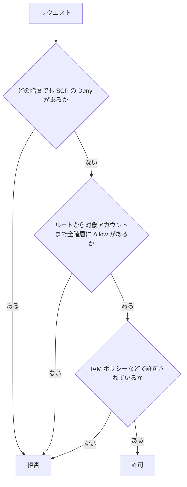
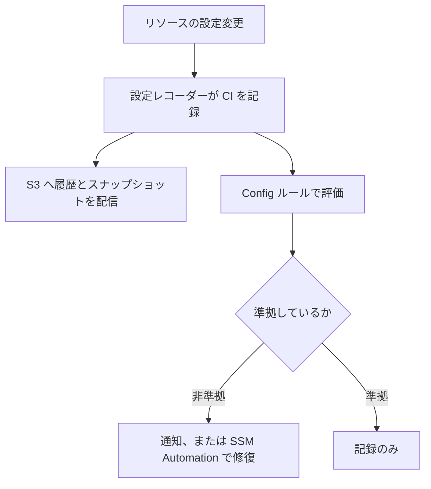

# ガバナンス

[:material-sprout: CLF](../courses/clf/services.md){ .exam-badge .exam-foundational } [:material-sprout: AIF](../courses/aif/services.md){ .exam-badge .exam-foundational } [:material-certificate: SAA](../courses/saa/services.md){ .exam-badge .exam-associate } [:material-certificate: SOA](../courses/soa/services.md){ .exam-badge .exam-associate } [:material-certificate: DEA](../courses/dea/services.md){ .exam-badge .exam-associate } [:material-certificate: MLA](../courses/mla/services.md){ .exam-badge .exam-associate } [:material-star-circle: SAP](../courses/sap/services.md){ .exam-badge .exam-professional } [:material-star-circle: DOP](../courses/dop/services.md){ .exam-badge .exam-professional } [:material-star-circle: AIP](../courses/aip/services.md){ .exam-badge .exam-professional } [:material-target: ANS](../courses/ans/services.md){ .exam-badge .exam-specialty } [:material-target: SCS](../courses/scs/services.md){ .exam-badge .exam-specialty }

複数の AWS アカウントを、まとめて管理して統制するためのサービスです。組織の構造を作る Organizations、環境を整える Control Tower、設定を監査する Config を中心に扱います。

[](../assets/diagrams/governance-multi-account.png)

| サービス | 役割 | 一言で |
| --- | --- | --- |
| [Organizations](#organizations) | アカウントの階層化、ポリシー、一括請求 | 組織の土台 |
| [Control Tower](#control-tower) | ベストプラクティスの環境の構築と統制 | 土台の自動構築 |
| [Config](#config) | リソースの設定の記録と評価 | 設定の監査 |
| [Service Catalog](#service-catalog) | 承認済みの構成をセルフサービスで提供 | 社内カタログ |
| [Resource Access Manager](#ram) | リソースをアカウント間で共有 | 共有 |
| [License Manager](#license-manager) | ソフトウェアライセンスの追跡と制限 | ライセンス |
| [Resource Groups と Tag Editor](#resource-groups) | タグでリソースをまとめて操作 | 整理 |

## AWS Organizations {#organizations}

[:material-sprout: CLF](../courses/clf/services.md){ .exam-badge .exam-foundational } [:material-certificate: SAA](../courses/saa/services.md){ .exam-badge .exam-associate } [:material-certificate: SOA](../courses/soa/services.md){ .exam-badge .exam-associate } [:material-certificate: MLA](../courses/mla/services.md){ .exam-badge .exam-associate } [:material-star-circle: SAP](../courses/sap/services.md){ .exam-badge .exam-professional } [:material-star-circle: DOP](../courses/dop/services.md){ .exam-badge .exam-professional } [:material-target: ANS](../courses/ans/services.md){ .exam-badge .exam-specialty } [:material-target: SCS](../courses/scs/services.md){ .exam-badge .exam-specialty }

**提供単位:** グローバル。VPC の外です。作成や変更は `us-east-1` のコントロールプレーンで行います（[提供単位の一覧](resource-scope.md#scope-global)）。

複数のアカウントを 1 つの組織にまとめるサービスです。追加料金はかかりません。

組織は、ルート 1 つの下に OU（組織単位）とアカウントを置く構造です。管理アカウントが 1 つあり、残りがメンバーアカウントです。

**例:** 12 アカウントの会社なら、次の形にできます。

```text
ルート
├─ 管理アカウント
├─ Security OU（ログ保管、監査の 2 アカウント）
├─ Workloads OU
│   ├─ Prod OU（本番 4 アカウント）
│   └─ Dev OU（開発 4 アカウント）
└─ Sandbox OU（個人検証 1 アカウント）
```

### 機能セット {#org-feature-sets}

| 機能セット | できること | 既定 |
| --- | --- | --- |
| すべての機能 | 一括請求、ポリシー、サービス連携 | 新規作成の既定で推奨 |
| 一括請求のみ | 1 枚の請求書にまとめるだけ | SCP や RCP は使えない |

一括請求のみからすべての機能へは移行できますが、逆には戻せません。

SCP を使おうとして使えない場合は、`aws organizations describe-organization` で `FeatureSet` を確認し、さらにルートでポリシータイプが有効かを確認します。

```bash
aws organizations describe-organization --query Organization.FeatureSet
aws organizations enable-policy-type --root-id r-examplerootid111 --policy-type SERVICE_CONTROL_POLICY
```

- **例:** 1 行目の結果が `"CONSOLIDATED_BILLING"` なら、SCP は使えません。`"ALL"` なら、2 行目でルートの SCP を有効にします。
- **移行の例:** 招待で加わった 20 アカウントがあると、`enable-all-features` の後に全 20 アカウントの承認が必要です。1 つでも承認しないと完了できません。
- **誤ると:** 一括請求のみのままだと、`attach-policy` が失敗します。

### OU の設計 {#org-ous}

ポリシーは OU に付けると配下へ継承されます。そのため、OU は人事上の部署ではなく、適用したいポリシーの違いで分けます。

ネストは 5 階層までです。深くすると SCP の評価が追いにくくなります。

**例:** 本番だけリージョンを東京に絞るなら、`Workloads/Prod` に SCP を付けます。人事部と開発部の本番アカウントは、部署が違っても同じ `Prod` に入れます。

- **継承の例:** `Workloads` に付けた Deny は、配下の `Prod` と `Dev` の全アカウントに効きます。
- **誤ると:** 部署ごとに OU を作ると、同じ SCP を部署の数だけ付けることになります。部署 8 つなら 8 か所の変更が要ります。

### ポリシーの種類 {#org-policy-types}

| 種類 | 区分 | 管理アカウントへの影響 | 対象に付けられる数 | 最大サイズ |
| --- | --- | --- | --- | --- |
| SCP | 認可 | なし | 10 | 10,240 文字 |
| RCP | 認可 | なし | 5 | 5,120 文字 |
| タグポリシー | 宣言型 | あり | 10 | 10,000 文字 |
| バックアップポリシー | 宣言型 | あり | 10 | 10,000 文字 |
| 宣言型ポリシー（EC2） | 宣言型 | あり | 10 | 10,000 文字 |
| AI サービスのオプトアウト | 宣言型 | あり | 5 | 2,500 文字 |

このほか、チャットアプリ、Security Hub、Inspector、Bedrock、S3、GuardDuty、アップグレードのロールアウトのポリシーがあります。

SCP の値は、古い教材の「5 個、5,120 文字」から増えています。

**計算例:** 1 つの対象に直接付けられる量は、SCP なら `10 × 10,240 = 102,400` 文字です。RCP は `RCPFullAWSAccess` が 1 枠使うので、自分のポリシーは 4 個で、`4 × 5,120 = 20,480` 文字です。

**誤ると:** 同じ OU に 11 個目の SCP を付けるとエラーです。文を 1 つのポリシーにまとめるか、上の階層の OU に分けて付けます。

### SCP {#scp}

[:material-certificate: SOA](../courses/soa/services.md){ .exam-badge .exam-associate }

組織内の IAM ユーザーとロールが使える権限の上限を決めるポリシーです。権限は与えません。実際に使うには、IAM ポリシーなどでの許可も必要です。



| 設定 | 動作 | 誤ったときの症状 |
| --- | --- | --- |
| `FullAWSAccess` | SCP を有効にすると既定で付く、全許可の SCP | 外して代わりを付けないと、メンバーアカウントの全操作が失敗する |
| Deny リスト方式 | `FullAWSAccess` を残して Deny を足す | 新サービスも既定で使える |
| Allow リスト方式 | `FullAWSAccess` を外して許可を列挙 | 途中の階層に Allow がないと、そのサービスが使えない |

次の例は、東京リージョン以外での EC2 起動を拒否します。

```json
{
  "Version": "2012-10-17",
  "Statement": [{
    "Sid": "DenyRunInstancesOutsideTokyo",
    "Effect": "Deny",
    "Action": "ec2:RunInstances",
    "Resource": "*",
    "Condition": {
      "StringNotEquals": {"aws:RequestedRegion": "ap-northeast-1"}
    }
  }]
}
```

上の SCP を付けたときの動きです。

| 実行するアカウント | ロールの権限 | `--region` | 結果 |
| --- | --- | --- | --- |
| メンバー | `AdministratorAccess` | `ap-northeast-1` | 成功 |
| メンバー | `AdministratorAccess` | `us-east-1` | SCP の明示的な拒否でエラー |
| メンバー | 権限なし | `ap-northeast-1` | IAM の許可がないのでエラー |
| 管理アカウント | `AdministratorAccess` | `us-east-1` | 成功（SCP が効かない） |

**継承の計算例（Allow リスト方式）:** Allow は全階層で必要です。

| 階層 | 付けた SCP |
| --- | --- |
| ルート | `FullAWSAccess` |
| `Workloads` OU | `s3:*`、`ec2:*` の Allow |
| `Prod` OU | `FullAWSAccess` |
| アカウント | `s3:*` の Allow |

このアカウントで使える上限は、すべての重なりである `s3:*` だけです。`ec2:*` はアカウントの階層に Allow がないので使えません。

SCP は次のものを制限できません。

- 管理アカウントのユーザーとロールの操作
- サービスリンクロールの権限で行う操作
- CloudFront の信頼された署名者の機能など、一部の操作

委任管理者のアカウントはメンバーアカウントなので、SCP の影響を受けます。

適用前に影響を試すには、ルートに直接付けず、テスト用の OU にアカウントを少しずつ移します。IAM の「最後にアクセスしたサービス」の情報で、使われているサービスを確認できます。

**例外の例:** 緊急用のロールだけ外すには、Deny に条件を足します。

```json
"Condition": {
  "StringNotEquals": {"aws:RequestedRegion": "ap-northeast-1"},
  "ArnNotLike": {"aws:PrincipalArn": "arn:aws:iam::*:role/BreakGlass"}
}
```

条件のキーどうしは AND なので、東京以外で、かつ `BreakGlass` 以外のときだけ拒否します。

SCP と権限境界の違いは [IAM](iam.md#boundaries-scp) を参照してください。

### RCP {#rcp}

組織内のリソースに対する権限の上限を決めるポリシーです。SCP は主体（自分の組織のユーザーやロール）を制限し、RCP はリソースへのアクセス（外部の主体を含む）を制限します。

| 観点 | SCP | RCP |
| --- | --- | --- |
| 制限の対象 | メンバーアカウントの IAM ユーザーとロール | メンバーアカウントのリソース |
| 主な用途 | 自社の人に禁止したいことを止める | 外部からのアクセスを防ぐ |
| 既定のポリシー | `FullAWSAccess` | `RCPFullAWSAccess`（外せず、上限 5 個に含まれる） |
| Effect | Allow、Deny | Deny のみ（Allow は `RCPFullAWSAccess` のみ） |
| 効かないもの | 管理アカウント、サービスリンクロール | 管理アカウントのリソース、サービスリンクロール、AWS 管理の KMS キー |

対象サービスには S3、STS、KMS、SQS、Secrets Manager などがあります。対象は増えているので、公式の一覧で確認します。

次の例は、組織の外の主体による S3 アクセスを拒否します。バケットポリシーを誤って公開しても、外部からはアクセスできなくなります。

```json
{
  "Version": "2012-10-17",
  "Statement": [{
    "Sid": "EnforceOrgIdentities",
    "Effect": "Deny",
    "Principal": "*",
    "Action": "s3:*",
    "Resource": "*",
    "Condition": {
      "StringNotEqualsIfExists": {"aws:PrincipalOrgID": "o-exampleorgid"},
      "BoolIfExists": {"aws:PrincipalIsAWSService": "false"}
    }
  }]
}
```

外部のパートナーからのアクセスが必要な場合に例外を入れないと、その連携が止まります。SCP と同様に、テスト用の OU で試してから広げます。

上の RCP の動きです。

| 呼び出し元 | バケットポリシーの許可 | 結果 |
| --- | --- | --- |
| 組織内のアカウント `111122223333` のロール | あり | 成功 |
| 組織外のアカウント `444455556666` のロール | あり | RCP で拒否 |
| 匿名のアクセス | 公開設定あり | RCP で拒否 |
| CloudFront などの AWS サービス | あり | `aws:PrincipalIsAWSService` が true なので Deny の対象外 |

**例外の例:** パートナーのアカウントを通すには、同じ `StringNotEqualsIfExists` にキーを足します。キーどうしは AND なので、組織外で、かつパートナーでもないときだけ拒否します。

```json
"StringNotEqualsIfExists": {
  "aws:PrincipalOrgID": "o-exampleorgid",
  "aws:PrincipalAccount": ["444455556666"]
}
```

### タグポリシー {#tag-policies}

組織内のタグを標準化するポリシーです。タグキーの大文字小文字と、使える値を決めます。

```json
{
  "tags": {
    "CostCenter": {
      "tag_key": {"@@assign": "CostCenter"},
      "tag_value": {"@@assign": ["HR", "Legal"]},
      "enforced_for": {"@@assign": ["ec2:instance"]}
    }
  }
}
```

| 機能 | 内容 | 注意 |
| --- | --- | --- |
| 基本のコンプライアンスルール | `enforced_for` で、不適合な値を持つ作成や変更を止める | タグなしのリソース作成は止めない |
| 必須タグキー | 必須のキーを定義する。CloudFormation、Terraform、Pulumi などの IaC で適用 | IaC 向けの機能 |
| レポート | 不適合のリソースを報告する | 報告だけでは止まらない |

「タグなしの作成を、IaC 以外も含めて止めたい」なら、SCP で `aws:RequestTag` を条件にして拒否します。

```json
{
  "Effect": "Deny",
  "Action": "ec2:RunInstances",
  "Resource": "arn:aws:ec2:*:*:instance/*",
  "Condition": {"Null": {"aws:RequestTag/CostCenter": "true"}}
}
```

上のタグポリシーと、この SCP の動きです。

| 作成時のタグ | タグポリシーだけ | この SCP も追加 |
| --- | --- | --- |
| `CostCenter=HR` | 作成できる | 作成できる |
| `CostCenter=Finance` | 拒否（値が許可にない） | 拒否 |
| タグなし | 作成できる | 拒否 |

事後の検出には Config の `required-tags` ルールが使えます。

**例:** `tag1Key=CostCenter`、`tag1Value=HR,Legal` で作ると、タグがない EC2 も、値が `Finance` の EC2 も非準拠です。キーは 6 個まで指定できます。

### 委任管理者 {#delegated-admin}

管理アカウントは、SCP が効かないため権限を強く絞りたいアカウントです。そこで、管理の業務をメンバーアカウントに委任します。

| 委任の範囲 | 方法 | 例 |
| --- | --- | --- |
| Organizations のポリシー管理 | リソースベースの委任ポリシー（最大 40,000 文字） | セキュリティ担当アカウントで SCP を管理 |
| 各サービスの組織管理 | 各サービスで委任管理者を登録 | Config、Security Hub、Health の組織ビュー |

ワークロードは管理アカウントに置かず、メンバーアカウントに置きます。

**例:** 管理アカウントの EC2 は SCP で止められないので、東京以外を禁止する SCP をすり抜けます。セキュリティ担当のアカウント `111122223333` を Config の委任管理者にすれば、管理アカウントに入らずに組織のルールを管理できます。

**誤ると:** 委任先はメンバーアカウントなので、SCP の影響を受けます。全アカウントの `config:*` を Deny する SCP を付けると、委任管理者の作業も止まります。

## AWS Control Tower {#control-tower}

[:material-sprout: CLF](../courses/clf/services.md){ .exam-badge .exam-foundational } [:material-certificate: SAA](../courses/saa/services.md){ .exam-badge .exam-associate } [:material-certificate: SOA](../courses/soa/services.md){ .exam-badge .exam-associate } [:material-star-circle: SAP](../courses/sap/services.md){ .exam-badge .exam-professional } [:material-star-circle: DOP](../courses/dop/services.md){ .exam-badge .exam-professional } [:material-target: ANS](../courses/ans/services.md){ .exam-badge .exam-specialty } [:material-target: SCS](../courses/scs/services.md){ .exam-badge .exam-specialty }

**提供単位:** リージョン（ホームリージョン）。ランディングゾーンを作ったときのリージョンで、後から変更できません。OU とアカウントはグローバルです。VPC の外のサービスです（[提供単位の考え方](resource-scope.md#two-axes)）。

ベストプラクティスに沿ったマルチアカウント環境を構築し、統制するサービスです。Organizations、Service Catalog、IAM Identity Center などを組み合わせて動かします。

| 要素 | 内容 |
| --- | --- |
| ランディングゾーン | ベストプラクティスに沿った環境全体 |
| コントロール | 環境に適用する統制のルール。旧称はガードレール |
| Account Factory | 承認済みの設定で新しいアカウントを用意するテンプレート。Service Catalog 上に構築 |
| ダッシュボード | アカウント、コントロール、非準拠のリソースの概要 |

**例:** 東京をホームリージョンにしてランディングゾーンを作ると、Log Archive と Audit のアカウント、Security OU が用意されます。Account Factory で `prod-orders` というアカウントを申請すると、決めた OU に入り、コントロールが自動で効きます。

**誤ると:** Control Tower は既存の Organizations を使えますが、外から OU や SCP を変えるとドリフトになります。

### ランディングゾーンの構造 {#ct-landing-zone}

コンソールから作ると、Security OU と任意の Sandbox OU が作られます。Security OU には、ログ保管（Log Archive）と監査（Audit）のアカウントが入ります。

ランディングゾーンのバージョン 4.0 では Security OU は必須でなくなり、自分の組織の構造を定義できます。バージョン 3.3 以前では、これらのアカウントは初回作成時に決まります。

**例:** 組織の全アカウントの CloudTrail と Config のログは Log Archive に集まり、監査の担当者は Audit から読みます。Log Archive に業務のワークロードを置かないようにします。

### コントロール {#ct-controls}

動作で 3 種類、適用の方針で 3 種類に分かれます。

| 動作 | 働き | 実装 |
| --- | --- | --- |
| 予防的 | 操作を止める | SCP、RCP、宣言型ポリシー |
| 検出的 | 違反を見つける | Config ルール |
| プロアクティブ | 作成前に確認し、不適合なら作らない | CloudFormation Hooks |

| 適用の方針 | 内容 |
| --- | --- |
| 必須 | 常に適用され、変更できない |
| 強く推奨 | 任意で有効化 |
| 選択的 | 任意で有効化 |

コントロールは OU 単位で適用され、配下の全アカウントに影響します。

管理アカウントには予防的コントロールが適用されません。

動作ごとの例です。

- **予防的:** Log Archive のバケットのポリシーを変更する操作を、SCP が拒否します。メンバーアカウントの管理者でも `AccessDenied` です。
- **検出的:** EBS の暗号化が無効のボリュームを作ると、作成は成功します。Config ルールが非準拠と判定し、ダッシュボードに出ます。
- **プロアクティブ:** 不適合のプロパティを持つリソースを CloudFormation で作ると、Hooks が作成前に止めます。CLI で直接作る操作は、Hooks の対象外です。

**OU の例:** `Prod` にコントロールを有効にすると、`Prod` の 4 アカウントすべてに効きます。1 つのアカウントだけ扱いを変えたいなら、別の OU へ移します。

### ドリフトと拡張 {#ct-drift}

Control Tower の外で OU やアカウント、SCP を変更すると、ドリフト（設定のずれ）になります。検出は自動ですが、解消は手動です。ランディングゾーン設定の **Reset**（バージョン 3.1 未満は **Update**）、OU の **Re-register OU**、アカウントの **Update account**、または `ResetEnabledControl`、`ResetEnabledBaseline` の API を使います。

| 拡張の方法 | 内容 |
| --- | --- |
| Account Factory for Terraform（AFT） | Terraform と Git でアカウントを発行、カスタマイズする。アプリのリソースのデプロイ用ではない |
| Customizations for Control Tower（CfCT） | テンプレートとポリシーを追加で展開する |

| 制限 | 値 |
| --- | --- |
| ランディングゾーンのアカウント数 | 最大 10,000 |
| OU あたりの SCP | 10 |
| 同時に進められるアカウント操作 | 5 |
| 同時に進められるコントロール操作 | 100 |

**計算例:** 12 アカウントの登録は、同時に 5 つまでなので `5, 5, 2` の 3 回に分かれて進みます。120 個のコントロールを有効にするなら、100 個まで進行中にでき、残りの 20 個は空いてから始めます。

**ドリフトの例:** 管理者が Control Tower の SCP を Organizations の画面で書き換えると、ドリフトになり、Audit アカウントの `aws-controltower-AggregateSecurityNotifications` に通知が届きます。OU の **Re-register OU** で元に戻ります。

**拡張の例:** アカウントの申請を Git の Pull Request で管理したいなら AFT です。全アカウントに同じ IAM ロールと SCP を追加したいなら CfCT です。

## AWS Config {#config}

[:material-sprout: CLF](../courses/clf/services.md){ .exam-badge .exam-foundational } [:material-sprout: AIF](../courses/aif/services.md){ .exam-badge .exam-foundational } [:material-certificate: SAA](../courses/saa/services.md){ .exam-badge .exam-associate } [:material-certificate: SOA](../courses/soa/services.md){ .exam-badge .exam-associate } [:material-certificate: DEA](../courses/dea/services.md){ .exam-badge .exam-associate } [:material-certificate: MLA](../courses/mla/services.md){ .exam-badge .exam-associate } [:material-star-circle: SAP](../courses/sap/services.md){ .exam-badge .exam-professional } [:material-star-circle: DOP](../courses/dop/services.md){ .exam-badge .exam-professional } [:material-target: ANS](../courses/ans/services.md){ .exam-badge .exam-specialty } [:material-target: SCS](../courses/scs/services.md){ .exam-badge .exam-specialty }

**提供単位:** リージョン。リージョンごとに有効にします。VPC の外のサービスです（[提供単位の考え方](resource-scope.md#two-axes)）。

リソースの設定の履歴を記録し、ルールに合っているかを評価するサービスです。「いつ、どう設定が変わったか」と「今の設定が基準に合っているか」に答えます。



### 設定レコーダー {#config-recorder}

設定の状態を設定項目（CI）として記録します。リージョンごとに有効にします。

| 設定 | 動作 | 既定、範囲 | 誤ったときの症状 |
| --- | --- | --- | --- |
| 記録の範囲 | 記録するリソースタイプ | 既定で、そのリージョンのサポートされる全リソース | 除外すると、そのタイプはルールで評価されない |
| 記録頻度 | 継続的または日次 | 継続的は変更のたびに記録 | 変更が多い環境は継続的だと CI の費用が増える |
| 保持期間 | CI を保持する期間 | 30 日から 2,557 日。既定は 7 年 | 短いと、監査で古い履歴を確認できない |
| 配信チャネル | S3 と SNS | S3 のライフサイクルは別に管理 | バケットポリシーの不足で配信が失敗する |

料金は、CI とルールの評価の回数によります。バージニア北部の例では、継続的な CI が 0.003 USD、日次の CI が 0.012 USD です。

**費用の計算例:** 上の単価で、1 リソースが 1 日に 20 回変わるとします。継続的なら `20 × 0.003 = 0.06` USD、日次なら 1 件で 0.012 USD です。分岐点は `0.012 / 0.003 = 4` 回です。1 日 4 回より多く変わるなら、日次のほうが安くなります。

```json
{
  "name": "default",
  "roleARN": "arn:aws:iam::111122223333:role/ConfigRole",
  "recordingGroup": {
    "allSupported": false,
    "exclusionByResourceTypes": {"resourceTypes": ["AWS::EC2::NetworkInterface"]},
    "recordingStrategy": {"useOnly": "EXCLUSION_BY_RESOURCE_TYPES"}
  },
  "recordingMode": {"recordingFrequency": "DAILY"}
}
```

- **例:** 上の設定は、ENI を記録せず、他を日次で記録します。Auto Scaling で ENI の増減が多い環境で CI を減らせます。
- **日次の誤り:** 監査で「いつ変わったか」を分単位で知りたいのに日次にすると、1 日の最後の状態しか残りません。
- **リージョンの誤り:** 東京だけ有効にしてバージニア北部を忘れると、そこの違反を見逃します。
- **保持期間の例:** `aws configservice put-retention-configuration --retention-period-in-days 365` で 1 年です。指定しなければ 2,557 日（7 年）で、29 日は指定できません。

### Config ルール {#config-rules}

| 観点 | 種類 | 内容 |
| --- | --- | --- |
| 作り方 | マネージドルール | AWS が用意したルール。`s3-bucket-public-read-prohibited` など |
| 作り方 | カスタムルール | Lambda などで自分で作る |
| トリガー | 設定変更 | 対象リソースの変更時に評価 |
| トリガー | 定期 | 指定した間隔で評価。例: 24 時間ごと |
| トリガー | ハイブリッド | 両方 |
| 評価モード | 検出的 | 作成済みのリソースを評価 |
| 評価モード | プロアクティブ | 作成前のプロパティを評価 |

**ルールは止めません。** プロアクティブ評価でも、判定するだけで修復やデプロイの阻止はしません。止めるなら SCP や Control Tower のプロアクティブコントロールを使います。

複数のアカウントで同じルールを使う組織ルールは、API か CLI でしか作れません。コンソールには対応していません。

```bash
aws configservice put-config-rule --config-rule '{
  "ConfigRuleName": "required-tags",
  "Source": {"Owner": "AWS", "SourceIdentifier": "REQUIRED_TAGS"},
  "InputParameters": "{\"tag1Key\":\"CostCenter\"}",
  "Scope": {"ComplianceResourceTypes": ["AWS::EC2::Instance"]}
}'
```

トリガーの選び方の例です。

- **設定変更:** セキュリティグループの 22 番を `0.0.0.0/0` に開くと、数分のうちに非準拠の判定が出ます。
- **定期:** `MaximumExecutionFrequency` に `TwentyFour_Hours` を指定すると、24 時間ごとです。IAM のアクセスキーの経過日数のように、設定変更がなくても状態が変わるものに向きます。値は `One_Hour`、`Three_Hours`、`Six_Hours`、`Twelve_Hours`、`TwentyFour_Hours` です。
- **プロアクティブ:** CI/CD の途中で、作る前のプロパティが準拠かを確認します。結果が `NON_COMPLIANT` でも自動では止まらないので、パイプライン側で失敗にします。

**誤ると:** 設定レコーダーで対象のタイプを除外していると、ルールはそのタイプを評価しません。結果が空のままになります。

### 修復 {#config-remediation}

非準拠のリソースを、Systems Manager Automation のドキュメントで修復します。手動と自動を選べます。

```bash
aws configservice put-remediation-configurations --remediation-configurations '[{
  "ConfigRuleName": "s3-bucket-public-read-prohibited",
  "TargetType": "SSM_DOCUMENT",
  "TargetId": "AWS-DisableS3BucketPublicReadWrite",
  "Automatic": true,
  "MaximumAutomaticAttempts": 5,
  "RetryAttemptSeconds": 60,
  "Parameters": {
    "S3BucketName": {"ResourceValue": {"Value": "RESOURCE_ID"}},
    "AutomationAssumeRole": {"StaticValue": {"Values": ["arn:aws:iam::111122223333:role/ConfigRemediationRole"]}}
  }
}]'
```

| 項目 | 内容 | 既定、範囲 | 誤ったときの症状 |
| --- | --- | --- | --- |
| `Automatic` | 自動修復するか | 手動か自動を選択 | `false` のままだと修復が走らない |
| `MaximumAutomaticAttempts` | 失敗を許す回数 | 既定 5、1 から 25 | 超えると修復の例外が付いて、止まる |
| `RetryAttemptSeconds` | 上の回数を数える時間枠 | 1 から 2,678,000 秒 | 短すぎると枠の中で回数に届かず、例外が付かないまま失敗を繰り返す |
| 実行ロール | Automation が使う IAM ロール | 自分で用意 | 権限不足で修復が失敗する |

サービスリンクルールの修復は管理できません。

**例:** 上の設定は、`MaximumAutomaticAttempts=5`、`RetryAttemptSeconds=60` です。60 秒に 5 回失敗すると、そのリソースに修復の例外が付き、自動の修復が止まります。

**誤ると:** ランブックが 1 回 30 秒かかるのに `RetryAttemptSeconds=60` なら、60 秒に 5 回の失敗には届きません。回数が窓に収まるように、所要時間を見て決めます。`AutomationAssumeRole` に S3 のパブリックアクセスブロックを変更する権限がないと、毎回失敗します。

### アグリゲーター {#config-aggregators}

複数のアカウントとリージョンの Config データを 1 か所で見るための仕組みです。追加料金はかかりません。

- 組織全体、または個別に指定したアカウントを対象にできる。
- 読み取り専用のビューで、ここからルールの展開や修復はできない。
- 個別指定の場合、ソースアカウント側の認可が必要。組織の場合は不要。
- 上限はアグリゲーター 50 個、1 つあたり 10,000 アカウント。

高度なクエリ（SQL に似た構文）で「暗号化されていない EBS ボリュームを全アカウントから探す」といった検索ができます。

```bash
aws configservice select-aggregate-resource-config \
  --configuration-aggregator-name org-aggregator \
  --expression "SELECT accountId, awsRegion, resourceId WHERE resourceType = 'AWS::EC2::Volume' AND configuration.encrypted = false"
```

**計算例:** 30 アカウント、4 リージョンを集めると、`30 × 4 = 120` か所分を 1 回で検索できます。

**誤ると:** Config を有効にしていないアカウントのデータは集まりません。組織を指定しても自動では有効になりません。

### 適合パック {#config-conformance-packs}

ルールと修復アクションを 1 つにまとめて、アカウントや組織に展開する単位です。YAML のテンプレートで定義します。

```yaml
Resources:
  S3PublicReadProhibited:
    Type: AWS::Config::ConfigRule
    Properties:
      ConfigRuleName: s3-bucket-public-read-prohibited
      Source:
        Owner: AWS
        SourceIdentifier: S3_BUCKET_PUBLIC_READ_PROHIBITED
```

サンプルのテンプレートが公開されています。上限は 1 パックあたり 130 ルール、アカウントあたり 50 パックです。パック内のルールも、1 リージョンあたり 1,000 ルールの上限に数えられます。

```bash
aws configservice put-organization-conformance-pack \
  --organization-conformance-pack-name baseline \
  --template-body file://baseline.yaml
```

**計算例:** 60 ルールのパックを 20 個展開すると `60 × 20 = 1,200` ルールで、1 リージョン 1,000 の上限を超えます。ほかの個別ルールが 100 あれば、パックに使えるのは 900 です。

| 違い | 見方 |
| --- | --- |
| 個別ルールとの違い | 複数ルールをまとめて展開、管理する |
| アグリゲーターとの違い | パックは展開、アグリゲーターは集約して閲覧 |

## Config と CloudTrail の違い {#config-vs-cloudtrail}

| 観点 | Config | CloudTrail | CloudWatch |
| --- | --- | --- | --- |
| 答える問い | 設定はどう変わり、基準に合っているか | 誰がいつどの API を呼んだか | 性能や動作はどうか |
| 記録するもの | 設定の状態（CI） | API の呼び出しイベント | メトリクス、ログ |
| 評価 | ルールで判定 | しない | アラームのしきい値 |
| 典型の問い | S3 が公開設定か | 誰がセキュリティグループを変更したか | CPU 使用率が高いか |

Config のタイムラインから、CloudTrail のイベントへたどることができます。両方を組み合わせると、「何がどう変わり、誰が変えたか」が分かります。

**例:** セキュリティグループ `sg-0abc` が 10:00 に 22 番を `0.0.0.0/0` に開いたとします。

- Config は、変更前後の設定（CI）と、10:03 の非準拠の判定を残します。
- CloudTrail は、`AuthorizeSecurityGroupIngress` を呼んだロールと送信元を残します。
- CloudWatch は、22 番への通信が増えても、それだけでは誰が開けたか答えません。

CloudTrail の設定は [オブザーバビリティ](observability.md#cloudtrail) を参照してください。

## AWS Service Catalog {#service-catalog}

[:material-sprout: CLF](../courses/clf/services.md){ .exam-badge .exam-foundational } [:material-certificate: SAA](../courses/saa/services.md){ .exam-badge .exam-associate } [:material-certificate: SOA](../courses/soa/services.md){ .exam-badge .exam-associate } [:material-certificate: MLA](../courses/mla/services.md){ .exam-badge .exam-associate } [:material-star-circle: DOP](../courses/dop/services.md){ .exam-badge .exam-professional } [:material-star-circle: AIP](../courses/aip/services.md){ .exam-badge .exam-professional } [:material-target: SCS](../courses/scs/services.md){ .exam-badge .exam-specialty }

**提供単位:** リージョン。ポートフォリオと製品はリージョンごとに作ります。VPC の外のサービスで、製品が作るリソースの置き場所はテンプレートで決まります（[提供単位の考え方](resource-scope.md#two-axes)）。

組織が承認した構成をカタログにし、利用者がセルフサービスで作成できるようにするサービスです。

| 要素 | 内容 |
| --- | --- |
| 製品 | CloudFormation や Terraform で定義した構成 |
| ポートフォリオ | 製品の集まり。IAM のユーザーやグループにアクセス権を与える |
| 制約 | 製品の使い方を制限するルール |
| プロビジョニング済み製品 | 利用者が作成した実体 |

| 制約 | 内容 | 例 |
| --- | --- | --- |
| 起動 | 作成時に Service Catalog が引き受ける IAM ロール | 利用者に EC2 権限を与えずに作らせる |
| テンプレート | 指定できるパラメータの値を制限 | `InstanceType` を `t3.small` のみに |
| 通知 | スタックのイベントを SNS に送る | 作成を担当者に通知 |
| タグ更新 | 作成後のタグ変更を許可するか | 変更を禁止する |
| スタックセット | 複数のアカウントとリージョンへの展開 | 3 リージョンに同じ構成を作る |

**起動制約が最重要です。** 製品とポートフォリオの組み合わせごとに設定します。ないと、利用者自身の権限で作成することになり、CloudFormation や対象サービスの権限が必要です。

テンプレート制約と TagOption は、Terraform の製品には使えません。

**起動制約の例:** ポートフォリオ `web` の製品 `small-ec2` に、ロール `arn:aws:iam::111122223333:role/SCLaunchEC2` を起動制約で設定します。利用者は Service Catalog のエンドユーザー権限だけで EC2 を作れます。利用者自身に `ec2:RunInstances` はありません。

**数の計算例:** 3 つの製品を 2 つのポートフォリオに入れると、組み合わせは `3 × 2 = 6` です。起動制約は組み合わせごとなので、最大 6 回設定します。

**テンプレート制約の例:**

```json
{
  "Rules": {
    "SmallOnly": {
      "Assertions": [{
        "Assert": {"Fn::Contains": [["t3.small"], {"Ref": "InstanceType"}]},
        "AssertDescription": "t3.small のみ選べます"
      }]
    }
  }
}
```

**誤ると:** 起動制約がないと、利用者は `cloudformation:CreateStack` の権限エラーで失敗します。起動ロールに `ec2:RunInstances` がないと、スタックの作成が失敗します。

共有は、アカウント間または Organizations で行えます。参照の共有なら元の更新が反映されます。コピーを配布するなら、CloudFormation で展開します。

## AWS Resource Access Manager {#ram}

[:material-sprout: CLF](../courses/clf/services.md){ .exam-badge .exam-foundational } [:material-certificate: SAA](../courses/saa/services.md){ .exam-badge .exam-associate } [:material-certificate: SOA](../courses/soa/services.md){ .exam-badge .exam-associate } [:material-star-circle: SAP](../courses/sap/services.md){ .exam-badge .exam-professional } [:material-star-circle: DOP](../courses/dop/services.md){ .exam-badge .exam-professional } [:material-target: ANS](../courses/ans/services.md){ .exam-badge .exam-specialty } [:material-target: SCS](../courses/scs/services.md){ .exam-badge .exam-specialty }

**提供単位:** リージョン。共有は同じリージョンに限られます。グローバルリソースの共有は `us-east-1` で作ります。RAM 自体は VPC の外のサービスで、共有するサブネットは VPC の中にあります（[提供単位の考え方](resource-scope.md#two-axes)）。

リソースをコピーせず、他のアカウントと共有するサービスです。追加料金はかかりません。

| 共有できる例 | 用途 |
| --- | --- |
| VPC サブネット | 複数のアカウントが 1 つの VPC を使う |
| Transit Gateway | 組織のネットワークのハブを共有 |
| Route 53 Resolver ルール | オンプレミスの名前解決を共有 |
| プレフィックスリスト、IPAM プール | IP の管理 |
| License Manager の設定 | ライセンス設定の共有 |
| Capacity Reservation、Dedicated Host | 確保した容量の共有 |

共有先の指定と動作です。

| 共有先 | 招待 | 条件 |
| --- | --- | --- |
| 組織、OU、組織内のアカウント | 不要（組織の共有を有効にしている場合） | 管理アカウントで `enable-sharing-with-aws-organization` を実行 |
| 組織外のアカウント | 必要 | 対象のリソースタイプのみ |

組織の共有が無効なままだと、招待が必要になったり、OU を指定できなかったりします。

既定では、組織を離れたアカウントは共有へのアクセスを失います。

```bash
aws ram create-resource-share --name shared-subnets \
  --resource-arns arn:aws:ec2:ap-northeast-1:111122223333:subnet/subnet-0abc1234 \
  --principals 444455556666
```

- **例:** 上のコマンドで、アカウント `444455556666` が東京のサブネットを使えます。同じアカウントの大阪からは見えません。
- **OU の例:** `--principals` に OU の ARN を指定すると、後からその OU に入るアカウントにも共有されます。
- **離脱の例:** アカウント間の共有で組織を離れても残したいなら、作成時に `RetainSharingOnAccountLeaveOrganization` を `True` にします。OU や組織全体への共有には使えません。
- **誤ると:** 組織の共有を有効にしないと、OU の ARN の指定が失敗します。

### VPC サブネットの共有 {#ram-vpc-sharing}

オーナーのアカウントが VPC を管理し、参加者のアカウントがそのサブネットにリソースを作ります。

- オーナーと参加者のアカウントは Organizations の管理下にある必要がある。
- オーナーは、サブネット、ルートテーブルなどの VPC のリソースを管理する。
- 参加者は、自分が作ったリソースを管理し、そのリソースの費用を負担する。
- VPC を減らせるので、ネットワークの構成が簡単になる。

**例:** ネットワークアカウント `111122223333` が `10.0.0.0/16` の VPC を持ち、`10.0.10.0/24` のサブネットをアプリのアカウント `444455556666` に共有します。

- アプリのアカウントは、そのサブネットに EC2 を作り、その料金を払います。
- ルートテーブルを変える権限はないので、経路の変更はネットワークの担当に依頼します。
- **誤ると:** 共有するサブネットの IP が足りないと、参加者のどのアカウントも起動に失敗します。`/24` の使える IP は `256 - 5 = 251` 個で、全アカウントの合計です。

VPC ピアリングや Transit Gateway との使い分けは [ネットワーク接続](network-connectivity.md) を参照してください。

## AWS License Manager {#license-manager}

[:material-sprout: CLF](../courses/clf/services.md){ .exam-badge .exam-foundational } [:material-certificate: SAA](../courses/saa/services.md){ .exam-badge .exam-associate } [:material-star-circle: DOP](../courses/dop/services.md){ .exam-badge .exam-professional }

**提供単位:** リージョン。リージョンをまたぐインスタンスの追跡には対応しません。VPC の外のサービスです（[提供単位の考え方](resource-scope.md#two-axes)）。

Microsoft、SAP、Oracle、IBM などのソフトウェアライセンスを、アカウントやリージョンをまたいで管理するサービスです。

- vCPU、物理コア、ソケット、マシン数で数えるライセンスを追跡できる。
- ルールで上限を決め、ハードリミットでは超過する起動を止められ、ソフトリミットでは通知する。
- BYOL の管理に使い、監査での超過リスクを減らせる。
- Marketplace の権利の配布や、ISV によるライセンスの配布（マネージドエンタイトルメント）にも使える。
- RAM でライセンス設定を共有できる。

「BYOL のライセンス超過を起動時に防ぎたい」なら License Manager です。

```bash
aws license-manager create-license-configuration \
  --name oracle-db \
  --license-counting-type vCPU \
  --license-count 64 \
  --license-count-hard-limit
```

**計算例:** 上の 64 vCPU のハードリミットで、8 vCPU のインスタンスを起動します。`64 / 8 = 8` 台までで、9 台目の起動はブロックされます。

- **ソフトリミットの例:** `--no-license-count-hard-limit` にすると、9 台目も起動し、超過を通知します。
- **停止の例:** 既定では、停止したインスタンスのライセンスはプールに戻ります。契約で停止中も数えるなら、**Include stopped instances** のルールを使います。
- **誤ると:** ライセンス設定を付けた AMI を別のリージョンへコピーすると、そのリージョンでは起動がブロックされます。

## Resource Groups とタグ付け {#resource-groups}

**提供単位:** リージョン。1 つのグループに入るのは同じリージョンのリソースです。VPC の外のサービスです（[提供単位の考え方](resource-scope.md#two-axes)）。

AWS Resource Groups は、複数のリソースをまとめて扱うためのサービスです。

| グループの種類 | メンバーの決まり方 |
| --- | --- |
| タグベース | リソースタイプとタグのクエリ |
| CloudFormation スタックベース | スタックに含まれるリソース |

Systems Manager などで、グループ単位の操作に使います。

```bash
aws resource-groups create-group --name prod-web --resource-query '{
  "Type": "TAG_FILTERS_1_0",
  "Query": "{\"ResourceTypeFilters\":[\"AWS::EC2::Instance\"],\"TagFilters\":[{\"Key\":\"Env\",\"Values\":[\"prod\"]}]}"
}'
```

**例:** 東京の `Env=prod` の EC2 が `prod-web` に入ります。Run Command は `--targets "Key=resource-groups:Name,Values=prod-web"` で全台に実行できます。

**誤ると:** 新しい EC2 に `Env=Prod` と大文字で付けると、値が一致せずグループから漏れます。

### タグ戦略 {#tagging-strategy}

Tag Editor を使うと、複数のリソースをリージョンをまたいで検索し、まとめてタグを付けられます。

タグのキーと値は大文字小文字を区別します。`aws:` はプレフィックスとして予約されています。

| 目的 | タグの例 |
| --- | --- |
| 費用の配賦 | `CostCenter=1234` |
| 環境 | `Environment=Production` |
| 所有者 | `Owner=platform-team` |
| 自動化 | `Backup=daily` |
| アクセス制御 | `Project=alpha`（ABAC） |

統制の組み合わせは次のとおりです。

| 目的 | 手段 |
| --- | --- |
| 表記の統一 | タグポリシー |
| 作成時の強制 | SCP の `aws:RequestTag`、IaC の必須タグキー |
| 事後の検出 | Config の `required-tags` |
| 費用への反映 | [コスト配分タグ](cost-management.md#cost-allocation-tags)の有効化 |

例です。

- **大文字小文字:** `CostCenter=1234` と `costcenter=1234` は別のタグです。コストレポートでは行が分かれます。
- **ABAC:** ロールのタグ `Project=alpha` と同じ値のリソースだけを操作させるには、次の条件にします。`Project=beta` のリソースは操作できません。

```json
"Condition": {"StringEquals": {"aws:ResourceTag/Project": "${aws:PrincipalTag/Project}"}}
```

- **`aws:` の予約:** `aws:team=core` のようなタグは自分では作れません。

## AWS Proton の状況 {#proton}

[:material-certificate: SAA](../courses/saa/services.md){ .exam-badge .exam-associate } [:material-star-circle: DOP](../courses/dop/services.md){ .exam-badge .exam-professional }

**AWS Proton は、公式の告知では 2026 年 10 月 7 日でサポート終了です。** この日以降はコンソールとリソースにアクセスできません。デプロイ済みのインフラはそのまま残ります。

DOP-C02 と SAA-C03 の対象サービス一覧には名前が残っていますが、新しい設計の選択肢にはなりません。

公式の移行先の案には、CloudFormation Git Sync、Harmonix on AWS などがあります。

**例:** 今日は 2026 年 10 月 31 日なので、Proton のコンソールには既に入れません。作成済みの ECS サービスは動き続けるので、CloudFormation で管理し直します。

## IAM Identity Center への案内 {#identity-center}

複数のアカウントに、社員が 1 か所からサインインする仕組みです。Control Tower は既定でこのディレクトリを作成します。

概要は [IAM](iam.md#identity-center)、詳細は [ID とディレクトリ](identity-directory.md) を参照してください。

**例:** 社員が 1 つのポータルにサインインし、`prod-orders` では `ReadOnlyAccess`、`dev-orders` では `PowerUserAccess` を選んで入ります。IAM ユーザーをアカウントごとに作らずに済みます。

## マルチアカウントのパターン {#multi-account-patterns}

アカウントを分けると、影響範囲、権限、費用、クォータを分離できます。公式の推奨の OU は次のとおりです。

| OU | 用途 |
| --- | --- |
| Security | ログ保管、セキュリティツール |
| Infrastructure | ネットワークなどの共有基盤 |
| Workloads | アプリの本番、開発 |
| Sandbox | 個人の実験 |
| Policy Staging | 新しいポリシーの検証 |
| Suspended | 停止したアカウントの隔離 |
| Exceptions | 標準から外れるワークロード |
| Transitional | 移行中のアカウント |

**例:** 買収した会社の 5 アカウントを受け入れるときは、`Transitional` に入れます。SCP で最低限の Deny だけ付けて、調査が済んだら `Workloads/Prod` へ移します。

| Deployments | デプロイ用のパイプライン |

| やりたいこと | パターン |
| --- | --- |
| 全アカウントのログを改ざんから守る | ログ保管アカウントへ集約し、SCP で変更を拒否 |
| セキュリティ担当の集中管理 | 監査アカウントを各サービスの委任管理者に |
| ネットワークの集中管理 | ネットワークアカウントから RAM で共有 |
| アカウントの大量発行 | Control Tower の Account Factory |
| 他アカウントへの作業 | 手元のアカウントから IAM ロールを引き受ける |
| 外部からのデータアクセスの遮断 | SCP と RCP でデータ境界を作る |
| 新しいポリシーの安全な適用 | Policy Staging OU で試してから広げる |

**ログを守る例:** Log Archive のバケットをメンバーアカウントから消せないようにする SCP です。組織の全アカウントに付けます。管理アカウントには SCP が効きません。

```json
{
  "Effect": "Deny",
  "Action": ["s3:DeleteBucket", "s3:DeleteObject*", "s3:PutBucketPolicy"],
  "Resource": ["arn:aws:s3:::org-log-archive", "arn:aws:s3:::org-log-archive/*"]
}
```

**段階の例:** 新しい SCP を `Policy Staging` の 1 アカウントで 1 週間試し、`CloudTrail` に拒否が増えないことを確かめてから `Dev`、`Prod` の順に広げます。

## 選び方の比較 {#choosing}

| 迷うもの | 使い分け |
| --- | --- |
| Organizations / Control Tower | 組織の仕組み自体は Organizations、構築と統制の自動化まで欲しいなら Control Tower |
| SCP / IAM ポリシー | 組織として上限を決めるなら SCP、権限を与えるなら IAM ポリシー |
| SCP / RCP | 自社の主体の制限なら SCP、外部からのリソースアクセスの制限なら RCP |
| Config / CloudTrail | 設定の状態なら Config、API の呼び出し履歴なら CloudTrail |
| Config ルール / SCP | 発見して修復なら Config、操作を止めるなら SCP |
| 適合パック / アグリゲーター | 展開なら適合パック、集約して閲覧ならアグリゲーター |
| Service Catalog / CloudFormation | 利用者に承認済みの構成を提供するなら Service Catalog、構成の定義自体は CloudFormation |
| Service Catalog / Marketplace | 自社の承認済みの構成なら Service Catalog、サードパーティ製品の購入なら Marketplace |
| RAM / IAM クロスアカウントロール | リソース自体を他アカウントで使わせるなら RAM、他アカウントで操作させるならロール |
| タグポリシー / Config の `required-tags` | 値の表記の統一ならタグポリシー、タグのないリソースの検出なら Config |

**例:** 「新しい EC2 に必ず `CostCenter` を付けさせ、値は `HR` か `Legal` に限り、既存の違反も一覧にしたい」なら、3 つを組み合わせます。SCP でタグなしの作成を止め、タグポリシーで値を制限し、Config の `required-tags` で既存を検出します。

## 既定値と上限のまとめ {#numbers}

| 項目 | 値 |
| --- | --- |
| 組織のアカウント数の既定クォータ | 10（引き上げ可） |
| ルートの数 | 1 |
| OU の数 | 2,000 |
| OU のネスト | 5 階層 |
| 同時に作成できるメンバーアカウント | 5 |
| 作成したアカウントを組織から外せるまでの期間 | 4 日 |
| 対象 1 つに付けられる SCP | 10 |
| SCP の最大サイズ | 10,240 文字 |
| 対象 1 つに付けられる RCP | 5（`RCPFullAWSAccess` を含む） |
| RCP の最大サイズ | 5,120 文字 |
| ルール数（リージョン、アカウントごと） | 1,000 |
| 適合パック | アカウントあたり 50、1 パック 130 ルール |
| アグリゲーター | 50 個、1 つあたり 10,000 アカウント |
| Config の保持期間 | 30 日から 2,557 日、既定は 7 年 |
| 自動修復の試行回数 | 既定 5、1 から 25 |

**数の例:**

- 12 アカウントを同時に作るなら、`5, 5, 2` の 3 回に分かれます。1 つ終わるごとに次を始められます。
- 今日作ったアカウントを組織から外せるのは 4 日後です。招待で加えたアカウントは、この待ち時間がありません。
- ルートの下に OU を 5 段作れます。6 段目は作れません。

## 試験のポイント {#exam-points}

| こう問われたら | 答え |
| --- | --- |
| 複数アカウントの請求をまとめて割引を共有したい | Organizations の一括請求 |
| 特定リージョンの利用を全アカウントで禁止したい | SCP |
| SCP を付けたのにまだ管理アカウントで操作できる | SCP は管理アカウントに効かない |
| SCP で権限を与えられるか | 与えられない。上限を決めるだけ |
| 外部からの S3 アクセスを組織全体で防ぎたい | RCP の `aws:PrincipalOrgID` |
| ベストプラクティスのマルチアカウント環境をすぐ作りたい | Control Tower |
| Control Tower の予防的コントロールの実体 | SCP、RCP、宣言型ポリシー |
| Control Tower の検出的コントロールの実体 | Config ルール |
| アカウントの発行を標準化したい | Account Factory |
| 公開バケットを検出して自動で直したい | Config ルールと SSM Automation の自動修復 |
| 全アカウントの準拠状況を 1 か所で見たい | Config アグリゲーター |
| ルールと修復をまとめて組織に展開したい | 適合パック |
| 過去のある時点の設定を確認したい | Config |
| 誰がセキュリティグループを変更したか | CloudTrail |
| 利用者に強い権限を渡さず承認済みの構成を作らせたい | Service Catalog の起動制約 |
| サブネットを他アカウントと共有したい | RAM |
| Transit Gateway を複数アカウントで使いたい | RAM |
| ライセンスの超過を防ぎたい | License Manager |
| タグの表記を組織で統一したい | タグポリシー |
| タグなしリソースを作らせたくない | SCP の `aws:RequestTag` |
| Proton を提案してよいか | 2026 年 10 月にサポート終了なので提案しない |

## 関連ページ {#related}

- [クラウドの基礎](cloud-foundations.md)
- [コスト管理](cost-management.md)
- [IAM](iam.md)
- [ID とディレクトリ](identity-directory.md)
- [オブザーバビリティ](observability.md)
- [運用](operations.md)
- [ネットワーク接続](network-connectivity.md)
- [脅威検出](threat-detection.md)

## 参考 {#references}

- [Service control policies (SCPs)](https://docs.aws.amazon.com/organizations/latest/userguide/orgs_manage_policies_scps.html)
- [SCP evaluation](https://docs.aws.amazon.com/organizations/latest/userguide/orgs_manage_policies_scps_evaluation.html)
- [Resource control policies (RCPs)](https://docs.aws.amazon.com/organizations/latest/userguide/orgs_manage_policies_rcps.html)
- [Managing organization policies](https://docs.aws.amazon.com/organizations/latest/userguide/orgs_manage_policies.html)
- [Quotas and service limits for AWS Organizations](https://docs.aws.amazon.com/organizations/latest/userguide/orgs_reference_limits.html)
- [Enforcing tag policies](https://docs.aws.amazon.com/organizations/latest/userguide/orgs_manage_policies_tag-policies-enforcement.html)
- [Delegated administrator for AWS Organizations](https://docs.aws.amazon.com/organizations/latest/userguide/orgs_delegate_policies.html)
- [What Is AWS Control Tower?](https://docs.aws.amazon.com/controltower/latest/userguide/what-is-control-tower.html)
- [How controls work](https://docs.aws.amazon.com/controltower/latest/userguide/how-controls-work.html)
- [Limitations and quotas in AWS Control Tower](https://docs.aws.amazon.com/controltower/latest/userguide/limits.html)
- [Components of an AWS Config rule](https://docs.aws.amazon.com/config/latest/developerguide/evaluate-config_components.html)
- [Remediating Noncompliant Resources](https://docs.aws.amazon.com/config/latest/developerguide/remediation.html)
- [RemediationConfiguration](https://docs.aws.amazon.com/config/latest/APIReference/API_RemediationConfiguration.html)
- [Multi-Account Multi-Region Data Aggregation](https://docs.aws.amazon.com/config/latest/developerguide/aggregate-data.html)
- [Conformance Packs](https://docs.aws.amazon.com/config/latest/developerguide/conformance-packs.html)
- [Service Limits for AWS Config](https://docs.aws.amazon.com/config/latest/developerguide/configlimits.html)
- [AWS Config pricing](https://aws.amazon.com/config/pricing/)
- [Using AWS Service Catalog Constraints](https://docs.aws.amazon.com/servicecatalog/latest/adminguide/constraints.html)
- [What is AWS Resource Access Manager?](https://docs.aws.amazon.com/ram/latest/userguide/what-is.html)
- [Shareable AWS resources](https://docs.aws.amazon.com/ram/latest/userguide/shareable.html)
- [Share your VPC subnets](https://docs.aws.amazon.com/vpc/latest/userguide/vpc-sharing.html)
- [What is AWS License Manager?](https://docs.aws.amazon.com/license-manager/latest/userguide/license-manager.html)
- [What are resource groups?](https://docs.aws.amazon.com/ARG/latest/userguide/resource-groups.html)
- [Best Practices for Tagging AWS Resources](https://docs.aws.amazon.com/whitepapers/latest/tagging-best-practices/tagging-best-practices.html)
- [AWS Proton Service Deprecation and Migration Guide](https://docs.aws.amazon.com/proton/latest/userguide/proton-end-of-support.html)
- [Recommended OUs and accounts](https://docs.aws.amazon.com/whitepapers/latest/organizing-your-aws-environment/recommended-ous-and-accounts.html)
