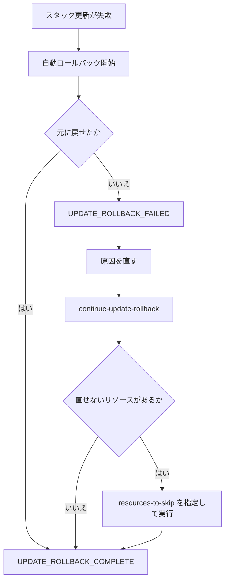
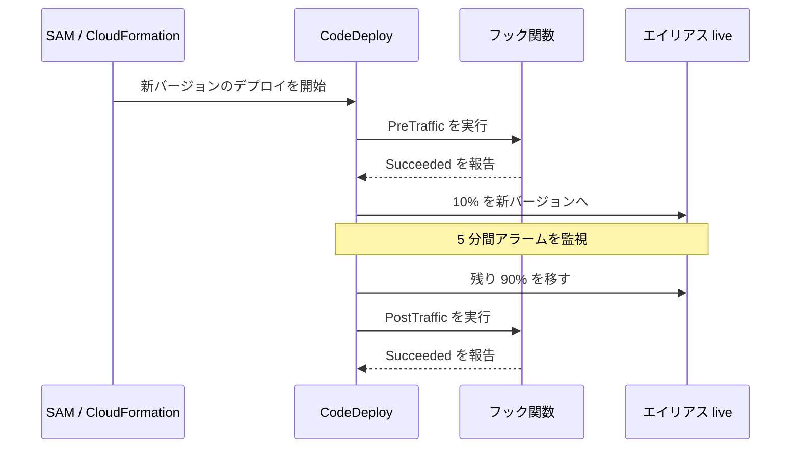

# IaC（CloudFormation / SAM / CDK / CLI）

[:material-sprout: CLF](../courses/clf/services.md){ .exam-badge .exam-foundational } [:material-certificate: SAA](../courses/saa/services.md){ .exam-badge .exam-associate } [:material-certificate: DVA](../courses/dva/services.md){ .exam-badge .exam-associate } [:material-certificate: SOA](../courses/soa/services.md){ .exam-badge .exam-associate } [:material-certificate: DEA](../courses/dea/services.md){ .exam-badge .exam-associate } [:material-certificate: MLA](../courses/mla/services.md){ .exam-badge .exam-associate } [:material-star-circle: SAP](../courses/sap/services.md){ .exam-badge .exam-professional } [:material-star-circle: DOP](../courses/dop/services.md){ .exam-badge .exam-professional } [:material-star-circle: AIP](../courses/aip/services.md){ .exam-badge .exam-professional } [:material-target: ANS](../courses/ans/services.md){ .exam-badge .exam-specialty } [:material-target: SCS](../courses/scs/services.md){ .exam-badge .exam-specialty }

インフラをコードで定義し、同じ構成を繰り返し安全に作るための道具です。CloudFormation が土台で、サーバーレスなら SAM、プログラミング言語で書くなら CDK を選びます。

[](../assets/diagrams/iac-sam-deploy.png)

## どれを使うか {#choosing}

| ツール | 書き方 | 向いている場面 |
|---|---|---|
| CloudFormation | YAML / JSON | あらゆる AWS リソースを宣言的に管理 |
| SAM | CloudFormation の拡張 YAML | Lambda、API Gateway などサーバーレス構成 |
| CDK | TypeScript、Python など | ループや条件を使い、抽象化して再利用したい |
| AWS CLI | コマンド | API の単発実行、スクリプト、確認 |
| CloudShell | ブラウザ上のシェル | 環境構築なしで CLI を使う |

SAM も CDK も、最終的には CloudFormation のテンプレートとしてデプロイされます。

## CloudFormation テンプレート {#cloudformation-template}

[:material-sprout: CLF](../courses/clf/services.md){ .exam-badge .exam-foundational } [:material-certificate: SAA](../courses/saa/services.md){ .exam-badge .exam-associate } [:material-certificate: DVA](../courses/dva/services.md){ .exam-badge .exam-associate } [:material-certificate: SOA](../courses/soa/services.md){ .exam-badge .exam-associate } [:material-certificate: DEA](../courses/dea/services.md){ .exam-badge .exam-associate } [:material-certificate: MLA](../courses/mla/services.md){ .exam-badge .exam-associate } [:material-star-circle: SAP](../courses/sap/services.md){ .exam-badge .exam-professional } [:material-star-circle: DOP](../courses/dop/services.md){ .exam-badge .exam-professional } [:material-star-circle: AIP](../courses/aip/services.md){ .exam-badge .exam-professional } [:material-target: ANS](../courses/ans/services.md){ .exam-badge .exam-specialty } [:material-target: SCS](../courses/scs/services.md){ .exam-badge .exam-specialty }

### セクション {#template-sections}

必須は `Resources` だけです。

| セクション | 役割 |
|---|---|
| `AWSTemplateFormatVersion` | テンプレート形式のバージョン |
| `Description` | 説明 |
| `Metadata` | 追加情報 |
| `Parameters` | デプロイ時に渡す値 |
| `Rules` | パラメータの検証 |
| `Mappings` | キーと値の固定の対応表 |
| `Conditions` | リソースを作るかどうかの条件 |
| `Transform` | マクロの適用。SAM もこれを使う |
| `Resources` | 作成するリソース（必須） |
| `Outputs` | スタックの出力値 |

```yaml
AWSTemplateFormatVersion: "2010-09-09"
Description: Orders table

Parameters:
  Stage:
    Type: String
    AllowedValues: [dev, staging, prod]
    Default: dev

Mappings:
  StageConfig:
    dev:
      LogRetention: 7
    staging:
      LogRetention: 30
    prod:
      LogRetention: 365

Conditions:
  IsProd: !Equals [!Ref Stage, prod]

Resources:
  OrdersTable:
    Type: AWS::DynamoDB::Table
    DeletionPolicy: Retain
    UpdateReplacePolicy: Retain
    Properties:
      BillingMode: PAY_PER_REQUEST
      AttributeDefinitions:
        - AttributeName: pk
          AttributeType: S
      KeySchema:
        - AttributeName: pk
          KeyType: HASH
      PointInTimeRecoverySpecification:
        PointInTimeRecoveryEnabled: !If [IsProd, true, false]

  AppLogs:
    Type: AWS::Logs::LogGroup
    Properties:
      LogGroupName: !Sub "/myapp/${Stage}"
      RetentionInDays: !FindInMap [StageConfig, !Ref Stage, LogRetention]

Outputs:
  TableName:
    Value: !Ref OrdersTable
    Export:
      Name: !Sub "${Stage}-orders-table"
```

### セクションの詳細 {#section-details}

| セクション | 書けるもの | 注意 |
|---|---|---|
| `AWSTemplateFormatVersion` | `2010-09-09` のみ | リテラルで書く。パラメータや関数は不可 |
| `Description` | 0〜1,024 バイトの文字列 | リテラルで書く |
| `Metadata` | 任意の情報 | `AWS::CloudFormation::Interface` でコンソールのパラメータを並べ替えられる |
| `Parameters` | 最大 200 個 | 値は 4,096 バイトまで |
| `Rules` | `RuleCondition`、`Assertions` | パラメータの組み合わせを作成前に検証 |
| `Mappings` | 最大 200 個。2 段階のキー | パラメータ、擬似パラメータ、関数は書けない |
| `Conditions` | `Fn::Equals` などの条件 | パラメータ、他の条件、マッピングを参照できる |
| `Transform` | マクロの一覧。書いた順に処理 | `AWS::Serverless-2016-10-31`、`AWS::Include`、`AWS::LanguageExtensions` など |
| `Resources` | 最大 500 個 | 必須 |
| `Outputs` | 最大 200 個 | `Condition` と `Export` を書ける |

```yaml
Rules:
  ProdNeedsLargeInstance:
    RuleCondition: !Equals [!Ref Stage, prod]
    Assertions:
      - Assert: !Contains [[m7g.large, m7g.xlarge], !Ref InstanceType]
        AssertDescription: "prod では m7g.large 以上を指定してください"
```

**例**: `Stage=prod`、`InstanceType=t3.micro` で作ると、リソースを作る前に検証で失敗し、`AssertDescription` が表示されます。

テンプレートの大きさは、リクエストの本文で 51,200 バイト、S3 経由で 1 MB までです。本文の上限を超えるなら、S3 に置いて `--template-url` か `aws cloudformation package` を使います。

### パラメータ {#parameters}

- `Type`: `String`、`Number`、`List<Number>`、`CommaDelimitedList` など
- `AWS::EC2::VPC::Id` のような AWS 固有の型は、値を検証してくれる
- `AWS::SSM::Parameter::Value<String>` で Parameter Store の値を読める
- `AllowedValues`、`AllowedPattern`、`MinLength` などで入力を制限する
- `NoEcho: true` で値を画面やログに表示しない

シークレットをパラメータの既定値に書いてはいけません。動的参照を使います。

```yaml
MasterUserPassword: "{{resolve:secretsmanager:my-db-secret:SecretString:password}}"
```

| 属性 | 対象 | 意味 |
|---|---|---|
| `Type` | 必須 | `String`、`Number`、`List<Number>`、`CommaDelimitedList` など |
| `Default` | | 既定値 |
| `AllowedValues` | | 許可する値の一覧 |
| `AllowedPattern` | `String`、`CommaDelimitedList` | 値**全体**に一致する正規表現 |
| `MinLength`、`MaxLength` | `String` | 文字数 |
| `MinValue`、`MaxValue` | `Number` | 値の範囲 |
| `ConstraintDescription` | | 制約違反のときのメッセージ |
| `NoEcho` | | 値を `***` で隠す |
| `Description` | | 説明 |

**落とし穴**: YAML で `AllowedValues` に `Yes`、`No` と書くと真偽値になります。文字列にするには引用符で囲みます。`NoEcho` は `Outputs` や `Metadata` に書いた値までは隠しません。

動的参照の種類は次のとおりです。テンプレートに 60 個まで書けます。

| 形式 | 取得先 |
|---|---|
| `{{resolve:ssm:/app/url:3}}` | Parameter Store の `String`、バージョン 3 |
| `{{resolve:ssm-secure:/app/pass:3}}` | Parameter Store の `SecureString`(対応するリソースのみ) |
| `{{resolve:secretsmanager:id:SecretString:password}}` | Secrets Manager |

**落とし穴**: `AWS::CloudFormation::Init` のメタデータと EC2 の `UserData` では解決されません。`AWS::Serverless` などのトランスフォームには解決前の文字列が渡ります。

### マッピングと条件 {#mappings-conditions}

`Mappings` はテンプレート内の固定の表で、`!FindInMap` で読みます。リージョンや環境ごとの値に使います。

`Conditions` は `!Equals`、`!And`、`!Or`、`!Not` で定義します。使い方は 2 つです。

- リソースや出力に `Condition: IsProd` と書き、作るかどうかを決める
- プロパティで `!If [IsProd, 値A, 値B]` として値を切り替える

### 出力とエクスポート {#outputs-exports}

`Outputs` の値に `Export` を付けると、別のスタックから `!ImportValue` で参照できます。

- エクスポート名はアカウントとリージョン内で一意
- `Fn::ImportValue` が参照できるのは同じアカウントとリージョンのみ
- 参照されている間は、エクスポート元のスタック削除や値の変更ができない
- 別アカウントや別リージョンのスタック出力は `Fn::GetStackOutput` で参照できる

### 組み込み関数 {#intrinsic-functions}

| 関数 | 用途 | 例 |
|---|---|---|
| `!Ref` | パラメータの値、リソースの主な識別子 | `!Ref Stage` |
| `!GetAtt` | リソースの属性 | `!GetAtt Table.Arn` |
| `!Sub` | 文字列への埋め込み | `!Sub "${AWS::StackName}-logs"` |
| `!Join` | 連結 | `!Join ["-", [a, b]]` |
| `!Select` / `!Split` | リストの要素選択、文字列の分割 | `!Select [0, !GetAZs ""]` |
| `!FindInMap` | マッピングの参照 | `!FindInMap [Map, Key, Name]` |
| `!ImportValue` | 他スタックのエクスポートの参照 | `!ImportValue dev-orders-table` |
| `!GetAZs` | リージョンの AZ 一覧 | `!GetAZs ""` |
| `!If` など | 条件 | `!If [IsProd, 3, 1]` |
| `!Base64` | Base64 変換（EC2 のユーザーデータ） | `!Base64 ...` |

擬似パラメータの `AWS::Region`、`AWS::AccountId`、`AWS::StackName` は `!Ref` や `!Sub` で使えます。

#### 関数の使用例 {#intrinsic-examples}

```yaml
# Ref と GetAtt の違い
BucketName: !Ref ReportBucket            # バケットの名前
BucketArn: !GetAtt ReportBucket.Arn      # 属性を指定

# Sub と変数マップ、リテラル
Url: !Sub "https://${Api}.execute-api.${AWS::Region}.${AWS::URLSuffix}/${Stage}"
Key: !Sub
  - "${Prefix}/${AWS::AccountId}"
  - Prefix: reports
Note: !Sub "echo ${!NOT_REPLACED}"       # ${NOT_REPLACED} のまま残る

# Select、Split、Join
FirstAz: !Select [0, !GetAZs ""]
First: !Select [0, !Split [",", "a,b,c"]]   # a
Name: !Join ["-", [!Ref Stage, orders]]     # prod-orders

# Cidr: /16 から 3 つの /24 を作る
Subnets: !Cidr ["10.0.0.0/16", 3, 8]

# If と NoValue
KmsKeyId: !If [IsProd, !Ref Key, !Ref AWS::NoValue]

# UserData
UserData: !Base64 |
  #!/bin/bash
  dnf install -y httpd
```

| 関数 | 注意 |
|---|---|
| `Fn::GetAZs` | `""` は `AWS::Region` と同じ |
| `Fn::Cidr` | 第 3 引数はホスト部のビット数。8 なら `/24`(IPv4) |
| `Fn::And`、`Fn::Or` | 条件は 2〜10 個 |
| `Fn::Not` | 1 個の条件を反転 |
| `Fn::ToJsonString`、`Fn::Length`、`Fn::ForEach` | `Transform: AWS::LanguageExtensions` が必要 |
| `Fn::Transform` | テンプレートの一部にマクロを適用 |
| `Fn::GetStackOutput` | 別アカウント、別リージョンのスタック出力を参照 |

#### 擬似パラメータ {#pseudo-parameters}

| 名前 | 値の例 |
|---|---|
| `AWS::AccountId` | `123456789012` |
| `AWS::NotificationARNs` | スタックの通知先 ARN の一覧 |
| `AWS::NoValue` | プロパティを削除する |
| `AWS::Partition` | `aws`、`aws-cn`、`aws-us-gov` |
| `AWS::Region` | `ap-northeast-1` |
| `AWS::StackId` | スタックの ARN |
| `AWS::StackName` | スタック名 |
| `AWS::URLSuffix` | `amazonaws.com` |

ARN を書くときは、`arn:aws:` と固定せず `arn:${AWS::Partition}:` にすると他のパーティションでも動きます。

### リソースの属性: DeletionPolicy {#deletion-policy}

| 値 | スタック削除時の動作 |
|---|---|
| `Delete` | 削除する（通常の既定） |
| `Retain` | 残す。全リソースで指定可能 |
| `RetainExceptOnCreate` | 残す。ただし作成時のロールバックでは削除する |
| `Snapshot` | スナップショットを取って削除する（EBS、RDS など対応リソースのみ） |

既定は `Delete` ですが、`AWS::RDS::DBCluster` と、`DBClusterIdentifier` を指定しない `AWS::RDS::DBInstance` の既定は `Snapshot` です。

`DeletionPolicy` はテンプレートからリソースを外す更新でも効きます。一方、プロパティ変更による**置き換え**では効きません。置き換えで元のリソースを残すには `UpdateReplacePolicy` を使います。

他に `DependsOn`（作成順の指定）、`CreationPolicy`（起動完了の信号を待つ）、`UpdatePolicy`（Auto Scaling グループの更新方法）があります。

### その他のリソース属性 {#resource-attributes}

#### DependsOn {#depends-on}

作成の順序を明示します。削除は逆の順序です。`!Ref` や `!GetAtt` を使うと依存は暗黙に決まるので、書く必要はありません。

**例**: `AWS::EC2::EIP` が VPC のインターネットゲートウェイのアタッチメントに依存するときなど、参照のない依存に使います。

#### UpdateReplacePolicy {#update-replace-policy}

`Delete`、`Retain`、`Snapshot` を指定します。**置き換えのとき**に古いリソースをどうするかを決めます。`DeletionPolicy` はスタックの削除とテンプレートからの除去のときに効きます。データを守るなら両方を書きます。

#### CreationPolicy {#creation-policy}

対象は `AWS::AutoScaling::AutoScalingGroup`、`AWS::EC2::Instance`、`AWS::CloudFormation::WaitCondition` です。

| 項目 | 既定値 | 説明 |
|---|---|---|
| `ResourceSignal.Count` | 1 | 待つ成功シグナルの数 |
| `ResourceSignal.Timeout` | `PT5M` | 待ち時間。最大 12 時間 |
| `AutoScalingCreationPolicy.MinSuccessfulInstancesPercent` | 100 | 成功が必要な割合 |

```yaml
WebGroup:
  Type: AWS::AutoScaling::AutoScalingGroup
  CreationPolicy:
    ResourceSignal:
      Count: 3
      Timeout: PT15M
```

**症状**: `cfn-signal` を送らない、タイムアウトが短い、またはインスタンスからエンドポイントに届かないと、シグナルが足りずに `CREATE_FAILED` になり、ロールバックします。

#### UpdatePolicy {#update-policy}

| ポリシー | 項目 | 既定値 |
|---|---|---|
| `AutoScalingRollingUpdate` | `MaxBatchSize` | 1(最大 100) |
| | `MinInstancesInService` | 0 |
| | `MinActiveInstancesPercent` | 100 |
| | `MinSuccessfulInstancesPercent` | 100 |
| | `PauseTime` | `WaitOnResourceSignals` が `true` なら `PT5M` |
| | `WaitOnResourceSignals` | `false` |
| | `SuspendProcesses` | 未指定 |
| `AutoScalingReplacingUpdate` | `WillReplace` | `true` で新しいグループを作る |
| `AutoScalingScheduledAction` | `IgnoreUnmodifiedGroupSizeProperties` | スケジュールアクションで変わった容量を更新で戻さない |
| `CodeDeployLambdaAliasUpdate` | `ApplicationName`、`DeploymentGroupName` など | エイリアスの更新で CodeDeploy を動かす |

`AutoScalingReplacingUpdate` の `WillReplace: true` は `AutoScalingRollingUpdate` より優先されます。

**例**: 6 台のグループで、`MaxBatchSize: 2`、`MinInstancesInService: 4`、`WaitOnResourceSignals: true`、`PauseTime: PT10M` なら、2 台ずつ置き換え、シグナルを最大 10 分待ちます。

#### Metadata 属性 {#metadata-attribute}

リソースに任意の JSON を付けます。`AWS::CloudFormation::Init` は `cfn-init` が読む設定です。

### ヘルパースクリプト {#cfn-helpers}

| スクリプト | 役割 |
|---|---|
| `cfn-init` | `AWS::CloudFormation::Init` を読み、パッケージの導入やファイルの作成を行う |
| `cfn-signal` | `CreationPolicy` や `WaitCondition` にシグナルを送る |
| `cfn-get-metadata` | メタデータを取得する |
| `cfn-hup` | メタデータの変更を検知し、フックを動かすデーモン。確認の間隔は既定で 15 分 |

`cfn-init` は `packages`、`groups`、`users`、`sources`、`files`、`commands`、`services` の順に処理します。順序を変えるには `configSets` を使います。

```yaml
Instance:
  Type: AWS::EC2::Instance
  CreationPolicy:
    ResourceSignal: {Timeout: PT10M}
  Metadata:
    AWS::CloudFormation::Init:
      config:
        packages:
          dnf: {httpd: []}
        files:
          /var/www/html/index.html:
            content: "hello"
        services:
          systemd:
            httpd: {enabled: true, ensureRunning: true}
  Properties:
    ImageId: "{{resolve:ssm:/aws/service/ami-amazon-linux-latest/al2023-ami-kernel-6.1-x86_64}}"
    InstanceType: t3.micro
    UserData: !Base64
      Fn::Sub: |
        #!/bin/bash
        /opt/aws/bin/cfn-init -v --stack ${AWS::StackName} --resource Instance --region ${AWS::Region}
        /opt/aws/bin/cfn-signal -e $? --stack ${AWS::StackName} --resource Instance --region ${AWS::Region}
```

`-e $?` で `cfn-init` の終了コードを渡します。失敗すれば `FAILURE` のシグナルになります。

`cfn-hup` のフックは `triggers=post.add`、`post.update`、`post.remove` と `action=` を書きます。

### カスタムリソース {#custom-resources}

CloudFormation にない処理を Lambda か SNS で実行します。種類は `AWS::CloudFormation::CustomResource` か `Custom::名前` です。

| 項目 | 内容 |
|---|---|
| `ServiceToken` | 必須。Lambda か SNS の ARN |
| `ServiceTimeout` | 1〜3,600 秒。既定は 3,600 秒 |
| リクエスト | `RequestType` が `Create`、`Update`、`Delete` |
| 応答先 | リクエストの署名付き S3 URL。`Status` は `SUCCESS` か `FAILED` |
| 応答の項目 | `Status`、`PhysicalResourceId`、`StackId`、`RequestId`、`LogicalResourceId`、`Data` |

**例**: スタック作成時に S3 へ初期データを入れる Lambda です。`Fn::GetAtt` で `Data` のキーを読めます。

**症状**: 関数が例外で落ちて応答を送らないと、スタックは `ServiceTimeout` まで待ち、既定では 1 時間動きません。`Delete` の処理を忘れるとスタックの削除でも止まります。必ず `try` と `finally` で応答し、短い `ServiceTimeout` を指定します。

## テンプレートの更新と変更の確認 {#updating-stacks}

### 既存テンプレートの更新 {#update-templates}

更新時は、変更するプロパティごとに動作が決まっています。

| 更新動作 | 影響 |
|---|---|
| 中断なし | 物理 ID は同じで止まらない |
| 一時的な中断 | 再起動などが起きる |
| 置き換え | 新しいリソースを作り、古いものを消す。物理 ID が変わる |

更新時の注意点です。

- リソースの**論理 ID を変えると**、削除と新規作成として扱われる
- 固定の名前（`TableName` など）を付けていると、置き換えで名前が衝突して失敗する
- 本番では変更セットで置き換えの有無を確認してから実行する

### 変更セット {#change-sets}

スタックへの影響を実行前に確認する仕組みです。作成しただけでは何も変わらず、実行して初めて反映されます。`Replacement` の列で置き換えの有無が分かります。

```bash
aws cloudformation create-change-set \
  --stack-name orders-prod \
  --change-set-name release-142 \
  --template-body file://template.yaml \
  --parameters ParameterKey=Stage,ParameterValue=prod

aws cloudformation describe-change-set \
  --stack-name orders-prod --change-set-name release-142

aws cloudformation execute-change-set \
  --stack-name orders-prod --change-set-name release-142
```

変更セットは更新の成功を保証しません。実行時の条件による失敗は起こりえます。

`describe-change-set` の主な項目です。

| 項目 | 値 | 意味 |
|---|---|---|
| `Action` | `Add`、`Modify`、`Remove` | 変更の種類 |
| `Replacement` | `True`、`False`、`Conditional` | 置き換えの有無 |
| `Scope` | `Properties`、`Tags` など | 変更の範囲 |

`Conditional` は実行時の値で決まります。**例**: `!GetAtt` の値に依存するプロパティがあるときです。

`--change-set-type CREATE` で新しいスタックの変更セットも作れます。ネストされたスタックも確認するなら `--include-nested-stacks` を指定します。

### スタックポリシー {#stack-policy}

更新時の保護です。削除からの保護ではありません。

| 状態 | 動作 |
|---|---|
| 設定なし(既定) | 全リソースの更新を許可 |
| 設定あり | **明示的に Allow したものだけ更新できる**。`Deny` は `Allow` より優先 |

```json
{
  "Statement": [
    {"Effect": "Allow", "Action": "Update:*", "Principal": "*", "Resource": "*"},
    {
      "Effect": "Deny",
      "Action": ["Update:Replace", "Update:Delete"],
      "Principal": "*",
      "Resource": "LogicalResourceId/OrdersTable"
    }
  ]
}
```

アクションは `Update:Modify`、`Update:Replace`、`Update:Delete`、`Update:*` です。

保護されたリソースを 1 回だけ更新するなら、`update-stack` の `--stack-policy-during-update-body` で一時的なポリシーを渡します。

**症状**: ポリシーで拒否された更新は失敗します。

**削除からの保護**には、スタックの終了保護(`--enable-termination-protection`)を使います。親で設定するとネストされたスタックにも適用され、ネストされたスタックに直接は設定できません。

### 機能の承認(capabilities) {#capabilities}

| 値 | 必要な場面 |
|---|---|
| `CAPABILITY_IAM` | IAM リソースを含む |
| `CAPABILITY_NAMED_IAM` | 名前を指定した IAM リソースを含む |
| `CAPABILITY_AUTO_EXPAND` | マクロやトランスフォームを含み、変更セットの確認なしで直接デプロイする |

**症状**: `RoleName` を指定したロールを `CAPABILITY_IAM` でデプロイすると、`InsufficientCapabilities` になります。`CAPABILITY_NAMED_IAM` にします。

### ドリフト検出 {#drift}

手作業の変更などで、実際の設定がテンプレートとずれた状態を検出します。

- `detect-stack-drift` で開始し、`describe-stack-resource-drifts` で差分を確認する
- 対応していないリソースは `NOT_CHECKED` になる
- 明示的に設定した値だけが比較の対象で、プロパティの既定値は対象外
- 親スタックの検出では、ネストされたスタックは検出されない。個別に実行する

ドリフトを検出するだけで自動修復はしません。差分を考慮して更新する機能として、ドリフト対応の変更セット（drift-aware change sets）もあります。

| 項目 | 値 |
|---|---|
| スタックの状態 | `DRIFTED`、`IN_SYNC`、`NOT_CHECKED` |
| リソースの状態 | `DELETED`、`MODIFIED`、`IN_SYNC`、`NOT_CHECKED` |
| プロパティの差分 | `ADD`、`NOT_EQUAL`、`REMOVE` |

### ネストされたスタックと StackSets {#nested-stacks-stacksets}

| 機能 | 用途 |
|---|---|
| ネストされたスタック | 共通の構成を部品にする。`AWS::CloudFormation::Stack` で別テンプレートを呼ぶ |
| クロススタック参照 | 独立したスタック間で値を共有する（`Export` と `ImportValue`） |
| StackSets | 1 回の操作で複数のアカウントとリージョンへ展開する |

部品の再利用ならネスト、ライフサイクルの違うスタック間の共有ならエクスポートです。

#### ネストとエクスポートの比較 {#nested-vs-exports}

| 観点 | ネストされたスタック | エクスポートと `ImportValue` |
|---|---|---|
| 関係 | 親子。親と一緒に更新される | 独立したスタック |
| 値の渡し方 | `Parameters` と `!GetAtt Child.Outputs.Name` | `Export` と `!ImportValue` |
| 変更 | テンプレートを変えて親を更新 | 参照があると値を変更、削除できない |
| 向く場面 | 再利用する部品 | ネットワークなど別のチームが管理する基盤 |

ネストの子テンプレートは `TemplateURL` で S3 の URL を指定します。ローカルのファイルは `aws cloudformation package` で S3 に上げて URL に置き換えられます。

**例**: VPC のスタックが `prod-vpc-id` をエクスポートし、アプリのスタックが参照しています。参照されている間は、VPC のスタックでこの出力を変更すると失敗します。先に参照側を変えます。

#### StackSets の設定 {#stacksets-settings}

| 項目 | 内容 |
|---|---|
| セルフマネージド権限 | `AWSCloudFormationStackSetAdministrationRole` と `AWSCloudFormationStackSetExecutionRole` を自分で作る |
| サービスマネージド権限 | AWS Organizations と連携。ロールは自動。新しいアカウントへの自動デプロイが可能 |
| `MaxConcurrentCount`、`MaxConcurrentPercentage` | 同時に処理するアカウント数 |
| `FailureToleranceCount`、`FailureTolerancePercentage` | 許容する失敗の数 |
| `RegionConcurrencyType` | リージョンを順に、または並列に処理 |

## スタックのロールバックと失敗 {#stack-failures}

### ロールバックの既定動作 {#stack-rollback}

作成や更新が失敗すると、既定で自動的に元へ戻します。

| 操作 | 失敗後の状態 | 次にできること |
|---|---|---|
| 作成の失敗 | `ROLLBACK_COMPLETE` | 更新はできない。削除して作り直す |
| 更新の失敗 | `UPDATE_ROLLBACK_COMPLETE` | 修正して再度更新 |
| 更新のロールバックも失敗 | `UPDATE_ROLLBACK_FAILED` | `continue-update-rollback` |

開発時は「正常にプロビジョニングされたリソースを保持する」オプションを使うと、成功したリソースを残し、失敗した場所から再開できます。

#### 作成の失敗時の動作 {#on-failure}

| 指定 | 動作 |
|---|---|
| `--on-failure ROLLBACK` | 既定。リソースを消す |
| `--on-failure DO_NOTHING` | そのまま残す。原因の調査に使う |
| `--on-failure DELETE` | スタックごと消す |
| `--disable-rollback` | 残す。`--on-failure` と同時に指定できない |
| `--timeout-in-minutes` | 指定時間で作成を失敗にする |

**例**: EC2 のユーザーデータの失敗を調べたいなら、`DO_NOTHING` で作り、残ったインスタンスの `/var/log/cfn-init.log` を確認します。

### ロールバックトリガー {#rollback-triggers}

スタック操作の間と、完了後の監視時間に CloudWatch アラームを見張ります。アラームが `ALARM` になるとスタック全体を戻します。

- トリガーは最大 5 個
- 監視時間は 0 から 180 分（既定は 0）
- 指定できるのはメトリクスアラームと複合アラーム
- `INSUFFICIENT_DATA` では戻さない。戻すにはアラームで欠落データを `breaching` として扱う

```bash
aws cloudformation update-stack \
  --stack-name orders-prod \
  --template-body file://template.yaml \
  --rollback-configuration "RollbackTriggers=[{Arn=<アラームの ARN>,Type=AWS::CloudWatch::Alarm}],MonitoringTimeInMinutes=10"
```

### よくある失敗と対処 {#common-failures}

まずスタックイベントで**最初に**失敗したリソースの理由を読みます。後続の失敗はその連鎖であることが多いためです。



| 症状 | 原因 | 対処 |
|---|---|---|
| `UPDATE_ROLLBACK_FAILED` | 戻す先のリソースが手動で削除された、権限不足など | 原因を直して `continue-update-rollback`。難しければ `--resources-to-skip` |
| `InsufficientCapabilities` | IAM リソースやマクロの承認なし | `--capabilities CAPABILITY_IAM`、`CAPABILITY_NAMED_IAM`、`CAPABILITY_AUTO_EXPAND` |
| `already exists` | 固定の名前が衝突 | 名前を指定せず自動生成に任せる |
| `DELETE_FAILED` | S3 バケットが空でない、依存リソースが残っている | 中身を消す、依存を外す、`--retain-resources` |
| エクスポートを消せない | 他スタックが `ImportValue` で参照中 | 参照側を先に更新 |
| `ROLLBACK_COMPLETE` で更新不可 | 初回作成の失敗 | スタックを削除して作り直す |
| `No updates are to be performed` | 差分なし | テンプレートやパラメータを確認 |
| `Circular dependency` | リソースの相互参照 | 参照の向きを整理する |
| `Template format error` | 構文エラー | `validate-template`、`sam validate --lint` |

!!! warning "スタック外の変更を避ける"
    スタックのリソースを手動で消すと、ロールバックが失敗する原因になります。変更はテンプレート経由で行い、重要なスタックは削除保護も有効にします。

## SAM {#sam}

[:material-certificate: SAA](../courses/saa/services.md){ .exam-badge .exam-associate } [:material-certificate: DVA](../courses/dva/services.md){ .exam-badge .exam-associate } [:material-certificate: DEA](../courses/dea/services.md){ .exam-badge .exam-associate } [:material-star-circle: DOP](../courses/dop/services.md){ .exam-badge .exam-professional }

サーバーレス向けの CloudFormation 拡張です。短い記述から、デプロイ時に IAM ロールなどを含む CloudFormation リソースへ展開されます。

### テンプレート {#sam-template}

`Transform: AWS::Serverless-2016-10-31` が SAM テンプレートの目印です。`Globals` で共通設定をまとめられます。

| リソース | 内容 |
|---|---|
| `AWS::Serverless::Function` | Lambda 関数 |
| `AWS::Serverless::Api` | REST API |
| `AWS::Serverless::HttpApi` | HTTP API |
| `AWS::Serverless::SimpleTable` | 単純な DynamoDB テーブル |
| `AWS::Serverless::LayerVersion` | Lambda レイヤー |
| `AWS::Serverless::StateMachine` | Step Functions |

```yaml
AWSTemplateFormatVersion: "2010-09-09"
Transform: AWS::Serverless-2016-10-31

Parameters:
  Stage:
    Type: String
    Default: dev

Globals:
  Function:
    Runtime: python3.12
    Timeout: 10
    Tracing: Active

Resources:
  OrdersFunction:
    Type: AWS::Serverless::Function
    Properties:
      CodeUri: src/orders/
      Handler: app.handler
      Environment:
        Variables:
          STAGE: !Ref Stage
      Events:
        CreateOrder:
          Type: Api
          Properties:
            Path: /orders
            Method: post
      AutoPublishAlias: live
      DeploymentPreference:
        Type: Canary10Percent5Minutes
        Alarms:
          - !Ref OrdersErrorsAlarm
        Hooks:
          PreTraffic: !Ref PreTrafficFunction
          PostTraffic: !Ref PostTrafficFunction
  # OrdersErrorsAlarm とフック関数の定義は省略
```

その他のリソースは次のとおりです。

| リソース | 内容 |
|---|---|
| `AWS::Serverless::Application` | 別の SAM アプリをネストする |
| `AWS::Serverless::Connector` | リソース間の権限を簡単に定義する |
| `AWS::Serverless::GraphQLApi` | AppSync の GraphQL API |
| `AWS::Serverless::WebSocketApi` | WebSocket API |

### Globals {#sam-globals}

共通の設定を 1 か所に書きます。対象は `AWS::Serverless::Api`、`Function`、`HttpApi`、`SimpleTable`、`StateMachine` などで、一覧にないリソースやプロパティは書けません。

```yaml
Globals:
  Function:
    Runtime: python3.12
    Timeout: 10
    Environment:
      Variables:
        STAGE: prod
    Layers:
      - !Ref Common
Resources:
  Orders:
    Type: AWS::Serverless::Function
    Properties:
      CodeUri: src/orders/
      Handler: app.handler
      Timeout: 30
      Environment:
        Variables:
          TABLE: orders
      Layers:
        - !Ref OrdersLayer
```

| 型 | 上書きの方法 | 上の例の結果 |
|---|---|---|
| 文字列、数値 | 置き換え | `Timeout` は 30 |
| マップ | マージ | `Variables` は `STAGE` と `TABLE` の両方 |
| リスト | 追加 | `Layers` は `Common` と `OrdersLayer` の両方 |

**落とし穴**: リソース側でグローバルのプロパティを消すことはできません。一部の関数だけで使うものは `Globals` に書かないようにします。

### Events {#sam-events}

`AWS::Serverless::Function` の `Events` の `Type` は次のとおりです。

| 種類 | 例 |
|---|---|
| API | `Api`、`HttpApi` |
| ポーリング | `SQS`、`Kinesis`、`DynamoDB`、`MSK`、`MQ`、`SelfManagedKafka`、`DocumentDB` |
| プッシュ | `S3`、`SNS`、`CloudWatchLogs`、`Cognito`、`IoTRule`、`AlexaSkill` |
| スケジュール、ルール | `Schedule`、`ScheduleV2`、`EventBridgeRule`、`CloudWatchEvent` |

```yaml
Events:
  Queue:
    Type: SQS
    Properties:
      Queue: !GetAtt OrdersQueue.Arn
      BatchSize: 10
  Daily:
    Type: ScheduleV2
    Properties:
      ScheduleExpression: "cron(0 15 * * ? *)"
  Upload:
    Type: S3
    Properties:
      Bucket: !Ref UploadBucket
      Events: s3:ObjectCreated:*
```

**落とし穴**: `S3` のイベントの `Bucket` は同じテンプレートのバケットを `!Ref` で指定します。

### Policies {#sam-policies}

```yaml
Policies:
  - AWSXRayDaemonWriteAccess          # AWS 管理ポリシーの名前
  - DynamoDBCrudPolicy:               # ポリシーテンプレート
      TableName: !Ref OrdersTable
  - S3ReadPolicy:
      BucketName: !Ref ReportBucket
  - SQSSendMessagePolicy:
      QueueName: !GetAtt OrdersQueue.QueueName
  - Statement:                        # インラインポリシー
      - Effect: Allow
        Action: ssm:GetParameter
        Resource: !Sub "arn:${AWS::Partition}:ssm:${AWS::Region}:${AWS::AccountId}:parameter/app/*"
```

| テンプレート | プレースホルダー |
|---|---|
| `DynamoDBReadPolicy`、`DynamoDBWritePolicy`、`DynamoDBCrudPolicy` | `TableName` |
| `S3ReadPolicy`、`S3WritePolicy`、`S3CrudPolicy` | `BucketName` |
| `SQSPollerPolicy`、`SQSSendMessagePolicy` | `QueueName` |
| `SNSPublishMessagePolicy` | `TopicName` |
| `KMSDecryptPolicy`、`KMSEncryptPolicy` | `KeyId` |
| `LambdaInvokePolicy` | `FunctionName` |
| `StepFunctionsExecutionPolicy` | `StateMachineName` |
| `SSMParameterReadPolicy` | `ParameterName` |
| `AWSSecretsManagerGetSecretValuePolicy` | `SecretArn` |
| `KinesisStreamReadPolicy` | `StreamName` |
| `EventBridgePutEventsPolicy` | `EventBusName` |

プレースホルダーがないテンプレートでも、空のオブジェクト `{}` を書きます。

### プロジェクトのディレクトリ構成 {#project-structure}

`sam init` が作る形を基本に、関数のコード、イベント、テストを分けます。

```text
my-app/
├── template.yaml        # SAM テンプレート
├── samconfig.toml       # デプロイ設定（環境別）
├── src/
│   └── orders/
│       ├── app.py       # ハンドラー
│       └── requirements.txt
├── events/
│   └── create-order.json  # テストイベント
└── tests/
    ├── unit/
    └── integration/
```

`sam build` は `CodeUri` ごとの依存関係（`requirements.txt`、`package.json` など）を解決し、`.aws-sam/build` に成果物をまとめます。関数ごとにディレクトリを分けると、パッケージが小さくなります。

### SAM CLI のコマンド {#sam-cli}

| コマンド | 用途 |
|---|---|
| `sam init` | プロジェクトの雛形を作る |
| `sam validate` | テンプレートの検証。`--lint` で詳しく確認 |
| `sam build` | 依存関係の解決とビルド |
| `sam deploy` | パッケージしてデプロイ。`--guided` で対話設定 |
| `sam local invoke` | 関数を 1 回ローカル実行（Docker が必要） |
| `sam local start-api` | API をローカルの HTTP サーバーで起動 |
| `sam local start-lambda` | Lambda のローカルエンドポイントを起動 |
| `sam local generate-event` | サービス別のサンプルイベントを生成 |
| `sam remote invoke` | クラウド上のリソースを呼び出す |
| `sam remote test-event` | 共有テストイベントを管理する |
| `sam sync` | 開発環境へ素早く反映 |
| `sam logs` | 関数のログを取得 |

```bash
sam validate --lint
sam build
sam local invoke OrdersFunction -e events/create-order.json
sam local start-api
sam deploy --guided
```

#### その他の SAM コマンド {#sam-cli-more}

| コマンド | 用途 |
|---|---|
| `sam package` | コードを ZIP にして S3 に上げ、テンプレートを書き換える |
| `sam delete` | スタックと関連の成果物を削除 |
| `sam list` | `endpoints`、`resources`、`stack-outputs` を表示 |
| `sam traces` | X-Ray のトレースを取得 |
| `sam publish` | Serverless Application Repository に公開 |
| `sam pipeline bootstrap` | パイプラインに必要なリソースを作成 |
| `sam pipeline init` | CI/CD パイプラインの設定を生成 |

| オプション | 効果 |
|---|---|
| `sam build --use-container` | Lambda に近いコンテナの中でビルド。ネイティブ依存のあるパッケージに使う |
| `sam build --parallel`、`--cached` | ビルドの短縮 |
| `sam deploy --guided`、`-g` | 対話で設定し、`samconfig.toml` に保存 |
| `sam deploy --no-execute-changeset` | 変更セットを作るだけで適用しない |
| `sam deploy --no-confirm-changeset` | 確認なしで適用 |
| `sam deploy --no-fail-on-empty-changeset` | 差分なしでも成功で終わる。CI で使う |
| `sam deploy --resolve-s3` | S3 バケットを自動で作る |
| `sam deploy --on-failure` | `ROLLBACK`、`DELETE`、`DO_NOTHING` |
| `sam sync --watch` | ローカルの変更を監視して同期 |
| `sam sync --code` | コードだけを同期 |

**落とし穴**: `sam sync` は開発環境向けです。CloudFormation を迂回する更新があり、本番には `sam deploy` か CI/CD を使います。

### DeploymentPreference によるカナリア {#deployment-preference}

`AutoPublishAlias` と `DeploymentPreference` を組み合わせると、裏で CodeDeploy が作られ、段階的にトラフィックを移します。

| 項目 | 内容 |
|---|---|
| `AutoPublishAlias` | コード変更時に新バージョンを発行し、エイリアスを更新 |
| `Type` | `Canary10Percent5Minutes`（10、15、30 分）、`Linear10PercentEvery1Minute`（2、3、10 分）、`AllAtOnce` |
| `Alarms` | 発火すると自動ロールバック |
| `Hooks` | `PreTraffic` と `PostTraffic` の検証関数 |



戦略全体の比較は [CI/CD](cicd.md) を参照してください。

`DeploymentPreference` のプロパティです。

| プロパティ | 既定値、例 |
|---|---|
| `Type` | 必須。`Canary10Percent5Minutes`、`Linear10PercentEvery1Minute`、`AllAtOnce`、カスタム設定の名前 |
| `Enabled` | `true` |
| `Alarms` | 発火でロールバックするアラーム |
| `Hooks` | `PreTraffic`、`PostTraffic` |
| `Role` | CodeDeploy が使うロール。省略すると自動で作られる |
| `TriggerConfigurations` | SNS の通知 |
| `PassthroughCondition` | `Enabled` のパラメータ化に使う |

| 関連のプロパティ | 効果 |
|---|---|
| `AutoPublishAlias` | コードの変更で新しいバージョンを作り、エイリアスを更新する |
| `AutoPublishCodeSha256` | バージョンの発行を決めるコードのハッシュを指定 |
| `AutoPublishAliasAllProperties` | `true` でコード以外の変更でも新しいバージョンを作る |

**落とし穴**: `AutoPublishAlias` がないと、`DeploymentPreference` で移すバージョンがありません。フック関数は結果を報告するので、`codedeploy:PutLifecycleEventHookExecutionStatus` の権限が必要です。

### 別のステージへのデプロイ {#deploy-stages}

同じテンプレートを、パラメータとスタック名を変えて配布します。`samconfig.toml` に環境ごとの設定を書き、`--config-env` で選びます。

```toml
version = 0.1

[staging.deploy.parameters]
stack_name = "orders-staging"
resolve_s3 = true
capabilities = "CAPABILITY_IAM"
parameter_overrides = "Stage=staging"

[prod.deploy.parameters]
stack_name = "orders-prod"
resolve_s3 = true
capabilities = "CAPABILITY_IAM"
parameter_overrides = "Stage=prod"
confirm_changeset = true
```

```bash
sam build
sam deploy --config-env staging

# 設定ファイルを使わずに指定する場合
sam deploy --stack-name orders-staging --resolve-s3 \
  --capabilities CAPABILITY_IAM \
  --parameter-overrides Stage=staging
```

既存環境への更新も同じコマンドです。SAM が変更セットを作り、差分を適用します。`confirm_changeset` を有効にすると実行前に確認できます。

### samconfig の構造 {#samconfig}

既定の名前は `samconfig`、場所はプロジェクトのルート、形式は TOML です。

```toml
version = 0.1

[default.global.parameters]
stack_name = "orders"

[default.build.parameters]
parallel = true

[default.deploy.parameters]
resolve_s3 = true
capabilities = "CAPABILITY_IAM"

[default.sync.parameters]
watch = true

[default.local_start_api.parameters]
warm_containers = "EAGER"
```

形式は `[環境.コマンド.parameters]` です。`sam local start-api` のような複数語のコマンドは `local_start_api` と書きます。

優先順位は、コマンドライン、コマンドごとの設定、`global` の順です。`--parameter-overrides` か `parameter_overrides` はテンプレートの `Parameters` の `Default` より優先されます。別のファイルなら `--config-file`、環境なら `--config-env` です。

## テストの書き方と実行 {#testing}

### テストイベントの作成 {#test-events}

Lambda のテストは JSON のイベントを渡して行います。`sam local generate-event` で雛形を作れます。

```bash
sam local generate-event s3 put --bucket my-bucket --key input.csv > events/s3-put.json
sam local generate-event sqs receive-message > events/sqs.json
sam local generate-event apigateway aws-proxy > events/api.json
```

API Gateway のプロキシ統合で受け取るイベントの主要部分は次のような形です。

```json
{
  "httpMethod": "POST",
  "path": "/orders",
  "headers": {"Content-Type": "application/json"},
  "queryStringParameters": null,
  "pathParameters": null,
  "body": "{\"item\": \"book\", \"quantity\": 1}",
  "isBase64Encoded": false
}
```

`body` は JSON 文字列である点に注意します。SQS イベントは `Records` の配列です。

```json
{
  "Records": [
    {
      "messageId": "19dd0b57-b21e-4ac1-bd88-01bbb068cb78",
      "body": "{\"orderId\": \"o-1\"}",
      "eventSource": "aws:sqs"
    }
  ]
}
```

| 実行場所 | 方法 |
|---|---|
| ローカル | `sam local invoke -e events/api.json` |
| クラウド上の Lambda | `sam remote invoke`、コンソールのテストイベント |
| クラウド上の API Gateway | コンソールのメソッドテスト、`aws apigateway test-invoke-method` |

### 単体テスト {#unit-tests}

ハンドラーの中身を外部サービスから切り離して検証します。AWS への呼び出しは `botocore.stub.Stubber` やモックに置き換えます。

```python
import json
from src.orders import app

def test_create_order_returns_201(monkeypatch):
    monkeypatch.setattr(app, "save_order", lambda order: "o-1")
    event = {"body": json.dumps({"item": "book", "quantity": 1})}

    response = app.handler(event, None)

    assert response["statusCode"] == 201
    assert json.loads(response["body"])["orderId"] == "o-1"
```

### デプロイ済みコードの結合テスト {#integration-tests}

テスト用スタックへデプロイし、実際の AWS サービスで確認します。スタックの出力から URL を取得すると、環境に依存しないテストになります。

```python
import boto3
import requests

def get_output(stack, key):
    cfn = boto3.client("cloudformation")
    outputs = cfn.describe_stacks(StackName=stack)["Stacks"][0]["Outputs"]
    return next(o["OutputValue"] for o in outputs if o["OutputKey"] == key)

def test_post_order():
    url = get_output("orders-staging", "ApiUrl")
    response = requests.post(f"{url}/orders", json={"item": "book"}, timeout=10)
    assert response.status_code == 201
```

### イベント駆動アプリのテスト {#event-driven-tests}

非同期処理は呼び出しの応答だけでは検証できません。入口でイベントを発生させ、**出口の結果を待って確認**します。

| 確認対象 | 方法 |
|---|---|
| ハンドラー単体 | 生成したイベント JSON でローカル実行 |
| EventBridge のルール | `aws events test-event-pattern` でパターンの一致を確認 |
| SQS から Lambda | テストキューへ送信し、DynamoDB などの結果をポーリング |
| 失敗時の動作 | 不正なメッセージを送り、DLQ に届くことを確認 |
| 流れ全体 | X-Ray のトレースで経路を確認 |

```python
import json
import time
import boto3

def test_order_is_processed():
    boto3.client("sqs").send_message(
        QueueUrl=QUEUE_URL,
        MessageBody=json.dumps({"orderId": "test-1"}),
    )
    table = boto3.resource("dynamodb").Table(TABLE_NAME)
    for _ in range(10):
        item = table.get_item(Key={"pk": "test-1"}).get("Item")
        if item:
            break
        time.sleep(3)
    assert item["status"] == "DONE"
```

## CDK {#cdk}

[:material-certificate: DVA](../courses/dva/services.md){ .exam-badge .exam-associate } [:material-certificate: SOA](../courses/soa/services.md){ .exam-badge .exam-associate } [:material-certificate: DEA](../courses/dea/services.md){ .exam-badge .exam-associate } [:material-certificate: MLA](../courses/mla/services.md){ .exam-badge .exam-associate } [:material-star-circle: SAP](../courses/sap/services.md){ .exam-badge .exam-professional } [:material-star-circle: DOP](../courses/dop/services.md){ .exam-badge .exam-professional } [:material-star-circle: AIP](../courses/aip/services.md){ .exam-badge .exam-professional }

プログラミング言語でインフラを定義し、CloudFormation テンプレートを生成します。CDK v2 が現行で、v1 のサポートは終了しています。

### コンストラクト {#cdk-constructs}

| レベル | 内容 | 例 |
|---|---|---|
| L1 | CloudFormation リソースと 1 対 1。名前は `Cfn` で始まる | `CfnBucket` |
| L2 | 既定値と便利なメソッドを備えた抽象化 | `s3.Bucket`、`bucket.grant_read(fn)` |
| L3 | 複数リソースをまとめたパターン | `ecs_patterns.ApplicationLoadBalancedFargateService` |

構造は App → Stack → Construct の階層です。

```python
from aws_cdk import Stack, aws_lambda as lambda_, aws_s3 as s3
from constructs import Construct

class OrdersStack(Stack):
    def __init__(self, scope: Construct, id: str, **kwargs):
        super().__init__(scope, id, **kwargs)
        bucket = s3.Bucket(self, "Reports", versioned=True)
        fn = lambda_.Function(
            self, "Handler",
            runtime=lambda_.Runtime.PYTHON_3_12,
            handler="app.handler",
            code=lambda_.Code.from_asset("src/orders"),
            environment={"BUCKET": bucket.bucket_name},
        )
        bucket.grant_read(fn)
```

### アプリとスタック {#cdk-app-stack}

| 階層 | 役割 | 例 |
|---|---|---|
| App | 全体の入れ物 | `app = cdk.App()` |
| Stack | CloudFormation のスタック 1 つに対応 | `OrdersStack(app, "Orders", env=...)` |
| Construct | リソースの部品 | `s3.Bucket(self, "Reports")` |

```python
app = cdk.App()
OrdersStack(app, "Orders-prod", env=cdk.Environment(account="111122223333", region="ap-northeast-1"))
app.synth()
```

**論理 ID の落とし穴**: コンストラクトの ID や親子関係を変えると論理 ID が変わります。CloudFormation はこれを別のリソースと見なし、置き換えます。データを持つリソースでは `removal_policy=RemovalPolicy.RETAIN` も確認します。

### CDK のコマンド {#cdk-cli}

| コマンド | 用途 |
|---|---|
| `cdk bootstrap` | デプロイに必要な資材をアカウントとリージョンに用意 |
| `cdk synth` | CloudFormation テンプレートを生成 |
| `cdk diff` | デプロイ済みスタックとの差分を表示 |
| `cdk deploy` | デプロイ |
| `cdk destroy` | スタックを削除 |

`cdk deploy` が初めて失敗するときは、`bootstrap` の未実行をまず疑います。

追加のコマンドとオプションです。

| コマンド、オプション | 用途 |
|---|---|
| `cdk init app --language python` | プロジェクトの雛形 |
| `cdk ls` | スタックの一覧 |
| `cdk watch` | 変更を監視して自動でデプロイ |
| `cdk deploy --all` | すべてのスタック |
| `cdk deploy --hotswap` | 可能なら CloudFormation を迂回して更新。開発用 |
| `cdk deploy --require-approval` | 手動の承認が必要な変更を指定 |
| `cdk deploy --no-rollback` | 失敗してもロールバックしない |
| `cdk deploy --parameters`、`--outputs-file` | パラメータの指定、出力の保存 |
| `cdk diff --fail` | 差分があれば非 0 で終わる。CI で使う |

### ブートストラップ {#cdk-bootstrap}

```bash
cdk bootstrap aws://111122223333/ap-northeast-1
```

アカウントとリージョンの組み合わせごとに必要です。S3 バケット(アセット)、ECR リポジトリ(イメージ)、IAM ロールを作ります。

**症状**: 実行していないと、`cdk deploy` がブートストラップの不足のエラーで失敗します。別のリージョンへ増やしたときにも発生します。

### コンテキスト {#cdk-context}

| 指定 | 内容 |
|---|---|
| `cdk.json` | プロジェクトの設定と機能フラグ |
| `cdk.context.json` | 自動で保存されるルックアップの結果 |
| `--context key=value`、`-c` | コマンドラインから。値は常に文字列 |
| `self.node.try_get_context("key")` | コードから読む |
| `cdk context --reset キー`、`--clear` | キャッシュの削除 |

**例**: `Vpc.from_lookup` の結果は `cdk.context.json` に保存されます。以後は再利用され、合成の結果が変わりません。

**落とし穴**: `cdk.context.json` もソース管理に入れます。入れないと、別の環境での合成で値が変わることがあります。ファイルを手で編集せず、`cdk context` を使います。

### assertions によるテスト {#cdk-testing}

`aws_cdk.assertions` は、生成されるテンプレートを検証します。AWS へのデプロイは不要です。

```python
import aws_cdk as cdk
from aws_cdk.assertions import Match, Template
from my_app.orders_stack import OrdersStack

def test_lambda_settings():
    app = cdk.App()
    template = Template.from_stack(OrdersStack(app, "TestStack"))

    template.has_resource_properties("AWS::Lambda::Function", {
        "Runtime": "python3.12",
        "Environment": Match.object_like({"Variables": Match.any_value()}),
    })
    template.resource_count_is("AWS::S3::Bucket", 1)
```

| テスト | 内容 |
|---|---|
| 詳細なアサーション | 特定のプロパティやリソース数を確認。`has_resource_properties`、`resource_count_is` |
| スナップショット | 前回のテンプレート全体との差分を検出 |

`has_resource_properties` は既定で部分一致です。`Match` で厳密さを調整できます。

### テンプレートの検証方法のまとめ {#validate-iac}

| ツール | 検証の方法 |
|---|---|
| CloudFormation | `aws cloudformation validate-template`、変更セット、cfn-lint |
| SAM | `sam validate --lint`、`sam local invoke`、`sam local start-api` |
| CDK | `cdk synth`、`cdk diff`、`assertions` によるテスト |

## AWS CLI {#aws-cli}

[:material-sprout: CLF](../courses/clf/services.md){ .exam-badge .exam-foundational } [:material-certificate: SAA](../courses/saa/services.md){ .exam-badge .exam-associate } [:material-certificate: DVA](../courses/dva/services.md){ .exam-badge .exam-associate } [:material-certificate: DEA](../courses/dea/services.md){ .exam-badge .exam-associate } [:material-star-circle: DOP](../courses/dop/services.md){ .exam-badge .exam-professional } [:material-star-circle: AIP](../courses/aip/services.md){ .exam-badge .exam-professional } [:material-target: ANS](../courses/ans/services.md){ .exam-badge .exam-specialty }

### プロファイル {#cli-profiles}

設定は `~/.aws/config` と `~/.aws/credentials` に保存します。`config` では `[profile 名前]`、`credentials` では `[名前]` と書きます。

```ini
[default]
region = ap-northeast-1
output = json

[profile staging]
region = ap-northeast-1
sso_session = my-sso
sso_account_id = 000000000000
sso_role_name = Developer
```

```bash
aws s3 ls --profile staging
export AWS_PROFILE=staging
aws sts get-caller-identity   # 今の認証情報を確認する
```

優先順位は、コマンドラインオプション、環境変数、設定ファイルの順です。

### 設定ファイルと優先順位 {#cli-config}

```ini
# ~/.aws/credentials
[default]
aws_access_key_id = <アクセスキー ID>
aws_secret_access_key = <シークレットアクセスキー>
```

```ini
# ~/.aws/config
[profile prod]
region = ap-northeast-1
output = json
role_arn = arn:aws:iam::111122223333:role/Deploy
source_profile = default
retry_mode = standard
max_attempts = 3
```

| 優先順 | 場所 |
|---|---|
| 1 | コマンドラインのオプション(`--region`、`--output`、`--profile`) |
| 2 | 環境変数 |
| 3 | ロールの引き受け |
| 4 | Web ID によるロールの引き受け |
| 5 | IAM Identity Center |
| 6 | `credentials` ファイル |
| 7 | カスタムプロセス |
| 8 | `config` ファイル |
| 9 | コンテナの認証情報 |
| 10 | EC2 のインスタンスプロファイル |

同じプロファイルの認証情報が両方のファイルにあれば、`credentials` が優先されます。

| 環境変数 | 意味 |
|---|---|
| `AWS_ACCESS_KEY_ID`、`AWS_SECRET_ACCESS_KEY` | 認証情報 |
| `AWS_SESSION_TOKEN` | 一時認証情報のトークン |
| `AWS_PROFILE` | プロファイル |
| `AWS_REGION` | リージョン。`AWS_DEFAULT_REGION` より優先 |
| `AWS_DEFAULT_OUTPUT` | 出力形式 |
| `AWS_PAGER` | ページャー。空にすると無効 |
| `AWS_CONFIG_FILE`、`AWS_SHARED_CREDENTIALS_FILE` | 設定ファイルの場所 |
| `AWS_MAX_ATTEMPTS`、`AWS_RETRY_MODE` | 再試行 |

**例**: `AWS_ACCESS_KEY_ID` が環境に残っていると、`credentials` の `[prod]` を入れ替えても環境変数の認証情報が使われます。`--profile prod` を指定すれば、プロファイルが優先されます。`aws sts get-caller-identity` で確かめます。

**再試行**: 既定の `standard` モードでは、最大 2 回の再試行で合計 3 回の呼び出しです。

| ロールの設定 | 意味 |
|---|---|
| `role_arn` | 引き受けるロール |
| `source_profile` | 認証に使うプロファイル |
| `credential_source` | `Ec2InstanceMetadata` などの認証情報の取得元。`source_profile` の代わりに使う |

### 出力形式 {#cli-output}

| `--output` | 用途 |
|---|---|
| `json` | 既定。プログラムで処理 |
| `yaml` / `yaml-stream` | 読みやすい形式。`yaml-stream` は逐次出力 |
| `text` | タブ区切り。シェルで加工 |
| `table` | 人が読む |
| `off` | 標準出力を抑止。CI で終了コードだけ使う |

### --query で絞り込む {#cli-query}

`--query` は JMESPath で**クライアント側**で結果を絞り込みます。サービス側で絞る `--filters` などとは別です。

```bash
aws ec2 describe-instances \
  --filters "Name=instance-state-name,Values=running" \
  --query "Reservations[].Instances[].{Id:InstanceId,Type:InstanceType}" \
  --output table

aws lambda list-functions \
  --query "Functions[?Runtime=='python3.12'].FunctionName" --output text
```

大量のデータでは、サーバー側で絞れる `--filters` を先に使うほうが効率的です。

`--query` の主な書き方です。

| 書き方 | 意味 |
|---|---|
| `Reservations[].Instances[]` | 配列を平らにする |
| `Functions[?Runtime=='python3.12']` | 条件で絞る |
| `Functions[].{Name:FunctionName,Mem:MemorySize}` | 項目を選び、名前を付ける |
| `sort_by(Images, &CreationDate)[-1]` | 並べ替えて最後の 1 件 |
| `length(Functions)` | 件数 |

ページネーションのある API では、`--query` はサービス側の結果を受けた後に動きます。`--max-items` を使っても、絞り込みは取得した分に対して行われます。

### ページネーション {#cli-pagination}

CLI は既定で複数の API 呼び出しを行い、全件を集めて返します。

| オプション | 動作 |
|---|---|
| `--page-size` | 1 回の API 呼び出しの件数を減らす。全件は取得する。タイムアウト対策 |
| `--max-items` | 出力の総数を制限。続きがあれば `NextToken` を表示 |
| `--starting-token` | `NextToken` の続きから取得 |
| `--no-paginate` | 最初の 1 ページだけ取得 |
| `--no-cli-pager` | 出力を `less` などのページャーに渡さない |

```bash
aws s3api list-objects-v2 --bucket my-bucket --max-items 100
aws s3api list-objects-v2 --bucket my-bucket --max-items 100 --starting-token <NextToken>
```

既定では S3 のページサイズは 1,000 です。大きなバケットで `--page-size 100` にすると、呼び出しが増えますが、1 回あたりの処理が軽くなり、タイムアウトを避けられます。

**スケルトンの生成**: `--generate-cli-skeleton` で入力の雛形を作り、`--cli-input-json file://input.json` か `--cli-input-yaml` で実行できます。原因の調査には `--debug` を使います。

### ドライランで権限を確かめる {#cli-dry-run}

EC2 などの API は `--dry-run` で、実際に変更せず権限を確認できます。

| エラーコード | 意味 |
|---|---|
| `DryRunOperation` | 権限があり、実行すれば成功する見込み |
| `UnauthorizedOperation` | 権限がない |

```bash
aws ec2 run-instances --dry-run --image-id ami-12345678 --instance-type t3.micro
```

すべての API に `--dry-run` があるわけではありません。IAM ポリシーの検証には `aws iam simulate-principal-policy` も使えます。

## CloudShell {#cloudshell}

[:material-certificate: DVA](../courses/dva/services.md){ .exam-badge .exam-associate } [:material-star-circle: DOP](../courses/dop/services.md){ .exam-badge .exam-professional }

マネジメントコンソールから起動できるブラウザ上のシェルです。Amazon Linux 2023 ベースで、AWS CLI などが導入済みです。

| 項目 | 内容 |
|---|---|
| 認証 | コンソールのサインイン情報をそのまま使える |
| 永続ストレージ | リージョンごとに `$HOME` へ 1 GB（無料） |
| データ保持 | 最後のセッションから 120 日使わないと削除対象 |
| 非アクティブ時 | 20〜30 分操作がないとセッション終了 |
| 長時間実行 | 約 12 時間でセッション終了 |
| シェル | Bash、PowerShell、Z shell |
| VPC 環境 | VPC 内で起動可能。ただし永続ストレージなし |

環境の仕様と上限です。

| 項目 | 値 |
|---|---|
| コンピュート | 1 vCPU、2 GiB の RAM |
| 同時に開けるシェル | リージョンごとに 10 |
| 月の利用量 | リージョンごとにクォータあり。引き上げ可能 |
| VPC 環境の時間切れ | 20〜30 分の非アクティブ。`$HOME` が消える |

**落とし穴**: 非アクティブの判定はキーボードとポインターの操作だけです。プロセスが動いていても、操作がなければ終わります。長いジョブには向きません。

## 既定値と上限のまとめ {#numbers}

| 項目 | 値 |
|---|---|
| テンプレートの本文 / S3 | 51,200 バイト / 1 MB |
| リソース / パラメータ / 出力 / マッピング | 500 / 200 / 200 / 200 |
| パラメータの値 | 4,096 バイト |
| 動的参照 | テンプレートに 60 個 |
| ロールバックトリガー | 5 個、監視 0〜180 分 |
| `CreationPolicy` の `Count` / `Timeout` | 1 / `PT5M`(最大 12 時間) |
| `MaxBatchSize` / `MinInstancesInService` | 1(最大 100)/ 0 |
| `cfn-hup` の間隔 | 15 分 |
| カスタムリソースの `ServiceTimeout` | 既定 3,600 秒、1〜3,600 |
| Description | 1,024 バイト |
| `Fn::And`、`Fn::Or` の条件 | 2〜10 個 |
| CLI の再試行(`standard`) | 2 回(合計 3 回) |
| S3 の既定のページサイズ | 1,000 |
| CloudShell の永続ストレージ | リージョンごとに 1 GB |
| CloudShell のデータ保持 | 120 日 |
| CloudShell の非アクティブ / 長時間 | 20〜30 分 / 約 12 時間 |
| CloudShell の同時シェル | 10 |

## 試験のポイント {#exam-points}

| こう問われたら | 答え |
|---|---|
| テンプレートで必須のセクションは | `Resources` |
| 更新前に影響を確認したい | 変更セット |
| 手動変更によるずれを見つけたい | ドリフト検出 |
| スタック削除後もリソースを残したい | `DeletionPolicy: Retain` |
| 置き換え時に元のリソースを残したい | `UpdateReplacePolicy` |
| 他スタックの出力を使いたい | `Export` と `Fn::ImportValue` |
| `UPDATE_ROLLBACK_FAILED` から回復したい | `continue-update-rollback`、必要なら `--resources-to-skip` |
| 初回作成に失敗して `ROLLBACK_COMPLETE` | スタックを削除して作り直す |
| デプロイ後にアラームで自動で戻したい | ロールバックトリガー（最大 5 個、0〜180 分） |
| IAM を含むテンプレートのエラー | `--capabilities CAPABILITY_IAM` など |
| 複数アカウントへ一括展開 | StackSets |
| SAM テンプレートの目印は | `Transform: AWS::Serverless-2016-10-31` |
| Lambda をカナリアでデプロイしたい | `AutoPublishAlias` と `DeploymentPreference` |
| 関数をローカルで 1 回実行したい | `sam local invoke -e event.json` |
| API をローカルで試したい | `sam local start-api` |
| 別の環境へ同じ SAM アプリを配布したい | `sam deploy --config-env`、`--parameter-overrides` |
| テストイベントの雛形が欲しい | `sam local generate-event` |
| CDK が生成するテンプレートをテストしたい | `assertions` の `Template` |
| CDK でデプロイとの差分を見たい | `cdk diff` |
| CDK の初回デプロイ前に必要なのは | `cdk bootstrap` |
| CLI の結果をクライアント側で絞りたい | `--query` |
| CLI のタイムアウトを避けたい | `--page-size` |
| 権限があるかだけ確認したい | `--dry-run`（`DryRunOperation` なら権限あり） |
| 環境構築なしに CLI を使いたい | CloudShell |

## 関連ページ {#related}

- [CI/CD](cicd.md)
- [Lambda](lambda.md)
- [API Gateway](api-gateway.md)
- [オブザーバビリティ](observability.md)
- [シークレット管理](secrets.md)
- [IAM](iam.md)

## 参考 {#references}

- [CloudFormation template sections](https://docs.aws.amazon.com/AWSCloudFormation/latest/UserGuide/template-anatomy.html)
- [Intrinsic function reference](https://docs.aws.amazon.com/AWSCloudFormation/latest/TemplateReference/intrinsic-function-reference.html)
- [`DeletionPolicy` attribute](https://docs.aws.amazon.com/AWSCloudFormation/latest/TemplateReference/aws-attribute-deletionpolicy.html)
- [Update CloudFormation stacks using change sets](https://docs.aws.amazon.com/AWSCloudFormation/latest/UserGuide/using-cfn-updating-stacks-changesets.html)
- [Detect unmanaged configuration changes with drift detection](https://docs.aws.amazon.com/AWSCloudFormation/latest/UserGuide/using-cfn-stack-drift.html)
- [Roll back your CloudFormation stack on alarm breach with rollback triggers](https://docs.aws.amazon.com/AWSCloudFormation/latest/UserGuide/using-cfn-rollback-triggers.html)
- [Choose how to handle failures when provisioning resources](https://docs.aws.amazon.com/AWSCloudFormation/latest/UserGuide/stack-failure-options.html)
- [Continue rolling back an update](https://docs.aws.amazon.com/AWSCloudFormation/latest/UserGuide/using-cfn-updating-stacks-continueupdaterollback.html)
- [Troubleshooting CloudFormation](https://docs.aws.amazon.com/AWSCloudFormation/latest/UserGuide/troubleshooting.html)
- [Get exported outputs from a deployed CloudFormation stack](https://docs.aws.amazon.com/AWSCloudFormation/latest/UserGuide/using-cfn-stack-exports.html)
- [Split a template into reusable pieces using nested stacks](https://docs.aws.amazon.com/AWSCloudFormation/latest/UserGuide/using-cfn-nested-stacks.html)
- [Managing stacks across accounts and Regions with StackSets](https://docs.aws.amazon.com/AWSCloudFormation/latest/UserGuide/what-is-cfnstacksets.html)
- [Deploying serverless applications gradually with AWS SAM](https://docs.aws.amazon.com/serverless-application-model/latest/developerguide/automating-updates-to-serverless-apps.html)
- [sam deploy](https://docs.aws.amazon.com/serverless-application-model/latest/developerguide/sam-cli-command-reference-sam-deploy.html)
- [Introduction to testing with sam local invoke](https://docs.aws.amazon.com/serverless-application-model/latest/developerguide/using-sam-cli-local-invoke.html)
- [Introduction to testing with sam local start-api](https://docs.aws.amazon.com/serverless-application-model/latest/developerguide/using-sam-cli-local-start-api.html)
- [Introduction to testing with sam local generate-event](https://docs.aws.amazon.com/serverless-application-model/latest/developerguide/using-sam-cli-local-generate-event.html)
- [Introduction to testing in the cloud with sam remote invoke](https://docs.aws.amazon.com/serverless-application-model/latest/developerguide/using-sam-cli-remote-invoke.html)
- [Test AWS CDK applications](https://docs.aws.amazon.com/cdk/v2/guide/testing.html)
- [AWS CDK Constructs](https://docs.aws.amazon.com/cdk/v2/guide/constructs.html)
- [Using the pagination options in the AWS CLI](https://docs.aws.amazon.com/cli/latest/userguide/cli-usage-pagination.html)
- [Filtering AWS CLI output](https://docs.aws.amazon.com/cli/latest/userguide/cli-usage-filter.html)
- [Setting the output format in the AWS CLI](https://docs.aws.amazon.com/cli/latest/userguide/cli-usage-output-format.html)
- [Configuration and credential file settings](https://docs.aws.amazon.com/cli/latest/userguide/cli-configure-files.html)
- [AWS CloudShell limits](https://docs.aws.amazon.com/cloudshell/latest/userguide/limits.html)
