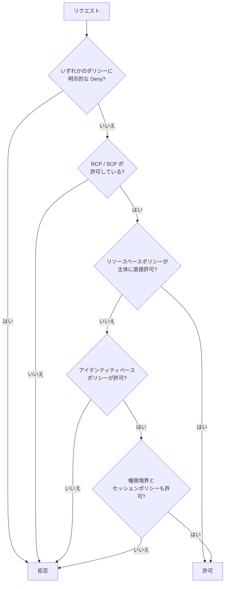

# IAM と STS

IAM は「誰が、どのリソースに、何をできるか」を定義するサービスで、STS はそのための一時的な認証情報を発行するサービスです。AWS 上で動くアプリの権限設計では、ほぼ必ずこの 2 つを使います。

[](../assets/diagrams/iam-cross-account.png)

## プリンシパルと権限の定義 {#principals}

プリンシパルは、AWS にリクエストを送る主体です。

| プリンシパル | 認証情報 | 主な用途 |
| --- | --- | --- |
| IAM ユーザー | 長期（パスワード、アクセスキー） | ロールを使えない場合の例外的な利用 |
| IAM ロール | 一時（STS が発行） | アプリ、AWS サービス、フェデレーションユーザー |
| ロールセッション | 一時 | ロールを引き受けた結果の実体。リクエストの主体はこれ |
| フェデレーションプリンシパル | 一時 | SAML や OIDC で認証した外部ユーザー |
| サービスプリンシパル | なし（AWS が管理） | `lambda.amazonaws.com` など、信頼ポリシーで指定する |
| ルートユーザー | 長期 | 日常業務では使わない |

権限は JSON のポリシーで定義します。`Effect`、`Action`、`Resource` が基本で、必要に応じて `Condition` を足します。

```json
{
  "Version": "2012-10-17",
  "Statement": [{
    "Effect": "Allow",
    "Action": ["dynamodb:GetItem", "dynamodb:Query"],
    "Resource": "arn:aws:dynamodb:ap-northeast-1:111122223333:table/Orders"
  }]
}
```

AWS サービスにロールを渡す操作（Lambda に実行ロールを設定するなど）には、呼び出し元に `iam:PassRole` の許可が必要です。信頼ポリシーとは別の権限なので、混同しないようにします。

## アイデンティティベースとリソースベース {#identity-vs-resource}

| 観点 | アイデンティティベース | リソースベース |
| --- | --- | --- |
| 付与先 | ユーザー、グループ、ロール | S3 バケット、SQS キュー、KMS キー、Lambda 関数など |
| `Principal` 要素 | なし（付与先が主体） | 必須 |
| 別アカウントへの許可 | 単独では不可 | 主体を別アカウントに指定できる |
| 代表例 | 管理ポリシー、インラインポリシー | バケットポリシー、キーポリシー、ロールの信頼ポリシー |

同じアカウント内では、どちらかの `Allow` があれば通るのが基本です。ただしロールの信頼ポリシーと KMS のキーポリシーは例外で、そのポリシー側での許可が必要になります。

## ポリシー評価 {#policy-evaluation}

既定はすべて拒否（暗黙の拒否）で、許可を積み上げて初めて通ります。どこかに明示的な `Deny` があれば、他のどの `Allow` よりも優先されます。



図は単一アカウント内の流れです。リソースベースポリシーによる許可が権限境界やセッションポリシーの制限を受けるかどうかは、指定した主体（ユーザー ARN、ロール ARN、ロールセッション ARN）で変わります。

| 状況 | 結果の考え方 |
| --- | --- |
| 同一アカウント、アイデンティティとリソース | 和集合。どちらかの Allow で可 |
| 別アカウント | 積集合。呼び出し側の Allow と、リソース側の Allow の両方が必須 |
| アイデンティティと権限境界 | 積集合 |
| ロールとセッションポリシー | 積集合。セッションポリシーで権限は増やせない |
| どの組み合わせでも | 明示的な Deny が最優先 |

拒否されたときは HTTP 403 の `AccessDenied` 系エラーになります。`aws sts get-caller-identity` で、実際に使われている主体をまず確認すると切り分けが速くなります。

### 権限境界と SCP {#boundaries-scp}

どちらも権限の上限を決めるだけで、それ自体は権限を与えません。

| 仕組み | 適用先 | 用途 |
| --- | --- | --- |
| 権限境界 | IAM ユーザー、ロール | 開発者に作らせるロールの上限を制限する |
| SCP | Organizations の組織、OU、アカウント内の主体 | 組織全体のガードレール |
| RCP | Organizations 配下のアカウントのリソース | リソース側のガードレール |
| セッションポリシー | STS で作るセッション | そのセッションだけ権限を絞る |

## 条件とアクセス制御 {#conditions}

`Condition` で、きめ細かい制御を行います。

| 条件キー | 用途 |
| --- | --- |
| `aws:MultiFactorAuthPresent`, `aws:MultiFactorAuthAge` | MFA の有無と経過時間 |
| `aws:SecureTransport` | TLS 経由に限定する |
| `aws:SourceIp`, `aws:SourceVpce` | 送信元の IP や VPC エンドポイント |
| `aws:PrincipalTag/キー`, `aws:ResourceTag/キー` | タグによる属性ベースアクセス制御（ABAC） |
| `aws:SourceArn`, `aws:SourceAccount` | サービスプリンシパルの呼び出し元を限定する |
| `dynamodb:LeadingKeys`, `dynamodb:Attributes` | DynamoDB の項目単位、属性単位の制御 |

次は、セッションタグと DynamoDB のパーティションキーを一致させる ABAC の例です。

```json
{
  "Effect": "Allow",
  "Action": ["dynamodb:GetItem", "dynamodb:Query"],
  "Resource": "arn:aws:dynamodb:*:*:table/TenantData",
  "Condition": {
    "ForAllValues:StringEquals": {
      "dynamodb:LeadingKeys": ["${aws:PrincipalTag/TenantId}"]
    }
  }
}
```

### 最小権限 {#least-privilege}

- `Action` と `Resource` を具体的に書き、`*` はできるだけ避ける。
- 長期のアクセスキーより、ロールの一時認証情報を使う。
- 機能ごとにロールを分ける。Lambda なら関数ごとに実行ロールを作る。
- IAM Access Analyzer で外部公開や未使用の権限を確認する。

## ロールの引き受け {#assume-role}

ロールには 2 種類のポリシーがあります。誰が引き受けられるかを決める「信頼ポリシー」と、引き受けた後に何ができるかを決める「許可ポリシー」です。

### 信頼ポリシー {#trust-policy}

```json
{
  "Version": "2012-10-17",
  "Statement": [{
    "Effect": "Allow",
    "Principal": {"AWS": "arn:aws:iam::444455556666:role/CallerRole"},
    "Action": "sts:AssumeRole"
  }]
}
```

別アカウントの場合は、この信頼ポリシーに加えて、呼び出し側の主体にも対象ロールへの `sts:AssumeRole` の許可が必要です。

### AssumeRole のコード {#assume-role-code}

```python
import boto3

sts = boto3.client("sts")
resp = sts.assume_role(
    RoleArn="arn:aws:iam::111122223333:role/ReportReader",
    RoleSessionName="report-job",
    DurationSeconds=900,
)
c = resp["Credentials"]

s3 = boto3.client(
    "s3",
    aws_access_key_id=c["AccessKeyId"],
    aws_secret_access_key=c["SecretAccessKey"],
    aws_session_token=c["SessionToken"],
)
```

| パラメータ | 要点 |
| --- | --- |
| `RoleArn`, `RoleSessionName` | 必須。セッション名は CloudTrail に残り、2〜64 文字 |
| `DurationSeconds` | 既定 3600 秒。最短 900 秒、上限はロールの最大セッション時間（1〜12 時間） |
| `ExternalId` | 第三者によるアクセス用。2〜1224 文字 |
| `Policy`, `PolicyArns` | セッションポリシー。平文の合計は 2048 文字まで、管理ポリシーは 10 個まで |
| `SerialNumber`, `TokenCode` | MFA の情報。信頼ポリシーで MFA を必須にする場合に渡す |
| `Tags`, `TransitiveTagKeys` | セッションタグ |

ロールチェーン（ロールから別のロールを引き受ける）のセッションは最大 1 時間で、それより長い `DurationSeconds` を指定すると失敗します。

!!! tip "SDK の自動更新を使う"
    プロファイルに `role_arn` と `source_profile` を書けば、SDK がロールの引き受けと更新を自動で行います。一時認証情報を自分でキャッシュするコードは、多くの場合不要です。

### ExternalId と混乱した代理問題 {#external-id}

第三者の SaaS に自分のアカウントのロールを使わせると、別の顧客がそのロール ARN を SaaS に登録して、SaaS 経由でアクセスしてくる恐れがあります。これが「混乱した代理問題」です。

対策として、SaaS 側が顧客ごとに一意の値を発行し、顧客はそれを信頼ポリシーの条件に書きます。値は顧客ではなく SaaS 側が管理します。

```json
{
  "Effect": "Allow",
  "Principal": {"AWS": "444455556666"},
  "Action": "sts:AssumeRole",
  "Condition": {"StringEquals": {"sts:ExternalId": "customer-12345"}}
}
```

AWS サービスがサービスプリンシパルでアクセスしてくる場合は、リソースポリシーに `aws:SourceArn` や `aws:SourceAccount` の条件を付けて同じ問題を防ぎます。

### セッションタグ {#session-tags}

セッションに付けるキーと値の組で、ポリシーからは `aws:PrincipalTag` として参照します。ABAC の基本部品です。

- 上限は 50 個で、キーは 128 文字、値は 256 文字まで。
- 信頼ポリシーで `sts:TagSession` を許可する必要がある。
- 既定ではロールチェーンの次のセッションに引き継がれない。`TransitiveTagKeys` で指定したタグだけが引き継がれる。
- 同じキーのロールタグより、セッションタグが優先される。
- SAML や OIDC からも `PrincipalTag` として渡せる。

## GetSessionToken と MFA {#mfa}

MFA 必須の API を呼ぶには、MFA の情報を含む一時認証情報が必要です。長期のアクセスキーには `aws:MultiFactorAuthPresent` キーが含まれないので、次のように一時認証情報を取得します。

```python
import boto3

sts = boto3.client("sts")
resp = sts.get_session_token(
    SerialNumber="arn:aws:iam::111122223333:mfa/alice",
    TokenCode="123456",
    DurationSeconds=3600,
)
```

ポリシー側では次の条件で MFA を要求します。`aws:MultiFactorAuthPresent` は長期認証情報では存在しないため、`Deny` と組み合わせるときは、キーがない場合の動作に注意します。

```json
{"Condition": {"Bool": {"aws:MultiFactorAuthPresent": "true"}}}
```

| API | 呼べる主体 | 有効期間（最短 / 最大 / 既定） | MFA | 主な用途 |
| --- | --- | --- | --- | --- |
| `AssumeRole` | IAM ユーザー、ロール | 15 分 / ロールの設定値 / 1 時間 | 可 | 権限の切り替え、クロスアカウント |
| `GetSessionToken` | IAM ユーザー | 15 分 / 36 時間 / 12 時間 | 可 | 同一ユーザーの権限のまま MFA を証明 |
| `GetSessionToken` | ルートユーザー | 15 分 / 1 時間 / 1 時間 | 可 | 非推奨 |
| `AssumeRoleWithSAML` | SAML で認証したユーザー | 15 分 / ロールの設定値 / 1 時間 | なし | 社内 ID 連携 |
| `AssumeRoleWithWebIdentity` | OIDC で認証したユーザー | 15 分 / ロールの設定値 / 1 時間 | なし | GitHub Actions、モバイルなど |
| `GetFederationToken` | IAM ユーザー | 15 分 / 36 時間 / 12 時間 | なし | カスタム ID ブローカー |
| `GetFederationToken` | ルートユーザー | 15 分 / 1 時間 / 1 時間 | なし | 非推奨 |

`GetSessionToken` の認証情報には次の制限があります。

- MFA 情報を含めない限り、IAM API を呼べない。
- STS は `AssumeRole` と `GetCallerIdentity` しか呼べない。

他アカウントのリソースに MFA 付きでアクセスするなら、信頼ポリシーで MFA を要求した `AssumeRole` を使います。

## フェデレーション {#federation}

外部の ID 基盤で認証したユーザーに、IAM ユーザーを作らずに一時認証情報を渡す仕組みです。

| 方式 | 使う API | IAM 側の準備 | 向いている場面 |
| --- | --- | --- | --- |
| SAML 2.0 | `AssumeRoleWithSAML` | SAML プロバイダーとロール | 社内ディレクトリから AWS へ |
| OIDC | `AssumeRoleWithWebIdentity` | OIDC プロバイダーとロール | CI/CD、外部 ID 基盤からの JWT |
| Cognito ID プール | Cognito 経由 | ID プールとロール | Web やモバイルの一般利用者 |
| IAM Identity Center | SDK、CLI の SSO プロバイダー | 権限セットの割り当て | 従業員の複数アカウント利用 |

`AssumeRoleWithSAML` と `AssumeRoleWithWebIdentity` は AWS の認証情報で署名せず、アサーションやトークンを提示して呼びます。

次は GitHub Actions を OIDC で信頼する例です。`sub` を絞らないと、他のリポジトリからも引き受けられてしまいます。

```json
{
  "Effect": "Allow",
  "Principal": {
    "Federated": "arn:aws:iam::111122223333:oidc-provider/token.actions.githubusercontent.com"
  },
  "Action": "sts:AssumeRoleWithWebIdentity",
  "Condition": {
    "StringEquals": {"token.actions.githubusercontent.com:aud": "sts.amazonaws.com"},
    "StringLike": {"token.actions.githubusercontent.com:sub": "repo:my-org/my-repo:*"}
  }
}
```

エンドユーザー向けのアプリなら、まず [Cognito](cognito.md) を検討します。

### IAM Identity Center {#identity-center}

従業員の ID を接続または作成し、複数の AWS アカウントやアプリへのアクセスを一元管理するサービスです。開発者の PC では、`aws configure sso` と `aws sso login` で長期のアクセスキーなしに CLI や SDK を使えます。

## プログラムからのアクセス {#programmatic-access}

実行環境ごとに、認証情報の渡し方が決まっています。コードにアクセスキーを書くのは避けます。

| 実行環境 | 推奨する方法 | 認証情報の取得元 |
| --- | --- | --- |
| Lambda | 実行ロール | Lambda が自動で引き受け、環境に設定 |
| EC2 | インスタンスプロファイル | インスタンスメタデータサービス（IMDS） |
| ECS | タスクロール | コンテナ認証情報プロバイダー |
| EKS | EKS Pod Identity | コンテナ認証情報プロバイダー |
| 開発者の PC | IAM Identity Center、プロファイル | `~/.aws/config` |
| CI/CD | OIDC フェデレーション | `AssumeRoleWithWebIdentity` |
| 外部サーバー | IAM Roles Anywhere、やむを得なければアクセスキー | プロセスプロバイダーなど |

### アクセスキーとプロファイル {#access-keys-profiles}

アクセスキーは IAM ユーザーまたはルートユーザーの長期認証情報で、1 ユーザーにつき最大 2 つです。2 つ持てるので、新しいキーを発行して切り替えてから古いキーを無効化する、という手順でローテーションできます。

プロファイルは `~/.aws/credentials` と `~/.aws/config` に定義します。

```ini
# ~/.aws/config
[profile dev]
region = ap-northeast-1

[profile prod-admin]
role_arn = arn:aws:iam::111122223333:role/Admin
source_profile = dev
mfa_serial = arn:aws:iam::444455556666:mfa/alice
```

コードからは `boto3.Session(profile_name="prod-admin")`、CLI からは `--profile` か環境変数 `AWS_PROFILE` で選びます。

### 認証情報プロバイダーチェーン {#credential-chain}

SDK は決まった順に認証情報を探し、最初に見つかったものを使います。順序は SDK ごとに異なります。boto3 の順序は次のとおりです。

1. `boto3.client()` に渡したパラメータ
2. `Session` に渡したパラメータ
3. 環境変数（`AWS_ACCESS_KEY_ID` など）
4. Assume role プロバイダー
5. Assume role with web identity プロバイダー
6. IAM Identity Center プロバイダー
7. 共有認証情報ファイル（`~/.aws/credentials`）
8. コンソールのログイン認証情報
9. AWS 設定ファイル（`~/.aws/config`）
10. Boto2 設定ファイル
11. コンテナ認証情報プロバイダー
12. EC2 インスタンスメタデータサービス

!!! warning "環境変数が残っていると優先される"
    EC2 で正しいロールを付けたのに権限エラーが出る場合、環境変数や `~/.aws/credentials` に残った古いキーが先に使われていることがあります。`aws sts get-caller-identity` で確認します。

### インスタンスプロファイル {#instance-profile}

EC2 にロールを渡すための入れ物です。1 つのインスタンスプロファイルに入るロールは 1 つだけです。

コンソールでロールを作ると同名のプロファイルが自動で作られますが、CLI や SDK では別々に作成します。権限を変えるときはプロファイルを置き換えます。プロファイルからロールを外すと、反映に最大 1 時間かかることがあります。

### Lambda の実行ロール {#lambda-execution-role}

信頼ポリシーに `lambda.amazonaws.com` を指定したロールです。Lambda が自動で引き受けるので、関数のコードで `sts:AssumeRole` を呼ぶ必要はありません。CloudWatch Logs への書き込みには `AWSLambdaBasicExecutionRole` を使います。詳しくは [Lambda](lambda.md) を参照してください。

## 認証付き呼び出し（SigV4） {#sigv4}

AWS API へのリクエストは Signature Version 4（SigV4）で署名します。SDK と CLI は自動で署名するので、自分で実装するのは次のような場合だけです。

- SDK のない言語から呼ぶとき。
- IAM 認証の API Gateway のように、自作 API を署名付きで呼ぶとき。

署名は次の手順で作ります。

1. リクエストの要素から正規リクエストを作る。
2. 署名する文字列を作る。
3. シークレットキーから、日付、リージョン、サービスで絞った署名キーを導出する。
4. 署名を計算し、`Authorization` ヘッダーまたはクエリ文字列に入れる。

一時認証情報の場合はセッショントークンも含めます。署名は秘密鍵そのものを送らずに、本人確認、改ざん検知、リプレイ対策を実現します。リクエストは原則としてタイムスタンプから 5 分以内に AWS に届く必要があります。

```python
import boto3
import requests
from botocore.auth import SigV4Auth
from botocore.awsrequest import AWSRequest

url = "https://abc123.execute-api.ap-northeast-1.amazonaws.com/prod/orders"
creds = boto3.Session().get_credentials().get_frozen_credentials()

req = AWSRequest(method="GET", url=url)
SigV4Auth(creds, "execute-api", "ap-northeast-1").add_auth(req)

resp = requests.get(url, headers=dict(req.headers))
```

| 症状 | 確認すること |
| --- | --- |
| HTTP 403 `SignatureDoesNotMatch` | シークレットキー、正規リクエスト、リージョン、サービス名 |
| `IncompleteSignatureException` | `Authorization` ヘッダーの構成と、途中での書き換え |
| 期限切れエラー | クライアントの時計のずれ、一時認証情報の期限 |
| `AccessDenied` | 署名は通っている。ポリシーを確認する |

S3 Multi-Region Access Points のように複数リージョンで検証する場合は、非対称の SigV4a を使います。SDK と CLI は必要に応じて自動で切り替えます。署名付き URL は [S3](s3.md) で扱います。

STS は、リージョンエンドポイントの利用が推奨されています。レイテンシーの低減と冗長性の向上につながります。

## マイクロサービス間の認証 {#microservices-auth}

| 呼び出しの種類 | 方式 | 認可の場所 |
| --- | --- | --- |
| サービスから AWS API | 各サービス専用のロール（SigV4 は SDK が担当） | IAM ポリシー |
| サービスから API Gateway | `AWS_IAM` 認可と SigV4 | `execute-api:Invoke` のポリシー |
| 別アカウントのサービスへ | ロールの引き受け、またはリソースベースポリシー | 両方のアカウント |
| サービスから自作 API（AWS 認証情報なし） | Cognito の client credentials で取得した JWT | スコープの検証 |
| クライアント証明書で相互認証 | API Gateway の mutual TLS | トラストストアと証明書 |
| エンドユーザーの文脈を引き継ぐ | JWT を転送し、各サービスで検証 | アプリコードや Lambda オーソライザー |

設計のポイントは次のとおりです。

- サービスごとにロールを分け、呼び出してよい相手だけを許可する。
- API キーやパスワードをサービス間で共有するなら [Secrets Manager](secrets.md) に置き、ローテーションする。
- 呼び出し元のサービスが誰かを示すため、`RoleSessionName` やセッションタグで追跡できるようにする。

API Gateway の認可方式の比較は [API Gateway](api-gateway.md) にあります。

## クロスアカウントアクセス {#cross-account}

| 観点 | リソースベースポリシー | ロールの引き受け |
| --- | --- | --- |
| 仕組み | リソース側で相手のアカウントや主体を許可 | 相手のアカウントのロールに切り替える |
| 元の権限 | 維持する | 手放す（そのセッションではロールの権限のみ） |
| 向いている処理 | 自アカウントと相手のリソース間のコピー | 複数サービスにまたがる操作 |
| 対応範囲 | リソースベースポリシーに対応するサービスのみ | ほぼすべて |
| 必要な許可 | 呼び出し側の Allow とリソース側の Allow | 呼び出し側の `sts:AssumeRole` と信頼ポリシー |

選び方の例です。

- 自分の S3 バケットから相手の S3 バケットへコピーする: 両方に同時にアクセスするので、リソースベースポリシー。
- 相手のアカウントの DynamoDB、S3、SQS をまとめて操作する: ロールの引き受け。
- 第三者の SaaS にアクセスを許可する: ロールの引き受けと `ExternalId`。

KMS で暗号化されたリソースは、キーポリシー側の許可も必要です。詳しくは [KMS](kms.md) を参照してください。

## ポリシーの要素 {#policy-elements}

ポリシーの各要素が、評価のときにどう動くかを整理します。

| 要素 | 必須か | 内容 |
| --- | --- | --- |
| `Version` | 任意だが常に書く | `2012-10-17` を指定する。省略するとポリシー変数が使えない |
| `Sid` | 任意 | 文の説明用の識別子 |
| `Effect` | 必須 | `Allow` または `Deny` |
| `Action` / `NotAction` | どちらか一方が必須 | 対象の操作 |
| `Resource` / `NotResource` | アイデンティティベースでは一方が必須 | 対象のリソース |
| `Principal` / `NotPrincipal` | リソースベースでは必須 | 対象の主体。アイデンティティベースでは書けない |
| `Condition` | 任意 | 文が適用される条件 |

### Effect と Action {#effect-action}

`Action` は `サービス:操作` の形で、大文字と小文字を区別せず、`*` を使えます。

たとえば `"Action": "s3:Get*"` は `s3:GetObject` などを含みます。便利な反面、後から S3 に増えた `Get` 系の操作も自動で許可されるので、機密性が高いロールでは列挙します。

アクセスが拒否されて調べると、`Action` のサービス名の誤りで文が一致していない場合があります。この場合のエラーは暗黙の拒否です。

### NotAction {#notaction}

`NotAction` は「指定した操作以外のすべて」に一致します。「拒否する」という意味ではありません。

```json
{"Effect": "Allow", "NotAction": "iam:*", "Resource": "*"}
```

これは IAM 以外の全サービスの全操作を許可します。新しいサービスも自動で含まれるので、広く許可しすぎやすい書き方です。

`Deny` と組み合わせると、「MFA がなければ、指定した操作以外をすべて拒否する」と書けます。この文は Deny なので、指定した操作を許可はしません。別の文で Allow が必要です。

```json
{
  "Effect": "Deny",
  "NotAction": "iam:*",
  "Resource": "*",
  "Condition": {"BoolIfExists": {"aws:MultiFactorAuthPresent": "false"}}
}
```

### Resource と NotResource {#notresource}

`Resource` は ARN で指定します。ARN が合っていても、操作とリソースの組み合わせが違うと効きません。

S3 が典型例です。`s3:ListBucket` はバケットの ARN（`arn:aws:s3:::my-bucket`）、`s3:GetObject` はオブジェクトの ARN（`arn:aws:s3:::my-bucket/*`）に対する操作です。`my-bucket/*` しか許可していないと、`ListObjectsV2` が `AccessDenied` になります。

`NotResource` は「指定したリソース以外のすべて」です。次の文は給与フォルダ以外の S3 を拒否します。給与フォルダへの許可は別に必要です。

```json
{
  "Effect": "Deny",
  "Action": "s3:*",
  "NotResource": ["arn:aws:s3:::hr-bucket/payroll", "arn:aws:s3:::hr-bucket/payroll/*"]
}
```

`Allow` と `NotResource` を組み合わせると、将来作られるリソースまで許可されるので避けます。

### Principal {#principal-element}

| 書き方 | 意味 |
| --- | --- |
| `{"AWS": "111122223333"}` または `{"AWS": "arn:aws:iam::111122223333:root"}` | そのアカウント。実際の権限はそのアカウントの IAM ポリシーで委譲する |
| `{"AWS": "arn:aws:iam::111122223333:role/App"}` | 特定のロール |
| `{"Service": "lambda.amazonaws.com"}` | AWS サービス |
| `{"Federated": "cognito-identity.amazonaws.com"}` | Web ID や SAML のプロバイダー |
| `"*"` | 匿名を含む全員。`Condition` で必ず絞る |

権限境界を持つ主体に対して、`NotPrincipal` と `Deny` の文を使うと、値にかかわらず常に拒否されます。AWS は代わりに `ArnNotEquals` と `aws:PrincipalArn` を使うよう推奨しています。

### Condition の評価 {#condition-logic}

| 組み合わせ | 評価 |
| --- | --- |
| 同じ演算子の中の複数のキー | AND |
| 複数の演算子 | AND |
| 1 つのキーの複数の値 | OR |

キーがリクエストに存在しないとき、通常の演算子は条件を満たしません。ただし `StringNotLike` や `ArnNotLike` のような否定の演算子は、キーがなければ条件を満たします。

### 条件演算子 {#condition-operators}

| 種類 | 演算子 | 例 |
| --- | --- | --- |
| 文字列 | `StringEquals`, `StringNotEquals`, `StringEqualsIgnoreCase`, `StringLike`, `StringNotLike` | `StringLike` は `*` と `?` が使える |
| 数値 | `NumericEquals`, `NumericLessThan`, `NumericGreaterThanEquals` など | `aws:MultiFactorAuthAge` が 3600 以下 |
| 日付 | `DateEquals`, `DateLessThan`, `DateGreaterThan` など | `aws:CurrentTime` で期間を限定 |
| 真偽値 | `Bool` | `aws:SecureTransport` が `false` |
| IP | `IpAddress`, `NotIpAddress` | `aws:SourceIp` が `203.0.113.0/24` |
| ARN | `ArnEquals`, `ArnLike`, `ArnNotEquals`, `ArnNotLike` | `aws:SourceArn` |
| 存在 | `Null` | `true` はキーがない、`false` はキーがある |

**`...IfExists`** は `Null` 以外の演算子に付けられます。キーがあれば通常どおり評価し、なければ条件を満たしたとみなします。

次の例は、対象が `ec2:InstanceType` を持つ場合だけ `t3.*` に制限します。`IfExists` がないと、このキーを持たないリソース（ボリュームなど）への操作まで一致しなくなり、拒否されます。

```json
{"Condition": {"StringLikeIfExists": {"ec2:InstanceType": ["t3.*"]}}}
```

**`Null`** はキーの有無だけを調べます。`{"Null": {"aws:TokenIssueTime": "false"}}` は一時認証情報でのリクエストだけに一致します。`Null` にポリシー変数は使えません。

**`ForAllValues` と `ForAnyValue`** は複数の値を持つキーに使います。

| 修飾子 | 条件を満たすとき | 注意 |
| --- | --- | --- |
| `ForAllValues` | リクエストの値がすべて、ポリシーのいずれかの値に一致 | キーがない、値が空のときも真になる |
| `ForAnyValue` | リクエストの値の少なくとも 1 つが一致 | キーがなければ偽 |

`ForAllValues` が空でも真になるため、`Allow` の文ではキーの存在も `Null` で確認すると安全です。

### 主なグローバル条件キー {#condition-keys}

| キー | 例と用途 |
| --- | --- |
| `aws:PrincipalArn`, `aws:PrincipalOrgID`, `aws:PrincipalTag/キー` | 主体の ARN、組織、タグで絞る |
| `aws:RequestedRegion` | `ap-northeast-1` 以外のリージョンの操作を拒否する |
| `aws:RequestTag/キー`, `aws:TagKeys` | 作成時に付けるタグを強制する |
| `aws:ResourceTag/キー` | リソースのタグで絞る |
| `aws:SourceIp`, `aws:SourceVpc`, `aws:SourceVpce` | 送信元を絞る |
| `aws:SourceArn`, `aws:SourceAccount` | サービスからの呼び出しで、混乱した代理を防ぐ |
| `aws:SecureTransport` | TLS を強制する |
| `aws:MultiFactorAuthPresent`, `aws:MultiFactorAuthAge` | MFA を確認する |
| `aws:CalledVia`, `aws:ViaAWSService` | AWS サービス経由の呼び出しかを見る |
| `aws:TokenIssueTime` | 一時認証情報の発行時刻を見る |
| `aws:CurrentTime` | 日付や時刻で絞る |
| `sts:ExternalId`, `sts:SourceIdentity` | ロールの引き受けを絞る |
| `iam:PassedToService`, `iam:PermissionsBoundary` | PassRole の渡し先、境界の強制 |

!!! warning "aws:SourceIp と VPC エンドポイント"
    `aws:SourceIp` の値は、VPC エンドポイント経由のリクエストには入りません。VPC 内からの通信を絞るときは `aws:SourceVpc` や `aws:SourceVpce` を使います。

### ポリシー変数 {#policy-variables}

`${キー}` を、リクエストの値に置き換えます。`Version` が `2012-10-17` の文でのみ使えます。省略すると、`${...}` がただの文字列として扱われます。

```json
{
  "Effect": "Allow",
  "Action": "s3:*",
  "Resource": "arn:aws:s3:::team-bucket/${aws:PrincipalTag/team}/*"
}
```

タグ `team=sales` のロールなら `team-bucket/sales/*` だけにアクセスできます。人ごとにポリシーを作らずに済みます。

既定値は `${aws:PrincipalTag/team, 'common'}` のように書きます。キーがないときに `common` を使います。

`Resource` と `Condition` の値に使えます。`aws:username` は IAM ユーザーでのみ値が入るので、ロールの主体には `aws:userid` やタグを使います。

## ポリシーの種類と上限 {#policy-types}

### 管理ポリシーとインラインポリシー {#managed-vs-inline}

| 観点 | AWS 管理 | カスタマー管理 | インライン |
| --- | --- | --- | --- |
| 作成者 | AWS | 自分 | 自分 |
| 再利用 | 複数の主体に付与 | 複数の主体に付与 | 1 つの主体に固定 |
| 主体を削除すると | 残る | 残る | 一緒に削除 |
| バージョン管理 | AWS が更新 | 最大 5 つ保存してロールバック可 | なし |
| サイズの上限 | - | 6,144 文字 | ユーザー 2,048、グループ 5,120、ロール 10,240 文字（合計） |

空白は文字数に数えません。

通常はカスタマー管理ポリシーを使います。インラインは「この主体だけに厳密に結び付けたい」ときの選択肢です。

ロールに付けられる管理ポリシーは既定で 20 個です（引き上げ後の最大 25）。ユーザーとグループは 10 個です（ユーザーは引き上げ後の最大 20）。

### 権限境界の設定 {#permissions-boundary}

`PutRolePermissionsBoundary` や、`CreateRole` の `PermissionsBoundary` で、管理ポリシーを 1 つ指定します。インラインポリシーは指定できません。

開発者にロールの作成を任せるときの定番の例です。次のように、境界を付けたロールしか作れないようにします。

```json
{
  "Effect": "Allow",
  "Action": ["iam:CreateRole", "iam:AttachRolePolicy"],
  "Resource": "arn:aws:iam::111122223333:role/app-*",
  "Condition": {
    "StringEquals": {
      "iam:PermissionsBoundary": "arn:aws:iam::111122223333:policy/DevBoundary"
    }
  }
}
```

境界で `s3:*` だけを許可し、許可ポリシーで `dynamodb:*` だけを付けたロールは、両者の共通部分が空なので何もできません。

リソースベースポリシーが主体に直接許可する場合の動きは、指定した ARN で変わります。

| リソースポリシーの主体 | 暗黙の拒否の影響 |
| --- | --- |
| IAM ユーザーの ARN | 権限境界の影響を受けない |
| IAM ロールの ARN | 権限境界とセッションポリシーの影響を受ける |
| ロールセッションの ARN | 影響を受けない |

### iam:PassRole {#passrole}

サービスにロールを渡す人に必要な権限です。`CreateFunction` の `Role`、`RunInstances` のインスタンスプロファイルなどで確認されます。

```json
{
  "Effect": "Allow",
  "Action": "iam:PassRole",
  "Resource": "arn:aws:iam::111122223333:role/lambda-exec-*",
  "Condition": {"StringEquals": {"iam:PassedToService": "lambda.amazonaws.com"}}
}
```

- `Resource` を `*` にすると、管理者ロールを Lambda に渡して権限を昇格できてしまう。
- 渡せるのは同じアカウントのロールのみ。別アカウントのサービスには渡せない。
- `ResourceTag` 条件で制御しても確実に効かないので、ロール名のパスなどで絞る。
- `PassRole` は権限であって API ではないので、CloudTrail にはそのイベントが残らない。渡した先の API（`CreateFunction` など）のログを見る。

権限がないと、関数の作成時に `iam:PassRole` についての `AccessDenied` になります。

### サービスロールとサービスリンクロール {#service-linked-roles}

| 観点 | サービスロール | サービスリンクロール |
| --- | --- | --- |
| 作成 | 自分で作って渡す | サービスが自動で作ることが多い |
| 権限の編集 | できる | 閲覧のみで編集できない |
| 名前 | 任意 | `AWSServiceRoleFor...` |
| 削除 | いつでも | 関連リソースを先に削除する |

自分でサービスリンクロールを作るときは、`iam:CreateServiceLinkedRole` が必要です。

## STS の設定 {#sts-settings}

### 最大セッション時間 {#max-session-duration}

ロールの `MaxSessionDuration` で、1〜12 時間（3,600〜43,200 秒）を設定します。既定は 1 時間です。

```bash
aws iam update-role --role-name ReportReader --max-session-duration 14400
aws sts assume-role --role-arn arn:aws:iam::111122223333:role/ReportReader \
  --role-session-name batch --duration-seconds 14400
```

- `DurationSeconds` を省略すると、`MaxSessionDuration` に関係なく 1 時間になる。
- `MaxSessionDuration` より長い値を指定すると、リクエストは失敗する。
- 4 時間かかるバッチに `MaxSessionDuration` を設定しただけでは、1 時間で切れる。`DurationSeconds` も指定する。
- ロールチェーンは 1 時間が上限で、`MaxSessionDuration` は効かない。
- コンソールでロールを切り替えた場合は、最大セッション時間とユーザーのセッションの残り時間の短いほうになる。
- AWS サービスが引き受けるセッションはこの設定の制限を受けない。

### API の比較 {#sts-api-compare}

| API | 呼べる主体 | 期間（最短 / 最大 / 既定） | MFA | セッションポリシー | 結果の認証情報の制限 |
| --- | --- | --- | --- | --- | --- |
| `AssumeRole` | IAM ユーザー、ロール | 15 分 / 設定値 / 1 時間 | 可 | 可 | `GetFederationToken` と `GetSessionToken` は呼べない |
| `AssumeRoleWithSAML` | 誰でも（SAML 応答） | 15 分 / 設定値 / 1 時間 | 不可 | 可 | 同上 |
| `AssumeRoleWithWebIdentity` | 誰でも（OIDC トークン） | 15 分 / 設定値 / 1 時間 | 不可 | 可 | 同上 |
| `GetFederationToken` | IAM ユーザー、ルート | ユーザー 15 分 / 36 時間 / 12 時間、ルート 15 分 / 1 時間 / 1 時間 | 不可 | 可 | CLI と API で IAM を呼べない。STS は `GetCallerIdentity` のみ |
| `GetSessionToken` | IAM ユーザー、ルート | 同上 | 可 | 不可 | MFA なしでは IAM を呼べない。STS は `AssumeRole` と `GetCallerIdentity` のみ |

`GetFederationToken` はセッションポリシーを渡さないと、権限のないセッションになります。

他の API です。

| API | 用途 | 必要な権限 |
| --- | --- | --- |
| `GetCallerIdentity` | 現在の主体の確認 | 不要。明示的に拒否しても呼べる |
| `GetAccessKeyInfo` | アクセスキー ID からアカウント ID を調べる | 必要。キーの状態はわからない |
| `DecodeAuthorizationMessage` | エンコードされた拒否理由の復号 | `sts:DecodeAuthorizationMessage` |

アクセスキー ID は、`AKIA` で始まれば長期、`ASIA` で始まれば一時の認証情報です。

### セッションポリシー {#session-policies}

`AssumeRole` などの `Policy`（JSON 1 つ）と `PolicyArns`（管理ポリシー最大 10 個）で渡します。平文で合計 2,048 文字までです。

```python
sts.assume_role(
    RoleArn="arn:aws:iam::111122223333:role/DataAccess",
    RoleSessionName="tenant-a",
    Policy='{"Version":"2012-10-17","Statement":[{"Effect":"Allow",'
           '"Action":"s3:GetObject","Resource":"arn:aws:s3:::data/tenant-a/*"}]}',
)
```

ロールが `s3:*` を持っていても、このセッションで使えるのは `data/tenant-a/*` の取得だけです。ポリシーに書かれていない権限は増えません。

セッションポリシーとセッションタグは、セッショントークンのサイズにも加算されます。個別の上限内でも、トークンが大きすぎると `PackedPolicyTooLarge`（HTTP 400）になります。応答の `PackedPolicySize` は非推奨になり、今は `SessionTokenUtilization` で使用率を確認します。

### ソースアイデンティティ {#source-identity}

`AssumeRole` の `SourceIdentity`（2〜64 文字）で、ロールを引き受けた本来の人を記録します。CloudTrail に残り、ロールチェーンをしても引き継がれます。

| キー | 使う場所 | 意味 |
| --- | --- | --- |
| `sts:SetSourceIdentity` | 信頼ポリシーと呼び出し側の許可 | 設定を許す権限 |
| `sts:SourceIdentity` | 信頼ポリシー | 引き受け時に値を要求する |
| `aws:SourceIdentity` | 後続の操作の条件 | セッションの値で制御する |

たとえば、共有の管理者ロールに複数の人が入っても、`SourceIdentity=alice` で誰の操作かを追えます。信頼ポリシーに `sts:SetSourceIdentity` がないと、`AssumeRole` は失敗します。

## 検証とトラブルシュート {#verification}

### IAM Access Analyzer {#access-analyzer}

| 機能 | できること |
| --- | --- |
| 外部アクセスの分析 | 信頼ゾーンの外に共有された S3 バケットやロールを検出。リージョンごとに作る |
| 内部アクセスの分析 | 組織やアカウント内から重要なリソースへのアクセスを検出 |
| 未使用アクセスの分析 | 未使用のロール、キー、権限を検出 |
| ポリシーの検証 | 文法とベストプラクティスの確認 |
| カスタムポリシーチェック | ポリシーが自社の基準を満たすか確認 |
| ポリシーの生成 | CloudTrail のアクセス履歴から最小権限のポリシーを作る |

### ポリシーシミュレーター {#policy-simulator}

実際の API を呼ばずに、許可か拒否かを試します。

- アイデンティティベース、権限境界、SCP、自分で渡したリソースベースポリシーを評価できる。RCP は未対応。
- 実際にリクエストを送らないので、削除操作も安全に試せる。
- `iam:SimulatePrincipalPolicy` は既存の主体、`iam:SimulateCustomPolicy` は書きかけのポリシーを試す。
- 条件キーの値は自動では入らないものがあり、自分で与える。結果が本番と異なる場合がある。

### アクセス拒否メッセージ {#access-denied-messages}

メッセージの言い回しで、原因の種類がわかります。

| メッセージの一部 | 意味 |
| --- | --- |
| `with an explicit deny in a service control policy` | SCP の明示的な拒否 |
| `with an explicit deny in a VPC endpoint policy` | VPC エンドポイントポリシーの明示的な拒否 |
| `with an explicit deny in a resource control policy` | RCP の明示的な拒否 |
| `because no identity-based policy allows the ... action` | アイデンティティベースの暗黙の拒否 |
| `because no resource-based policy allows the ... action` | リソースベースの暗黙の拒否 |
| `because no session policy allows the ... action` | セッションポリシーの暗黙の拒否 |
| `because no permissions boundary allows the ... action` | 権限境界の暗黙の拒否 |

### DecodeAuthorizationMessage {#decode-authorization}

EC2 の `UnauthorizedOperation`（HTTP 403）などでは、拒否の詳細がエンコードされて返ります。

```bash
aws sts decode-authorization-message --encoded-message "<メッセージ>" \
  --query DecodedMessage --output text | jq .
```

復号すると、次の情報がわかります。

- 明示的な拒否か、許可がないためか
- リクエストした主体
- 操作とリソース
- リクエストの条件キーの値

呼び出す主体に `sts:DecodeAuthorizationMessage` の許可が必要です。理由がエンコードされているのは、ユーザーに見せるべきでない情報を含みうるからです。すべての API がエンコードされたメッセージを返すわけではありません。

### アクセスキーの扱い {#access-key-handling}

- `CreateAccessKey` のシークレットは作成時にしか取得できない。なくしたら作り直す。
- 上限はユーザーごとに 2 つ。
- `UpdateAccessKey` で `Inactive` にでき、影響がなければ `DeleteAccessKey` で消す。
- ローテーションの順序は、新しいキーの作成、切り替え、古いキーの無効化、削除。

### インスタンスメタデータ {#imds}

EC2 のアプリは、インスタンスメタデータサービス（IMDS）から認証情報を受け取ります。

```bash
TOKEN=$(curl -X PUT "http://169.254.169.254/latest/api/token" \
  -H "X-aws-ec2-metadata-token-ttl-seconds: 21600")
curl -H "X-aws-ec2-metadata-token: $TOKEN" \
  http://169.254.169.254/latest/meta-data/iam/security-credentials/ロール名
```

| 設定 | 内容 |
| --- | --- |
| IMDSv2 のトークンの TTL | 1 秒〜6 時間（21,600 秒） |
| `HttpTokens` が `required` | トークンなしのリクエストは `401 Unauthorized` |
| ホップ制限 | `PUT` の応答の TTL。既定 1。コンテナからは 2 にする |

ホップ制限が 1 のままだと、EC2 上のコンテナから IMDSv2 のトークンを取得できず、SDK の認証情報の取得が遅くなったり失敗したりします。

IMDS は問い合わせをスロットリングします。リクエストごとに取得せず、SDK のキャッシュを使います。

## 既定値と上限のまとめ {#numbers}

| 項目 | 値 |
| --- | --- |
| `MaxSessionDuration` | 既定 1 時間。1〜12 時間 |
| `DurationSeconds`（ロール） | 既定 1 時間。最短 900 秒、上限は `MaxSessionDuration` |
| ロールチェーン | 1 時間 |
| `GetSessionToken`, `GetFederationToken`（IAM ユーザー） | 15 分〜36 時間。既定 12 時間 |
| 同（ルートユーザー） | 15 分〜1 時間。既定 1 時間 |
| `RoleSessionName`, `SourceIdentity` | 2〜64 文字 |
| `ExternalId` | 2〜1,224 文字 |
| セッションポリシー | 合計 2,048 文字。管理ポリシー ARN は 10 個まで |
| セッションタグ | 50 個。キー 128 文字、値 256 文字 |
| カスタマー管理ポリシーのサイズ | 6,144 文字 |
| インラインポリシーの合計 | ユーザー 2,048、グループ 5,120、ロール 10,240 文字 |
| 信頼ポリシーの長さ | 既定 2,048 文字。最大 8,192 文字 |
| 管理ポリシーのバージョン | 5 つまで |
| ロールあたりの管理ポリシー | 既定 20。最大 25 |
| ユーザーあたりの管理ポリシー | 既定 10。最大 20 |
| グループあたりの管理ポリシー | 10 |
| アクセスキー | ユーザーごとに 2 つ |
| ロール名 | 64 文字 |
| IMDSv2 トークンの TTL | 最大 21,600 秒 |
| `EncodedMessage` | 最大 10,240 文字 |

## 試験のポイント {#exam-points}

| こう問われたら | 答え |
| --- | --- |
| Allow と Deny が両方あるときの結果 | 明示的な Deny が優先される |
| どのポリシーにも記載がない操作 | 暗黙の拒否 |
| 別アカウントの S3 に読み書きしたいのに 403 | 呼び出し側とバケット側の両方に Allow が必要 |
| EC2 上のアプリに権限を与える安全な方法 | インスタンスプロファイル経由のロール |
| 第三者に自分のアカウントへのアクセスを許可する | ロールと `ExternalId`（混乱した代理問題の対策） |
| CLI で MFA 必須の API を呼ぶ | `GetSessionToken` に `SerialNumber` と `TokenCode` を渡す |
| ロールチェーンで 2 時間のセッションを指定したら | 失敗する。チェーンは最大 1 時間 |
| 開発者が作るロールの権限に上限を設ける | 権限境界 |
| 組織全体で特定の操作を禁止する | SCP |
| 元の権限を保ったまま別アカウントのリソースを使う | リソースベースポリシー |
| GitHub Actions に長期キーを置かず権限を与える | OIDC フェデレーションと `AssumeRoleWithWebIdentity` |
| 誰の権限で動いているか確認する | `sts:GetCallerIdentity` |
| `SignatureDoesNotMatch` の原因 | シークレットキーや署名対象の不一致 |
| 環境変数とインスタンスプロファイルが両方ある | SDK のチェーンでは環境変数が先に使われる |
| 関数の作成で `iam:PassRole` の `AccessDenied` | 呼び出し側に `iam:PassRole` を許可する |
| エンコードされた拒否メッセージを読む | `sts:DecodeAuthorizationMessage` |
| 12 時間のロールで `DurationSeconds` を省略 | 1 時間で切れる |
| 実 API を呼ばずにポリシーを確認する | ポリシーシミュレーター |
| キーが存在しないときも条件を満たしたい | `...IfExists` |
| タグごとに S3 のパスを分ける | `${aws:PrincipalTag/キー}` |

## 関連ページ {#related}

- [Cognito](cognito.md): エンドユーザーの認証と ID プール
- [KMS](kms.md): キーポリシーと暗号化
- [Secrets Manager と Parameter Store](secrets.md): シークレットの管理
- [API Gateway](api-gateway.md): API の認可方式
- [Lambda](lambda.md): 実行ロール
- [S3](s3.md): バケットポリシーと署名付き URL
- [コンテナ](containers.md): ECS タスクロールと EKS Pod Identity

## 参考 {#references}

- [Policy evaluation logic](https://docs.aws.amazon.com/IAM/latest/UserGuide/reference_policies_evaluation-logic.html)
- [How AWS enforcement code logic evaluates requests](https://docs.aws.amazon.com/IAM/latest/UserGuide/reference_policies_evaluation-logic_policy-eval-denyallow.html)
- [Permissions boundaries for IAM entities](https://docs.aws.amazon.com/IAM/latest/UserGuide/access_policies_boundaries.html)
- [Cross account resource access in IAM](https://docs.aws.amazon.com/IAM/latest/UserGuide/access_policies-cross-account-resource-access.html)
- [AssumeRole API](https://docs.aws.amazon.com/STS/latest/APIReference/API_AssumeRole.html)
- [GetSessionToken API](https://docs.aws.amazon.com/STS/latest/APIReference/API_GetSessionToken.html)
- [Compare AWS STS credentials](https://docs.aws.amazon.com/IAM/latest/UserGuide/id_credentials_sts-comparison.html)
- [Request temporary security credentials](https://docs.aws.amazon.com/IAM/latest/UserGuide/id_credentials_temp_request.html)
- [Manage AWS STS in an AWS Region](https://docs.aws.amazon.com/IAM/latest/UserGuide/id_credentials_temp_enable-regions.html)
- [The confused deputy problem](https://docs.aws.amazon.com/IAM/latest/UserGuide/confused-deputy.html)
- [Pass session tags in AWS STS](https://docs.aws.amazon.com/IAM/latest/UserGuide/id_session-tags.html)
- [Secure API access with MFA](https://docs.aws.amazon.com/IAM/latest/UserGuide/id_credentials_mfa_configure-api-require.html)
- [Manage access keys for IAM users](https://docs.aws.amazon.com/IAM/latest/UserGuide/id_credentials_access-keys.html)
- [Use instance profiles](https://docs.aws.amazon.com/IAM/latest/UserGuide/id_roles_use_switch-role-ec2_instance-profiles.html)
- [AWS Signature Version 4 for API requests](https://docs.aws.amazon.com/IAM/latest/UserGuide/reference_sigv.html)
- [Troubleshoot Signature Version 4 signing](https://docs.aws.amazon.com/IAM/latest/UserGuide/reference_sigv-troubleshooting.html)
- [AWS SDKs and Tools standardized credential providers](https://docs.aws.amazon.com/sdkref/latest/guide/standardized-credentials.html)
- [Boto3: Credentials](https://boto3.amazonaws.com/v1/documentation/api/latest/guide/credentials.html)
- [Lambda execution role](https://docs.aws.amazon.com/lambda/latest/dg/lambda-intro-execution-role.html)
- [What is IAM Identity Center?](https://docs.aws.amazon.com/singlesignon/latest/userguide/what-is.html)
