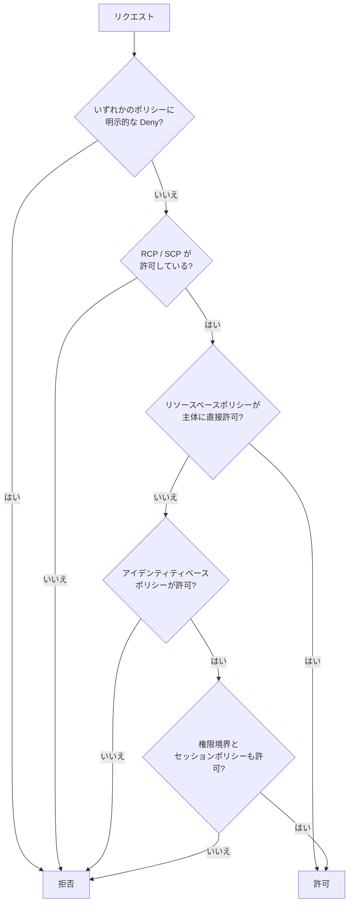

# IAM と STS

[:material-sprout: CLF](../courses/clf/services.md){ .exam-badge .exam-foundational } [:material-sprout: AIF](../courses/aif/services.md){ .exam-badge .exam-foundational } [:material-certificate: SAA](../courses/saa/services.md){ .exam-badge .exam-associate } [:material-certificate: DVA](../courses/dva/services.md){ .exam-badge .exam-associate } [:material-certificate: SOA](../courses/soa/services.md){ .exam-badge .exam-associate } [:material-certificate: DEA](../courses/dea/services.md){ .exam-badge .exam-associate } [:material-certificate: MLA](../courses/mla/services.md){ .exam-badge .exam-associate } [:material-star-circle: SAP](../courses/sap/services.md){ .exam-badge .exam-professional } [:material-star-circle: DOP](../courses/dop/services.md){ .exam-badge .exam-professional } [:material-star-circle: AIP](../courses/aip/services.md){ .exam-badge .exam-professional } [:material-target: ANS](../courses/ans/services.md){ .exam-badge .exam-specialty } [:material-target: SCS](../courses/scs/services.md){ .exam-badge .exam-specialty }

IAM は「誰が、どのリソースに、何をできるか」を定義するサービスで、STS はそのための一時的な認証情報を発行するサービスです。AWS 上で動くアプリの権限設計では、ほぼ必ずこの 2 つを使います。

**提供単位:** IAM はグローバルで、VPC の外にあります。変更は `us-east-1` のコントロールプレーンで行います（[提供単位の一覧](resource-scope.md#scope-global)）。STS は全リージョンにエンドポイントがあり、リージョナルエンドポイントで発行した認証情報は全リージョンで使えます。グローバルエンドポイントで発行した認証情報は、既定では最初から有効なリージョンでだけ使えます。

[](../assets/diagrams/iam-cross-account.png)

## プリンシパルと権限の定義 {#principals}

プリンシパルは、AWS にリクエストを送る主体です。

| プリンシパル | 認証情報 | 主な用途 |
| --- | --- | --- |
| IAM ユーザー | 長期（パスワード、アクセスキー） | ロールを使えない場合の例外的な利用 |
| IAM ロール | 一時（STS が発行） | アプリ、AWS サービス、フェデレーションユーザー |
| ロールセッション | 一時 | ロールを引き受けた結果の実体。リクエストの主体はこれ |
| フェデレーションプリンシパル | 一時 | SAML や OIDC で認証した外部ユーザー |
| サービスプリンシパル | なし（AWS が管理） | `lambda.amazonaws.com` など、信頼ポリシーで指定する |
| ルートユーザー | 長期 | 日常業務では使わない |

- **例:** Lambda の `orders-api` が DynamoDB を読むなら、主体は実行ロール `orders-api-role` のロールセッションになる。CloudTrail の `userIdentity.arn` には `arn:aws:sts::111122223333:assumed-role/orders-api-role/orders-api` のように、セッション名まで残る。
- **例:** 退職した担当者のアクセスキーをバッチで使っていると、キーを消した瞬間にバッチが止まる。長期の認証情報を持つ主体を減らすのは、この事故を避けるためでもある。
- **誤ると:** リソースベースポリシーの `Principal` にロールセッションの ARN を書くと、そのセッション名だけが許可される。別のセッション名で引き受けた同じロールは拒否される。

権限は JSON のポリシーで定義します。`Effect`、`Action`、`Resource` が基本で、必要に応じて `Condition` を足します。

```json
{
  "Version": "2012-10-17",
  "Statement": [{
    "Effect": "Allow",
    "Action": ["dynamodb:GetItem", "dynamodb:Query"],
    "Resource": "arn:aws:dynamodb:ap-northeast-1:111122223333:table/Orders"
  }]
}
```

AWS サービスにロールを渡す操作（Lambda に実行ロールを設定するなど）には、呼び出し元に `iam:PassRole` の許可が必要です。信頼ポリシーとは別の権限なので、混同しないようにします。

- **例:** 上のポリシーを付けたロールは `Orders` への `GetItem` と `Query` だけ通る。`PutItem` は書かれていないので、`AccessDeniedException` で拒否される。
- **例:** 開発者 alice が Lambda 関数を作るとき、`lambda.amazonaws.com` がロールを引き受けられるかは信頼ポリシーで決まる。alice がそのロールを関数に設定してよいかは、alice の `iam:PassRole` で決まる。
- **誤ると:** 片方だけ設定すると失敗する。信頼ポリシーがないと関数の作成時に「Lambda がロールを引き受けられない」というエラーになり、`iam:PassRole` がないと alice が `AccessDenied` になる。

## アイデンティティベースとリソースベース {#identity-vs-resource}

| 観点 | アイデンティティベース | リソースベース |
| --- | --- | --- |
| 付与先 | ユーザー、グループ、ロール | S3 バケット、SQS キュー、KMS キー、Lambda 関数など |
| `Principal` 要素 | なし（付与先が主体） | 必須 |
| 別アカウントへの許可 | 単独では不可 | 主体を別アカウントに指定できる |
| 代表例 | 管理ポリシー、インラインポリシー | バケットポリシー、キーポリシー、ロールの信頼ポリシー |

同じアカウント内では、どちらかの `Allow` があれば通るのが基本です。ただしロールの信頼ポリシーと KMS のキーポリシーは例外で、そのポリシー側での許可が必要になります。

- **例:** 同じアカウントのロール `App` について、IAM ポリシーに記載がなくても、バケットポリシーが `App` のロール ARN に `s3:GetObject` を許可していれば読める。
- **例:** 同じ `App` が別のアカウント `444455556666` のバケットを読むなら、バケットポリシーと `App` の IAM ポリシーの両方に `s3:GetObject` が要る。
- **誤ると:** KMS キーの場合は、キーポリシーに許可がなければ、IAM ポリシーで `kms:Decrypt` を許可しても `AccessDeniedException` になる。

## ポリシー評価 {#policy-evaluation}

既定はすべて拒否（暗黙の拒否）で、許可を積み上げて初めて通ります。どこかに明示的な `Deny` があれば、他のどの `Allow` よりも優先されます。



図は単一アカウント内の流れです。リソースベースポリシーによる許可が権限境界やセッションポリシーの制限を受けるかどうかは、指定した主体（ユーザー ARN、ロール ARN、ロールセッション ARN）で変わります。

| 状況 | 結果の考え方 |
| --- | --- |
| 同一アカウント、アイデンティティとリソース | 和集合。どちらかの Allow で可 |
| 別アカウント | 積集合。呼び出し側の Allow と、リソース側の Allow の両方が必須 |
| アイデンティティと権限境界 | 積集合 |
| ロールとセッションポリシー | 積集合。セッションポリシーで権限は増やせない |
| どの組み合わせでも | 明示的な Deny が最優先 |

**値を入れた評価の例**です。ロール `App` に、次の設定があるとします。

| 種類 | 内容 |
| --- | --- |
| SCP | `FullAWSAccess` と、`ec2:*` の `Deny` |
| 権限境界 | `s3:*` と `ec2:*` を許可 |
| 許可ポリシー | `s3:GetObject` と `dynamodb:Query` と `ec2:RunInstances` を許可 |

| 操作 | 結果 | 理由 |
| --- | --- | --- |
| `s3:GetObject` | 許可 | SCP、境界、許可ポリシーのすべてが許可 |
| `s3:PutObject` | 拒否 | 境界は許可するが、許可ポリシーにない（暗黙の拒否） |
| `dynamodb:Query` | 拒否 | 許可ポリシーにはあるが、境界にない（暗黙の拒否） |
| `ec2:RunInstances` | 拒否 | SCP の明示的な拒否 |

拒否されたときは HTTP 403 の `AccessDenied` 系エラーになります。`aws sts get-caller-identity` で、実際に使われている主体をまず確認すると切り分けが速くなります。

### 権限境界と SCP {#boundaries-scp}

どちらも権限の上限を決めるだけで、それ自体は権限を与えません。

| 仕組み | 適用先 | 用途 |
| --- | --- | --- |
| 権限境界 | IAM ユーザー、ロール | 開発者に作らせるロールの上限を制限する |
| SCP | Organizations の組織、OU、アカウント内の主体 | 組織全体のガードレール |
| RCP | Organizations 配下のアカウントのリソース | リソース側のガードレール |
| セッションポリシー | STS で作るセッション | そのセッションだけ権限を絞る |

- **例（権限境界）:** 開発者が作るロールの境界を `s3:*` と `logs:*` にしておくと、開発者が `AdministratorAccess` を付けても、使えるのは S3 と CloudWatch Logs だけになる。
- **例（SCP）:** OU に「`aws:RequestedRegion` が `ap-northeast-1` 以外なら拒否」の SCP を付けると、その OU のアカウントでは管理者ロールでも `us-west-2` に EC2 を作れない。
- **例（RCP）:** RCP で「`aws:PrincipalOrgID` が `o-exampleorgid` 以外なら `s3:*` を拒否」とすると、バケットポリシーを誤って公開しても組織外からは読めない。
- **例（セッションポリシー）:** `s3:*` を持つロールを、テナント A の処理だけ `data/tenant-a/*` の読み取りに絞って引き受ける。
- **誤ると:** SCP で `s3:*` を許可しただけでは何もできない。IAM ポリシーでの許可が別に必要で、拒否の理由は `no identity-based policy allows` になる。

## 条件とアクセス制御 {#conditions}

`Condition` で、きめ細かい制御を行います。

| 条件キー | 用途 |
| --- | --- |
| `aws:MultiFactorAuthPresent`, `aws:MultiFactorAuthAge` | MFA の有無と経過時間 |
| `aws:SecureTransport` | TLS 経由に限定する |
| `aws:SourceIp`, `aws:SourceVpce` | 送信元の IP や VPC エンドポイント |
| `aws:PrincipalTag/キー`, `aws:ResourceTag/キー` | タグによる属性ベースアクセス制御（ABAC） |
| `aws:SourceArn`, `aws:SourceAccount` | サービスプリンシパルの呼び出し元を限定する |
| `dynamodb:LeadingKeys`, `dynamodb:Attributes` | DynamoDB の項目単位、属性単位の制御 |

キーごとの具体例です。

- **`aws:MultiFactorAuthAge`:** 値は MFA 認証からの秒数。`NumericLessThanEquals` で `3600` とすると、2 時間前に MFA を通したセッションは 7,200 秒なので条件を満たさない。
- **`aws:MultiFactorAuthPresent`:** 長期のアクセスキーで呼ぶとキー自体がない。`Bool` で `false` を `Deny` しても一致しないので、`BoolIfExists` を使う。
- **`aws:SecureTransport`:** バケットポリシーで `false` のときに `Deny` すると、`http://` での取得が 403 になる。
- **`aws:SourceIp`:** `IpAddress` で `192.0.2.0/24` と書くと、`198.51.100.7` からの呼び出しは一致しない。
- **`aws:SourceVpce`:** `vpce-1a2b3c4d` を指定すると、そのエンドポイント経由だけに絞れる。VPC エンドポイント経由のリクエストには `aws:SourceIp` の値が入らない。
- **`aws:PrincipalTag` と `aws:ResourceTag`:** 主体のタグ `team=sales` とリソースのタグ `team=sales` が一致するときだけ許可する。タグが `team=hr` の EC2 は操作できない。
- **`aws:SourceArn` と `aws:SourceAccount`:** SNS トピックのポリシーで、S3 からの発行を `arn:aws:s3:::my-bucket` と `111122223333` に限る。別のアカウントのバケットからは発行できない。
- **`dynamodb:Attributes`:** `Name` と `Email` だけを許可すると、`Salary` を含む `GetItem` は拒否される。

次は、セッションタグと DynamoDB のパーティションキーを一致させる ABAC の例です。

```json
{
  "Effect": "Allow",
  "Action": ["dynamodb:GetItem", "dynamodb:Query"],
  "Resource": "arn:aws:dynamodb:*:*:table/TenantData",
  "Condition": {
    "ForAllValues:StringEquals": {
      "dynamodb:LeadingKeys": ["${aws:PrincipalTag/TenantId}"]
    }
  }
}
```

### 最小権限 {#least-privilege}

- `Action` と `Resource` を具体的に書き、`*` はできるだけ避ける。
- 長期のアクセスキーより、ロールの一時認証情報を使う。
- 機能ごとにロールを分ける。Lambda なら関数ごとに実行ロールを作る。
- IAM Access Analyzer で外部公開や未使用の権限を確認する。
- **例:** `s3:*` と `Resource: "*"` を、`s3:GetObject` と `arn:aws:s3:::reports/*` に絞る。ロールが漏れても、被害は `reports` の読み取りだけで済む。
- **例:** 10 個の Lambda 関数で 1 つのロールを共有すると、読み取り専用の関数にも削除の権限が付く。関数ごとに 10 個のロールに分ければ、必要な権限だけを付けられる。
- **誤ると:** 広い権限のまま運用しても、普段は何も起きない。キーの漏えいや SSRF が起きたときに、被害の範囲がアカウント全体になる。

## ロールの引き受け {#assume-role}

ロールには 2 種類のポリシーがあります。誰が引き受けられるかを決める「信頼ポリシー」と、引き受けた後に何ができるかを決める「許可ポリシー」です。

### 信頼ポリシー {#trust-policy}

```json
{
  "Version": "2012-10-17",
  "Statement": [{
    "Effect": "Allow",
    "Principal": {"AWS": "arn:aws:iam::444455556666:role/CallerRole"},
    "Action": "sts:AssumeRole"
  }]
}
```

別アカウントの場合は、この信頼ポリシーに加えて、呼び出し側の主体にも対象ロールへの `sts:AssumeRole` の許可が必要です。

- **例:** アカウント `444455556666` の `CallerRole` が、`111122223333` の `ReportReader` を引き受ける。必要なのは、`ReportReader` の信頼ポリシーと、`CallerRole` の許可ポリシーの `sts:AssumeRole` の 2 つ。
- **例:** `Principal` を `{"AWS": "444455556666"}` にすると、そのアカウントの主体のうち、`sts:AssumeRole` を許可された全員が引き受けられる。
- **誤ると:** どちらかが欠けると `AccessDenied`（`is not authorized to perform: sts:AssumeRole`）になる。信頼ポリシーの `Principal` に書いたロールを削除して作り直すと、内部の ID が変わるので信頼が切れ、同じ名前でも引き受けられない。

### AssumeRole のコード {#assume-role-code}

```python
import boto3

sts = boto3.client("sts")
resp = sts.assume_role(
    RoleArn="arn:aws:iam::111122223333:role/ReportReader",
    RoleSessionName="report-job",
    DurationSeconds=900,
)
c = resp["Credentials"]

s3 = boto3.client(
    "s3",
    aws_access_key_id=c["AccessKeyId"],
    aws_secret_access_key=c["SecretAccessKey"],
    aws_session_token=c["SessionToken"],
)
```

| パラメータ | 要点 |
| --- | --- |
| `RoleArn`, `RoleSessionName` | 必須。セッション名は CloudTrail に残り、2〜64 文字 |
| `DurationSeconds` | 既定 3600 秒。最短 900 秒、上限はロールの最大セッション時間（1〜12 時間） |
| `ExternalId` | 第三者によるアクセス用。2〜1224 文字 |
| `Policy`, `PolicyArns` | セッションポリシー。平文の合計は 2048 文字まで、管理ポリシーは 10 個まで |
| `SerialNumber`, `TokenCode` | MFA の情報。信頼ポリシーで MFA を必須にする場合に渡す |
| `Tags`, `TransitiveTagKeys` | セッションタグ |

パラメータごとの具体例です。

- **`RoleSessionName`:** `alice@example.com` や `report-job-20261031` のように、誰が何のために使ったかが分かる値にする。CloudTrail の ARN の末尾に入る。使えるのは英数字と `+=,.@-` で、1 文字や 65 文字以上は `ValidationError` になる。
- **`DurationSeconds`:** バッチが最大 40 分かかるなら `3000`（50 分）にする。`900` より小さい値はエラーになる。既定の 3,600 秒で足りる処理に 12 時間を指定すると、漏えい時に使える時間が延びる。
- **`ExternalId`:** SaaS が発行した `customer-12345` を渡す。信頼ポリシーの値と違えば `AccessDenied` になる。
- **`Policy`:** ロールの権限の一部だけを使う JSON を渡す。`PolicyArns` は 10 個まで。両方の文字数を足して 2,048 文字を超えるとエラーになる。
- **`SerialNumber`, `TokenCode`:** `arn:aws:iam::111122223333:mfa/alice` と、6 桁の `123456` を渡す。信頼ポリシーが MFA を要求するのに省略すると、`AccessDenied` になる。
- **`Tags`:** `[{"Key": "TenantId", "Value": "a"}]` を渡すと、ポリシーから `${aws:PrincipalTag/TenantId}` で読める。

ロールチェーン（ロールから別のロールを引き受ける）のセッションは最大 1 時間で、それより長い `DurationSeconds` を指定すると失敗します。

- **例:** EC2 のインスタンスプロファイルのロールから `ReportReader` を `DurationSeconds=7200` で引き受けると、`ValidationError` になる。`The requested DurationSeconds exceeds the 1 hour session limit` というメッセージで分かる。3,600 秒以下にするか、1 時間ごとに引き受け直す。

!!! tip "SDK の自動更新を使う"
    プロファイルに `role_arn` と `source_profile` を書けば、SDK がロールの引き受けと更新を自動で行います。一時認証情報を自分でキャッシュするコードは、多くの場合不要です。

    例えば 8 時間かかる処理でも、`ReportReader` の認証情報を SDK が期限の前に取り直すので、コードは同じ `Session` を使い続けられます。ロールチェーンの 1 時間の上限があっても、更新できれば処理は止まりません。

### ExternalId と混乱した代理問題 {#external-id}

第三者の SaaS に自分のアカウントのロールを使わせると、別の顧客がそのロール ARN を SaaS に登録して、SaaS 経由でアクセスしてくる恐れがあります。これが「混乱した代理問題」です。

対策として、SaaS 側が顧客ごとに一意の値を発行し、顧客はそれを信頼ポリシーの条件に書きます。値は顧客ではなく SaaS 側が管理します。

```json
{
  "Effect": "Allow",
  "Principal": {"AWS": "444455556666"},
  "Action": "sts:AssumeRole",
  "Condition": {"StringEquals": {"sts:ExternalId": "customer-12345"}}
}
```

AWS サービスがサービスプリンシパルでアクセスしてくる場合は、リソースポリシーに `aws:SourceArn` や `aws:SourceAccount` の条件を付けて同じ問題を防ぎます。

- **例:** 顧客 A に `customer-12345`、顧客 B に `customer-67890` を SaaS が発行する。顧客 B が顧客 A のロール ARN を SaaS に登録しても、SaaS は顧客 B の値 `customer-67890` で `AssumeRole` を呼ぶので、A の信頼ポリシーに一致せず拒否される。
- **例:** S3 の `s3.amazonaws.com` に SNS への発行を許可するなら、`aws:SourceArn` に `arn:aws:s3:::my-bucket`、`aws:SourceAccount` に `111122223333` を指定する。
- **誤ると:** 顧客が値を自由に決められる設計にすると、他の顧客の値を当てられたときに防げない。値は SaaS 側で顧客ごとに生成する。長さは 2〜1,224 文字。

### セッションタグ {#session-tags}

セッションに付けるキーと値の組で、ポリシーからは `aws:PrincipalTag` として参照します。ABAC の基本部品です。

- 上限は 50 個で、キーは 128 文字、値は 256 文字まで。
- 信頼ポリシーで `sts:TagSession` を許可する必要がある。
- 既定ではロールチェーンの次のセッションに引き継がれない。`TransitiveTagKeys` で指定したタグだけが引き継がれる。
- 同じキーのロールタグより、セッションタグが優先される。
- SAML や OIDC からも `PrincipalTag` として渡せる。
- **例:** `Tags` に `TenantId=a` と `Project=x`、`TransitiveTagKeys` に `TenantId` を指定してロール A を引き受ける。A からロール B を引き受けると、B のセッションに残るのは `TenantId=a` だけになる。
- **例:** ロール自体に `team=sales` が付いていても、セッションタグで `team=hr` を渡すと、`aws:PrincipalTag/team` は `hr` になる。大文字と小文字が違うキーでも上書きされる。
- **誤ると:** 信頼ポリシーに `sts:TagSession` がないと、タグを渡した `AssumeRole` が `AccessDenied` になる。IdP からタグを渡す場合は、その IdP に接続した全ロールの信頼ポリシーに必要。
- **誤ると:** タグが 51 個になると拒否される。個々の上限内でも、セッションポリシーと合わせて大きいと `PackedPolicyTooLarge` になる。

## GetSessionToken と MFA {#mfa}

MFA 必須の API を呼ぶには、MFA の情報を含む一時認証情報が必要です。長期のアクセスキーには `aws:MultiFactorAuthPresent` キーが含まれないので、次のように一時認証情報を取得します。

```python
import boto3

sts = boto3.client("sts")
resp = sts.get_session_token(
    SerialNumber="arn:aws:iam::111122223333:mfa/alice",
    TokenCode="123456",
    DurationSeconds=3600,
)
```

ポリシー側では次の条件で MFA を要求します。`aws:MultiFactorAuthPresent` は長期認証情報では存在しないため、`Deny` と組み合わせるときは、キーがない場合の動作に注意します。

- **誤ると:** `{"Effect": "Deny", "Condition": {"Bool": {"aws:MultiFactorAuthPresent": "false"}}}` と書くと、長期のアクセスキーの呼び出しを止められない。キーが存在しないので条件が偽になり、Deny が効かないからだ。`BoolIfExists` にすれば、キーがない場合は条件が真になり、拒否される。

```json
{"Condition": {"Bool": {"aws:MultiFactorAuthPresent": "true"}}}
```

| API | 呼べる主体 | 有効期間（最短 / 最大 / 既定） | MFA | 主な用途 |
| --- | --- | --- | --- | --- |
| `AssumeRole` | IAM ユーザー、ロール | 15 分 / ロールの設定値 / 1 時間 | 可 | 権限の切り替え、クロスアカウント |
| `GetSessionToken` | IAM ユーザー | 15 分 / 36 時間 / 12 時間 | 可 | 同一ユーザーの権限のまま MFA を証明 |
| `GetSessionToken` | ルートユーザー | 15 分 / 1 時間 / 1 時間 | 可 | 非推奨 |
| `AssumeRoleWithSAML` | SAML で認証したユーザー | 15 分 / ロールの設定値 / 1 時間 | なし | 社内 ID 連携 |
| `AssumeRoleWithWebIdentity` | OIDC で認証したユーザー | 15 分 / ロールの設定値 / 1 時間 | なし | GitHub Actions、モバイルなど |
| `GetFederationToken` | IAM ユーザー | 15 分 / 36 時間 / 12 時間 | なし | カスタム ID ブローカー |
| `GetFederationToken` | ルートユーザー | 15 分 / 1 時間 / 1 時間 | なし | 非推奨 |

期間の値を秒で書くと次のとおりです。

- **`GetSessionToken` の例:** IAM ユーザーが `DurationSeconds` を省略すると 12 時間（43,200 秒）。最長は 36 × 3,600 = 129,600 秒で、これを超えるとエラーになる。作業が 2 時間なら `7200` で足りる。
- **`AssumeRoleWithWebIdentity` の例:** GitHub Actions の 20 分のジョブなら、`DurationSeconds=1800` にする。ジョブの所要時間より短いと、途中で `ExpiredToken` になる。
- **`GetFederationToken` の例:** ID ブローカーの IAM ユーザーが、社員 alice 向けに 4 時間（14,400 秒）のセッションを `Policy` 付きで発行する。

`GetSessionToken` の認証情報には次の制限があります。

- MFA 情報を含めない限り、IAM API を呼べない。
- STS は `AssumeRole` と `GetCallerIdentity` しか呼べない。

他アカウントのリソースに MFA 付きでアクセスするなら、信頼ポリシーで MFA を要求した `AssumeRole` を使います。

- **例:** alice が MFA 付きの `GetSessionToken` で得た認証情報で `iam:ListUsers` を呼べるのは、MFA の情報を含むからだ。MFA を省略して得た認証情報では、同じ呼び出しが拒否される。
- **例:** 信頼ポリシーの条件を `{"Bool": {"aws:MultiFactorAuthPresent": "true"}}` にすると、`AssumeRole` に `SerialNumber` と `TokenCode` を渡した呼び出しだけが通る。

## フェデレーション {#federation}

外部の ID 基盤で認証したユーザーに、IAM ユーザーを作らずに一時認証情報を渡す仕組みです。

| 方式 | 使う API | IAM 側の準備 | 向いている場面 |
| --- | --- | --- | --- |
| SAML 2.0 | `AssumeRoleWithSAML` | SAML プロバイダーとロール | 社内ディレクトリから AWS へ |
| OIDC | `AssumeRoleWithWebIdentity` | OIDC プロバイダーとロール | CI/CD、外部 ID 基盤からの JWT |
| Cognito ID プール | Cognito 経由 | ID プールとロール | Web やモバイルの一般利用者 |
| IAM Identity Center | SDK、CLI の SSO プロバイダー | 権限セットの割り当て | 従業員の複数アカウント利用 |

`AssumeRoleWithSAML` と `AssumeRoleWithWebIdentity` は AWS の認証情報で署名せず、アサーションやトークンを提示して呼びます。

次は GitHub Actions を OIDC で信頼する例です。`sub` を絞らないと、他のリポジトリからも引き受けられてしまいます。

```json
{
  "Effect": "Allow",
  "Principal": {
    "Federated": "arn:aws:iam::111122223333:oidc-provider/token.actions.githubusercontent.com"
  },
  "Action": "sts:AssumeRoleWithWebIdentity",
  "Condition": {
    "StringEquals": {"token.actions.githubusercontent.com:aud": "sts.amazonaws.com"},
    "StringLike": {"token.actions.githubusercontent.com:sub": "repo:my-org/my-repo:*"}
  }
}
```

エンドユーザー向けのアプリなら、まず [Cognito](cognito.md) を検討します。

方式ごとの具体例です。

- **SAML の例:** 社内 IdP の属性 `https://aws.amazon.com/SAML/Attributes/Role` に、ロールと SAML プロバイダーの ARN の組を入れる。社員は IdP のサインイン後、コンソールに入る。
- **OIDC の例:** `sub` を `repo:my-org/my-repo:ref:refs/heads/main` にすると、`main` ブランチのジョブだけが引き受けられる。`repo:my-org/my-repo:*` なら、同じリポジトリの他のブランチのジョブも通る。
- **誤ると:** `sub`（または `job_workflow_ref`）の条件がなく `aud` だけの信頼ポリシーは、ロールの作成や更新のときに `MalformedPolicyDocument` で拒否される。この検査の前からある同じ形のロールは、GitHub の他の組織のジョブからも引き受けられる。`aud` の `sts.amazonaws.com` は全利用者で同じ値だからだ。

### IAM Identity Center {#identity-center}

従業員の ID を接続または作成し、複数の AWS アカウントやアプリへのアクセスを一元管理するサービスです。開発者の PC では、`aws configure sso` と `aws sso login` で長期のアクセスキーなしに CLI や SDK を使えます。

設定項目は [ID とディレクトリ](identity-directory.md#idc-permission-sets) で扱います。

## プログラムからのアクセス {#programmatic-access}

実行環境ごとに、認証情報の渡し方が決まっています。コードにアクセスキーを書くのは避けます。

| 実行環境 | 推奨する方法 | 認証情報の取得元 |
| --- | --- | --- |
| Lambda | 実行ロール | Lambda が自動で引き受け、環境に設定 |
| EC2 | インスタンスプロファイル | インスタンスメタデータサービス（IMDS） |
| ECS | タスクロール | コンテナ認証情報プロバイダー |
| EKS | EKS Pod Identity | コンテナ認証情報プロバイダー |
| 開発者の PC | IAM Identity Center、プロファイル | `~/.aws/config` |
| CI/CD | OIDC フェデレーション | `AssumeRoleWithWebIdentity` |
| 外部サーバー | IAM Roles Anywhere、やむを得なければアクセスキー | プロセスプロバイダーなど |

- **例（EC2）:** `aws configure` をせずにインスタンスプロファイルだけを付ければ、SDK は IMDS から認証情報を取得する。
- **例（ECS）:** タスクロール `orders-task-role` を付けると、コンテナの `AWS_CONTAINER_CREDENTIALS_RELATIVE_URI` が示す先から認証情報を取得する。タスク実行ロールはイメージの取得とログの送信に使う別のロールで、アプリの権限にはならない。
- **例（オンプレ）:** 社内サーバーが Private CA の証明書を持つなら、IAM Roles Anywhere で一時認証情報に交換できる。長期のアクセスキーを置かなくて済む。
- **誤ると:** コードにアクセスキーを書いて公開リポジトリに push すると、キーを無効化するまで第三者に使われる。

### アクセスキーとプロファイル {#access-keys-profiles}

アクセスキーは IAM ユーザーまたはルートユーザーの長期認証情報で、1 ユーザーにつき最大 2 つです。2 つ持てるので、新しいキーを発行して切り替えてから古いキーを無効化する、という手順でローテーションできます。

プロファイルは `~/.aws/credentials` と `~/.aws/config` に定義します。

```ini
# ~/.aws/config
[profile dev]
region = ap-northeast-1

[profile prod-admin]
role_arn = arn:aws:iam::111122223333:role/Admin
source_profile = dev
mfa_serial = arn:aws:iam::444455556666:mfa/alice
```

コードからは `boto3.Session(profile_name="prod-admin")`、CLI からは `--profile` か環境変数 `AWS_PROFILE` で選びます。

- **例:** `AWS_PROFILE=prod-admin aws s3 ls` を実行すると、`dev` の認証情報で `Admin` ロールを引き受ける。`mfa_serial` があるので、CLI は MFA コードを尋ねる。
- **ローテーションの例:** キー 1 を使っている状態で `CreateAccessKey` を呼びキー 2 を作る。アプリをキー 2 に切り替え、`UpdateAccessKey` でキー 1 を `Inactive` にして 1 週間様子を見る。問題がなければ `DeleteAccessKey` で消す。
- **誤ると:** 3 つ目を作ろうとすると `LimitExceeded` になる。先に使っていないキーを消す。

### 認証情報プロバイダーチェーン {#credential-chain}

SDK は決まった順に認証情報を探し、最初に見つかったものを使います。順序は SDK ごとに異なります。boto3 の順序は次のとおりです。

1. `boto3.client()` に渡したパラメータ
2. `Session` に渡したパラメータ
3. 環境変数（`AWS_ACCESS_KEY_ID` など）
4. Assume role プロバイダー
5. Assume role with web identity プロバイダー
6. IAM Identity Center プロバイダー
7. 共有認証情報ファイル（`~/.aws/credentials`）
8. コンソールのログイン認証情報
9. AWS 設定ファイル（`~/.aws/config`）
10. Boto2 設定ファイル
11. コンテナ認証情報プロバイダー
12. EC2 インスタンスメタデータサービス

!!! warning "環境変数が残っていると優先される"
    EC2 で正しいロールを付けたのに権限エラーが出る場合、環境変数や `~/.aws/credentials` に残った古いキーが先に使われていることがあります。`aws sts get-caller-identity` で確認します。

- **例:** EC2 に `AWS_ACCESS_KEY_ID` を設定したまま、インスタンスプロファイルを付ける。`aws sts get-caller-identity` の `Arn` が `user/old-admin` なら環境変数のキーが使われている。`unset AWS_ACCESS_KEY_ID AWS_SECRET_ACCESS_KEY AWS_SESSION_TOKEN` のあと、`assumed-role/web-role/i-1234567890abcdef0` に変わる。
- **例:** `boto3.client("s3", aws_access_key_id=...)` と書くと 1 番目に当たり、環境変数もプロファイルも無視される。

### インスタンスプロファイル {#instance-profile}

EC2 にロールを渡すための入れ物です。1 つのインスタンスプロファイルに入るロールは 1 つだけです。

コンソールでロールを作ると同名のプロファイルが自動で作られますが、CLI や SDK では別々に作成します。権限を変えるときはプロファイルを置き換えます。プロファイルからロールを外すと、反映に最大 1 時間かかることがあります。

- **例:** CLI なら `aws iam create-instance-profile --instance-profile-name web` のあと、`aws iam add-role-to-instance-profile --instance-profile-name web --role-name web-role` を実行し、`aws ec2 associate-iam-instance-profile` でインスタンスに付ける。
- **例:** ロールに付けた許可ポリシーの変更は、プロファイルの置き換えなしで反映される。ロール自体を別のものにしたいときに、プロファイルを置き換える。
- **誤ると:** 2 つ目のロールを同じプロファイルに追加すると `LimitExceeded` になる。上限の 1 個は引き上げられない。

### Lambda の実行ロール {#lambda-execution-role}

信頼ポリシーに `lambda.amazonaws.com` を指定したロールです。Lambda が自動で引き受けるので、関数のコードで `sts:AssumeRole` を呼ぶ必要はありません。CloudWatch Logs への書き込みには `AWSLambdaBasicExecutionRole` を使います。詳しくは [Lambda](lambda.md) を参照してください。

- **例:** S3 の `reports` を読む関数なら、実行ロールに `AWSLambdaBasicExecutionRole` と `s3:GetObject`（`arn:aws:s3:::reports/*`）を付ける。
- **誤ると:** `AWSLambdaBasicExecutionRole` を付け忘れると、関数は動くのに CloudWatch Logs にログが出ない。

## 認証付き呼び出し（SigV4） {#sigv4}

AWS API へのリクエストは Signature Version 4（SigV4）で署名します。SDK と CLI は自動で署名するので、自分で実装するのは次のような場合だけです。

- SDK のない言語から呼ぶとき。
- IAM 認証の API Gateway のように、自作 API を署名付きで呼ぶとき。

署名は次の手順で作ります。

1. リクエストの要素から正規リクエストを作る。
2. 署名する文字列を作る。
3. シークレットキーから、日付、リージョン、サービスで絞った署名キーを導出する。
4. 署名を計算し、`Authorization` ヘッダーまたはクエリ文字列に入れる。

一時認証情報の場合はセッショントークンも含めます。署名は秘密鍵そのものを送らずに、本人確認、改ざん検知、リプレイ対策を実現します。リクエストは原則としてタイムスタンプから 5 分以内に AWS に届く必要があります。

```python
import boto3
import requests
from botocore.auth import SigV4Auth
from botocore.awsrequest import AWSRequest

url = "https://abc123.execute-api.ap-northeast-1.amazonaws.com/prod/orders"
creds = boto3.Session().get_credentials().get_frozen_credentials()

req = AWSRequest(method="GET", url=url)
SigV4Auth(creds, "execute-api", "ap-northeast-1").add_auth(req)

resp = requests.get(url, headers=dict(req.headers))
```

| 症状 | 確認すること |
| --- | --- |
| HTTP 403 `SignatureDoesNotMatch` | シークレットキー、正規リクエスト、リージョン、サービス名 |
| `IncompleteSignatureException` | `Authorization` ヘッダーの構成と、途中での書き換え |
| 期限切れエラー | クライアントの時計のずれ、一時認証情報の期限 |
| `AccessDenied` | 署名は通っている。ポリシーを確認する |

- **例:** リージョン `ap-northeast-1` のエンドポイントに、`us-east-1` で作った署名を送ると、署名のスコープが合わないので拒否される。
- **例:** PC の時計が 10 分ずれていると、5 分以内の条件から外れるので、正しいキーでも拒否される。NTP で合わせるとすぐ直る。
- **例:** `SigV4Auth` の第 2 引数は、API Gateway なら `execute-api`。ここを `apigateway` にすると、API の呼び出しの署名が一致しない。
- **誤ると:** 一時認証情報でセッショントークンを付け忘れると、`InvalidClientTokenId` などの認証エラーになる。

S3 Multi-Region Access Points のように複数リージョンで検証する場合は、非対称の SigV4a を使います。SDK と CLI は必要に応じて自動で切り替えます。署名付き URL は [S3](s3.md) で扱います。

STS は、リージョンエンドポイントの利用が推奨されています。レイテンシーの低減と冗長性の向上につながります。

## マイクロサービス間の認証 {#microservices-auth}

| 呼び出しの種類 | 方式 | 認可の場所 |
| --- | --- | --- |
| サービスから AWS API | 各サービス専用のロール（SigV4 は SDK が担当） | IAM ポリシー |
| サービスから API Gateway | `AWS_IAM` 認可と SigV4 | `execute-api:Invoke` のポリシー |
| 別アカウントのサービスへ | ロールの引き受け、またはリソースベースポリシー | 両方のアカウント |
| サービスから自作 API（AWS 認証情報なし） | Cognito の client credentials で取得した JWT | スコープの検証 |
| クライアント証明書で相互認証 | API Gateway の mutual TLS | トラストストアと証明書 |
| エンドユーザーの文脈を引き継ぐ | JWT を転送し、各サービスで検証 | アプリコードや Lambda オーソライザー |

設計のポイントは次のとおりです。

- サービスごとにロールを分け、呼び出してよい相手だけを許可する。
- API キーやパスワードをサービス間で共有するなら [Secrets Manager](secrets.md) に置き、ローテーションする。
- 呼び出し元のサービスが誰かを示すため、`RoleSessionName` やセッションタグで追跡できるようにする。
- **例:** 注文サービスの `order-svc-role` にだけ、在庫 API の `execute-api:Invoke`（`arn:aws:execute-api:ap-northeast-1:111122223333:abc123/prod/GET/items/*`）を許可する。決済サービスのロールから呼ぶと 403 になる。
- **例:** 認証情報のない外部のジョブは、Cognito の client credentials でアクセストークンを取り、API は `orders-api/read` のスコープだけを確認する。

API Gateway の認可方式の比較は [API Gateway](api-gateway.md) にあります。

## クロスアカウントアクセス {#cross-account}

| 観点 | リソースベースポリシー | ロールの引き受け |
| --- | --- | --- |
| 仕組み | リソース側で相手のアカウントや主体を許可 | 相手のアカウントのロールに切り替える |
| 元の権限 | 維持する | 手放す（そのセッションではロールの権限のみ） |
| 向いている処理 | 自アカウントと相手のリソース間のコピー | 複数サービスにまたがる操作 |
| 対応範囲 | リソースベースポリシーに対応するサービスのみ | ほぼすべて |
| 必要な許可 | 呼び出し側の Allow とリソース側の Allow | 呼び出し側の `sts:AssumeRole` と信頼ポリシー |

選び方の例です。

- 自分の S3 バケットから相手の S3 バケットへコピーする: 両方に同時にアクセスするので、リソースベースポリシー。
- 相手のアカウントの DynamoDB、S3、SQS をまとめて操作する: ロールの引き受け。
- 第三者の SaaS にアクセスを許可する: ロールの引き受けと `ExternalId`。
- **例:** `AccountA` のロールが `AccountB` のバケットにオブジェクトをコピーするとき、`AccountB` のロールを引き受けると、そのセッションは `AccountA` のバケットを読む権限を失う。両方に触るので、`AccountB` のバケットポリシーで許可する形を選ぶ。
- **誤ると:** 別のアカウントがリソースベースポリシーの許可で `PutObject` したオブジェクトは、既定ではそのアカウントの所有となる場合がある。バケットの所有者が読めないときは [S3](s3.md) のオブジェクト所有権を確認する。

KMS で暗号化されたリソースは、キーポリシー側の許可も必要です。詳しくは [KMS](kms.md) を参照してください。

## ポリシーの要素 {#policy-elements}

ポリシーの各要素が、評価のときにどう動くかを整理します。

| 要素 | 必須か | 内容 |
| --- | --- | --- |
| `Version` | 任意だが常に書く | `2012-10-17` を指定する。省略するとポリシー変数が使えない |
| `Sid` | 任意 | 文の説明用の識別子 |
| `Effect` | 必須 | `Allow` または `Deny` |
| `Action` / `NotAction` | どちらか一方が必須 | 対象の操作 |
| `Resource` / `NotResource` | アイデンティティベースでは一方が必須 | 対象のリソース |
| `Principal` / `NotPrincipal` | リソースベースでは必須 | 対象の主体。アイデンティティベースでは書けない |
| `Condition` | 任意 | 文が適用される条件 |

- **`Version` の例:** `2012-10-17` を省略すると既定の `2008-10-17` として扱われ、`${aws:username}` は変数ではなく文字列のまま比較されて一致しない。
- **`Sid` の例:** `"Sid": "AllowReadReports"` のように目的を書くと、複数の文のうちどれが効いたかを読み取りやすい。ポリシー内で一意にする。
- **`Effect` の例:** `Allow` と `Deny` だけで、値は大文字と小文字を区別する。`allow` と書くと検証エラーになる。

### Effect と Action {#effect-action}

`Action` は `サービス:操作` の形で、大文字と小文字を区別せず、`*` を使えます。

たとえば `"Action": "s3:Get*"` は `s3:GetObject` などを含みます。便利な反面、後から S3 に増えた `Get` 系の操作も自動で許可されるので、機密性が高いロールでは列挙します。

アクセスが拒否されて調べると、`Action` のサービス名の誤りで文が一致していない場合があります。この場合のエラーは暗黙の拒否です。

- **例:** `"Action": "dynamodb:getitem"` は `dynamodb:GetItem` と同じ扱いになる。`"Action": "dynamo:GetItem"` はサービス名が違うので、どの操作にも一致しない。

### NotAction {#notaction}

`NotAction` は「指定した操作以外のすべて」に一致します。「拒否する」という意味ではありません。

```json
{"Effect": "Allow", "NotAction": "iam:*", "Resource": "*"}
```

これは IAM 以外の全サービスの全操作を許可します。新しいサービスも自動で含まれるので、広く許可しすぎやすい書き方です。

- **例:** `{"Effect": "Allow", "NotAction": "iam:*", "Resource": "*"}` を持つロールは、`s3:DeleteBucket` を実行できるが、`iam:CreateUser` は実行できない。拒否しているわけではないので、他のポリシーが `iam:CreateUser` を許可すれば実行できる。

`Deny` と組み合わせると、「MFA がなければ、指定した操作以外をすべて拒否する」と書けます。この文は Deny なので、指定した操作を許可はしません。別の文で Allow が必要です。

```json
{
  "Effect": "Deny",
  "NotAction": "iam:*",
  "Resource": "*",
  "Condition": {"BoolIfExists": {"aws:MultiFactorAuthPresent": "false"}}
}
```

### Resource と NotResource {#notresource}

`Resource` は ARN で指定します。ARN が合っていても、操作とリソースの組み合わせが違うと効きません。

S3 が典型例です。`s3:ListBucket` はバケットの ARN（`arn:aws:s3:::my-bucket`）、`s3:GetObject` はオブジェクトの ARN（`arn:aws:s3:::my-bucket/*`）に対する操作です。`my-bucket/*` しか許可していないと、`ListObjectsV2` が `AccessDenied` になります。

`NotResource` は「指定したリソース以外のすべて」です。次の文は給与フォルダ以外の S3 を拒否します。給与フォルダへの許可は別に必要です。

```json
{
  "Effect": "Deny",
  "Action": "s3:*",
  "NotResource": ["arn:aws:s3:::hr-bucket/payroll", "arn:aws:s3:::hr-bucket/payroll/*"]
}
```

`Allow` と `NotResource` を組み合わせると、将来作られるリソースまで許可されるので避けます。

- **誤ると:** `{"Effect": "Allow", "Action": "s3:*", "NotResource": "arn:aws:s3:::hr-bucket/*"}` は `hr-bucket` のオブジェクトだけを除く。翌月に作った `finance-bucket` も自動で許可の対象になる。

### Principal {#principal-element}

| 書き方 | 意味 |
| --- | --- |
| `{"AWS": "111122223333"}` または `{"AWS": "arn:aws:iam::111122223333:root"}` | そのアカウント。実際の権限はそのアカウントの IAM ポリシーで委譲する |
| `{"AWS": "arn:aws:iam::111122223333:role/App"}` | 特定のロール |
| `{"Service": "lambda.amazonaws.com"}` | AWS サービス |
| `{"Federated": "cognito-identity.amazonaws.com"}` | Web ID や SAML のプロバイダー |
| `"*"` | 匿名を含む全員。`Condition` で必ず絞る |

権限境界を持つ主体に対して、`NotPrincipal` と `Deny` の文を使うと、値にかかわらず常に拒否されます。AWS は代わりに `ArnNotEquals` と `aws:PrincipalArn` を使うよう推奨しています。

- **例:** `{"AWS": "111122223333"}` をバケットポリシーに書いても、そのアカウントのロールがすぐ読めるわけではない。そのロールの IAM ポリシーにも `s3:GetObject` が要る。
- **誤ると:** `"Principal": "*"` と `Allow` を条件なしで書いたバケットポリシーは、インターネットの全員に許可する。Block Public Access を無効にしていると、そのまま公開される。

### Condition の評価 {#condition-logic}

| 組み合わせ | 評価 |
| --- | --- |
| 同じ演算子の中の複数のキー | AND |
| 複数の演算子 | AND |
| 1 つのキーの複数の値 | OR |

キーがリクエストに存在しないとき、通常の演算子は条件を満たしません。ただし `StringNotLike` や `ArnNotLike` のような否定の演算子は、キーがなければ条件を満たします。

次の条件で試します。

```json
{
  "Condition": {
    "StringEquals": {"aws:PrincipalTag/team": ["sales", "hr"]},
    "IpAddress": {"aws:SourceIp": "192.0.2.0/24"}
  }
}
```

| タグ `team` | 送信元 IP | 結果 |
| --- | --- | --- |
| `sales` | `192.0.2.10` | 一致（値は OR、演算子どうしは AND） |
| `hr` | `192.0.2.10` | 一致 |
| `sales` | `198.51.100.7` | 不一致（IP の条件を満たさない） |
| なし | `192.0.2.10` | 不一致（キーがない） |

### 条件演算子 {#condition-operators}

| 種類 | 演算子 | 例 |
| --- | --- | --- |
| 文字列 | `StringEquals`, `StringNotEquals`, `StringEqualsIgnoreCase`, `StringLike`, `StringNotLike` | `StringLike` は `*` と `?` が使える |
| 数値 | `NumericEquals`, `NumericLessThan`, `NumericGreaterThanEquals` など | `aws:MultiFactorAuthAge` が 3600 以下 |
| 日付 | `DateEquals`, `DateLessThan`, `DateGreaterThan` など | `aws:CurrentTime` で期間を限定 |
| 真偽値 | `Bool` | `aws:SecureTransport` が `false` |
| IP | `IpAddress`, `NotIpAddress` | `aws:SourceIp` が `203.0.113.0/24` |
| ARN | `ArnEquals`, `ArnLike`, `ArnNotEquals`, `ArnNotLike` | `aws:SourceArn` |
| 存在 | `Null` | `true` はキーがない、`false` はキーがある |

**`...IfExists`** は `Null` 以外の演算子に付けられます。キーがあれば通常どおり評価し、なければ条件を満たしたとみなします。

次の例は、対象が `ec2:InstanceType` を持つ場合だけ `t3.*` に制限します。`IfExists` がないと、このキーを持たないリソース（ボリュームなど）への操作まで一致しなくなり、拒否されます。

```json
{"Condition": {"StringLikeIfExists": {"ec2:InstanceType": ["t3.*"]}}}
```

**`Null`** はキーの有無だけを調べます。`{"Null": {"aws:TokenIssueTime": "false"}}` は一時認証情報でのリクエストだけに一致します。`Null` にポリシー変数は使えません。

**`ForAllValues` と `ForAnyValue`** は複数の値を持つキーに使います。

| 修飾子 | 条件を満たすとき | 注意 |
| --- | --- | --- |
| `ForAllValues` | リクエストの値がすべて、ポリシーのいずれかの値に一致 | キーがない、値が空のときも真になる |
| `ForAnyValue` | リクエストの値の少なくとも 1 つが一致 | キーがなければ偽 |

`ForAllValues` が空でも真になるため、`Allow` の文ではキーの存在も `Null` で確認すると安全です。

`aws:TagKeys` を `["environment", "cost-center"]` と比較した結果です。

| リクエストのタグキー | `ForAllValues:StringEquals` | `ForAnyValue:StringEquals` |
| --- | --- | --- |
| `environment` | 真 | 真 |
| `environment`, `owner` | 偽（`owner` が一致しない） | 真 |
| `owner` | 偽 | 偽 |
| タグなし | 真（これが危険） | 偽 |

- **誤ると:** `ForAllValues` だけの `Allow` は、タグを 1 つも付けないリクエストも許可する。`{"Null": {"aws:TagKeys": "false"}}` を同じ文に足す。
- **誤ると:** `aws:PrincipalArn` のような単一値のキーに `ForAllValues` を付けると、広く許可しすぎる場合がある。修飾子は複数の値を持つキーにだけ使う。
- **`StringLike` の例:** `{"StringLike": {"s3:prefix": ["home/*"]}}` は `home/alice/` に一致する。`StringEquals` にすると `*` は文字そのものとして比較され、一致しない。
- **`DateLessThan` の例:** `{"DateLessThan": {"aws:CurrentTime": "2026-12-31T15:00:00Z"}}` は、日本時間の 2027 年 1 月 1 日 0 時になると効かなくなる。時刻は UTC で書く。

### 主なグローバル条件キー {#condition-keys}

| キー | 例と用途 |
| --- | --- |
| `aws:PrincipalArn`, `aws:PrincipalOrgID`, `aws:PrincipalTag/キー` | 主体の ARN、組織、タグで絞る |
| `aws:RequestedRegion` | `ap-northeast-1` 以外のリージョンの操作を拒否する |
| `aws:RequestTag/キー`, `aws:TagKeys` | 作成時に付けるタグを強制する |
| `aws:ResourceTag/キー` | リソースのタグで絞る |
| `aws:SourceIp`, `aws:SourceVpc`, `aws:SourceVpce` | 送信元を絞る |
| `aws:SourceArn`, `aws:SourceAccount` | サービスからの呼び出しで、混乱した代理を防ぐ |
| `aws:SecureTransport` | TLS を強制する |
| `aws:MultiFactorAuthPresent`, `aws:MultiFactorAuthAge` | MFA を確認する |
| `aws:CalledVia`, `aws:ViaAWSService` | AWS サービス経由の呼び出しかを見る |
| `aws:TokenIssueTime` | 一時認証情報の発行時刻を見る |
| `aws:CurrentTime` | 日付や時刻で絞る |
| `sts:ExternalId`, `sts:SourceIdentity` | ロールの引き受けを絞る |
| `iam:PassedToService`, `iam:PermissionsBoundary` | PassRole の渡し先、境界の強制 |

キーごとの具体例です。

- **`aws:PrincipalOrgID`:** バケットポリシーで `o-exampleorgid` を指定すると、組織内の全アカウントに一度で許可できる。アカウント ID を列挙せずに済む。
- **`aws:RequestedRegion`:** `StringNotEquals` で `["ap-northeast-1", "us-east-1"]` を `Deny` する。IAM や CloudFront などのグローバルサービスは `us-east-1` への呼び出しになるので、外すと使えなくなる。
- **`aws:RequestTag` と `aws:TagKeys`:** `aws:RequestTag/CostCenter` を `Null: true` で `Deny` すると、`CostCenter` タグなしの `RunInstances` が拒否される。
- **`aws:CalledVia`:** `ForAnyValue:StringEquals` で `athena.amazonaws.com` を指定すると、S3 のデータを Athena 経由でだけ読ませられる。アプリから直接 `GetObject` を呼ぶと一致しない。
- **`aws:ViaAWSService`:** CloudFormation などが代理で呼ぶ処理を、IP の制限から除外するときに `false` と組み合わせる。
- **`aws:TokenIssueTime`:** 漏えい時に `DateLessThan` と組み合わせ、特定の時刻より前に発行された一時認証情報をまとめて拒否する。AWS の「古いセッションの失効」と同じ考え方。
- **`aws:CurrentTime`:** 作業の窓を `2026-11-01T00:00:00Z` から `2026-11-02T00:00:00Z` に限る。
- **`sts:SourceIdentity`:** 信頼ポリシーで `${aws:username}` と一致させると、本人の名前でしか引き受けられない。

!!! warning "aws:SourceIp と VPC エンドポイント"
    `aws:SourceIp` の値は、VPC エンドポイント経由のリクエストには入りません。VPC 内からの通信を絞るときは `aws:SourceVpc` や `aws:SourceVpce` を使います。

### ポリシー変数 {#policy-variables}

`${キー}` を、リクエストの値に置き換えます。`Version` が `2012-10-17` の文でのみ使えます。省略すると、`${...}` がただの文字列として扱われます。

```json
{
  "Effect": "Allow",
  "Action": "s3:*",
  "Resource": "arn:aws:s3:::team-bucket/${aws:PrincipalTag/team}/*"
}
```

タグ `team=sales` のロールなら `team-bucket/sales/*` だけにアクセスできます。人ごとにポリシーを作らずに済みます。

- **例:** タグ `team` がないロールでは変数を解決できず、その `Resource` の文は一致しない。アクセスは暗黙の拒否になる。既定値を書くと、`team-bucket/common/*` に向けられる。

既定値は `${aws:PrincipalTag/team, 'common'}` のように書きます。キーがないときに `common` を使います。

`Resource` と `Condition` の値に使えます。`aws:username` は IAM ユーザーでのみ値が入るので、ロールの主体には `aws:userid` やタグを使います。

- **例:** ユーザー alice には `${aws:username}` が `alice` になり、`arn:aws:s3:::home/${aws:username}/*` は `home/alice/*` に展開される。同じポリシーを 100 人のグループに付けても、自分のフォルダしか読めない。
- **誤ると:** このポリシーをロールに付けると `aws:username` が存在せず、誰も読めない。ロールなら `aws:userid`（`AROAEXAMPLE:alice` の形）やタグを使う。

## ポリシーの種類と上限 {#policy-types}

### 管理ポリシーとインラインポリシー {#managed-vs-inline}

| 観点 | AWS 管理 | カスタマー管理 | インライン |
| --- | --- | --- | --- |
| 作成者 | AWS | 自分 | 自分 |
| 再利用 | 複数の主体に付与 | 複数の主体に付与 | 1 つの主体に固定 |
| 主体を削除すると | 残る | 残る | 一緒に削除 |
| バージョン管理 | AWS が更新 | 最大 5 つ保存してロールバック可 | なし |
| サイズの上限 | - | 6,144 文字 | ユーザー 2,048、グループ 5,120、ロール 10,240 文字（合計） |

空白は文字数に数えません。

通常はカスタマー管理ポリシーを使います。インラインは「この主体だけに厳密に結び付けたい」ときの選択肢です。

ロールに付けられる管理ポリシーは既定で 20 個です（引き上げ後の最大 25）。ユーザーとグループは 10 個です（ユーザーは引き上げ後の最大 20）。

上限の使い方の例です。

- **カスタマー管理の例:** 7,000 文字のポリシーは 6,144 文字を超えるので作れない。S3 用と DynamoDB 用の 2 つに分ける。ワイルドカードで短くするより、用途で分けるほうが安全。
- **ロールの計算:** カスタマー管理ポリシーの上限で計算すると、既定の 20 個で 20 × 6,144 = 122,880 文字、引き上げ後の 25 個で 25 × 6,144 = 153,600 文字まで持てる。
- **バージョンの例:** v1〜v5 があるポリシーで `CreatePolicyVersion` を呼ぶと `LimitExceeded` になる。古い版を `DeletePolicyVersion` で消す。問題があれば `SetDefaultPolicyVersion` で v4 に戻せる。
- **インラインの例:** ロールのインラインは合計で 10,240 文字。4,000 文字を 3 つ付けると 12,000 文字になり、3 つ目で拒否される。
- **誤ると:** 21 個目の管理ポリシーを既定のままのロールに付けると `LimitExceeded` になる。ポリシーをまとめるか、Service Quotas で引き上げる。

### 権限境界の設定 {#permissions-boundary}

`PutRolePermissionsBoundary` や、`CreateRole` の `PermissionsBoundary` で、管理ポリシーを 1 つ指定します。インラインポリシーは指定できません。

開発者にロールの作成を任せるときの定番の例です。次のように、境界を付けたロールしか作れないようにします。

```json
{
  "Effect": "Allow",
  "Action": ["iam:CreateRole", "iam:AttachRolePolicy"],
  "Resource": "arn:aws:iam::111122223333:role/app-*",
  "Condition": {
    "StringEquals": {
      "iam:PermissionsBoundary": "arn:aws:iam::111122223333:policy/DevBoundary"
    }
  }
}
```

境界で `s3:*` だけを許可し、許可ポリシーで `dynamodb:*` だけを付けたロールは、両者の共通部分が空なので何もできません。

- **例:** `DevBoundary` を付けずに `iam:CreateRole` を呼ぶと、上の文の条件に一致せず `AccessDenied` になる。開発者は `--permissions-boundary arn:aws:iam::111122223333:policy/DevBoundary` を付けて作る。
- **誤ると:** 開発者に `iam:DeleteRolePermissionsBoundary` や `iam:CreatePolicyVersion`（`DevBoundary` に対して）を許可すると、境界を外したり広げたりして抜けられる。これらは `Deny` にする。

リソースベースポリシーが主体に直接許可する場合の動きは、指定した ARN で変わります。

| リソースポリシーの主体 | 暗黙の拒否の影響 |
| --- | --- |
| IAM ユーザーの ARN | 権限境界の影響を受けない |
| IAM ロールの ARN | 権限境界とセッションポリシーの影響を受ける |
| ロールセッションの ARN | 影響を受けない |

### iam:PassRole {#passrole}

サービスにロールを渡す人に必要な権限です。`CreateFunction` の `Role`、`RunInstances` のインスタンスプロファイルなどで確認されます。

```json
{
  "Effect": "Allow",
  "Action": "iam:PassRole",
  "Resource": "arn:aws:iam::111122223333:role/lambda-exec-*",
  "Condition": {"StringEquals": {"iam:PassedToService": "lambda.amazonaws.com"}}
}
```

- `Resource` を `*` にすると、管理者ロールを Lambda に渡して権限を昇格できてしまう。
- 渡せるのは同じアカウントのロールのみ。別アカウントのサービスには渡せない。
- `ResourceTag` 条件で制御しても確実に効かないので、ロール名のパスなどで絞る。
- `PassRole` は権限であって API ではないので、CloudTrail にはそのイベントが残らない。渡した先の API（`CreateFunction` など）のログを見る。

権限がないと、関数の作成時に `iam:PassRole` についての `AccessDenied` になります。

- **例:** alice に `lambda-exec-*` だけを許可していると、`lambda-exec-orders` は渡せるが、`admin-role` を渡す `CreateFunction` は `AccessDenied` になる。
- **例:** `iam:PassedToService` を `lambda.amazonaws.com` に絞ると、同じロールを EC2 のインスタンスプロファイルに渡す操作は拒否される。

### サービスロールとサービスリンクロール {#service-linked-roles}

| 観点 | サービスロール | サービスリンクロール |
| --- | --- | --- |
| 作成 | 自分で作って渡す | サービスが自動で作ることが多い |
| 権限の編集 | できる | 閲覧のみで編集できない |
| 名前 | 任意 | `AWSServiceRoleFor...` |
| 削除 | いつでも | 関連リソースを先に削除する |

自分でサービスリンクロールを作るときは、`iam:CreateServiceLinkedRole` が必要です。

- **例:** EC2 Auto Scaling の `AWSServiceRoleForAutoScaling` は、最初のグループを作るときに自動で作られる。自動で作られるには、操作する人にこの権限が要る。
- **例:** サービスロールの例は、CodeBuild に渡す `codebuild-orders-role`。何を許可するかは自分で決める。
- **誤ると:** 使用中のサービスリンクロールは削除できない。Auto Scaling グループが残っていると、`AWSServiceRoleForAutoScaling` の削除は失敗する。

## STS の設定 {#sts-settings}

[:material-certificate: DVA](../courses/dva/services.md){ .exam-badge .exam-associate } [:material-star-circle: DOP](../courses/dop/services.md){ .exam-badge .exam-professional } [:material-target: SCS](../courses/scs/services.md){ .exam-badge .exam-specialty }

### 最大セッション時間 {#max-session-duration}

ロールの `MaxSessionDuration` で、1〜12 時間（3,600〜43,200 秒）を設定します。既定は 1 時間です。

```bash
aws iam update-role --role-name ReportReader --max-session-duration 14400
aws sts assume-role --role-arn arn:aws:iam::111122223333:role/ReportReader \
  --role-session-name batch --duration-seconds 14400
```

- `DurationSeconds` を省略すると、`MaxSessionDuration` に関係なく 1 時間になる。
- `MaxSessionDuration` より長い値を指定すると、リクエストは失敗する。
- 4 時間かかるバッチに `MaxSessionDuration` を設定しただけでは、1 時間で切れる。`DurationSeconds` も指定する。
- ロールチェーンは 1 時間が上限で、`MaxSessionDuration` は効かない。
- コンソールでロールを切り替えた場合は、最大セッション時間とユーザーのセッションの残り時間の短いほうになる。
- AWS サービスが引き受けるセッションはこの設定の制限を受けない。
- **計算の例:** 4 時間 = 4 × 3,600 = 14,400 秒。12 時間 = 43,200 秒が上限で、`--max-session-duration 50000` は拒否される。
- **誤ると:** `MaxSessionDuration` が 3,600 のロールに `--duration-seconds 7200` を渡すと、`The requested DurationSeconds exceeds the MaxSessionDuration set for this role.` というエラーになる。

### API の比較 {#sts-api-compare}

| API | 呼べる主体 | 期間（最短 / 最大 / 既定） | MFA | セッションポリシー | 結果の認証情報の制限 |
| --- | --- | --- | --- | --- | --- |
| `AssumeRole` | IAM ユーザー、ロール | 15 分 / 設定値 / 1 時間 | 可 | 可 | `GetFederationToken` と `GetSessionToken` は呼べない |
| `AssumeRoleWithSAML` | 誰でも（SAML 応答） | 15 分 / 設定値 / 1 時間 | 不可 | 可 | 同上 |
| `AssumeRoleWithWebIdentity` | 誰でも（OIDC トークン） | 15 分 / 設定値 / 1 時間 | 不可 | 可 | 同上 |
| `GetFederationToken` | IAM ユーザー、ルート | ユーザー 15 分 / 36 時間 / 12 時間、ルート 15 分 / 1 時間 / 1 時間 | 不可 | 可 | CLI と API で IAM を呼べない。STS は `GetCallerIdentity` のみ |
| `GetSessionToken` | IAM ユーザー、ルート | 同上 | 可 | 不可 | MFA なしでは IAM を呼べない。STS は `AssumeRole` と `GetCallerIdentity` のみ |

`GetFederationToken` はセッションポリシーを渡さないと、権限のないセッションになります。

他の API です。

| API | 用途 | 必要な権限 |
| --- | --- | --- |
| `GetCallerIdentity` | 現在の主体の確認 | 不要。明示的に拒否しても呼べる |
| `GetAccessKeyInfo` | アクセスキー ID からアカウント ID を調べる | 必要。キーの状態はわからない |
| `DecodeAuthorizationMessage` | エンコードされた拒否理由の復号 | `sts:DecodeAuthorizationMessage` |

アクセスキー ID は、`AKIA` で始まれば長期、`ASIA` で始まれば一時の認証情報です。

- **例:** ログに `AKIA` で始まるキーが見つかれば、IAM ユーザーの長期のキーが使われている。`GetAccessKeyInfo` でアカウント ID を調べ、そのアカウントでキーの持ち主を探す。
- **例:** `GetCallerIdentity` は `Deny` しても呼べるので、権限のないロールでも `Arn` を確認できる。切り分けの最初に使う。
- **誤ると:** `AssumeRole` で得た認証情報で `GetSessionToken` を呼ぶと拒否される。一時認証情報から `GetSessionToken` は呼べない。

### セッションポリシー {#session-policies}

`AssumeRole` などの `Policy`（JSON 1 つ）と `PolicyArns`（管理ポリシー最大 10 個）で渡します。平文で合計 2,048 文字までです。

```python
sts.assume_role(
    RoleArn="arn:aws:iam::111122223333:role/DataAccess",
    RoleSessionName="tenant-a",
    Policy='{"Version":"2012-10-17","Statement":[{"Effect":"Allow",'
           '"Action":"s3:GetObject","Resource":"arn:aws:s3:::data/tenant-a/*"}]}',
)
```

ロールが `s3:*` を持っていても、このセッションで使えるのは `data/tenant-a/*` の取得だけです。ポリシーに書かれていない権限は増えません。

セッションポリシーとセッションタグは、セッショントークンのサイズにも加算されます。個別の上限内でも、トークンが大きすぎると `PackedPolicyTooLarge`（HTTP 400）になります。応答の `PackedPolicySize` は非推奨になり、今は `SessionTokenUtilization` で使用率を確認します。

- **誤ると:** `Allow` の `s3:GetObject` をセッションポリシーで渡しても、ロールに `s3:GetObject` がなければ拒否される。結果は両者の積集合。
- **例:** テナントが 1,000 あっても、ロールを 1 つ作り、セッションポリシーで `data/tenant-x/*` を渡せば、1,000 個のロールが要らない。

### ソースアイデンティティ {#source-identity}

`AssumeRole` の `SourceIdentity`（2〜64 文字）で、ロールを引き受けた本来の人を記録します。CloudTrail に残り、ロールチェーンをしても引き継がれます。

| キー | 使う場所 | 意味 |
| --- | --- | --- |
| `sts:SetSourceIdentity` | 信頼ポリシーと呼び出し側の許可 | 設定を許す権限 |
| `sts:SourceIdentity` | 信頼ポリシー | 引き受け時に値を要求する |
| `aws:SourceIdentity` | 後続の操作の条件 | セッションの値で制御する |

たとえば、共有の管理者ロールに複数の人が入っても、`SourceIdentity=alice` で誰の操作かを追えます。信頼ポリシーに `sts:SetSourceIdentity` がないと、`AssumeRole` は失敗します。

- **例:** 信頼ポリシーの `StringLike` で `sts:SourceIdentity` を `*@example.com` にすると、`alice@example.com` は通るが、`SourceIdentity` なしの引き受けは拒否される。
- **例:** 一度設定した値は、そのセッションのロールチェーンの中で変えられない。別の値を渡した引き受けは失敗するので、後から別人になりすませない。

## 検証とトラブルシュート {#verification}

### IAM Access Analyzer {#access-analyzer}

| 機能 | できること |
| --- | --- |
| 外部アクセスの分析 | 信頼ゾーンの外に共有された S3 バケットやロールを検出。リージョンごとに作る |
| 内部アクセスの分析 | 組織やアカウント内から重要なリソースへのアクセスを検出 |
| 未使用アクセスの分析 | 未使用のロール、キー、権限を検出 |
| ポリシーの検証 | 文法とベストプラクティスの確認 |
| カスタムポリシーチェック | ポリシーが自社の基準を満たすか確認 |
| ポリシーの生成 | CloudTrail のアクセス履歴から最小権限のポリシーを作る |

- **例（外部アクセス）:** バケットポリシーで `444455556666` に許可していて、信頼ゾーンが自アカウントなら、検出結果が出る。組織が信頼ゾーンで、`444455556666` が組織内なら出ない。
- **例（未使用アクセス）:** 追跡期間を 90 日にすると、95 日使っていないロールや、1 回も呼んでいない `dynamodb:DeleteTable` の権限が検出される。
- **例（ポリシーの検証）:** `"Action": "s3:GetObjects"` は実在しないので、`ValidatePolicy` が `ERROR` の検出結果を返す。
- **例（カスタムチェック）:** CI で `CheckNoNewAccess` を呼び、PR のポリシーが本番より権限を増やしていれば、ビルドを失敗させる。
- **例（生成）:** 30 日分の CloudTrail から、ロールが呼んだ `s3:GetObject` と `dynamodb:Query` だけのポリシーの下書きを作る。

### ポリシーシミュレーター {#policy-simulator}

実際の API を呼ばずに、許可か拒否かを試します。

- アイデンティティベース、権限境界、SCP、自分で渡したリソースベースポリシーを評価できる。RCP は未対応。
- 実際にリクエストを送らないので、削除操作も安全に試せる。
- `iam:SimulatePrincipalPolicy` は既存の主体、`iam:SimulateCustomPolicy` は書きかけのポリシーを試す。
- 条件キーの値は自動では入らないものがあり、自分で与える。結果が本番と異なる場合がある。
- **例:** `aws:MultiFactorAuthPresent` が条件のポリシーを試すときは、コンテキストキーの欄で `true` を入力する。入力しないと、キーがないものとして評価され、本番と結果が変わる。
- **例:** CLI なら `aws iam simulate-principal-policy --policy-source-arn arn:aws:iam::111122223333:role/App --action-names s3:DeleteBucket` で、`EvalDecision` が `allowed` か `implicitDeny` か `explicitDeny` かを確認できる。

### アクセス拒否メッセージ {#access-denied-messages}

メッセージの言い回しで、原因の種類がわかります。

| メッセージの一部 | 意味 |
| --- | --- |
| `with an explicit deny in a service control policy` | SCP の明示的な拒否 |
| `with an explicit deny in a VPC endpoint policy` | VPC エンドポイントポリシーの明示的な拒否 |
| `with an explicit deny in a resource control policy` | RCP の明示的な拒否 |
| `because no identity-based policy allows the ... action` | アイデンティティベースの暗黙の拒否 |
| `because no resource-based policy allows the ... action` | リソースベースの暗黙の拒否 |
| `because no session policy allows the ... action` | セッションポリシーの暗黙の拒否 |
| `because no permissions boundary allows the ... action` | 権限境界の暗黙の拒否 |

**読み方の例**です。

```text
User: arn:aws:sts::111122223333:assumed-role/App/job is not authorized to perform:
s3:GetObject on resource: "arn:aws:s3:::reports/a.csv"
because no identity-based policy allows the s3:GetObject action
```

ロール `App` の IAM ポリシーに `s3:GetObject` がありません。`App` に許可を足します。`with an explicit deny in a service control policy` なら、IAM ポリシーを直しても解決しないので、組織の管理者に相談します。

### DecodeAuthorizationMessage {#decode-authorization}

EC2 の `UnauthorizedOperation`（HTTP 403）などでは、拒否の詳細がエンコードされて返ります。

```bash
aws sts decode-authorization-message --encoded-message "<メッセージ>" \
  --query DecodedMessage --output text | jq .
```

復号すると、次の情報がわかります。

- 明示的な拒否か、許可がないためか
- リクエストした主体
- 操作とリソース
- リクエストの条件キーの値

呼び出す主体に `sts:DecodeAuthorizationMessage` の許可が必要です。理由がエンコードされているのは、ユーザーに見せるべきでない情報を含みうるからです。すべての API がエンコードされたメッセージを返すわけではありません。

- **例:** `RunInstances` が `UnauthorizedOperation` で失敗し、復号すると `"allowed": false`、`"explicitDeny": false` で、`ec2:InstanceType` が `m5.24xlarge` と分かる。インスタンスタイプを絞る `Allow` に一致していないと判断できる。
- **誤ると:** `<メッセージ>` の値は 10,240 文字まで。途中で切ってコピーすると、`InvalidAuthorizationMessageException` になる。

### アクセスキーの扱い {#access-key-handling}

- `CreateAccessKey` のシークレットは作成時にしか取得できない。なくしたら作り直す。
- 上限はユーザーごとに 2 つ。
- `UpdateAccessKey` で `Inactive` にでき、影響がなければ `DeleteAccessKey` で消す。
- ローテーションの順序は、新しいキーの作成、切り替え、古いキーの無効化、削除。
- **例:** `aws iam get-access-key-last-used --access-key-id AKIAEXAMPLE` で最終使用日を確認し、90 日使っていないキーを `Inactive` にする。
- **誤ると:** シークレットをなくすと、AWS にも再表示できない。`The security token included in the request is invalid` が出たら、キーの削除や無効化を疑う。

### インスタンスメタデータ {#imds}

EC2 のアプリは、インスタンスメタデータサービス（IMDS）から認証情報を受け取ります。

```bash
TOKEN=$(curl -X PUT "http://169.254.169.254/latest/api/token" \
  -H "X-aws-ec2-metadata-token-ttl-seconds: 21600")
curl -H "X-aws-ec2-metadata-token: $TOKEN" \
  http://169.254.169.254/latest/meta-data/iam/security-credentials/ロール名
```

| 設定 | 内容 |
| --- | --- |
| IMDSv2 のトークンの TTL | 1 秒〜6 時間（21,600 秒） |
| `HttpTokens` が `required` | トークンなしのリクエストは `401 Unauthorized` |
| ホップ制限 | `PUT` の応答の TTL。既定 1。コンテナからは 2 にする |

ホップ制限が 1 のままだと、EC2 上のコンテナから IMDSv2 のトークンを取得できず、SDK の認証情報の取得が遅くなったり失敗したりします。

IMDS は問い合わせをスロットリングします。リクエストごとに取得せず、SDK のキャッシュを使います。

- **例（TTL）:** 上の `21600` は 6 時間（6 × 3,600 = 21,600 秒）。TTL が切れたトークンは 401 になるので、取り直す。
- **例（ホップ制限）:** 範囲は 1〜64。EC2 上のコンテナでは、応答がインスタンスからコンテナへ渡るので 1 ホップ増える。下のコマンドのように 2 にする。
- **例（必須化）:** `HttpTokens` を `required` にすると、IMDSv1 の `curl http://169.254.169.254/latest/meta-data/` が 401 になる。SSRF で認証情報を抜かれにくくなる。

```bash
aws ec2 modify-instance-metadata-options --instance-id i-1234567890abcdef0 \
  --http-tokens required --http-put-response-hop-limit 2
```

- **誤ると:** 古い SDK は IMDSv2 に対応していないことがある。`required` にすると認証情報を取れなくなるので、CloudWatch の `MetadataNoToken` が 0 になってから切り替える。

## 既定値と上限のまとめ {#numbers}

| 項目 | 値 |
| --- | --- |
| `MaxSessionDuration` | 既定 1 時間。1〜12 時間 |
| `DurationSeconds`（ロール） | 既定 1 時間。最短 900 秒、上限は `MaxSessionDuration` |
| ロールチェーン | 1 時間 |
| `GetSessionToken`, `GetFederationToken`（IAM ユーザー） | 15 分〜36 時間。既定 12 時間 |
| 同（ルートユーザー） | 15 分〜1 時間。既定 1 時間 |
| `RoleSessionName`, `SourceIdentity` | 2〜64 文字 |
| `ExternalId` | 2〜1,224 文字 |
| セッションポリシー | 合計 2,048 文字。管理ポリシー ARN は 10 個まで |
| セッションタグ | 50 個。キー 128 文字、値 256 文字 |
| カスタマー管理ポリシーのサイズ | 6,144 文字 |
| インラインポリシーの合計 | ユーザー 2,048、グループ 5,120、ロール 10,240 文字 |
| 信頼ポリシーの長さ | 既定 2,048 文字。最大 8,192 文字 |
| 管理ポリシーのバージョン | 5 つまで |
| ロールあたりの管理ポリシー | 既定 20。最大 25 |
| ユーザーあたりの管理ポリシー | 既定 10。最大 20 |
| グループあたりの管理ポリシー | 10 |
| アクセスキー | ユーザーごとに 2 つ |
| ロール名 | 64 文字 |
| IMDSv2 トークンの TTL | 最大 21,600 秒 |
| `EncodedMessage` | 最大 10,240 文字 |

## 試験のポイント {#exam-points}

| こう問われたら | 答え |
| --- | --- |
| Allow と Deny が両方あるときの結果 | 明示的な Deny が優先される |
| どのポリシーにも記載がない操作 | 暗黙の拒否 |
| 別アカウントの S3 に読み書きしたいのに 403 | 呼び出し側とバケット側の両方に Allow が必要 |
| EC2 上のアプリに権限を与える安全な方法 | インスタンスプロファイル経由のロール |
| 第三者に自分のアカウントへのアクセスを許可する | ロールと `ExternalId`（混乱した代理問題の対策） |
| CLI で MFA 必須の API を呼ぶ | `GetSessionToken` に `SerialNumber` と `TokenCode` を渡す |
| ロールチェーンで 2 時間のセッションを指定したら | 失敗する。チェーンは最大 1 時間 |
| 開発者が作るロールの権限に上限を設ける | 権限境界 |
| 組織全体で特定の操作を禁止する | SCP |
| 元の権限を保ったまま別アカウントのリソースを使う | リソースベースポリシー |
| GitHub Actions に長期キーを置かず権限を与える | OIDC フェデレーションと `AssumeRoleWithWebIdentity` |
| 誰の権限で動いているか確認する | `sts:GetCallerIdentity` |
| `SignatureDoesNotMatch` の原因 | シークレットキーや署名対象の不一致 |
| 環境変数とインスタンスプロファイルが両方ある | SDK のチェーンでは環境変数が先に使われる |
| 関数の作成で `iam:PassRole` の `AccessDenied` | 呼び出し側に `iam:PassRole` を許可する |
| エンコードされた拒否メッセージを読む | `sts:DecodeAuthorizationMessage` |
| 12 時間のロールで `DurationSeconds` を省略 | 1 時間で切れる |
| 実 API を呼ばずにポリシーを確認する | ポリシーシミュレーター |
| キーが存在しないときも条件を満たしたい | `...IfExists` |
| タグごとに S3 のパスを分ける | `${aws:PrincipalTag/キー}` |

## 関連ページ {#related}

- [Cognito](cognito.md): エンドユーザーの認証と ID プール
- [KMS](kms.md): キーポリシーと暗号化
- [Secrets Manager と Parameter Store](secrets.md): シークレットの管理
- [API Gateway](api-gateway.md): API の認可方式
- [Lambda](lambda.md): 実行ロール
- [S3](s3.md): バケットポリシーと署名付き URL
- [コンテナ](containers.md): ECS タスクロールと EKS Pod Identity

## 参考 {#references}

- [Policy evaluation logic](https://docs.aws.amazon.com/IAM/latest/UserGuide/reference_policies_evaluation-logic.html)
- [How AWS enforcement code logic evaluates requests](https://docs.aws.amazon.com/IAM/latest/UserGuide/reference_policies_evaluation-logic_policy-eval-denyallow.html)
- [Permissions boundaries for IAM entities](https://docs.aws.amazon.com/IAM/latest/UserGuide/access_policies_boundaries.html)
- [Cross account resource access in IAM](https://docs.aws.amazon.com/IAM/latest/UserGuide/access_policies-cross-account-resource-access.html)
- [AssumeRole API](https://docs.aws.amazon.com/STS/latest/APIReference/API_AssumeRole.html)
- [GetSessionToken API](https://docs.aws.amazon.com/STS/latest/APIReference/API_GetSessionToken.html)
- [Compare AWS STS credentials](https://docs.aws.amazon.com/IAM/latest/UserGuide/id_credentials_sts-comparison.html)
- [Request temporary security credentials](https://docs.aws.amazon.com/IAM/latest/UserGuide/id_credentials_temp_request.html)
- [Manage AWS STS in an AWS Region](https://docs.aws.amazon.com/IAM/latest/UserGuide/id_credentials_temp_enable-regions.html)
- [The confused deputy problem](https://docs.aws.amazon.com/IAM/latest/UserGuide/confused-deputy.html)
- [Pass session tags in AWS STS](https://docs.aws.amazon.com/IAM/latest/UserGuide/id_session-tags.html)
- [Secure API access with MFA](https://docs.aws.amazon.com/IAM/latest/UserGuide/id_credentials_mfa_configure-api-require.html)
- [Manage access keys for IAM users](https://docs.aws.amazon.com/IAM/latest/UserGuide/id_credentials_access-keys.html)
- [Use instance profiles](https://docs.aws.amazon.com/IAM/latest/UserGuide/id_roles_use_switch-role-ec2_instance-profiles.html)
- [AWS Signature Version 4 for API requests](https://docs.aws.amazon.com/IAM/latest/UserGuide/reference_sigv.html)
- [Troubleshoot Signature Version 4 signing](https://docs.aws.amazon.com/IAM/latest/UserGuide/reference_sigv-troubleshooting.html)
- [AWS SDKs and Tools standardized credential providers](https://docs.aws.amazon.com/sdkref/latest/guide/standardized-credentials.html)
- [Boto3: Credentials](https://boto3.amazonaws.com/v1/documentation/api/latest/guide/credentials.html)
- [Lambda execution role](https://docs.aws.amazon.com/lambda/latest/dg/lambda-intro-execution-role.html)
- [What is IAM Identity Center?](https://docs.aws.amazon.com/singlesignon/latest/userguide/what-is.html)
