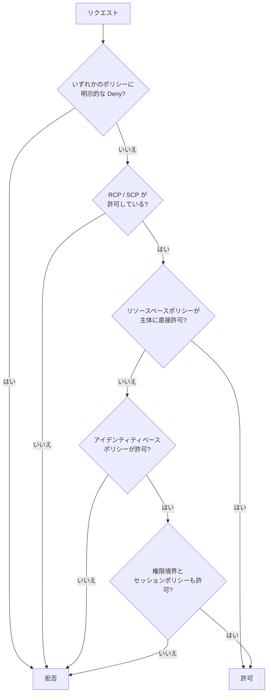

# IAM と STS

IAM は「誰が、どのリソースに、何をできるか」を定義するサービスで、STS はそのための一時的な認証情報を発行するサービスです。AWS 上で動くアプリの権限設計では、ほぼ必ずこの 2 つを使います。

[](../assets/diagrams/iam-cross-account.png)

## プリンシパルと権限の定義 {#principals}

プリンシパルは、AWS にリクエストを送る主体です。

| プリンシパル | 認証情報 | 主な用途 |
| --- | --- | --- |
| IAM ユーザー | 長期（パスワード、アクセスキー） | ロールを使えない場合の例外的な利用 |
| IAM ロール | 一時（STS が発行） | アプリ、AWS サービス、フェデレーションユーザー |
| ロールセッション | 一時 | ロールを引き受けた結果の実体。リクエストの主体はこれ |
| フェデレーションプリンシパル | 一時 | SAML や OIDC で認証した外部ユーザー |
| サービスプリンシパル | なし（AWS が管理） | `lambda.amazonaws.com` など、信頼ポリシーで指定する |
| ルートユーザー | 長期 | 日常業務では使わない |

権限は JSON のポリシーで定義します。`Effect`、`Action`、`Resource` が基本で、必要に応じて `Condition` を足します。

```json
{
  "Version": "2012-10-17",
  "Statement": [{
    "Effect": "Allow",
    "Action": ["dynamodb:GetItem", "dynamodb:Query"],
    "Resource": "arn:aws:dynamodb:ap-northeast-1:111122223333:table/Orders"
  }]
}
```

AWS サービスにロールを渡す操作（Lambda に実行ロールを設定するなど）には、呼び出し元に `iam:PassRole` の許可が必要です。信頼ポリシーとは別の権限なので、混同しないようにします。

## アイデンティティベースとリソースベース {#identity-vs-resource}

| 観点 | アイデンティティベース | リソースベース |
| --- | --- | --- |
| 付与先 | ユーザー、グループ、ロール | S3 バケット、SQS キュー、KMS キー、Lambda 関数など |
| `Principal` 要素 | なし（付与先が主体） | 必須 |
| 別アカウントへの許可 | 単独では不可 | 主体を別アカウントに指定できる |
| 代表例 | 管理ポリシー、インラインポリシー | バケットポリシー、キーポリシー、ロールの信頼ポリシー |

同じアカウント内では、どちらかの `Allow` があれば通るのが基本です。ただしロールの信頼ポリシーと KMS のキーポリシーは例外で、そのポリシー側での許可が必要になります。

## ポリシー評価 {#policy-evaluation}

既定はすべて拒否（暗黙の拒否）で、許可を積み上げて初めて通ります。どこかに明示的な `Deny` があれば、他のどの `Allow` よりも優先されます。



図は単一アカウント内の流れです。リソースベースポリシーによる許可が権限境界やセッションポリシーの制限を受けるかどうかは、指定した主体（ユーザー ARN、ロール ARN、ロールセッション ARN）で変わります。

| 状況 | 結果の考え方 |
| --- | --- |
| 同一アカウント、アイデンティティとリソース | 和集合。どちらかの Allow で可 |
| 別アカウント | 積集合。呼び出し側の Allow と、リソース側の Allow の両方が必須 |
| アイデンティティと権限境界 | 積集合 |
| ロールとセッションポリシー | 積集合。セッションポリシーで権限は増やせない |
| どの組み合わせでも | 明示的な Deny が最優先 |

拒否されたときは HTTP 403 の `AccessDenied` 系エラーになります。`aws sts get-caller-identity` で、実際に使われている主体をまず確認すると切り分けが速くなります。

### 権限境界と SCP {#boundaries-scp}

どちらも権限の上限を決めるだけで、それ自体は権限を与えません。

| 仕組み | 適用先 | 用途 |
| --- | --- | --- |
| 権限境界 | IAM ユーザー、ロール | 開発者に作らせるロールの上限を制限する |
| SCP | Organizations の組織、OU、アカウント内の主体 | 組織全体のガードレール |
| RCP | Organizations 配下のアカウントのリソース | リソース側のガードレール |
| セッションポリシー | STS で作るセッション | そのセッションだけ権限を絞る |

## 条件とアクセス制御 {#conditions}

`Condition` で、きめ細かい制御を行います。

| 条件キー | 用途 |
| --- | --- |
| `aws:MultiFactorAuthPresent`, `aws:MultiFactorAuthAge` | MFA の有無と経過時間 |
| `aws:SecureTransport` | TLS 経由に限定する |
| `aws:SourceIp`, `aws:SourceVpce` | 送信元の IP や VPC エンドポイント |
| `aws:PrincipalTag/キー`, `aws:ResourceTag/キー` | タグによる属性ベースアクセス制御（ABAC） |
| `aws:SourceArn`, `aws:SourceAccount` | サービスプリンシパルの呼び出し元を限定する |
| `dynamodb:LeadingKeys`, `dynamodb:Attributes` | DynamoDB の項目単位、属性単位の制御 |

次は、セッションタグと DynamoDB のパーティションキーを一致させる ABAC の例です。

```json
{
  "Effect": "Allow",
  "Action": ["dynamodb:GetItem", "dynamodb:Query"],
  "Resource": "arn:aws:dynamodb:*:*:table/TenantData",
  "Condition": {
    "ForAllValues:StringEquals": {
      "dynamodb:LeadingKeys": ["${aws:PrincipalTag/TenantId}"]
    }
  }
}
```

### 最小権限 {#least-privilege}

- `Action` と `Resource` を具体的に書き、`*` はできるだけ避ける。
- 長期のアクセスキーより、ロールの一時認証情報を使う。
- 機能ごとにロールを分ける。Lambda なら関数ごとに実行ロールを作る。
- IAM Access Analyzer で外部公開や未使用の権限を確認する。

## ロールの引き受け {#assume-role}

ロールには 2 種類のポリシーがあります。誰が引き受けられるかを決める「信頼ポリシー」と、引き受けた後に何ができるかを決める「許可ポリシー」です。

### 信頼ポリシー {#trust-policy}

```json
{
  "Version": "2012-10-17",
  "Statement": [{
    "Effect": "Allow",
    "Principal": {"AWS": "arn:aws:iam::444455556666:role/CallerRole"},
    "Action": "sts:AssumeRole"
  }]
}
```

別アカウントの場合は、この信頼ポリシーに加えて、呼び出し側の主体にも対象ロールへの `sts:AssumeRole` の許可が必要です。

### AssumeRole のコード {#assume-role-code}

```python
import boto3

sts = boto3.client("sts")
resp = sts.assume_role(
    RoleArn="arn:aws:iam::111122223333:role/ReportReader",
    RoleSessionName="report-job",
    DurationSeconds=900,
)
c = resp["Credentials"]

s3 = boto3.client(
    "s3",
    aws_access_key_id=c["AccessKeyId"],
    aws_secret_access_key=c["SecretAccessKey"],
    aws_session_token=c["SessionToken"],
)
```

| パラメータ | 要点 |
| --- | --- |
| `RoleArn`, `RoleSessionName` | 必須。セッション名は CloudTrail に残り、2〜64 文字 |
| `DurationSeconds` | 既定 3600 秒。最短 900 秒、上限はロールの最大セッション時間（1〜12 時間） |
| `ExternalId` | 第三者によるアクセス用。2〜1224 文字 |
| `Policy`, `PolicyArns` | セッションポリシー。平文の合計は 2048 文字まで、管理ポリシーは 10 個まで |
| `SerialNumber`, `TokenCode` | MFA の情報。信頼ポリシーで MFA を必須にする場合に渡す |
| `Tags`, `TransitiveTagKeys` | セッションタグ |

ロールチェーン（ロールから別のロールを引き受ける）のセッションは最大 1 時間で、それより長い `DurationSeconds` を指定すると失敗します。

!!! tip "SDK の自動更新を使う"
    プロファイルに `role_arn` と `source_profile` を書けば、SDK がロールの引き受けと更新を自動で行います。一時認証情報を自分でキャッシュするコードは、多くの場合不要です。

### ExternalId と混乱した代理問題 {#external-id}

第三者の SaaS に自分のアカウントのロールを使わせると、別の顧客がそのロール ARN を SaaS に登録して、SaaS 経由でアクセスしてくる恐れがあります。これが「混乱した代理問題」です。

対策として、SaaS 側が顧客ごとに一意の値を発行し、顧客はそれを信頼ポリシーの条件に書きます。値は顧客ではなく SaaS 側が管理します。

```json
{
  "Effect": "Allow",
  "Principal": {"AWS": "444455556666"},
  "Action": "sts:AssumeRole",
  "Condition": {"StringEquals": {"sts:ExternalId": "customer-12345"}}
}
```

AWS サービスがサービスプリンシパルでアクセスしてくる場合は、リソースポリシーに `aws:SourceArn` や `aws:SourceAccount` の条件を付けて同じ問題を防ぎます。

### セッションタグ {#session-tags}

セッションに付けるキーと値の組で、ポリシーからは `aws:PrincipalTag` として参照します。ABAC の基本部品です。

- 上限は 50 個で、キーは 128 文字、値は 256 文字まで。
- 信頼ポリシーで `sts:TagSession` を許可する必要がある。
- 既定ではロールチェーンの次のセッションに引き継がれない。`TransitiveTagKeys` で指定したタグだけが引き継がれる。
- 同じキーのロールタグより、セッションタグが優先される。
- SAML や OIDC からも `PrincipalTag` として渡せる。

## GetSessionToken と MFA {#mfa}

MFA 必須の API を呼ぶには、MFA の情報を含む一時認証情報が必要です。長期のアクセスキーには `aws:MultiFactorAuthPresent` キーが含まれないので、次のように一時認証情報を取得します。

```python
import boto3

sts = boto3.client("sts")
resp = sts.get_session_token(
    SerialNumber="arn:aws:iam::111122223333:mfa/alice",
    TokenCode="123456",
    DurationSeconds=3600,
)
```

ポリシー側では次の条件で MFA を要求します。`aws:MultiFactorAuthPresent` は長期認証情報では存在しないため、`Deny` と組み合わせるときは、キーがない場合の動作に注意します。

```json
{"Condition": {"Bool": {"aws:MultiFactorAuthPresent": "true"}}}
```

| API | 呼べる主体 | 有効期間（最短 / 最大 / 既定） | MFA | 主な用途 |
| --- | --- | --- | --- | --- |
| `AssumeRole` | IAM ユーザー、ロール | 15 分 / ロールの設定値 / 1 時間 | 可 | 権限の切り替え、クロスアカウント |
| `GetSessionToken` | IAM ユーザー | 15 分 / 36 時間 / 12 時間 | 可 | 同一ユーザーの権限のまま MFA を証明 |
| `GetSessionToken` | ルートユーザー | 15 分 / 1 時間 / 1 時間 | 可 | 非推奨 |
| `AssumeRoleWithSAML` | SAML で認証したユーザー | 15 分 / ロールの設定値 / 1 時間 | なし | 社内 ID 連携 |
| `AssumeRoleWithWebIdentity` | OIDC で認証したユーザー | 15 分 / ロールの設定値 / 1 時間 | なし | GitHub Actions、モバイルなど |
| `GetFederationToken` | IAM ユーザー | 15 分 / 36 時間 / 12 時間 | なし | カスタム ID ブローカー |
| `GetFederationToken` | ルートユーザー | 15 分 / 1 時間 / 1 時間 | なし | 非推奨 |

`GetSessionToken` の認証情報には次の制限があります。

- MFA 情報を含めない限り、IAM API を呼べない。
- STS は `AssumeRole` と `GetCallerIdentity` しか呼べない。

他アカウントのリソースに MFA 付きでアクセスするなら、信頼ポリシーで MFA を要求した `AssumeRole` を使います。

## フェデレーション {#federation}

外部の ID 基盤で認証したユーザーに、IAM ユーザーを作らずに一時認証情報を渡す仕組みです。

| 方式 | 使う API | IAM 側の準備 | 向いている場面 |
| --- | --- | --- | --- |
| SAML 2.0 | `AssumeRoleWithSAML` | SAML プロバイダーとロール | 社内ディレクトリから AWS へ |
| OIDC | `AssumeRoleWithWebIdentity` | OIDC プロバイダーとロール | CI/CD、外部 ID 基盤からの JWT |
| Cognito ID プール | Cognito 経由 | ID プールとロール | Web やモバイルの一般利用者 |
| IAM Identity Center | SDK、CLI の SSO プロバイダー | 権限セットの割り当て | 従業員の複数アカウント利用 |

`AssumeRoleWithSAML` と `AssumeRoleWithWebIdentity` は AWS の認証情報で署名せず、アサーションやトークンを提示して呼びます。

次は GitHub Actions を OIDC で信頼する例です。`sub` を絞らないと、他のリポジトリからも引き受けられてしまいます。

```json
{
  "Effect": "Allow",
  "Principal": {
    "Federated": "arn:aws:iam::111122223333:oidc-provider/token.actions.githubusercontent.com"
  },
  "Action": "sts:AssumeRoleWithWebIdentity",
  "Condition": {
    "StringEquals": {"token.actions.githubusercontent.com:aud": "sts.amazonaws.com"},
    "StringLike": {"token.actions.githubusercontent.com:sub": "repo:my-org/my-repo:*"}
  }
}
```

エンドユーザー向けのアプリなら、まず [Cognito](cognito.md) を検討します。

### IAM Identity Center {#identity-center}

従業員の ID を接続または作成し、複数の AWS アカウントやアプリへのアクセスを一元管理するサービスです。開発者の PC では、`aws configure sso` と `aws sso login` で長期のアクセスキーなしに CLI や SDK を使えます。

## プログラムからのアクセス {#programmatic-access}

実行環境ごとに、認証情報の渡し方が決まっています。コードにアクセスキーを書くのは避けます。

| 実行環境 | 推奨する方法 | 認証情報の取得元 |
| --- | --- | --- |
| Lambda | 実行ロール | Lambda が自動で引き受け、環境に設定 |
| EC2 | インスタンスプロファイル | インスタンスメタデータサービス（IMDS） |
| ECS | タスクロール | コンテナ認証情報プロバイダー |
| EKS | EKS Pod Identity | コンテナ認証情報プロバイダー |
| 開発者の PC | IAM Identity Center、プロファイル | `~/.aws/config` |
| CI/CD | OIDC フェデレーション | `AssumeRoleWithWebIdentity` |
| 外部サーバー | IAM Roles Anywhere、やむを得なければアクセスキー | プロセスプロバイダーなど |

### アクセスキーとプロファイル {#access-keys-profiles}

アクセスキーは IAM ユーザーまたはルートユーザーの長期認証情報で、1 ユーザーにつき最大 2 つです。2 つ持てるので、新しいキーを発行して切り替えてから古いキーを無効化する、という手順でローテーションできます。

プロファイルは `~/.aws/credentials` と `~/.aws/config` に定義します。

```ini
# ~/.aws/config
[profile dev]
region = ap-northeast-1

[profile prod-admin]
role_arn = arn:aws:iam::111122223333:role/Admin
source_profile = dev
mfa_serial = arn:aws:iam::444455556666:mfa/alice
```

コードからは `boto3.Session(profile_name="prod-admin")`、CLI からは `--profile` か環境変数 `AWS_PROFILE` で選びます。

### 認証情報プロバイダーチェーン {#credential-chain}

SDK は決まった順に認証情報を探し、最初に見つかったものを使います。順序は SDK ごとに異なります。boto3 の順序は次のとおりです。

1. `boto3.client()` に渡したパラメータ
2. `Session` に渡したパラメータ
3. 環境変数（`AWS_ACCESS_KEY_ID` など）
4. Assume role プロバイダー
5. Assume role with web identity プロバイダー
6. IAM Identity Center プロバイダー
7. 共有認証情報ファイル（`~/.aws/credentials`）
8. コンソールのログイン認証情報
9. AWS 設定ファイル（`~/.aws/config`）
10. Boto2 設定ファイル
11. コンテナ認証情報プロバイダー
12. EC2 インスタンスメタデータサービス

!!! warning "環境変数が残っていると優先される"
    EC2 で正しいロールを付けたのに権限エラーが出る場合、環境変数や `~/.aws/credentials` に残った古いキーが先に使われていることがあります。`aws sts get-caller-identity` で確認します。

### インスタンスプロファイル {#instance-profile}

EC2 にロールを渡すための入れ物です。1 つのインスタンスプロファイルに入るロールは 1 つだけです。

コンソールでロールを作ると同名のプロファイルが自動で作られますが、CLI や SDK では別々に作成します。権限を変えるときはプロファイルを置き換えます。プロファイルからロールを外すと、反映に最大 1 時間かかることがあります。

### Lambda の実行ロール {#lambda-execution-role}

信頼ポリシーに `lambda.amazonaws.com` を指定したロールです。Lambda が自動で引き受けるので、関数のコードで `sts:AssumeRole` を呼ぶ必要はありません。CloudWatch Logs への書き込みには `AWSLambdaBasicExecutionRole` を使います。詳しくは [Lambda](lambda.md) を参照してください。

## 認証付き呼び出し（SigV4） {#sigv4}

AWS API へのリクエストは Signature Version 4（SigV4）で署名します。SDK と CLI は自動で署名するので、自分で実装するのは次のような場合だけです。

- SDK のない言語から呼ぶとき。
- IAM 認証の API Gateway のように、自作 API を署名付きで呼ぶとき。

署名は次の手順で作ります。

1. リクエストの要素から正規リクエストを作る。
2. 署名する文字列を作る。
3. シークレットキーから、日付、リージョン、サービスで絞った署名キーを導出する。
4. 署名を計算し、`Authorization` ヘッダーまたはクエリ文字列に入れる。

一時認証情報の場合はセッショントークンも含めます。署名は秘密鍵そのものを送らずに、本人確認、改ざん検知、リプレイ対策を実現します。リクエストは原則としてタイムスタンプから 5 分以内に AWS に届く必要があります。

```python
import boto3
import requests
from botocore.auth import SigV4Auth
from botocore.awsrequest import AWSRequest

url = "https://abc123.execute-api.ap-northeast-1.amazonaws.com/prod/orders"
creds = boto3.Session().get_credentials().get_frozen_credentials()

req = AWSRequest(method="GET", url=url)
SigV4Auth(creds, "execute-api", "ap-northeast-1").add_auth(req)

resp = requests.get(url, headers=dict(req.headers))
```

| 症状 | 確認すること |
| --- | --- |
| HTTP 403 `SignatureDoesNotMatch` | シークレットキー、正規リクエスト、リージョン、サービス名 |
| `IncompleteSignatureException` | `Authorization` ヘッダーの構成と、途中での書き換え |
| 期限切れエラー | クライアントの時計のずれ、一時認証情報の期限 |
| `AccessDenied` | 署名は通っている。ポリシーを確認する |

S3 Multi-Region Access Points のように複数リージョンで検証する場合は、非対称の SigV4a を使います。SDK と CLI は必要に応じて自動で切り替えます。署名付き URL は [S3](s3.md) で扱います。

STS は、リージョンエンドポイントの利用が推奨されています。レイテンシーの低減と冗長性の向上につながります。

## マイクロサービス間の認証 {#microservices-auth}

| 呼び出しの種類 | 方式 | 認可の場所 |
| --- | --- | --- |
| サービスから AWS API | 各サービス専用のロール（SigV4 は SDK が担当） | IAM ポリシー |
| サービスから API Gateway | `AWS_IAM` 認可と SigV4 | `execute-api:Invoke` のポリシー |
| 別アカウントのサービスへ | ロールの引き受け、またはリソースベースポリシー | 両方のアカウント |
| サービスから自作 API（AWS 認証情報なし） | Cognito の client credentials で取得した JWT | スコープの検証 |
| クライアント証明書で相互認証 | API Gateway の mutual TLS | トラストストアと証明書 |
| エンドユーザーの文脈を引き継ぐ | JWT を転送し、各サービスで検証 | アプリコードや Lambda オーソライザー |

設計のポイントは次のとおりです。

- サービスごとにロールを分け、呼び出してよい相手だけを許可する。
- API キーやパスワードをサービス間で共有するなら [Secrets Manager](secrets.md) に置き、ローテーションする。
- 呼び出し元のサービスが誰かを示すため、`RoleSessionName` やセッションタグで追跡できるようにする。

API Gateway の認可方式の比較は [API Gateway](api-gateway.md) にあります。

## クロスアカウントアクセス {#cross-account}

| 観点 | リソースベースポリシー | ロールの引き受け |
| --- | --- | --- |
| 仕組み | リソース側で相手のアカウントや主体を許可 | 相手のアカウントのロールに切り替える |
| 元の権限 | 維持する | 手放す（そのセッションではロールの権限のみ） |
| 向いている処理 | 自アカウントと相手のリソース間のコピー | 複数サービスにまたがる操作 |
| 対応範囲 | リソースベースポリシーに対応するサービスのみ | ほぼすべて |
| 必要な許可 | 呼び出し側の Allow とリソース側の Allow | 呼び出し側の `sts:AssumeRole` と信頼ポリシー |

選び方の例です。

- 自分の S3 バケットから相手の S3 バケットへコピーする: 両方に同時にアクセスするので、リソースベースポリシー。
- 相手のアカウントの DynamoDB、S3、SQS をまとめて操作する: ロールの引き受け。
- 第三者の SaaS にアクセスを許可する: ロールの引き受けと `ExternalId`。

KMS で暗号化されたリソースは、キーポリシー側の許可も必要です。詳しくは [KMS](kms.md) を参照してください。

## 試験のポイント {#exam-points}

| こう問われたら | 答え |
| --- | --- |
| Allow と Deny が両方あるときの結果 | 明示的な Deny が優先される |
| どのポリシーにも記載がない操作 | 暗黙の拒否 |
| 別アカウントの S3 に読み書きしたいのに 403 | 呼び出し側とバケット側の両方に Allow が必要 |
| EC2 上のアプリに権限を与える安全な方法 | インスタンスプロファイル経由のロール |
| 第三者に自分のアカウントへのアクセスを許可する | ロールと `ExternalId`（混乱した代理問題の対策） |
| CLI で MFA 必須の API を呼ぶ | `GetSessionToken` に `SerialNumber` と `TokenCode` を渡す |
| ロールチェーンで 2 時間のセッションを指定したら | 失敗する。チェーンは最大 1 時間 |
| 開発者が作るロールの権限に上限を設ける | 権限境界 |
| 組織全体で特定の操作を禁止する | SCP |
| 元の権限を保ったまま別アカウントのリソースを使う | リソースベースポリシー |
| GitHub Actions に長期キーを置かず権限を与える | OIDC フェデレーションと `AssumeRoleWithWebIdentity` |
| 誰の権限で動いているか確認する | `sts:GetCallerIdentity` |
| `SignatureDoesNotMatch` の原因 | シークレットキーや署名対象の不一致 |
| 環境変数とインスタンスプロファイルが両方ある | SDK のチェーンでは環境変数が先に使われる |

## 関連ページ {#related}

- [Cognito](cognito.md): エンドユーザーの認証と ID プール
- [KMS](kms.md): キーポリシーと暗号化
- [Secrets Manager と Parameter Store](secrets.md): シークレットの管理
- [API Gateway](api-gateway.md): API の認可方式
- [Lambda](lambda.md): 実行ロール
- [S3](s3.md): バケットポリシーと署名付き URL
- [コンテナ](containers.md): ECS タスクロールと EKS Pod Identity

## 参考 {#references}

- [Policy evaluation logic](https://docs.aws.amazon.com/IAM/latest/UserGuide/reference_policies_evaluation-logic.html)
- [How AWS enforcement code logic evaluates requests](https://docs.aws.amazon.com/IAM/latest/UserGuide/reference_policies_evaluation-logic_policy-eval-denyallow.html)
- [Permissions boundaries for IAM entities](https://docs.aws.amazon.com/IAM/latest/UserGuide/access_policies_boundaries.html)
- [Cross account resource access in IAM](https://docs.aws.amazon.com/IAM/latest/UserGuide/access_policies-cross-account-resource-access.html)
- [AssumeRole API](https://docs.aws.amazon.com/STS/latest/APIReference/API_AssumeRole.html)
- [GetSessionToken API](https://docs.aws.amazon.com/STS/latest/APIReference/API_GetSessionToken.html)
- [Compare AWS STS credentials](https://docs.aws.amazon.com/IAM/latest/UserGuide/id_credentials_sts-comparison.html)
- [Request temporary security credentials](https://docs.aws.amazon.com/IAM/latest/UserGuide/id_credentials_temp_request.html)
- [Manage AWS STS in an AWS Region](https://docs.aws.amazon.com/IAM/latest/UserGuide/id_credentials_temp_enable-regions.html)
- [The confused deputy problem](https://docs.aws.amazon.com/IAM/latest/UserGuide/confused-deputy.html)
- [Pass session tags in AWS STS](https://docs.aws.amazon.com/IAM/latest/UserGuide/id_session-tags.html)
- [Secure API access with MFA](https://docs.aws.amazon.com/IAM/latest/UserGuide/id_credentials_mfa_configure-api-require.html)
- [Manage access keys for IAM users](https://docs.aws.amazon.com/IAM/latest/UserGuide/id_credentials_access-keys.html)
- [Use instance profiles](https://docs.aws.amazon.com/IAM/latest/UserGuide/id_roles_use_switch-role-ec2_instance-profiles.html)
- [AWS Signature Version 4 for API requests](https://docs.aws.amazon.com/IAM/latest/UserGuide/reference_sigv.html)
- [Troubleshoot Signature Version 4 signing](https://docs.aws.amazon.com/IAM/latest/UserGuide/reference_sigv-troubleshooting.html)
- [AWS SDKs and Tools standardized credential providers](https://docs.aws.amazon.com/sdkref/latest/guide/standardized-credentials.html)
- [Boto3: Credentials](https://boto3.amazonaws.com/v1/documentation/api/latest/guide/credentials.html)
- [Lambda execution role](https://docs.aws.amazon.com/lambda/latest/dg/lambda-intro-execution-role.html)
- [What is IAM Identity Center?](https://docs.aws.amazon.com/singlesignon/latest/userguide/what-is.html)
