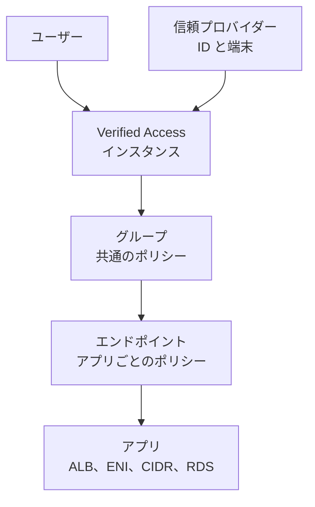
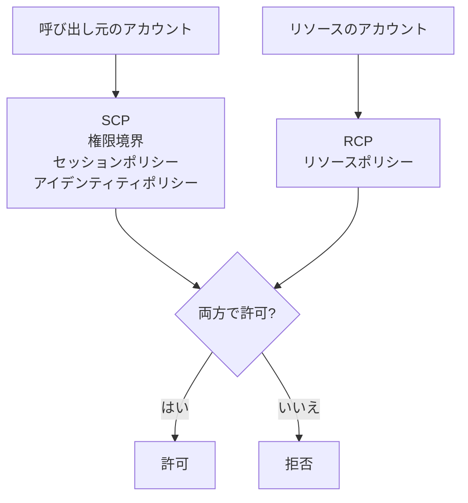

# ID とディレクトリ

従業員の ID、Active Directory、ハードウェアの鍵管理、アプリの認可、ゼロトラストのアクセスをまとめたページです。IAM の基本は [IAM と STS](iam.md)、顧客向けの認証は [Cognito](cognito.md)、KMS は [KMS](kms.md) を参照してください。

[](../assets/diagrams/identity-directory-sources.png)

| サービス | 解決すること | 利用者 | 代表的な問われ方 |
| --- | --- | --- | --- |
| [IAM Identity Center](#identity-center) | 複数アカウントへの SSO | 従業員 | 多数のアカウントに集中して権限を割り当てたい |
| [Directory Service](#directory-service) | AWS で Active Directory を使う | Windows ワークロード、従業員 | RDS SQL Server、ドメイン参加、オンプレ AD |
| [CloudHSM](#cloudhsm) | 占有 HSM で鍵を管理 | 規制のあるシステム | FIPS、単一テナント、鍵を AWS から分離 |
| [Verified Permissions](#verified-permissions) | 自作アプリの細かい認可 | アプリ | Cedar でアプリの認可を外出ししたい |
| [Verified Access](#verified-access) | VPN なしのアプリへのアクセス | 従業員 | ユーザーと端末の状態でアクセスを判断 |
| [IAM Access Analyzer](#access-analyzer) | 意図しないアクセスの発見 | セキュリティ担当 | 外部共有や未使用権限の検出 |

!!! warning "2026 年 10 月時点の状態の変更"
    - **Simple AD** は新規の顧客を受け付けていません。既存の顧客は使い続けられ、新しいディレクトリも作れます。
    - **CloudHSM の `hsm1.medium`** は 2026 年 3 月 31 日でサポートが終了しました。2025 年 4 月から新規に作れず、2026 年 1 月から `hsm2m.medium` への自動移行が始まっています。

## IAM Identity Center {#identity-center}

従業員の ID を 1 か所でつなぎ、複数の AWS アカウントとアプリへの SSO を提供します。長期のアクセスキーなしで CLI や SDK も使えます。

### インスタンス {#idc-instances}

| 機能 | 組織インスタンス | アカウントインスタンス |
| --- | --- | --- |
| 有効にする場所 | Organizations の管理アカウント | メンバーか単独のアカウント |
| AWS アカウントへの権限（権限セット） | 可 | **不可** |
| ポータルからのアカウント SSO | 可 | 不可 |
| SAML の独自アプリ | 可 | 不可 |
| OIDC の独自アプリ、AWS マネージドアプリ | 可 | 可 |
| 委任管理者 | 可 | 不可 |
| カスタマー管理 KMS キー | 可 | 不可 |
| 他リージョンへの複製 | 可 | 不可 |

「複数アカウントに権限を割り当てたい」なら組織インスタンスです。

### ID ソース {#idc-identity-sources}

組織に **ID ソースは 1 つ** です。

| ID ソース | ユーザーの管理場所 | パスワード | 向いている場面 |
| --- | --- | --- | --- |
| Identity Center ディレクトリ（既定） | Identity Center | Identity Center | 小規模、IdP なし |
| 外部 IdP（Okta、Entra ID など） | IdP。SCIM で同期 | IdP | すでに IdP がある |
| Active Directory | AD（Managed AD か AD Connector 経由） | AD にパススルー。同期しない | 既存の AD を使う |

**Simple AD は ID ソースに使えません。**

| 条件 | 内容 | 誤ったときの症状 |
| --- | --- | --- |
| AD の場所 | 管理アカウントか、委任管理者アカウント | ディレクトリを選択できない |
| Managed AD のリージョン | Identity Center と同じ | 接続できない |
| 接続できるディレクトリ | 同時に 1 つ | 複数のドメインやフォレストには Managed AD の信頼を使う |
| Foreign Security Principal | 同期されない | 信頼先のドメインのメンバーが同期されない |

SCIM の注意点です。

- アクセストークンの有効期間は **1 年** です。残り 90 日以下で通知が出ます。切れると同期が止まります。
- 姓、名、ユーザー名、表示名のいずれかが欠けたユーザーは同期されません。
- 複数の値を持つ属性は同期に失敗します。
- SAML の `NameID` と SCIM の Username が一致しないと、サインインに失敗します。
- 同期後は、コンソールからユーザーを追加、編集できません。

!!! danger "ID ソースの変更"
    **Active Directory へ変更すると、ユーザー、グループ、メンバーシップ、割り当てがすべて完全に削除されます。** 元に戻せません。AD から他へ変更する場合は保持されますが、AWS アクセスポータルの URL が変わります。

### 権限セット {#idc-permission-sets}

権限セットは IAM ポリシーのテンプレートです。アカウントに割り当てると、Identity Center が管理するロールをそのアカウントに作ります。

```text
arn:aws:iam::111122223333:role/aws-reserved/sso.amazonaws.com/ap-northeast-1/AWSReservedSSO_DatabaseAdmin_1234567890abcdef
```

| 設定 | 内容 | 既定と範囲 | 例と誤ったときの症状 |
| --- | --- | --- | --- |
| 定義済み権限 | ジョブ機能の AWS 管理ポリシーを 1 つ選ぶ | | `ViewOnlyAccess`、`PowerUserAccess` |
| AWS 管理ポリシー | カスタム権限に複数追加 | 管理ポリシーの合計は最大 251。IAM ロールの既定の上限は 10 | 上限に達すると IAM のクォータ引き上げが必要 |
| カスタマー管理ポリシー | 名前とパスで参照 | | **割り当て先の各アカウントに同じ名前とパスで事前に作る**。なければ割り当てに失敗 |
| インラインポリシー | 権限セットに直接書く | 1 つ、32,768 バイトまで | Identity Center が各アカウントへ展開 |
| 権限境界 | 権限の上限を設定 | 任意 | 許可しても境界の外なら拒否 |
| セッション時間 | AWS アカウントのセッション | 既定 1 時間、1 - 12 時間 | 長すぎると漏えい時の影響が大きい |
| リレー状態 | サインイン後に開くコンソールの URL | 任意 | `https://ap-northeast-1.console.aws.amazon.com/ec2/` |

権限セットを変更すると、割り当て先のアカウントに自動で再プロビジョニングされます。

**ARN の変更に注意します。** あるアカウントで権限セットの割り当てをすべて削除すると、ロールも消えます。再度割り当てると接尾辞が変わり、ARN が変わります。次の場所で参照していると、アクセスできなくなります。

- KMS のキーポリシー
- EKS の `aws-auth` ConfigMap
- その他のリソースポリシー

対策は、そのアカウントに割り当てを 1 つ残すことです。EKS にはアクセスエントリを使い、KMS には IAM のバックアップロールをキーポリシーに入れます。

権限セットではできないこともあります。独自の信頼ポリシー、ロールのタグ、ロールのパスが必要なら、IAM の **アカウントアクセスマネージャー** で既存の IAM ロールをユーザーやグループに割り当てられます。

### セッション {#idc-sessions}

| セッション | 既定 | 上限 | 切れたときの動き |
| --- | --- | --- | --- |
| AWS アクセスポータル（ユーザー対話） | 8 時間 | 90 日 | 再認証が必要 |
| 権限セット（アカウント内） | 1 時間 | 12 時間 | AWS からサインアウトされる |

別物であることが問われます。ポータルが有効でも、アカウントのセッションが切れれば入り直します。

CLI では次のように使います。

```bash
aws configure sso
aws sso login --profile prod-admin
aws s3 ls --profile prod-admin
```

### MFA {#idc-mfa}

Identity Center ディレクトリでは既定で MFA が有効です。外部 IdP を使うと **Identity Center の MFA は対象外** で、IdP 側で設定します。

| 種類 | 備考 |
| --- | --- |
| FIDO2（セキュリティキー、内蔵の認証器） | フィッシング耐性あり |
| 認証アプリ | 仮想 |
| RADIUS MFA | AWS Managed Microsoft AD 経由 |

1 ユーザーに最大 8 台（認証アプリ 2、FIDO 6）を登録できます。

### ABAC {#idc-abac}

ID ソースの属性をセッションタグにして、権限セットの数を減らせます。Team 属性を渡すと、次のポリシーで同じチームのリソースだけに限定できます。

```json
{
  "Effect": "Allow",
  "Action": ["ec2:StartInstances", "ec2:StopInstances"],
  "Resource": "*",
  "Condition": {
    "StringEquals": {"aws:ResourceTag/Team": "${aws:PrincipalTag/Team}"}
  }
}
```

**症状:** 条件が常に不一致になる場合は、「アクセス制御の属性」に Team を設定したか、リソースにタグが付いているかを確認します。

### 委任管理者 {#idc-delegated-admin}

- 管理アカウントを使う人を減らすため、メンバーアカウントに管理を委任します。
- 委任管理者は、**管理アカウントに割り当てられた権限セットを変更できません**。
- 管理アカウントの権限セットは専用にして、グループではなくユーザーに割り当てます。グループにすると、グループを編集できる人が管理アカウントに入れてしまうからです。
- 外部 ID ソースでは、`identitystore:CreateGroupMembership` などの書き込みを SCP で制限できます。

### マルチリージョンと緊急アクセス {#idc-multi-region}

組織インスタンスは他のリージョンに複製できます。

| 条件 | 内容 |
| --- | --- |
| ID ソース | 外部 IdP か Identity Center ディレクトリ。**AD は不可** |
| KMS キー | 同じアカウントのマルチリージョンのカスタマー管理キー |
| 外部 IdP | 複数の ACS URL に対応していること |

Identity Center 自体の障害に備えるには、IdP から各アカウントへの直接の SAML フェデレーションで緊急用の経路を作ります。一時的な権限昇格は、パートナーの製品を組み合わせて実現します。

### トラブルシュート {#idc-troubleshooting}

| 症状 | 確認点 |
| --- | --- |
| 権限セットの割り当てが失敗する | カスタマー管理ポリシーの名前とパス、IAM のクォータ |
| ロールがポータルに出ない | ユーザーやグループの割り当て、SCIM の同期 |
| サインインは成功するがアクセス拒否 | 権限セット、SCP、権限境界 |
| 突然 KMS や EKS に入れない | ロールの ARN の接尾辞の変化 |
| SCIM の同期が止まった | トークンの期限 |
| AD のユーザーが見つからない | ディレクトリの場所、信頼、FSP |

## Directory Service {#directory-service}

AWS で Active Directory を使うための選択肢です。

| 観点 | Managed Microsoft AD | AD Connector | Simple AD |
| --- | --- | --- | --- |
| 実体 | 本物の Windows Server AD | オンプレ AD へのプロキシ | Samba 4 |
| 状態 | 利用可能 | 利用可能 | **新規の顧客は受付終了** |
| ユーザーの場所 | AWS（信頼でオンプレも） | オンプレ AD | AWS |
| 規模 | Standard 30,000 オブジェクト、Enterprise 500,000 | small、large | small 500 ユーザー、large 5,000 ユーザー |
| 信頼 | 可 | 不可 | 不可 |
| MFA（RADIUS） | 可 | 可 | 不可 |
| LDAPS | サーバー側、クライアント側 | クライアント側 | 不可 |
| RDS SQL Server | 可 | 不可 | 不可 |
| IAM Identity Center | 可 | 可 | 不可 |
| 他アカウントとの共有 | 可 | 不可 | 不可 |

### Managed Microsoft AD {#managed-ad}

| 設定 | 内容 | 既定と範囲 | 誤ったときの症状 |
| --- | --- | --- | --- |
| サブネット | 異なる AZ の 2 つ以上 | ドメインコントローラーは 2 台から。最大 20 台 | 作成できない |
| エディション | Standard、Enterprise | 作成時に選ぶ | Standard はマルチリージョン不可 |
| 管理者 | `Admin` というユーザーが作られる | | ドメイン管理者そのものの権限は渡されない |
| VPC のテナンシー | 既定のテナンシー | | 専有では作れない |
| スナップショット | 毎日の自動と手動 | 手動 5 個、180 日まで | 180 日より古いものは復元不可 |
| マルチリージョン | Enterprise のみ | 合計 5 リージョン | |
| 共有 | 他のアカウントへドメイン参加を共有 | Standard 25、Enterprise 500、Hybrid 125 | EC2 のドメイン参加に使える |
| ログ | DC のセキュリティログを CloudWatch Logs へ | リージョンごとに有効化 | 有効化前のログは届かない |

### 信頼関係 {#ad-trust}

オンプレ AD との間に信頼を結ぶと、ユーザーはオンプレの認証情報で AWS のリソースを使えます。外部信頼とフォレスト信頼、一方向と双方向に対応します。

| 利用するもの | 必要な信頼 |
| --- | --- |
| IAM Identity Center、WorkSpaces、WorkMail、Amazon Quick、コンソール | **双方向** |
| EC2、RDS、FSx | 一方向でも双方向でも可 |

| 前提 | 誤ったときの症状 |
| --- | --- |
| VPN か Direct Connect でネットワークをつなぐ | 信頼の検証に失敗 |
| ファイアウォールで必要なポートを開く | 検証に失敗 |
| DNS の条件付きフォワーダー | 相手のドメインを解決できない |
| NetBIOS とドメイン名が相手と異なる | 信頼を作れない |
| シングルラベルドメインではない | 非対応 |

双方向で権限を絞りたいなら、選択的認証で AWS アプリのサービスアカウントだけに限定します。

**Hybrid Edition** は、信頼を結ばずに既存の AD を AWS に拡張する形です。ユーザーを同期せず、同じ認証情報を使えます。AWS は定期的にディレクトリを評価します。

### AD Connector {#ad-connector}

ディレクトリのリクエストをオンプレの AD に転送するゲートウェイです。**クラウドに情報をキャッシュしません。**

| 設定 | 内容 | 誤ったときの症状 |
| --- | --- | --- |
| サービスアカウント | オンプレに作り、最小限の権限を委任 | 権限が足りずディレクトリを読めない |
| DNS サーバー | IP を 2 つ指定。LDAP と Kerberos の SRV レコードが必要 | 接続に失敗 |
| 開けるポート | TCP/UDP 53、88、389 を VPC の 2 つのサブネットの CIDR へ | 接続に失敗 |
| サイズ | small、large | 負荷に応じて複数に分散 |
| ドメインとの関係 | **1 対 1**。子ドメインごとに必要 | 推移的な信頼に非対応 |

- 他のアカウントと共有できません。
- マルチ VPC を意識しません。WorkSpaces などは同じ VPC に置きます。
- オンプレのパスワードポリシー（期限、履歴、ロック）がそのまま効きます。
- オンプレとの接続が切れると認証できなくなるので、VPN と Direct Connect の冗長性が重要です。

### Simple AD {#simple-ad}

!!! warning "新規の顧客は受付終了"
    AWS は代替として Managed Microsoft AD か AD Connector を案内しています。既存の顧客は機能を維持します。

Samba 4 の簡易ディレクトリです。ユーザー、グループ、グループポリシー、Linux と Windows のドメイン参加、Kerberos SSO に対応します。MFA、信頼、PowerShell、LDAPS、スキーマ拡張、RDS SQL Server、FSx、Identity Center には対応しません。

### MFA と LDAPS {#ad-mfa-ldaps}

| 機能 | 内容 | 例 |
| --- | --- | --- |
| RADIUS MFA | Managed AD と AD Connector に対応 | SG で UDP 1812 を RADIUS サーバーとの間で許可 |
| サーバー側 LDAPS | LDAP アプリと Managed AD の間を暗号化 | 証明書を AD に用意 |
| クライアント側 LDAPS | AWS アプリとオンプレ AD の間を暗号化。Managed AD と AD Connector に対応 | CA 証明書を登録。Managed AD はディレクトリに最大 5 個 |
| 細かいパスワードポリシー | OU やグループごとのポリシー | 特権ユーザーだけ厳しくする |

## CloudHSM {#cloudhsm}

FIPS 検証済みの **単一テナントの HSM** を VPC で使えるサービスです。鍵とユーザーは利用者が管理し、AWS は鍵を見られません。

### KMS との比較 {#cloudhsm-vs-kms}

| 観点 | KMS | CloudHSM |
| --- | --- | --- |
| テナント | 共有（テナントを問わない HSM の集合） | **単一テナント** |
| 鍵の管理主体 | AWS の HSM。権限はキーポリシー | 利用者。HSM のユーザーで管理 |
| 認証、認可 | IAM とキーポリシー | **HSM のユーザー**（IAM はクラスターの操作のみ） |
| 対応 API | AWS API | PKCS#11、JCE、CNG、KSP |
| AWS サービスとの統合 | 多数 | 直接はなし。KMS のキーストア経由 |
| 可用性 | AWS が管理（SLA 99.999%） | 利用者が HSM の台数と AZ を設計 |
| 鍵の持ち出し | 基本的に不可 | 可（利用者の管理） |
| 向いている場面 | ほとんどの場合 | TDE、SSL オフロード、CA の鍵、規制の要件 |

AWS は、カスタムキーストアは規制で明確に必要な場合にだけ選ぶよう案内しています。詳細は [KMS](kms.md) を参照してください。決済用の HSM が必要なら AWS Payment Cryptography です。

### クラスター {#cloudhsm-clusters}

| 設定 | 内容 | 既定と範囲 | 誤ったときの症状 |
| --- | --- | --- | --- |
| HSM の種類 | `hsm2m.medium` | `hsm1.medium` は作成不可 | |
| モード | FIPS、非 FIPS | **作成後に変更不可** | バックアップも同じモード同士のみ |
| HSM の数 | AZ に分散。同期は自動 | 1 - 28 台。既定のクォータは 6 台 | 1 台だと障害で停止 |
| サブネット | AZ ごとにプライベートサブネット | | |
| 認証 | CSR に署名して初期化し、CLI で有効化 | | 未初期化のままでは使えない |
| ネットワーク | IPv4 か デュアルスタック | 既定は IPv4 | |

作成の流れです。

1. クラスターと最初の HSM を作る。
2. CSR を取得し、自分の鍵で署名して初期化する。
3. CloudHSM CLI の `cluster activate` で有効化する。

```bash
aws cloudhsmv2 create-cluster \
  --hsm-type hsm2m.medium \
  --subnet-ids subnet-0abc subnet-0def \
  --backup-retention-policy Type=DAYS,Value=90
```

| 上限（`hsm2m.medium`） | 値 |
| --- | --- |
| 鍵 | 合計 16,666、うち非対称は 3,333 |
| ユーザー | 1,024 |
| 同時接続 | 900 |

### HSM のユーザー {#cloudhsm-users}

| ユーザー | できること |
| --- | --- |
| 未有効の管理者 | 最初の HSM にだけ存在。有効化で管理者になる |
| 管理者（Admin） | ユーザーの作成、削除、パスワード変更 |
| Crypto User（CU） | 鍵の管理と暗号操作 |
| Appliance User（AU） | クラスター内の同期（AWS が使用） |

**IAM ユーザーとは別物** です。IAM はクラスターや HSM の作成を制御し、HSM の中の操作は HSM のユーザーが制御します。AWS は鍵やユーザーを見られず、暗号操作もできません。

M of N の制御（クォーラム認証）を使うと、2 人以上の承認を必須にできます。

### バックアップとログ {#cloudhsm-backups}

| 項目 | 内容 |
| --- | --- |
| バックアップの頻度 | 少なくとも 24 時間に 1 回 |
| 保持 | 7 - 379 日 |
| 保管場所 | サービス管理の S3（同じリージョン）。暗号化され AWS も復号できない |
| リージョン間のコピー | `copy-backup-to-region`。パーティションをまたげない |
| コピー先の扱い | 元のクラスターとは連携しない。別に管理 |
| 監査ログ | HSM の操作を CloudWatch Logs に自動送信 |
| API のログ | クラスター操作は CloudTrail |

**症状:** 暗号操作を調べたいときに CloudTrail を見ても HSM の中の操作はありません。CloudWatch Logs の監査ログを見ます。

### KMS の CloudHSM キーストア {#cloudhsm-key-store}

KMS の API や AWS サービスとの統合を保ったまま、鍵の素材を自分の CloudHSM に置く方法です。

| 条件 | 内容 | 誤ったときの症状 |
| --- | --- | --- |
| HSM の台数 | 異なる AZ に **2 台以上** | 接続できない |
| 専用ユーザー | `kmsuser` という CU を作る | 接続できない |
| クラスターとの関係 | 1 クラスターに 1 キーストア | |
| 対応する鍵 | 対称の暗号化キー | 非対称や HMAC は不可 |
| 切断時 | 暗号操作ができない | KMS キーを使うサービスが失敗 |

## Verified Permissions {#verified-permissions}

自作アプリの **認可を外部に切り出す** サービスです。Cedar でポリシーを書き、アプリは「この主体はこの操作をしてよいか」を問い合わせます。認証は Cognito や OIDC の IdP が担います。

```text
permit (
  principal in Group::"managers",
  action == Action::"approveExpense",
  resource
) when {
  resource.amount <= 100000
};
```

```bash
aws verifiedpermissions is-authorized \
  --policy-store-id PSEXAMPLEabcdefg111111 \
  --principal entityType=User,entityId=alice \
  --action actionType=Action,actionId=approveExpense \
  --resource entityType=Expense,entityId=exp-42
```

| 項目 | 内容 | 既定と上限 | 誤ったときの症状 |
| --- | --- | --- | --- |
| ポリシーストア | ポリシーとテンプレートの入れ物 | 1 アプリか 1 テナントに 1 つを推奨 | 混在すると影響範囲が広がる |
| スキーマと検証 | エンティティと操作の型を定義し、ポリシーを検証 | スキーマ 100,000 バイト | 不正なポリシーは拒否 |
| ポリシー | 静的ポリシー | 10,000 バイト | |
| テンプレート | `?principal`、`?resource` を後で埋める | ストアあたり 40 | テンプレートの更新はリンク先に反映 |
| ID ソース | Cognito か OIDC | ストアに 1 つ | トークンの属性を主体やコンテキストに対応付け |
| 削除保護 | 誤削除を防ぐ | コンソールでは有効、API では無効 | |
| リクエスト | 認可リクエスト | 1 MB | |

| API | 用途 |
| --- | --- |
| `IsAuthorized` | 主体、操作、リソースを指定 |
| `IsAuthorizedWithToken` | JWT から主体を作る |

判定は既定で拒否です。`forbid` が満たされると `permit` より優先されます。

API Gateway では、Lambda オーソライザーから呼ぶ構成が AWS のブログで紹介されています。

## Verified Access {#verified-access}

VPN なしで社内アプリへアクセスさせるサービスです。リクエストごとに、ユーザーと端末の信頼データをポリシーで評価します。



| 要素 | 内容 | 誤ったときの症状 |
| --- | --- | --- |
| インスタンス | 評価の本体 | 信頼プロバイダーを最低 1 つ接続 |
| 信頼プロバイダー | ID を 1 つと、端末を複数 | |
| グループ | ポリシーを共有するエンドポイントの集まり | |
| エンドポイント | 種類は ALB や NLB、ネットワークインターフェイス、CIDR、RDS | CIDR は TCP のみ |
| ポリシー | Cedar | **ポリシーがなければ全拒否** |
| 接続クライアント | HTTP 以外のアプリで必要 | SSH や RDS に接続できない |
| ログ | OCSF を CloudWatch Logs、S3、Firehose へ | 設定しないと残らない |
| AWS WAF | インスタンスに WEB ACL を関連付け | |

| 信頼プロバイダー | 選択肢 |
| --- | --- |
| ユーザー | IAM Identity Center（組織インスタンス、同じリージョン）、OIDC |
| 端末 | Jamf、CrowdStrike、JumpCloud |

```text
permit(principal, action, resource)
when {
  context.idc.groups has "c242c5b0-6081-1845-6fa8-6e0d9513c107"
  && context.idc.user.email.verified == true
  && context.jamf.risk == "LOW"
};
```

`idc` はポリシー参照名で、信頼プロバイダーの作成時に決めます。

**症状:** ポリシーを通ったのにアプリに届かない場合は、アプリ側のセキュリティグループがエンドポイントからの通信を許可しているか確認します。

Client VPN との違いです。VPN はネットワーク全体に入るのに対し、Verified Access はアプリ単位でリクエストごとに判断します。ネットワークの経路を減らせるので、不要なネットワークアクセスの削減につながります。

## IAM Access Analyzer {#access-analyzer}

意図しないアクセスを見つけ、ポリシーを検証するツールです。基本は [IAM のページ](iam.md#access-analyzer) にあります。

| 分析ツール | 分かること | `type` | リージョン | 料金 |
| --- | --- | --- | --- | --- |
| 外部アクセス | 信頼ゾーンの外への共有 | `ACCOUNT`、`ORGANIZATION` | **リージョンごと** | 無料 |
| 内部アクセス | 組織やアカウント内から重要リソースへの経路 | `ACCOUNT_INTERNAL_ACCESS`、`ORGANIZATION_INTERNAL_ACCESS` | リージョンごと | リソース数で課金 |
| 未使用アクセス | 未使用のロール、キー、パスワード、権限 | `ACCOUNT_UNUSED_ACCESS`、`ORGANIZATION_UNUSED_ACCESS` | **リージョンを問わない** | ロールとユーザーの数で課金 |

組織を対象にできるのは、管理アカウントか委任管理者です。同じアカウントを信頼ゾーンにする分析ツールはリージョンに 1 つ、組織は 5 つまでです。

### 外部アクセスの検出 {#aa-external}

**信頼ゾーン** の外の主体に許可するリソースポリシーを、論理的な推論（Zelkova）で調べます。

- **アクセスログは見ません。** 実際に使われたかではなく、ポリシーで許可されているかを判定します。
- 外部アカウントの SCP や、ユーザーの状態は考慮しません。
- 反映はポリシー変更から最大 30 分、RCP の変更は 24 時間以内の定期スキャンです。

| 対象 | 外部 | 内部 |
| --- | --- | --- |
| S3 バケット、ディレクトリバケット | 可 | 可 |
| RDS の DB スナップショット、クラスタースナップショット | 可 | 可 |
| DynamoDB のテーブル、ストリーム | 可 | 可 |
| IAM ロール、KMS キー | 可 | |
| Lambda の関数とレイヤー | 可 | |
| SQS、SNS | 可 | |
| Secrets Manager | 可 | |
| EBS スナップショット | 可 | |
| ECR、EFS | 可 | |

| 状態 | 意味 |
| --- | --- |
| Active | 対応が必要 |
| Archived | 意図したものとして保管 |
| Resolved | アクセスが削除された |

アーカイブルールは新しい検出結果を自動でアーカイブします。既存の検出結果は、ルールを手動で適用します。S3 の意図した公開などに使います。

### 内部アクセスの検出 {#aa-internal}

監視するリソースを選んで作る、別の分析ツールです。アイデンティティポリシー、リソースポリシー、SCP、RCP、権限境界を合わせて評価します。結果は `ListFindingsV2` で取得します。

外部と内部を合わせると、リソースへのアクセスの全体像が分かります。

### 未使用アクセスの検出 {#aa-unused}

| 設定 | 内容 | 誤ったときの症状 |
| --- | --- | --- |
| 追跡期間 | 例 90 日 | 期間より新しいエンティティは評価されない |
| 除外 | タグで除外 | 緊急用のロールが検出され続ける |
| 種類 | 未使用のロール、キーとパスワード、権限 | |

[Security Hub](threat-detection.md#security-hub-unified) を有効にすると、90 日の分析が自動で動きます。

### ポリシーの検証とチェック {#aa-policy-checks}

| 機能 | API | 使いどころ |
| --- | --- | --- |
| ポリシーの検証 | `ValidatePolicy` | 文法とベストプラクティス |
| 新しいアクセスの確認 | `CheckNoNewAccess` | 元のポリシーと比べて増えていないか |
| 特定の操作の確認 | `CheckAccessNotGranted` | 危険な操作を許可していないか |
| 公開の確認 | `CheckNoPublicAccess` | リソースポリシーが公開していないか |
| アクセスのプレビュー | `CreateAccessPreview` | 変更の前に検出結果を確認 |
| ポリシーの生成 | CloudTrail を基に生成 | 最小権限の下書き |

CI/CD に組み込む例です。

```bash
aws accessanalyzer check-access-not-granted \
  --policy-document file://policy.json \
  --access '[{"actions":["iam:PassRole","s3:DeleteBucket"]}]' \
  --policy-type IDENTITY_POLICY

aws accessanalyzer validate-policy \
  --policy-document file://policy.json \
  --policy-type IDENTITY_POLICY
```

| 機能 | 条件 |
| --- | --- |
| ポリシーの生成 | CloudTrail の証跡が必要。最大 90 日を分析。サービスロールが必要 |
| アクセスプレビュー | S3、KMS、IAM ロール、SQS、Secrets Manager |
| カスタムポリシーチェック | 1 回ごとに課金 |

検出結果は EventBridge と Security Hub CSPM に送られます。委任管理者を変更すると、前の管理者の組織の分析ツールは無効になります。

## SCP と権限境界の組み合わせ {#multi-account-access}

基本は [ポリシー評価](iam.md#policy-evaluation)、[権限境界と SCP](iam.md#boundaries-scp)、[クロスアカウントアクセス](iam.md#cross-account) にあります。ここでは複数アカウントでの組み合わせを扱います。Organizations の設定は [ガバナンス](governance.md) を参照してください。

### それぞれの効く場所 {#evaluation-layers}

| ポリシー | 効く対象 | 与える権限 | 管理アカウント |
| --- | --- | --- | --- |
| SCP | メンバーアカウントの IAM ユーザーとロール（ルートユーザーも） | なし | 影響なし |
| RCP | メンバーアカウントのリソース（一部のサービス） | なし | 影響なし |
| 権限境界 | 1 つのユーザーやロール | なし | |
| セッションポリシー | 1 つのセッション | なし | |
| アイデンティティポリシー | 主体 | あり | |
| リソースポリシー | リソース | あり | |

SCP と権限境界とアイデンティティポリシーは **すべてが許可** して初めて操作できます。

### クロスアカウントの評価 {#cross-account-evaluation}

別アカウントのリソースへのアクセスは、両方のアカウントでの評価が必要です。



| 状況 | どのポリシーが効くか |
| --- | --- |
| 組織 A の主体が組織 B のバケットへ | 組織 A の SCP、組織 B の RCP とバケットポリシー |
| 外部の主体が自組織のバケットへ | **SCP は効かない**。RCP とバケットポリシーで制限 |
| 自組織の主体が外部のバケットへ | SCP で制限できる（`aws:ResourceOrgID`） |
| 別アカウントのロールを引き受ける | 呼び出し元の `sts:AssumeRole` と信頼ポリシー。その後は **引き受けたロールのアカウントの SCP** と、そのロールの境界が効く |
| 権限セットのロール（メンバー） | そのアカウントの SCP が効く |
| 権限セットのロール（管理アカウント） | SCP は効かない |

同じアカウント内のリソースポリシーは、権限境界との関係が主体の指定で変わります。

| リソースポリシーの主体 | 権限境界やセッションポリシーの暗黙の拒否 |
| --- | --- |
| IAM ユーザーの ARN | 制限されない |
| IAM ロールの ARN | **制限される** |
| ロールセッションの ARN | 制限されない |

SCP や RCP の明示的な拒否は、どの場合でも優先されます。

### SCP と RCP の例外 {#guardrail-exceptions}

| 例外 | SCP | RCP |
| --- | --- | --- |
| 管理アカウント | 効かない | 効かない |
| サービスリンクロール | 効かない | 効かない |
| AWS サービスプリンシパル | 効かない | 効く。例外を明示 |
| AWS 管理の KMS キー | | 効かない |
| ルートユーザー（メンバー） | 効く | 効く |
| 委任管理者（メンバー） | 効く | 効く |

組織のルートから `FullAWSAccess` を外すと、許可がなくなりメンバーの操作がすべて失敗します。テストは OU で順に行います。

| 上限 | SCP | RCP |
| --- | --- | --- |
| ポリシーの最大サイズ | 10,240 文字 | 5,120 文字 |
| ルート、OU、アカウントごとの直接の関連付け | 10 | 5（`RCPFullAWSAccess` を含む） |

### アクセス拒否の切り分け {#access-troubleshooting}

| 手順 | 使うもの |
| --- | --- |
| 実際の主体を確認 | `aws sts get-caller-identity` |
| どのポリシーで拒否か | [拒否メッセージ](iam.md#access-denied-messages)、CloudTrail の `errorCode` |
| 暗号化されたメッセージを解読 | [`DecodeAuthorizationMessage`](iam.md#decode-authorization) |
| 想定の検証 | [ポリシーシミュレーター](iam.md#policy-simulator) |
| 意図しない許可の発見 | [Access Analyzer](#access-analyzer) |

## データ境界 {#data-perimeter}

「信頼できる ID が、信頼できるリソースに、想定されたネットワークからアクセスする」場合だけ許可する考え方です。組織を境界にします。

| 境界 | 目的 | 主な仕組み | 条件キー |
| --- | --- | --- | --- |
| 信頼できる ID | 自分のリソースとネットワークは自組織の主体だけ | RCP、VPC エンドポイントポリシー | `aws:PrincipalOrgID`、`aws:PrincipalIsAWSService` |
| 信頼できるリソース | 自組織の主体とネットワークは自組織のリソースだけ | SCP、VPC エンドポイントポリシー | `aws:ResourceOrgID` |
| 想定されたネットワーク | 自組織の主体とリソースは社内ネットワークからだけ | SCP、RCP | `aws:SourceIp`、`aws:SourceVpc`、`aws:ViaAWSService` |

RCP の例です。自組織と AWS サービス以外からの S3 へのアクセスを拒否します。

```json
{
  "Version": "2012-10-17",
  "Statement": [{
    "Sid": "EnforceIdentityPerimeter",
    "Effect": "Deny",
    "Principal": "*",
    "Action": "s3:*",
    "Resource": "*",
    "Condition": {
      "StringNotEqualsIfExists": {"aws:PrincipalOrgID": "o-exampleorgid"},
      "BoolIfExists": {"aws:PrincipalIsAWSService": "false"}
    }
  }]
}
```

SCP の例です。組織外のバケットへの書き込みを拒否します。

```json
{
  "Version": "2012-10-17",
  "Statement": [{
    "Sid": "EnforceResourcePerimeter",
    "Effect": "Deny",
    "Action": "s3:PutObject",
    "Resource": "*",
    "Condition": {
      "StringNotEqualsIfExists": {"aws:ResourceOrgID": "o-exampleorgid"}
    }
  }]
}
```

例外が必要な主な場面です。

| 場面 | 対応 |
| --- | --- |
| CloudTrail などのサービスプリンシパル | RCP で `aws:PrincipalIsAWSService` を除外。`aws:SourceOrgID` で混乱した代理を防ぐ |
| AWS が所有するバケット（Amazon Linux のパッケージなど） | SCP とエンドポイントポリシーに例外を追加 |
| CloudFormation などが代わりに呼ぶ処理 | `aws:ViaAWSService` で除外 |
| VPC の外で動く Lambda | VPC 内で動かす。またはネットワークの条件から除外 |

**症状:** データ境界の導入後に CloudTrail のログ配信が止まる場合は、サービスプリンシパルの例外を確認します。

既存の許可が広すぎないかは [Access Analyzer](#access-analyzer) で確認します。VPC 側の設定は [エンドポイントポリシー](networking.md#endpoint-policies) を参照してください。

## 選び方の比較 {#choosing}

| 迷う組み合わせ | 選び方 |
| --- | --- |
| Identity Center と Cognito | 従業員の AWS アクセスは Identity Center、アプリの顧客は Cognito |
| Identity Center と IAM ユーザー | 人は Identity Center の一時認証情報。長期キーは避ける |
| 権限セットとアカウントアクセスマネージャー | 共通テンプレートは権限セット、独自の信頼ポリシーやタグが必要なら既存ロールを割り当て |
| Managed AD と AD Connector | AD がクラウドで必要なら Managed AD、既存 AD への認証の転送だけなら AD Connector |
| Managed AD と EC2 上の自前 AD | スキーマの完全な制御が必要なら自前、運用を任せたいなら Managed AD |
| 信頼と Hybrid Edition | リソースフォレストと分離なら信頼、既存 AD の拡張なら Hybrid Edition |
| CloudHSM と KMS | 通常は KMS。単一テナントの要件、PKCS#11 などが必要なら CloudHSM |
| CloudHSM 直接とキーストア | AWS サービスの暗号化に使うならキーストア、自作アプリの暗号なら直接 |
| Verified Permissions と IAM | 自作アプリの認可は Verified Permissions、AWS リソースは IAM |
| Verified Permissions と Cognito | 認可は Verified Permissions、認証は Cognito |
| Verified Access と Client VPN | アプリ単位でユーザーと端末を評価するなら Verified Access、ネットワーク全体なら VPN |
| Verified Access と Verified Permissions | 社内アプリへの接続の制御は Access、アプリ内の操作の認可は Permissions。どちらも Cedar |
| Access Analyzer の外部と未使用 | 共有の発見は外部、権限の削減は未使用 |
| SCP と RCP | 主体を制限するなら SCP、外部からリソースへの制限は RCP |
| SCP と権限境界 | 組織のガードレールは SCP、開発者が作るロールの上限は権限境界 |

## 既定値と上限のまとめ {#numbers}

| 項目 | 値 |
| --- | --- |
| Identity Center の権限セットのセッション | 既定 1 時間、1 - 12 時間 |
| Identity Center のポータルのセッション | 既定 8 時間、最大 90 日 |
| Identity Center の ID ソース | 組織に 1 つ |
| 権限セットの数 | 3,500 |
| アカウントごとの権限セット | 500 |
| 権限セットのインラインポリシー | 1 つ、32,768 バイト |
| SCIM トークン | 1 年 |
| ユーザーの MFA デバイス | 8 台 |
| Managed AD のドメインコントローラー | 2 - 20 台 |
| Managed AD の手動スナップショット | 5 個、180 日 |
| Managed AD の規模 | Standard 30,000、Enterprise 500,000 オブジェクト |
| Managed AD のマルチリージョン | Enterprise、合計 5 リージョン |
| AD Connector のポート | 53、88、389 |
| RADIUS のポート | 1812 |
| Simple AD の規模 | 500、5,000 ユーザー |
| CloudHSM の HSM | クラスターに 28 台、既定で 6 台 |
| CloudHSM のクラスター | 既定で 4 個 |
| CloudHSM のバックアップの保持 | 7 - 379 日 |
| KMS キーストアの HSM | 2 台以上、異なる AZ |
| Verified Permissions の ID ソース | ストアに 1 つ |
| Verified Access のエンドポイント | 50 |
| Access Analyzer の外部の反映 | ポリシー変更後 最大 30 分 |
| Access Analyzer のポリシー生成 | 最大 90 日 |
| SCP の最大サイズ | 10,240 文字 |
| RCP の最大サイズ | 5,120 文字 |

## 試験のポイント {#exam-points}

| こう問われたら | 答え |
| --- | --- |
| 多数のアカウントに従業員の SSO | IAM Identity Center の組織インスタンスと権限セット |
| 権限セットにカスタマー管理ポリシーを付けたら失敗 | 各アカウントに同じ名前とパスで作る |
| 権限セットの再割り当て後に KMS にアクセスできない | ロールの ARN の接尾辞が変わった |
| 権限セットのセッションを 8 時間に | セッション時間を設定（最大 12 時間） |
| 外部 IdP のユーザーの自動同期 | SCIM。トークンは 1 年 |
| 外部 IdP で MFA | IdP 側で設定 |
| AD を ID ソースにしたら割り当てが消えた | AD への変更で完全に削除される |
| 同じ権限セットでチームごとに制限 | ABAC と `aws:PrincipalTag` |
| RDS SQL Server を Windows 認証で使う | Managed Microsoft AD |
| オンプレ AD の認証を転送、キャッシュなし | AD Connector |
| AD Connector が他のアカウントで使えない | 共有不可。Managed AD を共有 |
| Identity Center とオンプレ AD の信頼 | 双方向の信頼 |
| Simple AD で MFA や信頼 | 非対応。Managed AD |
| AD ユーザーに MFA | RADIUS と Managed AD か AD Connector |
| 単一テナントの HSM、FIPS | CloudHSM |
| CloudHSM の鍵を AWS サービスで使う | KMS の CloudHSM キーストア |
| CloudHSM の操作ログ | CloudWatch Logs の監査ログ |
| CloudHSM のユーザーを IAM で制御 | できない。HSM のユーザーで管理 |
| Oracle TDE、SSL オフロード | CloudHSM |
| 自作アプリの細かい認可を Cedar で | Verified Permissions |
| VPN なしで社内アプリ。端末の状態も判定 | Verified Access |
| Verified Access で全員が拒否される | ポリシー未定義なら全拒否 |
| 外部に共有されたバケットやロールを見つける | Access Analyzer の外部アクセス |
| 未使用の権限を減らす | Access Analyzer の未使用アクセス |
| デプロイ前に新しい権限の増加を止める | `CheckNoNewAccess` |
| 危険な操作の許可を CI で検出 | `CheckAccessNotGranted` |
| 使った操作から最小権限のポリシーを作る | ポリシーの生成（CloudTrail） |
| 全リージョンの外部共有を検出 | リージョンごとに分析ツール |
| SCP で許可したのに使えない | アイデンティティポリシーの許可も必要 |
| 管理アカウントに SCP が効かない | 仕様。管理アカウントには効かない |
| 外部の主体から組織のバケットを守る | RCP と `aws:PrincipalOrgID` |
| 組織外のバケットへの持ち出しを止める | SCP と `aws:ResourceOrgID` |
| 社内ネットワークからだけ操作させたい | SCP と `aws:SourceIp`、`aws:SourceVpc` |

## 関連ページ {#related}

- [IAM と STS](iam.md)
- [Cognito](cognito.md)
- [KMS](kms.md)
- [シークレットと設定](secrets.md)
- [証明書と WAF](certificates.md)
- [脅威検出とインシデント対応](threat-detection.md)
- [ネットワークと配信](networking.md)
- [ガバナンス](governance.md)

## 参考 {#references}

- [What is IAM Identity Center?](https://docs.aws.amazon.com/singlesignon/latest/userguide/what-is.html)
- [Organization and account instances of IAM Identity Center](https://docs.aws.amazon.com/singlesignon/latest/userguide/identity-center-instances.html)
- [Manage AWS accounts with permission sets](https://docs.aws.amazon.com/singlesignon/latest/userguide/permissionsetsconcept.html)
- [Custom permissions for AWS managed and customer managed policies](https://docs.aws.amazon.com/singlesignon/latest/userguide/permissionsetcustom.html)
- [Set session duration for AWS accounts](https://docs.aws.amazon.com/singlesignon/latest/userguide/howtosessionduration.html)
- [Manage your identity source](https://docs.aws.amazon.com/singlesignon/latest/userguide/manage-your-identity-source.html)
- [Considerations for changing your identity source](https://docs.aws.amazon.com/singlesignon/latest/userguide/manage-your-identity-source-considerations.html)
- [Provision users and groups with SCIM](https://docs.aws.amazon.com/singlesignon/latest/userguide/provision-automatically.html)
- [Referencing permission sets in resource policies](https://docs.aws.amazon.com/singlesignon/latest/userguide/referencingpermissionsets.html)
- [Delegated administration](https://docs.aws.amazon.com/singlesignon/latest/userguide/delegated-admin.html)
- [Using IAM Identity Center across multiple Regions](https://docs.aws.amazon.com/singlesignon/latest/userguide/multi-region-iam-identity-center.html)
- [Quotas in IAM Identity Center](https://docs.aws.amazon.com/singlesignon/latest/userguide/limits.html)
- [Account access manager](https://docs.aws.amazon.com/IAM/latest/UserGuide/account-access-manager.html)
- [What is AWS Directory Service?](https://docs.aws.amazon.com/directoryservice/latest/admin-guide/what_is.html)
- [AWS Managed Microsoft AD](https://docs.aws.amazon.com/directoryservice/latest/admin-guide/directory_microsoft_ad.html)
- [AWS Managed Microsoft AD quotas](https://docs.aws.amazon.com/directoryservice/latest/admin-guide/ms_ad_limits.html)
- [Creating a trust relationship](https://docs.aws.amazon.com/directoryservice/latest/admin-guide/ms_ad_setup_trust.html)
- [AD Connector](https://docs.aws.amazon.com/directoryservice/latest/admin-guide/directory_ad_connector.html)
- [Simple AD](https://docs.aws.amazon.com/directoryservice/latest/admin-guide/directory_simple_ad.html)
- [Simple AD availability changes](https://docs.aws.amazon.com/directoryservice/latest/admin-guide/simple-ad-availability-change.html)
- [What is AWS CloudHSM?](https://docs.aws.amazon.com/cloudhsm/latest/userguide/introduction.html)
- [AWS CloudHSM clusters](https://docs.aws.amazon.com/cloudhsm/latest/userguide/clusters.html)
- [HSM types in AWS CloudHSM](https://docs.aws.amazon.com/cloudhsm/latest/userguide/hsm-types.html)
- [HSM user types](https://docs.aws.amazon.com/cloudhsm/latest/userguide/understanding-users.html)
- [AWS CloudHSM quotas](https://docs.aws.amazon.com/cloudhsm/latest/userguide/limits.html)
- [CloudHSM deprecation notifications](https://docs.aws.amazon.com/cloudhsm/latest/userguide/compliance-dep-notif.html)
- [AWS CloudHSM key stores](https://docs.aws.amazon.com/kms/latest/developerguide/keystore-cloudhsm.html)
- [Choosing the right key store](https://docs.aws.amazon.com/kms/latest/developerguide/key-store-overview.html)
- [What is Amazon Verified Permissions?](https://docs.aws.amazon.com/verifiedpermissions/latest/userguide/what-is-avp.html)
- [Quotas for Amazon Verified Permissions](https://docs.aws.amazon.com/verifiedpermissions/latest/userguide/quotas.html)
- [What is AWS Verified Access?](https://docs.aws.amazon.com/verified-access/latest/ug/what-is-verified-access.html)
- [How Verified Access works](https://docs.aws.amazon.com/verified-access/latest/ug/how-it-works.html)
- [Verified Access example policies](https://docs.aws.amazon.com/verified-access/latest/ug/trust-data-iam-add-pol.html)
- [Using IAM Access Analyzer](https://docs.aws.amazon.com/IAM/latest/UserGuide/what-is-access-analyzer.html)
- [How IAM Access Analyzer findings work](https://docs.aws.amazon.com/IAM/latest/UserGuide/access-analyzer-concepts.html)
- [IAM Access Analyzer supported resource types](https://docs.aws.amazon.com/IAM/latest/UserGuide/access-analyzer-resources.html)
- [CreateAnalyzer](https://docs.aws.amazon.com/access-analyzer/latest/APIReference/API_CreateAnalyzer.html)
- [Cross-account policy evaluation logic](https://docs.aws.amazon.com/IAM/latest/UserGuide/reference_policies_evaluation-logic-cross-account.html)
- [Permissions boundaries for IAM entities](https://docs.aws.amazon.com/IAM/latest/UserGuide/access_policies_boundaries.html)
- [Service control policies](https://docs.aws.amazon.com/organizations/latest/userguide/orgs_manage_policies_scps.html)
- [Resource control policies](https://docs.aws.amazon.com/organizations/latest/userguide/orgs_manage_policies_rcps.html)
- [Quotas for AWS Organizations](https://docs.aws.amazon.com/organizations/latest/userguide/orgs_reference_limits.html)
- [Building a data perimeter on AWS](https://docs.aws.amazon.com/whitepapers/latest/building-a-data-perimeter-on-aws/building-a-data-perimeter-on-aws.html)
- [Data perimeter: perimeter implementation](https://docs.aws.amazon.com/whitepapers/latest/building-a-data-perimeter-on-aws/perimeter-implementation.html)
