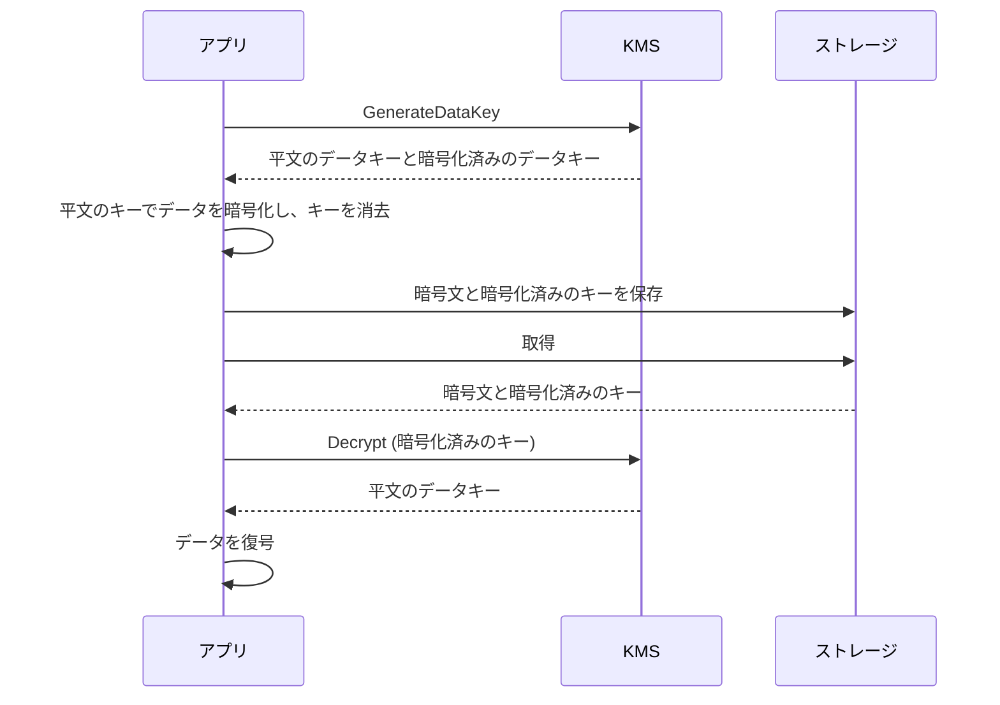

# AWS KMS

暗号鍵を作成、管理し、データの暗号化と復号に使うためのサービスです。AWS サービスのデータを保存時に暗号化するときも、アプリで独自に暗号化するときも、鍵の管理を任せられます。

[](../assets/diagrams/kms-services.png)

## 保存時と転送時の暗号化 {#at-rest-in-transit}

| 観点 | 保存時の暗号化 | 転送時の暗号化 |
| --- | --- | --- |
| 守る対象 | ディスクやストレージ上のデータ | ネットワークを流れるデータ |
| 主な仕組み | KMS、S3 の SSE、EBS、RDS の暗号化 | TLS（HTTPS） |
| 防ぐもの | 媒体やバックアップからの漏えい | 盗聴、改ざん |
| 開発者の作業 | キーの選択、権限の設定 | HTTPS の強制、証明書の管理 |

保存時と転送時は別の対策なので、両方必要です。

| サービス | 保存時 | 転送時の強制の例 |
| --- | --- | --- |
| S3 | 新規オブジェクトは既定で SSE-S3 | バケットポリシーで `aws:SecureTransport` が `false` のリクエストを拒否 |
| DynamoDB | 常に暗号化。既定は AWS 所有キー | SDK は HTTPS を使用 |
| RDS | 作成時に KMS キーを指定 | クライアントから TLS で接続 |
| Lambda | 環境変数は常に暗号化 | 暗号化ヘルパーで追加の保護 |

```json
{
  "Effect": "Deny",
  "Principal": "*",
  "Action": "s3:*",
  "Resource": ["arn:aws:s3:::my-bucket", "arn:aws:s3:::my-bucket/*"],
  "Condition": {"Bool": {"aws:SecureTransport": "false"}}
}
```

TLS の証明書については [証明書と WAF](certificates.md) を参照してください。

## KMS キーの種類 {#key-types}

管理主体で 3 種類に分かれます。

| 観点 | カスタマー管理キー | AWS 管理キー | AWS 所有キー |
| --- | --- | --- | --- |
| 作成先 | 自分のアカウント | 自分のアカウント | AWS のサービスアカウント |
| キーポリシー | 自分で管理 | サービスが管理（閲覧は可） | 見えない |
| CloudTrail での監査 | 可 | 可 | 不可 |
| 自動ローテーション | 任意 | 必須（約 1 年ごと） | サービスが決定 |
| 暗号 API の直接呼び出し | 可 | 不可（サービス経由のみ） | 不可 |
| クロスアカウント共有 | 可 | 不可 | サービスによる |
| 料金 | 月額と利用料 | 月額なし。利用料はサービスによる | なし |
| 見分け方 | `DescribeKey` の `KeyManager` が `CUSTOMER` | `KeyManager` が `AWS`、別名が `aws/サービス名` | 一覧に出ない |

監査、権限の制御、クロスアカウント共有が必要ならカスタマー管理キーを選びます。

用途では次のように分かれます。

| 種類 | 用途 | 主な操作 |
| --- | --- | --- |
| 対称（`SYMMETRIC_DEFAULT`） | 暗号化と復号の標準 | `Encrypt`, `Decrypt`, `GenerateDataKey` |
| 非対称（RSA） | KMS の外で公開鍵を使って暗号化、署名 | `Encrypt`, `Decrypt`, `Sign`, `Verify` |
| 非対称（楕円曲線） | 署名、鍵共有 | `Sign`, `Verify`, `DeriveSharedSecret` |
| HMAC | メッセージ認証コード | `GenerateMac`, `VerifyMac` |

キーの仕様は作成後に変更できません。データキーの生成には対称キーが必要です。また、複数リージョンで同じ鍵を使う場合は、マルチリージョンキー（ID が `mrk-` で始まる）があります。

## キーポリシー、IAM、グラント {#access-control}

KMS キーの権限は、キーポリシーが中心です。他の多くのリソースと違い、キーポリシーで許可しない限り、同じアカウントの主体でも使えません。

| 仕組み | 特徴 | 使いどころ |
| --- | --- | --- |
| キーポリシー | すべてのキーに必須。主たる権限の定義 | 基本の管理者、利用者の定義 |
| IAM ポリシー | キーポリシーで許可されたときだけ有効 | アカウント内での権限の委譲 |
| グラント | 特定の主体に一時的に権限を委譲。条件も付けられる | AWS サービスの代理利用、動的な委譲 |

既定のキーポリシーの中心は次の文です。これはアカウントのルートユーザーだけに許可するものではなく、「IAM ポリシーでこのキーの権限を与えられるようにする」という意味を持ちます。

```json
{
  "Sid": "Enable IAM User Permissions",
  "Effect": "Allow",
  "Principal": {"AWS": "arn:aws:iam::111122223333:root"},
  "Action": "kms:*",
  "Resource": "*"
}
```

この文がないと、IAM ポリシーで許可しても効きません（IAM の拒否は効きます）。

- API で作成して指定しない場合、既定のポリシーはこの文だけ。
- コンソールで作成すると、キー管理者とキー利用者の文も追加される。
- キー管理者はキーを管理できるが、暗号操作はできない。
- `kms:ViaService` で、特定の AWS サービス経由の利用に限定できる。
- `kms:GrantIsForAWSResource` で、AWS サービス向けのグラントだけを許可できる。

グラントは、`CreateGrant` で作り、`RetireGrant` や `RevokeGrant` で削除します。作成直後は結果整合性の影響で反映に時間がかかることがあり、グラントトークンを使うとすぐに利用できます。

## 主な API {#api-operations}

| API | 動作 | 必要な権限 | 注意点 |
| --- | --- | --- | --- |
| `Encrypt` | 平文を暗号化 | `kms:Encrypt` | 対称キーで最大 4,096 バイト |
| `Decrypt` | 暗号文を復号 | `kms:Decrypt` | 対称キーは `KeyId` を省略可 |
| `GenerateDataKey` | データキーを生成。平文と暗号化済みを返す | `kms:GenerateDataKey` | `KeySpec` または `NumberOfBytes` が必須 |
| `GenerateDataKeyWithoutPlaintext` | 暗号化済みのデータキーだけを返す | `kms:GenerateDataKeyWithoutPlaintext` | 後で使うときに `Decrypt` |
| `ReEncrypt` | 平文を見せずに別のキーで再暗号化 | `kms:ReEncryptFrom`, `kms:ReEncryptTo` | キーの切り替えに使う |
| `DescribeKey` | キーの情報を取得 | `kms:DescribeKey` | |

非対称キーでの `Encrypt` は、さらに上限が小さくなります。たとえば `RSA_2048` と `RSAES_OAEP_SHA_256` の組み合わせでは 190 バイトです。

```python
import boto3

kms = boto3.client("kms")
KEY = "alias/app-key"
CONTEXT = {"app": "billing"}

encrypted = kms.encrypt(
    KeyId=KEY,
    Plaintext=b"small secret",
    EncryptionContext=CONTEXT,
)["CiphertextBlob"]

plain = kms.decrypt(
    CiphertextBlob=encrypted,
    EncryptionContext=CONTEXT,
)["Plaintext"]
```

## エンベロープ暗号化 {#envelope-encryption}

`Encrypt` は最大 4 KB までしか扱えません。大きなデータは、データキーで暗号化し、そのデータキーを KMS キーで暗号化します。これがエンベロープ暗号化です。KMS を呼ぶ回数が減り、暗号鍵自体は KMS の外に出ません。



次の例は、仕組みを説明するためのコードです（`cryptography` ライブラリを使用）。実際には AWS Encryption SDK を使うほうが安全です。

```python
import os
import boto3
from cryptography.hazmat.primitives.ciphers.aead import AESGCM

kms = boto3.client("kms")
CONTEXT = {"purpose": "invoice"}


def encrypt(data: bytes) -> dict:
    key = kms.generate_data_key(
        KeyId="alias/app-key",
        KeySpec="AES_256",
        EncryptionContext=CONTEXT,
    )
    nonce = os.urandom(12)
    ciphertext = AESGCM(key["Plaintext"]).encrypt(nonce, data, None)
    return {
        "ciphertext": ciphertext,
        "nonce": nonce,
        "encrypted_key": key["CiphertextBlob"],  # データと一緒に保存する
    }


def decrypt(item: dict) -> bytes:
    plain_key = kms.decrypt(
        CiphertextBlob=item["encrypted_key"],
        EncryptionContext=CONTEXT,
    )["Plaintext"]
    return AESGCM(plain_key).decrypt(item["nonce"], item["ciphertext"], None)
```

| 確認事項 | 内容 |
| --- | --- |
| 保存するもの | 暗号文と暗号化済みのデータキー |
| 保存しないもの | 平文のデータキー。使い終えたらメモリから消す |
| 同じ暗号化済みキーの復号 | KMS の権限がある人だけ |
| キーの `KeySpec` | `AES_128` か `AES_256` |

## 暗号化コンテキスト {#encryption-context}

暗号化コンテキストは、暗号化のときに渡す秘密でないキーと値の組で、追加認証データとして暗号文に結び付けられます。対称キーでのみ使えます。

- 復号では、暗号化のときと完全に一致（大文字と小文字も区別）する値を渡す。違うと `InvalidCiphertextException` になる。
- CloudTrail に平文で記録されるので、監査に役立つが、機密情報は入れない。
- ポリシーの条件 `kms:EncryptionContext:キー名` で、利用を制限できる。

```json
{
  "Effect": "Allow",
  "Principal": {"AWS": "arn:aws:iam::111122223333:role/BillingApp"},
  "Action": "kms:Decrypt",
  "Resource": "*",
  "Condition": {
    "StringEquals": {"kms:EncryptionContext:app": "billing"}
  }
}
```

S3 や Secrets Manager など、多くの AWS サービスも独自の暗号化コンテキストを使います。

## ThrottlingException とキャッシュ {#throttling}

リクエストが上限を超えると、KMS は `ThrottlingException` を返します（HTTP 400）。

暗号操作の上限は対称キーで共有され、アカウントとリージョンごとに計算されます。AWS サービスが代理で呼ぶ分も含みます。

| リージョン | 対称キーの暗号操作の既定の上限（秒間） |
| --- | --- |
| us-east-1, us-west-2, eu-west-1 | 100,000 |
| ap-northeast-1 など一部 | 20,000 |
| その他 | 10,000 |

RSA と楕円曲線のキーは、それぞれ別枠で 1,000 です。クロスアカウントで使うと、キーの所有者ではなく呼び出し側のアカウントが計上されます。AWS 所有キーの利用は計上されません。

対処の順序は次のとおりです。

1. エクスポネンシャルバックオフで再試行する。SDK の再試行設定は [SDK と耐障害性](sdk-resilience.md) を参照。
2. S3 なら S3 バケットキーで KMS 呼び出しを減らす。
3. データキーをキャッシュする。AWS Encryption SDK のデータキーキャッシュや Hierarchical keyring を使う。
4. Service Quotas で上限の引き上げを申請する。

### データキーキャッシュ {#data-key-caching}

AWS Encryption SDK は、既定では暗号化のたびに新しいデータキーを作ります。キャッシュすると再利用できますが、同じ鍵で暗号化するデータが増えるトレードオフがあります。

| 向いている条件 | 設定すべきしきい値 |
| --- | --- |
| データキーを再利用できる | キャッシュの最大有効期間 |
| 大量のデータキーを生成する | 1 つのキーで暗号化する最大バイト数 |
| KMS の呼び出しが遅い、高い、上限に近い | 1 つのキーで暗号化する最大メッセージ数 |

## クライアント側とサーバー側の暗号化 {#client-vs-server-side}

| 観点 | サーバー側暗号化 | クライアント側暗号化 |
| --- | --- | --- |
| 暗号化する場所 | AWS サービスの中 | データを送る前のアプリの中 |
| サービスから見えるもの | 処理中は平文 | 暗号文のみ |
| 実装の負担 | 小さい。設定のみ | 大きい。鍵と形式の管理が必要 |
| 検索や集計 | そのまま使える | サービス側で中身を扱えない |
| 向いている場面 | 多くの場合の標準 | AWS にも平文を見せたくない要件 |
| 例 | SSE-S3、SSE-KMS、DynamoDB、EBS | AWS Encryption SDK、S3 Encryption Client |

### S3 の暗号化オプション {#s3-encryption}

| 方式 | 鍵の管理 | 使う場面 |
| --- | --- | --- |
| SSE-S3 | S3 が管理 | 既定。特別な要件がないとき |
| SSE-KMS | KMS キー | 権限の分離、CloudTrail での監査 |
| DSSE-KMS | KMS キーで 2 層 | 2 層の暗号化が求められるとき |
| SSE-C | リクエストごとに自分の鍵を渡す | 鍵を AWS に保存したくないとき |
| クライアント側 | アプリが管理 | S3 に平文を渡したくないとき |

### AWS Encryption SDK {#encryption-sdk}

クライアント側の暗号化ライブラリで、エンベロープ暗号化を代わりに行います。暗号文と暗号化済みのデータキーを 1 つのメッセージ形式にまとめるので、データキーを別に管理する必要がありません。

```python
import aws_encryption_sdk
from aws_encryption_sdk import CommitmentPolicy

client = aws_encryption_sdk.EncryptionSDKClient(
    commitment_policy=CommitmentPolicy.REQUIRE_ENCRYPT_REQUIRE_DECRYPT
)
provider = aws_encryption_sdk.StrictAwsKmsMasterKeyProvider(
    key_ids=["arn:aws:kms:ap-northeast-1:111122223333:key/1234abcd-12ab-34cd-56ef-1234567890ab"]
)

ciphertext, _ = client.encrypt(source=b"large data", key_provider=provider)
plaintext, _ = client.decrypt(source=ciphertext, key_provider=provider)
```

新しい版では、キーリングを使う方法も選べます。Encryption SDK は他のライブラリと形式の互換性がなく、DynamoDB Encryption Client や S3 のクライアント側暗号化で作った暗号文は復号できません。

## 暗号鍵でのデータの暗号化と復号 {#use-keys}

用途ごとの選び方です。

| 目的 | 方法 |
| --- | --- |
| 4 KB 以下の少量データ | `Encrypt` と `Decrypt` |
| 大きなデータ | エンベロープ暗号化。AWS Encryption SDK を推奨 |
| 今は使わないデータキーを準備 | `GenerateDataKeyWithoutPlaintext` |
| 別のキーへの切り替え | `ReEncrypt` |
| 署名と検証 | 非対称キーで `Sign` と `Verify` |
| AWS サービス上のデータ | サービスの暗号化設定でキーを指定 |

## Lambda 環境変数の暗号化 {#lambda-env-encryption}

Lambda の環境変数は、常にサーバー側で KMS により保存時に暗号化されます。既定は AWS 管理キーで、設定は不要です。

| 方法 | 動作 | 必要な権限 |
| --- | --- | --- |
| 既定（AWS 管理キー） | デプロイ時に暗号化、実行環境では平文で参照 | 追加なし |
| カスタマー管理キー | キーのローテーションや権限を自分で管理 | 設定する人に `kms:CreateGrant`, `kms:Encrypt`、閲覧する人に `kms:Decrypt` |
| 転送時の暗号化ヘルパー | コンソールでクライアント側でも暗号化。値は暗号文のまま関数に届く | 実行ロールに `kms:Decrypt` |

ヘルパーを使うと、コードで復号が必要になります。

```python
import base64
import os
import boto3

kms = boto3.client("kms")
ENCRYPTED = os.environ["DB_PASSWORD"]

# コールドスタート時に 1 回だけ復号する
DB_PASSWORD = kms.decrypt(
    CiphertextBlob=base64.b64decode(ENCRYPTED),
    EncryptionContext={
        "LambdaFunctionName": os.environ["AWS_LAMBDA_FUNCTION_NAME"]
    },
)["Plaintext"].decode()
```

カスタマー管理キーへの `kms:Decrypt` がないユーザーは、関数を管理できても環境変数を閲覧できません。特定のユーザーに見せたくないときは、この性質を使います。

データベースの認証情報は、環境変数ではなく [Secrets Manager](secrets.md) に置くのが AWS の推奨です。

## アカウントをまたぐ暗号化 {#cross-account}

別のアカウントのキーを使うには、次の両方が必要です。

1. キーを所有するアカウントで、キーポリシーに相手のアカウントまたはロールを許可する。
2. 利用するアカウントで、IAM ポリシーで主体に許可する。

```json
{
  "Sid": "AllowExternalAccount",
  "Effect": "Allow",
  "Principal": {"AWS": "arn:aws:iam::444455556666:root"},
  "Action": ["kms:Decrypt", "kms:GenerateDataKey*", "kms:DescribeKey"],
  "Resource": "*"
}
```

```json
{
  "Effect": "Allow",
  "Action": ["kms:Decrypt", "kms:GenerateDataKey*", "kms:DescribeKey"],
  "Resource": "arn:aws:kms:ap-northeast-1:111122223333:key/1234abcd-12ab-34cd-56ef-1234567890ab"
}
```

- 呼び出しでは、キー ARN または別名 ARN を指定する。キー ID や別名だけだと、自分のアカウントのキーと解釈される。
- 使えるのは暗号操作と `CreateGrant`、`DescribeKey`、`GetKeyRotationStatus`、`GetPublicKey`、`ListGrants`、`RetireGrant`、`RevokeGrant` などに限られる。`ScheduleKeyDeletion` のような管理操作を許可しても効かない。
- AWS 管理キーのポリシーは変更できないので、共有できない。共有するならカスタマー管理キーで暗号化する。
- たとえば RDS のスナップショットを共有するなら、AWS 管理キーではなくカスタマー管理キーが必要。

## キーのローテーション {#key-rotation}

ローテーションは、キーの ID や ARN を変えずに、中の鍵素材を新しくします。古い素材は保持されるので、以前の暗号文も復号でき、コードの変更は不要です。

```python
import boto3

kms = boto3.client("kms")
key_id = "1234abcd-12ab-34cd-56ef-1234567890ab"

kms.enable_key_rotation(KeyId=key_id, RotationPeriodInDays=180)  # 有効化
kms.get_key_rotation_status(KeyId=key_id)                        # 確認
kms.rotate_key_on_demand(KeyId=key_id)                           # 今すぐ実行
kms.list_key_rotations(KeyId=key_id)                             # 履歴
kms.disable_key_rotation(KeyId=key_id)                           # 無効化
```

| 方式 | 対象 | 仕様 |
| --- | --- | --- |
| 自動 | 対称のカスタマー管理キー（KMS 生成の鍵素材） | 既定 365 日。90〜2560 日で指定 |
| オンデマンド | 対称キー（KMS 生成またはインポート） | キーごとに最大 25 回。自動の予定は変えない |
| 手動 | 非対称、HMAC、カスタムキーストアのキー | 新しいキーを作り、別名を切り替える |
| AWS 管理キー | 変更不可 | 約 1 年ごとに自動 |

- 無効化すると、その時点の鍵素材を使い続ける。古い素材は削除されない。
- 再度有効化すると、有効化した日を基準にローテーションする。
- 無効化されたキーや削除待ちのキーはローテーションされない。
- ローテーションは既存のデータを再暗号化しない。流出したデータキーの影響も消えない。
- 実行すると EventBridge に `KMS CMK Rotation` イベントが、CloudTrail に `RotateKey` イベントが記録される。
- 料金は、最初の 2 回のローテーションで増え、それ以降は増えない。

## 別名とキーの削除 {#aliases}

別名（エイリアス）は KMS キーの覚えやすい名前で、`alias/` で始まります。

- 別名はキーのプロパティではなく別のリソース。`UpdateAlias` で指し先を切り替えられる。
- 手動ローテーションでは、コードを変えずに別名の指し先を新しいキーに変える。
- 別名はアカウントとリージョンごと。同じ名前を各リージョンで作れば、コードを共通化できる。
- `alias/aws/` は AWS 管理キー用に予約されている。
- 別のアカウントのキーは、別名 ARN で指定する。

キーの削除はすぐには実行されません。`ScheduleKeyDeletion` で 7〜30 日（既定 30 日）の待機期間を置き、その間は `CancelKeyDeletion` で取り消せます。削除すると、そのキーの暗号文は復号できなくなります。迷ったら `DisableKey` で無効化します。

## サービスでの KMS の利用 {#service-integration}

| サービス | 既定 | KMS の使い方 | 注意点 |
| --- | --- | --- | --- |
| S3（SSE-KMS） | SSE-S3 | アップロードで `GenerateDataKey`、ダウンロードで `Decrypt` | 上限に達しやすい。S3 バケットキーで KMS リクエストのコストを最大 99% 削減 |
| DynamoDB | AWS 所有キー | テーブルごとにキーの種類を選択 | 常に暗号化され、無効にできない |
| RDS | 作成時に選択 | ストレージ、ログ、バックアップ、スナップショットを暗号化 | 作成後にキーを変更できない |
| EBS | 設定による | グラントを作ってデータキーを利用 | キーの利用者に `kms:CreateGrant` が必要 |
| Lambda | AWS 管理キー | 環境変数を暗号化 | 上記のとおり |
| Secrets Manager | `aws/secretsmanager` | シークレットを暗号化 | カスタマー管理キーなら `kms:Decrypt` も必要 |
| Parameter Store | `aws/ssm` | スタンダードは直接暗号化、アドバンストはエンベロープ暗号化 | `WithDecryption=True` で復号 |
| SQS | 設定による | データキーでメッセージを暗号化 | AWS 管理キーで暗号化したキューは別アカウントの Lambda を呼べない |

S3 バケットキーを有効にすると、暗号化コンテキストはオブジェクト ARN ではなくバケット ARN になります。ポリシーでオブジェクト ARN を条件にしているなら修正します。

SSE-KMS のオブジェクトを読むには、`s3:GetObject` に加えて KMS キーの `kms:Decrypt` も必要です。権限エラーの原因としてよく問われます。

## 試験のポイント {#exam-points}

| こう問われたら | 答え |
| --- | --- |
| 4 KB を超えるデータを KMS で暗号化 | `GenerateDataKey` によるエンベロープ暗号化 |
| 大量の `GenerateDataKey` で `ThrottlingException` | データキーキャッシュ、バックオフ、上限の引き上げ |
| S3 の SSE-KMS でコストや呼び出し回数を減らす | S3 バケットキー |
| 誰がいつ鍵を使ったか監査したい | カスタマー管理キーと CloudTrail |
| AWS にも平文を見せたくない | クライアント側暗号化（AWS Encryption SDK） |
| IAM で許可したのにキーを使えない | キーポリシーに、IAM を有効にする文や主体の許可がない |
| 別アカウントのキーを使う | キーポリシーと IAM の両方の許可、キー ARN の指定 |
| AWS 管理キーのデータを他アカウントと共有 | できない。カスタマー管理キーで再暗号化する |
| 自動ローテーションの期間 | 既定 365 日。90〜2560 日で指定できる |
| ローテーション後に古いデータは | 古い鍵素材は保持され、そのまま復号できる |
| 非対称キーのローテーション | 自動は不可。新しいキーと別名の切り替え |
| 復号で `InvalidCiphertextException` | 暗号化コンテキストの不一致など |
| AWS サービスに一時的に権限を委譲 | グラント |
| 特定サービス経由でのみ鍵を使わせる | `kms:ViaService` |
| 環境変数の暗号化ヘルパーを使う Lambda の権限 | 実行ロールに `kms:Decrypt` |
| キーの削除の待機期間 | 7〜30 日。既定は 30 日 |

## 関連ページ {#related}

- [IAM と STS](iam.md): ポリシー評価とクロスアカウント
- [Secrets Manager と Parameter Store](secrets.md): シークレットの暗号化
- [証明書と WAF](certificates.md): 転送時の暗号化
- [S3](s3.md): サーバー側暗号化の詳細
- [Lambda](lambda.md): 環境変数
- [DynamoDB](dynamodb.md): 保存時の暗号化

## 参考 {#references}

- [AWS KMS keys](https://docs.aws.amazon.com/kms/latest/developerguide/concepts.html)
- [Default key policy](https://docs.aws.amazon.com/kms/latest/developerguide/key-policy-default.html)
- [Grants in AWS KMS](https://docs.aws.amazon.com/kms/latest/developerguide/grants.html)
- [Encrypt API](https://docs.aws.amazon.com/kms/latest/APIReference/API_Encrypt.html)
- [GenerateDataKey API](https://docs.aws.amazon.com/kms/latest/APIReference/API_GenerateDataKey.html)
- [Encryption context](https://docs.aws.amazon.com/kms/latest/developerguide/encrypt_context.html)
- [Request quotas](https://docs.aws.amazon.com/kms/latest/developerguide/requests-per-second.html)
- [Throttling AWS KMS requests](https://docs.aws.amazon.com/kms/latest/developerguide/throttling.html)
- [Rotate AWS KMS keys](https://docs.aws.amazon.com/kms/latest/developerguide/rotate-keys.html)
- [EnableKeyRotation API](https://docs.aws.amazon.com/kms/latest/APIReference/API_EnableKeyRotation.html)
- [Perform on-demand key rotation](https://docs.aws.amazon.com/kms/latest/developerguide/rotating-keys-on-demand.html)
- [Allowing users in other accounts to use a KMS key](https://docs.aws.amazon.com/kms/latest/developerguide/key-policy-modifying-external-accounts.html)
- [Aliases in AWS KMS](https://docs.aws.amazon.com/kms/latest/developerguide/kms-alias.html)
- [ScheduleKeyDeletion API](https://docs.aws.amazon.com/kms/latest/APIReference/API_ScheduleKeyDeletion.html)
- [AWS Encryption SDK](https://docs.aws.amazon.com/encryption-sdk/latest/developer-guide/introduction.html)
- [Data key caching](https://docs.aws.amazon.com/encryption-sdk/latest/developer-guide/data-key-caching.html)
- [Securing Lambda environment variables](https://docs.aws.amazon.com/lambda/latest/dg/configuration-envvars-encryption.html)
- [Protecting data with encryption in Amazon S3](https://docs.aws.amazon.com/AmazonS3/latest/userguide/UsingEncryption.html)
- [Reducing the cost of SSE-KMS with S3 Bucket Keys](https://docs.aws.amazon.com/AmazonS3/latest/userguide/bucket-key.html)
- [DynamoDB encryption at rest](https://docs.aws.amazon.com/amazondynamodb/latest/developerguide/EncryptionAtRest.html)
- [Encrypting Amazon RDS resources](https://docs.aws.amazon.com/AmazonRDS/latest/UserGuide/Overview.Encryption.html)
- [Parameter Store SecureString and KMS](https://docs.aws.amazon.com/systems-manager/latest/userguide/secure-string-parameter-kms-encryption.html)
- [Amazon SQS server-side encryption](https://docs.aws.amazon.com/AWSSimpleQueueService/latest/SQSDeveloperGuide/sqs-server-side-encryption.html)
