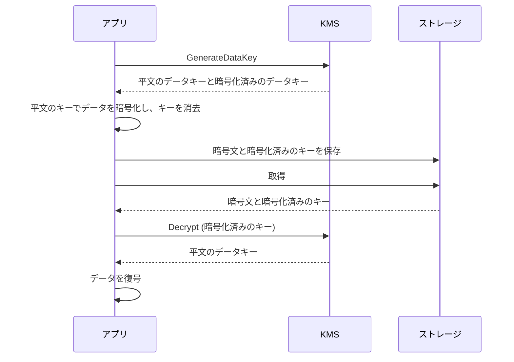

# AWS KMS

[:material-sprout: CLF](../courses/clf/services.md){ .exam-badge .exam-foundational } [:material-sprout: AIF](../courses/aif/services.md){ .exam-badge .exam-foundational } [:material-certificate: SAA](../courses/saa/services.md){ .exam-badge .exam-associate } [:material-certificate: DVA](../courses/dva/services.md){ .exam-badge .exam-associate } [:material-certificate: SOA](../courses/soa/services.md){ .exam-badge .exam-associate } [:material-certificate: DEA](../courses/dea/services.md){ .exam-badge .exam-associate } [:material-certificate: MLA](../courses/mla/services.md){ .exam-badge .exam-associate } [:material-star-circle: SAP](../courses/sap/services.md){ .exam-badge .exam-professional } [:material-star-circle: DOP](../courses/dop/services.md){ .exam-badge .exam-professional } [:material-star-circle: AIP](../courses/aip/services.md){ .exam-badge .exam-professional } [:material-target: SCS](../courses/scs/services.md){ .exam-badge .exam-specialty }

暗号鍵を作成、管理し、データの暗号化と復号に使うためのサービスです。AWS サービスのデータを保存時に暗号化するときも、アプリで独自に暗号化するときも、鍵の管理を任せられます。

[](../assets/diagrams/kms-services.png)

## 保存時と転送時の暗号化 {#at-rest-in-transit}

| 観点 | 保存時の暗号化 | 転送時の暗号化 |
| --- | --- | --- |
| 守る対象 | ディスクやストレージ上のデータ | ネットワークを流れるデータ |
| 主な仕組み | KMS、S3 の SSE、EBS、RDS の暗号化 | TLS（HTTPS） |
| 防ぐもの | 媒体やバックアップからの漏えい | 盗聴、改ざん |
| 開発者の作業 | キーの選択、権限の設定 | HTTPS の強制、証明書の管理 |

保存時と転送時は別の対策なので、両方必要です。

| サービス | 保存時 | 転送時の強制の例 |
| --- | --- | --- |
| S3 | 新規オブジェクトは既定で SSE-S3 | バケットポリシーで `aws:SecureTransport` が `false` のリクエストを拒否 |
| DynamoDB | 常に暗号化。既定は AWS 所有キー | SDK は HTTPS を使用 |
| RDS | 作成時に KMS キーを指定 | クライアントから TLS で接続 |
| Lambda | 環境変数は常に暗号化 | 暗号化ヘルパーで追加の保護 |

```json
{
  "Effect": "Deny",
  "Principal": "*",
  "Action": "s3:*",
  "Resource": ["arn:aws:s3:::my-bucket", "arn:aws:s3:::my-bucket/*"],
  "Condition": {"Bool": {"aws:SecureTransport": "false"}}
}
```

TLS の証明書については [証明書と WAF](certificates.md) を参照してください。

## KMS キーの種類 {#key-types}

管理主体で 3 種類に分かれます。

| 観点 | カスタマー管理キー | AWS 管理キー | AWS 所有キー |
| --- | --- | --- | --- |
| 作成先 | 自分のアカウント | 自分のアカウント | AWS のサービスアカウント |
| キーポリシー | 自分で管理 | サービスが管理（閲覧は可） | 見えない |
| CloudTrail での監査 | 可 | 可 | 不可 |
| 自動ローテーション | 任意 | 必須（約 1 年ごと） | サービスが決定 |
| 暗号 API の直接呼び出し | 可 | 不可（サービス経由のみ） | 不可 |
| クロスアカウント共有 | 可 | 不可 | サービスによる |
| 料金 | 月額と利用料 | 月額なし。利用料はサービスによる | なし |
| 見分け方 | `DescribeKey` の `KeyManager` が `CUSTOMER` | `KeyManager` が `AWS`、別名が `aws/サービス名` | 一覧に出ない |

キーポリシーやローテーションを自分で管理したいとき、暗号 API を直接呼びたいとき、クロスアカウントで共有したいときは、カスタマー管理キーを選びます。CloudTrail での監査は AWS 管理キーでもできます。

用途では次のように分かれます。

| 種類 | 用途 | 主な操作 |
| --- | --- | --- |
| 対称（`SYMMETRIC_DEFAULT`） | 暗号化と復号の標準 | `Encrypt`, `Decrypt`, `GenerateDataKey` |
| 非対称（RSA） | KMS の外で公開鍵を使って暗号化、署名 | `Encrypt`, `Decrypt`, `Sign`, `Verify` |
| 非対称（楕円曲線） | 署名、鍵共有 | `Sign`, `Verify`, `DeriveSharedSecret` |
| HMAC | メッセージ認証コード | `GenerateMac`, `VerifyMac` |

キーの仕様は作成後に変更できません。データキーの生成には対称キーが必要です。また、複数リージョンで同じ鍵を使う場合は、マルチリージョンキー（ID が `mrk-` で始まる）があります。

## キーポリシー、IAM、グラント {#access-control}

KMS キーの権限は、キーポリシーが中心です。他の多くのリソースと違い、キーポリシーで許可しない限り、同じアカウントの主体でも使えません。

| 仕組み | 特徴 | 使いどころ |
| --- | --- | --- |
| キーポリシー | すべてのキーに必須。主たる権限の定義 | 基本の管理者、利用者の定義 |
| IAM ポリシー | キーポリシーで許可されたときだけ有効 | アカウント内での権限の委譲 |
| グラント | 特定の主体に一時的に権限を委譲。条件も付けられる | AWS サービスの代理利用、動的な委譲 |

既定のキーポリシーの中心は次の文です。これはアカウントのルートユーザーだけに許可するものではなく、「IAM ポリシーでこのキーの権限を与えられるようにする」という意味を持ちます。

```json
{
  "Sid": "Enable IAM User Permissions",
  "Effect": "Allow",
  "Principal": {"AWS": "arn:aws:iam::111122223333:root"},
  "Action": "kms:*",
  "Resource": "*"
}
```

この文がないと、IAM ポリシーで許可しても効きません（IAM の拒否は効きます）。

- API で作成して指定しない場合、既定のポリシーはこの文だけ。
- コンソールで作成すると、キー管理者とキー利用者の文も追加される。
- キー管理者はキーを管理できるが、暗号操作はできない。
- `kms:ViaService` で、特定の AWS サービス経由の利用に限定できる。
- `kms:GrantIsForAWSResource` で、AWS サービス向けのグラントだけを許可できる。

グラントは、`CreateGrant` で作り、`RetireGrant` や `RevokeGrant` で削除します。作成直後は結果整合性の影響で反映に時間がかかることがあり、グラントトークンを使うとすぐに利用できます。

## 主な API {#api-operations}

| API | 動作 | 必要な権限 | 注意点 |
| --- | --- | --- | --- |
| `Encrypt` | 平文を暗号化 | `kms:Encrypt` | 対称キーで最大 4,096 バイト |
| `Decrypt` | 暗号文を復号 | `kms:Decrypt` | 対称キーは `KeyId` を省略可 |
| `GenerateDataKey` | データキーを生成。平文と暗号化済みを返す | `kms:GenerateDataKey` | `KeySpec` または `NumberOfBytes` が必須 |
| `GenerateDataKeyWithoutPlaintext` | 暗号化済みのデータキーだけを返す | `kms:GenerateDataKeyWithoutPlaintext` | 後で使うときに `Decrypt` |
| `ReEncrypt` | 平文を見せずに別のキーで再暗号化 | `kms:ReEncryptFrom`, `kms:ReEncryptTo` | キーの切り替えに使う |
| `DescribeKey` | キーの情報を取得 | `kms:DescribeKey` | |

非対称キーでの `Encrypt` は、さらに上限が小さくなります。たとえば `RSA_2048` と `RSAES_OAEP_SHA_256` の組み合わせでは 190 バイトです。

```python
import boto3

kms = boto3.client("kms")
KEY = "alias/app-key"
CONTEXT = {"app": "billing"}

encrypted = kms.encrypt(
    KeyId=KEY,
    Plaintext=b"small secret",
    EncryptionContext=CONTEXT,
)["CiphertextBlob"]

plain = kms.decrypt(
    CiphertextBlob=encrypted,
    EncryptionContext=CONTEXT,
)["Plaintext"]
```

## エンベロープ暗号化 {#envelope-encryption}

`Encrypt` は最大 4 KB までしか扱えません。大きなデータは、データキーで暗号化し、そのデータキーを KMS キーで暗号化します。これがエンベロープ暗号化です。KMS を呼ぶ回数が減り、暗号鍵自体は KMS の外に出ません。



次の例は、仕組みを説明するためのコードです（`cryptography` ライブラリを使用）。実際には AWS Encryption SDK を使うほうが安全です。

```python
import os
import boto3
from cryptography.hazmat.primitives.ciphers.aead import AESGCM

kms = boto3.client("kms")
CONTEXT = {"purpose": "invoice"}


def encrypt(data: bytes) -> dict:
    key = kms.generate_data_key(
        KeyId="alias/app-key",
        KeySpec="AES_256",
        EncryptionContext=CONTEXT,
    )
    nonce = os.urandom(12)
    ciphertext = AESGCM(key["Plaintext"]).encrypt(nonce, data, None)
    return {
        "ciphertext": ciphertext,
        "nonce": nonce,
        "encrypted_key": key["CiphertextBlob"],  # データと一緒に保存する
    }


def decrypt(item: dict) -> bytes:
    plain_key = kms.decrypt(
        CiphertextBlob=item["encrypted_key"],
        EncryptionContext=CONTEXT,
    )["Plaintext"]
    return AESGCM(plain_key).decrypt(item["nonce"], item["ciphertext"], None)
```

| 確認事項 | 内容 |
| --- | --- |
| 保存するもの | 暗号文と暗号化済みのデータキー |
| 保存しないもの | 平文のデータキー。使い終えたらメモリから消す |
| 同じ暗号化済みキーの復号 | KMS の権限がある人だけ |
| キーの `KeySpec` | `AES_128` か `AES_256` |

## 暗号化コンテキスト {#encryption-context}

暗号化コンテキストは、暗号化のときに渡す秘密でないキーと値の組で、追加認証データとして暗号文に結び付けられます。対称キーでのみ使えます。

- 復号では、暗号化のときと完全に一致（大文字と小文字も区別）する値を渡す。違うと `InvalidCiphertextException` になる。
- CloudTrail に平文で記録されるので、監査に役立つが、機密情報は入れない。
- ポリシーの条件 `kms:EncryptionContext:キー名` で、利用を制限できる。

```json
{
  "Effect": "Allow",
  "Principal": {"AWS": "arn:aws:iam::111122223333:role/BillingApp"},
  "Action": "kms:Decrypt",
  "Resource": "*",
  "Condition": {
    "StringEquals": {"kms:EncryptionContext:app": "billing"}
  }
}
```

S3 や Secrets Manager など、多くの AWS サービスも独自の暗号化コンテキストを使います。

## ThrottlingException とキャッシュ {#throttling}

リクエストが上限を超えると、KMS は `ThrottlingException` を返します（HTTP 400）。

暗号操作の上限は対称キーで共有され、アカウントとリージョンごとに計算されます。AWS サービスが代理で呼ぶ分も含みます。

| リージョン | 対称キーの暗号操作の既定の上限（秒間） |
| --- | --- |
| us-east-1, us-west-2, eu-west-1 | 100,000 |
| ap-northeast-1 など一部 | 20,000 |
| その他 | 10,000 |

RSA と楕円曲線のキーは、それぞれ別枠で 1,000 です。クロスアカウントで使うと、キーの所有者ではなく呼び出し側のアカウントが計上されます。AWS 所有キーの利用は計上されません。

対処の順序は次のとおりです。

1. エクスポネンシャルバックオフで再試行する。SDK の再試行設定は [SDK と耐障害性](sdk-resilience.md) を参照。
2. S3 なら S3 バケットキーで KMS 呼び出しを減らす。
3. データキーをキャッシュする。AWS Encryption SDK のデータキーキャッシュや Hierarchical keyring を使う。
4. Service Quotas で上限の引き上げを申請する。

### データキーキャッシュ {#data-key-caching}

AWS Encryption SDK は、既定では暗号化のたびに新しいデータキーを作ります。キャッシュすると再利用できますが、同じ鍵で暗号化するデータが増えるトレードオフがあります。

| 向いている条件 | 設定すべきしきい値 |
| --- | --- |
| データキーを再利用できる | キャッシュの最大有効期間 |
| 大量のデータキーを生成する | 1 つのキーで暗号化する最大バイト数 |
| KMS の呼び出しが遅い、高い、上限に近い | 1 つのキーで暗号化する最大メッセージ数 |

## クライアント側とサーバー側の暗号化 {#client-vs-server-side}

| 観点 | サーバー側暗号化 | クライアント側暗号化 |
| --- | --- | --- |
| 暗号化する場所 | AWS サービスの中 | データを送る前のアプリの中 |
| サービスから見えるもの | 処理中は平文 | 暗号文のみ |
| 実装の負担 | 小さい。設定のみ | 大きい。鍵と形式の管理が必要 |
| 検索や集計 | そのまま使える | サービス側で中身を扱えない |
| 向いている場面 | 多くの場合の標準 | AWS にも平文を見せたくない要件 |
| 例 | SSE-S3、SSE-KMS、DynamoDB、EBS | AWS Encryption SDK、S3 Encryption Client |

### S3 の暗号化オプション {#s3-encryption}

| 方式 | 鍵の管理 | 使う場面 |
| --- | --- | --- |
| SSE-S3 | S3 が管理 | 既定。特別な要件がないとき |
| SSE-KMS | KMS キー | 権限の分離、CloudTrail での監査 |
| DSSE-KMS | KMS キーで 2 層 | 2 層の暗号化が求められるとき |
| SSE-C | リクエストごとに自分の鍵を渡す | 鍵を AWS に保存したくないとき |
| クライアント側 | アプリが管理 | S3 に平文を渡したくないとき |

### AWS Encryption SDK {#encryption-sdk}

[:material-star-circle: AIP](../courses/aip/services.md){ .exam-badge .exam-professional }

クライアント側の暗号化ライブラリで、エンベロープ暗号化を代わりに行います。暗号文と暗号化済みのデータキーを 1 つのメッセージ形式にまとめるので、データキーを別に管理する必要がありません。

```python
import aws_encryption_sdk
from aws_encryption_sdk import CommitmentPolicy

client = aws_encryption_sdk.EncryptionSDKClient(
    commitment_policy=CommitmentPolicy.REQUIRE_ENCRYPT_REQUIRE_DECRYPT
)
provider = aws_encryption_sdk.StrictAwsKmsMasterKeyProvider(
    key_ids=["arn:aws:kms:ap-northeast-1:111122223333:key/1234abcd-12ab-34cd-56ef-1234567890ab"]
)

ciphertext, _ = client.encrypt(source=b"large data", key_provider=provider)
plaintext, _ = client.decrypt(source=ciphertext, key_provider=provider)
```

新しい版では、キーリングを使う方法も選べます。Encryption SDK は他のライブラリと形式の互換性がなく、DynamoDB Encryption Client や S3 のクライアント側暗号化で作った暗号文は復号できません。

## 暗号鍵でのデータの暗号化と復号 {#use-keys}

用途ごとの選び方です。

| 目的 | 方法 |
| --- | --- |
| 4 KB 以下の少量データ | `Encrypt` と `Decrypt` |
| 大きなデータ | エンベロープ暗号化。AWS Encryption SDK を推奨 |
| 今は使わないデータキーを準備 | `GenerateDataKeyWithoutPlaintext` |
| 別のキーへの切り替え | `ReEncrypt` |
| 署名と検証 | 非対称キーで `Sign` と `Verify` |
| AWS サービス上のデータ | サービスの暗号化設定でキーを指定 |

## Lambda 環境変数の暗号化 {#lambda-env-encryption}

Lambda の環境変数は、常にサーバー側で KMS により保存時に暗号化されます。既定は AWS 管理キーで、設定は不要です。

| 方法 | 動作 | 必要な権限 |
| --- | --- | --- |
| 既定（AWS 管理キー） | デプロイ時に暗号化、実行環境では平文で参照 | 追加なし |
| カスタマー管理キー | キーのローテーションや権限を自分で管理 | 設定する人に `kms:CreateGrant`, `kms:Encrypt`、閲覧する人に `kms:Decrypt` |
| 転送時の暗号化ヘルパー | コンソールでクライアント側でも暗号化。値は暗号文のまま関数に届く | 実行ロールに `kms:Decrypt` |

ヘルパーを使うと、コードで復号が必要になります。

```python
import base64
import os
import boto3

kms = boto3.client("kms")
ENCRYPTED = os.environ["DB_PASSWORD"]

# コールドスタート時に 1 回だけ復号する
DB_PASSWORD = kms.decrypt(
    CiphertextBlob=base64.b64decode(ENCRYPTED),
    EncryptionContext={
        "LambdaFunctionName": os.environ["AWS_LAMBDA_FUNCTION_NAME"]
    },
)["Plaintext"].decode()
```

カスタマー管理キーへの `kms:Decrypt` がないユーザーは、関数を管理できても環境変数を閲覧できません。特定のユーザーに見せたくないときは、この性質を使います。

データベースの認証情報は、環境変数ではなく [Secrets Manager](secrets.md) に置くのが AWS の推奨です。

## アカウントをまたぐ暗号化 {#cross-account}

別のアカウントのキーを使うには、次の両方が必要です。

1. キーを所有するアカウントで、キーポリシーに相手のアカウントまたはロールを許可する。
2. 利用するアカウントで、IAM ポリシーで主体に許可する。

```json
{
  "Sid": "AllowExternalAccount",
  "Effect": "Allow",
  "Principal": {"AWS": "arn:aws:iam::444455556666:root"},
  "Action": ["kms:Decrypt", "kms:GenerateDataKey*", "kms:DescribeKey"],
  "Resource": "*"
}
```

```json
{
  "Effect": "Allow",
  "Action": ["kms:Decrypt", "kms:GenerateDataKey*", "kms:DescribeKey"],
  "Resource": "arn:aws:kms:ap-northeast-1:111122223333:key/1234abcd-12ab-34cd-56ef-1234567890ab"
}
```

- 呼び出しでは、キー ARN または別名 ARN を指定する。キー ID や別名だけだと、自分のアカウントのキーと解釈される。
- 使えるのは暗号操作と `CreateGrant`、`DescribeKey`、`GetKeyRotationStatus`、`GetPublicKey`、`ListGrants`、`RetireGrant`、`RevokeGrant` などに限られる。`ScheduleKeyDeletion` のような管理操作を許可しても効かない。
- AWS 管理キーのポリシーは変更できないので、共有できない。共有するならカスタマー管理キーで暗号化する。
- たとえば RDS のスナップショットを共有するなら、AWS 管理キーではなくカスタマー管理キーが必要。

## キーのローテーション {#key-rotation}

ローテーションは、キーの ID や ARN を変えずに、中の鍵素材を新しくします。古い素材は保持されるので、以前の暗号文も復号でき、コードの変更は不要です。

```python
import boto3

kms = boto3.client("kms")
key_id = "1234abcd-12ab-34cd-56ef-1234567890ab"

kms.enable_key_rotation(KeyId=key_id, RotationPeriodInDays=180)  # 有効化
kms.get_key_rotation_status(KeyId=key_id)                        # 確認
kms.rotate_key_on_demand(KeyId=key_id)                           # 今すぐ実行
kms.list_key_rotations(KeyId=key_id)                             # 履歴
kms.disable_key_rotation(KeyId=key_id)                           # 無効化
```

| 方式 | 対象 | 仕様 |
| --- | --- | --- |
| 自動 | 対称のカスタマー管理キー（KMS 生成の鍵素材） | 既定 365 日。90〜2560 日で指定 |
| オンデマンド | 対称キー（KMS 生成またはインポート） | キーごとに最大 25 回。自動の予定は変えない |
| 手動 | 非対称、HMAC、カスタムキーストアのキー | 新しいキーを作り、別名を切り替える |
| AWS 管理キー | 変更不可 | 約 1 年ごとに自動 |

- 無効化すると、その時点の鍵素材を使い続ける。古い素材は削除されない。
- 再度有効化すると、有効化した日を基準にローテーションする。
- 無効化されたキーや削除待ちのキーはローテーションされない。
- ローテーションは既存のデータを再暗号化しない。流出したデータキーの影響も消えない。
- 実行すると EventBridge に `KMS CMK Rotation` イベントが、CloudTrail に `RotateKey` イベントが記録される。
- 料金は、最初の 2 回のローテーションで増え、それ以降は増えない。

## 別名とキーの削除 {#aliases}

別名（エイリアス）は KMS キーの覚えやすい名前で、`alias/` で始まります。

- 別名はキーのプロパティではなく別のリソース。`UpdateAlias` で指し先を切り替えられる。
- 手動ローテーションでは、コードを変えずに別名の指し先を新しいキーに変える。
- 別名はアカウントとリージョンごと。同じ名前を各リージョンで作れば、コードを共通化できる。
- `alias/aws/` は AWS 管理キー用に予約されている。
- 別のアカウントのキーは、別名 ARN で指定する。

キーの削除はすぐには実行されません。`ScheduleKeyDeletion` で 7〜30 日（既定 30 日）の待機期間を置き、その間は `CancelKeyDeletion` で取り消せます。削除すると、そのキーの暗号文は復号できなくなります。迷ったら `DisableKey` で無効化します。

## サービスでの KMS の利用 {#service-integration}

| サービス | 既定 | KMS の使い方 | 注意点 |
| --- | --- | --- | --- |
| S3（SSE-KMS） | SSE-S3 | アップロードで `GenerateDataKey`、ダウンロードで `Decrypt` | 上限に達しやすい。S3 バケットキーで KMS リクエストのコストを最大 99% 削減 |
| DynamoDB | AWS 所有キー | テーブルごとにキーの種類を選択 | 常に暗号化され、無効にできない |
| RDS | 作成時に選択 | ストレージ、ログ、バックアップ、スナップショットを暗号化 | 作成後にキーを変更できない |
| EBS | 設定による | グラントを作ってデータキーを利用 | キーの利用者に `kms:CreateGrant` が必要 |
| Lambda | AWS 管理キー | 環境変数を暗号化 | 上記のとおり |
| Secrets Manager | `aws/secretsmanager` | シークレットを暗号化 | カスタマー管理キーなら `kms:Decrypt` も必要 |
| Parameter Store | `aws/ssm` | スタンダードは直接暗号化、アドバンストはエンベロープ暗号化 | `WithDecryption=True` で復号 |
| SQS | 設定による | データキーでメッセージを暗号化 | AWS 管理キーで暗号化したキューは別アカウントの Lambda を呼べない |

S3 バケットキーを有効にすると、暗号化コンテキストはオブジェクト ARN ではなくバケット ARN になります。ポリシーでオブジェクト ARN を条件にしているなら修正します。

SSE-KMS のオブジェクトを読むには、`s3:GetObject` に加えて KMS キーの `kms:Decrypt` も必要です。権限エラーの原因としてよく問われます。

## キーの作成時の設定 {#key-creation-settings}

`CreateKey` は引数なしでも動き、対称の暗号化キーができます。

| パラメータ | 既定 | 値と効果 |
| --- | --- | --- |
| `KeySpec` | `SYMMETRIC_DEFAULT` | 下の表。作成後は変更できない |
| `KeyUsage` | `ENCRYPT_DECRYPT` | `SIGN_VERIFY`, `GENERATE_VERIFY_MAC`, `KEY_AGREEMENT` |
| `Origin` | `AWS_KMS` | `EXTERNAL`（インポート）, `AWS_CLOUDHSM`, `EXTERNAL_KEY_STORE` |
| `MultiRegion` | `false` | `true` でマルチリージョンのプライマリキー。後から変換できない |
| `Policy` | 既定のキーポリシー | 未指定なら「IAM を有効にする文」のみ |
| `BypassPolicyLockoutSafetyCheck` | `false` | 自分が管理できなくなるポリシーの拒否を飛ばす。通常は使わない |

### キーの仕様 {#key-specs}

| 仕様 | 用途 | 備考 |
| --- | --- | --- |
| `SYMMETRIC_DEFAULT` | 暗号化と復号 | 暗号文は KMS でのみ復号できる。データキーの生成はこれだけ |
| `RSA_2048`, `RSA_3072`, `RSA_4096` | 暗号化と復号、または署名と検証 | どちらか一方を作成時に選ぶ |
| `ECC_NIST_P256`, `ECC_NIST_P384`, `ECC_NIST_P521`, `ECC_SECG_P256K1` | 署名と検証、または鍵共有 | |
| `ECC_NIST_EDWARDS25519` | 署名と検証 | |
| `HMAC_224`, `HMAC_256`, `HMAC_384`, `HMAC_512` | `GenerateMac`, `VerifyMac` | `KeyUsage` の指定が必須 |

### 対称と非対称の違い {#symmetric-vs-asymmetric}

| 観点 | 対称 | 非対称 |
| --- | --- | --- |
| 鍵素材 | KMS の外に出ない | 公開鍵は `GetPublicKey` で取得できる |
| 暗号文の作成場所 | KMS 内 | KMS の外で公開鍵を使える |
| 暗号化コンテキスト | 使える | 使えない |
| `Decrypt` の `KeyId` | 省略できる | 必須 |
| 自動ローテーション | 対象 | 対象外 |

外部のシステムが AWS の認証情報を持てず、データを暗号化して送ってくる場合は、RSA キーの公開鍵を渡します。AWS の認証情報があるなら、対称キーが標準です。

## キーポリシーの詳細 {#key-policy-details}

### 既定のキーポリシー {#default-key-policy-details}

| 作成の方法 | 既定で入る文 |
| --- | --- |
| API、CLI、SDK、CloudFormation | IAM を有効にする文のみ |
| コンソール | IAM を有効にする文、キー管理者、キー利用者、AWS サービスとの統合のための文 |

| 文 | 主な権限 |
| --- | --- |
| キー管理者 | `kms:Create*`, `kms:Describe*`, `kms:Enable*`, `kms:Put*`, `kms:Update*`, `kms:Revoke*`, `kms:Disable*`, `kms:Get*`, `kms:Delete*`, `kms:ScheduleKeyDeletion`, `kms:CancelKeyDeletion` など |
| キー利用者 | `kms:Encrypt`, `kms:Decrypt`, `kms:ReEncrypt*`, `kms:GenerateDataKey*`, `kms:DescribeKey` |
| AWS サービスとの統合 | `kms:CreateGrant`, `kms:ListGrants`, `kms:RevokeGrant`（`kms:GrantIsForAWSResource` が真のとき） |

`arn:aws:iam::アカウント:root` を指定すると、そのアカウントの主体すべてに直接許可されるわけではありません。アカウントが IAM ポリシーで委譲できるようになるだけです。

この文を消してから IAM だけで許可しても、キーを使えません。利用者には `AccessDeniedException` が返ります。誰も管理できないポリシーを `PutKeyPolicy` で設定すると、キーが管理不能になります。

キーポリシーの `Principal` を `*` にして条件を付けないと、全アカウントの全員に許可するので避けます。

### kms:ViaService {#via-service}

特定のサービス経由に限定します。AWS サービスが利用者の代理で呼ぶとき（フォワードアクセスセッション）に効きます。

```json
{
  "Effect": "Allow",
  "Principal": {"AWS": "arn:aws:iam::111122223333:role/App"},
  "Action": ["kms:Decrypt", "kms:GenerateDataKey*"],
  "Resource": "*",
  "Condition": {
    "StringEquals": {
      "kms:ViaService": "s3.ap-northeast-1.amazonaws.com",
      "kms:CallerAccount": "111122223333"
    }
  }
}
```

このロールは S3 を通してならキーを使えますが、アプリから直接 `kms:Decrypt` を呼ぶと拒否されます。値には `<サービス>.<リージョン>.amazonaws.com` の形で、リージョンを含めます。

### 主な条件キー {#kms-condition-keys}

| キー | 用途 |
| --- | --- |
| `kms:ViaService` | 特定のサービス経由に限定 |
| `kms:CallerAccount` | 呼び出し元のアカウント |
| `kms:EncryptionContext:キー`, `kms:EncryptionContextKeys` | 暗号化コンテキストの値、キーで絞る |
| `kms:GrantIsForAWSResource` | AWS サービスと統合されたグラントだけ許可 |
| `kms:RequestAlias`, `kms:ResourceAliases` | 別名に基づく制御。IAM の `Resource` に別名は書けない |

### グラントの設定 {#grant-settings}

```bash
aws kms create-grant \
  --key-id 1234abcd-12ab-34cd-56ef-1234567890ab \
  --grantee-principal arn:aws:iam::111122223333:role/Worker \
  --operations Decrypt GenerateDataKey \
  --retiring-principal arn:aws:iam::111122223333:role/Admin \
  --constraints EncryptionContextEquals={Purpose=Test}
```

| 項目 | 内容 |
| --- | --- |
| `GranteePrincipal` | 権限を受ける主体。別アカウントでも可 |
| `Operations` | 暗号操作、`DescribeKey`, `CreateGrant`, `RetireGrant` などに限る。`ScheduleKeyDeletion` は不可で、`ValidationError` になる |
| `Constraints` | `EncryptionContextEquals` か `EncryptionContextSubset` |
| `RetiringPrincipal` | グラントを退役できる主体 |
| `Name` | 再試行の重複を防ぐ名前 |
| 上限 | キーあたり 50,000 |

**結果整合性**: 反映は通常数秒以内ですが、すぐに使うならレスポンスの `GrantToken` をリクエストの `GrantTokens` に渡します。トークンは秘密ではありません。

| 削除の API | 主な使い手 |
| --- | --- |
| `RetireGrant` | 作業が終わったグラントの受け手や退役の主体 |
| `RevokeGrant` | 権限を取り消す管理者。付与を意図的に否定する |

## マルチリージョンキー {#multi-region-keys}

| 項目 | 内容 |
| --- | --- |
| 共通するもの | キー ID、鍵素材、キーの仕様、自動ローテーションの設定 |
| 別々のもの | キーポリシー、グラント、別名、タグ、キーの有効、無効 |
| 作成 | `CreateKey` の `MultiRegion=true` のあと `ReplicateKey` |
| ローテーション | プライマリで実施 |
| 既存のキーの変換 | できない |
| 料金と上限 | 関連キーはそれぞれ 1 つのキーとして数える |

```bash
aws kms replicate-key --key-id mrk-1234abcd12ab34cd56ef1234567890ab \
  --replica-region us-west-2
```

東京で暗号化した DynamoDB グローバルテーブルのフィールドを、オレゴンでも再暗号化なしで復号したい場合に使います。クライアント側で暗号化するとき以外は、単一リージョンのキーが基本です。多くの AWS サービスは、これを単一リージョンのキーと同様に扱います。

プライマリキーを削除するには、先にレプリカを削除します。その間の状態は `PendingReplicaDeletion` です。プライマリの待機期間は、最後のレプリカが削除されたときから始まります。

## ローテーションの設定 {#rotation-settings}

```bash
aws kms enable-key-rotation --key-id <id> --rotation-period-in-days 180
```

| 設定 | 値 |
| --- | --- |
| `RotationPeriodInDays` | 90〜2,560 日。既定 365 日 |
| オンデマンド | キーあたり 25 回まで。引き上げ不可 |

180 日に設定して 3 年運用すると、自動ローテーションは約 6 回です。ID や ARN は変わらず、新しい暗号文は新しい鍵素材で作られ、古い暗号文は古い鍵素材で復号されます。

既存の暗号文やデータキーは再暗号化されません。データキーを再度暗号化したいなら、`ReEncrypt` を使います。

## キーの無効化と削除 {#disable-delete}

| 操作 | 効果 | 戻せるか | 暗号操作でのエラー |
| --- | --- | --- | --- |
| `DisableKey` | 使えなくなる。ローテーションも止まる | `EnableKey` | `DisabledException` |
| `ScheduleKeyDeletion` | 7〜30 日後に削除（既定 30 日） | 待機中は `CancelKeyDeletion`。戻すと `Disabled` になる | `KMSInvalidStateException` |
| 削除の完了 | 鍵素材、メタデータ、別名を削除 | 不可 | |

実際の削除は、指定より最大 24 時間ほど遅れることがあります。正確な日時は `DescribeKey` で確認します。

待機中に誰かがキーを使おうとしたことを検知するには、CloudTrail のイベントから CloudWatch アラームを作ります。

## 鍵素材のインポート {#imported-key-material}

自分で作った鍵素材を使う方法で、`Origin=EXTERNAL` のキーを作ります。

1. `CreateKey --origin EXTERNAL` で鍵素材なしのキーを作る。
2. `GetParametersForImport` でラッピング用の公開鍵とインポートトークンを取得する。
3. 鍵素材を暗号化し、`ImportKeyMaterial` でアップロードする。

| 観点 | 内容 |
| --- | --- |
| 対象 | 対称、非対称（ML-DSA, ML-KEM を除く）、HMAC、マルチリージョンキー |
| 有効期限 | `ValidTo` で任意に設定できる |
| 鍵素材の削除 | `DeleteImportedKeyMaterial` ですぐ削除できる。再度インポートで戻せる |
| 自動ローテーション | 不可 |
| オンデマンドローテーション | 対称キーは可。新しい鍵素材を先にインポートする |

鍵素材が期限切れや削除になると、キーの状態が `PendingImport` になり、使えなくなります。

待機期間なしで鍵素材を消せるのが、インポートを選ぶ主な理由です。

## API の詳細 {#api-details}

| API | 入力 | 出力 | 上限 |
| --- | --- | --- | --- |
| `Encrypt` | 平文 | 暗号文 | 下の表 |
| `Decrypt` | 暗号文 | 平文 | 暗号文は 6,144 バイトまで |
| `ReEncrypt` | 暗号文、宛先キー | 新しい暗号文 | 平文をアプリに見せない |
| `GenerateDataKey` | `KeySpec` または `NumberOfBytes` | 平文のキー、暗号化されたキー | `NumberOfBytes` は 1〜1,024 |
| `GenerateDataKeyWithoutPlaintext` | 同上 | 暗号化されたキーのみ | |
| `GenerateDataKeyPair` | `KeyPairSpec` | 公開鍵、平文の秘密鍵、暗号化された秘密鍵 | |
| `GenerateRandom` | `NumberOfBytes` | ランダムなバイト列 | 1〜1,024 バイト。キー不要 |

| 暗号化のアルゴリズム、キー | `Encrypt` の平文の上限 |
| --- | --- |
| `SYMMETRIC_DEFAULT` | 4,096 バイト |
| `RSA_2048` + `RSAES_OAEP_SHA_1` / `SHA_256` | 214 / 190 バイト |
| `RSA_3072` + `RSAES_OAEP_SHA_1` / `SHA_256` | 342 / 318 バイト |
| `RSA_4096` + `RSAES_OAEP_SHA_1` / `SHA_256` | 470 / 446 バイト |

`GenerateDataKey` は `KeySpec` と `NumberOfBytes` を同時に指定できません。128 ビットや 256 ビットなら `KeySpec` を使います。

KMS はデータキーを保存も追跡もしません。またデータキーで暗号化もしません。使うのはアプリ側で、暗号化されたキーの保管もアプリの責任です。

**用途別の例**です。

| 場面 | API |
| --- | --- |
| 今すぐ 10 MB のファイルを暗号化 | `GenerateDataKey` |
| 別のワーカーが後で暗号化するキーを、準備だけする | `GenerateDataKeyWithoutPlaintext` |
| KMS キーを新しいものに切り替え、データキーを包み直す | `ReEncrypt` |
| 暗号学的に強い 32 バイトのトークンが欲しい | `GenerateRandom` |

### 主なエラー {#kms-errors}

| エラー | 原因 |
| --- | --- |
| `AccessDeniedException` | キーポリシー、IAM、グラントのいずれにも許可がない |
| `InvalidCiphertextException` | 暗号文の破損、暗号化コンテキストの不一致 |
| `IncorrectKeyException` | `KeyId` が暗号化に使ったキーと違う |
| `DisabledException` | キーが無効 |
| `KMSInvalidStateException` | 削除待ちなど、操作に合わない状態 |
| `ThrottlingException` | リクエストの上限超過（HTTP 400） |
| `KeyUnavailableException` | キーを一時的に使えない。再試行する |
| `NotFoundException` | 指定のキーがない。別のリージョンや、別アカウントのキーを ID で指定している場合など |

## リクエストの計算 {#request-quota-calc}

| 項目 | 既定の上限（秒間、共有） |
| --- | --- |
| 対称キーの暗号操作 | 10,000。`ap-northeast-1` などは 20,000。`us-east-1`, `us-west-2`, `eu-west-1` は 100,000 |
| RSA キーの暗号操作 | 1,000 |
| 楕円曲線、SM2 キーの暗号操作 | 1,000 |
| `CreateGrant` | 50 |
| `DescribeKey` | 2,000 |
| `CreateKey` | 5 |

**計算の例**: 東京リージョンで、SSE-KMS の S3 バケットに秒間 500 回 `PutObject` し、秒間 800 回 `GetObject` するとします。S3 バケットキーがないと、KMS へのリクエストは秒間 1,300 回です。

同じアカウントとリージョンの他の処理と合わせて 20,000 を超えなければ、スロットリングされません。バケットキーを有効にすると、S3 が短期間バケット単位のキーを再利用するので、KMS へのリクエストはさらに減ります。

### S3 バケットキー {#s3-bucket-key-settings}

| 項目 | 内容 |
| --- | --- |
| 効果 | KMS へのリクエストのコストを最大 99% 削減 |
| 既存のオブジェクト | 対象外。`CopyObject` でコピーすると適用される |
| 暗号化コンテキスト | バケット ARN になる。オブジェクト ARN を条件にしたポリシーは効かなくなる |
| CloudTrail | KMS のイベントがオブジェクト単位でなくバケット単位になる |

### データキーキャッシュの設定 {#data-key-cache-settings}

| しきい値 | 既定、範囲 | 必須か |
| --- | --- | --- |
| 最大有効期間 | 0 より大きい値。多くの言語は秒、JavaScript はミリ秒 | 必須 |
| 暗号化の最大メッセージ数 | 1〜2^32。既定 2^32 | 任意 |
| 暗号化の最大バイト数 | 既定 2^63 - 1 | 任意 |

## CloudTrail での監査 {#kms-cloudtrail}

KMS のすべての操作は CloudTrail に記録されます。読み取り専用の `ListAliases` や、管理操作の `CreateKey`、暗号操作の `Decrypt` も含みます。

- `Encrypt` の `Plaintext` のような機密フィールドは記録されない。
- 暗号化コンテキストは記録される。
- 証跡からは、KMS のイベントだけをまとめて除外できる（個別には選べない）。大量のイベントでコストが増えるときの選択肢。
- `RotateKey` イベントでローテーションを確認できる。
- AWS 所有キーの使用は記録されない。

## アカウントをまたぐ手順 {#cross-account-steps}

Account A のキーを Account B のロールで使う順序です。

1. A のキーポリシーで、B のアカウントかロールに `kms:Decrypt` などを許可する。
2. B の IAM ポリシーで、ロールにキー ARN への同じ権限を許可する。
3. B のロールは呼び出しでキー ARN か別名 ARN を指定する。
4. スロットリングは B（呼び出し側）に計上される。

別名を使う場合は別名 ARN にします。`alias/app-key` のように書くと、B のアカウントの別名を探して `NotFoundException` になります。

片方だけだと `AccessDeniedException` です。

## 既定値と上限のまとめ {#numbers}

| 項目 | 値 |
| --- | --- |
| `Encrypt` の平文（対称） | 4,096 バイト |
| `Decrypt` の暗号文 | 6,144 バイト |
| `GenerateDataKey` の `NumberOfBytes` | 1〜1,024 |
| `GenerateRandom` | 1〜1,024 バイト |
| 自動ローテーションの期間 | 既定 365 日。90〜2,560 日 |
| オンデマンドローテーション | キーあたり 25 回 |
| AWS 管理キーのローテーション | 約 1 年ごと |
| 削除の待機期間 | 既定 30 日。7〜30 日 |
| カスタマー管理キー | リージョンあたり 100,000 |
| 別名 | キーあたり 50 |
| グラント | キーあたり 50,000 |
| 対称キーの暗号操作 | 秒間 10,000 / 20,000 / 100,000（リージョンによる） |
| RSA、楕円曲線の暗号操作 | 秒間 1,000 |
| S3 バケットキーの削減効果 | 最大 99% |

## 試験のポイント {#exam-points}

| こう問われたら | 答え |
| --- | --- |
| 4 KB を超えるデータを KMS で暗号化 | `GenerateDataKey` によるエンベロープ暗号化 |
| 大量の `GenerateDataKey` で `ThrottlingException` | データキーキャッシュ、バックオフ、上限の引き上げ |
| S3 の SSE-KMS でコストや呼び出し回数を減らす | S3 バケットキー |
| 誰がいつ鍵を使ったか監査したい | カスタマー管理キーと CloudTrail |
| AWS にも平文を見せたくない | クライアント側暗号化（AWS Encryption SDK） |
| IAM で許可したのにキーを使えない | キーポリシーに、IAM を有効にする文や主体の許可がない |
| 別アカウントのキーを使う | キーポリシーと IAM の両方の許可、キー ARN の指定 |
| AWS 管理キーのデータを他アカウントと共有 | できない。カスタマー管理キーで再暗号化する |
| 自動ローテーションの期間 | 既定 365 日。90〜2560 日で指定できる |
| ローテーション後に古いデータは | 古い鍵素材は保持され、そのまま復号できる |
| 非対称キーのローテーション | 自動は不可。新しいキーと別名の切り替え |
| 復号で `InvalidCiphertextException` | 暗号化コンテキストの不一致など |
| AWS サービスに一時的に権限を委譲 | グラント |
| 特定サービス経由でのみ鍵を使わせる | `kms:ViaService` |
| 環境変数の暗号化ヘルパーを使う Lambda の権限 | 実行ロールに `kms:Decrypt` |
| キーの削除の待機期間 | 7〜30 日。既定は 30 日 |
| ランダムなバイト列を KMS で作る | `GenerateRandom`（1〜1,024 バイト） |
| 今は平文のキーが要らない | `GenerateDataKeyWithoutPlaintext` |
| KMS の外の相手に公開鍵だけ渡して暗号化させる | 非対称の RSA キー |
| 別リージョンで再暗号化なしに復号したい | マルチリージョンキー |
| 待機期間なしで鍵素材を消したい | インポートした鍵素材と `DeleteImportedKeyMaterial` |
| グラントをすぐに使う | `GrantToken` を渡す |

## 関連ページ {#related}

- [IAM と STS](iam.md): ポリシー評価とクロスアカウント
- [Secrets Manager と Parameter Store](secrets.md): シークレットの暗号化
- [証明書と WAF](certificates.md): 転送時の暗号化
- [S3](s3.md): サーバー側暗号化の詳細
- [Lambda](lambda.md): 環境変数
- [DynamoDB](dynamodb.md): 保存時の暗号化

## 参考 {#references}

- [AWS KMS keys](https://docs.aws.amazon.com/kms/latest/developerguide/concepts.html)
- [Default key policy](https://docs.aws.amazon.com/kms/latest/developerguide/key-policy-default.html)
- [Grants in AWS KMS](https://docs.aws.amazon.com/kms/latest/developerguide/grants.html)
- [Encrypt API](https://docs.aws.amazon.com/kms/latest/APIReference/API_Encrypt.html)
- [GenerateDataKey API](https://docs.aws.amazon.com/kms/latest/APIReference/API_GenerateDataKey.html)
- [Encryption context](https://docs.aws.amazon.com/kms/latest/developerguide/encrypt_context.html)
- [Request quotas](https://docs.aws.amazon.com/kms/latest/developerguide/requests-per-second.html)
- [Throttling AWS KMS requests](https://docs.aws.amazon.com/kms/latest/developerguide/throttling.html)
- [Rotate AWS KMS keys](https://docs.aws.amazon.com/kms/latest/developerguide/rotate-keys.html)
- [EnableKeyRotation API](https://docs.aws.amazon.com/kms/latest/APIReference/API_EnableKeyRotation.html)
- [Perform on-demand key rotation](https://docs.aws.amazon.com/kms/latest/developerguide/rotating-keys-on-demand.html)
- [Allowing users in other accounts to use a KMS key](https://docs.aws.amazon.com/kms/latest/developerguide/key-policy-modifying-external-accounts.html)
- [Aliases in AWS KMS](https://docs.aws.amazon.com/kms/latest/developerguide/kms-alias.html)
- [ScheduleKeyDeletion API](https://docs.aws.amazon.com/kms/latest/APIReference/API_ScheduleKeyDeletion.html)
- [AWS Encryption SDK](https://docs.aws.amazon.com/encryption-sdk/latest/developer-guide/introduction.html)
- [Data key caching](https://docs.aws.amazon.com/encryption-sdk/latest/developer-guide/data-key-caching.html)
- [Securing Lambda environment variables](https://docs.aws.amazon.com/lambda/latest/dg/configuration-envvars-encryption.html)
- [Protecting data with encryption in Amazon S3](https://docs.aws.amazon.com/AmazonS3/latest/userguide/UsingEncryption.html)
- [Reducing the cost of SSE-KMS with S3 Bucket Keys](https://docs.aws.amazon.com/AmazonS3/latest/userguide/bucket-key.html)
- [DynamoDB encryption at rest](https://docs.aws.amazon.com/amazondynamodb/latest/developerguide/EncryptionAtRest.html)
- [Encrypting Amazon RDS resources](https://docs.aws.amazon.com/AmazonRDS/latest/UserGuide/Overview.Encryption.html)
- [Parameter Store SecureString and KMS](https://docs.aws.amazon.com/systems-manager/latest/userguide/secure-string-parameter-kms-encryption.html)
- [Amazon SQS server-side encryption](https://docs.aws.amazon.com/AWSSimpleQueueService/latest/SQSDeveloperGuide/sqs-server-side-encryption.html)
