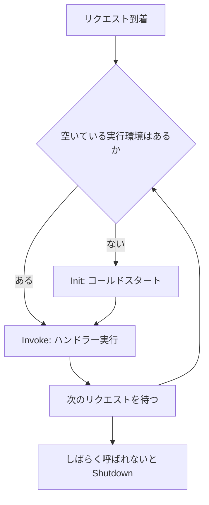

# AWS Lambda

[:material-sprout: CLF](../courses/clf/services.md){ .exam-badge .exam-foundational } [:material-sprout: AIF](../courses/aif/services.md){ .exam-badge .exam-foundational } [:material-certificate: SAA](../courses/saa/services.md){ .exam-badge .exam-associate } [:material-certificate: DVA](../courses/dva/services.md){ .exam-badge .exam-associate } [:material-certificate: SOA](../courses/soa/services.md){ .exam-badge .exam-associate } [:material-certificate: DEA](../courses/dea/services.md){ .exam-badge .exam-associate } [:material-certificate: MLA](../courses/mla/services.md){ .exam-badge .exam-associate } [:material-star-circle: SAP](../courses/sap/services.md){ .exam-badge .exam-professional } [:material-star-circle: DOP](../courses/dop/services.md){ .exam-badge .exam-professional } [:material-star-circle: AIP](../courses/aip/services.md){ .exam-badge .exam-professional } [:material-target: ANS](../courses/ans/services.md){ .exam-badge .exam-specialty } [:material-target: SCS](../courses/scs/services.md){ .exam-badge .exam-specialty }

サーバーを管理せずに、イベントに応じてコードを実行するサービス。短時間の処理、API のバックエンド、データ変換に使う。

[](../assets/diagrams/lambda-invocation.png)

!!! note "Event Function という呼び方"
    現在の公式ドキュメントは、従来の Lambda 関数を **Event Function** と呼ぶ。Lambda Web Functions や Lambda MicroVMs と区別するためで、関数というリソース自体は変わらない。このページの「関数」は Event Function を指す。

## 実行モデル {#execution-model}

Lambda はリクエストごとに **実行環境** を割り当てる。1つの実行環境は同時に1リクエストだけを処理する。同時リクエストが増えると、実行環境も増える。

実行環境のライフサイクルは次の順に進む。

| フェーズ | 内容 |
| --- | --- |
| Init | 環境を作り、拡張機能とランタイムを起動し、ハンドラー外のコードを実行する。10 秒以内に終わらないと、最初の呼び出し時に、関数のタイムアウトを上限として再試行される。Provisioned Concurrency と SnapStart には 10 秒の制限がない |
| Restore | SnapStart のときだけ。スナップショットから復元する |
| Invoke | ハンドラーを実行する |
| Shutdown | しばらく呼び出しがないと環境を破棄する。使える時間は拡張機能なしで 0 ms、内部拡張機能ありで 500 ms、外部拡張機能ありで 2,000 ms |

新しい実行環境で Init が走るときの遅延を **コールドスタート** と呼ぶ。Invoke が終わった環境は次のリクエストに再利用される場合があるが、再利用は保証されない。永続化したい状態は DynamoDB などの外部に置く。



## ハンドラー {#handler}

ハンドラーはイベントを受け取る入口の関数。Python では `ファイル名.関数名` の形式で設定する。下の例の設定値は `app.handler`。

```python
import json
import os

import boto3

# ハンドラーの外で初期化すると、再利用された環境では再実行されない
table = boto3.resource("dynamodb").Table(os.environ["TABLE_NAME"])


def handler(event, context):
    # event: 呼び出し元が渡す JSON。context: 実行時の情報
    print(context.aws_request_id, context.get_remaining_time_in_millis())
    table.put_item(Item={"id": event["id"]})
    return {"statusCode": 200, "body": json.dumps({"ok": True})}
```

## 設定項目 {#configuration}

| 項目 | 値 | メモ |
| --- | --- | --- |
| メモリ | 128〜10,240 MB（1 MB 単位） | CPU はメモリに比例する。1,769 MB で 1 vCPU 相当 |
| タイムアウト | 既定 3 秒、最大 900 秒（15 分） | 超えると実行が打ち切られる |
| `/tmp` | 512〜10,240 MB | 実行環境が再利用されれば中身も残る |
| 環境変数 | 全変数の合計で 4 KB | 下の「環境変数」を参照 |
| リソースベースポリシー | 20 KB | 下の「リソースベースポリシー」を参照 |
| レイヤー | 1関数に最大 5 個 | .zip の関数でのみ使える |
| アーキテクチャ | `x86_64` または `arm64` | `arm64` は Graviton |
| ペイロード | 同期 6 MB、非同期 1 MB | ストリーミング応答は最大 200 MB |

### メモリ {#memory}

`MemorySize` で設定する。既定は最小値の 128 MB で、128〜10,240 MB を 1 MB 単位で選ぶ。増やすと CPU とネットワークの能力も比例して増える。1,769 MB で 1 vCPU 相当になる。

- **例:** 128 MB で 8 秒かかる画像変換を 1,024 MB にすると、CPU が増えて短時間で終わる。実行時間が縮めば、料金が下がる場合もある。
- **罠:** CPU だけを増やす設定はない。CPU 不足の遅さも、メモリを増やして解消する。

```bash
aws lambda update-function-configuration --function-name my-function --memory-size 1024
```

### タイムアウト {#timeout}

`Timeout` で設定する。既定は 3 秒で、1 秒単位で最大 900 秒（15 分）にできる。超えると実行は打ち切られ、`Task timed out` がログに残る。

- **例:** 平均 2 秒、最大 10 秒かかる関数を既定の 3 秒のまま動かすと、遅いときだけ失敗する。テストは小さいデータだけでなく、想定の上限に近いデータでも行う。
- **罠:** 呼び出し元の待ち時間は別に決まる。REST API の統合タイムアウトが 29 秒なら、関数のタイムアウトを 60 秒にしても、クライアントには 29 秒で 504 が返る。
- **罠:** SQS から呼ぶ場合は、キューの可視性タイムアウトも合わせて変える。関数のタイムアウトのほうが長いと、マッピングの作成や更新がエラーになる。

### エフェメラルストレージ {#ephemeral-storage}

`EphemeralStorage.Size` で設定する `/tmp` の容量。既定は 512 MB で、512〜10,240 MB を 1 MB 単位で選ぶ。実行環境ごとに分かれ、AWS 管理のキーで保存時に暗号化される。

- **例:** S3 から 2 GB の動画を取得して変換する関数は、`Size` を 4,096 にする。ファイルをメモリに載せずに済む。
- **罠:** SnapStart は 512 MB を超える `/tmp` と併用できない。また、別の実行環境とはデータを共有できない。

### アーキテクチャ {#architecture}

`Architectures` で `x86_64`（既定）か `arm64`（Graviton）を選ぶ。`arm64` は計算の多い処理で価格性能が良くなることがある。

移行では次のものをすべて `arm64` 対応にする。

| 対象 | 必要な対応 |
| --- | --- |
| アップロード済みのコード | 対象アーキテクチャ向けのコードを上げ直す |
| 依存ライブラリ | 各ライブラリの `arm64` 版を使う。ネイティブ拡張は再ビルドする |
| レイヤー | 互換性を確認し、合わなければ対応版に差し替える |
| 拡張機能 | 互換性を確認する |
| コンテナイメージ | `arm64` 向けのイメージを作り直す |

**罠:** 設定だけ変えても、`x86_64` 向けにビルドしたネイティブライブラリは動かない。

### ランタイムとハンドラー {#runtime}

ランタイムは `python3.13` のような言語実行環境を指す。AWS の管理ランタイムのほか、独自の実行環境を載せる OS 専用ランタイムもある。ランタイムには廃止予定日があるので、更新を計画しておく。

`Handler` は [ハンドラー](#handler) の場所を示す。Python の `lambda_function.py` の `lambda_handler` 関数なら `lambda_function.lambda_handler` にする。

- **例:** ファイルを `app.py` に変えたのに設定が `lambda_function.lambda_handler` のままだと、ハンドラーが見つからず実行に失敗する。
- **罠:** ランタイムの廃止後も、作成と更新は一定期間できる。その後は作成、続いて更新がブロックされるので、期日は公式の一覧で確認する。

### レイヤー {#layers}

共通ライブラリや設定ファイルをまとめた .zip で、関数とは別にバージョン管理する。

- 関数の実行時に `/opt` に展開される。
- Python では `python/` フォルダに入れて作ると、インポートのパスに入る。
- 複数の関数で同じ依存関係を共有でき、デプロイパッケージを小さくできる。
- 展開後のサイズは関数本体と合わせて 250 MB まで。
- コンテナイメージの関数では使えない。依存関係はイメージに含める。
- 追加するときはバージョン番号付きの ARN を指定する（`...:layer:my-layer:1`）。新しいバージョンを発行しても、関数は自動では切り替わらない。
- 追加した順に `/opt` へマージされる。順序はコンソールの **Merge earlier**、**Merge later** で変えられる。
- 関数のアーキテクチャに合うレイヤーを使う。

**例:** 3 つの関数で共通の `requests` を、`python/requests/` を入れたレイヤーにまとめる。各関数のパッケージから `requests` を外せる。

### 拡張機能 {#extensions}

監視やセキュリティのツールを実行環境に組み込む仕組み。主にレイヤーとして追加する。

| 種類 | 動き方 |
| --- | --- |
| 内部拡張機能 | ランタイムのプロセスの一部として動く。ラッパースクリプトや `JAVA_TOOL_OPTIONS` で設定する |
| 外部拡張機能 | 独立したプロセスとして動く。`/opt/extensions/` に置く。関数の応答後も動き続けられる |

外部拡張機能は Init 時間やメモリを消費し、関数の性能に影響することがある。Telemetry API を使うと、ログなどを拡張機能で受け取れる。

- 拡張機能のサイズは展開後 250 MB の上限に含まれる。
- すべての拡張機能の初期化が終わるまで、関数は呼び出されない。遅い拡張機能はコールドスタートを長くする。
- イベントソースマッピングは、拡張機能の終了を待たずに次のバッチを送る。想定より `ConcurrentExecutions` が高ければ、スロットリングの原因になっていないか確認する。

### 環境変数 {#environment-variables}

環境ごとに変わる値（テーブル名、接続先、ログレベルなど）をコードから分離する。

```python
import os

table_name = os.environ["TABLE_NAME"]
region = os.environ["AWS_REGION"]  # Lambda が予約している変数の一つ
```

`AWS_REGION` や `AWS_LAMBDA_FUNCTION_NAME` のような予約済みのキーは設定できない。一方で `PATH` や `LD_LIBRARY_PATH` は予約されておらず、関数の設定で拡張できる。

キーは英字で始まる 2 文字以上で、使える文字は英数字とアンダースコアだけ。合計 4 KB を超える設定は入らないので、大きな設定は [Parameter Store や AppConfig](secrets.md) に置き、環境変数には名前だけを入れる。

バージョンを発行すると環境変数も固定される。同じコードで値だけ環境ごとに変えたいときは、環境ごとにバージョンを発行するか、別の関数に分ける。[設定管理の選択肢](secrets.md) も参照する。

### 環境変数の暗号化 {#encrypting-env-vars}

機密情報は [Secrets Manager](secrets.md) に置き、環境変数にはシークレット名だけを入れるのが基本。環境変数に機密情報を入れる場合の暗号化は次の2段階がある。

| 段階 | 内容 | 必要な設定 |
| --- | --- | --- |
| 保存時（サーバー側） | 常に KMS で暗号化される。既定は AWS マネージドキー | ローテーションなどを自分で管理したいときは、カスタマーマネージドキーを指定する（`KMSKeyArn`） |
| 転送時（クライアント側） | コンソールの暗号化ヘルパーで、値を送信前に暗号化する | 実行ロールに `kms:Decrypt` を与え、コードで復号する |

暗号化ヘルパーを使うと、コンソールや API の表示でも値は暗号文のままになる。コードでは次のように復号する。

```python
import base64
import os

import boto3

kms = boto3.client("kms")
plain = kms.decrypt(
    CiphertextBlob=base64.b64decode(os.environ["DB_PASSWORD"]),
    EncryptionContext={"LambdaFunctionName": os.environ["AWS_LAMBDA_FUNCTION_NAME"]},
)["Plaintext"].decode()
```

カスタマーマネージドキーを使う場合、環境変数を閲覧・管理するユーザーやロールにも `kms:Decrypt` などの権限が必要になる。KMS の詳細は [KMS](kms.md) を参照する。

### 実行ロール {#execution-role}

関数が他のサービスを呼ぶときの権限を決める IAM ロール。信頼ポリシーで `lambda.amazonaws.com` を信頼する。コードで `sts:AssumeRole` を呼ぶ必要はなく、Lambda が自動で引き受ける。

| マネージドポリシー | 用途 |
| --- | --- |
| `AWSLambdaBasicExecutionRole` | CloudWatch Logs への書き込み |
| `AWSLambdaVPCAccessExecutionRole` | VPC 接続のネットワークインターフェイス管理 |
| `AWSLambdaSQSQueueExecutionRole` | SQS のポーリング |
| `AWSLambdaKinesisExecutionRole` | Kinesis の読み取り |
| `AWSXRayDaemonWriteAccess` | X-Ray へのトレース送信 |

- **例:** DynamoDB に書く関数には、対象テーブルの `dynamodb:PutItem` だけを追加する。
- **罠:** ログの権限を外すと、関数は動いてもログが出なくなる。暗号化された SQS キューを読むには `kms:Decrypt` も要る。

### リソースベースポリシー {#resource-policy}

他のアカウントや AWS サービスに、関数の呼び出しを許可するポリシー。上限は 20 KB。[呼び出し権限の向き](#invocation-permissions) のとおり、プッシュ型の呼び出し元に使う。

```bash
# S3 バケットのイベントで関数を呼べるようにする
aws lambda add-permission --function-name my-function:prod \
  --statement-id s3-invoke --action lambda:InvokeFunction \
  --principal s3.amazonaws.com --source-arn arn:aws:s3:::my-bucket
```

- **罠:** エイリアスやバージョンを呼ばせるなら、修飾名を指定して許可する。権限の範囲は、ポリシーを関数全体に付けたか、特定のバージョンに付けたかで変わる。

### ログ設定 {#logging-config}

`LoggingConfig` で次の項目を設定する。

| 項目 | 値 | 既定 |
| --- | --- | --- |
| `LogFormat` | `Text`、`JSON` | `Text` |
| `ApplicationLogLevel` | `TRACE`、`DEBUG`、`INFO`、`WARN`、`ERROR`、`FATAL` | JSON にしたとき `INFO` |
| `SystemLogLevel` | `DEBUG`、`INFO`、`WARN` | JSON にしたとき `INFO` |
| `LogGroup` | ロググループ名 | `/aws/lambda/<関数名>` |

- **例:** 本番は `ApplicationLogLevel` を `WARN` にすると、`INFO` と `DEBUG` のログは送られない。コードを変えずに量を減らせる。
- **罠:** ログレベルのフィルターは JSON 形式でのみ使える。`Text` のままレベルだけ変えても効かない。
- **罠:** Python で `Text` のときの既定のログレベルは `WARN` なので、`logger.info()` は出ない。JSON に変えると既定は `INFO` になる。
- 形式の変更は新しいログにだけ適用される。CloudWatch Logs のほか、S3 や Firehose にも送れる。

### トレーシング {#tracing}

`TracingConfig.Mode` で `Active` か `PassThrough`（既定）を選ぶ。

| モード | 動き |
| --- | --- |
| `Active` | サンプリングされたリクエストのトレースを Lambda が X-Ray に送る |
| `PassThrough` | トレースヘッダーを下流に渡すだけで、トレースは送らない |

- サンプリングは毎秒 1 リクエストと、それ以外の 5%。関数側では変更できない。
- コンソール以外で有効にするなら、実行ロールに `AWSXRayDaemonWriteAccess` を付ける。
- 発行済みのバージョンではモードを変えられない。

!!! note "動きが変わった点"
    以前は、API Gateway などの上流がトレースヘッダーを付けると、Lambda も自動でトレースを送っていた。現在の `PassThrough` は、ヘッダーがサンプリングを指示していても送らない。トレースが欲しい関数は `Active` にする。

### コード署名 {#code-signing}

AWS Signer で署名したコードだけをデプロイさせる設定。コード署名設定を関数に関連付ける。検証はデプロイ時に行うので、実行時の性能には影響しない。

`UntrustedArtifactOnDeployment` で、検証に失敗したときの動きを選ぶ。

| 値 | 動き |
| --- | --- |
| `Warn`（既定） | デプロイを許可し、`SignatureValidationErrors` メトリクスと CloudTrail に記録する |
| `Enforce` | 警告したうえでデプロイをブロックする |

- **例:** 本番アカウントでは `Enforce` にする。まず `Warn` で様子を見てから切り替えると、未署名のパイプラインを安全に洗い出せる。
- **罠:** 既に動いている未署名のコードは止まらない。次のデプロイから検証される。
- **罠:** 関数が使うレイヤーも、許可されたプロファイルでの署名が必要になる。

### 関数 URL {#function-urls}

関数専用の HTTPS エンドポイント。エイリアスか `$LATEST` にだけ付けられ、番号付きのバージョンには付けられない。パブリックインターネットからのみアクセスでき、PrivateLink には対応しない。

| 設定 | 値 | メモ |
| --- | --- | --- |
| `AuthType` | `AWS_IAM`、`NONE` | 必須。`AWS_IAM` は SigV4 署名が要る |
| `Cors` | `AllowOrigins`、`AllowMethods`、`AllowHeaders`、`ExposeHeaders`、`AllowCredentials`、`MaxAge` | 関数側のヘッダーと重複させない |
| `InvokeMode` | `BUFFERED`（既定）、`RESPONSE_STREAM` | `BUFFERED` の上限は 6 MB |

!!! warning "権限が2つ必要になった"
    2025 年 10 月以降に作る関数 URL には、`lambda:InvokeFunctionUrl` と `lambda:InvokeFunction` の両方が必要。`AuthType` が `NONE` でも、リソースベースポリシーで許可がないと **403** になる。コンソールと SAM は自動で付けるが、CLI、CloudFormation、API では自分で追加する。

- **条件キー:** `lambda:InvokedViaFunctionUrl` を付けると、URL 経由以外の呼び出しを防げる。
- **クロスアカウント（`AWS_IAM`）:** 呼び出し側の IAM ポリシーと関数のリソースベースポリシーの両方で許可する。
- **スロットリング:** 予約済み同時実行で制限する。RPS の上限はその 10 倍で、超えると 429。予約を 0 にすれば全リクエストが 429 になり、緊急停止できる。
- **CORS の罠:** URL の CORS 設定と関数の応答の両方にヘッダーがあると、プリフライト以外で重複し、`Access-Control-Allow-Origin` が複数値だというブラウザのエラーになる。
- **削除の罠:** 削除すると URL は復元できず、作り直すと別のアドレスになる。`NONE` のポリシーは自動では消えない。

## VPC 内のリソースへのアクセス {#vpc-access}

[](../assets/diagrams/lambda-vpc.png)

既定の Lambda は AWS 管理の VPC で動く。インターネットには出られるが、自分の VPC のプライベートリソース（RDS、ElastiCache など）には届かない。届かせるには、関数に VPC 設定を追加する。

1. 関数の VPC 設定で、VPC、プライベートサブネット、セキュリティグループを指定する。
2. 実行ロールに `AWSLambdaVPCAccessExecutionRole` を付ける。これには `ec2:CreateNetworkInterface` などのネットワークインターフェイス管理権限が含まれる。
3. 接続先のセキュリティグループで、関数のセキュリティグループからの通信を許可する。

Lambda はサブネットに **Hyperplane ENI** を作り、関数の通信をそこに流す。可用性のため、複数のアベイラビリティーゾーンのサブネットを指定する。

`VpcConfig` の項目は次の通り。

| 項目 | 内容 |
| --- | --- |
| `SubnetIds` | 接続するサブネット。プライベートサブネットを複数の AZ で指定する |
| `SecurityGroupIds` | 関数の ENI に付けるセキュリティグループ |
| `Ipv6AllowedForDualStack` | 既定 `false`。`true` で外向き IPv6 を許可する。全サブネットがデュアルスタックである必要がある |

- 新しい関数は、ENI の準備ができるまで `Pending` で、呼び出せない。数分かかることがある。
- ENI の管理権限は作成時に必要で、呼び出しには要らない。
- 14 日間使われないと、ENI が回収されて関数は `Inactive` になる。次の呼び出しが失敗する場合がある。
- VPC 設定を外すと、ENI の削除に最大 20 分かかる。
- 専有テナンシーの VPC には直接接続できない。

VPC に接続すると、関数の通信は VPC の中に閉じる。外に出る経路は自分で用意する。

| 接続先 | 経路 |
| --- | --- |
| インターネット | プライベートサブネット → NAT ゲートウェイ（パブリックサブネット）→ インターネットゲートウェイ |
| S3、DynamoDB | ゲートウェイ型の VPC エンドポイント |
| Secrets Manager、KMS など | インターフェイス型の VPC エンドポイント（PrivateLink） |

!!! warning "パブリックサブネットに置いてもインターネットに出られない"
    関数をパブリックサブネットに接続しても、パブリック IP は付かない。インターネットが必要なら NAT ゲートウェイを使う。

RDS に多数の関数からつなぐ場合、接続数が増えすぎないように [RDS Proxy](databases.md) を間に置く。頻繁に短い接続を作る関数に AWS が勧めている構成で、本番向けでもある。ネットワークの詳細は [ネットワーク](networking.md) を参照する。

## 同時実行とスケーリング {#concurrency}

**同時実行数** は同じ瞬間に処理中のリクエスト数で、次の式で見積もる。

```text
同時実行数 = 平均リクエスト数/秒 × 平均実行時間（秒）
```

例: 100 リクエスト/秒で、平均 0.5 秒かかる関数の同時実行数は 50。

### クォータとスケーリング速度 {#concurrency-quota}

| 項目 | 値 |
| --- | --- |
| アカウントの同時実行数 | リージョンごとに既定 1,000（引き上げ可）。新しいアカウントはもっと低いことがある |
| スケーリング速度（バースト） | 関数ごとに 10 秒あたり 1,000 実行環境まで |
| 同期呼び出しのリクエスト数 | 同時実行数の 10 倍/秒まで |

スケーリング速度は関数単位で、使わなかった分は持ち越せない。急増時はこの速度を超えた分がスロットリングされることがある。

### 予約済みと Provisioned の違い {#reserved-provisioned}

| | 予約済み同時実行 | Provisioned Concurrency |
| --- | --- | --- |
| 目的 | 同時実行数の確保と上限設定 | コールドスタートの削減 |
| 実行環境 | 事前に用意しない | 事前に初期化して待機させる |
| 料金 | 設定自体は無料 | 追加料金あり |
| 対象 | 関数全体 | バージョンまたはエイリアス（`$LATEST` は不可） |
| 超過時 | スロットリング | 通常の同時実行にあふれる |
| 用途 | 重要な関数の枠を確保、下流の DB を守るための上限、緊急停止（0 に設定） | レイテンシーに厳しい API、予測できるピーク |

- 予約できる量は、未予約の同時実行数から 100 を引いた分まで。残り 100 は予約のない関数のために残る。
- 予約を増やすと、他の関数が使える共有プールは減る。
- 両方を設定する場合、Provisioned は予約済みの値を超えられない。
- Provisioned は Application Auto Scaling で調整できる。ピークの時刻が決まっているならスケジュール、そうでなければ使用率によるターゲット追跡を使う。
- あふれた呼び出しは `ProvisionedConcurrencySpilloverInvocations` メトリクスで確認する。

### 予約済み同時実行の設定 {#reserved-concurrency}

`PutFunctionConcurrency` の `ReservedConcurrentExecutions` で設定する。関数全体（全バージョン）に効く。上限でもあり、確保でもある。

**計算例:** アカウントの上限 1,000 で、関数 A に 500、B に 300 を予約した。未予約は 200 で、そこから 100 を残すので、関数 C に予約できるのは最大 100。

```bash
aws lambda put-function-concurrency --function-name my-function --reserved-concurrent-executions 100
```

- **例:** 接続数 50 の DB を守るなら 50 にする。51 件目以降は 429 になり、DB は守られる。
- **罠:** 使わない分も他の関数には回らない。大きく取りすぎると、他の関数がスロットリングされる。
- **罠:** 非同期呼び出しの関数を 0 にすると、新しいイベントは再試行なしで DLQ かオンフェイラーデスティネーションに送られる。
- **SQS:** 予約済み同時実行を使うなら 5 以上にして、スロットリングを減らす。

### Provisioned Concurrency の設定 {#provisioned-concurrency}

`PutProvisionedConcurrencyConfig` でバージョンかエイリアスに設定する。`$LATEST` には付けられない。

**計算例:** ピークが 200 の関数なら、10% の余裕を見て 220 にする。

- **罠:** 呼び出し元やイベントソースが `$LATEST` や別のエイリアスを指していると、設定した環境は使われず、コールドスタートが残る。
- 反映には 1〜2 分かかる。全部の割り当てが終わるまで、どの環境も使えない。関数ごとに毎分 6,000 環境まで割り当てられる。
- あふれた分は通常の同時実行で処理する。予約済みも設定していれば、予約の上限でスロットリングされる。
- RPS の上限は割り当て数の 10 倍。割り当てが 10 なら 100 RPS を超えた分はあふれる。
- バージョンごとの合計は予約済みの値を超えられない。合計が予約済みと同じだと、`$LATEST` はスロットリングされて動かない。
- 初期化はハンドラーの外に集めると、割り当て時に済む。割り当て時の初期化は最大 15 分まで動ける。
- 環境の種類は `AWS_LAMBDA_INITIALIZATION_TYPE`（`provisioned-concurrency` か `on-demand`）で分かる。

ターゲット追跡では `LambdaProvisionedConcurrencyUtilization` を 10〜90% の間で指定する。70% なら、63%（目標の 90%）を下回り続けると減らす。

**罠:** 短いバーストは平均値では検知しにくい。自動スケーリングが反応するには 3 分程度の継続が必要で、呼び出しがないとメトリクスも出ない。急なバーストには `Maximum` 統計を使う。

### 同時実行数とリクエスト数の両方を見る {#concurrency-rps}

同時実行数だけでは足りない。RPS の上限は同時実行数の 10 倍になる。

**計算例:** 平均 20 ms の関数に 30,000 リクエスト/秒が来ると、同時実行数は 600。上限 1,000 に収まって見えるが、RPS の上限は 10,000 なのでスロットリングされる。上限を 3,000 以上に引き上げる必要がある。

### スロットリング {#throttling}

同時実行の上限を超えるとスロットリングされる。動きは呼び出し方で変わる。

| 呼び出し方 | スロットリング時の動き |
| --- | --- |
| 同期 | `429 TooManyRequestsException` を返す。リトライは呼び出し側の責任 |
| 非同期 | イベントをキューに戻し、既定で最大 6 時間、間隔を広げながら再試行する |
| SQS のイベントソースマッピング | ポーリングの同時実行を徐々に下げながら、可視性タイムアウトまで再試行する。その後はキューのリドライブ設定に従う |
| ストリームのイベントソースマッピング | レコードの期限切れまで再試行する。関数のエラーと違い、`MaximumRetryAttempts` には数えない |

### スレッドとコネクションプール {#connection-pooling}

Lambda では1つの実行環境が同時に1リクエストしか処理しない。そのため、大きなコネクションプールは不要で、環境ごとに1接続を使い回すのが基本になる。ただし環境の数だけ接続が増えるので、RDS には RDS Proxy を使う。

EC2 や [コンテナ](containers.md) のように1プロセスが多数のリクエストをさばく環境では、スレッドプールとコネクションプールのサイズを、CPU 数と下流の接続上限に合わせて決める。増やしすぎると、DB 側の接続数の上限に達する。負荷に応じたインスタンス数の調整は [EC2 Auto Scaling](ec2-beanstalk.md) を使う。

## 呼び出しの種類 {#invocation-types}

| 種類 | 代表的な呼び出し元 | 動き | エラー時 |
| --- | --- | --- | --- |
| 同期 | API Gateway、`Invoke`（`RequestResponse`） | 終了を待って結果を返す | 呼び出し元が判断する |
| 非同期 | S3、SNS、EventBridge、`Invoke`（`Event`） | Lambda が内部キューに入れて 202 を返す | Lambda が再試行する |
| イベントソースマッピング | SQS、Kinesis、DynamoDB Streams、Kafka | Lambda 側のポーラーが取得し、バッチで同期呼び出しする | ソースごとの規則に従う |

```python
import json

import boto3

client = boto3.client("lambda")

# 同期: 関数のエラーは例外にならず FunctionError に入る
res = client.invoke(
    FunctionName="my-function:prod",
    InvocationType="RequestResponse",
    Payload=json.dumps({"id": "1"}),
)
if "FunctionError" in res:
    print("関数でエラー", res["Payload"].read())

# 非同期: StatusCode は 202
client.invoke(FunctionName="my-function:prod", InvocationType="Event", Payload=b"{}")
```

`InvocationType` にはもう一つ `DryRun` があり、実行せずにパラメーターと権限だけ確認する。

### 呼び出し権限の向き {#invocation-permissions}

権限を与える先は、呼び出し方で変わる。試験でよく問われる。

| 方式 | 必要な権限 |
| --- | --- |
| 同期と非同期（プッシュ） | **関数のリソースベースポリシー** で呼び出し元のサービスに `lambda:InvokeFunction` を許可する |
| イベントソースマッピング（ポーリング） | **実行ロール** に読み取り権限を付ける（SQS なら `sqs:ReceiveMessage`、`sqs:DeleteMessage` など） |

### イベントソースマッピング {#event-source-mapping}

Lambda のリソースとしてソースとの紐付けを作り、バッチサイズなどを調整する。

```python
import boto3

boto3.client("lambda").create_event_source_mapping(
    EventSourceArn="arn:aws:sqs:ap-northeast-1:111122223333:orders",
    FunctionName="my-function:prod",
    BatchSize=10,
    MaximumBatchingWindowInSeconds=5,
    FunctionResponseTypes=["ReportBatchItemFailures"],
)
```

| 設定 | SQS | Kinesis と DynamoDB Streams |
| --- | --- | --- |
| `BatchSize` | 既定 10。標準キューは最大 10,000、FIFO は最大 10 | 既定 100、最大 10,000 |
| `MaximumBatchingWindowInSeconds` | 既定 0、最大 300。FIFO では使えない | 既定 0、最大 300 |
| 同時実行の制御 | `ScalingConfig` の最大同時実行数、または provisioned mode | `ParallelizationFactor`（1〜10）でシャードごとの並列数を増やす |
| 再試行の制御 | 可視性タイムアウトと `maxReceiveCount` | `MaximumRetryAttempts`、`MaximumRecordAgeInSeconds`、`BisectBatchOnFunctionError` |
| 失敗の記録先 | キュー側の DLQ | `DestinationConfig`（SQS、SNS、S3） |

処理は少なくとも1回で、重複があり得る。関数は [冪等](sdk-resilience.md) に作る。

SQS と組み合わせるときは、次の2点を守る。

- キューの可視性タイムアウトを関数のタイムアウトの **6 倍以上** にする。バッチウィンドウを使うなら、その秒数も足す。関数のタイムアウトより短いと、マッピングの作成時や更新時にエラーになる。
- リドライブポリシーの `maxReceiveCount` を **5 以上** にする。少なすぎると、スロットリングだけで DLQ に送られることがある。

### バッチの設定 {#esm-batching}

`BatchSize` は1回の呼び出しに入るレコードの最大数、`MaximumBatchingWindowInSeconds` は集める時間の最大値（0〜300 秒、1 秒単位）。次のどれかを満たすと関数が呼ばれる。

1. バッチウィンドウが終わった
2. バッチサイズに達した
3. ペイロードが 6 MB に達した（変更不可）

| ソース | `BatchSize` の既定と上限 | ウィンドウの既定 |
| --- | --- | --- |
| SQS 標準 | 10、最大 10,000 | 0 秒 |
| SQS FIFO | 10、最大 10 | 使えない |
| Kinesis、DynamoDB Streams | 100、最大 10,000 | 0 秒 |
| MSK、自己管理 Kafka、Amazon MQ、DocumentDB | 100、最大 10,000 | 500 ms |

**例:** 関数のタイムアウト 60 秒、バッチウィンドウ 20 秒の SQS マッピングなら、可視性タイムアウトは 60 × 6 + 20 = 380 秒にする。

- **罠:** SQS で `BatchSize` を 10 より大きくするときは、`MaximumBatchingWindowInSeconds` を 1 以上にする。
- **罠:** メタデータもペイロードに数えるので、バッチは `BatchSize` より小さくなることがある。
- **罠:** 通信量の少ない SQS では、ウィンドウが 20 秒未満でも最大 20 秒待つことがある。
- **罠:** Kafka などの 500 ms は秒単位の設定では戻せない。変更後に戻すなら、マッピングを作り直す。
- 関数のタイムアウトは、バッチ全体を処理できる長さにする。

### ParallelizationFactor {#esm-parallelization}

Kinesis と DynamoDB Streams 専用で、1 シャードから同時に処理するバッチ数を決める。既定 1、最大 10。パーティションキーごとの順序は保たれる。

**計算例:** 20 シャードで `ParallelizationFactor` を 5 にすると、同時実行は最大 100。予約済み同時実行が 50 のままだと、スロットリングで追いつかない。

`IteratorAge` が増え続けるときに上げる。シャードを増やす方法もある。

### StartingPosition {#esm-starting-position}

ストリームで必須の設定。どこから読み始めるかを決める。

| 値 | 動き | 使えるソース |
| --- | --- | --- |
| `LATEST` | 新しいレコードから | Kinesis、DynamoDB Streams |
| `TRIM_HORIZON` | 保持されている最も古いレコードから | Kinesis、DynamoDB Streams |
| `AT_TIMESTAMP` | 指定の時刻から（`StartingPositionTimestamp`、未来は不可） | Kinesis。DynamoDB Streams では使えない |

**罠:** マッピングの作成や更新の後、ポーリングの開始には数分かかる。`LATEST` だとこの間のレコードを取りこぼす。取りこぼせないなら `TRIM_HORIZON` か `AT_TIMESTAMP` を使う。

### ストリームのエラー処理の設定 {#esm-stream-errors}

既定では、1 件の不良レコードでシャードが最大で保持期限まで止まる。既定の設定で Kinesis の場合、最長 1 週間止まることがある。

| 設定 | 既定 | 範囲 | 効果 |
| --- | --- | --- | --- |
| `MaximumRetryAttempts` | -1（無限） | -1〜10,000 | 関数エラーの再試行回数の上限。スロットリングは数えない |
| `MaximumRecordAgeInSeconds` | -1（無限） | -1、または 60〜604,800 | これより古いレコードを捨てる |
| `BisectBatchOnFunctionError` | `false` | true/false | エラー時にバッチを半分に分けて再試行し、不良レコードを絞り込む |
| `DestinationConfig.OnFailure` | なし | SQS、SNS、S3、Kafka | 捨てるレコードの情報を送る |

**例:** `MaximumRetryAttempts: 2`、`BisectBatchOnFunctionError: true`、`OnFailure` に SQS を設定すると、不良レコードは 2 回の再試行後に飛ばされ、シャードが進む。調査は SQS に残った情報で行う。

- **罠:** SQS と SNS の送信先に届くのはメタデータだけで、レコード本体は入らない。本体は位置情報を使ってストリームから読む。S3 には呼び出しレコード全体が届く。
- **罠:** `MaximumRecordAgeInSeconds` に 1〜59 は指定できない。
- `ReportBatchItemFailures` と併用すると、返したシーケンス番号の位置でバッチを分ける。

### TumblingWindowInSeconds {#esm-tumbling-window}

Kinesis と DynamoDB Streams で、時間枠ごとに状態を持って集計する。0〜900 秒で、0 は無効。

- 関数は `state` を返す。ないと失敗扱いになる。
- 状態はシャードごとに最大 1 MB。超えると枠が早く閉じる。
- 枠の最後の呼び出しでは `isFinalInvokeForWindow` が `true` になる。ここで集計結果を保存する。
- 枠の境界はレコードがストリームに入った時刻で決まる。
- リシャーディングには対応しない。シャードが終わると枠も閉じる。

**例:** `TumblingWindowInSeconds` を 300 にすると、シャードごとの 5 分間の売上合計を外部 DB なしで計算できる。

### FilterCriteria {#esm-filter}

条件に合うレコードだけを関数に渡す。呼び出し回数を減らせる。既定で 5 個まで（申請で 10 個まで）指定でき、OR で評価する。

```bash
aws lambda create-event-source-mapping --function-name my-function \
  --event-source-arn arn:aws:sqs:ap-northeast-1:111122223333:orders \
  --filter-criteria '{"Filters":[{"Pattern":"{\"body\":{\"type\":[\"order\"]}}"}]}'
```

条件に合わなかったレコードの扱いはソースで変わる。

| ソース | 動き |
| --- | --- |
| SQS | Lambda がキューから **削除** する |
| Kinesis、DynamoDB Streams | イテレーターが通過する。保持期間が過ぎると消える |

- **罠:** 同じ SQS キューを別のコンシューマーも読んでいると、合わなかったメッセージは消えてしまう。
- **罠:** データのキーはソースで違う。SQS は `body` を指定する。
- `FilteredOutEventCount` メトリクスで、除外された数を確認できる。
- 機密情報を含むなら KMS キーで暗号化できる。`ListEventSourceMappings` では `null` になり、`GetEventSourceMapping` と `kms:Decrypt` で読める。

### ScalingConfig の MaximumConcurrency {#esm-max-concurrency}

SQS 専用で、そのマッピングが呼べる関数の同時実行数を制限する。範囲は 2〜1,000 で、追加料金はない。

**例:** 1 つの関数に重要なキューと低優先度のキューをつなぐ。低優先度のマッピングを `MaximumConcurrency: 10` にすれば、予約済み同時実行を食いつぶさない。

```bash
aws lambda update-event-source-mapping --uuid a1b2c3d4-5678-90ab-cdef-11111EXAMPLE \
  --scaling-config '{"MaximumConcurrency":10}'
```

- **罠:** 予約済み同時実行とは独立した設定。全マッピングの合計を予約済み同時実行以下にしないと、スロットリングされる。
- **FIFO:** メッセージグループ数と設定値の小さいほうで頭打ちになる。グループが 6 で設定が 10 なら、最大 6。
- 既定では、SQS のマッピングは 5 同時実行から始まり、毎分 300 ずつ、最大 1,250 まで増える。

### ProvisionedPollerConfig {#esm-provisioned-mode}

ポーラーを専用で確保するプロビジョンドモード。SQS、MSK、自己管理 Kafka で使える。追加料金がかかる。

| 項目 | SQS | Kafka |
| --- | --- | --- |
| `MinimumPollers` | 2〜200、既定 2 | 既定 1、最大 200 |
| `MaximumPollers` | 2〜10,000、既定 200 | 1〜2,000、既定 200 |
| ポーラー 1 台の能力 | 1 MB/秒、10 同時呼び出し、毎秒 10 回のポーリング | 5 MB/秒、5 同時呼び出し |

**計算例:** バッチサイズ 10、平均 3 KB、平均 100 ms の関数なら、SQS のポーラー 1 台で約 100 イベント/秒。1,000 イベント/秒を処理するには `MinimumPollers` を 10 にする。関数が平均 1 秒なら 1 台 10 イベント/秒なので、100 にする。

- SQS では毎分 1,000 同時呼び出しずつ増え、最大 100,000 まで増やせる。
- **罠:** SQS では `MaximumConcurrency` と併用できない。同時実行の上限は `MaximumPollers` で決める。
- 使用量は `ProvisionedPollers` メトリクスで確認する。遅延を抑えるなら `MaximumBatchingWindowInSeconds` を 0 にする。

### その他のマッピング設定 {#esm-other}

| 設定 | 内容 |
| --- | --- |
| `Enabled` | 既定 `true`。`false` にするとポーリングと呼び出しを止める。マッピングを消さずに一時停止できる |
| `FunctionResponseTypes` | `ReportBatchItemFailures` のみ。[部分バッチレスポンス](#partial-batch-response) を有効にする |
| `FunctionName` | エイリアスを指定すると、Provisioned Concurrency を使える |

## 再試行の動き {#retries}

| 呼び出し方 | Lambda の再試行 | 調整方法 |
| --- | --- | --- |
| 同期 | しない。SDK や CLI がタイムアウトやスロットリングで自動再試行する | 呼び出し側の [再試行設定](sdk-resilience.md) |
| 非同期 | 関数エラーは最大 2 回。1回目の再実行まで1分、2回目まで2分。スロットリングと 500 番台は最大 6 時間 | `MaximumRetryAttempts`（0〜2）、`MaximumEventAgeInSeconds`（最大 6 時間） |
| SQS | 可視性タイムアウト後に再度見えるようになる | 可視性タイムアウト、`maxReceiveCount`、DLQ |
| Kinesis、DynamoDB Streams | バッチ全体をレコードが期限切れになるまで再試行し、そのシャードは止まる | `MaximumRetryAttempts`、`MaximumRecordAgeInSeconds`、バッチ分割、部分バッチレスポンス |

### 非同期呼び出しの設定 {#async-config}

関数、バージョン、エイリアスの単位で設定する。

| 設定 | 既定 | 範囲 | 内容 |
| --- | --- | --- | --- |
| `MaximumRetryAttempts` | 2 | 0〜2 | 関数エラーの再試行回数 |
| `MaximumEventAgeInSeconds` | 21,600（6 時間） | 60〜21,600 | 内部キューでイベントを保持する時間 |

**流れの例（既定）:** 関数エラーの場合、1 回目が失敗してから 1 分後に 2 回目、その 2 分後に 3 回目を実行する。3 回とも失敗すると捨てるか、DLQ やデスティネーションへ送る。

スロットリングと 500 番台のエラーでは、イベントをキューに戻す。間隔は 1 秒から最大 5 分まで広がり、最大 6 時間続ける。この再試行は `MaximumRetryAttempts` の対象ではなく、`MaximumEventAgeInSeconds` で打ち切る。

- **例:** 古い通知に意味がないなら、`MaximumEventAgeInSeconds` を 300 にする。5 分待って処理できなかったイベントは送信先に回る。
- **例:** 副作用があり二重実行を避けたい関数は `MaximumRetryAttempts` を 0 にする。

```bash
# put は既存の設定を上書きする。未指定の項目は消える
aws lambda put-function-event-invoke-config --function-name my-function \
  --maximum-event-age-in-seconds 3600 --maximum-retry-attempts 0

# update は指定した項目だけを変える。送信先を残したいならこちら
aws lambda update-function-event-invoke-config --function-name my-function \
  --maximum-retry-attempts 0
```

監視には次のメトリクスを使う。

| メトリクス | 内容 |
| --- | --- |
| `AsyncEventsReceived` | キューに入ったイベント数 |
| `AsyncEventAge` | キューに入ってから呼び出されるまでの時間 |
| `AsyncEventsDropped` | 処理されずに捨てられたイベント数 |

非同期呼び出しでは、エラーがなくても同じイベントが2回届くことがある。詰まったシャードは `IteratorAge` メトリクスの増加で検知する。

## デスティネーションと DLQ {#destinations-dlq}

どちらも非同期呼び出しで使う。デスティネーションは処理結果の後続処理にも使え、DLQ は破棄されたイベントを残す。DLQ は関数単位の設定で、バージョンごとには変えられない。

| | デスティネーション | デッドレターキュー（DLQ） |
| --- | --- | --- |
| 対象 | 成功と失敗を別々に指定 | 失敗のみ |
| 送信先 | SQS 標準、SNS 標準、Lambda、EventBridge、S3（失敗時のみ） | SQS 標準、SNS 標準 |
| 送る内容 | リクエストとレスポンスの詳細を含む呼び出しレコード | イベントの本文のみ |
| 向いている場面 | 新規の構成、成功時の後続処理、原因調査 | 既存の構成、イベントだけ残せばよい場合 |

- FIFO のキューやトピックは送信先にできない。失敗すると `DestinationDeliveryFailures` メトリクスが増える。
- 実行ロールには送信先への権限（`sqs:SendMessage`、`sns:Publish` など）が必要。
- SNS を送信先にすると、メッセージの上限（既定 256 KiB）を超える場合がある。
- 送信先ごとに実行ロールの権限が違う。S3 は `s3:PutObject` と `s3:ListBucket`（KMS 暗号化なら `kms:GenerateDataKey` も）、Lambda は `lambda:InvokeFunction`、EventBridge は `events:PutEvents`。
- EventBridge では、`detail-type` が `Lambda Function Invocation Result - Success` または `Failure` になる。ルールはこれで絞る。
- S3 の送信先は失敗時のみ。バケットを消して設定を残すと、同名のバケットを他人が作ったときに記録が流れる危険がある。

DLQ のメッセージには、属性として `RequestID`、`ErrorCode`、`ErrorMessage`（先頭 1 KB）が付く。DLQ に送れなかったイベントは削除され、`DeadLetterErrors` メトリクスが増える。

```python
import boto3

boto3.client("lambda").put_function_event_invoke_config(
    FunctionName="my-function",
    Qualifier="prod",
    MaximumRetryAttempts=1,
    MaximumEventAgeInSeconds=3600,
    DestinationConfig={
        "OnSuccess": {"Destination": "arn:aws:sqs:ap-northeast-1:111122223333:done"},
        "OnFailure": {"Destination": "arn:aws:sns:ap-northeast-1:111122223333:alerts"},
    },
)
```

イベントソースマッピングは別の仕組みを使う。

| ソース | 失敗の退避先 |
| --- | --- |
| Kinesis、DynamoDB Streams、Kafka | マッピングのオンフェイラーデスティネーション |
| SQS | キューのリドライブポリシーで設定する DLQ |

## 部分バッチレスポンス {#partial-batch-response}

既定では、バッチ内の1件でも失敗すると全件が再処理される。`ReportBatchItemFailures` を有効にして、失敗した分だけ返すと、成功分の重複処理を防げる。

```python
def handler(event, context):
    failures = []
    for record in event["Records"]:
        try:
            process(record["body"])
        except Exception:
            # SQS は messageId を返す
            failures.append({"itemIdentifier": record["messageId"]})
    return {"batchItemFailures": failures}
```

- コードだけでは動かない。マッピングの `FunctionResponseTypes` にも設定が必要。
- FIFO キューでは、最初の失敗で処理を止め、失敗分と未処理分をすべて返す。順序を守るため。
- ストリームでは `itemIdentifier` にシーケンス番号を入れる。複数返すと最小の番号がチェックポイントになり、そこから再試行する。
- 有効にすると、SQS のマッピングは失敗時にポーリングを絞らなくなる。
- Powertools for AWS Lambda の Batch Processor を使うと実装を省ける。

## バージョンとエイリアス {#versions-aliases}

| | バージョン | エイリアス |
| --- | --- | --- |
| 実体 | 発行時点のコードと設定のスナップショット | バージョンを指すポインター |
| 変更 | 発行後は変更できない（一部の設定を除く） | 指す先を変更できる |
| 作り方 | `PublishVersion` | `CreateAlias`、`UpdateAlias` |
| ARN | 末尾に `:3` のような番号 | 末尾に `:prod` のような名前 |

`$LATEST` は未発行で、デプロイのたびに上書きされる。本番は発行済みバージョンを指すエイリアス経由で呼ぶ。こうすると、呼び出し元を変えずに切り替えとロールバックができる。

- 発行すると、コード、ランタイム、メモリ、タイムアウト、環境変数、レイヤー、VPC 設定、実行ロール、トレース設定、ログ設定などが固定される。
- 予約済み同時実行は関数全体の設定で、変更しても新しいバージョンは発行できない。
- 発行後も、トリガー、デスティネーション、Provisioned Concurrency、非同期呼び出しの設定、DB 接続とプロキシは変更できる。
- `$LATEST` が前のバージョンと同じなら、新しいバージョンは作られない。
- 番号は再利用されない。関数を消して作り直しても同じ番号には戻らない。
- 修飾なしの ARN は `$LATEST` を呼ぶ。修飾なしの ARN でエイリアスは作れない。

```python
import boto3

client = boto3.client("lambda")
version = client.publish_version(FunctionName="my-function")["Version"]
client.update_alias(FunctionName="my-function", Name="prod", FunctionVersion=version)
```

### エイリアスによる環境の分離 {#alias-environments}

`dev`、`test`、`prod` のエイリアスを作り、承認済みのバージョンを `test` や `prod` に割り当てる。統合テストは `test` エイリアスに対して実行する。API Gateway からは [ステージ変数](api-gateway.md) でエイリアスを切り替えられる。

### トラフィックの分割 {#alias-routing}

重み付きエイリアスで、2つのバージョンにトラフィックを分けられる（カナリアリリース）。

```python
import boto3

boto3.client("lambda").update_alias(
    FunctionName="my-function",
    Name="prod",
    FunctionVersion="4",
    RoutingConfig={"AdditionalVersionWeights": {"5": 0.1}},  # v5 に 10%
)
```

- 指定できるのは2バージョンまで。
- どちらも発行済みで、実行ロールと DLQ の設定が同じである必要がある。`$LATEST` は不可。
- どちらが動いたかは、ログや `x-amz-executed-version` ヘッダーで分かる。
- `AdditionalVersionWeights` の値は 0.0〜1.0 の割合で、指定できるのは2つ目のバージョン1つだけ。
- 配分は確率で決まるので、通信量が少ないと実際の割合はぶれる。

CodeDeploy を使うと、この切り替えを自動化できる。詳細は [CI/CD](cicd.md) を参照する。

## デプロイパッケージ {#packaging}

| | .zip | .zip + レイヤー | コンテナイメージ |
| --- | --- | --- | --- |
| 上限 | 直接アップロードは 50 MB、展開後 250 MB。大きいファイルは S3 経由 | レイヤーを含めて展開後 250 MB | 10 GB |
| 依存関係 | パッケージに同梱 | レイヤーで共有 | イメージに同梱 |
| 置き場所 | Lambda または S3 | Lambda または S3 | [Amazon ECR](containers.md) |
| 向いている場面 | 小さく単純な関数 | 複数の関数で共通の依存関係がある | 大きな依存関係、Docker のビルドに統一したい |

### 効率を上げるコツ {#packaging-tips}

- パッケージは必要なものだけにする。使っていない依存関係は削る。
- ネイティブ拡張を含むライブラリは、関数のアーキテクチャに合わせてビルドする。
- コンテナイメージは AWS のベースイメージを使うと、ランタイムインターフェイスクライアントとローカルテスト用のエミュレーターが入っている。
- AWS 以外のベースイメージでは、ランタイムインターフェイスクライアントを自分で追加する。
- コンテナはマルチステージビルドで小さくする。

```dockerfile
FROM public.ecr.aws/lambda/python:3.13
COPY requirements.txt ${LAMBDA_TASK_ROOT}
RUN pip install -r requirements.txt --target ${LAMBDA_TASK_ROOT}
COPY app.py ${LAMBDA_TASK_ROOT}
CMD ["app.handler"]
```

## 性能チューニング {#performance}

### メモリと CPU の最適化 {#memory-tuning}

メモリを増やすと CPU も増える。実行時間が短くなれば、メモリ単価が上がっても料金が下がる場合がある。

1. ログの `REPORT` 行で `Max Memory Used` を確認する。
2. メモリを変えて負荷テストする。CPU を使う処理ほど効果が出る。
3. オープンソースの AWS Lambda Power Tuning で、料金と速度のバランスを調べる。

```text
REPORT RequestId: ... Duration: 12.34 ms Billed Duration: 13 ms Memory Size: 128 MB Max Memory Used: 18 MB
```

### コールドスタートを減らす {#cold-start}

| 方法 | 内容 |
| --- | --- |
| Provisioned Concurrency | 初期化済みの環境を待機させる。最も確実だが料金がかかる |
| SnapStart | バージョン発行時に初期化し、スナップショットから復元する。Java 11 以降、Python 3.12 以降、.NET 8 以降 |
| 初期化の軽量化 | 不要な依存関係を削る。あまり使わないクライアントは必要になってから作る |
| パッケージの縮小 | 読み込むコードを減らす |

SnapStart は発行済みのバージョンとエイリアスでのみ使える。Provisioned Concurrency、EFS、512 MB を超える `/tmp` とは併用できない。スナップショットから復元するので、乱数やネットワーク接続など、環境ごとに一意であるべき値の扱いに注意する。

### SnapStart の設定 {#snapstart}

`SnapStart.ApplyOn` を `PublishedVersions` にすると有効になる。既定は `None`。バージョンの発行時に初期化が走り、スナップショットを作る。

```bash
aws lambda update-function-configuration --function-name my-function \
  --snap-start ApplyOn=PublishedVersions
aws lambda publish-version --function-name my-function
```

確認は `get-function-configuration` で `OptimizationStatus` が `On`、`State` が `Active` になっているかを見る。

| 状態 | 意味 |
| --- | --- |
| `Pending` | スナップショットを作成中。呼び出しは失敗する |
| `Active` | 呼び出せる |
| `Inactive` | 定期的な再生成で初期化に失敗した場合など |
| `Failed` | 初期化やスナップショット作成でエラー |

- **罠:** `$LATEST` には効かない。発行済みバージョンかエイリアスを呼ぶ。
- **罠:** 初期化で作った乱数や ID はすべての環境で同じになる。一意な値はハンドラーの中で作る。接続も復元後に確認する。
- **罠（Java）:** 14 日呼ばれないとスナップショットが消え、次の呼び出しは `SnapStartNotReadyException` になる。`Active` に戻るのを待って呼ぶ。
- 料金: Java は追加料金なし。それ以外はスナップショットのキャッシュと復元に料金がかかる。
- Node.js、Ruby、OS 専用ランタイムでは使えない。

### コードの最適化 {#code-optimization}

- SDK クライアントと DB 接続はハンドラーの外で作り、再利用する。
- 静的データは `/tmp` にキャッシュする。ただしユーザーデータは残さない。
- keep-alive で接続を維持する。
- 関数が自分自身を呼び出す構成を避ける。S3 トリガーの関数が同じバケットに書くと、無限ループになる。
- 再帰ループの検出が既定で有効。同じリクエストの連鎖で約 16 回呼ばれると、Lambda が次の呼び出しを止めて通知し、`RecursiveInvocationsDropped` メトリクスが増える。対象は SQS、S3、SNS、EventBridge のカスタムバス、Lambda 同士で、DynamoDB を挟むループは検出できない。
- ボトルネックの調査は [X-Ray と CloudWatch](observability.md) を使う。

## ほぼリアルタイムのデータ処理 {#near-real-time}

| ソース | 処理の例 | 押さえる設定 |
| --- | --- | --- |
| Kinesis Data Streams | クリックストリームの集計、不正検知 | `BatchSize`、`ParallelizationFactor`、拡張ファンアウト |
| DynamoDB Streams | 変更の検知、別テーブルへの反映 | `StartingPosition`、部分バッチレスポンス |
| S3 イベント通知 | アップロードされたファイルの変換 | プレフィックスとサフィックスのフィルター |
| Data Firehose | レコードの変換、形式の変更 | 変換関数のレスポンス形式 |

- シャードの中は順番に処理される。処理が追いつかなければ `ParallelizationFactor` を上げるか、シャードを増やす。
- 時間枠での集計には、Kinesis と DynamoDB Streams のタンブリングウィンドウ（`TumblingWindowInSeconds`）を使う。
- 詳細は [ストリーミング](streaming.md) を参照する。

Kinesis のイベントではデータが Base64 で届く。

```python
import base64
import json


def handler(event, context):
    for record in event["Records"]:
        payload = json.loads(base64.b64decode(record["kinesis"]["data"]))
        print(record["kinesis"]["partitionKey"], payload)
```

## テストイベントとテスト {#testing}

テストイベントは、関数に渡す JSON のこと。入力を選ばないなら `{}` でよい。

| 方法 | 内容 |
| --- | --- |
| コンソールのプライベートイベント | 作成者だけが使える。関数ごとに 10 個まで |
| コンソールの共有イベント | 同じアカウントのユーザーと共有する。スキーマレジストリ `lambda-testevent-schemas` に保存される |
| `sam local generate-event` | S3 や SQS などの本物と同じ形のサンプルを生成する |
| `sam local invoke` | ローカルの Docker で1回実行する |
| `sam local start-lambda` | ローカルにエンドポイントを立て、自動テストから呼ぶ |

```bash
# SQS のサンプルイベントを作ってローカル実行する
sam local generate-event sqs receive-message > event.json
sam local invoke MyFunction -e event.json

# デプロイ済みの関数を CLI で呼ぶ
aws lambda invoke --function-name my-function:test \
  --cli-binary-format raw-in-base64-out \
  --payload file://event.json response.json
```

SQS のイベントは次の形になる。`body` は文字列なので、JSON なら自分で解析する。

```json
{
  "Records": [
    {
      "messageId": "059f36b4-87a3-44ab-83d2-661975830a7d",
      "receiptHandle": "AQEBwJnKyrHigUMZj6rYigCgxlaS3SLy0a",
      "body": "{\"orderId\": \"1\"}",
      "attributes": { "ApproximateReceiveCount": "1" },
      "eventSource": "aws:sqs",
      "awsRegion": "ap-northeast-1"
    }
  ]
}
```

API Gateway 用のテストイベントは [API Gateway のページ](api-gateway.md) を、スタブを使う単体テストは [SDK と耐障害性](sdk-resilience.md) を参照する。

## 既定値と上限のまとめ {#numbers}

| 項目 | 既定 | 範囲・上限 |
| --- | --- | --- |
| メモリ | 128 MB | 128〜10,240 MB |
| タイムアウト | 3 秒 | 1〜900 秒 |
| `/tmp` | 512 MB | 512〜10,240 MB |
| 環境変数 | なし | 合計 4 KB |
| レイヤー | なし | 5 個 |
| .zip パッケージ | なし | 直接 50 MB、展開後 250 MB |
| コンテナイメージ | なし | 10 GB |
| ペイロード | なし | 同期 6 MB、非同期 1 MB、ストリーミング 200 MB |
| アカウントの同時実行数 | 1,000 | 引き上げ可。100 は予約できない |
| スケーリング速度 | 関数ごと | 10 秒あたり 1,000 環境 |
| RPS の上限 | なし | 同時実行数の 10 倍 |
| 非同期の再試行 | 2 回 | 0〜2 |
| 非同期の最大経過時間 | 6 時間 | 60〜21,600 秒 |
| `BatchSize`（SQS） | 10 | 標準 10,000、FIFO 10 |
| `BatchSize`（ストリーム） | 100 | 10,000 |
| `MaximumBatchingWindowInSeconds` | 0 秒 | 0〜300 秒 |
| `ParallelizationFactor` | 1 | 1〜10 |
| `TumblingWindowInSeconds` | 0（無効） | 0〜900 秒 |
| `MaximumRetryAttempts`（ストリーム） | -1 | -1〜10,000 |
| `MaximumRecordAgeInSeconds` | -1 | -1、または 60〜604,800 秒 |
| `FilterCriteria` | なし | 5 個（申請で 10 個） |
| `MaximumConcurrency` | なし | 2〜1,000 |
| `MinimumPollers`（SQS） | 2 | 2〜200 |
| `MaximumPollers`（SQS） | 200 | 2〜10,000 |
| SQS の既定のスケーリング | 5 同時実行 | 毎分 300 増、最大 1,250 |
| 可視性タイムアウト | 推奨 | 関数のタイムアウト × 6 + バッチウィンドウ |
| `maxReceiveCount` | 推奨 | 5 以上 |
| エイリアスの重み | なし | 0.0〜1.0、2 バージョンまで |

## 試験のポイント {#exam-points}

| こう問われたら | 答え |
| --- | --- |
| Lambda から RDS（プライベート）につなぐ | VPC 設定を追加し、`AWSLambdaVPCAccessExecutionRole` を付ける |
| VPC 接続した Lambda から外部 API を呼ぶ | NAT ゲートウェイを通す。パブリックサブネットでは解決しない |
| VPC 接続した Lambda から S3 を安く使う | ゲートウェイ型 VPC エンドポイント |
| コールドスタートをなくしたい | Provisioned Concurrency |
| Java などの起動を低コストで速くしたい | SnapStart |
| 重要な関数の同時実行数を確保したい | 予約済み同時実行 |
| 下流の DB を守るため同時実行を制限したい | 予約済み同時実行で上限を設定 |
| 関数を緊急停止したい | 予約済み同時実行を 0 にする |
| 同期呼び出しで 429 | 同時実行の上限超過。上限の引き上げや呼び出し側の再試行を検討 |
| 非同期の失敗をレスポンス付きで残す | オンフェイラーデスティネーション |
| 成功時に次の処理へつなぐ | オンサクセスデスティネーション |
| SQS のバッチで一部だけ再処理したい | `ReportBatchItemFailures` と `batchItemFailures` |
| SQS トリガーで重複処理が起きる | 可視性タイムアウトを関数のタイムアウトの 6 倍以上に |
| Kinesis のシャードが毒レコードで止まる | `BisectBatchOnFunctionError`、最大再試行回数、オンフェイラーデスティネーション |
| 呼び出し元を変えずに本番を切り替えたい | エイリアスの指す先を更新 |
| 新バージョンに 10% だけ流したい | 重み付きエイリアス |
| 依存関係を複数の関数で共有 | レイヤー |
| 依存関係が 250 MB を超える | コンテナイメージ（最大 10 GB） |
| 実行が遅くて CPU が足りない | メモリを増やす。CPU が比例して増える |
| 環境変数の値をコンソールでも隠したい | 暗号化ヘルパー（クライアント側暗号化）とコードでの復号 |
| 15 分を超える処理 | [Step Functions](step-functions.md) に分割、または [コンテナ](containers.md) |
| SQS でバッチサイズを 10 より大きくできない | `MaximumBatchingWindowInSeconds` を 1 以上に |
| ストリームの取りこぼしをなくす | `StartingPosition` を `TRIM_HORIZON` か `AT_TIMESTAMP` に |
| シャードの処理が遅れて `IteratorAge` が増える | `ParallelizationFactor` を上げる、シャードを増やす |
| キューごとに同時実行を制限 | `ScalingConfig` の `MaximumConcurrency` |
| SQS で 1,250 を超える同時実行 | プロビジョンドモード |
| 一部のメッセージだけ処理したい | `FilterCriteria`。SQS では不一致が削除される |
| 非同期の設定を一部だけ変更 | `update-function-event-invoke-config` |
| 短いリクエストで同時実行に余裕があるのに 429 | RPS の上限（同時実行数の 10 倍） |
| 関数 URL で 403 | `lambda:InvokeFunctionUrl` と `lambda:InvokeFunction` を許可 |
| 未署名のデプロイを止めたい | コード署名の `Enforce` |
| 上流にトレースがあるのに関数のトレースが出ない | `TracingConfig` を `Active` に |
| ログレベルを変えても効かない | ログ形式を JSON に |

## 関連ページ {#related}

- [API Gateway](api-gateway.md)
- [メッセージング](messaging.md)
- [ストリーミング](streaming.md)
- [Step Functions](step-functions.md)
- [SDK と耐障害性](sdk-resilience.md)
- [IAM](iam.md)
- [オブザーバビリティ](observability.md)

## 参考 {#references}

- [Lambda quotas](https://docs.aws.amazon.com/lambda/latest/dg/gettingstarted-limits.html)
- [Lambda execution environment](https://docs.aws.amazon.com/lambda/latest/dg/lambda-runtime-environment.html)
- [Invocation methods](https://docs.aws.amazon.com/lambda/latest/dg/lambda-invocation.html)
- [Error handling for asynchronous invocation](https://docs.aws.amazon.com/lambda/latest/dg/invocation-async-error-handling.html)
- [Retaining records of asynchronous invocations](https://docs.aws.amazon.com/lambda/latest/dg/invocation-async-retain-records.html)
- [Event source mappings](https://docs.aws.amazon.com/lambda/latest/dg/invocation-eventsourcemapping.html)
- [Using Lambda with Amazon SQS](https://docs.aws.amazon.com/lambda/latest/dg/with-sqs.html)
- [Kinesis partial batch response](https://docs.aws.amazon.com/lambda/latest/dg/services-kinesis-batchfailurereporting.html)
- [Understanding Lambda function scaling](https://docs.aws.amazon.com/lambda/latest/dg/lambda-concurrency.html)
- [Provisioned concurrency](https://docs.aws.amazon.com/lambda/latest/dg/provisioned-concurrency.html)
- [Connecting functions to a VPC](https://docs.aws.amazon.com/lambda/latest/dg/configuration-vpc.html)
- [Securing environment variables](https://docs.aws.amazon.com/lambda/latest/dg/configuration-envvars-encryption.html)
- [Layers](https://docs.aws.amazon.com/lambda/latest/dg/chapter-layers.html)
- [Extensions](https://docs.aws.amazon.com/lambda/latest/dg/lambda-extensions.html)
- [Versions](https://docs.aws.amazon.com/lambda/latest/dg/configuration-versions.html)
- [Aliases](https://docs.aws.amazon.com/lambda/latest/dg/configuration-aliases.html)
- [SnapStart](https://docs.aws.amazon.com/lambda/latest/dg/snapstart.html)
- [Best practices](https://docs.aws.amazon.com/lambda/latest/dg/best-practices.html)
- [Testing in the console](https://docs.aws.amazon.com/lambda/latest/dg/testing-functions.html)
- [sam local generate-event](https://docs.aws.amazon.com/serverless-application-model/latest/developerguide/using-sam-cli-local-generate-event.html)
- [sam local invoke](https://docs.aws.amazon.com/serverless-application-model/latest/developerguide/using-sam-cli-local-invoke.html)
- [Configure memory](https://docs.aws.amazon.com/lambda/latest/dg/configuration-memory.html)
- [Configure timeout](https://docs.aws.amazon.com/lambda/latest/dg/configuration-timeout.html)
- [Configure ephemeral storage](https://docs.aws.amazon.com/lambda/latest/dg/configuration-ephemeral-storage.html)
- [Instruction set architectures](https://docs.aws.amazon.com/lambda/latest/dg/foundation-arch.html)
- [Execution role](https://docs.aws.amazon.com/lambda/latest/dg/lambda-intro-execution-role.html)
- [Resource-based policies](https://docs.aws.amazon.com/lambda/latest/dg/access-control-resource-based.html)
- [Log-level filtering](https://docs.aws.amazon.com/lambda/latest/dg/monitoring-cloudwatchlogs-log-level.html)
- [Tracing with X-Ray](https://docs.aws.amazon.com/lambda/latest/dg/services-xray.html)
- [Code signing](https://docs.aws.amazon.com/lambda/latest/dg/configuration-codesigning.html)
- [Function URLs](https://docs.aws.amazon.com/lambda/latest/dg/urls-configuration.html)
- [Function URL access control](https://docs.aws.amazon.com/lambda/latest/dg/urls-auth.html)
- [Reserved concurrency](https://docs.aws.amazon.com/lambda/latest/dg/configuration-concurrency.html)
- [CreateEventSourceMapping](https://docs.aws.amazon.com/lambda/latest/api/API_CreateEventSourceMapping.html)
- [Event filtering](https://docs.aws.amazon.com/lambda/latest/dg/invocation-eventfiltering.html)
- [Configuring SQS scaling](https://docs.aws.amazon.com/lambda/latest/dg/services-sqs-scaling.html)
- [Kinesis tumbling windows](https://docs.aws.amazon.com/lambda/latest/dg/services-kinesis-windows.html)
- [Configuring asynchronous error handling](https://docs.aws.amazon.com/lambda/latest/dg/invocation-async-configuring.html)
- [Weighted aliases](https://docs.aws.amazon.com/lambda/latest/dg/configuring-alias-routing.html)
- [Recursive loop detection](https://docs.aws.amazon.com/lambda/latest/dg/invocation-recursion.html)
