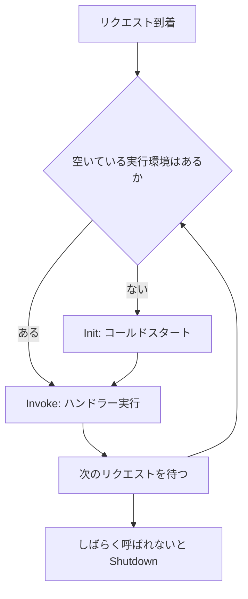

# AWS Lambda

サーバーを管理せずに、イベントに応じてコードを実行するサービス。短時間の処理、API のバックエンド、データ変換に使う。

[](../assets/diagrams/lambda-invocation.png)

!!! note "Event Function という呼び方"
    現在の公式ドキュメントは、従来の Lambda 関数を **Event Function** と呼ぶ。Lambda Web Functions や Lambda MicroVMs と区別するためで、関数というリソース自体は変わらない。このページの「関数」は Event Function を指す。

## 実行モデル {#execution-model}

Lambda はリクエストごとに **実行環境** を割り当てる。1つの実行環境は同時に1リクエストだけを処理する。同時リクエストが増えると、実行環境も増える。

実行環境のライフサイクルは次の順に進む。

| フェーズ | 内容 |
| --- | --- |
| Init | 環境を作り、拡張機能とランタイムを起動し、ハンドラー外のコードを実行する。10 秒以内に終わらないと、最初の呼び出し時に再試行される |
| Restore | SnapStart のときだけ。スナップショットから復元する |
| Invoke | ハンドラーを実行する |
| Shutdown | しばらく呼び出しがないと環境を破棄する |

新しい実行環境で Init が走るときの遅延を **コールドスタート** と呼ぶ。Invoke が終わった環境は次のリクエストに再利用される場合があるが、再利用は保証されない。永続化したい状態は DynamoDB などの外部に置く。



## ハンドラー {#handler}

ハンドラーはイベントを受け取る入口の関数。Python では `ファイル名.関数名` の形式で設定する。下の例の設定値は `app.handler`。

```python
import json
import os

import boto3

# ハンドラーの外で初期化すると、再利用された環境では再実行されない
table = boto3.resource("dynamodb").Table(os.environ["TABLE_NAME"])


def handler(event, context):
    # event: 呼び出し元が渡す JSON。context: 実行時の情報
    print(context.aws_request_id, context.get_remaining_time_in_millis())
    table.put_item(Item={"id": event["id"]})
    return {"statusCode": 200, "body": json.dumps({"ok": True})}
```

## 設定項目 {#configuration}

| 項目 | 値 | メモ |
| --- | --- | --- |
| メモリ | 128〜10,240 MB（1 MB 単位） | CPU はメモリに比例する。1,769 MB で 1 vCPU 相当 |
| タイムアウト | 既定 3 秒、最大 900 秒（15 分） | 超えると実行が打ち切られる |
| `/tmp` | 512〜10,240 MB | 実行環境が再利用されれば中身も残る |
| 環境変数 | 全変数の合計で 4 KB | 下の「環境変数」を参照 |
| レイヤー | 1関数に最大 5 個 | .zip の関数でのみ使える |
| アーキテクチャ | `x86_64` または `arm64` | `arm64` は Graviton |
| ペイロード | 同期 6 MB、非同期 1 MB | ストリーミング応答は最大 200 MB |

### ランタイムとハンドラー {#runtime}

ランタイムは `python3.13` のような言語実行環境を指す。AWS の管理ランタイムのほか、独自の実行環境を載せる OS 専用ランタイムもある。ランタイムには廃止予定日があるので、更新を計画しておく。

### レイヤー {#layers}

共通ライブラリや設定ファイルをまとめた .zip で、関数とは別にバージョン管理する。

- 関数の実行時に `/opt` に展開される。
- Python では `python/` フォルダに入れて作ると、インポートのパスに入る。
- 複数の関数で同じ依存関係を共有でき、デプロイパッケージを小さくできる。
- 展開後のサイズは関数本体と合わせて 250 MB まで。
- コンテナイメージの関数では使えない。依存関係はイメージに含める。

### 拡張機能 {#extensions}

監視やセキュリティのツールを実行環境に組み込む仕組み。主にレイヤーとして追加する。

| 種類 | 動き方 |
| --- | --- |
| 内部拡張機能 | ランタイムのプロセスの一部として動く。ラッパースクリプトや `JAVA_TOOL_OPTIONS` で設定する |
| 外部拡張機能 | 独立したプロセスとして動く。`/opt/extensions/` に置く。関数の応答後も動き続けられる |

外部拡張機能は Init 時間やメモリを消費し、関数の性能に影響することがある。Telemetry API を使うと、ログなどを拡張機能で受け取れる。

### 環境変数 {#environment-variables}

環境ごとに変わる値（テーブル名、接続先、ログレベルなど）をコードから分離する。

```python
import os

table_name = os.environ["TABLE_NAME"]
region = os.environ["AWS_REGION"]  # Lambda が予約している変数の一つ
```

`AWS_REGION` や `AWS_LAMBDA_FUNCTION_NAME` のように、Lambda が予約している変数は上書きできないものがある。

バージョンを発行すると環境変数も固定される。同じコードで値だけ環境ごとに変えたいときは、環境ごとにバージョンを発行するか、別の関数に分ける。[設定管理の選択肢](secrets.md) も参照する。

### 環境変数の暗号化 {#encrypting-env-vars}

機密情報は [Secrets Manager](secrets.md) に置き、環境変数にはシークレット名だけを入れるのが基本。環境変数に機密情報を入れる場合の暗号化は次の2段階がある。

| 段階 | 内容 | 必要な設定 |
| --- | --- | --- |
| 保存時（サーバー側） | 常に KMS で暗号化される。既定は AWS マネージドキー | ローテーションなどを自分で管理したいときは、カスタマーマネージドキーを指定する（`KMSKeyArn`） |
| 転送時（クライアント側） | コンソールの暗号化ヘルパーで、値を送信前に暗号化する | 実行ロールに `kms:Decrypt` を与え、コードで復号する |

暗号化ヘルパーを使うと、コンソールや API の表示でも値は暗号文のままになる。コードでは次のように復号する。

```python
import base64
import os

import boto3

kms = boto3.client("kms")
plain = kms.decrypt(
    CiphertextBlob=base64.b64decode(os.environ["DB_PASSWORD"]),
    EncryptionContext={"LambdaFunctionName": os.environ["AWS_LAMBDA_FUNCTION_NAME"]},
)["Plaintext"].decode()
```

カスタマーマネージドキーを使う場合、環境変数を閲覧・管理するユーザーやロールにも `kms:Decrypt` などの権限が必要になる。KMS の詳細は [KMS](kms.md) を参照する。

## VPC 内のリソースへのアクセス {#vpc-access}

[](../assets/diagrams/lambda-vpc.png)

既定の Lambda は AWS 管理の VPC で動く。インターネットには出られるが、自分の VPC のプライベートリソース（RDS、ElastiCache など）には届かない。届かせるには、関数に VPC 設定を追加する。

1. 関数の VPC 設定で、VPC、プライベートサブネット、セキュリティグループを指定する。
2. 実行ロールに `AWSLambdaVPCAccessExecutionRole` を付ける。これには `ec2:CreateNetworkInterface` などのネットワークインターフェイス管理権限が含まれる。
3. 接続先のセキュリティグループで、関数のセキュリティグループからの通信を許可する。

Lambda はサブネットに **Hyperplane ENI** を作り、関数の通信をそこに流す。可用性のため、複数のアベイラビリティーゾーンのサブネットを指定する。

VPC に接続すると、関数の通信は VPC の中に閉じる。外に出る経路は自分で用意する。

| 接続先 | 経路 |
| --- | --- |
| インターネット | プライベートサブネット → NAT ゲートウェイ（パブリックサブネット）→ インターネットゲートウェイ |
| S3、DynamoDB | ゲートウェイ型の VPC エンドポイント |
| Secrets Manager、KMS など | インターフェイス型の VPC エンドポイント（PrivateLink） |

!!! warning "パブリックサブネットに置いてもインターネットに出られない"
    関数をパブリックサブネットに接続しても、パブリック IP は付かない。インターネットが必要なら NAT ゲートウェイを使う。

RDS に多数の関数からつなぐ場合、接続数が増えすぎないように [RDS Proxy](databases.md) を間に置く。頻繁に短い接続を作る関数に AWS が勧めている構成で、本番向けでもある。ネットワークの詳細は [ネットワーク](networking.md) を参照する。

## 同時実行とスケーリング {#concurrency}

**同時実行数** は同じ瞬間に処理中のリクエスト数で、次の式で見積もる。

```text
同時実行数 = 平均リクエスト数/秒 × 平均実行時間（秒）
```

例: 100 リクエスト/秒で、平均 0.5 秒かかる関数の同時実行数は 50。

### クォータとスケーリング速度 {#concurrency-quota}

| 項目 | 値 |
| --- | --- |
| アカウントの同時実行数 | リージョンごとに既定 1,000（引き上げ可）。新しいアカウントはもっと低いことがある |
| スケーリング速度（バースト） | 関数ごとに 10 秒あたり 1,000 実行環境まで |
| 同期呼び出しのリクエスト数 | 同時実行数の 10 倍/秒まで |

スケーリング速度は関数単位で、使わなかった分は持ち越せない。急増時はこの速度を超えた分がスロットリングされることがある。

### 予約済みと Provisioned の違い {#reserved-provisioned}

| | 予約済み同時実行 | Provisioned Concurrency |
| --- | --- | --- |
| 目的 | 同時実行数の確保と上限設定 | コールドスタートの削減 |
| 実行環境 | 事前に用意しない | 事前に初期化して待機させる |
| 料金 | 設定自体は無料 | 追加料金あり |
| 対象 | 関数全体 | バージョンまたはエイリアス（`$LATEST` は不可） |
| 超過時 | スロットリング | 通常の同時実行にあふれる |
| 用途 | 重要な関数の枠を確保、下流の DB を守るための上限、緊急停止（0 に設定） | レイテンシーに厳しい API、予測できるピーク |

- 予約できる量は、未予約の同時実行数から 100 を引いた分まで。残り 100 は予約のない関数のために残る。
- 予約を増やすと、他の関数が使える共有プールは減る。
- 両方を設定する場合、Provisioned は予約済みの値を超えられない。
- Provisioned は Application Auto Scaling で調整できる。ピークの時刻が決まっているならスケジュール、そうでなければ使用率によるターゲット追跡を使う。
- あふれた呼び出しは `ProvisionedConcurrencySpilloverInvocations` メトリクスで確認する。

### スロットリング {#throttling}

同時実行の上限を超えるとスロットリングされる。動きは呼び出し方で変わる。

| 呼び出し方 | スロットリング時の動き |
| --- | --- |
| 同期 | `429 TooManyRequestsException` を返す。リトライは呼び出し側の責任 |
| 非同期 | イベントをキューに戻し、既定で最大 6 時間、間隔を広げながら再試行する |
| SQS のイベントソースマッピング | ポーリングの同時実行を徐々に下げながら、可視性タイムアウトまで再試行する。その後はキューのリドライブ設定に従う |
| ストリームのイベントソースマッピング | レコードの期限切れまで再試行する。関数のエラーと違い、`MaximumRetryAttempts` には数えない |

### スレッドとコネクションプール {#connection-pooling}

Lambda では1つの実行環境が同時に1リクエストしか処理しない。そのため、大きなコネクションプールは不要で、環境ごとに1接続を使い回すのが基本になる。ただし環境の数だけ接続が増えるので、RDS には RDS Proxy を使う。

EC2 や [コンテナ](containers.md) のように1プロセスが多数のリクエストをさばく環境では、スレッドプールとコネクションプールのサイズを、CPU 数と下流の接続上限に合わせて決める。増やしすぎると、DB 側の接続数の上限に達する。負荷に応じたインスタンス数の調整は [EC2 Auto Scaling](ec2-beanstalk.md) を使う。

## 呼び出しの種類 {#invocation-types}

| 種類 | 代表的な呼び出し元 | 動き | エラー時 |
| --- | --- | --- | --- |
| 同期 | API Gateway、`Invoke`（`RequestResponse`） | 終了を待って結果を返す | 呼び出し元が判断する |
| 非同期 | S3、SNS、EventBridge、`Invoke`（`Event`） | Lambda が内部キューに入れて 202 を返す | Lambda が再試行する |
| イベントソースマッピング | SQS、Kinesis、DynamoDB Streams、Kafka | Lambda 側のポーラーが取得し、バッチで同期呼び出しする | ソースごとの規則に従う |

```python
import json

import boto3

client = boto3.client("lambda")

# 同期: 関数のエラーは例外にならず FunctionError に入る
res = client.invoke(
    FunctionName="my-function:prod",
    InvocationType="RequestResponse",
    Payload=json.dumps({"id": "1"}),
)
if "FunctionError" in res:
    print("関数でエラー", res["Payload"].read())

# 非同期: StatusCode は 202
client.invoke(FunctionName="my-function:prod", InvocationType="Event", Payload=b"{}")
```

`InvocationType` にはもう一つ `DryRun` があり、実行せずにパラメーターと権限だけ確認する。

### 呼び出し権限の向き {#invocation-permissions}

権限を与える先は、呼び出し方で変わる。試験でよく問われる。

| 方式 | 必要な権限 |
| --- | --- |
| 同期と非同期（プッシュ） | **関数のリソースベースポリシー** で呼び出し元のサービスに `lambda:InvokeFunction` を許可する |
| イベントソースマッピング（ポーリング） | **実行ロール** に読み取り権限を付ける（SQS なら `sqs:ReceiveMessage`、`sqs:DeleteMessage` など） |

### イベントソースマッピング {#event-source-mapping}

Lambda のリソースとしてソースとの紐付けを作り、バッチサイズなどを調整する。

```python
import boto3

boto3.client("lambda").create_event_source_mapping(
    EventSourceArn="arn:aws:sqs:ap-northeast-1:111122223333:orders",
    FunctionName="my-function:prod",
    BatchSize=10,
    MaximumBatchingWindowInSeconds=5,
    FunctionResponseTypes=["ReportBatchItemFailures"],
)
```

| 設定 | SQS | Kinesis と DynamoDB Streams |
| --- | --- | --- |
| `BatchSize` | 既定 10。標準キューは最大 10,000、FIFO は最大 10 | Kinesis は既定 100、最大 10,000 |
| `MaximumBatchingWindowInSeconds` | 既定 0、最大 300。FIFO では使えない | 既定 0、最大 300 |
| 同時実行の制御 | `ScalingConfig` の最大同時実行数、または provisioned mode | `ParallelizationFactor`（1〜10）でシャードごとの並列数を増やす |
| 再試行の制御 | 可視性タイムアウトと `maxReceiveCount` | `MaximumRetryAttempts`、`MaximumRecordAgeInSeconds`、`BisectBatchOnFunctionError` |
| 失敗の記録先 | キュー側の DLQ | `DestinationConfig`（SQS、SNS、S3） |

処理は少なくとも1回で、重複があり得る。関数は [冪等](sdk-resilience.md) に作る。

SQS と組み合わせるときは、次の2点を守る。

- キューの可視性タイムアウトを関数のタイムアウトの **6 倍以上** にする。関数のタイムアウトより短いと、マッピングの作成時にエラーになる。
- リドライブポリシーの `maxReceiveCount` を **5 以上** にする。少なすぎると、スロットリングだけで DLQ に送られることがある。

## 再試行の動き {#retries}

| 呼び出し方 | Lambda の再試行 | 調整方法 |
| --- | --- | --- |
| 同期 | しない。SDK や CLI がタイムアウトやスロットリングで自動再試行する | 呼び出し側の [再試行設定](sdk-resilience.md) |
| 非同期 | 関数エラーは最大 2 回。1回目の再実行まで1分、2回目まで2分。スロットリングと 500 番台は最大 6 時間 | `MaximumRetryAttempts`（0〜2）、`MaximumEventAgeInSeconds`（最大 6 時間） |
| SQS | 可視性タイムアウト後に再度見えるようになる | 可視性タイムアウト、`maxReceiveCount`、DLQ |
| Kinesis、DynamoDB Streams | バッチ全体をレコードが期限切れになるまで再試行し、そのシャードは止まる | `MaximumRetryAttempts`、`MaximumRecordAgeInSeconds`、バッチ分割、部分バッチレスポンス |

非同期呼び出しでは、エラーがなくても同じイベントが2回届くことがある。詰まったシャードは `IteratorAge` メトリクスの増加で検知する。

## デスティネーションと DLQ {#destinations-dlq}

どちらも非同期呼び出しで使う。デスティネーションは処理結果の後続処理にも使え、DLQ は破棄されたイベントを残す。DLQ は関数単位の設定で、バージョンごとには変えられない。

| | デスティネーション | デッドレターキュー（DLQ） |
| --- | --- | --- |
| 対象 | 成功と失敗を別々に指定 | 失敗のみ |
| 送信先 | SQS 標準、SNS 標準、Lambda、EventBridge、S3（失敗時のみ） | SQS 標準、SNS 標準 |
| 送る内容 | リクエストとレスポンスの詳細を含む呼び出しレコード | イベントの本文のみ |
| 向いている場面 | 新規の構成、成功時の後続処理、原因調査 | 既存の構成、イベントだけ残せばよい場合 |

- FIFO のキューやトピックは送信先にできない。失敗すると `DestinationDeliveryFailures` メトリクスが増える。
- 実行ロールには送信先への権限（`sqs:SendMessage`、`sns:Publish` など）が必要。
- SNS を送信先にすると、メッセージの上限（既定 256 KiB）を超える場合がある。

```python
import boto3

boto3.client("lambda").put_function_event_invoke_config(
    FunctionName="my-function",
    Qualifier="prod",
    MaximumRetryAttempts=1,
    MaximumEventAgeInSeconds=3600,
    DestinationConfig={
        "OnSuccess": {"Destination": "arn:aws:sqs:ap-northeast-1:111122223333:done"},
        "OnFailure": {"Destination": "arn:aws:sns:ap-northeast-1:111122223333:alerts"},
    },
)
```

イベントソースマッピングは別の仕組みを使う。

| ソース | 失敗の退避先 |
| --- | --- |
| Kinesis、DynamoDB Streams、Kafka | マッピングのオンフェイラーデスティネーション |
| SQS | キューのリドライブポリシーで設定する DLQ |

## 部分バッチレスポンス {#partial-batch-response}

既定では、バッチ内の1件でも失敗すると全件が再処理される。`ReportBatchItemFailures` を有効にして、失敗した分だけ返すと、成功分の重複処理を防げる。

```python
def handler(event, context):
    failures = []
    for record in event["Records"]:
        try:
            process(record["body"])
        except Exception:
            # SQS は messageId を返す
            failures.append({"itemIdentifier": record["messageId"]})
    return {"batchItemFailures": failures}
```

- コードだけでは動かない。マッピングの `FunctionResponseTypes` にも設定が必要。
- FIFO キューでは、最初の失敗で処理を止め、失敗分と未処理分をすべて返す。順序を守るため。
- ストリームでは `itemIdentifier` にシーケンス番号を入れる。複数返すと最小の番号がチェックポイントになり、そこから再試行する。
- 有効にすると、SQS のマッピングは失敗時にポーリングを絞らなくなる。
- Powertools for AWS Lambda の Batch Processor を使うと実装を省ける。

## バージョンとエイリアス {#versions-aliases}

| | バージョン | エイリアス |
| --- | --- | --- |
| 実体 | 発行時点のコードと設定のスナップショット | バージョンを指すポインター |
| 変更 | 発行後は変更できない（一部の設定を除く） | 指す先を変更できる |
| 作り方 | `PublishVersion` | `CreateAlias`、`UpdateAlias` |
| ARN | 末尾に `:3` のような番号 | 末尾に `:prod` のような名前 |

`$LATEST` は未発行で、デプロイのたびに上書きされる。本番は発行済みバージョンを指すエイリアス経由で呼ぶ。こうすると、呼び出し元を変えずに切り替えとロールバックができる。

```python
import boto3

client = boto3.client("lambda")
version = client.publish_version(FunctionName="my-function")["Version"]
client.update_alias(FunctionName="my-function", Name="prod", FunctionVersion=version)
```

### エイリアスによる環境の分離 {#alias-environments}

`dev`、`test`、`prod` のエイリアスを作り、承認済みのバージョンを `test` や `prod` に割り当てる。統合テストは `test` エイリアスに対して実行する。API Gateway からは [ステージ変数](api-gateway.md) でエイリアスを切り替えられる。

### トラフィックの分割 {#alias-routing}

重み付きエイリアスで、2つのバージョンにトラフィックを分けられる（カナリアリリース）。

```python
import boto3

boto3.client("lambda").update_alias(
    FunctionName="my-function",
    Name="prod",
    FunctionVersion="4",
    RoutingConfig={"AdditionalVersionWeights": {"5": 0.1}},  # v5 に 10%
)
```

- 指定できるのは2バージョンまで。
- どちらも発行済みで、実行ロールと DLQ の設定が同じである必要がある。`$LATEST` は不可。
- どちらが動いたかは、ログや `x-amz-executed-version` ヘッダーで分かる。

CodeDeploy を使うと、この切り替えを自動化できる。詳細は [CI/CD](cicd.md) を参照する。

## デプロイパッケージ {#packaging}

| | .zip | .zip + レイヤー | コンテナイメージ |
| --- | --- | --- | --- |
| 上限 | 直接アップロードは 50 MB、展開後 250 MB。大きいファイルは S3 経由 | レイヤーを含めて展開後 250 MB | 10 GB |
| 依存関係 | パッケージに同梱 | レイヤーで共有 | イメージに同梱 |
| 置き場所 | Lambda または S3 | Lambda または S3 | [Amazon ECR](containers.md) |
| 向いている場面 | 小さく単純な関数 | 複数の関数で共通の依存関係がある | 大きな依存関係、Docker のビルドに統一したい |

### 効率を上げるコツ {#packaging-tips}

- パッケージは必要なものだけにする。使っていない依存関係は削る。
- ネイティブ拡張を含むライブラリは、関数のアーキテクチャに合わせてビルドする。
- コンテナイメージは AWS のベースイメージを使うと、ランタイムインターフェイスクライアントとローカルテスト用のエミュレーターが入っている。
- AWS 以外のベースイメージでは、ランタイムインターフェイスクライアントを自分で追加する。
- コンテナはマルチステージビルドで小さくする。

```dockerfile
FROM public.ecr.aws/lambda/python:3.13
COPY requirements.txt ${LAMBDA_TASK_ROOT}
RUN pip install -r requirements.txt --target ${LAMBDA_TASK_ROOT}
COPY app.py ${LAMBDA_TASK_ROOT}
CMD ["app.handler"]
```

## 性能チューニング {#performance}

### メモリと CPU の最適化 {#memory-tuning}

メモリを増やすと CPU も増える。実行時間が短くなれば、メモリ単価が上がっても料金が下がる場合がある。

1. ログの `REPORT` 行で `Max Memory Used` を確認する。
2. メモリを変えて負荷テストする。CPU を使う処理ほど効果が出る。
3. オープンソースの AWS Lambda Power Tuning で、料金と速度のバランスを調べる。

```text
REPORT RequestId: ... Duration: 12.34 ms Billed Duration: 100 ms Memory Size: 128 MB Max Memory Used: 18 MB
```

### コールドスタートを減らす {#cold-start}

| 方法 | 内容 |
| --- | --- |
| Provisioned Concurrency | 初期化済みの環境を待機させる。最も確実だが料金がかかる |
| SnapStart | バージョン発行時に初期化し、スナップショットから復元する。Java 11 以降、Python 3.12 以降、.NET 8 以降 |
| 初期化の軽量化 | 不要な依存関係を削る。あまり使わないクライアントは必要になってから作る |
| パッケージの縮小 | 読み込むコードを減らす |

SnapStart は発行済みのバージョンとエイリアスでのみ使える。Provisioned Concurrency、EFS、512 MB を超える `/tmp` とは併用できない。スナップショットから復元するので、乱数やネットワーク接続など、環境ごとに一意であるべき値の扱いに注意する。

### コードの最適化 {#code-optimization}

- SDK クライアントと DB 接続はハンドラーの外で作り、再利用する。
- 静的データは `/tmp` にキャッシュする。ただしユーザーデータは残さない。
- keep-alive で接続を維持する。
- 関数が自分自身を呼び出す構成を避ける。S3 トリガーの関数が同じバケットに書くと、無限ループになる。
- ボトルネックの調査は [X-Ray と CloudWatch](observability.md) を使う。

## ほぼリアルタイムのデータ処理 {#near-real-time}

| ソース | 処理の例 | 押さえる設定 |
| --- | --- | --- |
| Kinesis Data Streams | クリックストリームの集計、不正検知 | `BatchSize`、`ParallelizationFactor`、拡張ファンアウト |
| DynamoDB Streams | 変更の検知、別テーブルへの反映 | `StartingPosition`、部分バッチレスポンス |
| S3 イベント通知 | アップロードされたファイルの変換 | プレフィックスとサフィックスのフィルター |
| Data Firehose | レコードの変換、形式の変更 | 変換関数のレスポンス形式 |

- シャードの中は順番に処理される。処理が追いつかなければ `ParallelizationFactor` を上げるか、シャードを増やす。
- 時間枠での集計には、Kinesis と DynamoDB Streams のタンブリングウィンドウ（`TumblingWindowInSeconds`）を使う。
- 詳細は [ストリーミング](streaming.md) を参照する。

Kinesis のイベントではデータが Base64 で届く。

```python
import base64
import json


def handler(event, context):
    for record in event["Records"]:
        payload = json.loads(base64.b64decode(record["kinesis"]["data"]))
        print(record["kinesis"]["partitionKey"], payload)
```

## テストイベントとテスト {#testing}

テストイベントは、関数に渡す JSON のこと。入力を選ばないなら `{}` でよい。

| 方法 | 内容 |
| --- | --- |
| コンソールのプライベートイベント | 作成者だけが使える。関数ごとに 10 個まで |
| コンソールの共有イベント | 同じアカウントのユーザーと共有する。スキーマレジストリ `lambda-testevent-schemas` に保存される |
| `sam local generate-event` | S3 や SQS などの本物と同じ形のサンプルを生成する |
| `sam local invoke` | ローカルの Docker で1回実行する |
| `sam local start-lambda` | ローカルにエンドポイントを立て、自動テストから呼ぶ |

```bash
# SQS のサンプルイベントを作ってローカル実行する
sam local generate-event sqs receive-message > event.json
sam local invoke MyFunction -e event.json

# デプロイ済みの関数を CLI で呼ぶ
aws lambda invoke --function-name my-function:test \
  --cli-binary-format raw-in-base64-out \
  --payload file://event.json response.json
```

SQS のイベントは次の形になる。`body` は文字列なので、JSON なら自分で解析する。

```json
{
  "Records": [
    {
      "messageId": "059f36b4-87a3-44ab-83d2-661975830a7d",
      "receiptHandle": "AQEBwJnKyrHigUMZj6rYigCgxlaS3SLy0a",
      "body": "{\"orderId\": \"1\"}",
      "attributes": { "ApproximateReceiveCount": "1" },
      "eventSource": "aws:sqs",
      "awsRegion": "ap-northeast-1"
    }
  ]
}
```

API Gateway 用のテストイベントは [API Gateway のページ](api-gateway.md) を、スタブを使う単体テストは [SDK と耐障害性](sdk-resilience.md) を参照する。

## 試験のポイント {#exam-points}

| こう問われたら | 答え |
| --- | --- |
| Lambda から RDS（プライベート）につなぐ | VPC 設定を追加し、`AWSLambdaVPCAccessExecutionRole` を付ける |
| VPC 接続した Lambda から外部 API を呼ぶ | NAT ゲートウェイを通す。パブリックサブネットでは解決しない |
| VPC 接続した Lambda から S3 を安く使う | ゲートウェイ型 VPC エンドポイント |
| コールドスタートをなくしたい | Provisioned Concurrency |
| Java などの起動を低コストで速くしたい | SnapStart |
| 重要な関数の同時実行数を確保したい | 予約済み同時実行 |
| 下流の DB を守るため同時実行を制限したい | 予約済み同時実行で上限を設定 |
| 関数を緊急停止したい | 予約済み同時実行を 0 にする |
| 同期呼び出しで 429 | 同時実行の上限超過。上限の引き上げや呼び出し側の再試行を検討 |
| 非同期の失敗をレスポンス付きで残す | オンフェイラーデスティネーション |
| 成功時に次の処理へつなぐ | オンサクセスデスティネーション |
| SQS のバッチで一部だけ再処理したい | `ReportBatchItemFailures` と `batchItemFailures` |
| SQS トリガーで重複処理が起きる | 可視性タイムアウトを関数のタイムアウトの 6 倍以上に |
| Kinesis のシャードが毒レコードで止まる | `BisectBatchOnFunctionError`、最大再試行回数、オンフェイラーデスティネーション |
| 呼び出し元を変えずに本番を切り替えたい | エイリアスの指す先を更新 |
| 新バージョンに 10% だけ流したい | 重み付きエイリアス |
| 依存関係を複数の関数で共有 | レイヤー |
| 依存関係が 250 MB を超える | コンテナイメージ（最大 10 GB） |
| 実行が遅くて CPU が足りない | メモリを増やす。CPU が比例して増える |
| 環境変数の値をコンソールでも隠したい | 暗号化ヘルパー（クライアント側暗号化）とコードでの復号 |
| 15 分を超える処理 | [Step Functions](step-functions.md) に分割、または [コンテナ](containers.md) |

## 関連ページ {#related}

- [API Gateway](api-gateway.md)
- [メッセージング](messaging.md)
- [ストリーミング](streaming.md)
- [Step Functions](step-functions.md)
- [SDK と耐障害性](sdk-resilience.md)
- [IAM](iam.md)
- [オブザーバビリティ](observability.md)

## 参考 {#references}

- [Lambda quotas](https://docs.aws.amazon.com/lambda/latest/dg/gettingstarted-limits.html)
- [Lambda execution environment](https://docs.aws.amazon.com/lambda/latest/dg/lambda-runtime-environment.html)
- [Invocation methods](https://docs.aws.amazon.com/lambda/latest/dg/lambda-invocation.html)
- [Error handling for asynchronous invocation](https://docs.aws.amazon.com/lambda/latest/dg/invocation-async-error-handling.html)
- [Retaining records of asynchronous invocations](https://docs.aws.amazon.com/lambda/latest/dg/invocation-async-retain-records.html)
- [Event source mappings](https://docs.aws.amazon.com/lambda/latest/dg/invocation-eventsourcemapping.html)
- [Using Lambda with Amazon SQS](https://docs.aws.amazon.com/lambda/latest/dg/with-sqs.html)
- [Kinesis partial batch response](https://docs.aws.amazon.com/lambda/latest/dg/services-kinesis-batchfailurereporting.html)
- [Understanding Lambda function scaling](https://docs.aws.amazon.com/lambda/latest/dg/lambda-concurrency.html)
- [Provisioned concurrency](https://docs.aws.amazon.com/lambda/latest/dg/provisioned-concurrency.html)
- [Connecting functions to a VPC](https://docs.aws.amazon.com/lambda/latest/dg/configuration-vpc.html)
- [Securing environment variables](https://docs.aws.amazon.com/lambda/latest/dg/configuration-envvars-encryption.html)
- [Layers](https://docs.aws.amazon.com/lambda/latest/dg/chapter-layers.html)
- [Extensions](https://docs.aws.amazon.com/lambda/latest/dg/lambda-extensions.html)
- [Versions](https://docs.aws.amazon.com/lambda/latest/dg/configuration-versions.html)
- [Aliases](https://docs.aws.amazon.com/lambda/latest/dg/configuration-aliases.html)
- [SnapStart](https://docs.aws.amazon.com/lambda/latest/dg/snapstart.html)
- [Best practices](https://docs.aws.amazon.com/lambda/latest/dg/best-practices.html)
- [Testing in the console](https://docs.aws.amazon.com/lambda/latest/dg/testing-functions.html)
- [sam local generate-event](https://docs.aws.amazon.com/serverless-application-model/latest/developerguide/using-sam-cli-local-generate-event.html)
- [sam local invoke](https://docs.aws.amazon.com/serverless-application-model/latest/developerguide/using-sam-cli-local-invoke.html)
