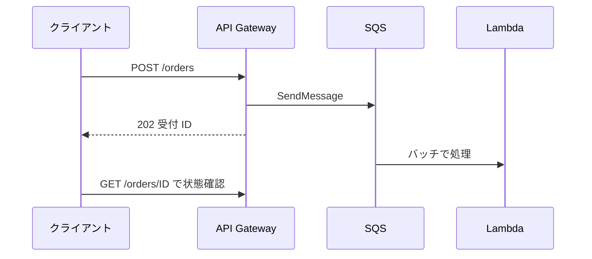
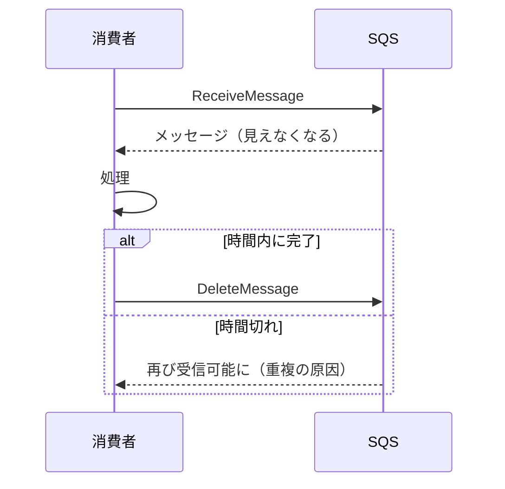
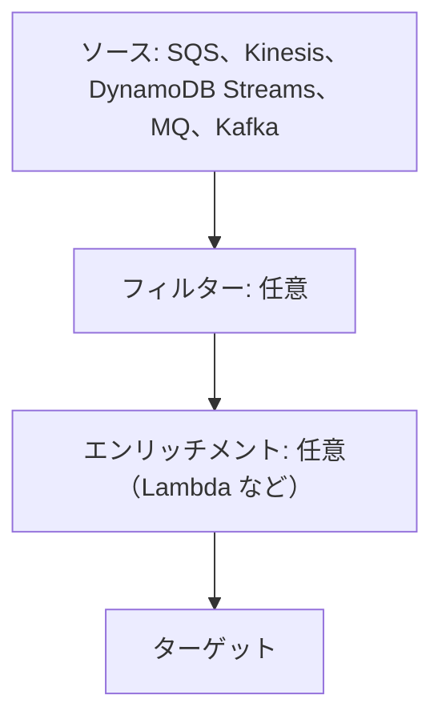
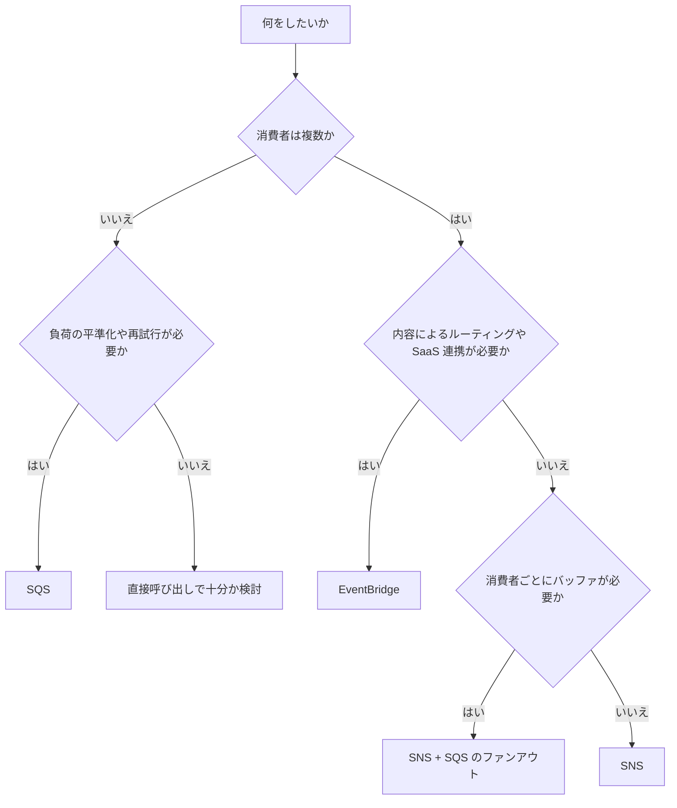

# メッセージングとイベント（SQS、SNS、EventBridge）

サービス同士を直接呼ばずにつなぐ仕組み。キューの Amazon SQS、通知の Amazon SNS、イベントルーターの Amazon EventBridge を、用途に応じて選んで使う。

[](../assets/diagrams/messaging-fanout.png)

## 密結合と疎結合 {#coupling}

| | 密結合 | 疎結合 |
| --- | --- | --- |
| つなぎ方 | 呼び出し先を直接呼ぶ | キューやイベントを間に挟む |
| 相手の障害 | 自分も失敗する | メッセージがたまり、復旧後に処理できる |
| 負荷の急増 | そのまま相手に届く | キューがバッファになる |
| 変更 | 呼び出し元の修正が必要 | 購読者を増やすだけで済む場合が多い |
| 動作の追跡 | 単純 | 分散するので X-Ray などが要る |

密結合のサインは「A の障害で B も止まる」「消費者を追加するたびに発行者のコードを変える」「B のピークに合わせて A も増やす」など。

| 解決したい問題 | 使うサービス |
| --- | --- |
| 処理を後回しにして負荷を平準化 | SQS |
| 1つの出来事を複数の宛先へ | SNS または EventBridge |
| 内容に応じて宛先を振り分け、SaaS とも連携 | EventBridge |
| 手順の順序や分岐を管理 | [Step Functions](step-functions.md) |
| 大量のデータを順序付きで複数の消費者へ | [Kinesis Data Streams](streaming.md) |

## 同期と非同期 {#sync-async}

| | 同期 | 非同期 |
| --- | --- | --- |
| 呼び出し元 | 結果が返るまで待つ | 受け付けだけ確認して先に進む |
| 例 | API Gateway + Lambda | SQS ベースの処理、EventBridge のイベント駆動 |
| 向いている場面 | 結果がすぐ必要、読み取り、短い処理 | 長い処理、ピークがある処理、複数の処理に広げたいとき |
| エラーの扱い | 呼び出し元がその場で扱う | DLQ、再試行、後からの処理 |
| 注意点 | 下流の遅延がそのまま伝わる | 結果の通知方法、重複、順序を考える必要がある |



API Gateway の統合タイムアウト（REST API の既定は 29 秒）を超えそうな処理は、この形にする。呼び出し方の違いは [Lambda](lambda.md) を参照する。

## SQS {#sqs}

メッセージをためるキュー。消費者が **取りに行く** プル型で、1つのメッセージは基本的に1つの消費者が処理する。

```python
import boto3

sqs = boto3.client("sqs")
url = sqs.get_queue_url(QueueName="orders")["QueueUrl"]

sqs.send_message(QueueUrl=url, MessageBody='{"orderId": "1"}')

res = sqs.receive_message(
    QueueUrl=url,
    MaxNumberOfMessages=10,
    WaitTimeSeconds=20,   # ロングポーリング
    VisibilityTimeout=60,
)
for m in res.get("Messages", []):
    process(m["Body"])
    # 処理後に自分で削除する。削除しないとまた受信される
    sqs.delete_message(QueueUrl=url, ReceiptHandle=m["ReceiptHandle"])
```

### 標準と FIFO {#standard-fifo}

| | 標準キュー | FIFO キュー |
| --- | --- | --- |
| 配信 | 少なくとも1回。重複があり得る | 重複を持ち込まない（5 分の重複排除） |
| 順序 | ベストエフォート | メッセージグループ内で保証 |
| スループット | ほぼ無制限 | パーティションごとに API アクションあたり 300 回/秒。バッチで 3,000 件/秒。高スループットモードあり |
| 名前 | 自由 | `.fifo` で終わる |
| 向いている場面 | スループット優先 | 順序や重複防止が必須 |

FIFO の属性は次の2つを押さえる。

| 属性 | 役割 |
| --- | --- |
| `MessageGroupId` | 順序を守る単位で、FIFO では必須。同じグループは同時に処理されない。処理中のメッセージがあると、同じグループの次のメッセージは渡されない |
| `MessageDeduplicationId` | 5 分間の重複排除に使う。明示するか、本文の SHA-256 を使う `ContentBasedDeduplication` を有効にする |

```python
sqs.send_message(
    QueueUrl=fifo_url,
    MessageBody='{"orderId": "1"}',
    MessageGroupId="customer-123",
    MessageDeduplicationId="order-1",
)
```

スループットを上げるには、グループ ID の種類を増やし、高スループットモードを有効にする（`DeduplicationScope` を `messageGroup`、`FifoThroughputLimit` を `perMessageGroupId`）。

標準キューでも `MessageGroupId` を指定すると **フェアキュー** になり、特定のテナントの大量メッセージが他のテナントの遅延を招く問題を和らげられる。

### 主な設定と上限 {#sqs-limits}

| 項目 | 既定 | 範囲 |
| --- | --- | --- |
| メッセージサイズ | | 1 バイト〜1 MiB |
| 保持期間 | 4 日 | 1 分〜14 日 |
| 可視性タイムアウト | 30 秒 | 0 秒〜12 時間 |
| 遅延 | 0 秒 | 0〜15 分 |
| ロングポーリングの待ち時間 | 0 秒（ショートポーリング） | 最大 20 秒 |
| バッチの件数 | | 最大 10 件 |
| 処理中（in-flight）メッセージ | | 標準は約 120,000、FIFO は 120,000 |

1 MiB を超えるものは、Extended Client Library で本体を S3 に置く。

### 可視性タイムアウト {#visibility-timeout}

受信されたメッセージは消えず、この時間だけ他の消費者から見えなくなる。時間内に `DeleteMessage` しないと再び見えるようになる。



- 処理時間より長く設定する。短いと重複処理の原因になる。
- 処理が長引くなら `ChangeMessageVisibility` で延長する。
- 処理をやめるなら 0 にして、すぐ他の消費者に渡す。
- Lambda のトリガーでは、関数のタイムアウトの 6 倍以上に設定する。
- ショートポーリングで処理中の上限に達すると `OverLimit` エラーになる。

### ショートポーリングとロングポーリング {#long-polling}

| | ショート | ロング |
| --- | --- | --- |
| 設定 | `WaitTimeSeconds` が 0 | 1〜20 |
| 動き | サーバーの一部だけ見てすぐ返す | 全サーバーを見て、メッセージが来るか時間切れまで待つ |
| 空の応答 | 多い | 少ない |
| 料金 | リクエストが多いと高くなる | 下げられる |

キュー全体には `ReceiveMessageWaitTimeSeconds` を設定する。特別な理由がなければロングポーリングを使う。

### デッドレターキュー {#sqs-dlq}

繰り返し失敗するメッセージを別のキューに移し、処理全体が詰まらないようにする。

```python
import json

sqs.set_queue_attributes(
    QueueUrl=url,
    Attributes={
        "RedrivePolicy": json.dumps(
            {
                "deadLetterTargetArn": "arn:aws:sqs:ap-northeast-1:111122223333:orders-dlq",
                "maxReceiveCount": "5",
            }
        )
    },
)
```

- `maxReceiveCount` は移動までに受信できる回数。少なすぎると一時的なエラーでも移動する。
- DLQ は元のキューと同じ種類にする（FIFO なら FIFO）。
- 原因を直したら **DLQ リドライブ** で元のキューに戻せる。
- 標準キューの有効期限は元の送信時刻のまま。DLQ の保持期間は元のキューより長くする。FIFO はここでリセットされる。
- 順序を厳密に守る必要がある FIFO では、DLQ が順序を崩すので注意する。
- `ApproximateAgeOfOldestMessage` などで監視し、[アラーム](observability.md) を設定する。

### 遅延キューとメッセージタイマー {#delay}

| | 遅延キュー | メッセージタイマー |
| --- | --- | --- |
| 範囲 | キュー全体（`DelaySeconds`） | メッセージごと（送信時の `DelaySeconds`） |
| 優先 | | タイマーが優先 |
| FIFO | 使える | 使えない |

どちらも最大 15 分。もっと先の予約には [EventBridge Scheduler](#eventbridge-schedule) を使う。可視性タイムアウトとの違いは、遅延が受信前に隠すのに対し、可視性タイムアウトは受信後に隠すこと。

### バッチ処理 {#batching}

`SendMessageBatch`、`DeleteMessageBatch`、`ChangeMessageVisibilityBatch` で 10 件までまとめて扱える。リクエスト数が減るので、スループットが上がり料金も下がる。

```python
res = sqs.send_message_batch(
    QueueUrl=url,
    Entries=[{"Id": str(i), "MessageBody": body} for i, body in enumerate(bodies[:10])],
)
# 一部だけ失敗することがある
for failed in res.get("Failed", []):
    print("再送が必要", failed["Id"], failed["Code"])
```

バッチ全体が成功とは限らないので、`Failed` を確認する。

## SNS {#sns}

トピックに発行すると、購読者全員に **プッシュ** するサービス。1対多の配信に使う。

```python
import boto3

sns = boto3.client("sns")
sns.publish(
    TopicArn="arn:aws:sns:ap-northeast-1:111122223333:orders",
    Message='{"orderId": "1"}',
    MessageAttributes={"event_type": {"DataType": "String", "StringValue": "created"}},
)
```

| 項目 | 内容 |
| --- | --- |
| 購読者 | SQS、Lambda、Data Firehose、HTTP/S、メール、SMS、モバイルプッシュ |
| メッセージサイズ | 既定 256 KiB。`MaximumMessageSize` 属性で 1 MiB まで |
| バッチ | `PublishBatch` で 10 件まで |
| 保持 | しない。届かない場合の再試行のみ |
| リトライ | 配信ポリシーによる。AWS 管理の宛先は 23 日間に最大 100,015 回、顧客管理の宛先は 6 時間に 50 回。HTTP/S のみ変更可 |
| 失敗の退避 | サブスクリプションごとの DLQ（SQS。同じアカウントとリージョン） |

### ファンアウト {#fanout}

SNS から複数の SQS キューに配信し、それぞれ独立して処理する。消費者が止まってもメッセージはキューに残る。消費者を増やすときは購読を追加するだけでよい。

- キューの **アクセスポリシー** で、トピックに `sqs:SendMessage` を許可する。
- **raw メッセージ配信** を有効にすると、SNS の JSON で包まれずに本文だけ届く。SQS と HTTP/S、Firehose で使える。
- 無効の場合、SQS の `Body` は SNS の JSON になるので、`Message` を取り出してさらに解析する。

### サブスクリプションフィルターポリシー {#filter-policies}

既定では購読者は全メッセージを受け取る。フィルターポリシーを設定すると、必要なものだけ受け取れる。消費者側で捨てるより、処理量と料金を減らせる。

```json
{
  "event_type": ["created", "paid"],
  "price_usd": [{ "numeric": [">=", 100] }],
  "store": [{ "anything-but": "test" }]
}
```

- `FilterPolicyScope` で対象を選ぶ。`MessageAttributes`（既定）か `MessageBody`。
- プロパティの間は AND、値の配列は OR で評価する。
- 発行者は購読者が増えても変更不要で、トピックを分ける必要も減る。

### SNS FIFO {#sns-fifo}

| 項目 | 内容 |
| --- | --- |
| 順序 | メッセージグループごとに保証 |
| 重複排除 | 5 分間 |
| 購読者 | SQS の標準または FIFO キュー |
| Lambda への配信 | 直接は不可。SQS を挟む |
| 購読者数 | トピックあたり 100 |

厳密な順序と重複防止が必要なら、SNS FIFO と SQS FIFO を組み合わせる。

## EventBridge {#eventbridge}

イベントをルールに従って振り分けるサービス。AWS のサービス、自前のアプリ、SaaS のイベントを扱える。

[](../assets/diagrams/messaging-eventbridge.png)

```python
import json

import boto3

events = boto3.client("events")
res = events.put_events(
    Entries=[
        {
            "EventBusName": "orders",
            "Source": "com.example.orders",
            "DetailType": "OrderCreated",
            "Detail": json.dumps({"orderId": "1", "amount": 1200}),
        }
    ]
)
# 一部だけ失敗することがある
if res["FailedEntryCount"] > 0:
    print(res["Entries"])
```

| 項目 | 内容 |
| --- | --- |
| `PutEvents` | 1 回あたり 10 エントリまで、合計 1 MB 未満 |
| 応答 | エントリ単位で成否が返る。`FailedEntryCount` を確認する |
| イベントパターン | 2,048 文字まで（引き上げ可） |
| ルールあたりのターゲット | 5 個 |
| ルール数 | バスごとに既定 300（一部のリージョンは 100） |
| ターゲットの再試行 | 既定で 24 時間、最大 185 回（指数バックオフとジッター） |

!!! note "Custom Event Bus と Classic"
    このページは、ルールとターゲットで動く既定のバスと **Custom Event Bus - Classic** を説明する。新しい **Custom Event Bus** はサブスクライバーを作る方式で、イベントを選んだ期間（1〜365 日）保持する。両方とも利用できる。

### ルールとイベントパターン {#eventbridge-rules}

ルールはイベントとパターンが一致すると、ターゲットに送る。

```json
{
  "source": ["com.example.orders"],
  "detail-type": ["OrderCreated"],
  "detail": {
    "amount": [{ "numeric": [">", 1000] }],
    "region": [{ "prefix": "ap-" }],
    "status": [{ "anything-but": "test" }]
  }
}
```

| 演算 | 書き方 |
| --- | --- |
| 一致 | `"state": ["running"]` |
| 前方一致、後方一致 | `{"prefix": "us-"}`、`{"suffix": ".png"}` |
| 否定 | `{"anything-but": "test"}` |
| 数値 | `{"numeric": [">", 0, "<=", 5]}` |
| 存在 | `{"exists": true}` |
| 大文字小文字を無視 | `{"equals-ignore-case": "alice"}` |

- パターンはコンソールのサンドボックスで試せる。
- 入力トランスフォーマーでターゲットへの入力を整形できる。
- 配信できないイベントはターゲットの **DLQ**（SQS 標準）に送れる。権限不足や宛先がない場合は再試行せず、直接 DLQ に送られる。
- ターゲットが Lambda なら、関数のリソースベースポリシーで `events.amazonaws.com` を許可する。ターゲットに `lambda:InvokeFunction` を持つ実行ロールを設定する方法もあり、その場合リソースベースポリシーは不要。

### スケジュール {#eventbridge-schedule}

定期実行には **EventBridge Scheduler** を使う。従来の「スケジュールされたルール」はレガシーの扱いで、AWS は Scheduler を勧めている。

| 種類 | 書き方 |
| --- | --- |
| 繰り返し（rate） | `rate(5 minutes)` |
| 繰り返し（cron） | `cron(0 9 * * ? *)` |
| 1回のみ | `at(2026-12-01T09:00:00)` |

Scheduler はタイムゾーンを指定でき、柔軟な時間枠を設定できる。

### Pipes {#eventbridge-pipes}

1つのソースと1つのターゲットをつなぐ、ポイントツーポイントの統合。バスが多対多のルーティングなのに対し、Pipes は1本の連携を少ないコードで作る。



ポーリングや変換のための Lambda を書かずに済むのが利点。

### アーカイブとリプレイ {#archive-replay}

バスのイベントをアーカイブに保存し、後で再送できる。障害からの復旧や、新機能の検証に使う。

- パターンで保存するイベントを絞れる。保持期間を設定できる。
- リプレイの送信先は、元のイベントバスのみ。
- 順序は保証されない。発生時刻を基準に 1 分間隔で処理する。
- 受信からアーカイブまで遅延がある。AWS は 10 分待ってからのリプレイを勧めている。
- 再送イベントには `replay-name` が付くので、ルールで区別できる。

### スキーマレジストリ {#schema-registry}

イベントの構造（スキーマ）を管理する。AWS サービスのイベントのスキーマは最初から用意されている。

- **スキーマ検出** でバス上のイベントから自動生成できる。
- OpenAPI 3 と JSONSchema Draft4 に対応する。
- 各言語の **コードバインディング** をダウンロードし、型付きで扱える。

## S3 イベント通知 {#s3-events}

オブジェクトの作成や削除で処理を起動する。

| 送信先 | 備考 |
| --- | --- |
| Lambda | 非同期で呼ばれる。S3 に呼び出しを許可するリソースベースポリシーが要る |
| SQS | 標準キューのみ。FIFO は直接送れない |
| SNS | 複数の宛先へ広げたいとき |
| EventBridge | バケットで有効にすると全イベントが届く。ルールで絞る |

```python
import urllib.parse


def handler(event, context):
    for record in event["Records"]:
        bucket = record["s3"]["bucket"]["name"]
        # キーは URL エンコードされている。red flower.jpg は red+flower.jpg になる
        key = urllib.parse.unquote_plus(record["s3"]["object"]["key"])
        print(bucket, key)
```

- 配信は少なくとも1回。通常は数秒で届くが、1 分以上かかることもある。
- プレフィックスとサフィックスでフィルターできる。ワイルドカードは使えない。
- 順序の判断には `sequencer` を使う。
- トリガーのバケットに書き込むと無限ループになる。別のバケットかプレフィックスに書く。
- SQS FIFO に送りたいときは EventBridge を経由する。

S3 自体の機能は [S3](s3.md) を参照する。

## 選び方 {#how-to-choose}

| | SQS | SNS | EventBridge |
| --- | --- | --- | --- |
| モデル | キュー（プル） | パブリッシュ/サブスクライブ（プッシュ） | イベントルーター（プッシュ） |
| 主な目的 | バッファ、負荷の平準化 | 高速な1対多の配信 | 内容ベースのルーティング |
| 保持 | 最大 14 日 | なし | アーカイブ機能あり |
| フィルター | なし | フィルターポリシー | イベントパターン |
| 消費者 | 通常1種類 | 多数 | ルールごとに最大 5 ターゲット |
| 順序 | FIFO | FIFO | Classic のルールでは保証なし |
| 連携 | AWS SDK | SMS、メール、モバイル、HTTP | SaaS、AWS のサービスイベント、スケジュール |



## メッセージングの最適化 {#optimization}

| 目的 | 方法 |
| --- | --- |
| API コールと料金を減らす | ロングポーリング、バッチ API |
| 無駄な処理を減らす | SNS フィルターポリシー、EventBridge パターン |
| 負荷の差を吸収 | SNS + SQS のファンアウト。消費者ごとに速度を変えられる |
| 処理の重複を防ぐ | 可視性タイムアウトの調整、[冪等な処理](sdk-resilience.md) |
| 失敗で詰まらないようにする | DLQ と `maxReceiveCount` |
| 消費者を自動で増やす | SQS の滞留をメトリクスにして EC2 や ECS をスケール |
| Lambda の処理量を調整 | `BatchSize`、バッチウィンドウ、[部分バッチレスポンス](lambda.md) |

## 試験のポイント {#exam-points}

| こう問われたら | 答え |
| --- | --- |
| サービスを疎結合にして障害の影響を分ける | SQS を間に挟む |
| 同じメッセージが2回処理される | 可視性タイムアウトを延ばす、処理を冪等に |
| 処理が長引くメッセージ | `ChangeMessageVisibility` で延長 |
| 空の応答とコストを減らす | ロングポーリング（`WaitTimeSeconds` 最大 20） |
| 順序と重複防止が必須 | FIFO キュー、`MessageGroupId`、`MessageDeduplicationId` |
| FIFO のスループットを上げたい | グループ ID を増やす、バッチ、高スループットモード |
| 何度も失敗するメッセージを分離 | DLQ と `maxReceiveCount` |
| 15 分以内の配信遅延 | 遅延キューまたはメッセージタイマー |
| 15 分を超える予約 | EventBridge Scheduler |
| 1 MiB を超えるメッセージ | S3 に保存して参照を送る（Extended Client） |
| 1 つのイベントを複数の処理へ | SNS + SQS のファンアウト |
| 購読者ごとに一部のメッセージだけ受信 | SNS のフィルターポリシー |
| キューに SNS が配信できない | キューのアクセスポリシーで `sqs:SendMessage` を許可 |
| SNS の JSON で包まれずに受け取りたい | raw メッセージ配信 |
| SaaS のイベントや AWS の状態変化で起動 | EventBridge |
| イベントを再処理したい | EventBridge のアーカイブとリプレイ |
| SQS から加工して別サービスへ、コードは書きたくない | EventBridge Pipes |
| イベントの型をコードで使いたい | スキーマレジストリとコードバインディング |
| S3 のイベントを SQS FIFO へ | EventBridge を経由 |
| S3 トリガーで関数が止まらない | 同じバケットへの書き込みによるループ |

## 関連ページ {#related}

- [Lambda](lambda.md)
- [Step Functions](step-functions.md)
- [ストリーミング](streaming.md)
- [SDK と耐障害性](sdk-resilience.md)
- [S3](s3.md)
- [オブザーバビリティ](observability.md)

## 参考 {#references}

- [SQS message quotas](https://docs.aws.amazon.com/AWSSimpleQueueService/latest/SQSDeveloperGuide/quotas-messages.html)
- [SQS queue types](https://docs.aws.amazon.com/AWSSimpleQueueService/latest/SQSDeveloperGuide/sqs-queue-types.html)
- [SQS FIFO exactly-once processing](https://docs.aws.amazon.com/AWSSimpleQueueService/latest/SQSDeveloperGuide/FIFO-queues-exactly-once-processing.html)
- [High throughput for FIFO queues](https://docs.aws.amazon.com/AWSSimpleQueueService/latest/SQSDeveloperGuide/high-throughput-fifo.html)
- [SQS fair queues](https://docs.aws.amazon.com/AWSSimpleQueueService/latest/SQSDeveloperGuide/sqs-fair-queues.html)
- [SQS visibility timeout](https://docs.aws.amazon.com/AWSSimpleQueueService/latest/SQSDeveloperGuide/sqs-visibility-timeout.html)
- [SQS short and long polling](https://docs.aws.amazon.com/AWSSimpleQueueService/latest/SQSDeveloperGuide/sqs-short-and-long-polling.html)
- [SQS dead-letter queues](https://docs.aws.amazon.com/AWSSimpleQueueService/latest/SQSDeveloperGuide/sqs-dead-letter-queues.html)
- [SQS delay queues](https://docs.aws.amazon.com/AWSSimpleQueueService/latest/SQSDeveloperGuide/sqs-delay-queues.html)
- [SQS message timers](https://docs.aws.amazon.com/AWSSimpleQueueService/latest/SQSDeveloperGuide/sqs-message-timers.html)
- [SQS batch actions](https://docs.aws.amazon.com/AWSSimpleQueueService/latest/SQSDeveloperGuide/sqs-batch-api-actions.html)
- [SNS endpoints and quotas](https://docs.aws.amazon.com/general/latest/gr/sns.html)
- [SNS message filtering](https://docs.aws.amazon.com/sns/latest/dg/sns-message-filtering.html)
- [SNS subscription filter policies](https://docs.aws.amazon.com/sns/latest/dg/sns-subscription-filter-policies.html)
- [SNS FIFO message delivery](https://docs.aws.amazon.com/sns/latest/dg/fifo-message-delivery.html)
- [SNS message delivery retries](https://docs.aws.amazon.com/sns/latest/dg/sns-message-delivery-retries.html)
- [SNS dead-letter queues](https://docs.aws.amazon.com/sns/latest/dg/sns-dead-letter-queues.html)
- [SNS raw message delivery](https://docs.aws.amazon.com/sns/latest/dg/sns-large-payload-raw-message-delivery.html)
- [EventBridge rules](https://docs.aws.amazon.com/eventbridge/latest/userguide/eb-rules.html)
- [EventBridge event patterns](https://docs.aws.amazon.com/eventbridge/latest/userguide/eb-event-patterns.html)
- [EventBridge retries](https://docs.aws.amazon.com/eventbridge/latest/userguide/eb-rule-retry-policy.html)
- [EventBridge dead-letter queues](https://docs.aws.amazon.com/eventbridge/latest/userguide/eb-rule-dlq.html)
- [EventBridge PutEvents](https://docs.aws.amazon.com/eventbridge/latest/userguide/eb-putevents.html)
- [EventBridge Scheduler](https://docs.aws.amazon.com/eventbridge/latest/userguide/using-eventbridge-scheduler.html)
- [EventBridge Pipes](https://docs.aws.amazon.com/eventbridge/latest/userguide/eb-pipes.html)
- [EventBridge archive and replay](https://docs.aws.amazon.com/eventbridge/latest/userguide/eb-archive.html)
- [EventBridge schema registry](https://docs.aws.amazon.com/eventbridge/latest/userguide/eb-schema.html)
- [EventBridge quotas](https://docs.aws.amazon.com/eventbridge/latest/userguide/eb-quota.html)
- [EventBridge Custom Event Bus](https://docs.aws.amazon.com/eventbridge/latest/userguide/eb-custom-bus.html)
- [S3 Event Notifications](https://docs.aws.amazon.com/AmazonS3/latest/userguide/EventNotifications.html)
- [S3 events with EventBridge](https://docs.aws.amazon.com/AmazonS3/latest/userguide/EventBridge.html)
- [S3 event message structure](https://docs.aws.amazon.com/AmazonS3/latest/userguide/notification-content-structure.html)
