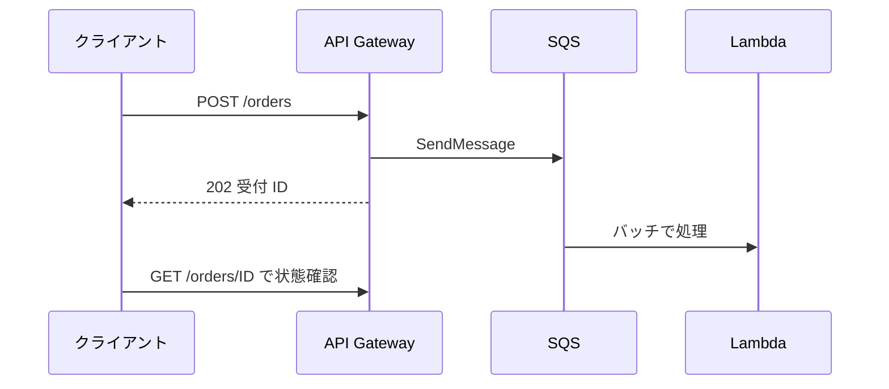
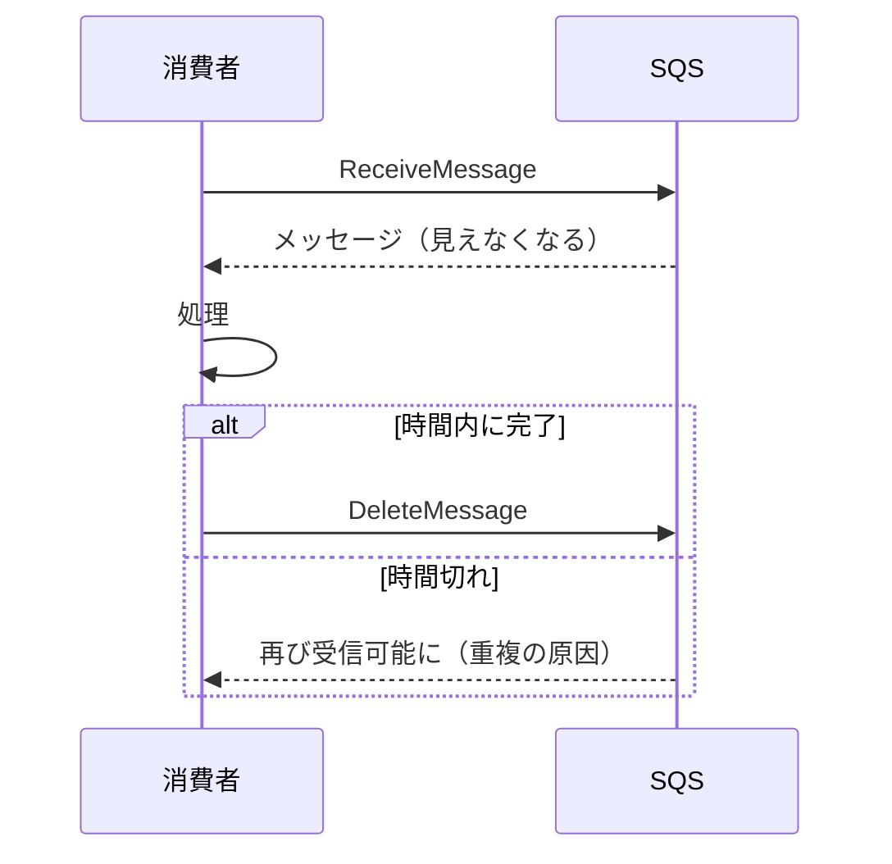
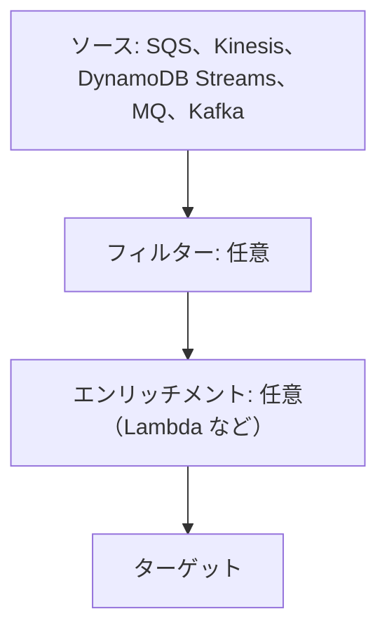
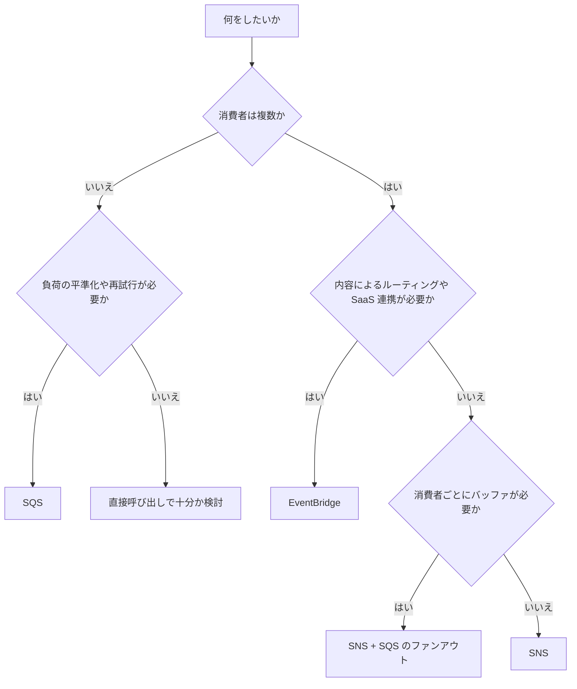

# メッセージングとイベント（SQS、SNS、EventBridge）

[:material-sprout: CLF](../courses/clf/services.md){ .exam-badge .exam-foundational } [:material-certificate: SAA](../courses/saa/services.md){ .exam-badge .exam-associate } [:material-certificate: DVA](../courses/dva/services.md){ .exam-badge .exam-associate } [:material-certificate: SOA](../courses/soa/services.md){ .exam-badge .exam-associate } [:material-certificate: DEA](../courses/dea/services.md){ .exam-badge .exam-associate } [:material-certificate: MLA](../courses/mla/services.md){ .exam-badge .exam-associate } [:material-star-circle: SAP](../courses/sap/services.md){ .exam-badge .exam-professional } [:material-star-circle: DOP](../courses/dop/services.md){ .exam-badge .exam-professional } [:material-star-circle: AIP](../courses/aip/services.md){ .exam-badge .exam-professional } [:material-target: ANS](../courses/ans/services.md){ .exam-badge .exam-specialty } [:material-target: SCS](../courses/scs/services.md){ .exam-badge .exam-specialty }

サービス同士を直接呼ばずにつなぐ仕組み。キューの Amazon SQS、通知の Amazon SNS、イベントルーターの Amazon EventBridge を、用途に応じて選んで使う。

[](../assets/diagrams/messaging-fanout.png)

## 密結合と疎結合 {#coupling}

| | 密結合 | 疎結合 |
| --- | --- | --- |
| つなぎ方 | 呼び出し先を直接呼ぶ | キューやイベントを間に挟む |
| 相手の障害 | 自分も失敗する | メッセージがたまり、復旧後に処理できる |
| 負荷の急増 | そのまま相手に届く | キューがバッファになる |
| 変更 | 呼び出し元の修正が必要 | 購読者を増やすだけで済む場合が多い |
| 動作の追跡 | 単純 | 分散するので X-Ray などが要る |

密結合のサインは「A の障害で B も止まる」「消費者を追加するたびに発行者のコードを変える」「B のピークに合わせて A も増やす」など。

- **例:** 注文 API に毎秒 1,000 件の注文が 60 秒続き、在庫処理は毎秒 200 件しかこなせないとする。直接呼ぶと、差の毎秒 800 件が失敗かタイムアウトになる。
- **例（続き）:** SQS を挟むと、60 秒で (1,000 − 200) × 60 = 48,000 件がキューにたまる。注文が止まった後、48,000 ÷ 200 = 240 秒で捌き切れる。注文 API は受け付けだけ返せばよい。

| 解決したい問題 | 使うサービス |
| --- | --- |
| 処理を後回しにして負荷を平準化 | SQS |
| 1つの出来事を複数の宛先へ | SNS または EventBridge |
| 内容に応じて宛先を振り分け、SaaS とも連携 | EventBridge |
| 手順の順序や分岐を管理 | [Step Functions](step-functions.md) |
| 大量のデータを順序付きで複数の消費者へ | [Kinesis Data Streams](streaming.md) |

## 同期と非同期 {#sync-async}

| | 同期 | 非同期 |
| --- | --- | --- |
| 呼び出し元 | 結果が返るまで待つ | 受け付けだけ確認して先に進む |
| 例 | API Gateway + Lambda | SQS ベースの処理、EventBridge のイベント駆動 |
| 向いている場面 | 結果がすぐ必要、読み取り、短い処理 | 長い処理、ピークがある処理、複数の処理に広げたいとき |
| エラーの扱い | 呼び出し元がその場で扱う | DLQ、再試行、後からの処理 |
| 注意点 | 下流の遅延がそのまま伝わる | 結果の通知方法、重複、順序を考える必要がある |



API Gateway の統合タイムアウト（REST API の既定は 29 秒）を超えそうな処理は、この形にする。呼び出し方の違いは [Lambda](lambda.md) を参照する。

- **例:** 帳票の作成に 180 秒かかる処理を同期で呼ぶと、29 秒の時点でクライアントに 504 が返る。関数は動き続けるが、結果は呼び出し元に届かない。
- **例（非同期）:** `POST /reports` は `SendMessage` して `202` と受付 ID をすぐ返す。クライアントは `GET /reports/ID` で状態を確認し、180 秒後に完了を受け取る。

## SQS {#sqs}

[:material-sprout: CLF](../courses/clf/services.md){ .exam-badge .exam-foundational } [:material-certificate: SAA](../courses/saa/services.md){ .exam-badge .exam-associate } [:material-certificate: DVA](../courses/dva/services.md){ .exam-badge .exam-associate } [:material-certificate: SOA](../courses/soa/services.md){ .exam-badge .exam-associate } [:material-certificate: DEA](../courses/dea/services.md){ .exam-badge .exam-associate } [:material-certificate: MLA](../courses/mla/services.md){ .exam-badge .exam-associate } [:material-star-circle: SAP](../courses/sap/services.md){ .exam-badge .exam-professional } [:material-star-circle: DOP](../courses/dop/services.md){ .exam-badge .exam-professional } [:material-star-circle: AIP](../courses/aip/services.md){ .exam-badge .exam-professional } [:material-target: ANS](../courses/ans/services.md){ .exam-badge .exam-specialty }

メッセージをためるキュー。消費者が **取りに行く** プル型で、1つのメッセージは基本的に1つの消費者が処理する。

提供単位はリージョンで、AZ は選ばない。VPC の外のサービスで、VPC 内からはインターフェイスエンドポイントか NAT を経由して呼ぶ（[リソースの提供単位](resource-scope.md#scope-regional-outside)）。

```python
import boto3

sqs = boto3.client("sqs")
url = sqs.get_queue_url(QueueName="orders")["QueueUrl"]

sqs.send_message(QueueUrl=url, MessageBody='{"orderId": "1"}')

res = sqs.receive_message(
    QueueUrl=url,
    MaxNumberOfMessages=10,
    WaitTimeSeconds=20,   # ロングポーリング
    VisibilityTimeout=60,
)
for m in res.get("Messages", []):
    process(m["Body"])
    # 処理後に自分で削除する。削除しないとまた受信される
    sqs.delete_message(QueueUrl=url, ReceiptHandle=m["ReceiptHandle"])
```

### 標準と FIFO {#standard-fifo}

| | 標準キュー | FIFO キュー |
| --- | --- | --- |
| 配信 | 少なくとも1回。重複があり得る | 重複を持ち込まない（5 分の重複排除） |
| 順序 | ベストエフォート | メッセージグループ内で保証 |
| スループット | ほぼ無制限 | パーティションごとに API アクションあたり 300 回/秒。バッチで 3,000 件/秒。高スループットモードあり |
| 名前 | 自由 | `.fifo` で終わる |
| 向いている場面 | スループット優先 | 順序や重複防止が必須 |

- **例（標準）:** 画像のサムネイル作成を毎秒 5,000 件流す。順番は関係なく、2 回作っても上書きで済む。FIFO の通常モードはバッチでも 3,000 件/秒なので足りない。
- **例（FIFO）:** 口座の「入金 → 出金」の順が入れ替わると残高不足で誤って失敗する。`MessageGroupId` に口座 ID を入れ、口座ごとに順序を守る。
- **誤ると:** 標準キューを後から FIFO に変えることはできない。新しい FIFO キューを作って切り替える。名前に `.fifo` がないと FIFO キューとして作成できない。

FIFO の属性は次の2つを押さえる。

| 属性 | 役割 |
| --- | --- |
| `MessageGroupId` | 順序を守る単位で、FIFO では必須。同じグループは同時に処理されない。処理中のメッセージがあると、同じグループの次のメッセージは渡されない |
| `MessageDeduplicationId` | 5 分間の重複排除に使う。明示するか、本文の SHA-256 を使う `ContentBasedDeduplication` を有効にする |

```python
sqs.send_message(
    QueueUrl=fifo_url,
    MessageBody='{"orderId": "1"}',
    MessageGroupId="customer-123",
    MessageDeduplicationId="order-1",
)
```

スループットを上げるには、グループ ID の種類を増やし、高スループットモードを有効にする（`DeduplicationScope` を `messageGroup`、`FifoThroughputLimit` を `perMessageGroupId`）。

標準キューでも `MessageGroupId` を指定すると **フェアキュー** になり、特定のテナントの大量メッセージが他のテナントの遅延を招く問題を和らげられる。

- **例:** テナント A が 10,000 件を一度に送り、テナント B が 10 件だけ送ったとする。グループ ID なしでは B の 10 件が A の滞留の後ろで待つ。テナント ID をグループ ID に入れると、SQS は B を優先して返し、B の待ち時間は短いまま保たれる。A の処理速度に上限はかからず、消費者に余裕があれば A も受信できる。

### FIFO の設定の詳細 {#fifo-settings}

#### MessageGroupId

順序を守る単位。FIFO では送信のたびに必須で、省くと `SendMessage` が失敗する。128 文字まで。グループ数に上限はない。

同じグループのメッセージは1つずつしか処理されない。たとえば全メッセージのグループ ID を `"orders"` に固定すると、消費者を 10 台に増やしても同時に処理されるのは 1 件だけになる。顧客 ID や注文 ID のように種類の多い値を使う。

処理中のメッセージが削除されるか可視性タイムアウトが切れるまで、そのグループの次のメッセージは渡されない。1件の処理が失敗し続けると、そのグループ全体が止まる。

- **例:** 1 件の処理に 30 秒かかるワーカーが 10 台ある。グループ ID を `"orders"` に固定すると 1 件ずつなので毎分 2 件。顧客 ID に分けると 10 件並列になり、毎分 20 件まで出る。
- **誤ると:** 壊れたメッセージが 1 件あると、そのグループの後続が止まる。可視性タイムアウト 60 秒、`maxReceiveCount` 5 なら、DLQ に移るまで約 5 × 60 = 300 秒そのグループは進まない。他のグループは止まらない。

#### MessageDeduplicationId と ContentBasedDeduplication

同じ ID のメッセージは、5 分間は受け付けられても配信されない。ID は 128 文字まで。最初のメッセージを受信して削除した後でも、5 分間は ID が追跡され続ける。

| 状況 | 結果 |
| --- | --- |
| ID を指定した | その ID で重複を判定する |
| `ContentBasedDeduplication` が有効で ID を省略 | 本文の SHA-256 を ID にする。**属性は含まれない** |
| 有効で、かつ ID を指定した | 指定した ID が優先される |
| 無効で ID を省略 | 送信がエラーになる |

具体例を示す。本文が `{"sku":"a-1"}` で、属性 `channel` だけが `web` と `store` で違う2通を 1 分以内に送ると、内容ベースでは同じ ID になるので 2 通目は配信されない。別物として扱うなら ID を明示するか、違いを本文に入れる。

逆に、送信成功の応答を失った後、5 分を過ぎてから同じ ID で再送すると、重複として検出できない。

- **例:** `order-1` を 10:00:00 に送り、応答を失ったので 10:02:00 に同じ ID で再送する。SQS は再送を受け付けるが配信しないので、消費者には 1 通だけ届く。再送が 10:06:00 なら 5 分を過ぎているので 2 通届く。
- **誤ると:** 再送のたびに UUID を作り直すと、毎回別の ID になり重複を防げない。ID は注文番号のように業務上の値から作る。

#### DeduplicationScope と FifoThroughputLimit

| 属性 | 値 | 意味 |
| --- | --- | --- |
| `DeduplicationScope` | `queue`、`messageGroup` | 重複を判定する範囲 |
| `FifoThroughputLimit` | `perQueue`、`perMessageGroupId` | スループットの上限をかける単位 |

高スループットモードには両方の組み合わせ（`messageGroup` と `perMessageGroupId`）が必要で、片方でも変えると通常のスループットに戻る。`perMessageGroupId` は `DeduplicationScope` が `messageGroup` のときだけ指定できる。

`messageGroup` にすると判定はグループごとになる。同じ `MessageDeduplicationId` でもグループが違えば別のメッセージとして配信される。

高スループットモードの上限はリージョンで異なる。たとえばバージニア北部では、バッチなしで 70,000 件/秒、バッチありで 700,000 件/秒。パーティションあたりは 300 件/秒（バッチで 3,000 件/秒）なので、グループ ID の種類が少ないと出せない。

東京リージョンの上限は、バッチなしで 9,000 件/秒、バッチありで 90,000 件/秒。

```bash
aws sqs create-queue --queue-name orders.fifo --attributes \
  FifoQueue=true,DeduplicationScope=messageGroup,FifoThroughputLimit=perMessageGroupId
```

- **例:** 東京で毎秒 30,000 件を 10 件ずつのバッチで送る。パーティションあたり 3,000 件/秒なので、30,000 ÷ 3,000 = 10 パーティション分が必要になる。パーティションは SQS が自動で増やすので、利用者はグループ ID を十分に分散させるだけでよい。
- **誤ると:** `perQueue` のままだとバッチでも 3,000 件/秒で頭打ちになる。設定が正しくても、グループ ID が 1 種類なら同じパーティションに集まり、3,000 件/秒を超えられない。

!!! note "ReceiveRequestAttemptId"
    FIFO で `ReceiveMessage` の応答がネットワーク障害で失われたとき、同じ `ReceiveRequestAttemptId` で再試行すると、可視性タイムアウトが切れる前でも同じメッセージの組を受け取り直せる。

    **例:** `ReceiveRequestAttemptId="poll-20261031-0001"` で受信し、応答がタイムアウトした。同じ値で呼び直すと、同じメッセージの組が返る。別の値で呼ぶと、その組は可視性タイムアウトが切れるまで受け取れない。

### 主な設定と上限 {#sqs-limits}

| 項目 | 属性 | 既定 | 範囲 |
| --- | --- | --- | --- |
| メッセージサイズ | `MaximumMessageSize` | 1,048,576 バイト（1 MiB） | 1,024 バイト〜1 MiB |
| 保持期間 | `MessageRetentionPeriod` | 345,600 秒（4 日） | 60 秒〜1,209,600 秒（14 日） |
| 可視性タイムアウト | `VisibilityTimeout` | 30 秒 | 0〜43,200 秒（12 時間） |
| 遅延 | `DelaySeconds` | 0 秒 | 0〜900 秒（15 分） |
| ロングポーリングの待ち時間 | `ReceiveMessageWaitTimeSeconds` | 0 秒（ショートポーリング） | 0〜20 秒 |
| 1 回の受信件数 | `MaxNumberOfMessages` | 1 件 | 1〜10 件 |
| バッチの件数 | | | 最大 10 件 |
| 処理中（in-flight）メッセージ | | | 標準は約 120,000、FIFO は 120,000 |
| メッセージ属性 | | | 10 個まで |

1 MiB を超えるものは、Extended Client Library で本体を S3 に置く。

属性を変えると反映までに最大 60 秒かかる。`MessageRetentionPeriod` だけは最大 15 分かかる。

- **例（`VisibilityTimeout`）:** 属性を 360 に変えた直後は、最大 60 秒の間、古い値の 30 秒で動くことがある。切り替え直後の重複に備え、処理を冪等にしておく。
- **例（`MaxNumberOfMessages`）:** 省略すると 1 回で 1 件。滞留が 500 件あるときに 1 件ずつ受信すると 500 回、10 件ずつなら最少 50 回で済む。
- **例（メッセージ属性）:** `tenant`、`source`、`schemaVersion` のような判定用の短い値を入れる。10 個を超えるなら本文の JSON に入れる。

```bash
aws sqs set-queue-attributes \
  --queue-url "$QUEUE_URL" \
  --attributes VisibilityTimeout=360,ReceiveMessageWaitTimeSeconds=20,MessageRetentionPeriod=1209600
```

!!! warning "古い教材の 256 KB"
    SQS のメッセージの上限は現在 1 MiB。古い教材には 256 KB と書かれたものがあり、AWS の Extended Client の説明にも 256 KB の記述が残っている。設問で値が出たら 1 MiB を基準に考える。

### メッセージ保持期間 {#retention-period}

`MessageRetentionPeriod` を過ぎたメッセージは、受信されていなくても自動で削除される。

週末に消費者を止めるシステムで既定の 4 日のままだと、連休中の障害で失う可能性がある。復旧にかかる最長の時間より長くする。

- **例:** `MessageRetentionPeriod=604800` で 7 日にする。金曜 18 時に止めて 6 日後に再開するシステムで 4 日のままだと、金曜夜に入ったメッセージは火曜の夜に消える。7 日なら再開時に全部残っている。
- **誤ると:** 消費者が動いていてもエラーは出ないまま、古いメッセージから消える。`ApproximateAgeOfOldestMessage` が保持期間に近づいたらアラームを出す。

短くする変更は **既存のメッセージにも効く**。14 日から 1 日に変えると、1 日より古いメッセージは期限切れとして消えることがある。

### 最大メッセージサイズと Extended Client {#max-message-size}

`MaximumMessageSize` を超えるメッセージは拒否される。既定で上限の 1 MiB なので、通常は変更しない。`SendMessageBatch` では、10 件の **合計** が 1 MiB まで。800 KiB を 2 件まとめて送ると上限を超える。

| Extended Client Library | 内容 |
| --- | --- |
| 対応言語 | Java、Python |
| 最大サイズ | 2 GB |
| 仕組み | 本体を S3 に保存し、キューには S3 の参照を送る |
| 権限 | キューに加えて S3 バケットへのアクセスが必要 |
| 制限 | 同期クライアントのみ |

受信側も同じライブラリで読む。普通のクライアントで受けると、本体ではなく参照が見える。

- **例（`MaximumMessageSize`）:** `MaximumMessageSize=65536` にすると 70,000 バイトの本文は送信エラーになる。大きなメッセージを誤って送るバグを、送信の時点で止められる。
- **例（Extended Client）:** 20 MB の PDF を送るなら、本体が S3 に置かれ、キューには S3 の参照だけが入る。受信側が普通の `boto3` クライアントだと、`Body` は PDF ではなく参照の JSON になる。
- **誤ると:** ライブラリの実行ロールに S3 の権限がないと、キューの権限があっても送受信に失敗する。

### 処理中メッセージの上限 {#in-flight}

処理中（受信済みで未削除）のメッセージには上限がある。キューにためられるメッセージ数には上限がない。

| キュー | 上限 | 上限に達したとき |
| --- | --- | --- |
| 標準（ショートポーリング） | 約 120,000 | `OverLimit` エラー |
| 標準（ロングポーリング） | 約 120,000 | エラーなし。新しいメッセージが返らない |
| FIFO | 120,000 | エラーなし。処理に影響が出ることがある |

症状は「キューにメッセージがあるのに受信できない」。処理後の `DeleteMessage` を忘れていないか確認する。対処は早めの削除、キューの追加、クォータの引き上げ申請。

- **例:** 毎秒 3 件を受信するのに削除を忘れ、可視性タイムアウトが 12 時間だとする。処理中は 1 時間で 3 × 3,600 = 10,800 件増え、120,000 ÷ 3 = 40,000 秒（約 11 時間）で上限に達する。
- **例（正常時の見積もり）:** 処理中の件数は、受信の速さ × 処理時間で見積もる。毎秒 500 件を平均 20 秒で処理するなら 500 × 20 = 10,000 件で、上限まで余裕がある。

### 暗号化 {#sqs-encryption}

| 方式 | 属性 | 鍵 |
| --- | --- | --- |
| SSE-SQS | `SqsManagedSseEnabled` | SQS が管理する |
| SSE-KMS | `KmsMasterKeyId` | KMS キー |

1つのキューで使えるのはどちらか一方だけ。

```bash
# SQS 管理の鍵
aws sqs set-queue-attributes --queue-url "$QUEUE_URL" \
  --attributes SqsManagedSseEnabled=true

# KMS の鍵。データキーを 1 時間再利用する
aws sqs set-queue-attributes --queue-url "$QUEUE_URL" \
  --attributes KmsMasterKeyId=alias/orders-key,KmsDataKeyReusePeriodSeconds=3600
```

- **例（選び方）:** 暗号化だけが要件なら SSE-SQS で足りる。鍵の利用を CloudTrail で追いたい、キーポリシーで使える人を絞りたいなら SSE-KMS にする。

- 暗号化されるのは **本文のみ**。キュー名、メッセージ ID、タイムスタンプ、属性は暗号化されない。機密情報を属性に入れない。
- 有効にした後に送られたメッセージだけが暗号化される。滞留中のメッセージは対象外。
- 暗号化キューへのリクエストは HTTPS と署名バージョン 4 が必須で、匿名リクエストは拒否される。

`KmsDataKeyReusePeriodSeconds` はデータキーを再利用する時間で、60〜86,400 秒（既定 300 秒）。短いほど安全だが KMS の呼び出しと料金が増える。KMS のスロットリングが出るなら長くする。

KMS の呼び出し回数は `R = (B ÷ D) × (2P + C)` で見積もる。`B` は期間（秒）、`D` は再利用の秒数、`P` は送信するプリンシパルの数、`C` は受信するプリンシパルの数。

- **例:** 1 月（2,678,400 秒）に送信側 1、受信側 1 なら、`D=300` で 8,928 × 3 = 26,784 回。`D=3600` にすると 744 × 3 = 2,232 回で、約 12 分の 1 になる。
- **例（送信側が多い）:** `D=300` で送信側 5、受信側 1 なら 8,928 × 11 = 98,208 回。プリンシパルごとに別のデータキーを使うので増える。
- **誤ると:** KMS の権限がないと、送受信が `KmsAccessDenied` で失敗する。呼び出しが多いと `KmsThrottled` が出る。

| 操作する側 | 必要な KMS の権限 |
| --- | --- |
| 送信側 | `kms:GenerateDataKey`、`kms:Decrypt` |
| 受信側 | `kms:Decrypt` |
| AWS サービス（SNS、EventBridge など） | キーポリシーで `kms:GenerateDataKey`、`kms:Decrypt` を許可 |

AWS マネージドキー（`alias/aws/sqs`）のキューは、別アカウントの Lambda を呼べない。サービスのプリンシパルを許可する必要があるなら、キーポリシーを編集できるカスタマーマネージドキーを使う。鍵の基本は [KMS](kms.md) を参照する。

- **例:** SNS から `alias/aws/sqs` のキューへ配信すると、キーポリシーを編集できないので配信に失敗する。`Publish` は成功するため発行側では気づけない。カスタマーマネージドキーにして、`sns.amazonaws.com` に `kms:GenerateDataKey` と `kms:Decrypt` を許可する。

### 可視性タイムアウト {#visibility-timeout}

受信されたメッセージは消えず、この時間だけ他の消費者から見えなくなる。時間内に `DeleteMessage` しないと再び見えるようになる。



- 処理時間より長く設定する。短いと重複処理の原因になる。
- 処理が長引くなら `ChangeMessageVisibility` で延長する。
- 処理をやめるなら 0 にして、すぐ他の消費者に渡す。
- Lambda のトリガーでは、関数のタイムアウトの 6 倍以上に設定する。
- ショートポーリングで処理中の上限に達すると `OverLimit` エラーになる。

#### 値の決め方

処理の最大時間を基準にする。処理に最大 90 秒かかる EC2 のワーカーで既定の 30 秒のままだと、処理中に別のワーカーへ再配信され、二重に処理される。

長すぎても問題がある。12 時間にすると、ワーカーが落ちたメッセージは 12 時間後まで再処理されない。処理時間のばらつきが大きいなら、短めに設定して、処理中に定期的に延長する（ハートビート）。

SQS は少なくとも1回の配信なので、タイムアウトが十分でも重複はあり得る。処理は [冪等](sdk-resilience.md#idempotency) にする。

#### 3 か所の指定と優先順位

| 指定の場所 | 範囲 |
| --- | --- |
| キューの属性 `VisibilityTimeout` | そのキューの既定 |
| `ReceiveMessage` の `VisibilityTimeout` | その受信で返るメッセージ |
| `ChangeMessageVisibility` | 受信済みの1通 |

- **例:** キューの属性が 60 秒で、`ReceiveMessage` に `VisibilityTimeout=120` を渡すと、その受信は 120 秒隠れる。受信の 30 秒後に `ChangeMessageVisibility` で 300 を指定すると、受信から 330 秒後まで隠れる。

#### ChangeMessageVisibility の動き

```python
# 受信時の残りに足すのではなく、呼び出した時点から 120 秒に置き換わる
sqs.change_message_visibility(
    QueueUrl=url,
    ReceiptHandle=m["ReceiptHandle"],
    VisibilityTimeout=120,
)
```

- 新しい値は **呼び出した時点から** 数える。キューの設定が 60 秒で、受信の 15 秒後に 10 を指定すると、受信から 25 秒で見えるようになる。
- 上限の 12 時間は **最初に受信した時点から** の時間で、延長してもリセットされない。残り時間を超える値を指定するとエラーになる。
- 変更はその受信にだけ効く。削除せずに次に受信されたときは、元の値に戻る。

12 時間を超える処理は、1つのメッセージで扱わない。[Step Functions](step-functions.md) を使うか、処理を分割する。

- **例（ハートビート）:** キューの属性を 60 秒にして、30 秒ごとに 60 秒へ延長する。10 分かかる処理なら 20 回呼ぶ。ワーカーが落ちると延長が止まり、最大 60 秒で別のワーカーに渡る。
- **例（上限）:** 受信から 11 時間 50 分が過ぎていれば、残りは 600 秒。`VisibilityTimeout=900` はエラーで、`600` なら通る。
- **例（返却）:** 依存先が落ちていて処理できないなら `VisibilityTimeout=0` を指定する。すぐに次のワーカーが受信できる。ただし受信回数は増えるので、`maxReceiveCount` に近づく。

#### Lambda の 6 倍の根拠

関数のタイムアウトがキューの可視性タイムアウトより長いと、イベントソースマッピングの作成や更新がエラーになる。AWS はさらに、関数のタイムアウトの **6 倍以上**、バッチウィンドウを使うなら **その値を足した時間** を勧めている。スロットリング時に Lambda が再試行する余裕を持たせるためである。

```text
関数のタイムアウト 60 秒、バッチウィンドウ 20 秒
可視性タイムアウト = 60 × 6 + 20 = 380 秒
```

足りないと、バッチの処理中にメッセージが再び見えるようになり、同じメッセージが同時に処理される。

### Lambda から使うときの設定 {#sqs-lambda-settings}

設定はキューではなくイベントソースマッピングに持つ。全体の仕組みは [Lambda](lambda.md#event-source-mapping) を参照する。

| 設定 | 既定 | 範囲 | 効果 |
| --- | --- | --- | --- |
| `BatchSize` | 10 | 標準は最大 10,000、FIFO は最大 10 | 1回で渡す件数 |
| `MaximumBatchingWindowInSeconds` | 0 | 0〜300 秒。標準キューのみ | 件数がそろうまで待つ時間 |
| `MaximumConcurrency` | なし | 2〜1,000 | このキューから同時に動かす関数の数 |
| `FunctionResponseTypes` | なし | `ReportBatchItemFailures` | 失敗したメッセージだけを戻す |

- `BatchSize` を 10 より大きくするなら、バッチウィンドウを 1 秒以上にする必要がある。
- 1回の呼び出しの合計は同期呼び出しの上限（6 MB）に収まる範囲に限られる。
- 既定ではバッチの1件でも失敗すると全件がキューに戻る。[部分バッチレスポンス](lambda.md#partial-batch-response) で失敗分だけ戻す。
- `maxReceiveCount` は 5 以上にすることを AWS は勧めている。1 だとスロットリング1回で DLQ に移ることがある。
- 暗号化キューなら実行ロールに `kms:Decrypt` が要る。`AWSLambdaSQSQueueExecutionRole` には含まれない。
- `MaximumConcurrency` とプロビジョンドモードは同時に使えない。

#### 値を入れた例 {#sqs-lambda-examples}

```bash
aws lambda create-event-source-mapping \
  --function-name notify \
  --event-source-arn arn:aws:sqs:ap-northeast-1:111122223333:orders \
  --batch-size 100 \
  --maximum-batching-window-in-seconds 30 \
  --scaling-config MaximumConcurrency=20 \
  --function-response-types ReportBatchItemFailures
```

- **例（`BatchSize`）:** 上の設定では、100 件そろうか、30 秒たつか、合計が 6 MB に達すると関数を呼ぶ。1 件 0.5 秒なら 100 件で 50 秒かかるので、関数のタイムアウトは 60 秒以上にする。
- **例（6 MB）:** 1 件 200 KB のメッセージなら 6,000 KB ÷ 200 KB = 30 件が上限の目安で、`BatchSize=100` でも 30 件未満で届く。メタデータも合計に含まれるので、実際はさらに少ない。
- **例（可視性タイムアウト）:** 関数のタイムアウトが 60 秒、バッチウィンドウが 30 秒なら 60 × 6 + 30 = 390 秒以上にする。
- **誤ると（`BatchSize`）:** 10 より大きくしてバッチウィンドウが 0 のままだと、マッピングの作成や更新がエラーになる。
- **例（スケール）:** 標準キューでは同時 5 呼び出しから始まり、1 分ごとに最大 300 増え、1,250 で頭打ちになる。1 分後に 305、4 分後に 1,205、5 分後に 1,250 に届く。アカウントの同時実行クォータが既定の 1,000 なら、そこで止まる。
- **例（`MaximumConcurrency`）:** DB の接続を守るため 20 にすると、同時実行は 20 までで、残りはキューで待つ。`BatchSize=10` なら同時に処理されるのは最大 20 × 10 = 200 件。
- **誤ると（`MaximumConcurrency`）:** 予約済み同時実行が 10 の関数に 20 を設定すると、関数がスロットリングされ、受信回数が増えて DLQ に移ることがある。予約は全マッピングの合計以上にする。下限は 2 なので 1 は指定できない。
- **例（FIFO）:** グループ ID が 6 種類で `MaximumConcurrency` が 10 なら、同時実行は少ない方の 6 になる。
- **例（プロビジョンドモード）:** ポーラーの最小（2〜200）と最大（2〜2,000）を指定する。1 ポーラーは最大 10 同時呼び出し、1 MB/秒なので、最大 20 ポーラーなら 200 同時呼び出し、20 MB/秒まで。1,250 を超える同時実行や、急な増加に備えるときに使う。追加料金がかかる。
- **例（`FunctionResponseTypes`）:** 10 件中 1 件だけ失敗したとき、関数が `{"batchItemFailures":[{"itemIdentifier":"<messageId>"}]}` を返すと、その 1 件だけ戻る。設定がないと、関数がエラーを返したとき 10 件すべてが戻り、成功済みの 9 件も再処理される。
- **例（`FilterCriteria`）:** `{"Filters":[{"Pattern":"{\"body\":{\"status\":[\"paid\"]}}"}]}` は本文の `status` が `paid` のものだけ関数に渡す。一致しないメッセージは **キューから自動で削除される**。後で別の処理が読む予定なら、同じキューでフィルターしない。

### ショートポーリングとロングポーリング {#long-polling}

| | ショート | ロング |
| --- | --- | --- |
| 設定 | `WaitTimeSeconds` が 0 | 1〜20 |
| 動き | サーバーの一部だけ見てすぐ返す | 全サーバーを見て、メッセージが来るか時間切れまで待つ |
| 空の応答 | 多い | 少ない |
| 料金 | リクエストが多いと高くなる | 下げられる |

キュー全体には `ReceiveMessageWaitTimeSeconds` を設定する。特別な理由がなければロングポーリングを使う。

`ReceiveMessage` の `WaitTimeSeconds` はキューの属性より優先される。属性を 20 にしていても、コードで `WaitTimeSeconds=0` を渡すとショートポーリングになる。

SDK のクライアントで読み取りタイムアウトを `WaitTimeSeconds` より短くすると、メッセージを待っている途中でタイムアウトする。読み取りタイムアウトは 20 秒より長くする。

ショートポーリングでは一部のサーバーしか見ないので、メッセージがあっても空の応答（false empty）が返ることがある。「メッセージがあるのに受信できない」「空の受信が多く料金が高い」は、ロングポーリングで解決する。

`MaxNumberOfMessages` の既定は 1。10 にすると1回の受信で最大 10 件取れるが、10 件そろうまで待つわけではなく、少なく返ることもある。

- **例（料金）:** 消費者 1 台がメッセージのないキューを毎秒ポーリングすると、1 日に 86,400 リクエストになる。`WaitTimeSeconds=20` なら 86,400 ÷ 20 = 4,320 リクエストで、20 分の 1 に減る。
- **例（`MaxNumberOfMessages`）:** `MaxNumberOfMessages=10`、`WaitTimeSeconds=20` で 3 件しかないと、20 秒待たずに 3 件を返すことがある。
- **誤ると（読み取りタイムアウト）:** SDK の読み取りタイムアウトが 10 秒で `WaitTimeSeconds=20` だと、メッセージがない間はタイムアウトエラーを繰り返す。

### デッドレターキュー {#sqs-dlq}

繰り返し失敗するメッセージを別のキューに移し、処理全体が詰まらないようにする。

```python
import json

sqs.set_queue_attributes(
    QueueUrl=url,
    Attributes={
        "RedrivePolicy": json.dumps(
            {
                "deadLetterTargetArn": "arn:aws:sqs:ap-northeast-1:111122223333:orders-dlq",
                "maxReceiveCount": "5",
            }
        )
    },
)
```

- `maxReceiveCount` は移動までに受信できる回数。少なすぎると一時的なエラーでも移動する。
- DLQ は元のキューと同じ種類にする（FIFO なら FIFO）。
- 原因を直したら **DLQ リドライブ** で元のキューに戻せる。
- 標準キューの有効期限は元の送信時刻のまま。DLQ の保持期間は元のキューより長くする。FIFO はここでリセットされる。
- 順序を厳密に守る必要がある FIFO では、DLQ が順序を崩すので注意する。
- `ApproximateAgeOfOldestMessage` などで監視し、[アラーム](observability.md) を設定する。

#### maxReceiveCount の決め方

受信されるたびにカウントが増え、`maxReceiveCount` を超えると DLQ に移る。API の説明では既定は 10。DLQ は元のキューと同じアカウント、同じリージョンに置く。

| 値 | 起きること |
| --- | --- |
| 1 | 一時的なエラー1回で DLQ に移る。消費者が受信だけして落ちても移る |
| 3〜5 | 一般的な範囲。Lambda なら 5 以上 |
| 1000 | 毒メッセージが長く居座り、保持期間が切れて DLQ に届かず消える恐れがある |

処理の失敗だけでなく、**受信した回数** で数える点に注意する。可視性タイムアウトが短くて再配信が続くと、処理が正常でも DLQ に移ることがある。

標準キューで `maxReceiveCount` が 3 より大きいとき、削除されないまま 3 回以上受信されたメッセージはキューの後ろに回される。このとき `ApproximateAgeOfOldestMessage` は、次のメッセージの経過時間を示す。

- **例:** 可視性タイムアウト 60 秒、`maxReceiveCount=5` なら、毒メッセージは 5 回受信された後、約 300 秒で DLQ に移る。`maxReceiveCount=1000` なら単純計算で 60,000 秒（約 16.7 時間）居座る。
- **例（正常なのに移る）:** 処理に 90 秒かかるのに可視性タイムアウトが 30 秒だと、処理中に再受信が続く。`maxReceiveCount=3` なら、処理は成功しているはずのメッセージまで DLQ に移る。

#### DLQ の保持期間

標準キューでは、DLQ に移っても期限は最初の送信時刻のまま。

```text
元のキューに 1 日いた後で DLQ に移動。DLQ の保持期間は 4 日
標準キュー: DLQ に残るのは 3 日
FIFO キュー: 時刻がリセットされ、DLQ に 4 日残る
```

元のキューの保持期間が 14 日で、DLQ も 14 日だと、13 日目に移ったメッセージは DLQ に 1 日しか残らない。DLQ の保持期間は常に元のキューより長くする。

- **例:** 元のキューが 4 日なら、DLQ は最大の 14 日にする。4 日目に移ったメッセージでも DLQ に 10 日残り、調査の時間を取れる。

#### リドライブ許可ポリシー {#redrive-allow-policy}

DLQ 側に `RedriveAllowPolicy` を設定し、どのキューが自分を DLQ にできるかを決める。

| `redrivePermission` | 意味 |
| --- | --- |
| `allowAll`（既定） | 同じアカウントとリージョンのどのキューでも可 |
| `byQueue` | `sourceQueueArns` に書いたキューだけ可（10 個まで） |
| `denyAll` | DLQ として使えない |

```json
{
  "redrivePermission": "byQueue",
  "sourceQueueArns": ["arn:aws:sqs:ap-northeast-1:111122223333:orders"]
}
```

`RedrivePolicy` は元のキューに、`RedriveAllowPolicy` は DLQ に設定する。

- **例:** 上の設定の DLQ は `orders` だけが使える。`payments` キューの `RedrivePolicy` にこの DLQ を指定しても使えない。別の失敗が混ざらないので、原因の調査が楽になる。
- **例（`denyAll`）:** 通常の業務キューに `denyAll` を設定すると、誤って DLQ に指定されるのを防げる。

#### DLQ リドライブの動き

既定では元のキューに戻すが、同じ種類の別のキューも指定できる。

- 戻したメッセージは新しいメッセージとして扱われ、新しいメッセージ ID と時刻が付く。**保持期間もリセットされる**。
- 古いメッセージから順に戻すが、送信先では新着と混ざるので、順序は保証されない。
- FIFO から FIFO の DLQ に移るとき、重複排除 ID は元のメッセージ ID に置き換わる。

DLQ のアラームは `ApproximateNumberOfMessagesVisible` に設定する。`NumberOfMessagesSent` は失敗で移動したメッセージを数えないので使えない。

`StartMessageMoveTask` の `MaxNumberOfMessagesPerSecond` で戻す速さを決められる。上限は 500 件/秒で、省略すると SQS が滞留量に合わせて調整する。

```bash
aws sqs start-message-move-task \
  --source-arn arn:aws:sqs:ap-northeast-1:111122223333:orders-dlq \
  --destination-arn arn:aws:sqs:ap-northeast-1:111122223333:orders \
  --max-number-of-messages-per-second 10
```

- **例:** DLQ に 3,600 件あるとき、毎秒 10 件なら 3,600 ÷ 10 = 360 秒で戻し終わる。下流が毎秒 50 件しか捌けないなら、新着の分を引いた余力の範囲に抑える。
- **誤ると:** 原因を直さずに戻すと、また失敗して `maxReceiveCount` の後に DLQ へ戻る。

### 遅延キューとメッセージタイマー {#delay}

| | 遅延キュー | メッセージタイマー |
| --- | --- | --- |
| 範囲 | キュー全体（`DelaySeconds`） | メッセージごと（送信時の `DelaySeconds`） |
| 優先 | | タイマーが優先 |
| FIFO | 使える | 使えない |

どちらも最大 15 分。もっと先の予約には [EventBridge Scheduler](#eventbridge-schedule) を使う。可視性タイムアウトとの違いは、遅延が受信前に隠すのに対し、可視性タイムアウトは受信後に隠すこと。

```python
# 注文の 45 秒後に在庫確認を走らせる。標準キューでのみ指定できる
sqs.send_message(QueueUrl=url, MessageBody=body, DelaySeconds=45)
```

- 標準キューでキューの遅延を変えても、**すでに入っているメッセージには効かない**。FIFO では効く。
- FIFO で送信時に `DelaySeconds` を指定することはできない。
- 遅延中のメッセージは受信されないので、`ApproximateNumberOfMessagesDelayed` に数えられる。
- 900 秒（15 分）を超える値はエラーになる。

- **例（優先）:** キューの `DelaySeconds` が 300 の標準キューに、送信時の `DelaySeconds=45` で送ると、45 秒後に受信できる。
- **例（遅延と可視性）:** キューの遅延が 300 秒、可視性タイムアウトが 60 秒なら、送信の 300 秒後に受信でき、受信後 60 秒は隠れる。送信からの合計で 360 秒の間、他の消費者には見えない。
- **例（順序待ち）:** 決済の完了イベントの到着を待ってから在庫を確認するなら、在庫確認のメッセージに 45 秒のタイマーを付ける。45 秒では足りない可能性があるなら、タイマーではなく Step Functions で待つ。
- **誤ると:** FIFO キューに送信時の `DelaySeconds` を付けると、エラーになる。キューの属性で設定する。

### バッチ処理 {#batching}

`SendMessageBatch`、`DeleteMessageBatch`、`ChangeMessageVisibilityBatch` で 10 件までまとめて扱える。リクエスト数が減るので、スループットが上がり料金も下がる。

```python
res = sqs.send_message_batch(
    QueueUrl=url,
    Entries=[{"Id": str(i), "MessageBody": body} for i, body in enumerate(bodies[:10])],
)
# 一部だけ失敗することがある
for failed in res.get("Failed", []):
    print("再送が必要", failed["Id"], failed["Code"])
```

バッチ全体が成功とは限らないので、`Failed` を確認する。

- `SendMessageBatch` の合計サイズは 1 MiB まで。
- 各エントリの `Id` はバッチ内で一意にする。80 文字まで、英数字とハイフン、アンダースコアのみ。
- IAM に `SendMessageBatch` という権限はない。`sqs:SendMessage` を与えればバッチにも効く。`DeleteMessageBatch` と `ChangeMessageVisibilityBatch` も同じ。
- FIFO でパーティションを有効に使うには、`SendMessageBatch` で同じグループ ID をまとめる。
- コンソールからバッチ操作はできない。

- **例（リクエスト数）:** 100 万件を 1 件ずつ送ると 1,000,000 リクエスト、10 件のバッチなら 100,000 リクエストで済む。
- **例（一部の失敗）:** 10 件のうち 8 件が `Successful`、2 件が `Failed` に入って HTTP は 200 で返る。例外にならないので、`Failed` の 2 件だけを再送するコードを書く。
- **誤ると:** 同じ `Id` を 2 回使うと `BatchEntryIdsNotDistinct`、合計が 1 MiB を超えると `BatchRequestTooLong` でリクエスト全体が失敗する。

## SNS {#sns}

[:material-sprout: CLF](../courses/clf/services.md){ .exam-badge .exam-foundational } [:material-certificate: SAA](../courses/saa/services.md){ .exam-badge .exam-associate } [:material-certificate: DVA](../courses/dva/services.md){ .exam-badge .exam-associate } [:material-certificate: SOA](../courses/soa/services.md){ .exam-badge .exam-associate } [:material-certificate: DEA](../courses/dea/services.md){ .exam-badge .exam-associate } [:material-certificate: MLA](../courses/mla/services.md){ .exam-badge .exam-associate } [:material-star-circle: SAP](../courses/sap/services.md){ .exam-badge .exam-professional } [:material-star-circle: DOP](../courses/dop/services.md){ .exam-badge .exam-professional } [:material-star-circle: AIP](../courses/aip/services.md){ .exam-badge .exam-professional } [:material-target: ANS](../courses/ans/services.md){ .exam-badge .exam-specialty } [:material-target: SCS](../courses/scs/services.md){ .exam-badge .exam-specialty }

トピックに発行すると、購読者全員に **プッシュ** するサービス。1対多の配信に使う。

提供単位はリージョンで、AZ は選ばない。VPC の外のサービスで、VPC 内からはインターフェイスエンドポイントか NAT を経由して呼ぶ（[リソースの提供単位](resource-scope.md#scope-regional-outside)）。

```python
import boto3

sns = boto3.client("sns")
sns.publish(
    TopicArn="arn:aws:sns:ap-northeast-1:111122223333:orders",
    Message='{"orderId": "1"}',
    MessageAttributes={"event_type": {"DataType": "String", "StringValue": "created"}},
)
```

| 項目 | 内容 |
| --- | --- |
| 購読者 | SQS、Lambda、Data Firehose、HTTP/S、メール、SMS、モバイルプッシュ |
| メッセージサイズ | 既定 256 KiB。`MaximumMessageSize` 属性で 1 MiB まで |
| バッチ | `PublishBatch` で 10 件まで |
| 保持 | しない。届かない場合の再試行のみ |
| リトライ | 配信ポリシーによる。詳しくは[配信の再試行](#sns-retries) |
| 失敗の退避 | サブスクリプションごとの DLQ（SQS。同じアカウントとリージョン） |

### サブスクリプションの種類 {#sns-subscriptions}

| プロトコル | 備考 |
| --- | --- |
| `sqs` | キューのポリシーで SNS に `sqs:SendMessage` を許可する |
| `lambda` | SNS に呼び出しを許可するリソースベースポリシーが要る。非同期で呼ばれる |
| `firehose` | トピック、サブスクリプション所有者ごとに 5 個まで |
| `http`、`https` | 購読の確認が必要。`SubscribeURL` にアクセスするか `ConfirmSubscription` を呼ぶ |
| `email`、`email-json` | 購読の確認が必要。10 件/秒が上限（引き上げ不可） |
| `sms` | 1 回の `Publish` は 1,600 文字まで |
| `application` | モバイルプッシュ |

`Subscribe` の応答は、確認が済むまで `pending confirmation` という文字列になる。ARN を受け取りたいなら `ReturnSubscriptionArn` を true にする。

HTTP/S の購読が保留のままなら、エンドポイントが確認の要求を処理していない。`SubscribeURL` に GET する処理を実装する。

- **例（`email`）:** 注文確定の通知を 600 件同時に発行すると、購読 1 つあたり 10 件/秒なので配信に 60 秒以上かかる。この上限は引き上げられないので、大量のメールには SES を使う。
- **例（`firehose`）:** 同じトピックに、同じ所有者で Firehose の購読を 6 つ作ることはできない。上限は 5 個。
- **例（`ReturnSubscriptionArn`）:** `aws sns subscribe --topic-arn ... --protocol https --notification-endpoint https://example.com/hook --return-subscription-arn` なら、未確認でも ARN が返る。
- **誤ると:** IaC でメール購読を作っても、メールのリンクを押すまで `pending confirmation` のままで、通知は届かない。

### メッセージのサイズと属性 {#sns-message-attributes}

トピックの `MaximumMessageSize` 属性で、受け付ける最大サイズを決める。

| 項目 | 値 |
| --- | --- |
| 既定 | 262,144 バイト（256 KiB） |
| 範囲 | 1,024〜1,048,576 バイト（1 MiB） |
| 超えたとき | `Publish` が `InvalidParameter` エラー |
| 数えるもの | 本文と属性の合計 |
| 256 KiB を超える設定の条件 | 購読 100 個以下で、すべて SQS、Firehose、Lambda |

つまり、HTTP/S やメールの購読があるトピックは 256 KiB を超えられない。

- **例:** 500 KiB の通知を送るなら `MaximumMessageSize=524288`（512 KiB）にする。購読が SQS 3 つと Lambda 1 つなら設定できる。ここに HTTPS の購読を足す構成にはできない。
- **誤ると:** 既定の 262,144 バイトのまま、本文 260,000 バイトと属性 3,000 バイトで発行すると、合計が超えるので `InvalidParameter` になる。

メッセージ属性は本文とは別のメタデータで、受信側が本文を解析せずに判断したり、フィルターに使ったりする。

| データ型 | 内容 |
| --- | --- |
| `String` | UTF-8 の文字列 |
| `String.Array` | 配列を文字列にしたもの。`["a","b"]` |
| `Number` | 整数か浮動小数点数。±10^9 の範囲で、小数点以下 5 桁 |
| `Binary` | バイナリ。Lambda の購読には `String` として渡される |

属性を送れるのは `MessageStructure` が文字列のときだけで、`json` のときは送られない。

- **例（値の入れ方）:** `{"DataType":"String","StringValue":"created"}`、`{"DataType":"Number","StringValue":"12.5"}`、`{"DataType":"String.Array","StringValue":"[\"a\",\"b\"]"}`。`Number` でも `StringValue` に文字列で入れる。
- **誤ると（精度）:** `Number` の比較は小数点以下 5 桁まで。`1.000001` と `1.000002` は区別できない前提で設計する。

raw 配信の SQS 購読では、属性は 10 個まで。11 個以上のメッセージはクライアント側エラーとして **破棄される**。

- **例:** 属性 12 個で発行すると、raw 配信の SQS 購読には届かず、DLQ がなければ失われる。`Publish` は成功するので、発行側では気づけない。属性を 10 個以内に減らすか、raw 配信を無効にする。

### ファンアウト {#fanout}

SNS から複数の SQS キューに配信し、それぞれ独立して処理する。消費者が止まってもメッセージはキューに残る。消費者を増やすときは購読を追加するだけでよい。

- キューの **アクセスポリシー** で、トピックに `sqs:SendMessage` を許可する。
- **raw メッセージ配信** を有効にすると、SNS の JSON で包まれずに本文だけ届く。SQS と HTTP/S、Firehose で使える。
- 無効の場合、SQS の `Body` は SNS の JSON になるので、`Message` を取り出してさらに解析する。

```json
{
  "Version": "2012-10-17",
  "Statement": [{
    "Effect": "Allow",
    "Principal": { "Service": "sns.amazonaws.com" },
    "Action": "sqs:SendMessage",
    "Resource": "arn:aws:sqs:ap-northeast-1:111122223333:orders-q",
    "Condition": {
      "ArnEquals": { "aws:SourceArn": "arn:aws:sns:ap-northeast-1:111122223333:orders" }
    }
  }]
}
```

`aws:SourceArn` がないと、他のトピックからも送れてしまう。購読は成功しているのにメッセージが届かないときは、このポリシーをまず確認する。キューが KMS で暗号化されているなら、キーポリシーで SNS に `kms:GenerateDataKey` と `kms:Decrypt` も許可する。

- **例:** `orders` トピックに `email-q`、`shipping-q`、`analytics-q` の 3 つを購読させる。1 通発行すると、キューごとに 1 通ずつ、計 3 通が入る。分析の消費者が 3 時間止まっても、メールと出荷には影響しない。
- **例（raw なしの解析）:** `json.loads(json.loads(m["Body"])["Message"])` のように 2 回解析する。raw を有効にすると `json.loads(m["Body"])` の 1 回で済む。

### raw メッセージ配信の詳細 {#sns-raw-delivery}

サブスクリプションの `RawMessageDelivery` を `true` にする。

```bash
aws sns set-subscription-attributes \
  --subscription-arn "$SUB_ARN" \
  --attribute-name RawMessageDelivery \
  --attribute-value true
```

| 宛先 | 有効にしたときの動き |
| --- | --- |
| SQS | SNS のメタデータが取り除かれ、本文がそのまま `Body` になる。属性は SQS の属性になる（10 個まで） |
| HTTP/S | 本文が届き、ヘッダー `x-amz-sns-rawdelivery: true` が付く。属性は送られない |
| Firehose | 本文が届く。属性は送られない |

Lambda には raw 配信の設定はない。有効にすると `TopicArn` や `Timestamp` は受け取れなくなるので、必要なら本文に入れる。

- **例（無効のとき）:** SQS の `Body` は次の JSON になる。

```json
{
  "Type": "Notification",
  "TopicArn": "arn:aws:sns:ap-northeast-1:111122223333:orders",
  "Message": "{\"orderId\":\"1\"}",
  "MessageAttributes": { "event_type": { "Type": "String", "Value": "created" } }
}
```

- **例（有効のとき）:** `Body` は `{"orderId":"1"}` だけで、`event_type` は SQS のメッセージ属性になる。
- **誤ると:** 有効にした後も `Body["Message"]` を読むコードのままだと `KeyError` で失敗し続け、メッセージが DLQ にたまる。

### トピックのアクセスポリシーと暗号化 {#sns-access}

トピックのリソースポリシーで、誰が `sns:Publish` できるかを決める。別アカウントや AWS サービス（S3、CloudWatch アラームなど）からの発行にはこの許可が要る。

```json
{
  "Effect": "Allow",
  "Principal": { "Service": "s3.amazonaws.com" },
  "Action": "sns:Publish",
  "Resource": "arn:aws:sns:ap-northeast-1:111122223333:uploads",
  "Condition": { "StringEquals": { "aws:SourceAccount": "111122223333" } }
}
```

SSE は `KmsMasterKeyId` で有効にする。暗号化されるのは本文のみで、件名、属性、メッセージ ID は暗号化されない。AWS サービスから暗号化トピックに発行するなら、キーポリシーを編集できるカスタマーマネージドキーを使う。

- **例（別アカウント）:** 発行側のアカウントが `111122223333` なら、トピックを持つ別アカウント側のポリシーで `Principal` に `{"AWS":"arn:aws:iam::111122223333:root"}` を書き、`sns:Publish` を許可する。呼び出し側の IAM にも `sns:Publish` が要る。
- **誤ると（S3）:** このポリシーがないと、S3 の通知設定の保存が宛先の検証エラーで失敗する。
- **誤ると（暗号化）:** S3 や CloudWatch アラームから `alias/aws/sns` のトピックへ発行すると、キーポリシーを編集できないので届かない。アラームは `ALARM` になるのに通知が来ない、という症状になる。

### サブスクリプションフィルターポリシー {#filter-policies}

既定では購読者は全メッセージを受け取る。フィルターポリシーを設定すると、必要なものだけ受け取れる。消費者側で捨てるより、処理量と料金を減らせる。

```json
{
  "event_type": ["created", "paid"],
  "price_usd": [{ "numeric": [">=", 100] }],
  "store": [{ "anything-but": "test" }]
}
```

- `FilterPolicyScope` で対象を選ぶ。`MessageAttributes`（既定）か `MessageBody`。
- プロパティの間は AND、値の配列は OR で評価する。
- 発行者は購読者が増えても変更不要で、トピックを分ける必要も減る。

上のポリシーと属性の組み合わせで確かめる。

| `event_type` | `price_usd` | `store` | 結果 |
| --- | --- | --- | --- |
| `created` | 150 | `web` | 届く |
| `paid` | 100 | `shop` | 届く。`>=` なので 100 も含む |
| `refunded` | 150 | `web` | 届かない。`event_type` が不一致 |
| `created` | 50 | `web` | 届かない。金額が不足 |
| `created` | 150 | `test` | 届かない。`anything-but` で除外 |
| `created` | なし | `web` | 届かない。属性がない |

#### FilterPolicyScope

| 値 | 判定の対象 | 注意点 |
| --- | --- | --- |
| `MessageAttributes`（既定） | メッセージ属性 | 属性を付けずに発行すると一致しない。入れ子は不可 |
| `MessageBody` | 本文の JSON | 本文が正しい JSON である前提。入れ子も書ける |

本文でフィルターしているつもりが既定のままだと、属性がないので何も届かない。`aws sns set-subscription-attributes` で `FilterPolicyScope` を `MessageBody` にする。

```json
{ "order": { "status": ["paid"], "total": [{ "numeric": [">=", 1000] }] } }
```

上のポリシーは `MessageBody` のスコープで、`{"order":{"status":"paid","total":1500}}` に一致する。`"total":999` には一致しない。

#### 上限

| 項目 | 値 |
| --- | --- |
| キーの数 | 1 ポリシーに 5 個（入れ子は末端のキーを数える） |
| 値の組み合わせ | 150 まで（各配列の値の数の積） |
| ポリシーのサイズ | 256 KB |
| ポリシーの数 | トピックごとに 200、アカウントごとに 10,000 |
| 反映までの時間 | 最大 15 分 |

組み合わせの例を示す。`a` に 3 個、`b` に 5 個、`c` に 10 個の値なら 3 × 5 × 10 = 150 で上限ちょうど。`c` に 1 つ足すと 165 で超える。

ポリシーを変えた直後は最大 15 分の間、古いポリシーで判定されることがある。

- **例（キー数）:** `event_type`、`price_usd`、`store`、`country`、`channel` の 5 個までは設定できる。`device` を足して 6 個にするとエラーになる。絞り込みの一部は消費者側に任せる。
- **例（反映）:** 10:00 にポリシーを変えて、10:01 のテストで届かなくても、設定の誤りとは限らない。15 分待ってから判断する。

### 配信の再試行 {#sns-retries}

失敗の種類で動きが分かれる。

| 失敗 | 例 | 動き |
| --- | --- | --- |
| クライアント側エラー | 購読先の削除、ポリシーで拒否 | 再試行しない。DLQ がなければ破棄 |
| サーバー側エラー | 宛先の障害、HTTP の 5XX と 429 | 配信ポリシーに従って再試行 |

| 宛先 | 既定の再試行 | 変更 |
| --- | --- | --- |
| SQS、Lambda、Firehose（AWS 管理） | 最大 100,015 回、23 日間 | 不可 |
| SMTP、SMS、モバイルプッシュ | 50 回、6 時間 | 不可 |
| HTTP/S | 既定は 3 回（20 秒間隔、linear） | 配信ポリシーで可 |

Firehose のスロットリングエラーには、顧客管理の宛先と同じポリシーが使われる。

既定の内訳は次のとおり。

| 段階 | AWS 管理 | 顧客管理（SMTP、SMS、プッシュ） |
| --- | --- | --- |
| 遅延なし | 3 回 | 0 回 |
| バックオフ前 | 2 回（1 秒間隔） | 2 回（10 秒間隔） |
| バックオフ | 10 回（1〜20 秒） | 10 回（10〜600 秒） |
| バックオフ後 | 100,000 回（20 秒間隔） | 38 回（600 秒間隔） |
| 合計 | 100,015 回、23 日 | 50 回、6 時間 |

- **例:** Lambda の購読で関数を消してしまうと、クライアント側エラーなので再試行されない。一方、SQS のキューが内部エラーを返す間は 23 日まで再試行される。
- **例（HTTP/S の既定）:** 既定は 20 秒間隔で 3 回なので、再試行は約 60 秒で終わる。エンドポイントのデプロイで 2 分止まると、その間のメッセージは DLQ がなければ失われる。

HTTP/S の配信ポリシーはトピックかサブスクリプションに設定する。

```json
{
  "healthyRetryPolicy": {
    "minDelayTarget": 1,
    "maxDelayTarget": 60,
    "numRetries": 50,
    "numNoDelayRetries": 3,
    "numMinDelayRetries": 2,
    "numMaxDelayRetries": 35,
    "backoffFunction": "exponential"
  },
  "throttlePolicy": { "maxReceivesPerSecond": 10 }
}
```

| 項目 | 範囲（既定） |
| --- | --- |
| `numRetries` | 0〜100（3） |
| `minDelayTarget` | 1〜最大遅延、秒（20） |
| `maxDelayTarget` | 最小遅延〜3,600、秒（20） |
| `backoffFunction` | `arithmetic`、`exponential`、`geometric`、`linear`（`linear`） |
| `maxReceivesPerSecond` | 1 以上（制限なし） |

上の例のバックオフの回数は 50 − 3 − 2 − 35 = 10 回。合計の再試行時間は 3,600 秒が上限（引き上げ不可）。

- **例（時間の計算）:** 上の例の待ち時間は、バックオフ前が 2 × 1 秒、バックオフ後が 35 × 60 秒 = 2,100 秒。バックオフの 10 回は長くても 10 × 60 秒 = 600 秒で、合計は最大 2,702 秒。3,600 秒に収まる。
- **誤ると:** `numRetries=100` で間隔を 60 秒に固定すると 100 × 60 = 6,000 秒で、3,600 秒の上限に収まらない。60 秒間隔なら 60 回までが目安になる。

`maxReceivesPerSecond` は平均の目安で、厳密な上限ではない。これを超えた分は再試行を消費せずに待たされるので、発行が速いと遅延が増える。

- **例:** `maxReceivesPerSecond=10` のエンドポイントに毎秒 50 件を 60 秒発行すると、(50 − 10) × 60 = 2,400 件が SNS 側にたまる。発行が止まった後、2,400 ÷ 10 = 240 秒で配信が終わる。
- **例（`headerContentType`）:** 既定の `Content-Type` は `text/plain; charset=UTF-8`。JSON として受けたいエンドポイントには、`requestPolicy` の `headerContentType` に `application/json` を指定する。

#### サブスクリプションの DLQ

SQS と違い、SNS の DLQ はトピックではなく **サブスクリプションごと** に設定する。

```json
{ "deadLetterTargetArn": "arn:aws:sqs:ap-northeast-1:111122223333:sns-orders-dlq" }
```

- `RedrivePolicy` 属性に設定する。`maxReceiveCount` はない。
- DLQ は同じアカウントと同じリージョンの SQS。標準トピックには標準キュー、FIFO トピックには FIFO キュー。
- 暗号化した DLQ には、SNS を許可したカスタム KMS キーが要る。
- DLQ がないと、再試行を使い切ったメッセージとクライアント側エラーのメッセージは失われる。
- AWS は DLQ の保持期間を最大の 14 日にすることを勧めている。

- **例:** `shipping` の購読に `sns-orders-dlq` を設定する。購読先のキューを誤って消すと、クライアント側エラーとして再試行なしで DLQ に入る。`email` の購読には別に設定しない限り、同じ失敗でも DLQ には入らない。
- **誤ると:** DLQ のキューポリシーで `sns.amazonaws.com` に `sqs:SendMessage` を許可していないと、DLQ にも送れず失われる。

### SNS FIFO {#sns-fifo}

| 項目 | 内容 |
| --- | --- |
| 順序 | メッセージグループごとに保証 |
| 重複排除 | 5 分間 |
| 購読者 | SQS の標準または FIFO キュー |
| Lambda への配信 | 直接は不可。SQS を挟む |
| 購読者数 | トピックあたり 100 |
| HTTP/S、メール、SMS | 購読しようとするとエラーになる |
| トピック名 | `.fifo` で終わる |

厳密な順序と重複防止が必要なら、SNS FIFO と SQS FIFO を組み合わせる。

- **例:** 価格の更新を卸売、小売、分析の 3 つの SQS FIFO に配信する。グループ ID を商品 ID にすると、同じ商品の更新はどのキューでも発行順に届く。
- **誤ると:** Lambda を直接購読しようとするとエラーになる。SQS FIFO を購読させ、そのキューを Lambda のイベントソースにする。

```python
sns.publish(
    TopicArn="arn:aws:sns:ap-northeast-1:111122223333:orders.fifo",
    Message=body,
    MessageGroupId="customer-123",       # FIFO では必須
    MessageDeduplicationId="order-1",    # 内容ベースが無効なら必須
)
```

| 属性 | 内容 |
| --- | --- |
| `ContentBasedDeduplication` | 既定は false。true なら本文の SHA-256 を ID にする。属性は含まれない |
| `FifoThroughputScope` | `Topic`（既定。トピック全体で重複排除し、3,000 件/秒または 20 MB/秒）か `MessageGroup`（グループごとに重複排除し、グループあたり 300 件/秒） |

フィルターポリシーを設定すると、FIFO トピックは「最大1回」の配信になる。フィルターで落とされるメッセージがあるので、そのキューには届かない前提で作る。

- **例（`FifoThroughputScope`）:** `Topic` の上限は 3,000 件/秒か 20 MB/秒で、先に達した方で止まる。1 件 10 KB を毎秒 3,000 件なら 30 MB/秒で、20 MB/秒の方に先に当たり、実際は 2,000 件/秒になる。
- **例（`MessageGroup`）:** 毎秒 9,000 件なら、グループあたり 300 件/秒なので 9,000 ÷ 300 = 30 グループ以上に均等に分ける。同じ `MessageDeduplicationId` でもグループが違えば別のメッセージとして配信される。全体の上限はリージョンのクォータに従う。
- **例（内容ベース）:** 本文が同じで属性 `channel` だけが違う卸売向けと小売向けの 2 通は、内容ベースでは同じ ID になり、5 分以内の 2 通目が配信されない。ID を明示するか、`channel` を本文に入れる。

標準トピックでも `MessageGroupId` を指定できる。これは SQS 標準キューの購読にだけ転送され、[フェアキュー](#standard-fifo) を有効にする。

## EventBridge {#eventbridge}

[:material-sprout: CLF](../courses/clf/services.md){ .exam-badge .exam-foundational } [:material-certificate: SAA](../courses/saa/services.md){ .exam-badge .exam-associate } [:material-certificate: DVA](../courses/dva/services.md){ .exam-badge .exam-associate } [:material-certificate: SOA](../courses/soa/services.md){ .exam-badge .exam-associate } [:material-certificate: DEA](../courses/dea/services.md){ .exam-badge .exam-associate } [:material-certificate: MLA](../courses/mla/services.md){ .exam-badge .exam-associate } [:material-star-circle: SAP](../courses/sap/services.md){ .exam-badge .exam-professional } [:material-star-circle: DOP](../courses/dop/services.md){ .exam-badge .exam-professional } [:material-star-circle: AIP](../courses/aip/services.md){ .exam-badge .exam-professional } [:material-target: ANS](../courses/ans/services.md){ .exam-badge .exam-specialty }

イベントをルールに従って振り分けるサービス。AWS のサービス、自前のアプリ、SaaS のイベントを扱える。

提供単位はリージョンで、AZ は選ばない。VPC の外のサービスで、VPC 内からはインターフェイスエンドポイントか NAT を経由して呼ぶ。エンドポイントは Classic のバスと既定のバスが `events`、新しい Custom Event Bus が `eventsv2`（[EC サイトの例](resource-scope.md#ec-site-order)）。

[](../assets/diagrams/messaging-eventbridge.png)

```python
import json

import boto3

events = boto3.client("events")
res = events.put_events(
    Entries=[
        {
            "EventBusName": "orders",
            "Source": "com.example.orders",
            "DetailType": "OrderCreated",
            "Detail": json.dumps({"orderId": "1", "amount": 1200}),
        }
    ]
)
# 一部だけ失敗することがある
if res["FailedEntryCount"] > 0:
    print(res["Entries"])
```

| 項目 | 内容 |
| --- | --- |
| `PutEvents` | 1 回あたり 10 エントリまで、合計 1 MB 未満 |
| 応答 | エントリ単位で成否が返る。`FailedEntryCount` を確認する |
| イベントパターン | 2,048 文字まで（引き上げ可） |
| ルールあたりのターゲット | 5 個 |
| ルール数 | バスごとに既定 300（一部のリージョンは 100） |
| ターゲットの再試行 | 既定で 24 時間、最大 185 回（指数バックオフとジッター） |

- **例（エントリ数）:** 25 件のイベントは 10 + 10 + 5 の 3 回に分けて送る。
- **例（サイズ）:** 200 KB のイベント 10 個は合計 2 MB で 1 MB 未満に収まらないので、1 回では送れない。5 個だと `Detail` だけで約 1 MB になり、`Source` や `DetailType` なども合計に入るので収まらない。4 個以下に分ける。
- **例（部分失敗）:** 3 エントリを送り、`FailedEntryCount` が 1 なら、HTTP は 200 のまま `Entries[1].ErrorCode` などに理由が入る。失敗したエントリだけ再送する。
- **例（スロットリング）:** `PutEvents` のリージョンあたりの既定クォータは、東京で 1,200 件/秒（引き上げ可）。超えると `ThrottlingException` が返る。
- **例（ルールの上限）:** ルールあたり 5 ターゲットなので、8 つの宛先に送るならルールを 2 つに分けるか、SNS トピックをターゲットにしてそこから広げる。

!!! note "Custom Event Bus と Classic"
    このページは、ルールとターゲットで動く既定のバスと **Custom Event Bus - Classic** を説明する。新しい **Custom Event Bus** はサブスクライバーを作る方式で、イベントを選んだ期間（1〜365 日）保持する。順序はサブスクライバーの設定、重複排除は発行時の設定で、`PutEvents` は 1 回に 100 エントリまで。両方とも利用できる。

!!! warning "古い教材の 256 KB"
    `PutEvents` のサイズの上限は、リクエスト全体で 1 MB 未満。1 エントリだけならほぼ 1 MB まで使える。古い教材の 256 KB という値は現在のものではない。

### イベントバス {#event-buses}

| バス | 受け取るもの | 備考 |
| --- | --- | --- |
| 既定のバス | AWS サービスのイベント、自分のアプリのイベント | アカウントに最初からある |
| カスタムバス | 自分のアプリ、他アカウントのイベント | アカウントごとに最大 100（引き上げ可）。Classic の場合 |
| パートナーバス | SaaS のイベント | パートナーのイベントソースに関連付ける |

ルールは特定のバスに属し、そのバスのイベントだけを評価する。カスタムバスに送ったのに既定のバスのルールが動かない、という間違いが多い。`PutEvents` で `EventBusName` を省くと既定のバスに入る。

別アカウントからの送信はバスのリソースポリシーで `events:PutEvents` を許可する。

`Detail` は JSON の **文字列** で渡す。オブジェクトのままや不正な JSON は受け付けられない。エントリのエラーは例外ではなく、`Entries` の `ErrorCode` で返る。

- **例（バス名）:** `orders` バスに `{"EventBusName":"orders"}` で送ると、`default` バスのルールは動かない。`EventBusName` を省いて送ると、`orders` バスのルールは動かない。どちらも `PutEvents` は成功するので、ルールとバスの組み合わせを確認する。
- **例（別アカウント）:** アカウント `111122223333` から別アカウントの `orders` バスに送るなら、バスのリソースポリシーで `111122223333` に `events:PutEvents` を許可する。送信側のロールにも同じ権限が要る。
- **例（パートナーバス）:** SaaS のイベントソース名は `aws.partner/` で始まる。バスを関連付けた後は、他のバスと同じようにルールを作る。
- **例（`Detail`）:** Python なら `"Detail": json.dumps({"orderId": "1"})`。`"Detail": {"orderId": "1"}` はパラメータの検証で失敗する。`"Detail": "{orderId: 1}"` は JSON として不正なのでエントリのエラーになる。

### ルールとイベントパターン {#eventbridge-rules}

ルールはイベントとパターンが一致すると、ターゲットに送る。

```json
{
  "source": ["com.example.orders"],
  "detail-type": ["OrderCreated"],
  "detail": {
    "amount": [{ "numeric": [">", 1000] }],
    "region": [{ "prefix": "ap-" }],
    "status": [{ "anything-but": "test" }]
  }
}
```

| 演算 | 書き方 |
| --- | --- |
| 一致 | `"state": ["running"]` |
| 前方一致、後方一致 | `{"prefix": "us-"}`、`{"suffix": ".png"}` |
| 否定 | `{"anything-but": "test"}` |
| 数値 | `{"numeric": [">", 0, "<=", 5]}` |
| 存在 | `{"exists": true}` |
| 大文字小文字を無視 | `{"equals-ignore-case": "alice"}` |

- パターンはコンソールのサンドボックスで試せる。
- 入力トランスフォーマーでターゲットへの入力を整形できる。
- 配信できないイベントはターゲットの **DLQ**（SQS 標準）に送れる。権限不足や宛先がない場合は再試行せず、直接 DLQ に送られる。
- ターゲットが Lambda なら、関数のリソースベースポリシーで `events.amazonaws.com` を許可する。ターゲットに `lambda:InvokeFunction` を持つ実行ロールを設定する方法もあり、その場合リソースベースポリシーは不要。

#### パターンの評価のしかた

- パターンに書いたフィールドだけを見る。書いていないフィールドは無視する。
- パターンに書いたフィールドは、イベントに同じ階層で存在する必要がある。
- 配列の中は OR、フィールドの間は AND。
- 文字列の一致は大文字と小文字を区別する。
- 比較演算子は末端のノードにだけ書ける。例外は `$or` と `anything-but`。

具体例で動きを確認する。

| パターン | 一致する | 一致しない |
| --- | --- | --- |
| `"state": ["running", "stopped"]` | `"running"` | `"Running"`、`"pending"` |
| `"region": [{"prefix": "ap-"}]` | `"ap-northeast-1"` | `"us-east-1"` |
| `"file": [{"suffix": ".png"}]` | `"a/b.png"` | `"a/b.PNG"` |
| `"file": [{"suffix": {"equals-ignore-case": ".png"}}]` | `"a/b.PNG"` | `"a/b.jpg"` |
| `"file": [{"wildcard": "dir/*.png"}]` | `"dir/a.png"` | `"x/a.png"` |
| `"amount": [{"numeric": [">", 0, "<=", 5]}]` | `3`、`5` | `0`、`6`、`"3"` |
| `"status": [{"anything-but": ["test", "dev"]}]` | `"prod"` | `"test"` |
| `"region": [{"anything-but": {"prefix": "us-"}}]` | `"ap-northeast-1"` | `"us-east-1"` |
| `"code": [{"exists": true}]` | `code` がある | `code` がない |
| `"code": [{"exists": false}]` | `code` がない | `code` がある |
| `"name": [""]` | 空文字 | `null`、フィールドなし |
| `"name": [null]` | `null` | 空文字、フィールドなし |

`exists` は末端のノードだけで使える。`"detail": {"exists": true}` のように中間のノードには書けない。空文字、`null`、フィールドなしは別物として扱われる。

- **例（複数の条件）:** `{"source":["aws.ec2"],"detail":{"state":["stopped","terminated"]}}` は、`source` が `aws.ec2` で **かつ**、`state` が `stopped` **または** `terminated` のときに一致する。
- **誤ると（階層）:** イベントの `detail.state` を見るのにパターンのトップに `"state"` を書くと、どのイベントにも一致しない。エラーは出ず、ルールが動かないだけになる。
- **誤ると（ワイルドカード）:** `wildcard` を含むルールはバスごとに 30 個まで。この上限は引き上げられない。

別のフィールドとの OR は `$or` で書く。

```json
{
  "detail": {
    "$or": [
      { "amount": [{ "numeric": [">", 10000] }] },
      { "priority": ["high"] }
    ]
  }
}
```

パターンを本番に置く前に、`aws events test-event-pattern` か `TestEventPattern` API で試せる。S3 の ACL 変更で起動する関数が ACL を変えるような再帰のルールは、無限ループと料金の増加を招く。パターンをなるべく細かく書く。

```bash
aws events test-event-pattern \
  --event-pattern '{"source":["com.example.orders"],"detail":{"amount":[{"numeric":[">",1000]}]}}' \
  --event '{"id":"1","account":"111122223333","source":"com.example.orders","time":"2026-10-31T00:00:00Z","region":"ap-northeast-1","resources":[],"detail-type":"OrderCreated","detail":{"amount":1500}}'
```

`amount` が 1500 なら `{"Result": true}`、800 なら `false` が返る。

### 入力トランスフォーマー {#input-transformer}

ターゲットに渡す内容を、イベント全体ではなく必要な形に整える。ターゲットには次のどれかを指定する。

| 設定 | 渡す内容 |
| --- | --- |
| なし | イベント全体 |
| `Input` | 固定の JSON |
| `InputPath` | イベントの一部（JSON パス） |
| `InputTransformer` | `InputPathsMap` で取り出し、`InputTemplate` で組み立てる |

```json
{
  "InputPathsMap": {
    "instance": "$.detail.instance-id",
    "state": "$.detail.state"
  },
  "InputTemplate": "{\"id\": <instance>, \"message\": \"<instance> is <state>\", \"rule\": <aws.events.rule-name>}"
}
```

`{"detail":{"instance-id":"i-1","state":"running"}}` に対し、ターゲットは `{"id": "i-1", "message": "i-1 is running", "rule": "..."}` を受け取る。

- **例（`Input`）:** 夜間バッチのルールで `"Input": "{\"job\":\"nightly\",\"dryRun\":false}"` とすると、イベントの中身に関係なく、常にこの JSON が渡る。
- **例（`InputPath`）:** `"InputPath": "$.detail"` なら、関数の `event` は `{"instance-id":"i-1","state":"running"}` になり、`event["detail"]` と書かずに済む。
- **誤ると:** `InputPath` を付けた後も関数が `event["detail"]` を読むと `KeyError` になる。

| 予約済みの変数 | 内容 |
| --- | --- |
| `aws.events.rule-arn` | ルールの ARN |
| `aws.events.rule-name` | ルールの名前 |
| `aws.events.event.ingestion-time` | 受信時刻 |
| `aws.events.event.json` | 元のイベント全体（JSON の値の位置でのみ使える） |

**クォートの扱いが落とし穴**。文字列の値を指す変数は、そのままでも `"<state>"` のように囲んでもよく、実行時に正しい JSON に置き換えられる。一方、**オブジェクトや配列を指す変数はクォートしない**。文章の中に埋め込むときは、文章全体を `"` で囲む。

`aws.events.event.json` も JSON の値の位置でだけ使える。文字列の中には入れられない。DLQ の `ERROR_CODE` の一例に `INVALID_JSON` がある。

- **例（クォート）:** `<state>` が文字列なら `{"s": <state>}` も `{"s": "<state>"}` も `{"s": "running"}` になる。`<detail>` がオブジェクトなら `{"d": <detail>}` と書く。`{"d": "<detail>"}` と囲むと正しい形にならない。
- **例（文章）:** `"Instance <instance> is <state>"` は全体を `"` で囲む。SNS やチャットの通知の本文に使う。
- **誤ると:** 組み立てた結果が JSON として不正だと、ターゲットへ配信されず、DLQ があれば `ERROR_CODE` に理由が入る。

### ターゲットの再試行と DLQ {#target-retry-dlq}

ターゲットごとに `RetryPolicy` と `DeadLetterConfig` を設定する。

| 項目 | 既定 | 範囲 |
| --- | --- | --- |
| `MaximumRetryAttempts` | 185 | 0〜185 |
| `MaximumEventAgeInSeconds` | 86,400（24 時間） | 60〜86,400 |

どちらかに達すると再試行をやめる。DLQ がなければイベントは捨てられる。

```bash
aws events put-targets --rule orders-created --targets '[{
  "Id": "notify",
  "Arn": "arn:aws:lambda:ap-northeast-1:111122223333:function:notify",
  "RetryPolicy": { "MaximumRetryAttempts": 10, "MaximumEventAgeInSeconds": 3600 },
  "DeadLetterConfig": { "Arn": "arn:aws:sqs:ap-northeast-1:111122223333:eb-dlq" }
}]'
```

1 時間を過ぎた通知に価値がないなら、上のように縮める。既定のままだと、宛先の障害中に 24 時間前のイベントが届くことがある。

- **例（どちらが先か）:** `MaximumRetryAttempts=185`、`MaximumEventAgeInSeconds=3600` なら、回数に関係なく 1 時間で打ち切る。`MaximumRetryAttempts=10`、`MaximumEventAgeInSeconds=86400` なら、10 回を使い切れば 24 時間を待たずに打ち切る。
- **例（再試行なし）:** `MaximumRetryAttempts=0` なら最初の 1 回だけ試す。失敗はすぐ DLQ に入るので、自前で再処理するときに使う。
- **誤ると:** `MaximumEventAgeInSeconds=30` は範囲外でエラーになる。下限は 60 秒。

- DLQ は SQS の **標準キュー**。FIFO は使えない。
- DLQ のキューポリシーで EventBridge に `sqs:SendMessage` を許可する。
- 権限不足、リソースなし、DNS の失敗のように再試行しても無駄なエラーは、すぐ DLQ に送られる。DLQ がなければ捨てられる。
- DLQ のメッセージには `RULE_ARN`、`TARGET_ARN`、`ERROR_CODE`、`ERROR_MESSAGE`、`EXHAUSTED_RETRY_CONDITION`、`RETRY_ATTEMPTS` の属性が付く。
- メトリクスは `InvocationsSentToDLQ` と `InvocationsFailedToBeSentToDLQ`。

- **例（DLQ の調査）:** `ERROR_CODE` が権限エラーなら、再試行されずに DLQ へ入っている。ロールや関数のポリシーを直してから、DLQ のメッセージを再処理する。
- **誤ると:** DLQ のキューポリシーがないと、`InvocationsFailedToBeSentToDLQ` が増え、イベントは失われる。

!!! note "SQS の FIFO や他のターゲット"
    SQS の FIFO キューやフェアキューをターゲットにするなら、`SqsParameters` でメッセージグループを指定する。ルールに書けるターゲットは 5 個で引き上げ不可。もっと広げるなら SNS トピックをターゲットにする。

### スケジュール {#eventbridge-schedule}

定期実行には **EventBridge Scheduler** を使う。従来の「スケジュールされたルール」はレガシーの扱いで、AWS は Scheduler を勧めている。

| 種類 | 書き方 |
| --- | --- |
| 繰り返し（rate） | `rate(5 minutes)` |
| 繰り返し（cron） | `cron(0 9 * * ? *)` |
| 1回のみ | `at(2026-12-01T09:00:00)` |

Scheduler はタイムゾーンを指定でき、柔軟な時間枠を設定できる。

```bash
aws scheduler create-schedule \
  --name daily-report \
  --schedule-expression "cron(0 9 * * ? *)" \
  --schedule-expression-timezone "Asia/Tokyo" \
  --flexible-time-window '{"Mode": "FLEXIBLE", "MaximumWindowInMinutes": 15}' \
  --target '{
    "Arn": "arn:aws:lambda:ap-northeast-1:111122223333:function:report",
    "RoleArn": "arn:aws:iam::111122223333:role/scheduler-invoke",
    "RetryPolicy": {"MaximumRetryAttempts": 3, "MaximumEventAgeInSeconds": 3600},
    "DeadLetterConfig": {"Arn": "arn:aws:sqs:ap-northeast-1:111122223333:sched-dlq"}
  }'
```

| 設定 | 内容 |
| --- | --- |
| `ScheduleExpressionTimezone` | 既定は UTC。`Asia/Tokyo` を付けないと 9 時は日本の 18 時になる |
| `FlexibleTimeWindow` | 必須。`OFF` か `FLEXIBLE`。`FLEXIBLE` には `MaximumWindowInMinutes`（1〜1,440）が要る |
| `StartDate`、`EndDate` | 繰り返しの期間。1回のみのスケジュールでは `EndDate` は無視される |
| `ActionAfterCompletion` | `NONE` か `DELETE`。`DELETE` なら完了後に自動で消える |
| `GroupName` | スケジュールグループ。リージョンに 500 まで |
| `ClientToken` | 作成の冪等性トークン |
| `Target.RoleArn` | 必須。スケジュールがターゲットを呼ぶための実行ロール |
| `RetryPolicy` | 再試行 0〜185 回、60〜86,400 秒 |
| `DeadLetterConfig` | SQS 標準キュー |

cron は 6 項目で、日と曜日の両方に `*` は書けない。片方を `?` にする。`cron(0 9 * * * *)` はエラーになる。

`FLEXIBLE` で 15 分にすると、9:00〜9:15 のどこかで動く。正確な時刻が要らず、呼び出しを分散させたい処理に向く。

ターゲットは2種類ある。**テンプレート化ターゲット** は SQS、Lambda、Step Functions などの一般的な API を簡単に呼ぶもの。**ユニバーサルターゲット** はより広い AWS サービスの API を呼ぶもの。どちらも実行ロールに権限が要る。

スケジュールの数は、既定でリージョンごとに 10,000,000 個。注文ごとの 1 回限りのリマインドのように、多数の個別予約に向く。

- **例（タイムゾーン）:** `cron(0 9 * * ? *)` に `Asia/Tokyo` を付けると毎日 9:00（日本時間）に動く。省くと UTC の 9:00、日本時間の 18:00 に動く。
- **例（`at`）:** `at(2026-12-01T09:00:00)` と `Asia/Tokyo` で、2026 年 12 月 1 日の日本時間 9:00 に 1 回だけ動く。
- **例（`rate`）:** `rate(5 minutes)` は 5 分ごと。単位は `minutes`、`hours`、`days` で、`rate(1 days)` のように 1 でも複数形で書く。`rate(1 days)` は常に 24 時間ごとなので、夏時間の切り替えで現地の時刻がずれる。
- **例（夏時間）:** `America/Los_Angeles` の `cron(30 2 * * ? *)` は、春に 2 時台が飛ぶ日は実行されず、秋に 2 時台が 2 回ある日は 1 回だけ実行される。`Asia/Tokyo` には夏時間がないので影響しない。
- **例（`StartDate`、`EndDate`）:** 2026 年 11 月の間だけ動かすなら、`StartDate=2026-11-01T00:00:00Z`、`EndDate=2026-12-01T00:00:00Z` にする。両方とも UTC で指定する。1 回のみのスケジュールでは両方とも無視される。
- **例（`ActionAfterCompletion`）:** 注文ごとに 1 回のリマインドを作るなら `DELETE` にする。`NONE` のままだと、100 万件の注文で 100 万個の完了済みスケジュールが残る。
- **例（`ClientToken`）:** 同じトークンで作成を再試行すると、二重に作られない。1〜64 文字。
- **誤ると（ロール）:** `RoleArn` の信頼ポリシーに `scheduler.amazonaws.com` がないとターゲットを呼べない。作成は成功しても実行で失敗する。

### Pipes {#eventbridge-pipes}

1つのソースと1つのターゲットをつなぐ、ポイントツーポイントの統合。バスが多対多のルーティングなのに対し、Pipes は1本の連携を少ないコードで作る。



ポーリングや変換のための Lambda を書かずに済むのが利点。

| 段階 | 設定と動き |
| --- | --- |
| フィルター | イベントパターンと同じ構文。課金は一致したイベントだけ |
| 入力トランスフォーマー | エンリッチメントとターゲットのそれぞれに指定できる。バッチでは各レコードに適用される |
| バッチ | ソースとターゲットが対応する範囲で。SQS がターゲットなら 10 件まで |
| 部分失敗 | SQS とストリームのソースでは、ターゲットの部分失敗を処理する。エンリッチメントの部分失敗には対応しない |

エンリッチメントやターゲットがバッチに対応しないと、ソースでバッチを有効にできない。

使い分けの例を示す。SQS のメッセージの一部だけを絞り、顧客情報を足してから Step Functions を起動するなら Pipes。1 つのイベントを 3 つのサービスに送るならバスとルールを使う。

```bash
aws pipes create-pipe --name paid-orders \
  --role-arn arn:aws:iam::111122223333:role/pipe-orders \
  --source arn:aws:sqs:ap-northeast-1:111122223333:orders \
  --source-parameters '{
    "SqsQueueParameters": {"BatchSize": 10, "MaximumBatchingWindowInSeconds": 30},
    "FilterCriteria": {"Filters": [{"Pattern": "{\"body\":{\"status\":[\"paid\"]}}"}]}
  }' \
  --enrichment arn:aws:lambda:ap-northeast-1:111122223333:function:add-customer \
  --target arn:aws:states:ap-northeast-1:111122223333:stateMachine:fulfill
```

- **例（`BatchSize`）:** SQS ソースの `BatchSize` は 1〜10,000、`MaximumBatchingWindowInSeconds` は 0〜300 秒。ターゲットの上限が優先され、SQS と SNS と EventBridge のバスは 10 件、Firehose と Kinesis は 500 件まで。
- **例（フィルター）:** 1 万件のうち `paid` が 2,000 件なら、課金対象の処理はフィルターに一致した 2,000 件になる。エンリッチメントの Lambda も 2,000 件分しか呼ばれない。
- **例（ペイロード）:** ターゲットやエンリッチメントが Lambda なら、バッチ全体が 6 MB に収まる必要がある。Step Functions なら 262,144 文字まで。
- **誤ると:** エンリッチメントがバッチに対応しないのにソースの `BatchSize` を 10 にすると、設定できない。実行ロールにソースの読み取りとターゲットの呼び出しの両方がないと、パイプが動かない。

### アーカイブとリプレイ {#archive-replay}

バスのイベントをアーカイブに保存し、後で再送できる。障害からの復旧や、新機能の検証に使う。

- パターンで保存するイベントを絞れる。保持期間を設定できる。
- リプレイの送信先は、元のイベントバスのみ。
- 順序は保証されない。発生時刻を基準に 1 分間隔で処理する。
- 受信からアーカイブまで遅延がある。AWS は 10 分待ってからのリプレイを勧めている。
- 再送イベントには `replay-name` が付くので、ルールで区別できる。

| 項目 | 内容 |
| --- | --- |
| 保持期間 | 日数で指定。既定は無期限 |
| 元のバス | 1つ。作成後は変更不可。1つのバスに複数のアーカイブを作れる |
| リプレイの範囲 | 開始時刻と終了時刻で指定 |
| リプレイの宛先 | 全ルールか、選んだルール |
| 件数の表示 | `DescribeArchive` の `EventCount` は最大 24 時間遅れる |
| 暗号化 | 既定は AWS 所有キーで AES-256 |

再送がアーカイブに戻らないよう、EventBridge は `replay-name` を持つイベントを除くマネージドルールを作る。

新しいルールだけに過去の 1 日分を流すなら、リプレイで **そのルールだけ** を選ぶ。全ルールにすると、既存の処理にも同じイベントが再び届き、二重に実行される。

```bash
aws events create-archive --archive-name orders-30d \
  --event-source-arn arn:aws:events:ap-northeast-1:111122223333:event-bus/orders \
  --event-pattern '{"source":["com.example.orders"]}' \
  --retention-days 30

aws events start-replay --replay-name fix-20261031 \
  --event-source-arn arn:aws:events:ap-northeast-1:111122223333:archive/orders-30d \
  --event-start-time 2026-10-31T01:00:00Z \
  --event-end-time 2026-10-31T02:00:00Z \
  --destination '{"Arn":"arn:aws:events:ap-northeast-1:111122223333:event-bus/orders","FilterArns":["arn:aws:events:ap-northeast-1:111122223333:rule/orders/new-rule"]}'
```

- **例（保持期間）:** `--retention-days 30` なら 30 日を過ぎたイベントは消える。35 日前の障害は復旧できない。既定は無期限なので、料金が増え続けないよう、必要な日数を指定する。
- **例（待ち時間）:** 10:00 までのイベントを再送するなら、10:10 以降に実行する。すぐ実行すると、アーカイブに届いていないイベントが抜ける。
- **例（再送の判別）:** 再送されたイベントには `replay-name` が付く。通常の処理から外すなら、ルールに `"replay-name": [{"exists": false}]` を足す。
- **誤ると:** 再送先の処理が冪等でないと、メール送信や課金が二重に実行される。

### スキーマレジストリ {#schema-registry}

イベントの構造（スキーマ）を管理する。AWS サービスのイベントのスキーマは最初から用意されている。

- **スキーマ検出** でバス上のイベントから自動生成できる。
- OpenAPI 3 と JSONSchema Draft4 に対応する。
- 各言語の **コードバインディング** をダウンロードし、型付きで扱える。
- 入力トランスフォーマーを使っていても、検出の対象は変換前の元のイベントになる。
- IDE では AWS Toolkit から検索とダウンロードができる。

- **例:** `orders` バスのスキーマ検出を有効にして `OrderCreated` を流すと、`detail` の `orderId`（文字列）と `amount`（数値）を持つスキーマが作られる。Python のコードバインディングを取得すると、辞書のキーを打ち間違えるような誤りを減らせる。
- **例（検出の対象）:** 検出はバスごとに有効にする。入力トランスフォーマーで整形後の形にはならないので、ターゲットが受け取る形とは一致しないことがある。

## S3 イベント通知 {#s3-events}

オブジェクトの作成や削除で処理を起動する。

提供単位はリージョンで、バケットのあるリージョンで動く。VPC の外の機能で、Lambda、SQS、SNS の宛先はバケットと同じリージョンに置く（[リソースの提供単位](resource-scope.md#scope-regional-outside)）。

| 送信先 | 備考 |
| --- | --- |
| Lambda | 非同期で呼ばれる。S3 に呼び出しを許可するリソースベースポリシーが要る |
| SQS | 標準キューのみ。FIFO は直接送れない |
| SNS | 複数の宛先へ広げたいとき |
| EventBridge | バケットで有効にすると全イベントが届く。ルールで絞る |

```python
import urllib.parse


def handler(event, context):
    for record in event["Records"]:
        bucket = record["s3"]["bucket"]["name"]
        # キーは URL エンコードされている。red flower.jpg は red+flower.jpg になる
        key = urllib.parse.unquote_plus(record["s3"]["object"]["key"])
        print(bucket, key)
```

- 配信は少なくとも1回。通常は数秒で届くが、1 分以上かかることもある。
- プレフィックスとサフィックスでフィルターできる。ワイルドカードは使えない。
- 順序の判断には `sequencer` を使う。
- トリガーのバケットに書き込むと無限ループになる。別のバケットかプレフィックスに書く。
- SQS FIFO に送りたいときは EventBridge を経由する。

- **例（フィルター）:** プレフィックス `images/`、サフィックス `.jpg` なら、`images/a.jpg` で動き、`logs/a.jpg` や `images/a.png` では動かない。`images/*.jpg` のようなワイルドカードは書けない。
- **例（複数の設定）:** `images/` を queue-A、`logs/` を queue-B に送る設定は作れる。同じイベントの種類で `images/` と `images/thumb/` のようにプレフィックスが重なる設定は作れない。
- **誤ると（ループ）:** `uploads/` で動く関数が、変換結果を同じ `uploads/` に保存すると、新しい作成イベントで自分を呼び続ける。出力を `thumbnails/` に分ける。
- **誤ると（順序）:** 同じキーへの 2 回の PUT のイベントが逆順で届くことがある。`sequencer` を比べ、大きい方を新しいものとして扱う。長さが違うことがあるので、短い方の左をゼロで埋めてから文字列として比べる。比べられるのは同じキーのイベントだけ。

S3 自体の機能は [S3](s3.md) を参照する。

## 選び方 {#how-to-choose}

| | SQS | SNS | EventBridge |
| --- | --- | --- | --- |
| モデル | キュー（プル） | パブリッシュ/サブスクライブ（プッシュ） | イベントルーター（プッシュ） |
| 主な目的 | バッファ、負荷の平準化 | 高速な1対多の配信 | 内容ベースのルーティング |
| 保持 | 最大 14 日 | なし | アーカイブ機能あり |
| フィルター | なし | フィルターポリシー | イベントパターン |
| 消費者 | 通常1種類 | 多数 | ルールごとに最大 5 ターゲット |
| 順序 | FIFO | FIFO | Classic のルールでは保証なし |
| 連携 | AWS SDK | SMS、メール、モバイル、HTTP | SaaS、AWS のサービスイベント、スケジュール |

- **例（SQS）:** 毎秒最大 2,000 件の画像処理を 50 台のワーカーで順に捌く。バッファが目的で、消費者は 1 種類。
- **例（SNS）:** 1 通の注文イベントをメール、出荷、分析の 3 キューと担当者の SMS に広げる。低遅延で 1 対多に届ける。
- **例（EventBridge）:** `amount` が 10,000 を超える注文だけを審査へ送り、SaaS の決済イベントも同じバスで受ける。内容による振り分けが目的。



## メッセージングの最適化 {#optimization}

| 目的 | 方法 |
| --- | --- |
| API コールと料金を減らす | ロングポーリング、バッチ API |
| 無駄な処理を減らす | SNS フィルターポリシー、EventBridge パターン |
| 負荷の差を吸収 | SNS + SQS のファンアウト。消費者ごとに速度を変えられる |
| 処理の重複を防ぐ | 可視性タイムアウトの調整、[冪等な処理](sdk-resilience.md) |
| 失敗で詰まらないようにする | DLQ と `maxReceiveCount` |
| 消費者を自動で増やす | SQS の滞留をメトリクスにして EC2 や ECS をスケール |
| Lambda の処理量を調整 | `BatchSize`、バッチウィンドウ、[部分バッチレスポンス](lambda.md) |

- **例（料金）:** 毎秒 100 件を 1 件ずつ送ると 1 日に 8,640,000 回の `SendMessage` になる。10 件のバッチなら 864,000 回で、10 分の 1 になる。
- **例（フィルター）:** 購読者が必要とするのが全体の 5% なら、フィルターで残り 95% の配信と Lambda の起動をなくせる。消費者で捨てると、捨てる分の料金も払う。
- **例（スケール）:** 滞留を消費者数で割った「1 台あたりの滞留」を追跡する。1 台が毎秒 5 件を処理し、許容遅延が 60 秒なら目標は 5 × 60 = 300 件。滞留が 3,000 件なら 3,000 ÷ 300 = 10 台に増やす。

## 既定値と上限のまとめ {#numbers}

| サービス | 項目 | 値 |
| --- | --- | --- |
| SQS | 可視性タイムアウト | 既定 30 秒、0 秒〜12 時間 |
| SQS | 保持期間 | 既定 4 日、60 秒〜14 日 |
| SQS | 遅延（キュー、メッセージ） | 既定 0、最大 15 分 |
| SQS | `WaitTimeSeconds` | 既定 0、最大 20 秒 |
| SQS | `MaxNumberOfMessages` | 既定 1、最大 10 |
| SQS | メッセージサイズ | 既定かつ最大 1 MiB。Extended Client で 2 GB |
| SQS | バッチ | 10 件、合計 1 MiB |
| SQS | メッセージ属性 | 10 個 |
| SQS | 処理中メッセージ | 標準は約 120,000、FIFO は 120,000 |
| SQS | FIFO の重複排除 | 5 分 |
| SQS | FIFO のスループット | 300 回/秒、バッチで 3,000 件/秒（パーティションあたり） |
| SQS | `maxReceiveCount` | API の既定 10。Lambda は 5 以上を推奨 |
| SQS | `sourceQueueArns` | 10 個 |
| SQS | データキーの再利用 | 既定 300 秒、60〜86,400 秒 |
| Lambda と SQS | 可視性タイムアウト | 関数のタイムアウトの 6 倍 + バッチウィンドウ |
| Lambda と SQS | `BatchSize` | 既定 10、標準は最大 10,000、FIFO は最大 10 |
| Lambda と SQS | `MaximumConcurrency` | 2〜1,000 |
| SNS | メッセージサイズ | 既定 256 KiB、最大 1 MiB |
| SNS | `PublishBatch` | 10 件 |
| SNS | フィルターポリシー | キー 5 個、組み合わせ 150、256 KB |
| SNS | ポリシーの数 | トピックごとに 200、アカウントごとに 10,000 |
| SNS | ポリシーの反映 | 最大 15 分 |
| SNS | 再試行（AWS 管理の宛先） | 100,015 回、23 日 |
| SNS | 再試行（SMTP、SMS、プッシュ） | 50 回、6 時間 |
| SNS | HTTP/S の再試行 | 既定 3 回、`numRetries` 最大 100、合計 3,600 秒 |
| SNS | 購読者数 | 標準 12,500,000、FIFO 100 |
| SNS | FIFO のスループット | 既定 3,000 件/秒または 20 MB/秒 |
| EventBridge | `PutEvents` | 10 エントリ、合計 1 MB 未満 |
| EventBridge | イベントパターン | 2,048 文字（引き上げ可） |
| EventBridge | ルールあたりのターゲット | 5 個（引き上げ不可） |
| EventBridge | ルール数 | バスごとに 300（一部のリージョンは 100） |
| EventBridge | Classic のカスタムバス | 100 個（引き上げ可） |
| EventBridge | ターゲットの再試行 | 既定 185 回、24 時間。0〜185 回、60〜86,400 秒 |
| EventBridge | アーカイブの保持 | 既定は無期限 |
| EventBridge | リプレイ前の待ち時間 | 10 分を推奨 |
| Scheduler | 再試行 | 0〜185 回、60〜86,400 秒 |
| Scheduler | 柔軟な時間枠 | 1〜1,440 分 |
| Scheduler | スケジュール数 | リージョンごとに 10,000,000 |
| Scheduler | スケジュールグループ | 500 |

## 試験のポイント {#exam-points}

| こう問われたら | 答え |
| --- | --- |
| 関数のタイムアウトが 60 秒のときの可視性タイムアウト | 6 倍の 360 秒以上 |
| キューにメッセージがあるのに受信が空で返る | ショートポーリング。ロングポーリングにする |
| 受信で `OverLimit` | 処理中が上限。削除を確認する |
| 内容ベース重複排除で別のメッセージが消える | 属性はハッシュに含まれない。ID を明示する |
| DLQ のメッセージが予定より早く消える | 標準キューは元の送信時刻のまま。DLQ の保持期間を長くする |
| この DLQ を特定のキューだけに使わせたい | `RedriveAllowPolicy` の `byQueue` |
| SNS の配信先がすべて失敗すると消える | サブスクリプションの DLQ |
| HTTP エンドポイントが過負荷になる | 配信ポリシーの `maxReceivesPerSecond` |
| 本文の内容で SNS をフィルター | `FilterPolicyScope` を `MessageBody` に |
| フィルターの変更がすぐ効かない | 反映に最大 15 分 |
| EventBridge の再試行を短くしたい | ターゲットの `RetryPolicy` |
| 配信できなかったイベントの原因を調べる | ターゲットの DLQ と `ERROR_CODE` 属性 |
| ターゲットに必要な項目だけ渡す | 入力トランスフォーマー |
| 日本時間の 9 時に実行 | Scheduler の `ScheduleExpressionTimezone` |
| 1 回限りの予約を完了後に消す | Scheduler の `ActionAfterCompletion` を `DELETE` |
| サービスを疎結合にして障害の影響を分ける | SQS を間に挟む |
| 同じメッセージが2回処理される | 可視性タイムアウトを延ばす、処理を冪等に |
| 処理が長引くメッセージ | `ChangeMessageVisibility` で延長 |
| 空の応答とコストを減らす | ロングポーリング（`WaitTimeSeconds` 最大 20） |
| 順序と重複防止が必須 | FIFO キュー、`MessageGroupId`、`MessageDeduplicationId` |
| FIFO のスループットを上げたい | グループ ID を増やす、バッチ、高スループットモード |
| 何度も失敗するメッセージを分離 | DLQ と `maxReceiveCount` |
| 15 分以内の配信遅延 | 遅延キューまたはメッセージタイマー |
| 15 分を超える予約 | EventBridge Scheduler |
| 1 MiB を超えるメッセージ | S3 に保存して参照を送る（Extended Client） |
| 1 つのイベントを複数の処理へ | SNS + SQS のファンアウト |
| 購読者ごとに一部のメッセージだけ受信 | SNS のフィルターポリシー |
| キューに SNS が配信できない | キューのアクセスポリシーで `sqs:SendMessage` を許可 |
| SNS の JSON で包まれずに受け取りたい | raw メッセージ配信 |
| SaaS のイベントや AWS の状態変化で起動 | EventBridge |
| イベントを再処理したい | EventBridge のアーカイブとリプレイ |
| SQS から加工して別サービスへ、コードは書きたくない | EventBridge Pipes |
| イベントの型をコードで使いたい | スキーマレジストリとコードバインディング |
| S3 のイベントを SQS FIFO へ | EventBridge を経由 |
| S3 トリガーで関数が止まらない | 同じバケットへの書き込みによるループ |

## 関連ページ {#related}

- [Lambda](lambda.md)
- [Step Functions](step-functions.md)
- [ストリーミング](streaming.md)
- [SDK と耐障害性](sdk-resilience.md)
- [S3](s3.md)
- [オブザーバビリティ](observability.md)

## 参考 {#references}

- [SQS SetQueueAttributes](https://docs.aws.amazon.com/AWSSimpleQueueService/latest/APIReference/API_SetQueueAttributes.html)
- [SQS ChangeMessageVisibility](https://docs.aws.amazon.com/AWSSimpleQueueService/latest/APIReference/API_ChangeMessageVisibility.html)
- [SQS DLQ redrive](https://docs.aws.amazon.com/AWSSimpleQueueService/latest/SQSDeveloperGuide/sqs-configure-dead-letter-queue-redrive.html)
- [SQS encryption at rest](https://docs.aws.amazon.com/AWSSimpleQueueService/latest/SQSDeveloperGuide/sqs-server-side-encryption.html)
- [SQS key management](https://docs.aws.amazon.com/AWSSimpleQueueService/latest/SQSDeveloperGuide/sqs-key-management.html)
- [SQS Extended Client for Python](https://docs.aws.amazon.com/AWSSimpleQueueService/latest/SQSDeveloperGuide/extended-client-library-python.html)
- [Configuring an SQS event source for Lambda](https://docs.aws.amazon.com/lambda/latest/dg/services-sqs-configure.html)
- [SNS large message payloads](https://docs.aws.amazon.com/sns/latest/dg/large-message-payloads.html)
- [SNS message attributes](https://docs.aws.amazon.com/sns/latest/dg/sns-message-attributes.html)
- [SNS filter policy constraints](https://docs.aws.amazon.com/sns/latest/dg/subscription-filter-policy-constraints.html)
- [SNS FIFO deduplication](https://docs.aws.amazon.com/sns/latest/dg/fifo-message-dedup.html)
- [SNS SetTopicAttributes](https://docs.aws.amazon.com/sns/latest/api/API_SetTopicAttributes.html)
- [EventBridge comparison operators](https://docs.aws.amazon.com/eventbridge/latest/userguide/eb-create-pattern-operators.html)
- [EventBridge input transformation](https://docs.aws.amazon.com/eventbridge/latest/userguide/eb-transform-target-input.html)
- [EventBridge RetryPolicy](https://docs.aws.amazon.com/eventbridge/latest/APIReference/API_RetryPolicy.html)
- [EventBridge Scheduler schedule types](https://docs.aws.amazon.com/scheduler/latest/UserGuide/schedule-types.html)
- [EventBridge Scheduler CreateSchedule](https://docs.aws.amazon.com/scheduler/latest/APIReference/API_CreateSchedule.html)
- [EventBridge Pipes batching](https://docs.aws.amazon.com/eventbridge/latest/userguide/eb-pipes-batching-concurrency.html)
- [SQS message quotas](https://docs.aws.amazon.com/AWSSimpleQueueService/latest/SQSDeveloperGuide/quotas-messages.html)
- [SQS queue types](https://docs.aws.amazon.com/AWSSimpleQueueService/latest/SQSDeveloperGuide/sqs-queue-types.html)
- [SQS FIFO exactly-once processing](https://docs.aws.amazon.com/AWSSimpleQueueService/latest/SQSDeveloperGuide/FIFO-queues-exactly-once-processing.html)
- [High throughput for FIFO queues](https://docs.aws.amazon.com/AWSSimpleQueueService/latest/SQSDeveloperGuide/high-throughput-fifo.html)
- [SQS fair queues](https://docs.aws.amazon.com/AWSSimpleQueueService/latest/SQSDeveloperGuide/sqs-fair-queues.html)
- [SQS visibility timeout](https://docs.aws.amazon.com/AWSSimpleQueueService/latest/SQSDeveloperGuide/sqs-visibility-timeout.html)
- [SQS short and long polling](https://docs.aws.amazon.com/AWSSimpleQueueService/latest/SQSDeveloperGuide/sqs-short-and-long-polling.html)
- [SQS dead-letter queues](https://docs.aws.amazon.com/AWSSimpleQueueService/latest/SQSDeveloperGuide/sqs-dead-letter-queues.html)
- [SQS delay queues](https://docs.aws.amazon.com/AWSSimpleQueueService/latest/SQSDeveloperGuide/sqs-delay-queues.html)
- [SQS message timers](https://docs.aws.amazon.com/AWSSimpleQueueService/latest/SQSDeveloperGuide/sqs-message-timers.html)
- [SQS batch actions](https://docs.aws.amazon.com/AWSSimpleQueueService/latest/SQSDeveloperGuide/sqs-batch-api-actions.html)
- [SNS endpoints and quotas](https://docs.aws.amazon.com/general/latest/gr/sns.html)
- [SNS message filtering](https://docs.aws.amazon.com/sns/latest/dg/sns-message-filtering.html)
- [SNS subscription filter policies](https://docs.aws.amazon.com/sns/latest/dg/sns-subscription-filter-policies.html)
- [SNS FIFO message delivery](https://docs.aws.amazon.com/sns/latest/dg/fifo-message-delivery.html)
- [SNS message delivery retries](https://docs.aws.amazon.com/sns/latest/dg/sns-message-delivery-retries.html)
- [SNS dead-letter queues](https://docs.aws.amazon.com/sns/latest/dg/sns-dead-letter-queues.html)
- [SNS raw message delivery](https://docs.aws.amazon.com/sns/latest/dg/sns-large-payload-raw-message-delivery.html)
- [EventBridge rules](https://docs.aws.amazon.com/eventbridge/latest/userguide/eb-rules.html)
- [EventBridge event patterns](https://docs.aws.amazon.com/eventbridge/latest/userguide/eb-event-patterns.html)
- [EventBridge retries](https://docs.aws.amazon.com/eventbridge/latest/userguide/eb-rule-retry-policy.html)
- [EventBridge dead-letter queues](https://docs.aws.amazon.com/eventbridge/latest/userguide/eb-rule-dlq.html)
- [EventBridge PutEvents](https://docs.aws.amazon.com/eventbridge/latest/userguide/eb-putevents.html)
- [EventBridge Scheduler](https://docs.aws.amazon.com/eventbridge/latest/userguide/using-eventbridge-scheduler.html)
- [EventBridge Pipes](https://docs.aws.amazon.com/eventbridge/latest/userguide/eb-pipes.html)
- [EventBridge archive and replay](https://docs.aws.amazon.com/eventbridge/latest/userguide/eb-archive.html)
- [EventBridge schema registry](https://docs.aws.amazon.com/eventbridge/latest/userguide/eb-schema.html)
- [EventBridge quotas](https://docs.aws.amazon.com/eventbridge/latest/userguide/eb-quota.html)
- [EventBridge Custom Event Bus](https://docs.aws.amazon.com/eventbridge/latest/userguide/eb-custom-bus.html)
- [S3 Event Notifications](https://docs.aws.amazon.com/AmazonS3/latest/userguide/EventNotifications.html)
- [S3 events with EventBridge](https://docs.aws.amazon.com/AmazonS3/latest/userguide/EventBridge.html)
- [S3 event message structure](https://docs.aws.amazon.com/AmazonS3/latest/userguide/notification-content-structure.html)
- [S3 event notification filtering](https://docs.aws.amazon.com/AmazonS3/latest/userguide/notification-how-to-filtering.html)
- [SQS StartMessageMoveTask](https://docs.aws.amazon.com/AWSSimpleQueueService/latest/APIReference/API_StartMessageMoveTask.html)
- [SQS service quotas](https://docs.aws.amazon.com/general/latest/gr/sqs-service.html)
- [Scaling for SQS event source mappings](https://docs.aws.amazon.com/lambda/latest/dg/services-sqs-scaling.html)
- [Lambda event filtering](https://docs.aws.amazon.com/lambda/latest/dg/invocation-eventfiltering.html)
