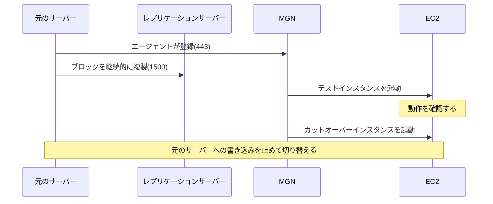
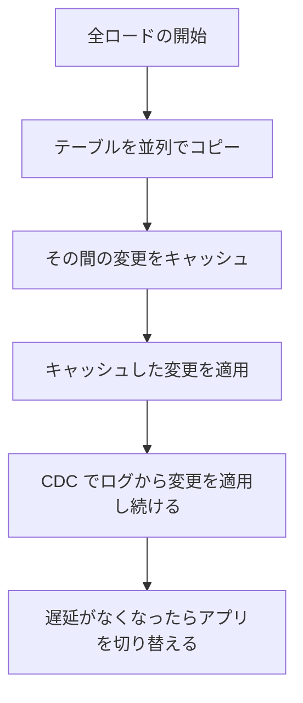
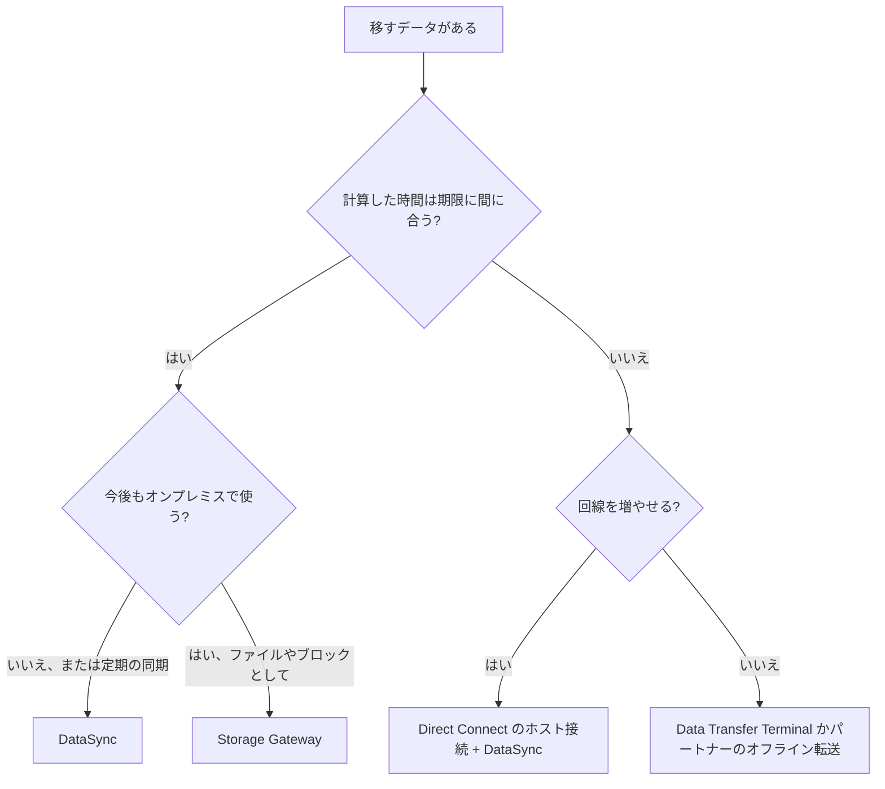

# 移行と転送

オンプレミスや他のクラウドから AWS へ、サーバー、データベース、ファイルを移すサービスをまとめます。何を移すかでサービスが決まり、データ量と回線で転送方法が決まります。

[](../assets/diagrams/migration-paths.png)

| 移すもの | 第一候補 | 動き |
| --- | --- | --- |
| サーバーをそのまま | [AWS Transform MGN](#mgn) | ブロック単位で継続的に複製し、短い停止で切り替える |
| データベース | [AWS DMS](#dms) と [SCT](#sct) | 全ロードの後、変更を CDC で流す |
| ファイル(大量、一括または定期) | [DataSync](#datasync) | エージェントで NFS、SMB などから AWS へ転送 |
| SFTP などの取引先連携 | [Transfer Family](#transfer-family) | クライアント側を変えずに S3、EFS を受け口にする |
| オンプレミスに残す処理とクラウドの接続 | [Storage Gateway](#storage-gateway) | ローカルのキャッシュ付きで S3 などを使う |
| 回線に乗らないデータ | [Data Transfer Terminal](#data-transfer-terminal) | 自分の機器を施設に持ち込み、高速回線でアップロード |
| 移行全体の計画と実行 | [AWS Transform](#transform) | AI エージェントが発見、計画、リホストを進める |

!!! warning "2025 年以降に新規受付を止めたサービスが多い"
    古い資料の定番だった Migration Hub、Application Discovery Service、App2Container、Snow Family は、新規のお客様には提供されていません。後継は下の表のとおりです。ただし試験ガイドの対象一覧に名前が残っているものもあるので、役割は覚えておきます。

| サービス | 現在の状況 | 代わりに使うもの |
| --- | --- | --- |
| AWS Migration Hub | 2025 年 11 月 7 日に新規受付を終了。既存のお客様は継続可 | AWS Transform |
| Migration Hub Refactor Spaces | 2025 年 11 月 7 日に新規受付を終了 | AWS Transform |
| Application Discovery Service | 新規受付を終了 | AWS Transform |
| App2Container | 新規受付を終了 | AWS Transform |
| Snow Family | 新規の注文を受け付けない。既存のお客様は継続可 | DataSync、Data Transfer Terminal、パートナー製品、エッジ処理は Outposts |
| Amazon FSx File Gateway | 新規受付を終了 | FSx for Windows File Server へ直接接続 |
| DMS Fleet Advisor | 2026 年 5 月 20 日にサポート終了 | Migration Evaluator |
| MGN のエージェントレス複製 | 新規のデプロイでは使えない | エージェントでの複製 |
| Mainframe Modernization | マネージドランタイムもセルフマネージドも新規受付を終了 | AWS Transform、ベンダー直接の製品 |
| VMware Cloud on AWS | 2024 年 4 月 30 日から AWS は販売しない。Broadcom が販売 | [Amazon EVS](#vmware) |

## 移行の 7 つの R {#seven-rs}

アプリごとに移行の方法を決める枠組みです。大規模な移行では、まずリホスト、リロケート、リプラットフォーム、リタイアを中心にし、モダナイズは移行後に進めるのが基本です。

| 戦略 | 別名 | 内容 | 向く場面の例 |
| --- | --- | --- | --- |
| Retire | 廃止 | 止めて、アーカイブする | 90 日間接続がない、CPU とメモリの平均が 5% 未満 |
| Retain | 保持 | 今は移さず、元の場所に残す | データの所在の規制、更新したばかり、専用ハードウェアに依存 |
| Rehost | リフトアンドシフト | アプリを変えずに EC2 へ移す | 多数のサーバーを短期間で移す |
| Relocate | ハイパーバイザーレベルのリフトアンドシフト | クラウド版の同じ基盤へ移す。ハードウェアの購入も書き換えも不要 | VMware をそのまま AWS 上の VMware へ |
| Repurchase | ドロップアンドショップ | 別の製品や SaaS に買い替える | 自社開発の CRM を SaaS に置き換える |
| Replatform | リフト、ティンカー、シフト | 少し手を入れて最適化する | 自前の DB を RDS へ、Windows から Linux へ、Graviton へ |
| Refactor | リアーキテクト | クラウド向けに作り直す | モノリスをマイクロサービスとサーバーレスへ |

**例**: 300 台のうち、接続が 90 日ないもの 40 台は Retire、期限が迫る残り 200 台は Rehost、DB サーバーは Replatform で RDS へ、競争力の中心のアプリだけ移行後に Refactor します。

**Refactor の進め方**: 全部を一度に作り直すと危険です。ストラングラーフィグパターンでは、前段のルーティング層から機能ごとに新しいサービスへ少しずつ振り向けます。

**落とし穴**: 大規模な移行で最初から Refactor を選ぶと、複雑さのため期限に間に合いません。問題文に「期限が短い」「手を加えない」とあれば Rehost です。

## AWS Migration Hub {#migration-hub}

**現在の状況**: 2025 年 11 月 7 日に新規受付を終了しました。既存のお客様は進行中のプロジェクトを続けられます。新機能は追加されず、セキュリティ更新は続きます。後継の AWS Transform へのデータ移行は不要です。

サーバーをアプリにまとめ、MGN や DMS の進み具合を 1 か所で追跡する画面です。

- **ホームリージョン**: 追跡データの保存先です。移行先のリージョンは別でかまいません。
- **関連機能**: Strategy Recommendations、Orchestrator、Refactor Spaces があります。
- **見分け方**: Migration Hub 自体はデータを移しません。実際の移行は MGN や DMS が行います。

## Application Discovery Service {#application-discovery}

**現在の状況**: 新規受付を終了しました。後継は AWS Transform です。

オンプレミスのサーバーとデータベースの構成、使用状況、依存関係を集めます。

| 方式 | 配置 | 集める情報 | 向く場面 |
| --- | --- | --- | --- |
| Agentless Collector | vCenter ごとに OVA で配置 | VM の構成と使用状況、TCP 接続。約 60 分間隔 | VMware で、VM にエージェントを入れたくない |
| Discovery Agent | サーバーごと | 構成、詳細な時系列、接続、実行中のプロセス。約 15 秒間隔 | 物理サーバーや、詳しい依存関係が必要 |
| ファイルのインポート | 不要 | 与えたデータのみ。1 回限りのスナップショット | すでに一覧がある |

**落とし穴**: Agentless Collector は VM の中を見ないので、実行中のプロセスがわかりません。依存関係を詳しく調べるならエージェントです。

## Migration Evaluator {#migration-evaluator}

移行の費用対効果(ビジネスケース)を作るサービスです。依存関係の調査ではなく、コストの比較に使います。

- オンプレミスの x86 サーバーを、構成、ライセンス、使用率をもとに EC2 に対応付けます。
- データ収集は **Agentless Collector** か、**ファイルでの提出**です。コレクターはネットワーク内に Windows Server の VM を 1 台置き、WMI、SNMP、vSphere、T-SQL で集めます。
- **Quick Insights** は、EC2、EBS、OS ライセンスを AWS で購入する場合の予想費用を 1 年の期間で示します。
- 追加のコストモデルを含む Business Case レポートは、担当のソリューションアーキテクトに依頼します。

| 問い | 使うもの |
| --- | --- |
| AWS に移すといくら節約できるか | Migration Evaluator |
| どのサーバーがどれに依存しているか | AWS Transform(既存のお客様は Application Discovery Service) |

新規受付を止めたという記載は、公式のページでは確認できませんでした(2026 年 10 月時点)。

## AWS Transform {#transform}

AI エージェントを使って、移行とモダナイズを進めるサービスです。2025 年 5 月に始まり、Migration Hub の機能を引き継いでいます。追加料金はかかりません。

| 対象 | 内容 |
| --- | --- |
| サーバー移行の発見 | オンプレミスのサーバー一覧を複数の情報源から集めて分析 |
| 移行計画 | アプリをまとめ、依存関係を見つけ、移行ウェーブを作る |
| ランディングゾーン | マルチアカウントの基盤を設計してデプロイ |
| ネットワーク移行 | 元のネットワーク構成を VPC の構成に変換 |
| サーバーのリホスト | レプリケーション、テスト、カットオーバーを案内 |
| コンテナ化 | ソースコードからコンテナ化して ECS、EKS へ |
| .NET | Linux で動くクロスプラットフォームの .NET へ |
| メインフレーム | IBM z/OS、富士通 GS21 のモダナイズと移行 |

**権限のしくみ**: ワークスペースが権限の境界です。重要な操作(本番へのデプロイなど)は、人の承認を挟めます。

| ロール | できること |
| --- | --- |
| Administrator | すべて。ワークスペース、コネクタ、ユーザーの変更も可 |
| Approver | 重要な操作の承認。ワークスペースなどの変更は不可 |
| Contributor | ジョブの開始と停止。重要な操作の承認は不可 |
| Reader | 閲覧のみ |

## AWS Transform MGN(旧 Application Migration Service) {#mgn}

物理、仮想、他のクラウドのサーバーを、**ブロック単位の継続的な複製**で EC2 へ移します。切り替えの停止は通常、分単位です。AWS Application Migration Service から名前が変わり、試験ガイドでも両方の名前が使われます。API やコンソールの URL では今も `mgn` です。



### 通信の要件 {#mgn-network}

| 通信 | ポート | 誤ったときの症状 |
| --- | --- | --- |
| 元のサーバー → MGN のエンドポイント | TCP 443 | エージェントの登録に失敗する |
| 元のサーバー → ステージングエリアのサブネット | TCP 1500 | 初回の同期が進まない |
| ステージングエリア → AWS のサービス | TCP 443 | レプリケーションサーバーが準備できない |

### 3 つのテンプレート {#mgn-templates}

テンプレートの設定は新しく追加するサーバーに適用されます。追加済みのサーバーには影響しません。サーバーごとに上書きできます。

| テンプレート | 主な設定 | 例 |
| --- | --- | --- |
| レプリケーション | ステージングエリアのサブネット、レプリケーションサーバーのインスタンスタイプ、対象ストレージ(EBS または FSx for ONTAP) | サブネットは 1 つに統一。インスタンスタイプの既定は `t3.small` |
| 起動 | テストとカットオーバーの EC2 の設定 | サイジングとサブネット |
| 起動後 | Systems Manager のアクションなど | 監視エージェントを入れる |

**例**: 書き込みが多いサーバーで複製が遅れるなら、そのサーバーのレプリケーションサーバーだけ `t3.small` から `m5.large` に変えます。

### ライフサイクル {#mgn-lifecycle}

状態は次の順に進みます。テストを省略せず、問題があれば元のサーバーで業務を続けながらやり直せます。

| 状態 | 意味 |
| --- | --- |
| Not ready | 初回の同期中 |
| Ready for testing | テストインスタンスを起動できる |
| Test in progress | テストインスタンスを起動中 |
| Ready for cutover | テスト済みで、カットオーバーできる |
| Cutover in progress | カットオーバーインスタンスを起動中 |
| Cutover complete | 移行が完了 |

大規模な移行では、サーバーをアプリに、アプリをウェーブにまとめ、まとめて操作します。

**落とし穴**: vCenter のエージェントレス複製は、新規のデプロイでは使えなくなりました。古い資料で「エージェントを入れられないなら agentless」とあっても、今はエージェントでの複製が推奨です。

## AWS DMS {#dms}

データベースを移行するサービスです。移行中も元のデータベースを使い続けられます。

### 構成要素 {#dms-components}

| 要素 | 内容 |
| --- | --- |
| レプリケーションインスタンス | タスクを実行する EC2。CDC が届かないときの変更の退避先にもなる |
| エンドポイント | 接続先の情報。ソースとターゲットに 1 つずつ |
| タスク | 移行タイプとテーブルの選択を決める |
| DMS Serverless | インスタンスの代わりに DCU を指定。自動でスケールする |

**例**: インスタンスの大きさを見積もりたくない、負荷が変わるなら Serverless です。最小 DCU は省略すると 1 で、最大は例えば 16 にします。Serverless はすべてのエンドポイントに対応しているわけではなく、S3 や Secrets Manager などへは VPC エンドポイントが必要です。

### 移行タイプ {#dms-migration-types}

| コンソール | API の値 | 動作 | 使う場面 |
| --- | --- | --- | --- |
| Migrate existing data | `full-load` | 既存データを一括で移す | 停止時間を取れる |
| Migrate existing data and replicate ongoing changes | `full-load-and-cdc` | 全ロードの後、変更を流し続ける | 停止を最小にする |
| Replicate data changes only | `cdc` | 変更だけを流す | 別の方法で初期データを入れた後 |



```bash
aws dms create-replication-task \
  --replication-task-identifier orders-migration \
  --source-endpoint-arn arn:aws:dms:ap-northeast-1:123456789012:endpoint:SOURCE \
  --target-endpoint-arn arn:aws:dms:ap-northeast-1:123456789012:endpoint:TARGET \
  --replication-instance-arn arn:aws:dms:ap-northeast-1:123456789012:rep:INSTANCE \
  --migration-type full-load-and-cdc \
  --table-mappings file://table-mappings.json
```

### CDC の前提 {#dms-cdc}

DMS はソースのトランザクションログから変更を読みます。エンジンごとに準備が必要です。

| ソース | 必要な準備 |
| --- | --- |
| Oracle | サプリメンタルログを有効にする |
| MySQL | 行形式のバイナリログを有効にする |
| PostgreSQL | 論理レプリケーションスロットを使う |
| RDS 全般 | 自動バックアップを有効にし、変更ログを十分保持する。通常 24 時間で足りる |

**例**: RDS for MySQL で CDC のタスクがログを読めないなら、バックアップの保持期間とバイナリログの形式を確認します。

**落とし穴**:

- CDC はリアルタイムの複製ではありません。遅延の SLA はなく、数分以上になることもあります。
- ビューは全ロードのタスクでしか移せません。
- ログを保持する時間が短いと、タスクが止まっている間に必要なログが消えて再開できません。

### 主なタスクの設定 {#dms-task-settings}

| 設定 | 値 | 動作と例 |
| --- | --- | --- |
| ターゲットテーブルの準備 | Do nothing | 既存の表をそのまま使う。空でなければ競合することがある |
| | Drop tables on target | 消して作り直す |
| | Truncate | 表を残して中身を消す |
| 全ロード後の停止 | Don't stop | そのまま変更を適用する |
| | Stop before applying cached changes | 適用の前に止める。セカンダリインデックスを足して適用を速くできる |
| | Stop after applying cached changes | 適用の後に止める。外部キーを足すときに使う |
| LOB | Don't include | LOB 列を移さない |
| | Limited LOB mode | 上限で切り詰める。速い |
| | Full LOB mode | サイズによらず全部移す。遅い |
| 検証 | 有効にする | ソースとターゲットを比較する。検証だけのタスクも作れる |
| Multi-AZ | 有効にする | 別の AZ に同期のスタンバイを置く。CDC を使うなら有効にする |

**例**: 最大 2 MB の LOB がある表を Limited LOB mode の上限 32 KB で移すと、切り詰められます。上限を 2 MB 以上にするか、Full LOB mode にします。

**落とし穴**: DMS はテーブルと主キーなど基本の作成だけを行います。セカンダリインデックス、制約、トリガーなどは SCT か手作業で作ります。全ロードの前に索引やトリガーを外し、後で作ると速くなります。

## AWS SCT と DMS Schema Conversion {#sct}

エンジンが異なる移行(異種間移行)で、スキーマとコードを変換します。データは移しません。データは DMS で移します。

| 観点 | AWS SCT | DMS Schema Conversion |
| --- | --- | --- |
| 形態 | ダウンロードして使うデスクトップアプリ | DMS のマネージド機能 |
| 変換先 | RDS、Aurora、Redshift | Aurora、RDS、Redshift |
| 追加の機能 | 拡張パック、データ抽出エージェント、ETL の変換、Redshift のキーの提案 | ターゲットがない段階では仮想ターゲットで評価 |

| 移行の組み合わせ | 必要なもの |
| --- | --- |
| Oracle → Aurora PostgreSQL(異種間) | SCT または Schema Conversion でスキーマ、DMS でデータ |
| SQL Server → Aurora MySQL(異種間) | 同上 |
| MySQL → Aurora MySQL(同種間) | スキーマ変換は不要 |
| Netezza、Greenplum、Oracle DW、Snowflake → Redshift | SCT とデータ抽出エージェント |

変換できない機能は、評価レポートに残ります。拡張パックは、変換できない機能を Lambda 関数や Python ライブラリで補います。

## AWS DataSync {#datasync}

ファイルやオブジェクトを転送する、マネージドのオンラインサービスです。増分転送、圧縮、暗号化、整合性の検証を自動で行います。

### 転送元と転送先 {#datasync-locations}

| 転送元 | 転送先 | エージェント |
| --- | --- | --- |
| NFS、SMB、HDFS、オブジェクトストレージ | S3、EFS、FSx | 必要 |
| S3、EFS、FSx | NFS、SMB、HDFS、オブジェクトストレージ | 必要 |
| S3、EFS、FSx | S3、EFS、FSx | 不要 |
| 他のクラウドのストレージ | S3 | Basic モードのみ必要 |
| 他のクラウドのストレージ | EFS、FSx | 必要 |

### タスクの設定 {#datasync-task-settings}

| 設定 | 値 | 動作と例 |
| --- | --- | --- |
| タスクモード | Enhanced | 一覧、準備、転送、検証を並列で実行。オブジェクト数は事実上無制限 |
| | Basic | 順に実行。件数のクォータあり。S3 on Outposts はこちらのみ |
| スケジュール | 最短 1 時間 | `rate(1 hour)` や cron。1 時間より短い間隔にはできない |
| 帯域の上限 | `BytesPerSecond` | 100 Mbps に制限するなら `12500000`。実行中も変更できる |
| データの検証 | Enhanced は転送分のみ。Basic は既定で全データ | 検証を減らすと速いが、確認の範囲が狭まる |
| 対象の絞り込み | フィルター、マニフェスト | 特定のプレフィックスだけ転送する |
| タスクレポート、ログ | CloudWatch Logs | Enhanced は JSON 形式 |

**落とし穴**: タスクモードは作成後に変更できません。

```bash
aws datasync create-task \
  --source-location-arn arn:aws:datasync:ap-northeast-1:123456789012:location/loc-source \
  --destination-location-arn arn:aws:datasync:ap-northeast-1:123456789012:location/loc-dest \
  --task-mode ENHANCED \
  --schedule 'ScheduleExpression=rate(24 hours)' \
  --options BytesPerSecond=12500000
```

**例**: 営業時間に回線を圧迫するので、夜間のスケジュールにし、`BytesPerSecond` で帯域を抑えます。

### 速度を上げる {#datasync-performance}

| 上限 | 値 | 対策 |
| --- | --- | --- |
| タスクあたりのスループット(エージェントあり) | 10 Gbps | 超えるならデータセットを分けて複数のタスクにする |
| タスクあたりのスループット(エージェントなし) | 5 Gbps | 同上 |
| Enhanced の同時実行 | 120 | |
| タスク数 | 100(引き上げ可) | |
| 実行履歴の保持 | 30 日 | |

**例**: 10 Gbps の回線で 1 つのタスクが 300 MiB/s しか出ないなら、回線の余力があります。データを分割して複数のタスクで並行して流します。

回線が足りないときは、期間を限定した Direct Connect のホスト接続と組み合わせます。

## AWS Transfer Family {#transfer-family}

SFTP、FTPS、FTP、AS2、ブラウザでの転送を受け付け、S3 または EFS に保存するマネージドサービスです。取引先のツールや設定を変えずに、自前のファイルサーバーをなくせます。

| プロトコル | エンドポイント | 要点 |
| --- | --- | --- |
| SFTP | 公開、VPC | ポート 22。VPC では 2222、2223、22000 も使える |
| FTPS | VPC(内部、インターネット向け) | ACM のサーバー証明書が必要。制御は 21、データチャネルは 8192〜8200 |
| FTP | VPC の内部のみ | 暗号化されないので公開できない。ポートは FTPS と同じ |
| AS2 | サーバーとコネクタ | B2B の連携。サーバーで受信し、コネクタで送信する |
| ブラウザ | Web アプリ | サーバー不要。IAM Identity Center と S3 Access Grants を使う |

| ID の管理 | 内容 |
| --- | --- |
| サービスマネージド | ユーザーと SSH 鍵を Transfer Family に保存。SFTP のサーバーでだけ選べる |
| Directory Service for Microsoft Active Directory | Active Directory の認証情報を使う |
| カスタム ID プロバイダー | Lambda または API Gateway で既存の ID 基盤につなぐ |

**例**: 取引先ごとに接続元 IP を限定したいなら、VPC 内にエンドポイントを置いて Elastic IP を割り当て、セキュリティグループで制限します。

**落とし穴**: 公開エンドポイントは SFTP だけで、セキュリティグループでは制限できません。FTPS は VPC でホストします。

## AWS Storage Gateway {#storage-gateway}

オンプレミスに置くアプライアンスで、ローカルのアプリと AWS のストレージをつなぎます。ESXi、KVM、Hyper-V、Nutanix AHV の VM、ハードウェアアプライアンス、EC2 にデプロイできます。

| タイプ | プロトコル | 保存先 | 向く場面 |
| --- | --- | --- | --- |
| S3 File Gateway | NFS v3、v4.1、SMB v2、v3 | S3(オブジェクトとして読める) | ファイルとして書き、クラウド側では S3 として使う |
| FSx File Gateway(新規受付終了) | SMB | FSx for Windows File Server | 既存のお客様のみ |
| Volume Gateway キャッシュ型 | iSCSI | S3。頻繁に使う部分をローカルに | オンプレミスの容量を増やしたくない |
| Volume Gateway 保管型 | iSCSI | ローカルに全量。S3 へ非同期にスナップショット | 全データに低遅延でアクセスする |
| Tape Gateway | iSCSI の仮想テープ(VTL) | S3、アーカイブは Glacier Flexible Retrieval か Deep Archive | 既存のテープのバックアップソフトを使い続ける |

| 上限 | キャッシュ型 | 保管型 |
| --- | --- | --- |
| ボリュームの最大サイズ | 32 TiB | 16 TiB |
| ゲートウェイあたりのボリューム数 | 32 | 32 |
| ゲートウェイの合計 | 1,024 TiB | 512 TiB |

| Tape Gateway の上限 | 値 |
| --- | --- |
| テープのサイズ | 100 GiB〜15 TiB |
| ゲートウェイあたりの本数 | 1,500 |
| ゲートウェイあたりの合計 | 1 PiB |
| アーカイブの本数と容量 | 無制限 |
| キャッシュ、アップロードバッファの最小 | 各 150 GiB |

**例**: 物理テープをやめたいが、バックアップソフトは変えたくないなら Tape Gateway です。オンプレミスの全データを低遅延で読み、DR 用に AWS にコピーを持つなら Volume Gateway の保管型です。

**落とし穴**: キャッシュ型の 16 TiB を超えるボリュームのスナップショットは、Storage Gateway のボリュームには復元できますが、EBS ボリュームには復元できません。

| 問い | 答え |
| --- | --- |
| 1 回きり、または定期にデータを AWS へ移す | DataSync |
| オンプレミスのアプリが、AWS のデータを使い続ける | Storage Gateway |
| 取引先が SFTP で送ってくる | Transfer Family |

## Snow Family の現在の状況 {#snow-family}

**現在の状況**: Snow Family のデバイスは新規のお客様に提供されません。既存のお客様は使い続けられ、AWS はセキュリティと可用性の改善を続けています。

| 元の用途 | 代わりに使うもの |
| --- | --- |
| オンラインで送れるデータの移行 | DataSync。必要なら期間限定の Direct Connect を組み合わせる |
| 回線に乗らないデータ | Data Transfer Terminal、パートナーのオフライン転送(Seagate、Tsecond など) |
| エッジでの処理(Compute Optimized) | Outposts のサーバー(2U)、ラック(42U)。接続が切れても最大 7 日動作 |

SAA の試験ガイドの対象一覧には Snow Family が残っています。「回線が細く、データが数十 TB 以上でオフラインの転送を選ぶ」という位置付けを覚えておきます。実務で新しく始めるなら、上の代替を検討します。

## AWS Data Transfer Terminal {#data-transfer-terminal}

高速回線につながった AWS の施設に、自分のストレージ機器を持ち込んでアップロードするサービスです。デバイスが届くのを待つ Snow とは逆で、データを持っていく形です。

- コンソールで予約し、施設で S3 などへ直接アップロードします。
- **対象**: 現時点では Enterprise Support のお客様のみです。それ以外は AWS サポートに問い合わせます。
- **設備**: 部屋には光ファイバーケーブル 2 本と机だけがあります。ノート PC、SSD、機器は自分で持ち込みます。
- **機器の要件**: 100GBASE-LR4 の QSFP28 トランシーバー、100 Gbps の NIC が推奨の構成に含まれます。光(LC コネクタ)に対応している必要があります。
- **場所**: 予約後、施設の公開名がメールで届きます。入館には身分証明が必要です。
- **向く場面**: 撮影や車載の収集など、すでに可搬の機器にデータがあるとき。

## App2Container {#app2container}

**現在の状況**: 新規受付を終了しました。後継は AWS Transform のコンテナ化です。

既存のアプリを、**ソースコードなしで**コンテナに変えるコマンドラインツールです。

- 対象はサーバーで動く ASP.NET(Windows)と Java(Linux)です。
- アプリの一覧作成、依存関係の分析、Dockerfile の生成、イメージのビルドを行います。
- ECS、EKS、App Runner 用の CloudFormation テンプレートなどを作り、CodePipeline のパイプラインも作れます。
- ツール自体は無料です。

**見分け方**: ソースコードがないアプリのコンテナ化なら App2Container、ソースコードから進めるなら AWS Transform です。

## VMware の移行 {#vmware}

VMware の環境と運用を変えずに AWS へ移す Relocate の選択肢です。

| サービス | 販売元、運用 | 位置付け |
| --- | --- | --- |
| VMware Cloud on AWS | Broadcom と認定販売店が販売。AWS は 2024 年 4 月 30 日から再販しない | SAA の試験ガイドの対象。VMware の環境を AWS 上で運用 |
| Amazon Elastic VMware Service(EVS) | AWS のサービス。運用は自分か AWS パートナー | VPC 内の EC2 ベアメタルで VMware Cloud Foundation を動かす |
| AWS Transform と MGN | AWS | VMware をやめて EC2 へリホストする |

**例**: VMware の運用手順、IP アドレス、スキルをそのまま残したいなら EVS です。VMware のライセンスをやめたいなら Transform で EC2 へ移します。

## 転送方法の選び方と時間の計算 {#choosing-transfer}



### 計算式 {#transfer-formula}

AWS が示す計算式です。理論上の最短なので、実際は余裕を見ます。

```text
日数 = (データ量のバイト数 × 8) ÷ (回線の bps × 利用率 × 3600 × 1 日に使える時間)
```

**例**: 100 TB、1 Gbps、利用率 80%、24 時間の場合です。

```text
(100,000,000,000,000 × 8) ÷ (1,000,000,000 × 0.8 × 3600 × 24) = 11.57 日
```

| データ量 | 回線 | 利用率 | 1 日の時間 | 日数 |
| --- | --- | --- | --- | --- |
| 10 TB | 100 Mbps | 80% | 24 時間 | 11.6 日 |
| 10 TB | 1 Gbps | 80% | 24 時間 | 1.2 日(約 28 時間) |
| 100 TB | 1 Gbps | 80% | 24 時間 | 11.6 日 |
| 500 TB | 500 Mbps | 80% | 12 時間 | 231 日 |
| 1 PB | 100 Mbps | 80% | 24 時間 | 1,157 日(約 3.2 年) |
| 1 PB | 1 Gbps | 80% | 24 時間 | 116 日 |
| 1 PB | 10 Gbps | 80% | 24 時間 | 11.6 日 |

**覚え方**: 1 Gbps、利用率 80%、24 時間で、100 TB が約 12 日です。あとは比例で計算できます。

**例題**: 500 TB を 60 日以内に移します。回線は 500 Mbps で、業務時間外の 12 時間しか使えません。

1. そのままでは 231 日なので間に合いません。
2. 60 日で済む速度を求めます。500 Mbps × 231 ÷ 60 = 約 1.9 Gbps です。
3. この速度を期間限定の Direct Connect で確保し、DataSync で転送します。確保できなければオフラインの転送です。

**例題**: 100 TB を 100 Gbps の施設でアップロードする場合、利用率 80% なら次のとおりです。機器の読み出しが 100 Gbps を出せることが前提です。

```text
(100,000,000,000,000 × 8) ÷ (100,000,000,000 × 0.8) = 10,000 秒 = 約 2.8 時間
```

### 変更の量も確認する {#transfer-change-rate}

切り替えまで同期を続けるなら、1 日の変更量が回線の処理量を下回る必要があります。

| 回線 | 利用率 | 1 日に送れる量 | 判定の例 |
| --- | --- | --- | --- |
| 100 Mbps | 80% | 864 GB | 変更が 500 GB/日なら追いつく。2 TB/日なら追いつかない |
| 1 Gbps | 80% | 8.64 TB | 変更が 2 TB/日なら追いつく |

計算: 100 Mbps × 0.8 = 80 Mbps = 10 MB/s、10 MB/s × 86,400 秒 = 864 GB です。

### サービスの比較 {#transfer-comparison}

| 手段 | 向く場面 | 向かない場面 |
| --- | --- | --- |
| DataSync | NFS、SMB、HDFS、オブジェクトからの移行と定期同期 | SFTP の受け口、オンプレミスのアプリからの継続利用 |
| S3 Transfer Acceleration | 世界中の拠点からの S3 への HTTPS アップロード | ファイル共有の丸ごとの移行 |
| Storage Gateway | オンプレミスのアプリが継続して使う | 1 回限りの移行だけ |
| Transfer Family | 既存の SFTP、FTPS、FTP、AS2 の連携 | 大量ファイルの一括移行 |
| Data Transfer Terminal | データが可搬の機器にあり、回線に乗らない | Enterprise Support でない、拠点が施設から遠い |
| S3 のマルチパート | 大きなファイルを SDK、CLI でアップロード | NFS、SMB の権限やメタデータの維持 |

S3 のアップロードについては [S3](s3.md#transfer-acceleration) を参照してください。

## 選び方の比較 {#choosing}

| 迷う組み合わせ | 見分け方 |
| --- | --- |
| MGN と DMS | サーバーを丸ごとなら MGN。データベースのエンジンを変える、マネージドに移すなら DMS |
| DMS と SCT | データは DMS、スキーマとコードの変換は SCT |
| MGN と Elastic Disaster Recovery | 似た複製の仕組みですが、移行して終わりなら MGN、継続して備えるなら [DRS](resilience.md#drs) |
| DataSync と Storage Gateway | 移すなら DataSync、使い続けるなら Storage Gateway |
| DataSync と Transfer Family | 自分で転送を実行するなら DataSync、相手がプロトコルで送ってくるなら Transfer Family |
| Application Discovery と Migration Evaluator | 依存関係は Discovery、費用対効果は Migration Evaluator |
| Migration Hub と AWS Transform | 新規は Transform。既存のプロジェクトは Hub を続けられる |
| VMware Cloud on AWS と EVS | Broadcom から買うのが VMware Cloud on AWS、AWS のサービスとして VPC 内で動かすのが EVS |

## 既定値と上限のまとめ {#numbers}

| 項目 | 値 |
| --- | --- |
| MGN の通信 | TCP 443、TCP 1500 |
| MGN のレプリケーションサーバーの既定 | `t3.small` |
| DMS のストレージ | リージョンの全インスタンスで 30,000 GB |
| DMS のレプリケーションインスタンス | 60 |
| DMS のインスタンスあたりのタスク | 200 |
| DMS Serverless のレプリケーション | 100 |
| DMS の変更ログの保持 | 通常 24 時間で足りる |
| DataSync のタスクの最大スループット | エージェントあり 10 Gbps、なし 5 Gbps |
| DataSync のスケジュール | 最短 1 時間 |
| DataSync のタスク数 | 100(引き上げ可) |
| Transfer Family の SFTP | ポート 22。VPC で 2222、2223、22000 も可 |
| Transfer Family の FTP、FTPS のデータチャネル | 8192〜8200 |
| Volume Gateway のボリューム | キャッシュ型 32 TiB、保管型 16 TiB |
| 仮想テープ | 100 GiB〜15 TiB |
| Outposts の切断時の動作 | 最大 7 日 |
| 転送の目安 | 1 Gbps、利用率 80% で 100 TB が 11.57 日 |

## 試験のポイント {#exam-points}

| こう問われたら | 答え |
| --- | --- |
| 短期間で多数のサーバーを、変更せずに移す | Rehost(AWS Transform MGN) |
| 自前の MySQL を RDS へ、コードはほぼ変えない | Replatform |
| 買い替えて SaaS にする | Repurchase |
| 90 日間接続がないサーバー | Retire |
| 規制でまだ移せない | Retain |
| VMware をそのまま AWS 上の VMware へ | Relocate(EVS、VMware Cloud on AWS) |
| 機能ごとに少しずつマイクロサービスへ | Refactor、ストラングラーフィグパターン |
| 依存関係を調べて移行ウェーブを作る | AWS Transform(既存は Application Discovery Service) |
| 移行のビジネスケースを作る | Migration Evaluator |
| 最小の停止でサーバーを移す、テストとカットオーバー | AWS Transform MGN |
| 移行中も DB を止めない | DMS の全ロード + CDC(`full-load-and-cdc`) |
| Oracle から Aurora PostgreSQL へ | SCT または DMS Schema Conversion + DMS |
| CDC を使うタスクの可用性を高める | レプリケーションインスタンスの Multi-AZ |
| MySQL のソースで CDC が動かない | 行形式のバイナリログ |
| NFS を AWS へ定期的に同期 | DataSync(スケジュール) |
| DataSync が回線を圧迫する | `BytesPerSecond` |
| 取引先の SFTP をそのまま S3 で受ける | Transfer Family |
| 物理テープをやめる、バックアップソフトは同じ | Tape Gateway |
| ローカルで NFS を使い、データは S3 に置く | S3 File Gateway |
| オンプレミスの全データに低遅延、AWS にはコピー | Volume Gateway 保管型 |
| オンプレミスの容量を抑え、最近のデータだけ手元に | Volume Gateway キャッシュ型 |
| 1 Gbps で 100 TB はどのくらいか | 約 12 日(利用率 80%) |
| 回線に乗らないデータ、新規の場合 | Data Transfer Terminal、またはパートナー製品 |
| エッジで処理する、Snowball の代わり | Outposts |
| ソースコードなしでコンテナ化(既存のお客様) | App2Container |

## 関連ページ {#related}

- [耐障害性と DR](resilience.md)
- [高度なストレージ(FSx など)](storage-advanced.md)
- [S3](s3.md)
- [ストレージの選び方](storage.md)
- [データベースとキャッシュ](databases.md)
- [ネットワークの接続](network-connectivity.md)
- [コンテナ](containers.md)

## 参考 {#references}

- [About the migration strategies](https://docs.aws.amazon.com/prescriptive-guidance/latest/large-migration-guide/migration-strategies.html)
- [AWS Migration Hub availability change](https://docs.aws.amazon.com/migrationhub/latest/ug/migrationhub-availability-change.html)
- [What is AWS Migration Hub Refactor Spaces?](https://docs.aws.amazon.com/migrationhub-refactor-spaces/latest/userguide/what-is-mhub-refactor-spaces.html)
- [What is AWS Application Discovery Service?](https://docs.aws.amazon.com/application-discovery/latest/userguide/what-is-appdiscovery.html)
- [Migration Evaluator FAQs](https://aws.amazon.com/migration-evaluator/faqs/)
- [What is AWS Transform?](https://docs.aws.amazon.com/transform/latest/userguide/what-is-service.html)
- [What is AWS Transform MGN?](https://docs.aws.amazon.com/mgn/latest/ug/what-is-mgn.html)
- [MGN replication template reference](https://docs.aws.amazon.com/mgn/latest/ug/replication-server-settings.html)
- [MGN lifecycle states](https://docs.aws.amazon.com/mgn/latest/ug/migration-dashboard.html)
- [MGN agentless replication](https://docs.aws.amazon.com/mgn/latest/ug/installing-vcenter-overview-mgn.html)
- [What is AWS DMS?](https://docs.aws.amazon.com/dms/latest/userguide/Welcome.html)
- [Creating a DMS task](https://docs.aws.amazon.com/dms/latest/userguide/CHAP_Tasks.Creating.html)
- [DMS ongoing replication](https://docs.aws.amazon.com/dms/latest/userguide/CHAP_Task.CDC.html)
- [DMS Serverless](https://docs.aws.amazon.com/dms/latest/userguide/CHAP_Serverless.html)
- [DMS best practices](https://docs.aws.amazon.com/dms/latest/userguide/CHAP_BestPractices.html)
- [DMS quotas](https://docs.aws.amazon.com/dms/latest/userguide/CHAP_Limits.html)
- [DMS Fleet Advisor end of support](https://docs.aws.amazon.com/dms/latest/userguide/dms_fleet.advisor-end-of-support.html)
- [DMS Schema Conversion](https://docs.aws.amazon.com/dms/latest/userguide/CHAP_SchemaConversion.html)
- [What is the AWS Schema Conversion Tool?](https://docs.aws.amazon.com/SchemaConversionTool/latest/userguide/CHAP_Welcome.html)
- [DataSync locations](https://docs.aws.amazon.com/datasync/latest/userguide/working-with-locations.html)
- [DataSync task modes](https://docs.aws.amazon.com/datasync/latest/userguide/choosing-task-mode.html)
- [DataSync quotas](https://docs.aws.amazon.com/datasync/latest/userguide/datasync-limits.html)
- [Estimating DataSync migration timelines](https://docs.aws.amazon.com/datasync/latest/userguide/datasync-large-migration-timelines.html)
- [What is AWS Transfer Family?](https://docs.aws.amazon.com/transfer/latest/userguide/what-is-aws-transfer-family.html)
- [Transfer Family web apps](https://docs.aws.amazon.com/transfer/latest/userguide/web-app.html)
- [What is Amazon S3 File Gateway](https://docs.aws.amazon.com/filegateway/latest/files3/what-is-file-s3.html)
- [What is Amazon FSx File Gateway](https://docs.aws.amazon.com/filegateway/latest/filefsxw/what-is-file-fsxw.html)
- [What is Volume Gateway?](https://docs.aws.amazon.com/storagegateway/latest/vgw/WhatIsStorageGateway.html)
- [What is Tape Gateway?](https://docs.aws.amazon.com/storagegateway/latest/tgw/WhatIsStorageGateway.html)
- [Volume Gateway quotas](https://docs.aws.amazon.com/storagegateway/latest/vgw/resource-gateway-limits.html)
- [Tape Gateway quotas](https://docs.aws.amazon.com/storagegateway/latest/tgw/resource-gateway-limits.html)
- [AWS Snowball Edge availability change](https://docs.aws.amazon.com/snowball/latest/developer-guide/snowball-edge-availability-change.html)
- [What is Data Transfer Terminal?](https://docs.aws.amazon.com/datatransferterminal/latest/userguide/what-is-dtt.html)
- [Data Transfer Terminal technical requirements](https://docs.aws.amazon.com/datatransferterminal/latest/userguide/tech-requirements.html)
- [What is AWS App2Container?](https://docs.aws.amazon.com/app2container/latest/UserGuide/what-is-a2c.html)
- [VMware Cloud on AWS FAQs](https://aws.amazon.com/vmware/faqs/)
- [What is Amazon Elastic VMware Service?](https://docs.aws.amazon.com/evs/latest/userguide/what-is-evs.html)
- [AWS Mainframe Modernization](https://docs.aws.amazon.com/m2/latest/userguide/what-is-m2.html)
