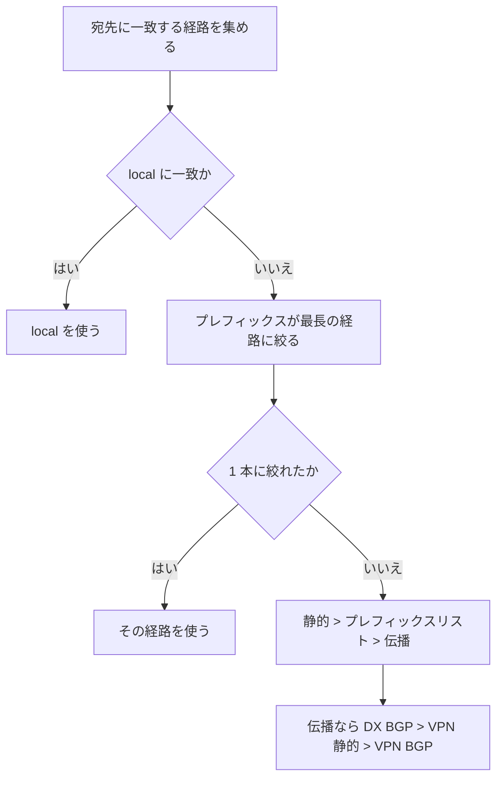
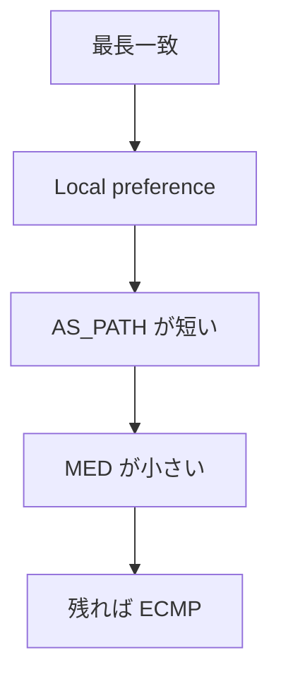
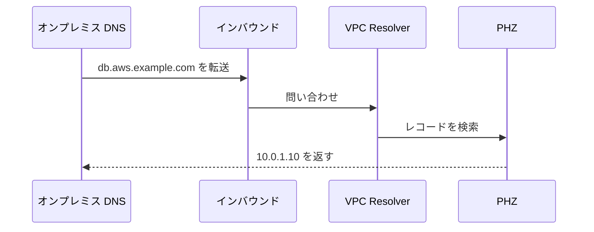
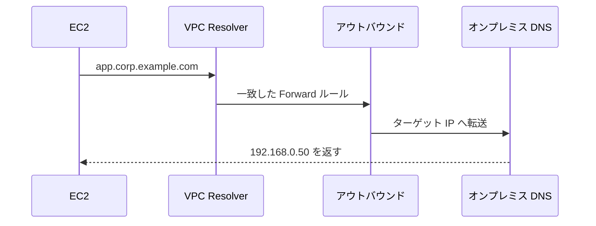
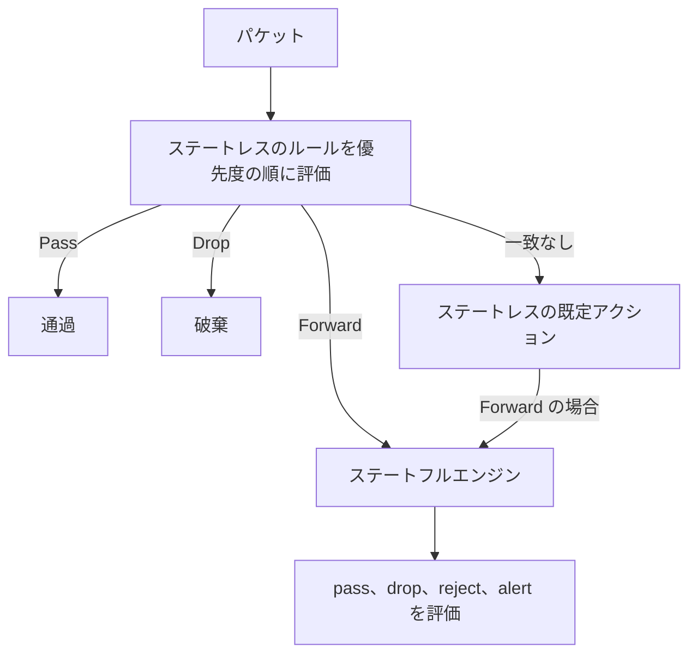

# ネットワーク接続（ハイブリッドとマルチ VPC）

[:material-sprout: CLF](../courses/clf/services.md){ .exam-badge .exam-foundational } [:material-certificate: SAA](../courses/saa/services.md){ .exam-badge .exam-associate } [:material-certificate: SOA](../courses/soa/services.md){ .exam-badge .exam-associate } [:material-certificate: MLA](../courses/mla/services.md){ .exam-badge .exam-associate } [:material-star-circle: SAP](../courses/sap/services.md){ .exam-badge .exam-professional } [:material-star-circle: DOP](../courses/dop/services.md){ .exam-badge .exam-professional } [:material-star-circle: AIP](../courses/aip/services.md){ .exam-badge .exam-professional } [:material-target: ANS](../courses/ans/services.md){ .exam-badge .exam-specialty } [:material-target: SCS](../courses/scs/services.md){ .exam-badge .exam-specialty }

オンプレミスと AWS、VPC と VPC、リージョンとリージョンをつなぐサービスと、その経路制御、DNS、検査、調査の方法をまとめます。主な読者は Advanced Networking（ANS-C01）の受験者で、ルートの優先順位と BGP の属性を計算例つきで扱います。

VPC の基本、VPC エンドポイント、Route 53 のレコードとルーティングポリシー、ELB、CloudFront は [ネットワーク](networking.md) を参照してください。ここでは繰り返しません。

| 接続先 | サービス | 帯域の目安 | 通信路 | 向いている場面 |
|---|---|---|---|---|
| オンプレミス ↔ AWS（専用線） | [Direct Connect](#direct-connect) | 接続あたり 50 Mbps〜400 Gbps | 専用の物理回線 | 大容量、安定した遅延 |
| オンプレミス ↔ AWS（IPsec） | [Site-to-Site VPN](#site-to-site-vpn) | トンネルあたり 1.25 Gbps または 5 Gbps | インターネット、または DX の上 | すぐ始めたい、DX のバックアップ |
| 利用者の端末 ↔ AWS | [Client VPN](#client-vpn) | 接続あたり基準 50 Mbps | TLS（OpenVPN） | リモートワーク |
| 多数の VPC とオンプレミス（リージョン内のハブ） | [Transit Gateway](#transit-gateway) | VPC アタッチメントの AZ あたり最大 100 Gbps | AWS ネットワーク | ハブアンドスポーク |
| 複数リージョンの WAN | [Cloud WAN](#cloud-wan) | 同上 | AWS ネットワーク | ポリシーで全体を一元管理 |
| VPC 2 つを直結 | [VPC ピアリング](#vpc-peering) | | AWS ネットワーク | 少数の VPC、推移的でなくてよい |
| インターネットの利用者 ↔ AWS | [Global Accelerator](#global-accelerator) | | AWS のエッジから AWS ネットワーク | 固定 IP、TCP/UDP の高速化 |
| サービス間（L7） | [VPC Lattice](#vpc-lattice) | サービスの AZ あたり既定 10 Gbps | AWS ネットワーク | CIDR の重複を気にせず、認可つきで接続 |

[](../assets/diagrams/network-connectivity-hybrid.png)

!!! warning "名称と提供状況の変更（2026 年 10 月時点）"
    - **AWS App Mesh** は、公式の告知では 2026 年 9 月 30 日でサポート終了です。この日以降はコンソールにもリソースにもアクセスできません。詳細は [App Mesh の状況](#app-mesh) を参照してください。
    - **Route 53 Resolver** は **Route 53 VPC Resolver** に改称されました。別物として、インターネットから到達できる **Route 53 Global Resolver** が加わっています。古い教材の「Route 53 Resolver」は VPC Resolver のことです。
    - **Transit Gateway Network Manager** の機能は、公式文書では **AWS Global Networks for Transit Gateways** として説明されています。コンソールは AWS Network Manager です。試験ガイドは旧称を使っています。

## Direct Connect {#direct-connect}

[:material-sprout: CLF](../courses/clf/services.md){ .exam-badge .exam-foundational } [:material-certificate: SAA](../courses/saa/services.md){ .exam-badge .exam-associate } [:material-certificate: MLA](../courses/mla/services.md){ .exam-badge .exam-associate } [:material-star-circle: SAP](../courses/sap/services.md){ .exam-badge .exam-professional } [:material-target: ANS](../courses/ans/services.md){ .exam-badge .exam-specialty } [:material-target: SCS](../courses/scs/services.md){ .exam-badge .exam-specialty }

オンプレミスと AWS を、インターネットを通らない専用回線で接続するサービスです。物理接続（コネクション）の上に論理接続（VIF）を作り、BGP で経路を交換します。

**提供単位:** 接続は Direct Connect ロケーションの物理ポートで、関連するリージョンを持ちます。VPC の外です。Direct Connect ゲートウェイはグローバルです。提供単位の考え方は[リソースの提供単位](resource-scope.md)を参照してください。

### 接続の種類 {#dx-connections}

| | 専用接続（Dedicated） | ホスト接続（Hosted） |
|---|---|---|
| 速度 | 1、10、100、400 Gbps | 50、100、200、300、400、500 Mbps、1、2、5、10、25 Gbps |
| 申し込み先 | AWS コンソール | Direct Connect パートナー（コンソールからは申し込めない） |
| 速度の変更 | できない。新しい接続を作る | パートナーが対応していれば変更できる |
| VIF の数 | 公開とプライベートで 50 個、合計 51 個（トランジットは 4 個まで） | **1 個** |
| 超過トラフィック | | ポリシングで破棄される |
| MACsec | 10、100、400 Gbps | 対象外 |

**物理の要件:** シングルモードファイバーで、1000BASE-LX（1 Gbps）、10GBASE-LR（10 Gbps）、100GBASE-LR4（100 Gbps）、400GBASE-LR4（400 Gbps）を使います。経路全体で 802.1Q VLAN と、BGP、BGP MD5 認証への対応が必要です。

**専用接続を開通させる流れ:**

1. コンソールで接続を要求します。審査とポート割り当てに最大 72 営業時間かかります。追加情報を求めるメールには 7 日以内に応答します。応答がないと接続は削除されます。
2. LOA-CFA（接続の許可書）をダウンロードします。ネットワーク事業者はこれを使ってクロスコネクトを発注します。
3. ポートが有効になると課金が始まります。有効にならなくても、LOA の発行から 90 日で課金が始まります。
4. VIF を作り、ルーターで BGP を設定します。

**症状と原因:**

| 症状 | 確認すること |
|---|---|
| 接続は up なのに VIF が down | レイヤー 2。オートネゴシエーション、VLAN タグの設定 |
| BGP が確立しない | ASN、ピア IP、MD5 キー |
| BGP セッションが `idle` で DOWN | 広告した経路数が上限（既定 100）を超えた |

**値を入れた例:**

- **種類の選び方（ホスト）:** 必要なのは 500 Mbps、VPC への VIF が 1 つ、という拠点ならホスト接続です。超過は破棄されるので、700 Mbps を流すと 200 Mbps 分が落ちます。
- **種類の選び方（専用）:** 同じ接続にプライベート VIF と公開 VIF の 2 つが要るなら、専用接続です。ホスト接続は 1 本に VIF が 1 つなので、2 本必要です。
- **速度の変更:** 1 Gbps の専用接続を 10 Gbps にするには、新しい接続を作り、VIF を移します。
- **課金の開始:** LOA を 1 日目に発行し、40 日目にポートが有効になれば 40 日目からです。工事が遅れても、90 日目には課金が始まります。
- **誤ると:** 10 Gbps のポートに 1000BASE-LX の機器をつなぐと、リンクが上がりません。速度と光の規格は一致させます。

### VIF の種類 {#dx-vif-types}

| | プライベート VIF | トランジット VIF | 公開 VIF |
|---|---|---|---|
| 接続先 | VGW、または DX ゲートウェイ | DX ゲートウェイ経由で Transit Gateway、Cloud WAN | AWS の公開エンドポイント（S3 など）と公開 IP |
| 使う IP | プライベート | プライベート | 公開（自分が所有するプレフィックス） |
| オンプレミスからの経路上限 | IPv4、IPv6 各 100（プレフィックス制御で各 1,000 まで） | 同左 | 1,000（変更不可） |
| AWS からの経路 | VPC の CIDR | 許可プレフィックス。Transit Gateway あたり合計 200 | AWS の公開プレフィックス |
| AWS 側の ASN | VGW または DX ゲートウェイの ASN | DX ゲートウェイの ASN | **7224** |
| MTU | 1500 または **9001** | 1500 または **8500** | 1500（ジャンボ非対応） |
| SiteLink | DX ゲートウェイ接続なら可（VGW 直結は不可） | 可 | 不可 |

**設定項目:**

| 項目 | 値 | 内容と誤ったときの症状 |
|---|---|---|
| VLAN | 1〜4094 | 接続内で一意。**作成後に変更不可**。ルーターと一致しないと VIF が down |
| 顧客側 ASN | 公開またはプライベート。16 ビットのプライベートは 64512〜65534 | AWS 側と同じ値は不可 |
| ピア IP | IPv4 は指定または自動。IPv6 は /125 を AWS が割り当て | 公開 VIF で Elastic IP と BYOIP の Amazon プールは使えない |
| MD5 | 既定で有効、無効にできない。キーは指定または自動生成 | キーが違うと BGP が確立しない |
| アドレスファミリー | IPv4、IPv6。同じファミリーのセッションは VIF に 1 つ | デュアルスタックは 2 セッション |
| 所有アカウント | 別のアカウントを指定するとホスト VIF | プライベート、トランジットは相手の VGW や DX ゲートウェイが接続先になる |

**BFD:** 非同期 BFD は VIF で自動的に有効です。ルーター側で設定するまで効きません。BGP のタイマーより早く障害を検出したいなら設定します。

**公開 VIF の注意:** 受信した経路には AWS 全リージョンの公開プレフィックスが含まれます。トラフィックを絞るなら、ルーター側で通信元と宛先をフィルターします。VPN の暗号化なしで公開 VIF を使うと、内容は平文のままです。

**作成の例:**

```bash
aws directconnect create-private-virtual-interface \
  --connection-id dxcon-EXAMPLE \
  --new-private-virtual-interface virtualInterfaceName=prod,vlan=101,asn=65001,mtu=9001,authKey=<MD5 キー>,amazonAddress=169.254.10.1/30,customerAddress=169.254.10.2/30,directConnectGatewayId=<DX ゲートウェイの ID>
```

- **VLAN:** ここでは 101 です。ルーターのサブインターフェイスも `dot1Q 101` にします。同じ接続の別の VIF に 101 は使えません。
- **顧客側 ASN:** ここでは 65001 です。AWS 側が 64512 なら eBGP になります。
- **ピア IP:** AWS が `169.254.10.1/30`、ルーターが `169.254.10.2/30` です。ルーターの `neighbor` には AWS 側の `.1` を書きます。
- **MTU:** `9001` はプライベート VIF の値です。トランジット VIF で 9001 は指定できず、8500 にします。
- **所有アカウント:** 回線を持つアカウントが、`111122223333` を指定してホスト VIF を作ります。相手が承認するまで使えません。
- **公開 VIF の経路:** 自社の `203.0.113.0/24` を広告します。所有していないプレフィックスは承認されません。
- **誤ると:** 経路を 101 個広告すると、既定の上限 100 を超え、BGP が `idle` になります。超えた分だけでなく、全経路が消えます。

**VIF の選び方の例:**

| 要件 | VIF |
|---|---|
| 東京の VPC 1 個へ | プライベート VIF と VGW |
| 東京と大阪の VPC へ | プライベート VIF と DX ゲートウェイ |
| VPC 30 個と VPN を 1 か所に | トランジット VIF と Transit Gateway |
| S3 の公開エンドポイントへ | 公開 VIF |

### Direct Connect ゲートウェイ {#dx-gateway}

**提供単位:** グローバルで、VPC の外です。

VIF と、VGW や Transit Gateway を結ぶグローバルなリソースです。中国を除く任意のリージョンへ接続できます。実体はデータ経路の外にある BGP ルートリフレクターの集まりなので、単一障害点になりません。冗長化のために 2 つ作る必要はありません。

| 項目 | 値 |
|---|---|
| Amazon 側 ASN | 64512〜65534、4200000000〜4294967294。既定 64512 |
| 関連付けられる VGW | 20 個まで（変更不可） |
| 関連付けられる Transit Gateway | 6 個まで（変更不可） |
| VIF（プライベートまたはトランジット） | 30 個まで（変更不可） |
| 1 つの Transit Gateway に関連付く DX ゲートウェイ | 20 個まで |

**制約:**

- VGW やプライベート VIF が付いている DX ゲートウェイを、Transit Gateway に関連付けることはできません。VGW 系と Transit Gateway 系でゲートウェイを分けます。
- 関連付けた VPC の CIDR は重複できません。
- 関連付け同士は原則として通信しません（VGW から VGW へは流れません）。
- ただしオンプレミスが、VPC を含むスーパーネット（`10.0.0.0/8` など）を同じ VIF で広告すると、VPC 同士が Direct Connect エンドポイント経由で通信できます。防ぐには、スーパーネットを広告しない、VPC ごとに DX ゲートウェイを分ける、セキュリティグループで遮断する、のいずれかです。
- `/30` のポイントツーポイントのアドレスは Transit Gateway へ伝播しません。
- 異なるリージョンの Transit Gateway を接続するなら、ASN を別々にします。

**許可プレフィックスの動作は、接続先で違います。** VPC が `10.0.0.0/16` のときの動作は次のとおりです。

| 許可プレフィックス | VGW の関連付け（フィルター） | Transit Gateway の関連付け（そのまま広告） |
|---|---|---|
| `10.0.0.0/16` | `10.0.0.0/16` を受信 | `10.0.0.0/16` を受信 |
| `10.0.0.0/15`（広い） | `10.0.0.0/16` を受信 | `10.0.0.0/15` を受信 |
| `10.0.0.0/24`（狭い） | **何も受信しない** | `10.0.0.0/24` を受信 |
| `22.0.0.0/24`（無関係） | 何も受信しない | `22.0.0.0/24` を受信 |

Transit Gateway の場合、ここに書いた値だけがオンプレミスへ広告されます。VPC を追加したのに経路が来ないときは、この一覧を確認します。

複数の Transit Gateway を 1 つの DX ゲートウェイに関連付けるときは、許可プレフィックスを重複させられません。

**クロスアカウント:** 関連付ける側のアカウントが提案を送り、DX ゲートウェイの所有者が承認します。所有者は承認時に許可プレフィックスを変更できます。

**値を入れた例:**

- **ASN:** Transit Gateway と DX ゲートウェイの ASN は別の値にします。どちらも既定が 64512 なので、DX ゲートウェイを 64513 のように変えます。
- **許可プレフィックスの集約:** VPC が `10.0.0.0/16`〜`10.3.0.0/16` の 4 個なら、`10.0.0.0/14` の 1 行で足ります。`2^(16-14) = 4` 個分だからです。上限の 200 に対して 1 行で済みます。
- **VGW の上限:** 25 個の VPC を VGW でつなごうとすると、上限の 20 個を超えます。Transit Gateway の構成に変えます。
- **誤ると:** Transit Gateway の許可プレフィックスを `10.0.0.0/16` だけにしたまま `10.1.0.0/16` の VPC を足すと、オンプレミスへ経路が広告されず、片方向の通信になります。

### SiteLink {#dx-sitelink}

2 つの Direct Connect の拠点（PoP）の間を、リージョンを経由せず AWS ネットワークの最短経路で接続する機能です。別料金です。

**経路選択が変わります。** SiteLink が無効なら、リージョンは自分に関連付くロケーションを優先します。有効なら、関連リージョンに関係なく **AS_PATH の短い経路** を優先します。

**落とし穴:** オンプレミスのルーターが同じ経路を複数の VIF で広告すると、SiteLink は動作しません。

**値を入れた例:** 大阪の拠点（`192.168.1.0/24`）と、シンガポールの拠点（`192.168.2.0/24`）を、それぞれのロケーションの VIF で同じ DX ゲートウェイにつなぎ、両方の VIF で SiteLink を有効にします。拠点間の通信はリージョンを通りません。

**誤ると:** 片方の VIF だけ有効にしても、拠点間は通りません。VPC から拠点への経路は別で、SiteLink を有効にすると選択の基準が変わるので、切り替え前に確認します。

### LAG {#dx-lag}

複数の専用接続を LACP で束ね、1 つの論理接続として扱います。

| 項目 | 内容 |
|---|---|
| 接続の種類 | 専用接続のみ（1、10、100、400 Gbps） |
| 速度 | すべて同じ |
| 本数 | 100 Gbps 未満は 4 本、100 Gbps 以上は 2 本まで |
| 終端 | **同じ Direct Connect エンドポイント**。MLAG は非対応 |
| 動作 | すべて active/active |
| 最小リンク数（`minimumLinks`） | 既定 0。下回ると LAG 全体が停止 |
| LAG の数 | リージョンあたり 10 |

**最小リンク数の例:** 10 Gbps を 4 本束ねて 25 Gbps を流しているとします。2 本残れば 20 Gbps なので輻輳します。`minimumLinks=3` にすると、2 本になった時点で LAG 全体が停止し、BGP が別の経路へ切り替えます。輻輳したまま使い続けるより切り替えたいときの設定です。

**LAG は冗長化の手段ではありません。** 同じデバイスで終端するので、ロケーションやデバイスの障害には耐えられません。

**MACsec との関係:** LAG に使える MACsec キーは常に 1 つです。既存の接続を LAG に入れると、接続のキーが外され、LAG のキーが付きます。

```bash
aws directconnect create-lag --lag-name tokyo-lag \
  --number-of-connections 4 --connections-bandwidth 10Gbps \
  --location <ロケーション>
```

- **計算例:** 10 Gbps を 4 本で `10 × 4 = 40` Gbps です。100 Gbps は 2 本までなので最大 200 Gbps です。
- **`minimumLinks` の既定:** 既定の 0 なら、1 本でも残れば LAG は動き続けます。4 本のうち 3 本が切れると、残り 10 Gbps に流量が集まります。
- **誤ると:** 4 本で 15 Gbps を流し、`minimumLinks=4` にすると、1 本の保守で 30 Gbps 残っているのに LAG 全体が止まります。必要な容量から逆算します。この例なら `15 / 10 = 1.5` なので 2 本以上あれば足り、`minimumLinks=2` です。

### 回復性のモデル {#dx-resiliency}

Resiliency Toolkit のウィザードで、モデルを選んで接続を発注します。

| モデル | 構成 | SLA | 耐えられる障害 |
|---|---|---|---|
| Maximum resiliency | **2 ロケーション × 各 2 デバイス**（別デバイスで終端） | 99.99% | デバイス、回線、ロケーション |
| High resiliency | 2 ロケーションに 1 接続ずつ | 99.9% | 回線、デバイス、ロケーション |
| Development and test | 1 ロケーションの別デバイスに 2 接続 | 公式に数値の記載なし | デバイスのみ |
| Classic | 1 接続ずつ手動で作成 | 95% | 冗長化なし |

SLA を満たすには、公式の SLA の要件をすべて満たす必要があります。

**フェイルオーバーテスト:** 指定した VIF の BGP セッションを一定時間 down にして、冗長経路へ切り替わるか確認できます。実行できるのは VIF の所有アカウントだけで、履歴は 365 日残ります。実行は CloudTrail に記録されます。保守期間中は、セッションが早く戻ることがあるので避けます。

**DX の障害に備える VPN:** 安価なバックアップとして VPN を足す構成もあります。優先順位は [ルートの優先順位](#route-priority) のとおり DX が勝つので、平常時は DX が使われます。

**容量の計算例:** 回復性は本数だけでなく、残った回線の容量で決まります。

| 構成 | 平常時の流量 | 1 ロケーションが停止 | 判定 |
|---|---|---|---|
| High（10 Gbps × 2） | 8 Gbps | 残り 10 Gbps | 足りる |
| High（10 Gbps × 2） | 14 Gbps | 残り 10 Gbps | **4 Gbps 足りない** |
| Maximum（10 Gbps × 4） | 14 Gbps | 残り 20 Gbps | 足りる |

```bash
aws directconnect start-bgp-failover-test \
  --virtual-interface-id dxvif-EXAMPLE --test-duration-in-minutes 60
```

**VPN のバックアップの例:** 10 Gbps の DX の代わりに、1.25 Gbps の VPN トンネルを用意しても、DX の停止時は 1.25 Gbps しか流せません。業務に必要な量を先に絞ります。

### MACsec {#dx-macsec}

お客様のルーターと Direct Connect ロケーションの機器の間を、レイヤー 2 で暗号化します。**区間だけの暗号化**で、エンドツーエンドではありません。

| 項目 | 内容 |
|---|---|
| 対象 | 10、100、400 Gbps の専用接続（対応 PoP のみ） |
| 暗号スイート | 10 Gbps は GCM-AES-256 または GCM-AES-XPN-256。100、400 Gbps は GCM-AES-XPN-256 |
| 鍵 | 256 ビットのみ。CKN/CAK は静的 CAK モード。16 進数 64 文字 |
| 鍵の保持 | 接続あたり CKN/CAK を 3 組まで |
| 鍵のローテーション | CKN/CAK は手動。SAK は自動 |
| モード | `should_encrypt`（既定）、`must_encrypt` |

| モード | MACsec の確立に失敗したとき |
|---|---|
| `should_encrypt` | **暗号化せずに通信を続ける** |
| `must_encrypt` | **通信が止まる** |

```bash
aws directconnect associate-mac-sec-key \
  --connection-id dxcon-EXAMPLE \
  --ckn <64 文字の 16 進数> --cak <64 文字の 16 進数>

aws directconnect update-connection \
  --connection-id dxcon-EXAMPLE --encryption-mode must_encrypt
```

**運用の順序:** 既定の `should_encrypt` で開通させ、セッションが確立したのを確認してから `must_encrypt` に変えます。監査で「暗号化なしの通信を許さない」と求められるなら `must_encrypt` です。

**値を入れた例:**

- **暗号スイート:** 10 Gbps なら GCM-AES-256 か GCM-AES-XPN-256 です。100 Gbps では GCM-AES-XPN-256 だけです。ルーターも同じスイートにします。
- **鍵のローテーション:** 接続に CKN/CAK を 3 組まで保持できます。新しい組を足してルーターを切り替え、古い組を消します。無停止で交換できます。
- **誤ると（`should_encrypt`）:** ルーターのキーが誤っていても通信は続きます。平文で流れていることに気づきません。
- **誤ると（`must_encrypt`）:** ルーターに同じキーを入れる前に変えると、その接続の通信が止まります。

**暗号化の選択肢:**

| 方法 | 暗号化の範囲 | 速度 |
|---|---|---|
| MACsec | ルーター ↔ DX ロケーション | ポート速度 |
| [プライベート IP VPN](#vpn-private-ip)（トランジット VIF の上） | CGW ↔ Transit Gateway | トンネルあたり 1.25 または 5 Gbps |
| 公開 VIF の上の VPN | CGW ↔ VPN エンドポイント（公開 IP） | 同上 |

## Site-to-Site VPN {#site-to-site-vpn}

[:material-sprout: CLF](../courses/clf/services.md){ .exam-badge .exam-foundational } [:material-certificate: SAA](../courses/saa/services.md){ .exam-badge .exam-associate } [:material-certificate: SOA](../courses/soa/services.md){ .exam-badge .exam-associate } [:material-star-circle: SAP](../courses/sap/services.md){ .exam-badge .exam-professional } [:material-star-circle: DOP](../courses/dop/services.md){ .exam-badge .exam-professional } [:material-target: ANS](../courses/ans/services.md){ .exam-badge .exam-specialty }

オンプレミスの顧客ゲートウェイ（CGW）と、AWS 側の VGW または Transit Gateway を IPsec で結びます。AWS の VPN はルートベースのみで、ポリシーベースは使えません。

**提供単位:** VPN 接続、CGW、VGW はリージョン単位で、VPC の外のリソースです。VGW は 1 つの VPC にアタッチします。Transit Gateway もリージョン単位です。

### トンネル {#vpn-tunnels}

1 つの VPN 接続は 2 本のトンネルからなり、別々の AZ で終端します。**必ず 2 本とも設定します。** AWS は保守のためトンネルを 1 本ずつ止めることがあります。

| | 標準 | Large Bandwidth Tunnel |
|---|---|---|
| トンネルあたりの帯域 | 最大 1.25 Gbps | 最大 5 Gbps |
| トンネルあたりの PPS | 最大 140,000 | 最大 400,000 |
| 接続先 | VGW、Transit Gateway、Cloud WAN | Transit Gateway、Cloud WAN のみ |
| CGW | 指定なしも可 | 固定 IP のみ |
| アクセラレーション | 可（Transit Gateway） | **不可** |

両方のトンネルは同じ帯域の設定にします。既存の接続の帯域は変更できます。

**VGW の注意:** AWS から出る方向では、VGW の全 VPN 接続の中で 1 本のトンネルだけが選ばれます。VGW は ECMP に対応しません。帯域を増やしたいなら、Transit Gateway に動的ルーティングの VPN を付けて ECMP を使います。

**計算例:** 標準トンネルで 8 Gbps が必要なら、`8 / 1.25 = 6.4` なので 7 本以上、つまり VPN 接続 4 本（8 トンネル）を BGP と ECMP で束ねます。CGW 側でもマルチパスを有効にします。Large Bandwidth なら接続 1 本の 2 トンネルで 10 Gbps です。

**PPS の計算例:** 帯域より先に PPS の上限に当たることがあります。標準トンネルの 140,000 PPS で計算します。

| パケットの大きさ | 計算 | トンネルの上限 |
|---|---|---|
| 1,000 バイト | `140,000 × 1,000 × 8` | 1.12 Gbps |
| 200 バイト | `140,000 × 200 × 8` | 224 Mbps |

音声のような小さいパケットが多いと、1.25 Gbps に届く前に上限です。

- **例（VGW）:** VGW に VPN 接続を 3 本付けても、AWS から出る方向は 1 トンネル、つまり 1.25 Gbps が上限です。
- **誤ると:** 片方のトンネルだけ設定すると、平常時は通ります。AWS の保守でそのトンネルが止まった瞬間に、接続全体が切れます。

### トンネルオプション {#vpn-tunnel-options}

| オプション | 既定値、範囲 | 内容と誤ったときの症状 |
|---|---|---|
| 内部 IPv4 CIDR | `169.254.0.0/16` の /30。自動割り当て | `169.254.0.0/30`〜`169.254.5.0/30`、`169.254.169.252/30` は予約済みで不可。VGW では接続間で一意 |
| PSK | 32 文字を自動生成。8〜64 文字 | 0 で始められない。不一致なら IKE が確立しない |
| IKE バージョン | `ikev1`、`ikev2` | IKEv2 を推奨。AWS からの開始は IKEv2 のみ |
| フェーズ 1 ライフタイム | 28,800 秒、900〜28,800 | 交渉値と違うと切断の原因になる |
| フェーズ 2 ライフタイム | 3,600 秒、900〜3,600 | フェーズ 1 より短くする |
| 再キーマージン | 270 秒、60〜フェーズ 2 の半分 | 有効期限前に AWS が再キーを行う幅 |
| 再キーファズ | 100%、0〜100 | 再キーの時刻をランダムにする幅 |
| リプレイウィンドウ | 1024、64〜2048 | |
| DPD タイムアウト | 30 秒以上（下の注を参照） | DPD に応答がないと peer 断と判定 |
| DPD タイムアウトアクション | `Clear`（既定）、`None`、`Restart` | `Clear` はトンネルを止めて経路を消す |
| 開始アクション | `Add`（既定）、`Start` | `Add` は CGW が開始する |
| 外部 IP の種類 | `PublicIpv4`（既定）、`PrivateIpv4`、`Ipv6` | `Ipv6` は Transit Gateway、Cloud WAN のみ |
| トンネルログ | `json`、`text` | IKE と DPD の調査に使う |

!!! note "DPD タイムアウトの既定値"
    公式の記載が分かれています。コンソールの説明は既定 40 秒、CLI と API の説明は既定 30 秒です。どちらも最小は 30 秒です。

**症状:** トラフィックがしばらく流れないとトンネルが落ちる場合があります。開始が CGW 任せの構成で、アイドル時に起こりやすい現象です。`StartupAction=start` と `DPDTimeoutAction=restart` で AWS から張り直すか、キープアライブの ping を流します。

**AWS から開始する条件:** IKEv2 であること、CGW に IP アドレスが指定されていることです。

```bash
aws ec2 modify-vpn-tunnel-options --vpn-connection-id vpn-EXAMPLE \
  --vpn-tunnel-outside-ip-address 192.0.2.10 \
  --tunnel-options DPDTimeoutSeconds=30,DPDTimeoutAction=restart,StartupAction=start
```

**各オプションの例:**

- **内部 IPv4 CIDR:** `169.254.10.0/30` なら AWS が `.1`、CGW が `.2` です。`169.254.5.0/30` は予約済みなので、作成に失敗します。
- **PSK:** `0abcdefgh` は 0 で始まるので指定できません。CGW と 1 文字でも違うと、IKE が確立せず、トンネルは `DOWN` のままです。
- **ライフタイム:** フェーズ 1 の 28,800 秒は 8 時間、フェーズ 2 の 3,600 秒は 1 時間です。CGW の値が交渉で一致しないと、再キーのときに切断します。
- **再キーマージン:** 既定の 270 秒なら、フェーズ 2 の 3,600 秒が切れる少なくとも 270 秒前に再キーします。つまり 3,330 秒より前です。上限はフェーズ 2 の半分なので、3,600 秒なら 1,800 秒です。
- **再キーファズ:** 既定の 100% では、マージンで決まる幅の全体からランダムに時刻を選びます。複数のトンネルの再キーが重なりにくくなります。
- **リプレイウィンドウ:** 既定は 1024 です。VoIP などで順序の入れ替わりが多く、正常なパケットが落ちるなら、2048 まで広げます。
- **DPD タイムアウト:** `30` なら、最初の keep-alive の失敗から 30 秒で相手を断と判定します。`20` は指定できません。
- **DPD タイムアウトアクション:** BGP でもう一方のトンネルへ切り替えたいなら既定の `Clear` です。AWS から張り直したいなら `Restart` です。`None` にすると、断と判定しても何もせず、経路も残ります。
- **開始アクション:** `Add` は CGW からの開始を待ちます。`Start` は AWS から開始します。
- **外部 IP の種類:** Direct Connect の上なら `PrivateIpv4` です。
- **トンネルログ:** `json` にして CloudWatch Logs Insights で集計すると、フェーズ 1 とフェーズ 2 のどちらで失敗したかを切り分けられます。

### MTU と MSS {#vpn-mtu}

IPsec のヘッダーの分だけ小さくなります。**ジャンボフレームと PMTUD は非対応**です。

| 暗号 | ハッシュ | NAT-T | MTU | MSS（IPv4） |
|---|---|---|---|---|
| AES-GCM-16 | | なし | 1446 | 1406 |
| AES-GCM-16 | | あり | 1438 | 1398 |
| AES-CBC | SHA1、SHA2-256 | なし | 1438 | 1398 |
| AES-CBC | SHA1、SHA2-256 | あり | 1422 | 1382 |
| AES-CBC | SHA2-384 | なし、あり | 1422 | 1382 |
| AES-CBC | SHA2-512 | なし | 1422 | 1382 |
| AES-CBC | SHA2-512 | あり | 1406 | 1366 |

**CGW の推奨設定:** 暗号化の前にフラグメントする、DF ビットをリセットする、TCP の MSS を上の値に調整します。

**値を入れた例:** NAT の後ろの CGW で、AES-CBC と SHA2-256 を使うなら、表から MTU 1422、MSS 1382 です。

- **MSS の計算:** `1422 - 20（IP）- 20（TCP）= 1382` です。
- **機器の例:** Cisco の書式なら、トンネルインターフェイスに `ip tcp adjust-mss 1382` です。機器により書式は異なります。
- **誤ると:** オンプレミスの 1500 バイトのパケットに DF が付いていると、トンネルに入れず破棄されます。VPN は PMTUD に対応しないので、送信元に通知が戻りません。

### ルーティング {#vpn-routing}

| | 動的（BGP） | 静的 |
|---|---|---|
| 経路の登録 | CGW が広告 | VPN 接続に手で登録 |
| トンネルの生存確認 | BGP が検出し、切り替えを助ける | CGW 側のヘルスチェック頼み |
| ECMP（Transit Gateway） | 可 | **不可** |
| 向いている場面 | BGP 対応の機器があるなら常にこちら | BGP 非対応の機器 |

BGP を選ぶと、静的ルートは指定できません。

| 経路の上限（変更不可） | VGW | Transit Gateway |
|---|---|---|
| CGW → AWS の動的経路 | 100 | 1,000 |
| AWS → CGW の経路 | 1,000 | 5,000 |
| 静的経路 | 100 | |

VPC の伝播経路は 100 個が上限（変更不可）です。これを超えるなら、デフォルトルートを広告します。

**BGP 属性の使い方**は [VPN の 2 本のトンネル](#bgp-vpn-tunnels) を参照してください。

**値を入れた例:**

```bash
# VGW の経路をルートテーブルへ伝播する
aws ec2 enable-vgw-route-propagation \
  --route-table-id rtb-EXAMPLE --gateway-id vgw-EXAMPLE

# 静的ルートを VPN 接続へ登録する
aws ec2 create-vpn-connection-route \
  --vpn-connection-id vpn-EXAMPLE --destination-cidr-block 192.168.0.0/16
```

- **動的の例:** CGW の ASN を 65000 にして、`192.168.0.0/16` を広告します。VPC のルートテーブルには、伝播が有効なら自動で入ります。
- **経路の上限:** CGW から VGW へ 101 個広告すると、上限の 100 を超えます。`192.168.0.0/16` などへ集約します。
- **誤ると:** ルートの伝播を有効にせず、静的ルートも足さないと、行きは VPN に入っても戻りの経路が VPC にありません。接続はタイムアウトします。

### アクセラレーション {#vpn-accelerated}

VPN のトラフィックを最寄りのエッジから AWS ネットワークに乗せます。トンネルごとに Global Accelerator のアクセラレーターが作られますが、自分では見えません。

| 制約 | 内容 |
|---|---|
| 接続先 | **Transit Gateway のみ**（VGW は不可） |
| 有効化 | 作成時のみ。既存の接続は切り替えられず、作り直す |
| NAT-T | 必須（既定で有効） |
| IKE の開始 | **CGW から**。`Startup Action` と `DPD Timeout Action` に注意 |
| 公開 VIF | 併用不可 |
| 証明書認証 | Global Accelerator のフラグメント対応が限られるので、CGW に IKE フラグメント対応が必要 |

**使う場面:** 遠隔地の拠点で、インターネットの遅延やジッターが問題になるときです。DX の代わりにはなりません。

```bash
aws ec2 create-vpn-connection --type ipsec.1 \
  --customer-gateway-id cgw-EXAMPLE --transit-gateway-id tgw-EXAMPLE \
  --options EnableAcceleration=true
```

- **例:** ロンドンの拠点から東京の Transit Gateway へつなぐなら、ロンドンに近いエッジまでインターネットで届き、以降は AWS ネットワークを通ります。
- **誤ると:** 既存の VPN 接続に後から有効にはできません。新しい接続を作り、CGW の設定も入れ直します。

### プライベート IP VPN {#vpn-private-ip}

Direct Connect の上に、公開 IP を使わず IPsec を張ります。金融や医療など、専用線でも暗号化を求められるときに使います。

| 項目 | 内容 |
|---|---|
| 通信路 | トランジット VIF、DX ゲートウェイ、Transit Gateway |
| トンネルの外部 IP | プライベート（Transit Gateway の CIDR から） |
| 経路の上限 | 受信 1,000、送信 5,000（VPN を使わない DX は 100 と 200） |
| 暗号化あり、なしの併用 | ルートテーブルを分ければ同時に使える |

```bash
aws ec2 create-vpn-connection --type ipsec.1 \
  --customer-gateway-id cgw-EXAMPLE --transit-gateway-id tgw-EXAMPLE \
  --options OutsideIpAddressType=PrivateIpv4,TransportTransitGatewayAttachmentId=tgw-attach-dx
```

- **例:** Transit Gateway CIDR が `192.0.2.0/24` なら、トンネルの AWS 側の外部 IP はこの範囲から割り当てられます。オンプレミスから `192.0.2.0/24` への経路が DX に要ります。
- **帯域の計算:** 10 Gbps の DX でも、暗号化された通信はトンネルの上限で決まります。標準トンネルなら 2 本で `1.25 × 2 = 2.5` Gbps です。これを超えるなら接続を増やすか、ルーターまでの暗号化で足りるなら MACsec です。

### VPN Concentrator {#vpn-concentrator}

帯域の小さい拠点を多数まとめる機能です。公式は 25 拠点以上で、各拠点が 100 Mbps 未満の場合を想定しています。

| 項目 | 内容 |
|---|---|
| 接続先 | Transit Gateway のみ |
| ルーティング | BGP のみ |
| 帯域 | Concentrator 全体で 5 Gbps。トンネルあたり最大 100 Mbps、10,000 PPS |
| 拠点数 | Concentrator あたり 100。Transit Gateway あたり Concentrator 5 個 |
| 非対応 | ECMP、プライベート IP VPN |

**計算例:**

| 拠点数 × 帯域 | 計算 | 判定 |
|---|---|---|
| 80 拠点 × 50 Mbps | `80 × 50 = 4 Gbps` | 1 個で足りる |
| 100 拠点 × 100 Mbps | `100 × 100 = 10 Gbps` | 5 Gbps を超える。分ける |
| 120 拠点 × 20 Mbps | 拠点の上限 100 を超える | 2 個必要 |
| 1 拠点が 150 Mbps | トンネルの上限 100 Mbps を超える | 通常の VPN にする |

**誤ると:** Concentrator は BGP のみです。静的ルートだけの機器の拠点は収容できません。

## Client VPN {#client-vpn}

[:material-sprout: CLF](../courses/clf/services.md){ .exam-badge .exam-foundational } [:material-certificate: SAA](../courses/saa/services.md){ .exam-badge .exam-associate } [:material-certificate: SOA](../courses/soa/services.md){ .exam-badge .exam-associate } [:material-star-circle: DOP](../courses/dop/services.md){ .exam-badge .exam-professional } [:material-target: ANS](../courses/ans/services.md){ .exam-badge .exam-specialty } [:material-target: SCS](../courses/scs/services.md){ .exam-badge .exam-specialty }

利用者の端末から OpenVPN ベースのクライアントで接続するマネージド VPN です。拠点と拠点をつなぐ Site-to-Site VPN とは用途が違います。

**提供単位:** エンドポイントはリージョン単位です。VPC のサブネットへ関連付けると、そのサブネットに ENI が置かれます。

| 項目 | 内容 |
|---|---|
| プロトコル | TLS。ポートは 443（既定）または 1194、TCP と UDP |
| 認証 | Active Directory、相互証明書、SAML。相互証明書とユーザー認証の併用も可 |
| サーバー証明書 | **認証方式に関係なく ACM に必須** |
| クライアント CIDR | /22 以上 /12 以下。VPC の CIDR と重複不可。**作成後に変更不可** |
| 接続先 | VPC のサブネットへの関連付け、または Transit Gateway への直接アタッチ |
| 帯域 | 接続あたり基準 50 Mbps |
| アドレス変換 | IPv4 は SNAT（同じ宛先に複数のクライアントなら PAT）。IPv6 は NAT なし |
| ログ | 接続ログを CloudWatch Logs へ |
| デバイスの状態 | CrowdStrike、Jamf、JumpCloud と連携。接続時と 5 分ごとに評価 |

| 関連付けたサブネット数 | 同時接続の上限 |
|---|---|
| 1 | 7,000 |
| 2 | 36,500 |
| 3 | 66,500 |
| 4 | 96,500 |
| 5 | 126,000 |

**クライアント CIDR の計算:** アドレスの一部は可用性のために AWS が使うので、公式は必要数の 2 倍を確保するよう勧めています。同時に 5,000 人なら 10,000 個以上、つまり `/18`（16,384 個）を選びます。

**通信を通すには 3 つすべて必要です。**

| 要素 | 役割 | ないときの症状 |
|---|---|---|
| ルート | 宛先への経路。関連付けた VPC 以外（ピア先、オンプレミス、インターネット）は手で追加 | 接続はできるが届かない |
| 認可ルール | 誰がどの宛先に届くか。**既定では何もなく、全部拒否** | 接続はできるが届かない |
| セキュリティグループ | Client VPN の ENI に付く | 宛先で拒否される |

**インターネットへ出す例:** ルートに `0.0.0.0/0`（ターゲットは関連付けたサブネット）を追加し、認可ルールで `0.0.0.0/0` を許可します。サブネットには IGW か NAT への経路が必要です。複数のサブネットを関連付けるなら、**すべてのサブネットに同じルート**を作ります。一部だけだと通信が断続的に切れます。

**スプリットトンネル:** 有効にすると、エンドポイントのルートだけがクライアントのルートテーブルへ追加されます。接続後にルートを足したら、再接続するまで反映されません。

```bash
aws ec2 create-client-vpn-route --client-vpn-endpoint-id cvpn-endpoint-EXAMPLE \
  --destination-cidr-block 192.168.0.0/16 --target-vpc-subnet-id subnet-EXAMPLE

aws ec2 authorize-client-vpn-ingress --client-vpn-endpoint-id cvpn-endpoint-EXAMPLE \
  --target-network-cidr 192.168.0.0/16 --access-group-id <グループの ID>
```

**各項目の例:**

- **ポート:** 既定の 443 は、ホテルや社外のネットワークでも通りやすい値です。1194 は閉じられている場合があります。
- **認証:** SAML だけなら、IdP の MFA をそのまま使えます。端末の証明書も求めるなら、相互証明書を併用します。
- **サーバー証明書:** エンドポイントと同じリージョンの ACM に置きます。
- **クライアント CIDR の最小:** `/22` は 1,024 個で、公式の 2 倍の目安なら同時 512 人です。`/23` は指定できません。`/21` が必要なら 2,048 個で同時 1,024 人です。
- **サブネット数:** 同時に 40,000 人なら、36,500 人の 2 個では足りず、66,500 人の 3 個です。同じ AZ のサブネットを 2 つ関連付けることはできません。
- **帯域:** 基準は接続あたり 50 Mbps です。5 Gbps を 1 人で流したい転送は、基準の `5,000 / 50 = 100` 倍です。大容量の転送には向きません。
- **SNAT:** 端末 `10.200.0.5` から VPC 内のサーバーへ届く送信元は、ENI のプライベート IP です。サーバーの SG はクライアント CIDR ではなく、Client VPN の SG を許可します。
- **スプリットトンネルの例:** 無効なら、動画サイトの通信もすべて VPN を通り、帯域と料金を消費します。有効にして `10.0.0.0/16` だけを VPN へ送ります。
- **誤ると:** `192.168.0.0/16` のルートを足し、認可ルールを足さないと、接続はできるのにそこへ届きません。クライアント CIDR を `10.0.0.0/22` にして VPC も `10.0.0.0/16` だと、作成か関連付けに失敗します。

## Transit Gateway {#transit-gateway}

[:material-sprout: CLF](../courses/clf/services.md){ .exam-badge .exam-foundational } [:material-certificate: SAA](../courses/saa/services.md){ .exam-badge .exam-associate } [:material-certificate: SOA](../courses/soa/services.md){ .exam-badge .exam-associate } [:material-star-circle: SAP](../courses/sap/services.md){ .exam-badge .exam-professional } [:material-star-circle: DOP](../courses/dop/services.md){ .exam-badge .exam-professional } [:material-target: ANS](../courses/ans/services.md){ .exam-badge .exam-specialty } [:material-target: SCS](../courses/scs/services.md){ .exam-badge .exam-specialty }

VPC、VPN、Direct Connect を 1 か所で接続するリージョンのルーターです。VPC を増やしても接続先は 1 つで済みます。高可用性の設計なので、冗長化のために 2 つ作る必要はありません。

**提供単位:** Transit Gateway はリージョン単位で、VPC の外です。VPC アタッチメントは、AZ ごとのサブネットに ENI を置きます。一覧は[リソースの提供単位](resource-scope.md#scope-regional-vpc)を参照してください。

### 作成時の設定 {#tgw-options}

| 設定 | 既定 | 内容 |
|---|---|---|
| `AmazonSideAsn` | 64512 | BGP の ASN。マルチリージョンでは Transit Gateway ごとに別の値を推奨 |
| `DefaultRouteTableAssociation` | 有効 | 新しいアタッチメントを既定のルートテーブルに関連付ける |
| `DefaultRouteTablePropagation` | 有効 | 新しいアタッチメントの経路を既定のルートテーブルへ伝播する |
| `AutoAcceptSharedAttachments` | 無効 | 共有先からのアタッチメントを自動で承認 |
| `VpnEcmpSupport` | 有効 | VPN の ECMP |
| `DnsSupport` | 有効 | アタッチした VPC 間の公開 DNS 名をプライベート IP へ解決 |
| `MulticastSupport` | 無効 | **作成時にのみ有効にできる** |
| Transit Gateway CIDR | なし | Connect の GRE、プライベート IP VPN に使う |

**分離したいなら:** 既定の関連付けと伝播を無効にして、ルートテーブルを明示します。有効のままだと、新しい VPC が全 VPC と通信できてしまいます。

```bash
aws ec2 create-transit-gateway --options \
  AmazonSideAsn=64513,DefaultRouteTableAssociation=disable,DefaultRouteTablePropagation=disable,AutoAcceptSharedAttachments=disable,VpnEcmpSupport=enable,DnsSupport=enable
```

**各設定の例:**

- **`AmazonSideAsn`:** 東京を 64512、大阪を 64513 にします。Cloud WAN や DX ゲートウェイとも重ならない値を選びます。
- **`AutoAcceptSharedAttachments`:** RAM で共有した先のアカウントがアタッチしたとき、`disable` なら所有者の承認まで `pendingAcceptance` です。有効にすると、すぐ通信できます。
- **`VpnEcmpSupport`:** `disable` にすると、2 本の VPN があっても ECMP になりません。8 Gbps を見込んだ構成でも、帯域が増えません。
- **`DnsSupport`:** `enable` なら、VPC A から VPC B の `ec2-...` のパブリック DNS 名がプライベート IP に解決されます。
- **`MulticastSupport`:** 後から有効にできないので、必要なら新しい Transit Gateway を作ります。
- **Transit Gateway CIDR:** `192.0.2.0/24` のように指定します。Connect の GRE やプライベート IP VPN の外部 IP が、ここから割り当てられます。

### アタッチメント {#tgw-attachments}

| 種類 | 経路の入り方 | 備考 |
|---|---|---|
| VPC | VPC の CIDR を伝播、または静的 | AZ あたり最大 100 Gbps |
| VPN | BGP、または静的 | ECMP 可（BGP のみ） |
| VPN Concentrator | BGP のみ | |
| Direct Connect ゲートウェイ | BGP を伝播 | AZ あたり最大 100 Gbps |
| Connect | BGP を伝播。静的不可 | GRE の上の BGP。ピアあたり 5 Gbps |
| ピアリング | **静的のみ** | |
| ネットワーク機能 | **静的のみ** | Network Firewall 用 |
| Client VPN | 伝播 | |

**VPC アタッチメントの要点:**

- AZ ごとにサブネットを 1 つ指定します。そのサブネットに ENI が 1 つ作られます。
- **アタッチメントのない AZ のリソースは Transit Gateway に届きません。** サブネットのルートテーブルに経路があっても届きません。
- 同じ CIDR や重複する CIDR の VPC をアタッチすると、経路が伝播しません。
- 1 つの Transit Gateway に、同じ VPC のアタッチメントは 1 つです。
- IPv6 のみのサブネットには作れません。Local Zone のサブネットにも作れません。
- PHZ のカスタム DNS 名を Transit Gateway 経由で解決する機能はありません。[ハイブリッド DNS](#hybrid-dns) の設計が別に要ります。

**推奨構成:** アタッチメント用に `/28` の専用サブネットを AZ ごとに作り、NACL は開けたままにします。ワークロード側のサブネットで NACL を効かせるためです。

**値を入れた例:** VPC `10.1.0.0/16` なら、`10.1.255.0/28`（1a）と `10.1.255.16/28`（1c）を専用にします。`/28` は 16 個で、AWS の予約を引いて 11 個使えます。

```bash
aws ec2 create-transit-gateway-vpc-attachment \
  --transit-gateway-id tgw-EXAMPLE --vpc-id vpc-EXAMPLE \
  --subnet-ids subnet-tgw-1a subnet-tgw-1c
```

- **AZ の例:** 1a と 1c にだけアタッチすると、1d のインスタンスから Transit Gateway へは届きません。ルートテーブルには経路があるので、設定を見ただけでは気づきにくい障害です。
- **重複の例:** `10.1.0.0/16` の VPC がすでにあるときに、同じ CIDR の VPC をアタッチすると、経路が伝播しません。

### ルートテーブル {#tgw-route-tables}

| 操作 | 意味 | 数 |
|---|---|---|
| 関連付け（association） | アタッチメントから**入ったパケット**が、どのルートテーブルを引くか | アタッチメントに **1 つ** |
| 伝播（propagation） | アタッチメントの経路を、どのルートテーブルに**載せるか** | アタッチメントから複数へ可 |
| 静的ルート | 手で追加。ブラックホールも可 | |

**分離の例:** 本番と開発を分け、どちらも共有サービスとオンプレミスにだけ届くようにします。

| ルートテーブル | 関連付けるもの | 伝播元 | 結果 |
|---|---|---|---|
| `rt-prod` | 本番 VPC | 共有 VPC、DX ゲートウェイ | 本番から本番へは通らない |
| `rt-dev` | 開発 VPC | 共有 VPC、DX ゲートウェイ | 開発から本番へは通らない |
| `rt-shared` | 共有 VPC、DX ゲートウェイ | 本番 VPC、開発 VPC | どちらへも戻れる |

```bash
aws ec2 create-transit-gateway-route-table --transit-gateway-id tgw-EXAMPLE
aws ec2 associate-transit-gateway-route-table \
  --transit-gateway-route-table-id tgw-rtb-prod \
  --transit-gateway-attachment-id tgw-attach-prod
aws ec2 enable-transit-gateway-route-table-propagation \
  --transit-gateway-route-table-id tgw-rtb-prod \
  --transit-gateway-attachment-id tgw-attach-shared
aws ec2 create-transit-gateway-route \
  --transit-gateway-route-table-id tgw-rtb-prod \
  --destination-cidr-block 10.99.0.0/16 --blackhole
```

**VPC 側の経路も必要です。** Transit Gateway は VPC のルートテーブルを自動では変えません。サブネットのルートテーブルに、宛先と `tgw-EXAMPLE` を追加します。

**症状と原因:**

| 症状 | 確認すること |
|---|---|
| 片方向しか通らない | 戻りの VPC ルートテーブル、戻りの Transit Gateway ルートテーブル |
| 一部の AZ からだけ届かない | その AZ にアタッチメントのサブネットがあるか |
| 新しい VPC に届かない | 伝播先のルートテーブル。CIDR の重複 |
| 意図せず通信できる | 既定の関連付けと伝播が有効のまま |

**確認の道具:** [Route Analyzer](#route-analyzer) はルートテーブルだけを、[Reachability Analyzer](#reachability-analyzer) は SG や NACL も含めて調べます。

**分離の例を値で確かめます。** 本番 `10.1.0.0/16`、開発 `10.2.0.0/16`、共有 `10.9.0.0/16` とします。

| パケット | 引く表 | 結果 |
|---|---|---|
| 本番 → `10.9.0.5` | `rt-prod` | 共有へ |
| 本番 → `10.2.0.5` | `rt-prod` | 経路がなく破棄 |
| 共有 → `10.2.0.5` | `rt-shared` | 開発へ |
| 開発 → `10.1.0.5` | `rt-dev` | 経路がなく破棄 |

- **ブラックホールの例:** `10.99.0.0/16` を `--blackhole` にすると、より広い `10.0.0.0/8` の経路があっても、この範囲は破棄されます。最長一致が先だからです。
- **静的ルートの例:** `0.0.0.0/0` を検査 VPC のアタッチメントへ向けると、他に一致しない通信がすべて検査 VPC へ流れます。
- **VPC 側の例:** 本番のルートテーブルに `10.9.0.0/16 → tgw-EXAMPLE` を足します。`10.0.0.0/8 → tgw-EXAMPLE` と広く書いておけば、VPC が増えても変更は要りません。

### ピアリング {#tgw-peering}

同じリージョン内でも、リージョンをまたいでも接続できます。

| 項目 | 内容 |
|---|---|
| 経路 | **静的ルートのみ**。両側に追加する |
| 承認 | 相手側の所有者が承認する |
| 本数 | 2 つの Transit Gateway の間に 1 本。Transit Gateway あたり 50 本 |
| 帯域 | AZ あたり最大 100 Gbps |
| 暗号化 | リージョン間は AES-256 で暗号化 |
| MTU | 8500 |
| ECMP | 不可 |
| DNS | 他リージョンの Resolver によるプライベート解決は非対応 |
| ASN | 別々の値を推奨 |

**片側だけ経路を足した場合:** 行きは通りますが戻りが届かず、タイムアウトします。

**値を入れた例:** 東京 `10.10.0.0/16`、大阪 `10.20.0.0/16` です。

| 場所 | 宛先 | ターゲット |
|---|---|---|
| 東京の Transit Gateway ルートテーブル | `10.20.0.0/16` | ピアリングアタッチメント |
| 大阪の Transit Gateway ルートテーブル | `10.10.0.0/16` | ピアリングアタッチメント |
| 東京の VPC のルートテーブル | `10.20.0.0/16` | `tgw-tokyo` |
| 大阪の VPC のルートテーブル | `10.10.0.0/16` | `tgw-osaka` |

**ECMP の例:** ピアリングは ECMP にならないので、2 本で束ねることはできません。2 つの Transit Gateway の間は 1 本です。

### マルチキャスト {#tgw-multicast}

| 項目 | 内容 |
|---|---|
| 有効化 | **Transit Gateway の新規作成時のみ** |
| ドメイン | サブネット単位の参加。サブネットは 1 つのドメインにのみ属する |
| グループ | グループ IP で識別。メンバーは ENI |
| メンバーの管理 | IGMPv2、または静的（API） |
| 送信元 | Nitro のインスタンスのみ。非 Nitro は送信できず、受信には送信元チェックの無効化が必要 |
| 非対応の経路 | **Direct Connect、VPN、ピアリング、Connect** |
| フラグメント | **破棄する** |

| 上限（変更不可） | 値 |
|---|---|
| グループあたりのメンバー | 100 |
| フローあたりの帯域 | 1 Gbps |
| AZ あたりの合計帯域 | 20 Gbps |
| フローあたりの PPS（10 受信者未満、超） | 75,000、15,000 |

```bash
aws ec2 create-transit-gateway --options MulticastSupport=enable
aws ec2 create-transit-gateway-multicast-domain \
  --transit-gateway-id tgw-EXAMPLE --options Igmpv2Support=enable
```

**オンプレミスとの間でマルチキャストを使うには:** DX と VPN は対応しないので、Transit Gateway のマルチキャストだけでは実現できません。

公式も、高頻度取引など性能に厳しい用途には向かない可能性があるとしています。

**値を入れた例:** グループ `239.1.1.1` にメンバーを静的に登録します。

```bash
aws ec2 register-transit-gateway-multicast-group-members \
  --transit-gateway-multicast-domain-id tgw-mcast-domain-EXAMPLE \
  --group-ip-address 239.1.1.1 --network-interface-ids eni-EXAMPLE
```

- **計算例（帯域）:** 受信者が 10 未満なら 75,000 PPS です。1,000 バイトなら `75,000 × 1,000 × 8 = 600` Mbps で、1 Gbps より先に PPS の上限に当たります。
- **計算例（受信者が多い）:** 受信者が 10 を超えると 15,000 PPS です。1,000 バイトなら `15,000 × 1,000 × 8 = 120` Mbps です。
- **誤ると:** 既存の Transit Gateway ではマルチキャストを有効にできません。101 台目のメンバーはグループに入れません。

### Connect {#tgw-connect}

SD-WAN などの仮想アプライアンスを、GRE と BGP で Transit Gateway に接続します。

| 項目 | 内容 |
|---|---|
| 土台 | VPC アタッチメント、または Direct Connect アタッチメント（トランスポート） |
| ピア（GRE トンネル） | アタッチメントあたり 4 個。ピアあたり最大 5 Gbps、300,000 PPS（合計 20 Gbps） |
| BGP セッション | **ピアあたり 2 本**。冗長のため両方設定する |
| BGP の種類 | eBGP（`ebgp-multihop` で TTL 2）、iBGP、MP-BGP |
| 内部 CIDR | `169.254.0.0/16` の /29。IPv6 は `fd00::/8` の /125。予約済みの範囲あり |
| アプライアンスの BGP IP | 内部 CIDR の最初のアドレス |
| タイマー | キープアライブ 10 秒、ホールド 30 秒 |
| 非対応 | 静的ルート、BFD、グレースフルリスタート |
| 経路の上限 | アプライアンス → Transit Gateway 1,000、逆 5,000 |

**設定例:** 内部 CIDR `169.254.6.0/29`、Transit Gateway CIDR `192.0.2.0/24` のとき、アプライアンスの BGP アドレスは `169.254.6.1` です。アプライアンスの VPC のルートテーブルに `192.0.2.0/24 → tgw-EXAMPLE` を入れます。

**GRE の MTU:** 外部インターフェイスが 1500 なら、`1500 - 4（GRE）- 20（外側 IP）= 1476` にします。

**ECMP の条件:** 同じプレフィックスを、**同じ AS_PATH と ASN** で広告します。1 つのピアの 2 本の BGP セッションの間では ECMP になりません。

**帯域の計算例:** SD-WAN へ 12 Gbps が必要なら、`12 / 5 = 2.4` なので 3 ピアです。上限は 4 ピアで `4 × 5 = 20` Gbps です。

**誤ると:** 1 ピアの 2 本の BGP セッションを両方張っても、帯域は 5 Gbps のままです。増やすならピアを増やします。

**GRE の誤り:** Transit Gateway CIDR へのルートが VPC にないと、GRE が届かず BGP が上がりません。SG で GRE（プロトコル 47）を許可します。

### アプライアンスモード {#tgw-appliance-mode}

既定の Transit Gateway は、送信元の AZ に留まろうとします。ステートフルなアプライアンスを VPC に置くと、次の問題が起きます。

1. AZ-a の VPC A から VPC B（AZ-b）への通信は、検査 VPC の AZ-a のアプライアンスを通ります。
2. 戻りは AZ-b から入るので、検査 VPC の AZ-b のアプライアンスへ届きます。
3. AZ-b のアプライアンスは行きの通信を知らないので、**破棄します**。

アプライアンスモードを有効にすると、フローの間ずっと検査 VPC の同じ AZ を使います。

```bash
aws ec2 modify-transit-gateway-vpc-attachment \
  --transit-gateway-attachment-id tgw-attach-inspection \
  --options ApplianceModeSupport=enable
```

| 確認項目 | 内容 |
|---|---|
| 設定する場所 | **アプライアンスのある VPC のアタッチメント**。VPC アタッチメントのみ |
| AZ を考慮した経路の条件 | そのアタッチメントが関連付いたルートテーブルで、**伝播が有効**であること。ないとハッシュで AZ を選び、同じ AZ の通信でも別 AZ へ行く |
| 1:1 NAT | 同じアタッチメントで併用不可 |
| Network Firewall のアタッチメント | 自動で有効 |

**症状:** 同じ AZ の VPC 間は通るのに、AZ をまたぐと通信が切れるか、一部のフローだけ失敗します。

**値を入れた例:** 1a の `10.1.1.5` から 1c の `10.2.2.5` へ接続します。

| 設定 | 行き | 戻り | 結果 |
|---|---|---|---|
| 無効 | 検査 VPC の 1a | 検査 VPC の 1c | 1c のアプライアンスが知らないフローとして破棄 |
| 有効 | 検査 VPC の 1a | 検査 VPC の 1a | 通る |

**誤ると:** スポーク VPC のアタッチメントだけに設定しても効きません。検査 VPC のアタッチメントに設定します。

### 1:1 NAT {#tgw-nat}

Transit Gateway の中で、アタッチメント単位に CIDR を静的に変換します。**CIDR が重複するネットワークをつなぐ**ときの新しい選択肢です。

| 項目 | 内容 |
|---|---|
| 動作 | ステートレス、ポート変換なし、ホスト部を保持 |
| 方向 | 1 つのルールで両方向 |
| 例 | `10.10.100.0/24` ↔ `100.64.100.0/24` なら、`10.10.100.5` は `100.64.100.5` |
| 条件 | 変換前後でプレフィックス長が同じ。IPv4 のみ |
| 対応 | VPC、Direct Connect ゲートウェイ、VPN、Connect、ピアリング、VPN Concentrator |
| 非対応 | Cloud WAN のピアリング、ネットワーク機能、Client VPN |
| 上限 | アタッチメントあたり 50、Transit Gateway あたり 1,000 |

**例:** VPC A と VPC B がどちらも `10.0.0.0/24` なら、A を `100.64.1.0/24` に、B を `100.64.2.0/24` に変換します。お互いの宛先は相手の NAT CIDR です。送信元と宛先が両方とも変換されます。

**値を入れた例:** A の `10.0.0.25` から B の `10.0.0.40` へ接続するなら、A のアプリは宛先を `100.64.2.40` にします。

| 地点 | 送信元 | 宛先 |
|---|---|---|
| A を出るとき | `10.0.0.25` | `100.64.2.40` |
| Transit Gateway の中 | `100.64.1.25` | `100.64.2.40` |
| B に届くとき | `100.64.1.25` | `10.0.0.40` |

- **SG の例:** B の SG は `10.0.0.0/24` ではなく、`100.64.1.0/24` を許可します。
- **誤ると:** `10.0.0.0/24` を `100.64.1.0/25` へ変換するルールは作れません。プレフィックス長が違うからです。

### ネットワーク機能アタッチメント {#tgw-network-function}

Network Firewall を、検査 VPC を作らず直接 Transit Gateway に付けます。

- AWS がバッファ VPC と GWLB エンドポイントを管理します。
- アプライアンスモードは自動で有効です。
- ルートテーブルからは静的ルートのみで向けます。
- 第三者のファイアウォールには使えません。第三者製なら [GWLB](#gwlb-inspection) の構成にします。

**値を入れた例:** スポークの `rt-spoke` に `0.0.0.0/0 → ネットワーク機能アタッチメント` の静的ルートを足します。アタッチメントを関連付けたルートテーブルには、スポークへの経路を入れます。

**誤ると:** 伝播では経路が入りません。静的ルートを足さないと、通信はファイアウォールを通らないまま通るか、経路がなく破棄されます。

## ルートの優先順位 {#route-priority}

**最長一致が常に最初**です。同じ長さの経路があるときだけ、次の規則を使います。VPC、VGW、Transit Gateway で規則が違うので、どの表を引いているか確かめます。

### VPC ルートテーブル {#vpc-route-priority}

1. `local` ルート（伝播経路がより具体的でも `local` が勝つ）
2. 最長一致
3. 静的ルート（IGW、NAT ゲートウェイ、ENI、インスタンス、ゲートウェイエンドポイント、GWLB エンドポイント、Transit Gateway、ピアリング）
4. プレフィックスリストを参照するルート
5. 伝播ルート（VGW 経由）
    1. Direct Connect の BGP
    2. VPN の静的
    3. VPN の BGP



**プレフィックスリストの注意:** 複数のプレフィックスリストが重複する CIDR で別の宛先を指すと、どちらが優先されるかはランダムに決まり、以後はその経路が使われ続けます。

**値を入れた例:** 宛先 `10.5.1.1` に、次の 3 つの経路が同じ `/16` で一致するとします。

| 経路 | 種類 | 順位 |
|---|---|---|
| `10.5.0.0/16 → pcx-EXAMPLE` | 静的 | 1 |
| `pl-EXAMPLE`（`10.5.0.0/16` を含む）`→ tgw-EXAMPLE` | プレフィックスリスト | 2 |
| `10.5.0.0/16 → vgw-EXAMPLE` | 伝播 | 3 |

静的を消すと、プレフィックスリストの経路へ移ります。

### VGW の経路選択 {#vgw-route-priority}

VGW は、BGP で受けた経路から選びます。**トンネルの正常性は他の属性より優先**されます。

1. 最長一致
2. Direct Connect の BGP 経路
3. VPN の静的経路
4. VPN の BGP 経路
5. VPN 同士なら AS_PATH の短いもの
6. AS_PATH が同じ長さで最初の AS も同じなら、MED の小さいもの

VGW は IPv6 のトラフィックに対応しません。

**値を入れた例:** 2 本の VPN で同じ `192.168.10.0/24` を BGP で受けました。

| VPN 1 | VPN 2 | 選ばれる経路 | 理由 |
|---|---|---|---|
| AS_PATH `65001` | AS_PATH `65001 65001` | VPN 1 | 短い |
| AS_PATH `65001`、MED 200 | AS_PATH `65001`、MED 100 | VPN 2 | 長さと最初の AS が同じで、MED が小さい |

**誤ると:** VPN 1 のトンネルが落ちると、AS_PATH が短くても VPN 2 へ移ります。トンネルの正常性が先だからです。

### Transit Gateway ルートテーブル {#tgw-route-priority}

同じ CIDR なら、次の順に評価します。

| 順位 | 経路の種類 |
|---|---|
| 1 | 静的ルート（VPN の静的を含む） |
| 2 | システムルート（1:1 NAT が追加する） |
| 3 | プレフィックスリスト参照 |
| 4 | VPC の伝播 |
| 5 | Direct Connect ゲートウェイの伝播 |
| 6 | Connect の伝播 |
| 7 | プライベート IP VPN（DX の上の VPN）の伝播 |
| 8 | VPN の伝播 |
| 9 | VPN Concentrator の伝播 |
| 10 | Client VPN の伝播 |
| 11 | ピアリング（Cloud WAN）の伝播 |

**同じ種類のアタッチメントなら BGP 属性で決めます。**

1. AS_PATH の短いもの
2. MED の小さいもの
3. iBGP より eBGP（対応するアタッチメントのみ）

| MED がないときの既定値 | |
|---|---|
| Direct Connect のアタッチメント | 0 |
| VPN、Connect のアタッチメント | 100 |

**表に出るのは優先経路だけです。** DX と VPN で同じ経路を広告すると、DX の経路だけが表示されます。VPN の経路は、DX の広告がなくなったときに現れます。「VPN の経路が表にない」のは異常ではありません。

**ECMP の制約:**

- 種類の違うアタッチメントの間では ECMP になりません（DX と VPN など）。
- BGP Multipath AS-Path Relax は非対応で、VPN と Connect の ECMP は ASN が違うと組めません。
- 1 つの DX ゲートウェイが、複数のトランジット VIF の ECMP を担います。**DX ゲートウェイを増やさず 1 つにする**のが推奨です。
- ピアリング、VPN Concentrator、VPC は ECMP になりません。

**値を入れた例:**

- **AS_PATH:** 2 本の VPN で同じ `192.168.0.0/16` を、`65001` と `65001 65001` で広告すると、短いほうだけが使われます。ECMP にしたいなら、長さと ASN をそろえます。
- **MED:** 同じ AS_PATH で MED が 100 と 50 なら、50 の VPN です。
- **種類の違い:** DX ゲートウェイと VPN で同じ経路を受けると、MED を比べる前に DX ゲートウェイが選ばれます。順位の 5 と 8 だからです。
- **ECMP の帯域:** 同じ条件の VPN 2 接続なら 4 トンネルです。標準トンネルで `4 × 1.25 = 5` Gbps です。

### 計算例 {#route-priority-examples}

**例 1: VPC ルートテーブル**

| 宛先 | ターゲット | 種類 |
|---|---|---|
| `10.0.0.0/16` | local | |
| `10.0.5.0/24` | vgw-1 | 伝播 |
| `10.1.0.0/16` | pcx-1 | 静的 |
| `10.1.0.0/16` | vgw-1 | 伝播 |
| `10.1.5.0/24` | vgw-1 | 伝播 |
| `0.0.0.0/0` | nat-1 | 静的 |

| パケットの宛先 | 使う経路 | 理由 |
|---|---|---|
| `10.0.5.9` | local | 伝播経路がより具体的でも `local` が勝つ |
| `10.1.7.9` | pcx-1 | `/16` の静的と伝播で、静的が勝つ |
| `10.1.5.9` | vgw-1 | `/24` が最長。伝播でも静的の `/16` に勝つ |
| `203.0.113.10` | nat-1 | 他に一致しない |

**例 2: VGW に同じ経路が 3 つある**

オンプレミスの `192.168.10.0/24` を、DX の BGP、VPN の静的、VPN の BGP で登録しました。

| 状態 | 使う経路 |
|---|---|
| 平常 | Direct Connect |
| DX が停止 | VPN の静的 |
| DX が停止、静的の登録を削除 | VPN の BGP |

**例 3: VPN が DX に勝つ場合**

DX で `192.168.0.0/16`、VPN で `192.168.10.0/24` を広告しました。宛先 `192.168.10.5` は、**DX が正常でも VPN を通ります**。最長一致が先だからです。「DX を主にしたのに VPN に流れる」ときは、まずプレフィックス長を比べます。

**例 4: Transit Gateway で DX が使われない**

| 宛先 | アタッチメント | 種類 |
|---|---|---|
| `172.31.0.0/16` | VPN | 静的 |
| `172.31.0.0/16` | DX ゲートウェイ | 伝播 |

静的ルートが優先されるので VPN を通ります。DX を優先したいなら、VPN を BGP にして静的ルートを消します。伝播同士なら DX が勝ち、DX が止まれば VPN へ切り替わります。

### VPC Route Server {#route-server}

BGP で受けた経路を、VPC とインターネットゲートウェイのルートテーブルへ動的に反映する機能です。VPC 内のアプライアンスが落ちたときに経路を切り替える用途です。経路はピアあたり、ルートサーバーあたり 100 個が上限です。

- **例:** 1a と 1c のファイアウォール機器が `0.0.0.0/0` を BGP で広告します。1a が止まると、ルートサーバーが経路を 1c の ENI へ書き換えます。Lambda とスクリプトで経路を入れ替える処理が不要になります。
- **誤ると:** VGW に関連付けたルートテーブルは対象外です。Transit Gateway のルートテーブルへ広げたいなら、[Connect](#tgw-connect) を使います。

## BGP と経路制御 {#bgp}

### 属性の一覧 {#bgp-attributes}

**最初に方向を決めます。** 「どちらから出るトラフィックを動かしたいか」で、使う属性と設定する場所が変わります。

| 属性 | 動かす方向 | 設定する場所 | 優先 | 備考 |
|---|---|---|---|---|
| プレフィックス長 | AWS → オンプレミス | オンプレミスが広告する経路 | 長いほう | 最も強い |
| Local preference コミュニティ（`7224:7100`〜`7300`） | AWS → オンプレミス | オンプレミスが広告する経路に付ける | 高いほう | プライベート、トランジット VIF |
| AS_PATH の付加（prepend） | AWS → オンプレミス | オンプレミスの広告 | 短いほう | Local preference の後 |
| MED | AWS → オンプレミス | オンプレミスの広告 | 小さいほう | 順位が低く、公式は非推奨 |
| Local preference（通常の BGP） | オンプレミス → AWS | オンプレミスのルーターの受信ポリシー | 高いほう | 自分の AS 内で完結 |
| スコープコミュニティ（`7224:9100` など） | AWS 内の広告範囲 | 公開 VIF で広告する経路 | | 公開 VIF のみ |

**覚え方:** AWS から戻るトラフィックは「広告の仕方」で動かし、オンプレミスから出るトラフィックは「自分のルーターの Local preference」で動かします。

**各属性の値の例:**

- **プレフィックス長:** A に `192.168.0.0/17` と `192.168.128.0/17`、B に `192.168.0.0/16` を広告すると、平常時は A です。A が落ちれば B の `/16` が使われます。
- **Local preference コミュニティ:** A に `7224:7300`、B に `7224:7100` を付けると、A です。
- **AS_PATH:** B の広告を `65001 65001 65001` にして遠ざけます。コミュニティをそろえたうえで使います。
- **MED:** A を 100、B を 200 にします。AS_PATH まで同じときにだけ効きます。
- **スコープコミュニティ:** `7224:9100` で広告すると、同じリージョンの範囲に留まります。

### AWS からの経路選択（プライベート、トランジット VIF） {#bgp-private-order}



**Local preference の既定値:** コミュニティを付けないと、**リージョンが自分に関連付いた Direct Connect ロケーションに medium（`7224:7200`）を割り当て**、他のロケーションには低い値を割り当てます。この仕組みで、同じ長さの AS_PATH でも近いロケーションが選ばれます。

| コミュニティ | 意味 |
|---|---|
| `7224:7100` | Low |
| `7224:7200` | Medium |
| `7224:7300` | High |

コミュニティは AS_PATH より先に評価されます。

**値を入れた例:** ロケーション A に `7224:7100` と短い AS_PATH `65001`、ロケーション B に `7224:7300` と長い AS_PATH `65001 65001 65001` を広告します。結果は B です。コミュニティが先だからです。

### 例 1: 2 本の DX で active/passive {#bgp-active-passive}

ロケーション A を主、B を従にします。オンプレミスは `192.168.0.0/16`、ASN 65001 です。VPC は `10.0.0.0/8` に収まります。

| 方向 | ルーター A | ルーター B |
|---|---|---|
| AWS → オンプレミス | `192.168.0.0/16` に `7224:7300` を付けて広告 | `192.168.0.0/16` に `7224:7100` を付けて広告 |
| オンプレミス → AWS | 受信した経路の Local preference を 200 に | 受信した経路の Local preference を 100 に |

```text
! ルーター A の例（機器により書式は異なる）
ip bgp-community new-format
route-map TO-AWS permit 10
 set community 7224:7300
route-map FROM-AWS permit 10
 set local-preference 200
router bgp 65001
 neighbor 169.254.10.1 remote-as 64512
 neighbor 169.254.10.1 send-community
 neighbor 169.254.10.1 route-map TO-AWS out
 neighbor 169.254.10.1 route-map FROM-AWS in
```

**確認:** フェイルオーバーテストで A の BGP を止め、両方向が B へ移るか確かめます。片方向しか移らないなら、片側の設定を忘れています。

**片方だけ設定した場合の症状:** Local preference だけ設定し、コミュニティを付けないと、行きは A、戻りは AWS の既定で選ばれます。ステートフルな機器があると、非対称な経路で切れます。

### 例 2: 2 本の DX で active/active {#bgp-active-active}

両方の VIF で次をそろえると、AWS は ECMP で分散します。

- 同じプレフィックス
- 同じコミュニティ（例: 両方 `7224:7200`）
- 同じ AS_PATH の長さ
- 同じ MED

VIF の ECMP では、AS_PATH の ASN 自体は同じでなくてかまいません。

どちらかの接続が落ちると、残りの接続の間で ECMP を続けます。**1 本落ちても残りで全量を運べる**ように、各接続の使用率を抑えます。

**計算例:** 10 Gbps を 2 本で active/active にするなら、合計の流量を 10 Gbps 以下に抑えます。各接続は 50% までです。3 本なら 1 本が落ちても `10 × 2 = 20` Gbps 残るので、合計 20 Gbps、各接続は約 67% までです。

**誤ると:** 片方だけ `7224:7300` のままだと、ECMP にならず片方に寄ります。

### 例 3: AS_PATH が効かないとき {#bgp-associated-region}

VPC は ap-northeast-1 にあります。ロケーション T は ap-northeast-1 に関連付き、ロケーション O は別のリージョンに関連付いています。O を主にしたいので、T の広告に AS_PATH を付加しました。

| ロケーション | 広告の AS_PATH | Local preference（既定） |
|---|---|---|
| T | `65001 65001 65001` | medium（関連リージョン） |
| O | `65001` | medium より低い値 |

**結果は T です。** Local preference が AS_PATH より先に評価されるので、付加は効きません。

**解決策:**

- O の広告に `7224:7300`、T の広告に `7224:7100` を付けます。
- または O へ、より具体的なプレフィックスを広告します。

[SiteLink](#dx-sitelink) を有効にすると関連リージョンの優先はなくなります。ただし同じ経路を複数の VIF で広告すると SiteLink は動作しないので、この例の解決策にはなりません。

### 例 4: DX を主、VPN を従にする {#bgp-dx-vpn}

同じプレフィックスを DX と VPN で広告します。

| 方向 | 動き | 設定 |
|---|---|---|
| AWS → オンプレミス | DX が優先（VGW も Transit Gateway も） | 設定は不要。**VPN にプレフィックスを細かく広告しない** |
| オンプレミス → AWS | ルーターが選ぶ | DX で受けた経路の Local preference を高くする |

**Transit Gateway で VPN を静的にすると逆転します。** [例 4](#route-priority-examples) のとおり、静的が DX の伝播に勝ちます。

**MTU の差:** DX は 8500 でも VPN は約 1400 です。切り替わった瞬間に大きいパケットが通らなくなることがあります。[MTU とジャンボフレーム](#mtu) を参照してください。

**帯域の差の例:** 平常時に DX で 5 Gbps を流す構成で、標準トンネル 2 本へ切り替わると、2.5 Gbps までです。ECMP が使える Transit Gateway でも、不足分は落ちます。

### VPN の 2 本のトンネル {#bgp-vpn-tunnels}

AWS は BGP の MED で主のトンネルを示します。トンネルの保守中は、もう一方のトンネルに低い MED を設定します。

| CGW | 推奨 |
|---|---|
| 非対称ルーティングに対応 | AS_PATH の付加は**しない**。両トンネルの AS_PATH をそろえ、MED で決めさせる |
| 非対称ルーティングに非対応 | AS_PATH の付加と Local preference で片方を優先。経路が変わると通信が落ちることがある |

**Weight と Local preference は MED より先に評価されます。** 両方のトンネルで同じ値にしないと、保守のときに AWS が付けた MED が無視されます。

**値を入れた例:** 平常時は T1 が MED 100、T2 が MED 200 で、T1 が使われます。T1 の保守中は AWS が T2 の MED を下げ、通信が T2 へ移ります。CGW で T1 に `weight 100`、T2 に `weight 0` を設定していると、CGW から AWS へは T1 を使い続け、保守で切れます。

### 公開 VIF の経路制御 {#bgp-public-vif}

| 規則 | 内容 |
|---|---|
| 選択基準 | AS_PATH と最長一致 |
| プレフィックスの所有 | RIR に登録された自分のものだけ広告できる |
| AWS 側の AS_PATH | 最小長 3 で広告する |
| AWS が付ける `NO_EXPORT` | 受信した AWS のプレフィックスを外へ再広告しない |
| 転送の制限 | 宛先は Amazon のプレフィックスのみ。送信元は広告したプレフィックスであること |
| プライベート ASN | 7224 に置き換わるので、**AS_PATH の付加は外部に効かない**。公開 ASN なら効く |
| 同じ経路をインターネットにも広告 | DX 側により具体的な経路を広告する |
| 複数の公開 VIF で負荷分散 | すべて同じリージョンの VIF |

| 広告に付けるコミュニティ | AWS 内の広がる範囲 |
|---|---|
| `7224:9100` | 同じリージョン |
| `7224:9200` | 同じ大陸 |
| `7224:9300` | 全公開リージョン |
| なし | **全公開リージョン** |

| AWS が付けるコミュニティ | 経路の出どころ |
|---|---|
| `7224:8100` | DX のロケーションと同じリージョン |
| `7224:8200` | 同じ大陸 |
| なし | 他の大陸 |

**例:** 東京の公開 VIF から同じ大陸の AWS にだけ入るようにするには、`7224:8100` と `7224:8200` の経路だけを受け入れるようルーターでフィルターします。

**広告の例:** `203.0.113.0/24` に `7224:9100` を付けると、同じリージョンの AWS からだけ、この経路が使われます。付けないと全公開リージョンから、この DX を通って戻ってきます。

**誤ると:** プライベート ASN 65001 で公開 VIF を作り、`65001 65001` と付加しても、外には 7224 に置き換わって見えます。経路を遠ざけるなら公開 ASN を使います。

### 経路数の上限に当たったとき {#bgp-route-limits}

| 区間 | 既定 | 超えたとき |
|---|---|---|
| オンプレミス → プライベート、トランジット VIF | IPv4、IPv6 各 100 | BGP が `idle` になり、**全経路が消える** |
| オンプレミス → 公開 VIF | 1,000 | 同上 |
| VPC の伝播ルート | 100（変更不可） | デフォルトルートを広告する |
| Transit Gateway → トランジット VIF | 200 | 許可プレフィックスで集約する |

**集約の例:** `10.1.0.0/24` から `10.1.255.0/24` までを 1 つずつ広告すると 256 経路です。`10.1.0.0/16` に集約すれば 1 経路です。

**計算の例:** VIF に IPv4 を 130 個広告すると、既定の 100 を超えます。プレフィックス制御で上限を広げるか、集約します。Transit Gateway から広告する許可プレフィックスは、IPv4 と IPv6 の合計で 200 です。

## Cloud WAN {#cloud-wan}

[:material-star-circle: SAP](../courses/sap/services.md){ .exam-badge .exam-professional }

複数リージョンの WAN を、1 つの JSON ポリシーで宣言するマネージドサービスです。リージョンごとに Transit Gateway を作ってピアリングし、ルートテーブルをそろえる作業を置き換えます。

**提供単位:** コアネットワークはグローバルで、VPC の外です。実際の接続点（CNE）は、ポリシーで指定したリージョンごとに置かれます。

| 概念 | 内容 |
|---|---|
| グローバルネットワーク | 全体の入れ物。Transit Gateway とコアネットワークを含められる |
| コアネットワーク | AWS が管理する部分。グローバルネットワークに 1 つ |
| コアネットワークエッジ（CNE） | リージョンごとの接続点。全 CNE が自動でフルメッシュにピアリング |
| セグメント | 全リージョンにまたがるルーティングドメイン。VRF に相当。既定では同じセグメント内だけ通信 |
| ネットワーク機能グループ | ファイアウォールなどのアタッチメントの集まり。`send-via`、`send-to` で経路に挟む |
| アタッチメント | VPC、VPN、Connect、Direct Connect ゲートウェイ、Transit Gateway ルートテーブル。1 つのセグメントに属する |

```json
{
  "version": "2021.12",
  "core-network-configuration": {
    "vpn-ecmp-support": true,
    "asn-ranges": ["64512-64520"],
    "edge-locations": [
      {"location": "ap-northeast-1"},
      {"location": "us-east-1"}
    ]
  },
  "segments": [
    {"name": "prod"},
    {"name": "dev", "isolate-attachments": true, "require-attachment-acceptance": false},
    {"name": "shared"}
  ],
  "segment-actions": [
    {"action": "share", "mode": "attachment-route", "segment": "shared", "share-with": ["prod", "dev"]}
  ],
  "attachment-policies": [
    {
      "rule-number": 100,
      "conditions": [{"type": "tag-exists", "key": "stage"}],
      "action": {"association-method": "tag", "tag-value-of-key": "stage"}
    }
  ]
}
```

この例では、タグ `stage=prod` の VPC アタッチメントが `prod` セグメントへ入ります。`shared` は両方と通信でき、`prod` と `dev` は互いに通信できません。

| ポリシーの設定 | 既定 | 内容 |
|---|---|---|
| `vpn-ecmp-support` | `true` | VPN の ECMP |
| `dns-support` | `true` | VPC 間の DNS 解決 |
| `security-group-referencing-support` | `false` | VPC をまたぐ SG 参照 |
| `isolate-attachments` | `false` | 同じセグメント内の通信を禁止 |
| `require-attachment-acceptance` | `true` | アタッチメントの承認 |
| `deny-filter`、`allow-filter` | | セグメント間の共有を絞る。どちらか片方だけ |

**各設定の例:**

- **`vpn-ecmp-support`:** `false` にすると、同じ経路の 2 本の VPN で帯域を増やせません。
- **`dns-support`:** `true` なら、VPC 間でパブリック DNS 名がプライベート IP へ解決されます。
- **`security-group-referencing-support`:** `true` にすると、`dev` の SG が同じリージョンの `shared` の SG を参照できます。既定は `false` なので、CIDR で書きます。
- **`isolate-attachments`:** `dev` で `true` にすると、同じ `dev` の VPC A と B は通信できず、`share` した `shared` にだけ届きます。
- **`require-attachment-acceptance`:** 既定の `true` だと、管理者が承認するまで接続されません。`dev` で `false` にすると、タグを付けるだけで入ります。タグの変更で自動的にセグメントを移ることにも注意します。
- **`deny-filter`:** `shared` が全セグメントへ共有していても、`dev` に `"deny-filter": ["prod"]` を付けると、`prod` からの経路は `dev` に入りません。
- **`asn-ranges`:** `64512-64520` は 9 個です。`edge-locations` が 10 リージョンになると足りません。
- **`edge-locations`（セグメント）:** `prod` を `ap-northeast-1` だけに絞れます。全体の `edge-locations` の一部である必要があります。
- **`send-via` と `send-to`:** `send-via` は東西（VPC 間）の通信をファイアウォールへ挟みます。`send-to` は南北（外へ出る通信）です。

**最初に一致したルールが使われ、一致がないとセグメントに入りません。** タグの値はセグメント名と完全に一致させます。綴りを間違えると、エラーにならずアタッチメントが宙に浮きます。

**ポリシーのバージョン:** `2025.11` を選ぶと、ルーティングポリシー（経路のフィルター、集約、AS_PATH の変更、Local preference の設定）と BGP コミュニティの伝播を使えます。

**Transit Gateway との接続:** 同じリージョンでピアリングし、BGP で動的に経路を交換します。**ASN は別の値**にします。ピアリングは静的ルートに対応しません。

| | Transit Gateway | Cloud WAN |
|---|---|---|
| 範囲 | リージョン | グローバル |
| 設定 | リージョンごとにルートテーブル | 1 つのポリシー |
| リージョン間 | ピアリングと静的ルート | 自動のフルメッシュと動的ルート |
| セグメント | ルートテーブルで自作 | 標準の機能 |
| タグで自動接続 | できない | できる |
| 向いている場面 | 1 つから少数のリージョン、細かい制御 | 多数のリージョン、全体を統一 |

**上限:** セグメント 40、コアネットワークのアタッチメント 5,000、VPC あたりのアタッチメント 5、ポリシー 1 MB です。

**タグの誤りの例:** VPC アタッチメントのタグを `stage=Prod` にすると、セグメント名 `prod` と一致しません。エラーなしで、どのセグメントにも入りません。

## VPC ピアリング {#vpc-peering}

[:material-certificate: SOA](../courses/soa/services.md){ .exam-badge .exam-associate }

2 つの VPC を直接接続します。リージョンをまたぐことも、アカウントをまたぐこともできます。

**提供単位:** ピアリング接続はリージョン単位のリソースで、2 つの VPC の間に作ります。ゲートウェイの部品を持たないので、単一障害点や帯域のボトルネックはありません。

| 項目 | 内容 |
|---|---|
| 関係 | 1 対 1。2 つの VPC の間に 1 本 |
| 手順 | 依頼者が要求、相手が承認、**両方**のルートテーブルに経路を追加 |
| 未承認の要求 | 7 日で失効 |
| 上限 | VPC あたり 50（125 まで増やせる） |
| CIDR | **一部でも重複すると作れない**。使わないセカンダリ CIDR でも同じ |
| SG の参照 | 同じリージョンなら相手の SG を指定できる |
| MTU | 同じリージョン 9001、リージョン間 8500 |
| DNS | 相手の公開 DNS 名をプライベート IP に解決するオプションあり。**リージョン間は必須** |

**できないこと（推移的な通信）:**

| VPC A にあるもの | VPC B から使えるか |
|---|---|
| 別のピアリング先 VPC C | 使えない |
| インターネットゲートウェイ | 使えない |
| NAT デバイス | 使えない |
| VPN、Direct Connect | 使えない |
| ゲートウェイエンドポイント | 使えない |
| Amazon DNS サーバー | 問い合わせできない |

**NAT ゲートウェイの例外:** 「NAT ゲートウェイからピアリング経由で相手へ」は通ります。戻りの経路が相手の VPC になくても、NAT ゲートウェイへ戻ります。「ピアリング経由で NAT ゲートウェイへ入り、インターネットへ」は通りません。

**部分的なピアリングの落とし穴:** VPC A が、CIDR の重複する B と C の両方とピアリングしていて、`10.0.0.0/16` を B に向けているとします。C からの通信の応答も B へ流れます。C の特定のサブネットだけを、より具体的な経路で向けます。

**Transit Gateway との使い分け:**

| | ピアリング | Transit Gateway |
|---|---|---|
| 接続の数 | VPC 数が増えるとメッシュの本数が急増 | VPC ごとに 1 本 |
| 料金 | データ転送料金のみ | アタッチメントの時間料金とデータ処理料金 |
| MTU | 9001 | 8500 |
| 推移的な通信 | 不可 | 可 |

**計算例:** 10 個の VPC をメッシュにすると `10 × 9 / 2 = 45` 本です。多数の VPC なら Transit Gateway にします。2 つの VPC の間で大量のデータを流し、コストと MTU を優先するならピアリングです。

**移行時の注意:** ピアリングから Transit Gateway へ移ると、MTU が 9001 から 8500 に下がります。両方の VPC を同時に切り替えないと、非対称な経路で大きなパケットが落ちます。

**値を入れた例:** VPC A（`10.1.0.0/16`）と、別アカウント `111122223333` の東京の VPC B（`10.2.0.0/16`）をつなぎます。

```bash
aws ec2 create-vpc-peering-connection --vpc-id vpc-a --peer-vpc-id vpc-b \
  --peer-owner-id 111122223333 --peer-region ap-northeast-1

# 相手のアカウントで承認する
aws ec2 accept-vpc-peering-connection --vpc-peering-connection-id pcx-EXAMPLE

# 両方の VPC のルートテーブルへ足す
aws ec2 create-route --route-table-id rtb-a \
  --destination-cidr-block 10.2.0.0/16 --vpc-peering-connection-id pcx-EXAMPLE
aws ec2 create-route --route-table-id rtb-b \
  --destination-cidr-block 10.1.0.0/16 --vpc-peering-connection-id pcx-EXAMPLE
```

- **CIDR の例:** `10.1.0.0/16` と `10.1.128.0/17` は一部が重なるので、ピアリングを作れません。
- **SG の例:** 同じリージョンなら、B の SG の送信元に A の `sg-app` を書けます。リージョンをまたぐなら `10.1.0.0/16` と書きます。
- **DNS の例:** 相手の `ec2-...` の名前がプライベート IP に解決されるように、`AllowDnsResolutionFromRemoteVpc` を有効にします。無効なら公開 IP に解決され、通信はピアリングを通りません。
- **上限の計算:** 既定の 50 なら、フルメッシュにできるのは `50 + 1 = 51` 個の VPC までです。
- **誤ると:** 片方のルートだけを足すと、SYN は届いても SYN-ACK が戻らず、タイムアウトします。8 日目に承認しようとしても、要求は 7 日で失効しています。

## Global Accelerator {#global-accelerator}

[:material-sprout: CLF](../courses/clf/services.md){ .exam-badge .exam-foundational } [:material-certificate: SAA](../courses/saa/services.md){ .exam-badge .exam-associate } [:material-certificate: SOA](../courses/soa/services.md){ .exam-badge .exam-associate } [:material-star-circle: SAP](../courses/sap/services.md){ .exam-badge .exam-professional } [:material-star-circle: AIP](../courses/aip/services.md){ .exam-badge .exam-professional } [:material-target: ANS](../courses/ans/services.md){ .exam-badge .exam-specialty }

世界共通の固定 IP でトラフィックを受け、最寄りのエッジから AWS ネットワークを通って正常なエンドポイントへ送ります。

**提供単位:** グローバルで、VPC の外です。エンドポイントとして、リージョンの ALB、NLB、EC2、Elastic IP を指定します。一覧は[リソースの提供単位](resource-scope.md)を参照してください。

| | 標準アクセラレーター | カスタムルーティングアクセラレーター |
|---|---|---|
| 振り分け | 距離、正常性、重み | アプリが決めた宛先へ決定的に |
| エンドポイント | ALB、NLB、EC2、Elastic IP | VPC サブネット（EC2 の IP とポート） |
| 用途 | Web、API、マルチリージョンのフェイルオーバー | ゲーム、VoIP でセッションを特定のサーバーへ |
| ヘルスチェック | あり | |
| トラフィックの既定 | | **すべて拒否**。許可を設定する |
| デュアルスタック | 可 | 不可 |

**固定 IP:** IPv4 が 2 個（デュアルスタックなら IPv6 も 2 個）です。エニーキャストで、別のネットワークゾーンから提供されます。無効化しても IP は保たれ、**削除すると失います**。IPv4 は BYOIP も使えます。

| 設定 | 既定値、範囲 | 内容 |
|---|---|---|
| トラフィックダイヤル | 100%、0〜100 | リージョン（エンドポイントグループ）へ送る割合 |
| エンドポイントの重み | 128、0〜255 | グループ内の割合。0 で停止 |
| クライアントアフィニティ | `None`（5 タプル） | `Source IP`（2 タプル）で同じ先へ |
| アイドルタイムアウト | TCP 340 秒、UDP 30 秒（変更不可） | |
| ポートオーバーライド | なし | リスナーとエンドポイントのポートを変える |

**重みの計算:** 新版に 1/256 だけ流すなら、重みを `1` と `255` にします。

**ダイヤルの計算:** 東西のリージョンをどちらも 50% にすると、各リージョンの近くの利用者の半分は反対側へ送られます。リージョンの保守では 0 に下げます。変更は新しい接続にのみ効きます。

**フェイルオーバー:** 全エンドポイントが異常になると、グループ内の全エンドポイントへ送ります。EC2 と Elastic IP のエンドポイントは、Route 53 のヘルスチェッカーの IP を SG で許可します。

**クライアント IP:** カスタムルーティングでは常に保持します。標準では対応するエンドポイントで選べます。

**各設定の例:**

- **固定 IP の例:** 取引先の許可リストに、2 個の IPv4 を登録します。背後の ALB を入れ替えても、許可リストは変えません。
- **エンドポイントの重み:** `200` と `56` なら、`200 / (200 + 56) = 78.125%` です。既定の `128` と `128` なら 50% ずつです。
- **トラフィックダイヤル:** 値は、そのグループへ向かう流量に掛ける割合です。東京へ向かう 1,000 件のうち、ダイヤルが `20` なら 200 件を東京で処理し、800 件を他のグループへ送ります。
- **クライアントアフィニティ:** `None` では、同じ利用者でも TCP の接続ごとに別のエンドポイントになる場合があります。ステートフルなアプリには `Source IP` にします。
- **アイドルタイムアウト:** TCP は 340 秒、UDP は 30 秒で、変更できません。10 分空く接続なら、アプリのキープアライブを 5 分ごとに送ります。
- **ポートオーバーライド:** リスナーの 443 を、エンドポイントの 8443 へ送ります。利用者はポートを意識しません。
- **ヘルスチェック:** 間隔は 10 秒か 30 秒で、既定は 30 秒です。プロトコルの既定は TCP です。`30 × 3 = 90` 秒が、閾値 3 のときの目安です。
- **誤ると:** アクセラレーターを削除すると、固定 IP も失います。取引先の登録がすべて無効になるので、止めるだけなら無効化にします。

**ICMP:** ping にはエッジが応答し、エンドポイントへは届きません。性能の測定に ping は使えません。PMTUD のためにエンドポイントの SG で ICMP を許可します。

**CloudFront との違い:**

| | Global Accelerator | CloudFront |
|---|---|---|
| 層 | レイヤー 4（TCP、UDP） | レイヤー 7（HTTP、HTTPS） |
| キャッシュ | なし | あり |
| 入口 | 固定のエニーキャスト IP | DNS 名 |
| 切り替えの速さ | DNS のキャッシュに左右されない | |
| 向く通信 | 非 HTTP、固定 IP が必要、動的な API | 静的コンテンツ、動画、Web |

**値を入れた選び方の例:**

- 世界中へ UDP 3478 のゲーム通信を届ける: Global Accelerator です。
- 200 GB の動画をキャッシュして配る: CloudFront です。
- 動的な API に、固定の 2 個の IP が要る: Global Accelerator です。
- 東京のリージョンが止まったら、数十秒でシドニーへ切り替える: Global Accelerator なら DNS の TTL を待ちません。

## IP アドレス設計と IPAM {#ip-addressing}

### VPC の CIDR {#vpc-cidr}

| 項目 | 内容 |
|---|---|
| IPv4 のサイズ | /16〜/28。作成後にサイズは変更できない |
| 使えない範囲 | `0.0.0.0/8`、`127.0.0.0/8`、`169.254.0.0/16`、`224.0.0.0/4` |
| 避ける範囲 | `172.17.0.0/16`（AWS サービスが使うことがある） |
| CIDR の数 | VPC あたり既定 5（50 まで） |
| プライマリ CIDR | 外せない |
| サブネットの予約 | 先頭 4 個と最後の 1 個 |

**サイズの計算例:**

| CIDR | 全体 | サブネットで使える数 |
|---|---|---|
| `/28` | 16 | `16 - 5 = 11` |
| `/24` | 256 | 251 |
| `/20` | 4,096 | 4,091 |
| `/16` | 65,536 | VPC 全体の大きさ |

**誤ると:** `/28` の VPC を作ると、後からプライマリのサイズは広げられません。セカンダリ CIDR で足すことになります。`172.17.0.0/16` を使うと、一部の AWS サービスの内部の範囲と衝突する場合があります。

**サブネットの予約の例:** `10.0.0.0/24` なら、`.0`（ネットワーク）、`.1`（VPC ルーター）、`.2`（DNS）、`.3`（予備）、`.255` が使えません。使えるのは `256 - 5 = 251` 個です。

**IP が足りなくなったとき:** セカンダリ CIDR を追加します。EKS で Pod に IP を割り当てる構成でよく使います。追加できる範囲には制限があります。

| 既存の CIDR | 追加できないもの | 追加できるもの |
|---|---|---|
| `10.0.0.0/8` | 他の RFC 1918 の範囲、`198.19.0.0/16`。既存の CIDR が `10.0.0.0/15` の範囲にあれば `10.0.0.0/16` の範囲も不可 | 他の `10.0.0.0/8`、公開範囲、`100.64.0.0/10` |
| `172.16.0.0/12` | 他の RFC 1918、`172.31.0.0/16`、`198.19.0.0/16` | 他の `172.16.0.0/12`、公開範囲、`100.64.0.0/10` |
| `192.168.0.0/16` | 他の RFC 1918、`198.19.0.0/16` | 他の `192.168.0.0/16`、公開範囲、`100.64.0.0/10` |
| 公開範囲、`100.64.0.0/10` | RFC 1918、`198.19.0.0/16` | 他の公開範囲、`100.64.0.0/10` |

**ルートとの衝突:** 新しい CIDR は、既存のルートの宛先と同じか、より大きくはできません。`10.0.0.0/24` を VGW へ向けるルートがあれば、`10.0.0.0/24` やそれより大きな CIDR は追加できません。`10.0.0.0/25` 以下なら追加できます。

**CIDR の重複への対処:**

| 方法 | 向いている場面 |
|---|---|
| [Transit Gateway の 1:1 NAT](#tgw-nat) | ネットワーク全体、両方向の接続 |
| [プライベート NAT ゲートウェイ](#nat-gateway) | VPC から外へ。内向きの接続は不要 |
| [PrivateLink](networking.md#vpc-endpoints) | 特定のサービスだけ公開 |
| [VPC Lattice](#vpc-lattice) | サービスやリソースの単位で接続 |
| アドレスの付け替え | 根本的な解決。時間がかかる |

**セカンダリ CIDR の例:**

```bash
aws ec2 associate-vpc-cidr-block --vpc-id vpc-EXAMPLE --cidr-block 100.64.0.0/16
```

`100.64.0.0/16` を足し、`/20` のサブネットを 3 つ作れば、Pod 用に `4,091 × 3 = 12,273` 個の IP が増えます。`10.0.0.0/16` の VPC に `192.168.0.0/16` を足そうとすると、表のとおり拒否されます。

### IPAM {#ipam}

[:material-certificate: SOA](../courses/soa/services.md){ .exam-badge .exam-associate }

**提供単位:** IPAM はホームリージョンに作り、運用するリージョンを指定して使います。VPC の外です。プールはロケールのリージョンで使います。

VPC IP Address Manager は、組織全体の IP を計画、割り当て、監視する機能です。

| 概念 | 内容 |
|---|---|
| スコープ | 最上位の入れ物。公開と非公開が 1 つずつ自動で作られる。追加できるのは非公開のみ |
| プール | CIDR の集まり。入れ子にできる（深さ 10） |
| 割り当て（allocation） | プールから VPC や下位のプールへの CIDR の割り当て |
| ロケール | プールを使えるリージョン |

**プールの構成例:**

```text
組織 10.0.0.0/8
└ 東京 10.0.0.0/12 （ロケール ap-northeast-1）
  ├ 本番 10.0.0.0/14 （RAM で本番 OU へ共有）
  └ 開発 10.4.0.0/14 （RAM で開発 OU へ共有）
```

```bash
aws ec2 create-vpc --ipv4-ipam-pool-id ipam-pool-EXAMPLE --ipv4-netmask-length 22
```

開発者は CIDR を指定せず、サイズだけを指定します。重複は起きません。

**計算例:**

- `/12` から `/14` は `2^(14-12) = 4` 個切り出せます。上の例では `10.0.0.0/14` と `10.4.0.0/14` の 2 個を使い、残りは 2 個です。
- `/14` から `/22` は `2^(22-14) = 256` 個です。本番プールで `/22` の VPC を 256 個まで作れます。
- `/22` は 1,024 個の IP です。

**プールの制限の例:** 割り当ての最小ネットマスク長を `16`、最大を `22`、既定を `22` にすると、`/16` から `/22` の範囲だけを許し、`/12` のような過大な要求を拒否できます。

**誤ると:** 本番のプールを開発 OU にも共有すると、開発の VPC が本番の範囲を消費します。ロケールを `ap-northeast-1` にしたプールからは、大阪の VPC を作れません。

| | Free Tier | Advanced Tier |
|---|---|---|
| 料金 | 無料 | アクティブな IP の数で課金 |
| 非公開スコープのプールと追加スコープ | 不可 | 可 |
| ホームリージョン以外のプール | 不可 | 可 |
| 他アカウントへのプールの割り当て | 不可 | 可 |

**上限:** リージョンあたり IPAM 1 個、スコープ 5 個、スコープあたりプール 50 個、プールあたり割り当て 550,000 個です。組織の IPAM 管理者は 1 アカウントです。Amazon 提供の IPv6 は既定で /52 です。

**組織の統合:** AWS Organizations と統合すると、全アカウントの IP を監視できます。プールの共有には RAM を使います。

### BYOIP {#byoip}

**提供単位:** 持ち込んだ範囲は 1 つのリージョンに属し、VPC の外です。

自社の公開 IP 範囲を AWS へ持ち込みます。IP の評判を保ちたいとき、取引先の許可リストに IP が載っているときに使います。

| 項目 | 内容 |
|---|---|
| 最小サイズ | IPv4 は /24。IPv6 は公開 /48、非公開 /60 |
| 登録先 | ARIN、RIPE、APNIC。個人名義は不可 |
| 上限 | リージョンあたり 5 範囲 |
| リージョン | 1 つの範囲は同時に 1 リージョン |
| 所有の証明 | RDAP の X.509 証明書（RPKI の ROA も必要）、または IPAM の DNS TXT レコード |
| アカウント間の共有 | IPAM と Organizations の統合が必要 |
| 非対応 | Wavelength Zone、Outposts |
| 使えるアドレス | 先頭と末尾を含む全アドレス |

**値を入れた例:** `203.0.113.0/24` を東京へ持ち込むと、`203.0.113.0` から `203.0.113.255` までの 256 個が使えます。

```bash
aws ec2 provision-byoip-cidr --cidr 203.0.113.0/24 \
  --cidr-authorization-context Message=<メッセージ>,Signature=<署名>
aws ec2 advertise-byoip-cidr --cidr 203.0.113.0/24
aws ec2 allocate-address --public-ipv4-pool ipv4pool-ec2-EXAMPLE
```

- **サイズの誤り:** `/25` は /24 より小さいので持ち込めません。
- **上限:** 東京に 6 個目の範囲を持ち込むには、クォータの引き上げが要ります。

**ROA の落とし穴:** ROA には Amazon の ASN を許可する必要があります。RADb などの IRR を手で編集すると、プロビジョニングが失敗します。

Global Accelerator へ持ち込む場合は手順が別です。

## IPv6 と Egress-only インターネットゲートウェイ {#ipv6}

[:material-certificate: SOA](../courses/soa/services.md){ .exam-badge .exam-associate }

**提供単位:** Egress-only インターネットゲートウェイはリージョン単位で、VPC に 1 つ付けます。AZ を選びません。

| 項目 | 内容 |
|---|---|
| VPC の CIDR | 作成時に 1 つ、後から最大 5 つ。/44〜/60（/4 刻み）。Amazon 提供の範囲は自分で選べない |
| サブネットの CIDR | /44〜/64（/4 刻み） |
| 公開か | Amazon 提供のアドレスは常に広告され、グローバルに一意 |
| プライベート IPv6 | IPAM 経由のみ。インターネットへは出られない |
| VPC Resolver | `fd00:ec2::253` |
| ルート | IPv4 と別に評価される |
| VGW | IPv6 トラフィック非対応。Transit Gateway や Cloud WAN を使う |

**値を入れた例:** VPC に Amazon 提供の `/56`、サブネットに `/64` を割り当てます。`/56` から `/64` は `2^8 = 256` 個切り出せます。

| ルートテーブル | 宛先 | ターゲット | 動き |
|---|---|---|---|
| パブリック | `::/0` | `igw-EXAMPLE` | 内外どちらからも接続できる |
| プライベート | `::/0` | `eigw-EXAMPLE` | 内から外だけ |

**誤ると:** サブネットの CIDR は `/64` が基本です。`/66` のように `/4` 刻みから外れた値や、`/64` より長い値は指定できません。

**Egress-only インターネットゲートウェイ:** IPv6 の NAT ゲートウェイに相当する部品です。ステートフルで、内から外への接続とその応答だけを通します。

| 項目 | 内容 |
|---|---|
| 対象 | IPv6 のみ |
| 料金 | ゲートウェイ自体は無料（データ転送料金は別） |
| SG | 付けられない。NACL で制御 |
| 数 | VPC に 1 つ |
| 経路 | `::/0 → eigw-EXAMPLE` |

**落とし穴:** IPv6 のアドレスはそもそも公開なので、IGW への `::/0` があると外から接続できます。インスタンスを内向きに隠すなら、`::/0` を EIGW へ向けます。

**GWLB との併用は不可:** GWLB を EIGW と組み合わせると、IPv6 トラフィックは破棄されます。IGW と受信のファイアウォールルールを使います。

**IPv6 のみの環境から IPv4 へ:** DNS64 と NAT64 を組み合わせます。

1. サブネットで DNS64 を有効にします。Resolver が `64:ff9b::/96` を前に付けた IPv6 アドレスを返します。
2. ルートテーブルに `64:ff9b::/96 → nat-EXAMPLE` を追加します。NAT64 は既存の NAT ゲートウェイで自動的に動きます。

```bash
aws ec2 modify-subnet-attribute --subnet-id subnet-EXAMPLE --enable-dns64
```

**EIGW への経路だけだと:** 宛先が IPv4 のみのサービスへは届きません。上の 2 つが要ります。

- **NAT64 の例:** `example.com` が `192.0.2.10` のみのとき、DNS64 は `64:ff9b::c000:20a` を返します。`c000:20a` は `192.0.2.10` の 16 進数です。このアドレス宛が NAT ゲートウェイへ向かいます。

**IPv4 との比較:**

| やりたいこと | IPv4 | IPv6 |
|---|---|---|
| 内から外だけ通す | NAT ゲートウェイ | Egress-only IGW |
| IPv6 → IPv4 | | NAT64 と DNS64 |
| 外から受ける | IGW と公開 IP | IGW と IPv6 アドレス |

## NAT と Elastic IP {#nat-eip}

**提供単位:** ゾーン型の NAT ゲートウェイは AZ 単位でサブネットに置きます。リージョン型は VPC に属し、自動で AZ へ広がります。Elastic IP はリージョン単位です。一覧は[リソースの提供単位](resource-scope.md)を参照してください。

### NAT ゲートウェイ {#nat-gateway}

[:material-certificate: SOA](../courses/soa/services.md){ .exam-badge .exam-associate }

| | パブリック | プライベート |
|---|---|---|
| 目的 | インターネットへ出る | 他の VPC、オンプレミスへ出る |
| Elastic IP | 必須 | 付けられない |
| 置く場所 | パブリックサブネット（ゾーン型） | プライベートサブネット |
| 次の経路 | IGW | Transit Gateway、VGW |
| 送信元 IP | IGW 経由は Elastic IP。Transit Gateway や VGW 経由は NAT のプライベート IP | NAT のプライベート IP |

| 項目 | 値 |
|---|---|
| 帯域 | 5 Gbps から自動で 100 Gbps まで |
| PPS | 100 万から自動で 1,000 万まで。超えると破棄 |
| プロトコル | TCP、UDP、ICMP |
| ポート（NACL 用） | 1024〜65535 |
| 同じ宛先への同時接続 | **IP あたり 55,000** |
| IP の数 | ゾーン型は 8 個（Elastic IP は既定 2 個）。リージョン型は AZ あたり 32 個 |
| MTU | 8500。パブリックでは 1500 以下を推奨 |
| セキュリティグループ | 付けられない |
| PMTUD | 対応。MSS クランプもあり |

**ゾーン型とリージョン型:**

| | ゾーン型 | リージョン型 |
|---|---|---|
| AZ | 1 つ。AZ ごとに作るのが推奨 | 自動で広がり縮む（広がるまで最大 60 分） |
| パブリックサブネット | 必要 | **不要** |
| ルート | AZ ごとに別の NAT ID | 全 AZ で同じ NAT ID |
| プライベート NAT | 可 | **不可** |

**接続数の計算:** 1 つの宛先（IP、ポート、プロトコルの組）へ 20 万の同時接続が必要なら、`200,000 / 55,000 = 3.6` なので IP が 4 個要ります。足りないと `ErrorPortAllocation` が増えます。

**CIDR 重複の例:** VPC A（`10.0.0.0/16`）がオンプレミスの `10.0.0.0/16` と重複しています。

1. VPC A に、重複しないセカンダリ CIDR（`100.64.0.0/24`）を追加します。
2. そのサブネットにプライベート NAT ゲートウェイを置きます。
3. 宛先の経路を NAT へ向け、NAT のサブネットから Transit Gateway へ向けます。

相手からは NAT のプライベート IP が見えます。ただし内向きの接続は受けられません。

**作成の例:**

```bash
aws ec2 create-nat-gateway --subnet-id subnet-public-1a --allocation-id eipalloc-EXAMPLE

aws ec2 create-nat-gateway --subnet-id subnet-100-64 --connectivity-type private
```

**各項目の例:**

- **帯域と PPS:** 自動で広がるので、設定はありません。1,000 万 PPS を超えた分は破棄されます。
- **NACL:** NAT のサブネットの NACL で、戻りの `1024-65535` を許可します。`32768-65535` だけだと、一部の通信が落ちます。
- **IP の数:** Elastic IP の既定は 2 個で、4 個にするならクォータの引き上げが要ります。
- **SG:** NAT ゲートウェイには付けられないので、インスタンスの SG と NACL で制御します。
- **誤ると:** NAT を 1a だけに置き、1c の経路も向けると、1a の障害で 1c も外へ出られません。AZ をまたぐデータ転送の料金もかかります。

**経路の制約:**

| 経路 | 可否 |
|---|---|
| オンプレミス → VGW → NAT ゲートウェイ | 不可 |
| オンプレミス → Transit Gateway → NAT ゲートウェイ | 可（集中型のインターネット出口） |
| ピアリング → NAT ゲートウェイ → インターネット | 不可 |
| NAT ゲートウェイ → ピアリング → 宛先 | 可 |

### Elastic IP {#elastic-ip}

[:material-certificate: SOA](../courses/soa/services.md){ .exam-badge .exam-associate }

**提供単位:** リージョン単位で、VPC の外です。ENI に関連付けて使います。

固定の公開 IPv4 アドレスです。

| 項目 | 内容 |
|---|---|
| 範囲 | 1 つのリージョンのみ。別のリージョンへ移せない |
| 上限 | リージョンあたり 5（変更可） |
| 料金 | **使用中でも未使用でも課金**。すべての公開 IPv4 が対象 |
| アカウント間の移管 | できる |
| 付け替え | 別のインスタンスや ENI へすぐ移せる |

**節約:** 公開 IPv4 の課金を減らすには、ALB や NAT ゲートウェイの数を整理し、IPv6 やインターフェイスエンドポイントへ移します。IPAM で公開 IP の使用状況を確認できます。

**値を入れた例:**

```bash
aws ec2 allocate-address --domain vpc
aws ec2 associate-address --allocation-id eipalloc-EXAMPLE --instance-id i-EXAMPLE
```

- **付け替え:** メンテナンスで `i-old` から `i-new` へ `198.51.100.10` を移します。利用者の DNS は変えません。
- **上限:** NAT ゲートウェイ 3 個と Web サーバー 3 台に 1 個ずつなら 6 個で、既定の 5 個を超えます。
- **誤ると:** 東京で取得した Elastic IP を大阪のインスタンスには付けられません。解放すると同じ IP が戻る保証はありません。取引先に登録済みの IP を解放しないようにします。

## Route 53 VPC Resolver とプライベート DNS {#route53-resolver}

Route 53 のレコードとルーティングポリシーは [ネットワーク](networking.md#route53) を参照してください。ここではハイブリッドとプライベートの DNS を扱います。

**提供単位:** VPC Resolver は各 VPC で動きます。エンドポイントと転送ルールはリージョン単位で、エンドポイントの ENI は VPC のサブネットに置きます。プライベートホストゾーンはグローバルで、VPC の外から関連付けます。一覧は[リソースの提供単位](resource-scope.md)を参照してください。

### VPC Resolver {#vpc-resolver}

すべての VPC で既定で動く再帰リゾルバーです。VPC の CIDR に 2 を足したアドレス（`10.0.0.0/16` なら `10.0.0.2`）と `fd00:ec2::253` で応答します。

| 解決するもの | 例 |
|---|---|
| VPC 内の名前 | EC2 のプライベート DNS 名 |
| プライベートホストゾーン | `db.corp.example.com` |
| 公開ドメイン | インターネットへ再帰的に問い合わせ |

**スロットリング:** ENI あたりリンクローカルサービスへ **1024 PPS** が上限です。超えると拒否されます。`ethtool -S` の `linklocal_allowance_exceeded` で確認します。対策はローカルの DNS キャッシュです。

**オンプレミスから VPC+2 へは転送しません。** 公式に非対応で、結果が不安定になります。インバウンドエンドポイントを使います。

**クエリログの注意:** Resolver クエリログに残るのは、キャッシュから答えなかった問い合わせだけです。**キャッシュから応答したものは記録されません。** たとえば同じ ENI が TTL の間に `accounting.example.com` をもう一度引いても、2 回目はログに出ません。ログの件数は、実際の問い合わせ回数より少なくなります。

**計算例（スロットリング）:** 1 つの ENI で毎秒 3,000 回の名前解決をするアプリは、上限の `1024` PPS を約 3 倍超えます。超えた分は拒否され、`linklocal_allowance_exceeded` が増えます。TTL 60 秒をローカルにキャッシュすれば、同じ名前の問い合わせは 60 秒に 1 回で済みます。

### エンドポイント {#resolver-endpoints}

| | インバウンド | アウトバウンド |
|---|---|---|
| 向き | オンプレミス → AWS | AWS → オンプレミス |
| 用途 | オンプレミスから PHZ を引く | VPC からオンプレミスの名前を引く |
| 必要なもの | オンプレミスの DNS の条件付き転送 | 転送ルールと VPC への関連付け |
| SG | **受信** TCP、UDP の 53 | **送信** TCP、UDP の 53（宛先の DNS のポート） |
| 接続 | DX、VPN | DX、VPN、NAT ゲートウェイ |

| 項目 | 値 |
|---|---|
| IP アドレス | API では最低 2 個。**2 つの AZ** に置くことを推奨。既定の上限は 6 個（増やせる） |
| ENI | IP ごとに 1 つ自動作成 |
| QPS | IP あたり UDP で 10,000。SG の接続追跡が働くと最低 1,500 程度まで下がる |
| 作成できる VPC | 自分が所有する VPC のみ。専有テナンシーの VPC は不可 |
| 料金 | ENI の時間料金とクエリ数 |

**容量の計算:** 2 万 QPS を見込むなら、`20,000 / 10,000 = 2` で 2 個は必要です。1 つの AZ の障害に備えるなら、各 AZ で 2 個ずつ、計 4 個にします。接続追跡が働かない SG ルールの条件は、公式のスケーリングの説明で確認します。

**プロトコル:** Do53 に加えて DoH も使えます。DoH で FQDN が必要なら SNI を指定します。

**接続追跡がある場合の計算:** 2 万 QPS で、1 IP が 1,500 QPS まで下がるなら、`20,000 / 1,500 = 13.3` なので 14 個です。既定の上限 6 個を超えるので、クォータの引き上げが要ります。

```bash
aws route53resolver create-resolver-endpoint \
  --creator-request-id in-1 --name inbound --direction INBOUND \
  --security-group-ids sg-resolver \
  --ip-addresses SubnetId=subnet-1a SubnetId=subnet-1c
```

- **SG の例:** インバウンドなら `sg-resolver` の受信に「TCP と UDP の 53、送信元 `192.168.0.0/16`」です。UDP だけだと、大きな応答で TCP に切り替わったときに失敗します。
- **誤ると:** 2 個の IP を同じ AZ に置くと、その AZ の障害で両方止まります。

### 転送ルール {#resolver-rules}

| 種類 | 動作 |
|---|---|
| Forward | ドメインとサブドメインを、ターゲット IP へ転送 |
| System | 特定のサブドメインだけ VPC Resolver で解決（Forward の例外） |
| Delegate | サブドメインの権限をオンプレミスに委任（NS レコードに基づく） |

**評価の規則:**

- 複数のルールに一致したら、**最も具体的なもの**を使います。
- ターゲット IP はランダムに選ばれ、応答がなければ別の IP を試します。
- ルールは RAM で他のアカウントへ共有できます。共有先は自分の VPC に関連付けます。
- ルール 1 つにターゲット IP は 6 個までです。ルールはリージョンあたり 1,000 個です。

**例外の例:**

| ルール | ドメイン | 結果 |
|---|---|---|
| Forward | `example.com` | オンプレミスへ |
| System | `acme.example.com` | VPC Resolver で解決 |

```bash
aws route53resolver create-resolver-rule \
  --creator-request-id corp-1 --rule-type FORWARD \
  --domain-name corp.example.com \
  --resolver-endpoint-id rslvr-out-EXAMPLE \
  --target-ips Ip=192.168.0.10,Port=53 Ip=192.168.1.10,Port=53

aws route53resolver associate-resolver-rule \
  --resolver-rule-id rslvr-rr-EXAMPLE --vpc-id vpc-EXAMPLE
```

**遅い原因:** ターゲット IP のどれかに届かないと、解決時間が延びます。全ターゲットへの経路と SG を確認します。

**値を入れた例:**

| ルール | 種類 | ドメイン |
|---|---|---|
| A | Forward | `example.com` |
| B | Forward | `corp.example.com` |
| C | System | `acme.corp.example.com` |

| 問い合わせ | 使うルール |
|---|---|
| `www.example.com` | A |
| `db.corp.example.com` | B |
| `x.acme.corp.example.com` | C（VPC Resolver で解決） |
| `aws.amazon.com` | なし（VPC Resolver で解決） |

**誤ると:** ルールを作っても、VPC に関連付けないと効きません。RAM で共有を受けたアカウントでも、関連付けは自分で行います。

### プライベートホストゾーン {#private-hosted-zones}

| 項目 | 内容 |
|---|---|
| 必要な VPC 属性 | [`enableDnsHostnames` と `enableDnsSupport`](networking.md#vpc-dns-attributes) を両方 `true` |
| 関連付け | ゾーンあたり VPC 300 個。それ以上なら Route 53 Profiles |
| ルーティングポリシー | シンプル、フェイルオーバー、複数値回答、加重、レイテンシー、位置情報、地理的近接性 |
| ヘルスチェック | VPC 内の IP には届かないので、CloudWatch アラーム型を使う |
| NS での委任 | サブドメインの委任を作れる |

**解決の順序（重要）:**

1. 名前が一致する PHZ があれば、そのゾーンを探します。複数あれば最も具体的なゾーンです。
2. ゾーンに一致するレコードがなければ **NXDOMAIN** を返します。公開 DNS へは流れません。
3. 一致する PHZ がなければ公開 DNS へ問い合わせます。

**Resolver ルールは PHZ より優先されます。** `example.com` の PHZ と `example.com` の Forward ルールが同じ VPC にあると、オンプレミスへ転送されます。

**スプリットビューの例:** 同名の公開ゾーンと PHZ を作ります。

| 問い合わせ元 | `www.example.com` | `db.example.com` |
|---|---|---|
| VPC 内（PHZ あり） | **PHZ にレコードが必要**。なければ NXDOMAIN | `10.0.1.10` |
| インターネット | 公開の ALB | 公開ゾーンになければ NXDOMAIN |

**症状:** VPC 内からだけ `www.example.com` が引けない場合は、PHZ に同じレコードを追加します。

**別のアカウントの VPC を関連付ける:** コンソールではできません。CLI か API を使います。

```bash
# ゾーンの所有アカウントで許可する
aws route53 create-vpc-association-authorization \
  --hosted-zone-id Z0EXAMPLE --vpc VPCRegion=ap-northeast-1,VPCId=vpc-EXAMPLE

# VPC の所有アカウントで関連付ける
aws route53 associate-vpc-with-hosted-zone \
  --hosted-zone-id Z0EXAMPLE --vpc VPCRegion=ap-northeast-1,VPCId=vpc-EXAMPLE

# 終わったら許可を消す（推奨）
aws route53 delete-vpc-association-authorization \
  --hosted-zone-id Z0EXAMPLE --vpc VPCRegion=ap-northeast-1,VPCId=vpc-EXAMPLE
```

**独自の DNS サーバーを使う VPC:** プライベートの問い合わせを VPC+2 へ転送するよう設定します。

**Route 53 Profiles:** PHZ、Resolver ルール、DNS Firewall のルールグループ、インターフェイスエンドポイントの設定をまとめて、多数の VPC とアカウントへ適用します。RAM で共有します。Profile あたり VPC 1,000 個、PHZ 5,000 個です。

**DNSSEC 署名（公開ゾーン）:** KSK の元になる KMS キーは **`us-east-1` の非対称キー（`ECC_NIST_P256`）** です。KSK はゾーンあたり 2 つまでです。

**値を入れた例:**

- **NXDOMAIN の例:** PHZ `example.com` に `db` だけを登録すると、VPC 内の `www.example.com` は NXDOMAIN です。公開ゾーンにあっても引けません。
- **最も具体的なゾーンの例:** `example.com` と `corp.example.com` の PHZ が同じ VPC にあると、`db.corp.example.com` は後者を探します。
- **Profiles の例:** VPC が 400 個なら、上限の 300 を超えるので Route 53 Profiles で配ります。
- **独自 DNS の例:** VPC の DHCP オプションで DNS を `10.0.1.53` にしたなら、`10.0.1.53` から `corp.example.com` を `10.0.0.2` へ転送します。しないと PHZ を引けません。
- **DNSSEC の誤り:** 東京の KMS キーでは KSK を作れません。`us-east-1` に作り直します。

### ハイブリッド DNS {#hybrid-dns}





**手順:**

| 目的 | AWS 側 | オンプレミス側 |
|---|---|---|
| オンプレミスから AWS の名前を引く | インバウンドエンドポイント、PHZ | `aws.example.com` をエンドポイントの IP へ条件付き転送 |
| AWS からオンプレミスの名前を引く | アウトバウンドエンドポイント、Forward ルール、VPC へ関連付け | 通信を許可 |

**集中型の設計（マルチアカウント）:**

- 共有サービス VPC にエンドポイントを置きます。
- Forward ルールを RAM で共有し、各 VPC に関連付けます。VPC Resolver はルールを使って、集中型のアウトバウンドエンドポイントへ転送します。
- 各 VPC の PHZ は、共有サービス VPC と関連付けます。インバウンドエンドポイントはその VPC の視点で解決するので、関連付けがないと引けません。
- Transit Gateway は PHZ を解決しないので、この構成が必要です。

**症状と原因:**

| 症状 | 確認すること |
|---|---|
| オンプレミスから PHZ が引けない | PHZ とエンドポイントの VPC の関連付け、SG の受信 53、経路 |
| VPC からオンプレミスが引けない | ルールと VPC の関連付け、SG の送信 53、ターゲットへの経路 |
| 特定のサブドメインだけ NXDOMAIN | より具体的な PHZ があり、レコードがない |
| インターフェイスエンドポイントの名前がオンプレミスから公開 IP に解決される | インバウンドエンドポイント経由で引く |

**Global Resolver との違い:** Route 53 Global Resolver はインターネットから到達できるエニーキャストのリゾルバーで、拠点や端末から直接使えます。接続線の上で VPC の DNS と連携するなら VPC Resolver のエンドポイントです。

**オンプレミス側の設定例:** BIND の条件付き転送です。`10.0.0.10` と `10.0.1.10` は、インバウンドエンドポイントの IP です。

```text
zone "aws.example.com" {
  type forward;
  forward only;
  forwarders { 10.0.0.10; 10.0.1.10; };
};
```

**誤ると:** `forwarders` に 1 個の IP だけを書くと、その AZ の障害で解決できません。

### DNS Firewall {#dns-firewall}

[:material-certificate: SOA](../courses/soa/services.md){ .exam-badge .exam-associate } [:material-target: SCS](../courses/scs/services.md){ .exam-badge .exam-specialty }

**提供単位:** ルールグループはリージョン単位で、VPC の外です。VPC に関連付けて使います。

VPC Resolver を通るクエリのドメイン名でフィルターします。

| 要素 | 内容 |
|---|---|
| ルールグループ | VPC に関連付ける。アカウントのリージョンあたり VPC に 5 個まで。優先度の小さい順 |
| ルール | ドメインリスト + アクション（`ALLOW`、`BLOCK`、`ALERT`） |
| ドメインリスト | 自作、または AWS 管理 |
| Advanced ルール | DGA、辞書 DGA、DNS トンネリングを検出（ブロックかアラートのみ）。信頼度 High、Medium、Low |
| ブロックの応答 | NODATA、NXDOMAIN、OVERRIDE（カスタム） |
| クエリタイプ | `MX` だけ許可するなど |
| リダイレクト | 既定は CNAME などの連鎖の全ドメインを検査 |
| 失敗時の動作 | 既定は**フェイルクローズ**（DNS Firewall から応答がないクエリをブロックし、`SERVFAIL` を返す）。VPC の設定（`FirewallFailOpen`）でフェイルオープンに変えると、応答がなくても通す。前者はセキュリティ、後者は可用性を優先 |

**例:** 許可リスト方式にします。優先度 100 で `*.example.com` を `ALLOW` し、優先度 200 で `*` を `BLOCK` します。

**できないこと:** 名前の解決結果の IP や、HTTPS などの他のプロトコルはフィルターしません。独自の DNS サーバーや IP 直接の通信はすり抜けます。**IP 宛の通信も止めたいなら [Network Firewall](#network-firewall) です。**

**CNAME の落とし穴:** 連鎖の検査が有効だと、CNAME の先のドメインも許可が必要です。許可リスト方式では、ここで解決に失敗します。

**各設定の例:**

- **優先度:** 優先度 100 のグループで `ALLOW` に一致すると、優先度 200 の `BLOCK` は評価しません。
- **ブロックの応答:** `NXDOMAIN` なら「存在しない」、`NODATA` なら「成功したが答えなし」です。`OVERRIDE` で `CNAME` に `blocked.example.com` を返すと、警告ページへ誘導できます。
- **`ALERT`:** まず `ALERT` で 1 週間ログを見て、業務の通信を巻き込まないことを確かめてから `BLOCK` にします。
- **クエリタイプ:** 1 ルールに 1 つです。`AAAA` なら `AAAA`、または `TYPE28` と書きます。
- **Advanced ルール:** DNS トンネリングを信頼度 `High` で `BLOCK` します。`Low` は誤検知が増えるので、`ALERT` から始めます。
- **連鎖の設定:** `www.example.com` が `cdn.example.net` の CNAME のとき、既定（すべてを検査）なら `example.net` も許可します。「最初のドメインのみ」にすれば、最初の名前だけを検査します。
- **失敗時の動作:** 既定のフェイルクローズでは、DNS Firewall が応答しないとクエリは `SERVFAIL` になります。可用性を優先するなら、VPC の設定でフェイルオープンに変えます。
- **誤ると:** 優先度 100 に `*` の `BLOCK`、200 に `*.example.com` の `ALLOW` と逆に書くと、全部ブロックされます。VPC 内の AWS サービスの名前も解決できません。

## Network Firewall {#network-firewall}

[:material-certificate: SAA](../courses/saa/services.md){ .exam-badge .exam-associate } [:material-certificate: SOA](../courses/soa/services.md){ .exam-badge .exam-associate } [:material-star-circle: SAP](../courses/sap/services.md){ .exam-badge .exam-professional } [:material-star-circle: DOP](../courses/dop/services.md){ .exam-badge .exam-professional } [:material-target: ANS](../courses/ans/services.md){ .exam-badge .exam-specialty } [:material-target: SCS](../courses/scs/services.md){ .exam-badge .exam-specialty }

VPC の境界でトラフィックを検査するマネージドのファイアウォールと IPS です。ステートフルエンジンは Suricata 互換です。

**提供単位:** リージョン単位です。ファイアウォールのエンドポイントは、AZ ごとに VPC の専用サブネットへ置きます。

[](../assets/diagrams/network-connectivity-inspection.png)

### 構成要素と評価の順序 {#nfw-components}

| 要素 | 内容 |
|---|---|
| ファイアウォール | AZ ごとにサブネットを 1 つ指定。そこにエンドポイントが作られる |
| ファイアウォールサブネット | **専用にする**。同じサブネットのトラフィックは検査できない |
| ポリシー | ルールグループと既定のアクション。ファイアウォールに 1 つ |
| VPC エンドポイントの関連付け | 同じポリシーのエンドポイントを別の VPC に追加 |



**ステートレスの既定アクションは `Forward to stateful` にします。** `Pass` にすると、ステートフルのルールが評価されません。これは「ルールを書いたのに効かない」原因です。

UDP 以外のフラグメントは黙って破棄されます。UDP フラグメントの既定アクションは別に指定できます。

**ステートレスルールの例:**

| 優先度 | 一致 | アクション |
|---|---|---|
| 1 | 送信元 `198.51.100.0/24` | Drop |
| 10 | TCP 22、送信元 `10.0.0.0/8` | Pass |
| 既定 | それ以外 | Forward to stateful |

- **例:** `198.51.100.7` からの通信は優先度 1 で破棄されます。ステートフルには届きません。
- **誤ると:** 優先度 10 の Pass に一致した通信は、ステートフルの検査を通りません。戻りの通信も別に評価するので、ステートレスでは両方向を書きます。

### ステートフルのルール順序 {#nfw-rule-order}

**`RuleOrder` はポリシーの作成時にしか指定できません。** 変更するにはポリシーを作り直します。ルールグループ側と一致させます。

| | アクション順 | 厳密順（Strict、推奨） |
|---|---|---|
| 順序 | `pass` → `drop` → `reject` → `alert` | 優先度の小さいグループから、書いた順 |
| `priority` キーワード | 使える | 使えない |
| 既定アクション | | 指定できる（Drop all、Drop established など） |

**アクション順の落とし穴:** `pass` が最初なので、`drop` や `alert` より先に通過します。`pass` に一致したフローはその後スキャンされません。

**Strict でのドメインフィルター:** 既定アクションは `Drop established` が公式の推奨です。`Drop all` だと TCP のハンドシェイクが落ち、TLS の SNI を見る前に切れます。

```text
pass tls $HOME_NET any -> $EXTERNAL_NET 443 (tls.sni; content:".example.com"; endswith; msg:"allow"; flow:to_server; sid:1001; rev:1;)
```

| 設定 | 既定値、範囲 | 内容 |
|---|---|---|
| `HOME_NET` | ファイアウォールの VPC の CIDR | **集中型では上書きする**。スポークの CIDR が含まれないと、ルールが一致しない |
| TCP アイドルタイムアウト | 350 秒、60〜6000 | |
| ストリーム例外ポリシー | | 接続が途中で切れたときの扱い |
| 解決済み IP の検証 | | SNI の偽装対策。VPC Resolver が解決した IP か確かめる |
| TLS インスペクション | ポリシーに 1 つ | 復号して検査 |
| エンドポイントの帯域 | AZ あたり最大 100 Gbps | 超えると破棄 |

**TLS インスペクションの例:** `tls.sni` だけでは本文は見えません。HTTPS の中のマルウェアのパターンまで検査するなら、ACM の証明書を使う TLS インスペクション設定をポリシーに 1 つ付けます。

**VPC エンドポイントの関連付けでは、ポリシー変数が自動で適用されません。** 主のファイアウォールで `HOME_NET` を設定していても、別に設定します。

**各設定の例:**

- **`RuleOrder`:** 新規なら `STRICT_ORDER` を選びます。後から変えるには、ポリシーを作り直してファイアウォールに付け替えます。
- **`HOME_NET`:** 検査 VPC が `10.100.0.0/16`、スポークが `10.1.0.0/16` と `10.2.0.0/16` なら、`10.0.0.0/8` に上書きします。既定のままだと、`$HOME_NET` を使った上の `pass tls` ルールにスポークの通信が一致しません。
- **TCP アイドルタイムアウト:** 既定の 350 秒を、10 分空く DB の接続のために 900 秒にします。
- **ストリーム例外ポリシー:** 既定の `Drop` はフェイルクローズです。`Continue` は文脈なしでルールを適用します。`Reject` は TCP の拒否を返すので、クライアントがすぐ張り直せます。
- **解決済み IP の検証:** `tls.sni` が `.example.com` でも、接続先が別の IP なら偽装の疑いです。
- **帯域の計算:** 2 AZ なら、各 AZ の 100 Gbps が上限です。片方の AZ に 120 Gbps を寄せる経路だと、超えた分は破棄されます。

**ドメインリストの例:** ルールグループの種類をドメインリストにし、`.example.com` を許可します。`.example.com` は `example.com` と全サブドメインに一致します。`abc.example.com` だけなら先頭の `.` を付けません。

### ルーティング {#nfw-routing}

トラフィックは経路で引き込みます。**AZ ごとに、同じ AZ のエンドポイントへ向けます。**

| ルートテーブル | 宛先 | ターゲット |
|---|---|---|
| 保護するサブネット | `0.0.0.0/0` | 同じ AZ のファイアウォールエンドポイント |
| ファイアウォールサブネット | `0.0.0.0/0` | IGW |
| IGW（エッジ関連付け） | 保護するサブネットの CIDR | 同じ AZ のファイアウォールエンドポイント |

**症状:** IGW のルートテーブルを忘れると、戻りがファイアウォールを通りません。行きと戻りで別の AZ を通ると、ステートフルの検査で破棄されます。

**値を入れた例:** 1a の保護するサブネットが `10.0.1.0/24`、1a のファイアウォールエンドポイントが `vpce-1a` です。

| ルートテーブル | 宛先 | ターゲット |
|---|---|---|
| `10.0.1.0/24` のサブネット | `0.0.0.0/0` | `vpce-1a` |
| ファイアウォールサブネット（1a） | `0.0.0.0/0` | `igw-EXAMPLE` |
| IGW | `10.0.1.0/24` | `vpce-1a` |

1c の `10.0.2.0/24` には、1c のエンドポイント `vpce-1c` を使います。IGW のルートテーブルで `10.0.2.0/24 → vpce-1a` と向けると、AZ をまたいで非対称になります。

**配置の選択肢:**

| 配置 | 内容 |
|---|---|
| 分散型 | VPC ごとにファイアウォール |
| 集中型（検査 VPC） | Transit Gateway から検査 VPC へ。[アプライアンスモード](#tgw-appliance-mode)が必須 |
| ネットワーク機能アタッチメント | [Transit Gateway に直接](#tgw-network-function)。検査 VPC は不要 |

**ログ:** Alert、Flow、TLS ログを S3、CloudWatch Logs、Data Firehose へ送れます。ログの設定がないとアラートは見えません。

**検査の対象の比較:**

| サービス | 層 | 向いている場面 |
|---|---|---|
| SG、NACL | L3、L4 | ENI やサブネットの基本の制御 |
| [DNS Firewall](#dns-firewall) | DNS | ドメインで VPC からの解決を止める |
| Network Firewall | L3〜L7 | VPC 全体の IPS、SNI での制限 |
| [AWS WAF](certificates.md) | L7 | HTTP の攻撃（ALB、CloudFront など） |
| GWLB | L3 | 第三者のアプライアンス |

**組織全体への展開:** Firewall Manager で一括管理できます。詳細は [Firewall Manager](threat-detection.md#firewall-manager) を参照してください。

**選び方の例:**

- `malware.example.net` の名前解決を止める: DNS Firewall です。
- `198.51.100.7` への直接の HTTPS も止める: Network Firewall です。
- `/login` への SQL インジェクションを止める: AWS WAF です。
- 既存の他社 IPS のライセンスを使う: GWLB です。

## Gateway Load Balancer による検査 {#gwlb-inspection}

GWLB の概要は [ネットワーク](networking.md#gwlb) にあります。ここでは検査の構成と設定を扱います。

**提供単位:** GWLB はリージョン単位で、VPC の中です。AZ ごとのサブネットにノードを置きます。GWLB エンドポイントは AZ 単位です。

| 設定 | 既定値、範囲 | 内容 |
|---|---|---|
| ターゲットグループ | GENEVE、ポート 6081 | 固定 |
| ヘルスチェック | TCP、ポート 80、間隔 10 秒、タイムアウト 5 秒 | HTTP、HTTPS も可 |
| 閾値 | 正常 5 回、異常 2 回 | 2〜10 |
| フローのスティッキー | 5 タプル（既定）、3 タプル、2 タプル | `stickiness.type` |
| TCP アイドルタイムアウト | 350 秒、60〜6000 | 変更は 5 タプルのときのみ |
| `target_failover.on_unhealthy`、`on_deregistration` | `no_rebalance` | 両方同じ値にする |
| クロスゾーン | 無効 | |
| 登録解除の待ち | 300 秒、0〜3600 | |
| ターゲットの IP | RFC 1918 と `100.64.0.0/10` | 公開 IP は不可 |
| エンドポイントの帯域 | AZ あたり 10 Gbps から 100 Gbps まで自動 | |

**MTU:** GWLB のインターフェイスは 8500 までです。GENEVE が 68 バイト足すので、**アプライアンスは 8568 以上**に対応させます。フラグメントと PMTUD に対応しないので、超えたパケットは黙って破棄されます。

**フェイルオーバーの動作:**

| 状況 | `no_rebalance`（既定） | `rebalance` |
|---|---|---|
| 既存のフローのターゲットが異常 | 同じターゲットへ送り続ける | 別のターゲットへ移す |
| 全ターゲットが異常 | ランダムに選んで送る（破棄される） | |

アプライアンスのアップグレードで、既存のフローを移したいなら `rebalance` です。ただしアプライアンスが途中のフローを扱えることが条件です。

**各設定の例:**

- **フローのスティッキー:** `stickiness.type` が `source_ip_dest_ip_proto` なら 3 タプル、`source_ip_dest_ip` なら 2 タプルです。FTP のように 1 つの通信で複数のポートを使うなら、ポートを見ない 2 タプルか 3 タプルにします。
- **ヘルスチェック:** 既定の間隔 10 秒、異常 2 回なら `10 × 2 = 20` 秒で外れます。
- **`target_failover`:** `on_unhealthy` と `on_deregistration` を両方 `rebalance` にします。片方だけの設定はできません。
- **MTU の計算:** `8500 + 68 = 8568` です。アプライアンスの ENI の MTU を 1500 のままにすると、大きなパケットが黙って破棄されます。
- **クロスゾーン:** 無効のまま 1c のアプライアンスをすべて止めると、1c のエンドポイントに来た通信は処理されません。

### 経路の例 {#gwlb-routing}

インターネットから VPC 内のアプリへの通信を検査します。

| ルートテーブル | 宛先 | ターゲット |
|---|---|---|
| IGW（エッジ関連付け） | アプリのサブネットの CIDR | GWLB エンドポイント |
| アプリのサブネット | `0.0.0.0/0` | GWLB エンドポイント |
| GWLB エンドポイントのサブネット | `0.0.0.0/0` | IGW |

**構成の条件:**

- エンドポイントとアプリのサブネットは分けます。
- GWLB エンドポイントは 1 つの AZ に 1 つです。AZ ごとに作ります。
- サービスの提供者が接続要求を承認します。
- ターゲットは、GWLB が有効な各 AZ に 1 台以上必要です。

**Transit Gateway との集中検査:**

1. スポーク VPC から Transit Gateway へ送ります。
2. Transit Gateway から検査 VPC のアタッチメントへ。ここで**アプライアンスモードを有効**にします。
3. 検査 VPC の GWLB エンドポイントから GWLB、アプライアンスを通って戻ります。

アプライアンスモードがないと、戻りが別の AZ に入ります。GWLB は別のアプライアンスを選ぶので、ステートフルな検査で破棄されます。

**値を入れた例:** アプリのサブネット `10.0.1.0/24` と、1a の `vpce-gwlb-1a` です。

| ルートテーブル | 宛先 | ターゲット |
|---|---|---|
| IGW | `10.0.1.0/24` | `vpce-gwlb-1a` |
| `10.0.1.0/24` のサブネット | `0.0.0.0/0` | `vpce-gwlb-1a` |
| エンドポイントのサブネット | `0.0.0.0/0` | `igw-EXAMPLE` |

**誤ると:** アプリとエンドポイントを同じサブネットに置くと、同じサブネットの通信は VPC 内の `local` で届くので、エンドポイントを通らない経路が生まれます。

## 接続の調査 {#network-analysis}

| ツール | 実パケットか | 質問の形 | 結果 |
|---|---|---|---|
| [Reachability Analyzer](#reachability-analyzer) | 送らない（設定の解析） | A から B へ届くか | 経路、または止めている部品 |
| [Network Access Analyzer](#network-access-analyzer) | 送らない | 望まない経路がないか | 違反の経路の一覧 |
| [Route Analyzer](#route-analyzer) | 送らない | Transit Gateway の経路は正しいか | 経路の結果 |
| [Traffic Mirroring](#traffic-mirroring) | 実パケットの複製 | 中身はどうなっているか | パケット |
| [フローログ](#flow-log-analysis) | 実トラフィックのメタデータ | 何が流れ、受け入れられたか | レコード |

**選び方の例:** 「`i-a` から `i-b` の 443 へ届くはずなのに届かない」なら Reachability Analyzer です。「本番から開発への経路が 1 本もないことを、毎週確認したい」なら Network Access Analyzer です。「HTTP の中身まで見たい」なら Traffic Mirroring です。

### Reachability Analyzer {#reachability-analyzer}

[:material-certificate: SOA](../courses/soa/services.md){ .exam-badge .exam-associate }

**提供単位:** 分析はリージョンごとに実行します。VPC の外の管理機能です。

設定のモデルを解析して、2 点間の到達性を調べます。**パケットを送らないので、本番に影響しません。**

| 項目 | 内容 |
|---|---|
| 送信元、宛先 | EC2、ENI、IGW、Transit Gateway、アタッチメント、VGW、VPC エンドポイント、エンドポイントサービス、ピアリング |
| 宛先だけ | IP アドレス |
| 範囲 | 同じリージョン。同じ VPC、ピアリング、Transit Gateway でつながっていること |
| アカウント | 同じ組織なら別アカウントも可（信頼されたアクセスを有効に） |
| 複数の経路 | 最短の 1 本を表示。中間の部品を指定して他の経路も調べられる |
| 料金 | 分析ごと |

**制約:**

- IPv4 のみです。
- Connect アタッチメントの先と、Transit Gateway のポリシーテーブルは解析しません。
- Transit Gateway のルートテーブルを通る TCP は、行きだけ解析します。
- GWLB エンドポイントの先（GWLB とターゲット）は含まれません。
- ターゲットの正常性は考慮しません。
- アプリが動いているか、OS のファイアウォールは見えません。

```bash
aws ec2 create-network-insights-path \
  --source i-EXAMPLE1 --destination i-EXAMPLE2 \
  --protocol tcp --destination-port 443
aws ec2 start-network-insights-analysis \
  --network-insights-path-id nip-EXAMPLE
aws ec2 describe-network-insights-analyses \
  --network-insights-analysis-ids nia-EXAMPLE
```

**自動化:** パスを CloudFormation で定義し（`AWS::EC2::NetworkInsightsPath`）、変更のたびに分析を実行すると、接続の意図を継続的に確認できます。

**結果の読み方の例:** `NetworkPathFound` が `false` なら、`Explanations` に止めている部品が出ます。

| 説明コード | 意味 | 対処 |
|---|---|---|
| `ENI_SG_RULES_MISMATCH` | SG のルールが一致しない | 443 の受信を足す |
| `SUBNET_ACL_RESTRICTION` | NACL が通さない | NACL のルールを足す |
| `NO_ROUTE_TO_DESTINATION` | 宛先への経路がない | ルートテーブルを直す |

**誤ると:** `NetworkPathFound` が `true` でも、アプリが落ちていれば接続は失敗します。OS やプロセスは解析の対象外です。

### Network Access Analyzer {#network-access-analyzer}

[:material-target: SCS](../courses/scs/services.md){ .exam-badge .exam-specialty }

**提供単位:** 分析はリージョンごとに実行します。VPC の外の管理機能です。

「あってはならない経路」を見つけます。Reachability Analyzer が 1 組を調べるのに対し、こちらは環境全体の要件を調べます。

| 概念 | 内容 |
|---|---|
| Network Access Scope | 要件の定義 |
| `MatchPaths` | 見つけたい経路（違反の形） |
| `ExcludePaths` | 例外 |
| Finding | Match に一致し、Exclude に一致しない経路 |

**検証できること:**

- 本番 VPC と開発 VPC の分離
- IGW から到達できるリソースの一覧
- IGW への経路にファイアウォールが必ずあること
- 信頼する IP 範囲とポートだけからのアクセス

**例:** IGW から到達できる ENI を、Web サーバーのタグを除いて探します。`MatchPaths` に送信元 `AWS::EC2::InternetGateway`、宛先 `AWS::EC2::NetworkInterface`、`ExcludePaths` に宛先のタグを指定します。

```json
{
  "MatchPaths": [{
    "Source": {"ResourceStatement": {"ResourceTypes": ["AWS::EC2::InternetGateway"]}},
    "Destination": {"ResourceStatement": {"ResourceTypes": ["AWS::EC2::NetworkInterface"]}}
  }],
  "ExcludePaths": [{
    "Destination": {"ResourceStatement": {"Resources": ["eni-web-EXAMPLE"]}}
  }]
}
```

**読み方の例:** Finding が `eni-db` なら、DB の ENI へインターネットから届く経路があります。Finding が 0 件なら、要件を満たしています。

**誤ると:** `MatchPaths` は「見つけたい違反の形」です。許可したい経路を書くと、正しい経路ばかりが Finding になります。

### Route Analyzer {#route-analyzer}

**提供単位:** Network Manager のグローバルネットワークはグローバルで、VPC の外です。

AWS Network Manager の機能です。Transit Gateway ルートテーブルだけを見て、送信元と宛先の経路を調べます。トラフィックを流す前の確認や、経路の問題の切り分けに使います。**SG や NACL は見ません。** 同じリージョン内のピアリングには対応しません。

**Global Networks for Transit Gateways（旧 Transit Gateway Network Manager）:** 複数アカウント、リージョン、オンプレミスのネットワークをトポロジーとして表示し、ルートの変更やイベントを監視します。

**例:** 送信元を VPC A のアタッチメントと `10.1.0.5`、宛先を VPC B のアタッチメントと `10.2.0.5` にします。行きは経路が見つかり、戻りは見つからないなら、戻りのルートテーブルに経路がありません。

### Traffic Mirroring {#traffic-mirroring}

**提供単位:** リージョン単位です。送信元の ENI は AZ のサブネットにあります。

ENI のパケットをコピーして、監視用のアプライアンスへ送ります。

| 要素 | 内容 |
|---|---|
| 送信元 | `interface` タイプの ENI。対応インスタンスのみ（Nitro が中心） |
| ターゲット | ENI、UDP リスナーの NLB、UDP リスナーの GWLB |
| フィルター | 受信、送信のルール。番号の小さい順に最初の一致。**ルールがなければ何もコピーしない** |
| セッション | 送信元、ターゲット、フィルターの組。番号の小さい順 |
| カプセル化 | **VXLAN、UDP 4789** |
| パケットの切り詰め | 設定できる |
| 接続 | 同じ VPC、同じリージョンのピアリング、Transit Gateway、GWLB エンドポイント |

**ターゲットの例:** IDS を 1 台だけなら ENI です。IDS を複数台で分散するなら、UDP 4789 のリスナーを持つ NLB をターゲットにします。

| 使う場面 | ツール |
|---|---|
| パケットの中身を見る（IDS、フォレンジック） | Traffic Mirroring |
| 誰が誰と通信したか | フローログ |
| 接続できるか（トラフィックなし） | Reachability Analyzer |

**注意:**

- ターゲットの SG で UDP 4789 を許可します。
- ターゲットとして使っている ENI は、送信元にできません。
- 1 つのパケットは 1 回しかコピーされません。複数のツールへ送るなら、フィルターで分けます。
- GWLB 経由なら、アプライアンスは外側の GENEVE と内側の VXLAN の両方を解釈します。
- VNI は認証されません。信頼の境界として使いません。
- セッションを消すまで課金は続きます。

**フィルターの例:** 番号の小さいルールから評価し、最初の一致で決まります。

| 番号 | 動作 | プロトコル | 宛先ポート | 送信元 | 宛先 |
|---|---|---|---|---|---|
| 10 | `reject` | TCP | 22 | `192.0.2.0/24` | `10.0.0.0/16` |
| 20 | `accept` | TCP | | `0.0.0.0/0` | `0.0.0.0/0` |

`192.0.2.0/24` からの SSH は複製せず、他の TCP を複製します。番号を逆にすると、20 が先に一致して SSH も複製されます。

```bash
aws ec2 create-traffic-mirror-session \
  --network-interface-id eni-source --traffic-mirror-target-id tmt-EXAMPLE \
  --traffic-mirror-filter-id tmf-EXAMPLE --session-number 1 --packet-length 128
```

- **`--packet-length`:** 先頭の 128 バイトだけを複製し、ヘッダーの解析に絞ります。本文まで見たいなら指定しません。
- **`--session-number`:** 同じ送信元に複数のセッションを作るとき、小さい番号が先です。1 つのパケットは 1 回しか複製されないので、番号 1 が `accept` すると番号 2 へは送られません。

## フローログの分析 {#flow-log-analysis}

[:material-certificate: SOA](../courses/soa/services.md){ .exam-badge .exam-associate }

**提供単位:** VPC フローログと Transit Gateway フローログは、どちらもリージョン単位の設定です。

フローログの基本は [ネットワーク](networking.md#flow-logs) にあります。ここでは読み方を扱います。

```text
2 111122223333 eni-EXAMPLE 10.0.1.5 203.0.113.10 49152 443 6 12 3400 1760000000 1760000060 ACCEPT OK
```

既定の形式（バージョン 2）の順序は、`version account-id interface-id srcaddr dstaddr srcport dstport protocol packets bytes start end action log-status` です。

**上の例の読み方:**

| フィールド | 値 | 意味 |
|---|---|---|
| `srcaddr`、`srcport` | `10.0.1.5`、`49152` | 送信元 |
| `dstaddr`、`dstport` | `203.0.113.10`、`443` | HTTPS の宛先 |
| `protocol` | `6` | TCP（UDP は 17、ICMP は 1） |
| `packets`、`bytes` | `12`、`3400` | 平均 `3400 / 12 ≈ 283` バイト |
| `end - start` | `1760000060 - 1760000000` | 60 秒の集約 |
| `action`、`log-status` | `ACCEPT`、`OK` | 許可され、正常に記録 |

**カスタム形式の例:**

```bash
aws ec2 create-flow-logs --resource-type VPC --resource-ids vpc-EXAMPLE \
  --traffic-type ALL --log-destination-type s3 \
  --log-destination arn:aws:s3:::my-flow-logs \
  --log-format '${srcaddr} ${pkt-srcaddr} ${dstaddr} ${dstport} ${tcp-flags} ${flow-direction} ${traffic-path} ${action}'
```

| 設定 | 内容 |
|---|---|
| 集約間隔 | 10 分（既定）または 1 分。Nitro では常に 1 分以下 |
| 配信の遅れ | CloudWatch Logs で約 5 分、S3 で約 10 分（ベストエフォート） |
| 作成後の変更 | **できない**。作り直す |
| 形式 | 既定、またはカスタム（フィールドを選択）。S3 は Parquet も可 |

| 追加のフィールド | バージョン | 使いどころ |
|---|---|---|
| `vpc-id`、`subnet-id`、`instance-id` | 3 | 範囲を絞る |
| `tcp-flags` | 3 | 接続の状態を見る |
| `type` | 3 | IPv4、IPv6、EFA |
| `pkt-srcaddr`、`pkt-dstaddr` | 3 | NAT や Pod の元の IP |
| `region`、`az-id` | 4 | AZ の偏りを調べる |
| `sublocation-type`、`sublocation-id` | 4 | Local Zone、Wavelength、Outposts |
| `pkt-src-aws-service`、`pkt-dst-aws-service` | 5 | AWS サービスとの通信 |
| `flow-direction` | 5 | `ingress`、`egress` |
| `traffic-path` | 5 | 外へ出る経路 |
| ECS のフィールド | 7 | クラスター、サービス、タスク |
| `reject-reason` | 8 | `BPA`（Block Public Access）、`EC`（暗号化制御） |

**値を入れた例:**

- **`vpc-id`、`subnet-id`:** ALB の複数のサブネットのログをまとめて集計するときに、`subnet-EXAMPLE` で絞ります。
- **`az-id`:** `apne1-az1` だけ `REJECT` が多いなら、その AZ のサブネットの NACL や SG の違いを疑います。
- **`pkt-dst-aws-service`:** `S3` への通信量が多いと分かれば、ゲートウェイエンドポイントへ移す判断ができます。
- **`flow-direction` と `traffic-path`:** `egress` で `traffic-path=8` なら IGW 経由です。`3` なら VGW 経由です。
- **`reject-reason`:** `BPA` なら、SG や NACL ではなく Block Public Access の設定が原因です。

**`traffic-path` の値:**

| 値 | 経路 |
|---|---|
| 1 | 同じ VPC の別のリソース（Outposts のローカルゲートウェイを含む） |
| 2 | IGW、またはゲートウェイエンドポイント |
| 3 | VGW |
| 4 | 同じリージョンのピアリング |
| 5 | リージョン間のピアリング |
| 6 | Local Zone、Wavelength Zone |
| 7 | ゲートウェイエンドポイント |
| 8 | IGW |

**`tcp-flags` の読み方:** FIN=1、SYN=2、RST=4、SYN-ACK=18 です。集約期間内で OR されるので、`19` は SYN-ACK と FIN、`3` は SYN と FIN です。ACK や PSH だけなら 0 です。

**計算例:** `18 + 1 = 19` で SYN-ACK と FIN です。`2 + 1 = 3` で SYN と FIN です。集約間隔の中で接続を開いて閉じた短い通信は、この値になります。

| 観察 | 解釈 |
|---|---|
| `tcp-flags=2` が続き、応答がない | SYN を送ったが返らない。経路か戻りの問題 |
| SYN が `REJECT` | SG か NACL で拒否 |
| RST（4）が多い | アプリやアイドルタイムアウトの切断 |
| `log-status=SKIPDATA` | 内部の容量不足などで記録が欠けた |
| `log-status=NODATA` | その期間に通信なし |

**NAT の例:** プライベートの `10.0.1.5` から NAT ゲートウェイ（`10.0.0.20`）を通る通信を、NAT の ENI で記録します。

| フィールド | 値 |
|---|---|
| `srcaddr` | `10.0.0.20`（NAT） |
| `pkt-srcaddr` | `10.0.1.5`（元の送信元） |
| `dstaddr` | `203.0.113.10` |
| `pkt-dstaddr` | `203.0.113.10` |

既定の形式には `pkt-srcaddr` がないので、**NAT の裏の送信元を知るにはカスタム形式で作り直します**。

**記録されないもの:**

- Amazon DNS サーバーへの問い合わせ（独自の DNS サーバーなら記録される）
- インスタンスメタデータ（`169.254.169.254`）、Time Sync（`169.254.169.123`）
- DHCP、ARP
- VPC ルーターの予約 IP への通信
- Windows のライセンス認証
- Traffic Mirroring の送信元のコピー
- エンドポイントの ENI と NLB の ENI の間の通信

**CloudWatch Logs Insights の例:** REJECT の多い送信元を探します。

```text
fields @timestamp, srcAddr, dstAddr, dstPort, action
| filter action = "REJECT"
| stats sum(packets) as pkts by srcAddr, dstAddr, dstPort
| sort pkts desc
| limit 20
```

**Transit Gateway のフローログ:** Transit Gateway を通る通信を記録します。送信先は CloudWatch Logs、S3、Data Firehose です。VPC のフローログでは見えない、アタッチメント間の通信や VPN Concentrator の全拠点の通信を確認できます。

**誤ると:** 集約間隔を 10 分のままにすると、1 分単位の急増が平均に埋もれます。短い調査には 1 分を選びます。作成後に変更できないので、作り直します。

**他のログとの対応:**

| 知りたいこと | ログ |
|---|---|
| IP レベルの通信 | VPC フローログ、Transit Gateway フローログ |
| DNS の問い合わせ | Resolver クエリログ |
| HTTP の詳細 | ALB、CloudFront のアクセスログ |
| IKE と DPD | VPN のトンネルログ |
| Client VPN の接続 | 接続ログ |
| ファイアウォールの判定 | Network Firewall の Alert、Flow ログ |

## MTU とジャンボフレーム {#mtu}

**経路全体の MTU は、最も小さい区間で決まります。** 超えたパケットはフラグメントされるか、DF ビットがあれば破棄されます。

| 区間 | MTU |
|---|---|
| VPC 内（同じリージョン） | 9001 |
| IGW | 1500 |
| Site-to-Site VPN | 1500 以下。実効は最大 1446（[VPN の MTU](#vpn-mtu)） |
| リージョン間（Transit Gateway とピアリング以外） | 1500 |
| 同じリージョンの VPC ピアリング | 9001 |
| リージョン間の VPC ピアリング | 8500 |
| Transit Gateway（VPC、DX、Connect、ピアリング） | 8500 |
| Transit Gateway の VPN | 1500 以下 |
| DX のプライベート VIF | 1500 または 9001 |
| DX のトランジット VIF | 1500 または 8500 |
| NAT ゲートウェイ | 8500。インターネット向けは 1500 以下を推奨 |
| GWLB | 8500（アプライアンスは 8568） |
| Local Zone 内 | 9001 |
| Local Zone ↔ リージョンの EC2 | 通常 1300（Zone により 8801、9001） |
| Local Zone ↔ DX、IGW | 1500（DX は一部の Zone で 8500） |
| Wavelength Zone 内 | 9001 |
| Wavelength ↔ リージョン | プライベート IP は 1300、公開 IP は 1500 |

**ジャンボフレームを有効にする手順（DX）:**

1. VIF の MTU を変更します。プライベートは 9001、トランジットは 8500 です。
2. 接続のジャンボ対応が未設定なら、更新で**最大 30 秒、その接続の全 VIF が中断**します。
3. オンプレミスのルーターと、経路上の機器の MTU を変更します。
4. EC2 の MTU を確認します。現行世代はすべて対応します。

```bash
aws directconnect update-virtual-interface-attributes \
  --virtual-interface-id dxvif-EXAMPLE --mtu 8500
```

**1500 に落ちる場合:**

- 同じ経路を別の MTU の VIF でも広告している
- 同じ経路を VPN でも広告している
- ホスト接続の親接続でジャンボが有効でない

**VPC 側の条件:** ジャンボが効くのは、Direct Connect の伝播ルートと、Transit Gateway へのルートです。

**値を入れた例:**

- **経路の最小値:** EC2（9001）→ Transit Gateway（8500）→ トランジット VIF（8500）→ オンプレミス（1500）なら、経路全体は 1500 です。
- **ピアリングの例:** 同じリージョンの VPC ピアリングなら 9001 です。リージョンをまたぐと 8500 です。
- **インターネットの例:** EC2 の MTU が 9001 でも、IGW の先は 1500 です。
- **誤ると:** VIF を 8500 にしただけでオンプレミスのスイッチが 1500 のままだと、大きなパケットだけが途中で落ちます。

### PMTUD とトラブルシューティング {#pmtud}

| 部品 | PMTUD |
|---|---|
| Transit Gateway（VPC、Connect から入る通信） | 対応 |
| Transit Gateway（VPN、DX、ピアリングから入る通信） | **非対応** |
| Site-to-Site VPN | **非対応** |
| GWLB | **非対応** |
| NAT ゲートウェイ | 対応 |
| IGW | 1500 まで転送。PMTUD で保証はされない |

PMTUD は ICMP に依存します。IPv4 は Type 3 Code 4、IPv6 は Packet Too Big です。**SG や NACL で ICMP を止めると、ブラックホールになります。**

**MSS クランプ:** Transit Gateway と NAT ゲートウェイは、全パケットの MSS を調整します。TCP はここで救われますが、UDP は救われません。

**症状:** ping や小さなリクエストは通るのに、大きな応答や転送だけ止まります。接続は確立するので、最初はアプリの障害に見えます。

```bash
# 8500 が通るか（8500 - IP 20 - ICMP 8 = 8472）
ping -M do -s 8472 10.1.0.10

# VPN の 1446 が通るか（1446 - 28 = 1418）
ping -M do -s 1418 192.168.0.10

# 経路の MTU を調べる
tracepath 10.1.0.10
```

| 計算の例 | 結果 |
|---|---|
| EC2 の MTU 9001 → Transit Gateway | 8500 に収まらないパケットは破棄か分割。Transit Gateway から ICMP が返る |
| EC2 → DX（9001）→ 切り替えて VPN | 急に 1400 台になり、大きな UDP が消える |
| IPv4 の TCP で MTU 8500 | MSS は `8500 - 40 = 8460` |
| GRE で外部 MTU 1500 | 内側は 1476 |
| GWLB の MTU 8500 | アプライアンスは 8568 |

**MTU の変更（Linux）:**

```bash
ip link show eth0
sudo ip link set dev eth0 mtu 1500
# 経路ごとに変える例
sudo ip route add 192.168.0.0/16 via 10.0.0.1 mtu 1400
```

インターネットにも VPC 内にも通信するインスタンスでは、経路ごとの MTU か、ENI を分ける方法が使えます。

**確認の例:** Transit Gateway 経由で `ping -M do -s 8472` が通り、`8473` が失敗すれば、MTU は `8472 + 28 = 8500` です。

## VPC Lattice {#vpc-lattice}

[:material-star-circle: SAP](../courses/sap/services.md){ .exam-badge .exam-professional }

サービス間の通信を接続、認可、監視するアプリケーションネットワークのサービスです。IP ルーティングではなく、サービスのレベルでつなぎます。

**提供単位:** リージョン単位です。サービスとサービスネットワークは VPC の外のリソースで、VPC に関連付けて使います。リソースゲートウェイは VPC の中に置きます。

| 要素 | 内容 |
|---|---|
| サービス | リスナー、ルール、ターゲットグループ。ターゲットは EC2、IP、Lambda、ALB、ECS、Kubernetes Pod |
| サービスネットワーク | サービスとリソース設定をまとめる論理的な境界 |
| リソース設定 | RDS、IP、ドメイン名などのリソースの定義 |
| リソースゲートウェイ | リソースのある VPC の入口 |
| 認証ポリシー | IAM の形式。サービス単位、サービスネットワーク単位。リソース設定には効かない |
| サービスディレクトリ | 自分のサービスと共有されたサービスの一覧 |

**要素の値の例:** サービス `orders` のターゲットグループに、ECS の `10.0.10.25:8080` と、Lambda の関数を別々に登録できます。リソース設定に RDS を定義すれば、別の VPC のクライアントが RDS へ L4 で接続できます。

| 接続の形 | 数 |
|---|---|
| VPC の関連付け | **VPC あたりサービスネットワーク 1 つ** |
| サービスネットワーク型の VPC エンドポイント | 1 つの VPC から複数のサービスネットワークへ。**オンプレミスから DX、VPN 経由で使える** |

**多層の防御:** サービスとの関連付け、VPC の関連付けの SG、サービスネットワークの認証ポリシー、サービスの認証ポリシーの順に確認します。

**上限:** サービスの AZ あたり帯域 10 Gbps、HTTP は毎秒 10,000 リクエストが既定です（増やせる）。サービスネットワークあたり VPC 関連付け 500、サービス関連付け 500 です。

| | VPC Lattice | PrivateLink | Transit Gateway |
|---|---|---|---|
| 層 | L7 中心。リソース接続は L4 | L4 | L3 |
| CIDR の重複 | 問題なし | 問題なし | 問題（1:1 NAT で回避） |
| 認可 | IAM の認証ポリシー | エンドポイントポリシー、SG | SG、NACL |
| ルーティング | パス、ヘッダー、重み | なし | IP |
| 向いている場面 | 多数のマイクロサービスを多アカウントで | 1 つのサービスを公開 | ネットワーク全体を接続 |

**クライアントの条件:** VPC の関連付けやエンドポイントがない VPC のクライアントは、サービスネットワークへリクエストを送れません。ターゲットだけを VPC に置いても、そこからは呼べません。

**認証ポリシーの例:** アカウント `111122223333` のロールだけに、`orders` サービスの呼び出しを許可します。

```json
{
  "Version": "2012-10-17",
  "Statement": [{
    "Effect": "Allow",
    "Principal": {"AWS": "arn:aws:iam::111122223333:role/checkout"},
    "Action": "vpc-lattice-svcs:Invoke",
    "Resource": "*"
  }]
}
```

**各項目の例:**

- **リスナーとルール:** リスナーを `HTTPS 443`、ルールを `/orders*` にして、`tg-v1` と `tg-v2` に重み `90` と `10` で送ります。
- **認証:** 認証ポリシーが要求するなら、クライアントは SigV4 でリクエストに署名します。署名がないと拒否されます。
- **CIDR の重複:** `10.0.0.0/16` の VPC A と B の間でも呼べます。IP の経路を交換しないからです。
- **上限:** 既定で、サービスあたりリスナー 2 個、リスナーあたりルール 10 個です。VPC の関連付けの SG は 5 個までです。
- **誤ると:** 1 つの VPC を 2 つのサービスネットワークへ関連付けることはできません。必要ならサービスネットワーク型の VPC エンドポイントを使います。

## App Mesh の状況 {#app-mesh}

[:material-target: ANS](../courses/ans/services.md){ .exam-badge .exam-specialty }

!!! danger "サポート終了"
    AWS App Mesh は、公式の告知では **2026 年 9 月 30 日でサポート終了**です。この日以降はコンソールにもリソースにもアクセスできません。ANS-C01 の試験範囲の一覧にはまだ載っています。

**新しい構成には使いません。** 公式の移行先の案内は Amazon ECS Service Connect です。多アカウントのサービス間接続なら [VPC Lattice](#vpc-lattice) も比較します。

**試験で名前が出たとき用の概念:**

| 要素 | 内容 |
|---|---|
| メッシュ | サービス間通信の論理的な境界 |
| 仮想サービス | 実サービスの抽象 |
| 仮想ノード | ECS や Kubernetes のサービスへの論理ポインター |
| 仮想ルーターとルート | 重みなどで振り分け |
| プロキシ | Envoy。サービスの隣で通信を仲介 |

ECS については [コンテナ](containers.md) を参照してください。

**例:** 試験で「`orders` の 10% を新バージョンへ送る」とあれば、App Mesh なら仮想ルーターのルートで重み 90 と 10 です。実際の構成では、ECS Service Connect か VPC Lattice に読み替えます。

## Outposts、Local Zones、Wavelength のネットワーク {#edge-infrastructure}

VPC をリージョンの外へ広げる 3 つの方法です。

**提供単位:** Outposts、Local Zones、Wavelength Zones は、いずれも AZ に相当する単位です。VPC のサブネットをそこへ作るので、VPC の中です。

| | Outposts | Local Zones | Wavelength |
|---|---|---|---|
| 場所 | 自社のデータセンター | AWS が運用する大都市の拠点 | 通信事業者の 5G 網の中 |
| 主な目的 | データの所在、オンプレミスとの低遅延 | 都市の利用者への低遅延 | モバイル端末への超低遅延 |
| 外への出口 | ローカルゲートウェイ（ラック）、LNI（サーバー） | IGW | キャリアゲートウェイ |
| リージョンへの接続 | サービスリンク（VPN） | AWS のネットワーク | AWS のネットワーク |
| Transit Gateway のアタッチメント | | **作れない** | |
| VPN の直接の終端 | | **できない** | |
| BYOIP | **不可** | 一部のネットワークボーダーグループで可 | **不可** |

### Outposts {#outposts}

| 要素 | 内容 |
|---|---|
| 形態 | ラック（42U）、サーバー（1U、2U） |
| サービスリンク | リージョンへの暗号化された VPN。**常時接続が前提** |
| ローカルゲートウェイ（LGW） | ラックとオンプレミスの接続。VIF と BGP を使う |
| CoIP プール | 自社の IP 範囲を使う方式（任意） |
| 直接 VPC ルーティング | インスタンスのプライベート IP のまま通信 |
| ローカルネットワークインターフェイス（LNI） | サーバーとオンプレミスの接続 |
| サブネット | Outpost の ARN を指定して作る。AZ の拡張 |

**IPv6:** デュアルスタックのサブネットは作れますが、IPv6 は同じ Outpost のサブネット間だけです。サービスリンクや IGW は IPv6 に対応しません。

**同じ Outpost の VPC ピアリング:** トラフィックはサービスリンクへ出ません。

**DNS:** Route 53 はリージョンにあります。遅延が気になるなら、ローカルの DNS サーバーか、Outposts 上の Resolver を使います。

**値を入れた例:**

- **サービスリンクの障害:** 回線が切れると、Outpost のインスタンスは動き続けますが、リージョンからの管理操作はできません。常時接続が前提なので、回線は冗長にします。
- **LGW の経路:** サブネットのルートテーブルに `192.168.0.0/16 → lgw-EXAMPLE` を足すと、オンプレミスへ直接出ます。リージョンを経由しません。
- **CoIP の例:** 社内の `192.168.100.0/24` のプールから、インスタンスに社内の IP を割り当てます。直接 VPC ルーティングなら、`10.0.0.5` のまま通信します。

### Local Zones {#local-zones}

| 項目 | 内容 |
|---|---|
| 有効化 | 明示的に有効にして、サブネットを作る |
| インターネット | Local Zone から直接出る |
| Direct Connect | 親リージョンを通らず最短経路。冗長なら接続を複数 |
| Transit Gateway 経由のオンプレミス接続 | **リージョンへヘアピン**する |
| Transit Gateway、Cloud WAN のアタッチメント | Local Zone のサブネットには作れない。親 AZ のサブネット経由 |
| VPC エンドポイント | Local Zone のサブネットには作れない |
| Site-to-Site VPN | 非対応。ソフトウェア VPN を使う |
| VGW のエッジ関連付け | 一部の Local Zone |
| IPv6 | 一部の Local Zone |

**例:** オンプレミスから Local Zone のアプリに低遅延で接続したいなら、Transit Gateway ではなく VGW と DX ゲートウェイの構成にします（VGW のエッジ関連付けに対応する Local Zone のみ）。Transit Gateway だとリージョンを往復します。

```bash
aws ec2 modify-availability-zone-group \
  --group-name ap-northeast-1-tpe-1 --opt-in-status opted-in
aws ec2 create-subnet --vpc-id vpc-EXAMPLE --cidr-block 10.0.50.0/24 \
  --availability-zone ap-northeast-1-tpe-1a
```

- **例:** 台北の利用者向けのアプリを Local Zone に置き、DB はリージョンに残す構成です。アプリと利用者の間の遅延は短くなりますが、アプリと DB の間はリージョンまで通信します。
- **誤ると:** Local Zone のサブネットにインターフェイスエンドポイントは作れません。リージョン側のエンドポイントを経路で使います。

### Wavelength {#wavelength}

| 項目 | 内容 |
|---|---|
| キャリアゲートウェイ | Wavelength Zone の入口。IPv4。NAT を行う |
| Carrier IP | ネットワークボーダーグループから割り当て |
| 経路 | `0.0.0.0/0 → carrier-gateway`。カスタムのルートテーブルを推奨 |
| インターネットからの受信 | 設定できない |
| 別の Wavelength Zone | **同じ VPC では通信不可**。VPC を分ける |
| 通信事業者のネットワーク | Zone のある地域の端末に最適化 |

```bash
aws ec2 create-carrier-gateway --vpc-id vpc-EXAMPLE
aws ec2 create-route --route-table-id rtb-wavelength \
  --destination-cidr-block 0.0.0.0/0 --carrier-gateway-id cagw-EXAMPLE
```

- **例:** 東京の Wavelength Zone に置いたゲームサーバーへ、同じ通信事業者の 5G 端末が接続します。インスタンスの Carrier IP を、ネットワークボーダーグループから割り当てます。
- **誤ると:** VPC のルートテーブルを Wavelength 用に分けず、`0.0.0.0/0` が IGW のままだと、キャリアゲートウェイへ出られません。

## 選び方の比較 {#choosing}

### オンプレミスとの接続 {#choosing-hybrid}

| 要件 | 選択 |
|---|---|
| 今日から使いたい、低コスト | Site-to-Site VPN |
| 安定した帯域、大量のデータ転送 | Direct Connect |
| 専用線で暗号化も必須（ルーターまで） | DX と MACsec |
| 専用線で暗号化も必須（VPC まで） | DX とプライベート IP VPN |
| 10 Gbps 超の VPN | Large Bandwidth Tunnel、または ECMP |
| 遠隔地の VPN を安定させる | アクセラレーション |
| 多数の小規模な拠点 | VPN Concentrator |
| SD-WAN の統合 | Transit Gateway Connect |
| 拠点間を AWS ネットワークで接続 | SiteLink |
| 利用者の端末から | Client VPN |
| 公開サービスへ専用線で | 公開 VIF |

**値を入れた選び方の例:**

- 3 拠点、各 300 Mbps、来週から: Site-to-Site VPN です。Direct Connect は開通に時間がかかります。
- 本社とデータセンターで 40 TB を毎晩転送: Direct Connect の 10 Gbps です。`40 TB × 8 / 10 Gbps = 32,000` 秒で約 8.9 時間です。1 Gbps では約 89 時間かかり、間に合いません。
- 専用線で、監査がルーターまでの暗号化を要求: MACsec です。10 Gbps のポート速度を保てます。
- 営業 200 人のノート PC から: Client VPN です。

### VPC 同士の接続 {#choosing-multi-vpc}

| 要件 | 選択 |
|---|---|
| 2、3 個の VPC、最小コスト、9001 MTU | VPC ピアリング |
| 多数の VPC、1 リージョン | Transit Gateway |
| 多数の VPC、多数のリージョン、統一ポリシー | Cloud WAN |
| 1 つのサービスだけ公開、CIDR 重複あり | PrivateLink |
| 多数のサービス、IAM で認可 | VPC Lattice |
| サブネットを他のアカウントと共有 | VPC 共有（RAM） |
| CIDR の重複をネットワークごと解決 | Transit Gateway の 1:1 NAT |

**値を入れた選び方の例:**

- VPC 3 個: メッシュでも `3 × 2 / 2 = 3` 本なので、VPC ピアリングで足ります。
- VPC 30 個: メッシュは `30 × 29 / 2 = 435` 本です。Transit Gateway なら 30 本のアタッチメントです。
- 5 リージョンに VPC 100 個: Cloud WAN でタグによる自動接続です。

### 検査の配置 {#choosing-inspection}

| 要件 | 選択 |
|---|---|
| AWS のマネージドで済ませたい | Network Firewall |
| 第三者のファイアウォールをそのまま使う | GWLB |
| 集中型、VPC を作りたくない | ネットワーク機能アタッチメント |
| ドメイン名だけ止める | DNS Firewall |
| HTTP の攻撃を止める | AWS WAF |

**値を入れた選び方の例:** スポーク VPC 20 個の外向き通信を 1 か所で検査し、検査 VPC は持ちたくありません。答えはネットワーク機能アタッチメントです。既存の他社製ファイアウォールの設定を流用するなら GWLB です。

### DX の VIF {#choosing-vif}

| 要件 | 選択 |
|---|---|
| VPC 1 個、同じリージョン | プライベート VIF と VGW |
| 複数リージョンの VPC（少数） | プライベート VIF と DX ゲートウェイ |
| 多数の VPC、VPN も統合 | トランジット VIF、DX ゲートウェイ、Transit Gateway |
| S3 などの公開エンドポイント | 公開 VIF |

**値を入れた選び方の例:** 東京の VPC が 1 個ならプライベート VIF と VGW です。次の年に大阪の VPC が増えるなら、最初から DX ゲートウェイに関連付けておくと VIF を作り直さずに済みます。

## 既定値と上限のまとめ {#numbers}

| 項目 | 値 |
|---|---|
| DX 専用接続の速度 | 1、10、100、400 Gbps |
| DX ホスト接続の VIF | 1 |
| DX 接続あたりの VIF | 51（トランジットは 4 まで） |
| DX オンプレミスからの経路（プライベート、トランジット） | 各 100、最大 1,000 |
| DX 公開 VIF の経路 | 1,000 |
| Transit Gateway から DX への経路 | 200 |
| DX ゲートウェイ | VGW 20、Transit Gateway 6、VIF 30 |
| LAG の接続数 | 100 Gbps 未満 4、以上 2 |
| LOA の課金開始 | 有効化、または発行から 90 日 |
| MACsec の CKN/CAK | 接続あたり 3 組 |
| VPN トンネルの帯域 | 1.25 Gbps、Large 5 Gbps |
| VPN の MTU、MSS | 1446、1406 |
| VPN の動的経路（CGW → VGW、Transit Gateway） | 100、1,000 |
| VPC の伝播ルート | 100（変更不可） |
| VPC の静的ルート | 500（1,000 まで） |
| Client VPN の CIDR | /22 以上、/12 以下 |
| Transit Gateway の ASN | 既定 64512 |
| Transit Gateway のルートテーブル | 20 |
| Transit Gateway のルート合計 | 10,000 |
| Transit Gateway のアタッチメント | 5,000 |
| VPC アタッチメントの帯域、PPS | AZ あたり 100 Gbps、750 万 |
| Connect のピアの帯域 | 5 Gbps（アタッチメントあたり 4 ピア） |
| マルチキャストのグループメンバー | 100 |
| VPC ピアリング | VPC あたり 50（125 まで）。要求の失効 7 日 |
| Global Accelerator | ダイヤル 100、重み 128、TCP 340 秒、UDP 30 秒 |
| NAT ゲートウェイの同時接続 | IP あたり 55,000 |
| NAT の帯域、PPS | 100 Gbps、1,000 万 |
| Elastic IP | リージョンあたり 5 |
| VPC の CIDR | /16〜/28、VPC に 5 個 |
| Resolver の QPS | IP あたり 10,000（UDP） |
| リンクローカルの PPS | ENI あたり 1024 |
| PHZ の VPC 関連付け | ゾーンあたり 300 |
| Network Firewall の帯域 | AZ あたり 100 Gbps |
| GWLB | GENEVE 6081、8500 MTU、+68 バイト |
| Traffic Mirroring | VXLAN 4789 |
| フローログの間隔 | 10 分または 1 分 |
| VPC Lattice | AZ あたり 10 Gbps、10,000 RPS |

## 試験のポイント {#exam-points}

| こう問われたら | 答え |
|---|---|
| 同じプレフィックスを DX と VPN で受けたときの VGW の選択 | DX の BGP > VPN の静的 > VPN の BGP |
| DX が正常なのに一部の宛先が VPN を通る | VPN により具体的な経路がある。最長一致が最優先 |
| Transit Gateway で DX より VPN が選ばれる | VPN の静的ルートが DX の伝播に勝つ。BGP に変える |
| 2 本の DX で active/passive にする（AWS → オンプレミス） | `7224:7300` と `7224:7100` のコミュニティ、またはより具体的な経路 |
| 2 本の DX で active/passive にする（オンプレミス → AWS） | ルーターの Local preference |
| AS_PATH の付加が効かず近いロケーションへ流れる | Local preference が先に評価される。`7224:7xxx` のコミュニティを使う |
| 2 本の DX で負荷分散 | 同じプレフィックス、コミュニティ、AS_PATH 長、MED で ECMP |
| プライベート ASN の公開 VIF で AS_PATH の付加が外へ効かない | 7224 に置き換わるから。公開 ASN を使う |
| 公開 VIF の広告範囲を同じリージョンに限る | `7224:9100` |
| 99.99% の DX | 2 ロケーションに各 2 接続（別デバイス） |
| LAG で同じデバイスを束ねたが、回復性は | ロケーションやデバイスの障害には耐えない |
| LAG の残り本数が少なくなったら全体を止めたい | 最小リンク数 |
| MACsec に失敗したら通信を止めたい | `must_encrypt` |
| DX の上で VPC まで暗号化、公開 IP なし | プライベート IP VPN（トランジット VIF） |
| BGP が `idle` で全経路が消えた | 広告経路が上限を超えた。集約する |
| 新しい VPC の経路がトランジット VIF で届かない | DX ゲートウェイの許可プレフィックス |
| 多数の VPC と 1 本の DX | トランジット VIF、DX ゲートウェイ、Transit Gateway |
| DX で複数リージョンの VPC へ | DX ゲートウェイ |
| VPN の帯域を増やす | Transit Gateway で BGP と ECMP、または Large Bandwidth Tunnel |
| 遠隔地の VPN の品質を上げる | アクセラレーション（Transit Gateway のみ、作成時に指定） |
| VPN のトンネルが通信なしで落ちる | `StartupAction=start`、`DPDTimeoutAction=restart`、またはキープアライブ |
| ピアリングで B から A の IGW や NAT を使う | できない。推移的な通信は不可 |
| CIDR が重複する 2 つのネットワークを Transit Gateway で接続 | 1:1 NAT |
| CIDR が重複する VPC からオンプレミスへの片方向 | プライベート NAT ゲートウェイとセカンダリ CIDR |
| 特定のサービスだけ、CIDR 重複あり | PrivateLink、または VPC Lattice |
| SD-WAN を Transit Gateway に | Connect（GRE と BGP） |
| 検査 VPC で AZ をまたぐと通信が切れる | アプライアンスモード |
| Transit Gateway のルートテーブルで分離 | 関連付けと伝播を分ける。既定を無効に |
| 新しい VPC を全 VPC とつながないようにする | 既定の関連付けと伝播を無効に |
| Transit Gateway のピアリングで経路が来ない | 静的ルートのみ。両側に追加 |
| VPC とオンプレミスの間でマルチキャスト | Transit Gateway のマルチキャストは DX、VPN に非対応 |
| マルチリージョンの全体ポリシー、タグで自動接続 | Cloud WAN |
| 固定 IP で TCP/UDP を高速化 | Global Accelerator |
| 特定のユーザーを特定のゲームサーバーへ | カスタムルーティングアクセラレーター |
| リージョンへの流量を減らす | トラフィックダイヤル |
| VPC の IP が枯渇 | セカンダリ CIDR（`100.64.0.0/10` など） |
| 組織全体の CIDR の重複を防ぐ | IPAM とプールの共有 |
| 自社の IP を持ち込む | BYOIP（最小 /24）、ROA が必要 |
| IPv6 で外への接続だけ許可 | Egress-only IGW |
| IPv6 のみのサブネットから IPv4 サービスへ | DNS64 と NAT64 |
| NAT の `ErrorPortAllocation` | 同じ宛先への接続が多い。IP を追加 |
| NAT を AZ ごとに作らず、公開サブネットもなくす | リージョン型 NAT ゲートウェイ |
| オンプレミスから PHZ を引く | インバウンドエンドポイントと条件付き転送 |
| VPC からオンプレミスのドメインを引く | アウトバウンドエンドポイントと Forward ルール |
| Forward ルールを多数のアカウントへ | RAM で共有 |
| PHZ を別のアカウントの VPC へ関連付ける | CLI で許可と関連付け |
| PHZ と同名の Forward ルール | ルールが勝つ |
| PHZ にレコードがなく公開に流れない | NXDOMAIN。公開へは流れない |
| VPC からのマルウェアのドメインをブロック | DNS Firewall |
| ドメインと IP の両方で外向きを制限 | Network Firewall |
| 第三者の IPS を透過的に挟む | GWLB |
| Network Firewall のルールが効かない | ステートレスの既定が `Pass`。`Forward to stateful` に |
| 集中型の Network Firewall でルールが一致しない | `HOME_NET` を上書き |
| Reachability Analyzer で Connect の先を調べる | 非対応 |
| 設定の誤りを、パケットを送らず調べる | Reachability Analyzer |
| 環境全体で望まない経路を探す | Network Access Analyzer |
| Transit Gateway の経路だけ確認 | Route Analyzer |
| パケットの中身を IDS で調べる | Traffic Mirroring（VXLAN 4789） |
| NAT の裏の元の送信元を見る | フローログの `pkt-srcaddr` |
| フローログに DNS の問い合わせがない | Amazon DNS への通信は記録されない |
| 大きなパケットだけ届かない | MTU。ICMP と PMTUD、MSS を確認 |
| DX で 9001 を使う | プライベート VIF のみ。トランジットは 8500 |
| GWLB のアプライアンスの MTU | 8568 以上 |
| サービスメッシュを新規に | App Mesh は終了。ECS Service Connect か VPC Lattice |
| オンプレミスから Local Zone へ低遅延 | Direct Connect（Transit Gateway はヘアピン） |

## 関連ページ {#related}

- [ネットワーク](networking.md): VPC、エンドポイント、Route 53 の基本、ELB、CloudFront
- [証明書と WAF](certificates.md): ACM、AWS WAF
- [オブザーバビリティ](observability.md): CloudWatch、ログの分析
- [コンテナ](containers.md): ECS の接続
- [ガバナンス](governance.md): Organizations、RAM
- [脅威検出](threat-detection.md): ネットワークの脅威の検出、[Firewall Manager](threat-detection.md#firewall-manager)
- [レジリエンス](resilience.md): 回復性の設計
- [移行](migration.md): データの転送と移行の接続

## 参考 {#references}

- [Direct Connect: 仮想インターフェイス](https://docs.aws.amazon.com/directconnect/latest/UserGuide/WorkingWithVirtualInterfaces.html)
- [Direct Connect: ルーティングポリシーと BGP コミュニティ](https://docs.aws.amazon.com/directconnect/latest/UserGuide/routing-and-bgp.html)
- [Direct Connect: 接続の選択肢](https://docs.aws.amazon.com/directconnect/latest/UserGuide/connection_options.html)
- [Direct Connect: 専用接続](https://docs.aws.amazon.com/directconnect/latest/UserGuide/dedicated_connection.html)
- [Direct Connect: ホスト接続](https://docs.aws.amazon.com/directconnect/latest/UserGuide/hosted_connection.html)
- [Direct Connect ゲートウェイ](https://docs.aws.amazon.com/directconnect/latest/UserGuide/direct-connect-gateways-intro.html)
- [Direct Connect: 許可プレフィックス](https://docs.aws.amazon.com/directconnect/latest/UserGuide/allowed-to-prefixes.html)
- [Direct Connect: LAG](https://docs.aws.amazon.com/directconnect/latest/UserGuide/lags.html)
- [Direct Connect: Resiliency Toolkit](https://docs.aws.amazon.com/directconnect/latest/UserGuide/resiliency_toolkit.html)
- [Direct Connect: フェイルオーバーテスト](https://docs.aws.amazon.com/directconnect/latest/UserGuide/resiliency_failover.html)
- [Direct Connect: MACsec](https://docs.aws.amazon.com/directconnect/latest/UserGuide/MACsec.html)
- [Direct Connect: クォータ](https://docs.aws.amazon.com/directconnect/latest/UserGuide/limits.html)
- [Site-to-Site VPN: トンネル](https://docs.aws.amazon.com/vpn/latest/s2svpn/VPNTunnels.html)
- [Site-to-Site VPN: トンネルオプション](https://docs.aws.amazon.com/vpn/latest/s2svpn/tunnel-configure.html)
- [Site-to-Site VPN: トンネルの開始](https://docs.aws.amazon.com/vpn/latest/s2svpn/initiate-vpn-tunnels.html)
- [Site-to-Site VPN: ルート優先度](https://docs.aws.amazon.com/vpn/latest/s2svpn/vpn-route-priority.html)
- [Site-to-Site VPN: エンドポイント更新中のルーティング](https://docs.aws.amazon.com/vpn/latest/s2svpn/routing-vpn-tunnel-updates.html)
- [Site-to-Site VPN: アクセラレーション](https://docs.aws.amazon.com/vpn/latest/s2svpn/accelerated-vpn.html)
- [Site-to-Site VPN: プライベート IP VPN](https://docs.aws.amazon.com/vpn/latest/s2svpn/private-ip-dx.html)
- [Site-to-Site VPN: Concentrator](https://docs.aws.amazon.com/vpn/latest/s2svpn/vpn-concentrator.html)
- [Site-to-Site VPN: CGW のベストプラクティス](https://docs.aws.amazon.com/vpn/latest/s2svpn/cgw-best-practice.html)
- [Site-to-Site VPN: クォータ](https://docs.aws.amazon.com/vpn/latest/s2svpn/vpn-limits.html)
- [Client VPN: 概要](https://docs.aws.amazon.com/vpn/latest/clientvpn-admin/what-is.html)
- [Client VPN: ルールとベストプラクティス](https://docs.aws.amazon.com/vpn/latest/clientvpn-admin/what-is-best-practices.html)
- [Client VPN: クォータ](https://docs.aws.amazon.com/vpn/latest/clientvpn-admin/limits.html)
- [Transit Gateway の仕組み](https://docs.aws.amazon.com/vpc/latest/tgw/how-transit-gateways-work.html)
- [Transit Gateway: VPC アタッチメントとアプライアンスモード](https://docs.aws.amazon.com/vpc/latest/tgw/tgw-vpc-attachments.html)
- [Transit Gateway: ピアリング](https://docs.aws.amazon.com/vpc/latest/tgw/tgw-peering.html)
- [Transit Gateway: Connect](https://docs.aws.amazon.com/vpc/latest/tgw/tgw-connect.html)
- [Transit Gateway: マルチキャスト](https://docs.aws.amazon.com/vpc/latest/tgw/tgw-multicast-overview.html)
- [Transit Gateway: 1:1 NAT](https://docs.aws.amazon.com/vpc/latest/tgw/tgw-nat.html)
- [Transit Gateway: 設計のベストプラクティス](https://docs.aws.amazon.com/vpc/latest/tgw/tgw-best-design-practices.html)
- [Transit Gateway: フローログ](https://docs.aws.amazon.com/vpc/latest/tgw/tgw-flow-logs.html)
- [Transit Gateway: クォータ](https://docs.aws.amazon.com/vpc/latest/tgw/transit-gateway-quotas.html)
- [Cloud WAN: 概要](https://docs.aws.amazon.com/network-manager/latest/cloudwan/what-is-cloudwan.html)
- [Cloud WAN: ポリシー](https://docs.aws.amazon.com/network-manager/latest/cloudwan/cloudwan-policies-json.html)
- [Cloud WAN: ピアリング](https://docs.aws.amazon.com/network-manager/latest/cloudwan/cloudwan-peerings.html)
- [Cloud WAN: クォータ](https://docs.aws.amazon.com/network-manager/latest/cloudwan/cloudwan-quotas.html)
- [Global Networks for Transit Gateways](https://docs.aws.amazon.com/network-manager/latest/tgwnm/what-are-global-networks.html)
- [Route Analyzer](https://docs.aws.amazon.com/network-manager/latest/tgwnm/route-analyzer.html)
- [VPC ピアリング: 仕組みと制限](https://docs.aws.amazon.com/vpc/latest/peering/vpc-peering-basics.html)
- [VPC ピアリング: クォータ](https://docs.aws.amazon.com/vpc/latest/peering/vpc-peering-connection-quotas.html)
- [Global Accelerator: 概要](https://docs.aws.amazon.com/global-accelerator/latest/dg/what-is-global-accelerator.html)
- [Global Accelerator: 仕組み](https://docs.aws.amazon.com/global-accelerator/latest/dg/introduction-how-it-works.html)
- [Global Accelerator: トラフィックダイヤル](https://docs.aws.amazon.com/global-accelerator/latest/dg/about-endpoint-groups-traffic-dial.html)
- [Global Accelerator: エンドポイントの重み](https://docs.aws.amazon.com/global-accelerator/latest/dg/about-endpoints-endpoint-weights.html)
- [Global Accelerator: カスタムルーティング](https://docs.aws.amazon.com/global-accelerator/latest/dg/about-custom-routing-how-it-works.html)
- [VPC: ルート優先度](https://docs.aws.amazon.com/vpc/latest/userguide/route-tables-priority.html)
- [VPC: CIDR ブロック](https://docs.aws.amazon.com/vpc/latest/userguide/vpc-cidr-blocks.html)
- [VPC: クォータ](https://docs.aws.amazon.com/vpc/latest/userguide/amazon-vpc-limits.html)
- [VPC: Route Server](https://docs.aws.amazon.com/vpc/latest/userguide/dynamic-routing-route-server.html)
- [IPAM: 概要](https://docs.aws.amazon.com/vpc/latest/ipam/what-it-is-ipam.html)
- [IPAM: 仕組み](https://docs.aws.amazon.com/vpc/latest/ipam/how-it-works-ipam.html)
- [IPAM: クォータ](https://docs.aws.amazon.com/vpc/latest/ipam/quotas-ipam.html)
- [BYOIP](https://docs.aws.amazon.com/AWSEC2/latest/UserGuide/ec2-byoip.html)
- [Egress-only インターネットゲートウェイ](https://docs.aws.amazon.com/vpc/latest/userguide/egress-only-internet-gateway.html)
- [NAT ゲートウェイ](https://docs.aws.amazon.com/vpc/latest/userguide/vpc-nat-gateway.html)
- [NAT ゲートウェイの基本](https://docs.aws.amazon.com/vpc/latest/userguide/nat-gateway-basics.html)
- [リージョン型 NAT ゲートウェイ](https://docs.aws.amazon.com/vpc/latest/userguide/nat-gateways-regional.html)
- [DNS64 と NAT64](https://docs.aws.amazon.com/vpc/latest/userguide/nat-gateway-nat64-dns64.html)
- [Elastic IP アドレス](https://docs.aws.amazon.com/AWSEC2/latest/UserGuide/elastic-ip-addresses-eip.html)
- [Route 53 VPC Resolver](https://docs.aws.amazon.com/Route53/latest/DeveloperGuide/resolver.html)
- [VPC Resolver の可用性とスケーリング](https://docs.aws.amazon.com/Route53/latest/DeveloperGuide/resolver-availability-scaling.html)
- [VPC Resolver のルールの値](https://docs.aws.amazon.com/Route53/latest/DeveloperGuide/resolver-forwarding-outbound-queries-rule-values.html)
- [Route 53 のクォータ](https://docs.aws.amazon.com/Route53/latest/DeveloperGuide/DNSLimitations.html)
- [プライベートホストゾーンの考慮事項](https://docs.aws.amazon.com/Route53/latest/DeveloperGuide/hosted-zone-private-considerations.html)
- [別アカウントの VPC を関連付ける](https://docs.aws.amazon.com/Route53/latest/DeveloperGuide/hosted-zone-private-associate-vpcs-different-accounts.html)
- [DNS Firewall の仕組み](https://docs.aws.amazon.com/Route53/latest/DeveloperGuide/resolver-dns-firewall-overview.html)
- [Route 53 Profiles](https://docs.aws.amazon.com/Route53/latest/DeveloperGuide/profiles.html)
- [Route 53 Global Resolver](https://docs.aws.amazon.com/Route53/latest/DeveloperGuide/gr-what-is-global-resolver.html)
- [VPC Resolver エンドポイントのスケーリング](https://docs.aws.amazon.com/Route53/latest/DeveloperGuide/best-practices-resolver-endpoint-scaling.html)
- [DNSSEC のカスタマー管理キー](https://docs.aws.amazon.com/Route53/latest/DeveloperGuide/dns-configuring-dnssec-cmk-requirements.html)
- [Network Firewall: 概要](https://docs.aws.amazon.com/network-firewall/latest/developerguide/what-is-aws-network-firewall.html)
- [Network Firewall: ポリシーの設定](https://docs.aws.amazon.com/network-firewall/latest/developerguide/firewall-policy-settings.html)
- [Network Firewall: ルールの評価順序](https://docs.aws.amazon.com/network-firewall/latest/developerguide/suricata-rule-evaluation-order.html)
- [Network Firewall: ルールのアクション](https://docs.aws.amazon.com/network-firewall/latest/developerguide/rule-action.html)
- [Network Firewall: クォータ](https://docs.aws.amazon.com/network-firewall/latest/developerguide/quotas.html)
- [Gateway Load Balancer: 概要](https://docs.aws.amazon.com/elasticloadbalancing/latest/gateway/introduction.html)
- [Gateway Load Balancer: 設定](https://docs.aws.amazon.com/elasticloadbalancing/latest/gateway/gateway-load-balancers.html)
- [Gateway Load Balancer: ターゲットグループ](https://docs.aws.amazon.com/elasticloadbalancing/latest/gateway/target-groups.html)
- [Gateway Load Balancer: ヘルスチェック](https://docs.aws.amazon.com/elasticloadbalancing/latest/gateway/health-checks.html)
- [Gateway Load Balancer エンドポイント](https://docs.aws.amazon.com/vpc/latest/privatelink/gateway-load-balancer-endpoints.html)
- [Reachability Analyzer の仕組み](https://docs.aws.amazon.com/vpc/latest/reachability/how-reachability-analyzer-works.html)
- [Network Access Analyzer](https://docs.aws.amazon.com/vpc/latest/network-access-analyzer/what-is-network-access-analyzer.html)
- [Traffic Mirroring: 概要](https://docs.aws.amazon.com/vpc/latest/mirroring/what-is-traffic-mirroring.html)
- [Traffic Mirroring: 仕組み](https://docs.aws.amazon.com/vpc/latest/mirroring/traffic-mirroring-how-it-works.html)
- [Traffic Mirroring: パケットの形式](https://docs.aws.amazon.com/vpc/latest/mirroring/traffic-mirroring-packet-formats.html)
- [Traffic Mirroring: フィルター](https://docs.aws.amazon.com/vpc/latest/mirroring/traffic-mirroring-filters.html)
- [Traffic Mirroring: セッション](https://docs.aws.amazon.com/vpc/latest/mirroring/traffic-mirroring-sessions.html)
- [フローログのレコード](https://docs.aws.amazon.com/vpc/latest/userguide/flow-log-records.html)
- [フローログの制限](https://docs.aws.amazon.com/vpc/latest/userguide/flow-logs-limitations.html)
- [EC2 の MTU](https://docs.aws.amazon.com/AWSEC2/latest/UserGuide/network_mtu.html)
- [VPC Lattice: 概要](https://docs.aws.amazon.com/vpc-lattice/latest/ug/what-is-vpc-lattice.html)
- [VPC Lattice: 仕組み](https://docs.aws.amazon.com/vpc-lattice/latest/ug/how-it-works.html)
- [VPC Lattice: サービスネットワーク](https://docs.aws.amazon.com/vpc-lattice/latest/ug/service-networks.html)
- [VPC Lattice: クォータ](https://docs.aws.amazon.com/vpc-lattice/latest/ug/quotas.html)
- [App Mesh: サポート終了の告知](https://docs.aws.amazon.com/app-mesh/latest/userguide/what-is-app-mesh.html)
- [Outposts の仕組み](https://docs.aws.amazon.com/outposts/latest/userguide/how-outposts-works.html)
- [Outposts のローカルゲートウェイ](https://docs.aws.amazon.com/outposts/latest/userguide/outposts-local-gateways.html)
- [Local Zones の仕組み](https://docs.aws.amazon.com/local-zones/latest/ug/how-local-zones-work.html)
- [Wavelength の仕組み](https://docs.aws.amazon.com/wavelength/latest/developerguide/how-wavelengths-work.html)
- [Wavelength のクォータと考慮事項](https://docs.aws.amazon.com/wavelength/latest/developerguide/wavelength-quotas.html)
