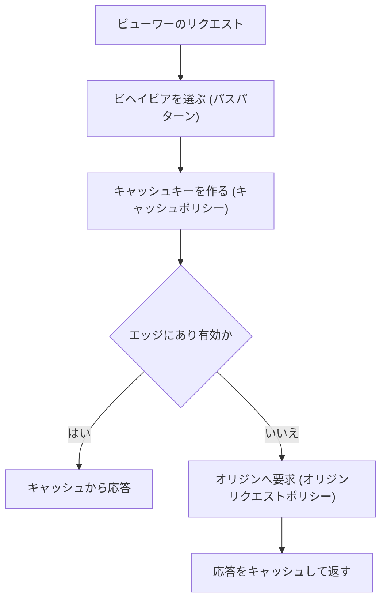

# ネットワーク（VPC / Route 53 / ELB / CloudFront）

アプリケーションへの通信の入口と、AWS リソース間の通信経路を構成するサービス群です。開発者にとっては、接続できない原因の切り分け、ロードバランサーのヘルスチェック、CloudFront のキャッシュ設定が特に重要です。

[](../assets/diagrams/networking-vpc.png)

## VPC の基本 {#vpc}

### サブネットとルートテーブル {#subnets-route-tables}

| 要素 | 役割 |
|---|---|
| VPC | 論理的に分離された仮想ネットワーク |
| サブネット | VPC を AZ ごとに分けた IP の範囲 |
| ルートテーブル | 宛先ごとの転送先を決める。VPC 内への `local` ルートは自動 |
| インターネットゲートウェイ | VPC とインターネットをつなぐ |
| NAT ゲートウェイ | プライベートサブネットから外へ出るための変換。外からの接続は受けない |

| サブネットの種類 | デフォルトルート（`0.0.0.0/0`）の転送先 | 置くもの |
|---|---|---|
| パブリック | インターネットゲートウェイ | ALB、NAT ゲートウェイ |
| プライベート | NAT ゲートウェイ | アプリケーション |
| 閉域 | なし | データベース |

!!! tip "VPC 内の Lambda"
    VPC に接続した Lambda は、パブリックサブネットに置いてもインターネットへ出られません。プライベートサブネットと NAT ゲートウェイ、または VPC エンドポイントを使います。詳細は [Lambda](lambda.md) を参照してください。

NAT ゲートウェイには AZ ごとに作るゾーン型のほか、複数の AZ へ自動で広がるリージョン型もあります。

### セキュリティグループとネットワーク ACL {#security-groups-nacls}

| | セキュリティグループ | ネットワーク ACL |
|---|---|---|
| 適用先 | インスタンス（ENI）単位 | サブネット単位 |
| ルール | 許可のみ | 許可と拒否 |
| 評価 | すべてのルールを評価 | 番号の小さい順に、最初の一致を適用 |
| 戻り通信 | 自動で許可（ステートフル） | 明示的な許可が必要（ステートレス） |
| 使いどころ | 主な通信制御 | 特定の IP の拒否など、粗い制御 |

セキュリティグループは送信元に別のセキュリティグループを指定できます。「ALB からの通信だけをアプリで受ける」などの設定は IP ではなく、この方法で書きます。

ネットワーク ACL を自作するときは、戻り通信のエフェメラルポートを忘れないようにします。これが閉じていると ALB の 504 の原因にもなります。

### 接続できないときの切り分け {#vpc-troubleshooting}

| 症状 | 確認するもの |
|---|---|
| タイムアウトする | セキュリティグループ、ネットワーク ACL、ルートテーブル |
| 接続拒否（すぐ失敗する） | アプリのプロセスとポート |
| 名前解決できない | VPC の DNS 設定、プライベート DNS |
| 通信の許可状況を確認したい | VPC フローログの `ACCEPT` と `REJECT` |

## VPC エンドポイントと PrivateLink {#vpc-endpoints}

インターネットを経由せず、VPC から AWS サービスへ接続する仕組みです。NAT の料金削減とセキュリティの向上につながります。

| | ゲートウェイエンドポイント | インターフェイスエンドポイント |
|---|---|---|
| 対象 | S3、DynamoDB | 多くの AWS サービス、PrivateLink 対応サービス |
| 仕組み | ルートテーブルにプレフィックスリストのルートを追加 | サブネットに ENI を作り、プライベート IP で接続 |
| 基盤 | PrivateLink を使わない | PrivateLink |
| 料金 | 追加料金なし | 時間とデータ量の料金 |
| アクセス制御 | エンドポイントポリシー | エンドポイントポリシーとセキュリティグループ |
| 名前解決 | 通常の公開エンドポイント名のまま | プライベート DNS を有効にすれば通常の名前のまま |

S3 はインターフェイスエンドポイントにも対応しています。

**プライベート DNS** を有効にすると、SDK のコードを変えずに通常のサービス名でエンドポイントへ接続できます。VPC の DNS ホスト名と DNS 解決の有効化が必要です。

**AWS PrivateLink** は、自社のサービスを NLB の裏に置いて、他の VPC へプライベートに公開する場合にも使います。

S3 のバケットポリシーで `aws:SourceVpce` 条件を使うと、特定のエンドポイントからのアクセスのみ許可できます。

## Route 53 {#route53}

### レコード {#route53-records}

| レコード | 内容 |
|---|---|
| `A` / `AAAA` | IPv4 / IPv6 アドレス |
| `CNAME` | 別のドメイン名への別名。ゾーンの頂点（`example.com`）には作れない |
| エイリアス | Route 53 独自の機能。AWS リソースを直接指す |
| `MX` / `TXT` / `NS` | メール、テキスト、ネームサーバー |

| | エイリアス | CNAME |
|---|---|---|
| ゾーンの頂点 | 作成できる | 作成できない |
| 指す先 | CloudFront、ALB、API Gateway、S3 Web サイトなど | 任意の DNS 名 |
| AWS リソースへのクエリ料金 | かからない | かかる |

ALB や CloudFront をドメインの頂点で公開するなら、エイリアスレコードを使います。

### ルーティングポリシー {#routing-policies}

| ポリシー | 用途 |
|---|---|
| シンプル | 単一のリソース |
| 加重 | 割合で分ける。カナリアリリース |
| レイテンシー | 最も遅延の小さいリージョンへ |
| フェイルオーバー | アクティブとパッシブの切り替え |
| 位置情報 | 利用者の位置で振り分け |
| 地理的近接性 | リソースの位置で振り分け、範囲を調整 |
| IP ベース | 利用者の IP 範囲で振り分け |
| 複数値回答 | 最大 8 個の正常なレコードをランダムに返す |

DNS はキャッシュされるので、切り替えの速さはレコードの TTL に左右されます。

## Elastic Load Balancing {#elb}

### ALB と NLB の違い {#alb-vs-nlb}

| | ALB | NLB |
|---|---|---|
| 層 | レイヤー 7（HTTP/HTTPS、gRPC） | レイヤー 4（TCP、TLS、UDP、QUIC） |
| ルーティング | パス、ホスト、ヘッダー、クエリ文字列 | ポート |
| ターゲット | インスタンス、IP、Lambda | インスタンス、IP、ALB |
| 接続先の IP | 変わる | AZ ごとに固定可能（Elastic IP） |
| 送信元 IP | `X-Forwarded-For` で確認 | 保持される構成が可能 |
| 向いている場面 | Web アプリ、マイクロサービス、認証連携 | 固定 IP、非 HTTP、高負荷、PrivateLink |

### ターゲットグループ {#target-groups}

リスナーのルールで選ばれた通信の転送先です。ヘルスチェックとスティッキーセッションはターゲットグループ単位で設定します。登録解除時は処理中のリクエストを待ちます（Deregistration delay、既定 300 秒、状態は `draining`）。

### ヘルスチェック {#alb-health-checks}

ロードバランサーの各ノードが、ターゲットの状態を定期的に確認し、正常なターゲットにだけ転送します。

| 設定 | 既定値（instance / ip） | 範囲 |
|---|---|---|
| `HealthCheckProtocol` | HTTP | HTTP、HTTPS |
| `HealthCheckPort` | トラフィックのポート | |
| `HealthCheckPath` | `/` | |
| `HealthCheckIntervalSeconds` | 30 秒（Lambda は 35 秒） | 5〜300 秒 |
| `HealthCheckTimeoutSeconds` | 5 秒（Lambda は 30 秒） | 2〜120 秒 |
| `HealthyThresholdCount` | 5 回 | 2〜10 回 |
| `UnhealthyThresholdCount` | 2 回 | 2〜10 回 |
| `Matcher`（成功コード） | 200 | HTTP は 200〜499 で指定 |

| ターゲットの状態 | 意味 |
|---|---|
| `initial` | 登録中、または初回チェック中 |
| `healthy` | 正常 |
| `unhealthy` | チェックに失敗 |
| `unused` | 使用されていない（リスナールールの対象外など） |
| `draining` | 登録解除の処理中 |

| 理由コード | 確認すること |
|---|---|
| `Target.ResponseCodeMismatch` | パスの誤り、認証必須のパス、`Matcher` の設定 |
| `Target.Timeout` | セキュリティグループ、アプリの応答速度 |
| `Target.FailedHealthChecks` | 接続不可。ポートやアプリの起動を確認 |

すべてのターゲットが異常になると、ALB は状態を無視して全ターゲットへ転送します（フェイルオープン）。

ヘルスチェック用のパスは軽くし、認証なしで 200 を返すようにします。ターゲットのセキュリティグループでは、ALB のセキュリティグループからの通信を許可します。全般的な設計は [オブザーバビリティ](observability.md) を参照してください。

### クライアント IP と X-Forwarded ヘッダー {#x-forwarded-for}

ALB は接続を中継するので、ターゲットから見た送信元は ALB の IP です。元の情報は次のヘッダーで分かります。

| ヘッダー | 内容 |
|---|---|
| `X-Forwarded-For` | クライアントの IP |
| `X-Forwarded-Proto` | クライアントが使ったプロトコル |
| `X-Forwarded-Port` | クライアントが接続したポート |

```text
X-Forwarded-For: 203.0.113.7
```

クライアントがすでに `X-Forwarded-For` を送っていると、ALB はその値の後ろに IP を追加します（既定の `append` モード）。リクエストの値は偽装できるので、信頼できる値は右側から判断します。Web サーバーのアクセスログに元の IP を残したいときは、このヘッダーをログの形式に追加します。

### スティッキーセッション {#stickiness}

同じクライアントを同じターゲットへ送り続ける機能です。ターゲットグループで有効にします。

| 種類 | Cookie | 期間 |
|---|---|---|
| 期間ベース | ロードバランサーが生成する `AWSALB` | 1 秒から 7 日 |
| アプリケーションベース | アプリが発行する Cookie を指定 | ロードバランサー生成の Cookie は 7 日固定 |

負荷が偏る原因にもなります。セッションデータは ElastiCache や DynamoDB へ外部化するのが基本で、スティッキーセッションは移行途中の手段と考えます。

### ALB のエラーコード {#alb-errors}

| コード | 主な原因 |
|---|---|
| 502 | ターゲットが接続を閉じた（keep-alive が ALB のアイドルタイムアウトより短いなど）、不正な応答、Lambda の失敗 |
| 503 | ターゲットグループに登録済みのターゲットがない |
| 504 | ターゲットの応答がアイドルタイムアウトを超えた、接続できない、ネットワーク ACL のエフェメラルポートが閉じている |

`HTTPCode_ELB_5XX_Count` は ALB が返したエラー、`HTTPCode_Target_5XX_Count` はターゲットが返したエラーです。どちらのメトリクスが増えたかで切り分けます。

## CloudFront {#cloudfront}

世界中のエッジロケーションでコンテンツをキャッシュして配信する CDN です。応答の高速化とオリジンの負荷軽減が目的です。

[](../assets/diagrams/networking-cloudfront.png)

### ビヘイビア {#cloudfront-behaviors}

ビヘイビアは、URL のパスパターンごとの設定です。リストの順に評価され、最初に一致したものが使われます。既定のビヘイビア（`*`）は最後に評価されます。

| パスパターン | オリジン | キャッシュ |
|---|---|---|
| `/api/*` | ALB | 無効（`CachingDisabled`） |
| `/images/*` | S3 | 長い TTL |
| `*`（既定） | S3 | `CachingOptimized` |

設定できる主な項目は、オリジン、ビューワープロトコルポリシー、許可する HTTP メソッド、キャッシュポリシー、オリジンリクエストポリシー、エッジ関数、署名の要求です。

### キャッシュキーとポリシー {#cache-keys}

キャッシュキーは、キャッシュしたオブジェクトを識別する値です。既定ではディストリビューションのドメイン名と URL パスです。**クエリ文字列、ヘッダー、Cookie は既定では含まれません**。



| ポリシー | 決めること | 例 |
|---|---|---|
| キャッシュポリシー | キャッシュキーに含める値、TTL、圧縮 | `Accept-Language` ごとにキャッシュ |
| オリジンリクエストポリシー | キャッシュキーに含めずオリジンへ送る値 | アプリが使う Cookie やクエリ文字列 |

キャッシュキーに含めた値は自動でオリジンへ送られます。キャッシュキーの値を増やすほどヒット率は下がるので、応答が実際に変わる値だけを含めます。

マネージドポリシーには `CachingOptimized`、`CachingDisabled`、`UseOriginCacheControlHeaders` などがあります。

### リクエストヘッダーに基づくキャッシュ {#header-caching}

既定ではヘッダーを考慮せず、1 つのオブジェクトのみキャッシュします。キャッシュポリシーに指定したヘッダーの値ごとに、別のキャッシュができます。

| 目的 | キャッシュキーに含めるヘッダー |
|---|---|
| 言語で出し分ける | `Accept-Language` |
| 端末で出し分ける | `CloudFront-Is-Mobile-Viewer`、`CloudFront-Is-Desktop-Viewer`、`CloudFront-Is-Tablet-Viewer` |
| 国で出し分ける | `CloudFront-Viewer-Country` |
| CORS に対応する | `Origin` など |
| 圧縮 | キャッシュポリシーで Gzip と Brotli を有効にする |

`CloudFront-Is-*-Viewer` は `User-Agent` から CloudFront が判定する値です。`User-Agent` をそのまま含めると値の種類が多すぎてヒット率が大きく下がるので、こちらを使います。

ヘッダーの値は大文字小文字も区別されます。値を CloudFront Functions で正規化すると、ヒット率を高められます。

### TTL とキャッシュの期間 {#cloudfront-ttl}

オリジンのヘッダーと、キャッシュポリシーの TTL で決まります。

| 設定 | 意味 |
|---|---|
| Minimum TTL | 最低限キャッシュする時間。0 より大きいと `no-cache` なども上書きする |
| Default TTL | オリジンが `Cache-Control` や `Expires` を返さないときの値 |
| Maximum TTL | オリジンのヘッダーがどんな値でも、これを超えない |

```text
Cache-Control: public, max-age=60, s-maxage=3600
```

`max-age` はブラウザと CloudFront、`s-maxage` は CloudFront などの共有キャッシュに使う値です。この例ではブラウザに 60 秒、CloudFront に 3,600 秒キャッシュします。キャッシュポリシーを使わないレガシー設定の Default TTL は 24 時間です。

### キャッシュの無効化 {#invalidation}

| 方法 | 特徴 | 向いている場面 |
|---|---|---|
| 無効化（invalidation） | パスを指定して削除。`/*` も可 | 緊急の修正 |
| バージョン付きファイル名 | `app.v2.js` のように名前を変える | 通常のリリース。ブラウザのキャッシュにも効く |

```bash
aws cloudfront create-invalidation --distribution-id <ID> --paths "/index.html" "/images/*"
```

無効化パスは月 1,000 個まで無料で、それ以降はパスごとに課金されます。`/*` は 1 パスとして数えます。キャッシュタグによる無効化も可能です。

### S3 オリジンの保護: OAC {#oac}

Origin Access Control を使うと、S3 バケットを公開せず CloudFront 経由だけでアクセスさせられます。

- SSE-KMS の暗号化、`PUT` や `DELETE` の動的リクエスト、全リージョンに対応
- 旧方式の OAI より OAC が推奨
- S3 の **Web サイトエンドポイントでは使えない**（カスタムオリジン扱いになる）
- SSE-KMS の場合は、KMS キーポリシーでも CloudFront を許可する

```json
{
  "Version": "2012-10-17",
  "Statement": [
    {
      "Effect": "Allow",
      "Principal": {"Service": "cloudfront.amazonaws.com"},
      "Action": "s3:GetObject",
      "Resource": "arn:aws:s3:::<バケット名>/*",
      "Condition": {
        "StringEquals": {"AWS:SourceArn": "<ディストリビューションの ARN>"}
      }
    }
  ]
}
```

### 署名付き URL と署名付き Cookie {#signed-urls-cookies}

有料コンテンツなどの限定配信に使います。時間で期限が切れるアクセスを提供できます。

| | 署名付き URL | 署名付き Cookie |
|---|---|---|
| 対象 | 個別のファイル | 複数のファイル（HLS の動画、会員エリア） |
| URL | 変わる | 変わらない |
| Cookie 非対応のクライアント | 使える | 使えない |
| 例 | インストーラーのダウンロード | 会員向けサイト全体 |

| ポリシー | 指定できるもの |
|---|---|
| 既定（canned） | 終了日時のみ。URL が短い |
| カスタム | 開始日時、終了日時、IP の範囲。ワイルドカードで再利用可能 |

署名者には**信頼済みキーグループ**を使います。旧方式の CloudFront キーペアはルートユーザーでの管理が必要なので推奨されません。公開鍵を CloudFront に登録し、秘密鍵で署名します。

```python
from datetime import datetime, timedelta, timezone

from botocore.signers import CloudFrontSigner
from cryptography.hazmat.primitives import hashes, serialization
from cryptography.hazmat.primitives.asymmetric import padding

def rsa_signer(message):
    key = serialization.load_pem_private_key(PRIVATE_KEY_PEM, password=None)
    return key.sign(message, padding.PKCS1v15(), hashes.SHA1())

signer = CloudFrontSigner(PUBLIC_KEY_ID, rsa_signer)
url = signer.generate_presigned_url(
    "https://d111111abcdef8.cloudfront.net/private/report.pdf",
    date_less_than=datetime.now(timezone.utc) + timedelta(hours=1),
)
```

秘密鍵は [Secrets Manager](secrets.md) などで管理します。

**S3 の署名付き URL との違い**

| | CloudFront の署名付き URL | S3 の署名付き URL |
|---|---|---|
| 署名に使うもの | CloudFront に登録した鍵ペア | IAM の認証情報 |
| 配信元 | エッジのキャッシュ | S3 に直接 |
| 期限 | ポリシーで指定 | IAM ユーザーの SigV4 で最長 7 日 |
| IP 制限 | カスタムポリシーで可能 | バケットポリシーなどで対応 |
| 向いている用途 | 世界中への限定配信 | 一時的なアップロードやダウンロード（[S3](s3.md)） |

### Lambda@Edge と CloudFront Functions {#edge-functions}

| | CloudFront Functions | Lambda@Edge |
|---|---|---|
| 言語 | JavaScript | Node.js、Python |
| イベント | ビューワーリクエスト、ビューワーレスポンス | 左記とオリジンリクエスト、オリジンレスポンス |
| 実行時間 | 1 ミリ秒未満 | 最大 30 秒 |
| 最大メモリ | 2 MB | ビューワー側 128 MB、オリジン側 10,240 MB |
| コードサイズ | 10 KB | 50 MB |
| ネットワーク、ファイルアクセス | 不可 | 可能 |
| リクエスト本文へのアクセス | 不可 | 可能 |
| 規模 | 毎秒数百万リクエスト | リージョンあたり毎秒 10,000 リクエスト |

| やりたいこと | 選択 |
|---|---|
| キャッシュキーの正規化、ヘッダーの追加、リダイレクト | CloudFront Functions |
| JWT の簡易検証 | CloudFront Functions |
| 外部 API や DynamoDB の呼び出し | Lambda@Edge |
| リクエスト本文の処理、外部ライブラリの利用 | Lambda@Edge |
| オリジンの動的な切り替え（オリジンイベント） | Lambda@Edge |

Lambda@Edge の関数は `us-east-1` で作成します。

### HTTPS {#cloudfront-https}

通信は 2 区間に分かれます。

| 区間 | 設定 | 値 |
|---|---|---|
| ビューワー ↔ CloudFront | ビューワープロトコルポリシー | HTTP と HTTPS、HTTP から HTTPS へリダイレクト、HTTPS のみ |
| CloudFront ↔ オリジン | オリジンプロトコルポリシー | HTTP のみ、HTTPS のみ、ビューワーに合わせる |

独自ドメインで使う ACM 証明書は **`us-east-1`** でリクエストまたはインポートします。ALB の証明書は ALB のリージョンに置くので、混同しないようにします。詳細は [証明書](certificates.md) を参照してください。

ALB や EC2 をプライベートサブネットに置いたままオリジンにできる VPC オリジンもあります。

## 試験のポイント {#exam-points}

| こう問われたら | 答え |
|---|---|
| 戻り通信も明示的に許可が必要なのは | ネットワーク ACL（ステートレス） |
| 特定の IP を拒否したい | ネットワーク ACL（セキュリティグループに拒否はない） |
| プライベートサブネットから外へ出たい | NAT ゲートウェイ |
| VPC から S3 や DynamoDB へ無料で接続したい | ゲートウェイエンドポイント |
| VPC から Secrets Manager などへ接続したい | インターフェイスエンドポイント（PrivateLink） |
| ドメインの頂点を ALB や CloudFront へ向けたい | Route 53 のエイリアスレコード |
| 割合でトラフィックを分けたい | 加重ルーティング |
| パスごとに転送先を変えたい | ALB |
| 固定 IP が必要、または TCP/UDP | NLB |
| ALB の裏でクライアント IP を知りたい | `X-Forwarded-For` |
| 同じターゲットへ送り続けたい | スティッキーセッション |
| ヘルスチェックで `Target.ResponseCodeMismatch` | パスや成功コード（`Matcher`）を確認 |
| ALB が 503 を返す | 登録済みターゲットがない |
| ALB が 504 を返す | ターゲットの応答遅れ、アイドルタイムアウト |
| 言語ごとに別のページをキャッシュしたい | キャッシュポリシーに `Accept-Language` を含める |
| 端末の種類でキャッシュを分けたい | `CloudFront-Is-Mobile-Viewer` など（`User-Agent` は避ける） |
| キャッシュせずにオリジンへヘッダーを送りたい | オリジンリクエストポリシー |
| ヒット率を上げたい | キャッシュキーの値を減らす、値を正規化する |
| 古いコンテンツをすぐ消したい | 無効化、またはバージョン付きファイル名 |
| S3 を CloudFront 経由のみに限定したい | OAC とバケットポリシー |
| 1 ファイルを限定配信したい | CloudFront の署名付き URL |
| 複数ファイルを URL を変えずに限定配信したい | CloudFront の署名付き Cookie |
| IP の制限も付けたい | カスタムポリシー |
| 軽いヘッダー操作をエッジで行いたい | CloudFront Functions |
| 外部サービスを呼ぶ処理をエッジで行いたい | Lambda@Edge |
| CloudFront の独自ドメインの証明書の置き場所は | ACM の `us-east-1` |

## 関連ページ {#related}

- [Lambda](lambda.md)
- [S3](s3.md)
- [API Gateway](api-gateway.md)
- [オブザーバビリティ](observability.md)
- [証明書](certificates.md)
- [EC2 と Elastic Beanstalk](ec2-beanstalk.md)
- [コンテナ](containers.md)

## 参考 {#references}

- [Compare security groups and network ACLs (Infrastructure security in Amazon VPC)](https://docs.aws.amazon.com/vpc/latest/userguide/infrastructure-security.html)
- [NAT gateways](https://docs.aws.amazon.com/vpc/latest/userguide/vpc-nat-gateway.html)
- [Regional NAT gateways for automatic multi-AZ expansion](https://docs.aws.amazon.com/vpc/latest/userguide/nat-gateways-regional.html)
- [AWS PrivateLink concepts](https://docs.aws.amazon.com/vpc/latest/privatelink/concepts.html)
- [Gateway endpoints](https://docs.aws.amazon.com/vpc/latest/privatelink/gateway-endpoints.html)
- [Access an AWS service using an interface VPC endpoint](https://docs.aws.amazon.com/vpc/latest/privatelink/create-interface-endpoint.html)
- [Choosing a routing policy](https://docs.aws.amazon.com/Route53/latest/DeveloperGuide/routing-policy.html)
- [Choosing between alias and non-alias records](https://docs.aws.amazon.com/Route53/latest/DeveloperGuide/resource-record-sets-choosing-alias-non-alias.html)
- [Health checks for Application Load Balancer target groups](https://docs.aws.amazon.com/elasticloadbalancing/latest/application/target-group-health-checks.html)
- [HTTP headers and Application Load Balancers](https://docs.aws.amazon.com/elasticloadbalancing/latest/application/x-forwarded-headers.html)
- [Edit target group attributes for your Application Load Balancer](https://docs.aws.amazon.com/elasticloadbalancing/latest/application/edit-target-group-attributes.html)
- [Troubleshoot your Application Load Balancers](https://docs.aws.amazon.com/elasticloadbalancing/latest/application/load-balancer-troubleshooting.html)
- [Edit attributes for your Network Load Balancer target group](https://docs.aws.amazon.com/elasticloadbalancing/latest/network/edit-target-group-attributes.html)
- [Control the cache key with a policy](https://docs.aws.amazon.com/AmazonCloudFront/latest/DeveloperGuide/controlling-the-cache-key.html)
- [Understand the cache key](https://docs.aws.amazon.com/AmazonCloudFront/latest/DeveloperGuide/understanding-the-cache-key.html)
- [Control origin requests with a policy](https://docs.aws.amazon.com/AmazonCloudFront/latest/DeveloperGuide/controlling-origin-requests.html)
- [Cache content based on request headers](https://docs.aws.amazon.com/AmazonCloudFront/latest/DeveloperGuide/header-caching.html)
- [Manage how long content stays in the cache (expiration)](https://docs.aws.amazon.com/AmazonCloudFront/latest/DeveloperGuide/Expiration.html)
- [Invalidate files to remove content](https://docs.aws.amazon.com/AmazonCloudFront/latest/DeveloperGuide/Invalidation.html)
- [Restrict access to an Amazon S3 origin](https://docs.aws.amazon.com/AmazonCloudFront/latest/DeveloperGuide/private-content-restricting-access-to-s3.html)
- [Decide to use signed URLs or signed cookies](https://docs.aws.amazon.com/AmazonCloudFront/latest/DeveloperGuide/private-content-choosing-signed-urls-cookies.html)
- [Use signed URLs](https://docs.aws.amazon.com/AmazonCloudFront/latest/DeveloperGuide/private-content-signed-urls.html)
- [Specify signers that can create signed URLs and signed cookies](https://docs.aws.amazon.com/AmazonCloudFront/latest/DeveloperGuide/private-content-trusted-signers.html)
- [Differences between CloudFront Functions and Lambda@Edge](https://docs.aws.amazon.com/AmazonCloudFront/latest/DeveloperGuide/edge-functions-choosing.html)
- [Requirements for using SSL/TLS certificates with CloudFront](https://docs.aws.amazon.com/AmazonCloudFront/latest/DeveloperGuide/cnames-and-https-requirements.html)
- [Sharing objects with presigned URLs (Amazon S3)](https://docs.aws.amazon.com/AmazonS3/latest/userguide/using-presigned-url.html)
