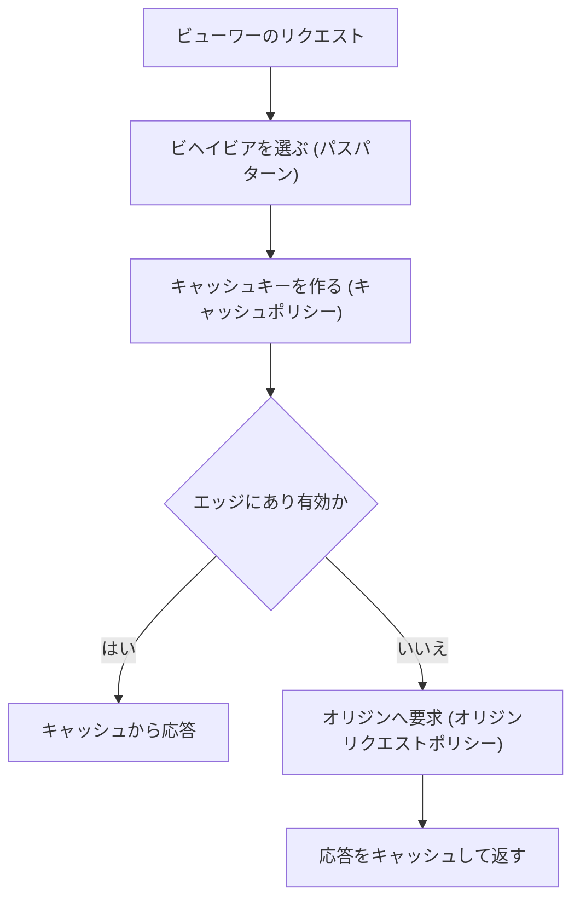

# ネットワーク（VPC / Route 53 / ELB / CloudFront）

[:material-sprout: CLF](../courses/clf/services.md){ .exam-badge .exam-foundational } [:material-sprout: AIF](../courses/aif/services.md){ .exam-badge .exam-foundational } [:material-certificate: SAA](../courses/saa/services.md){ .exam-badge .exam-associate } [:material-certificate: DVA](../courses/dva/services.md){ .exam-badge .exam-associate } [:material-certificate: SOA](../courses/soa/services.md){ .exam-badge .exam-associate } [:material-certificate: DEA](../courses/dea/services.md){ .exam-badge .exam-associate } [:material-certificate: MLA](../courses/mla/services.md){ .exam-badge .exam-associate } [:material-star-circle: SAP](../courses/sap/services.md){ .exam-badge .exam-professional } [:material-star-circle: DOP](../courses/dop/services.md){ .exam-badge .exam-professional } [:material-star-circle: AIP](../courses/aip/services.md){ .exam-badge .exam-professional } [:material-target: ANS](../courses/ans/services.md){ .exam-badge .exam-specialty } [:material-target: SCS](../courses/scs/services.md){ .exam-badge .exam-specialty }

各リソースがグローバル、リージョン、AZ のどの単位か、VPC の内外のどちらかは、[リソースの提供単位](resource-scope.md)にまとめています。

アプリケーションへの通信の入口と、AWS リソース間の通信経路を構成するサービス群です。開発者にとっては、接続できない原因の切り分け、ロードバランサーのヘルスチェック、CloudFront のキャッシュ設定が特に重要です。

[](../assets/diagrams/networking-vpc.png)

## VPC の基本 {#vpc}

[:material-sprout: CLF](../courses/clf/services.md){ .exam-badge .exam-foundational } [:material-sprout: AIF](../courses/aif/services.md){ .exam-badge .exam-foundational } [:material-certificate: SAA](../courses/saa/services.md){ .exam-badge .exam-associate } [:material-certificate: DVA](../courses/dva/services.md){ .exam-badge .exam-associate } [:material-certificate: SOA](../courses/soa/services.md){ .exam-badge .exam-associate } [:material-certificate: DEA](../courses/dea/services.md){ .exam-badge .exam-associate } [:material-certificate: MLA](../courses/mla/services.md){ .exam-badge .exam-associate } [:material-star-circle: SAP](../courses/sap/services.md){ .exam-badge .exam-professional } [:material-star-circle: DOP](../courses/dop/services.md){ .exam-badge .exam-professional } [:material-star-circle: AIP](../courses/aip/services.md){ .exam-badge .exam-professional } [:material-target: ANS](../courses/ans/services.md){ .exam-badge .exam-specialty } [:material-target: SCS](../courses/scs/services.md){ .exam-badge .exam-specialty }

### サブネットとルートテーブル {#subnets-route-tables}

| 要素 | 役割 |
|---|---|
| VPC | 論理的に分離された仮想ネットワーク |
| サブネット | VPC を AZ ごとに分けた IP の範囲 |
| ルートテーブル | 宛先ごとの転送先を決める。VPC 内への `local` ルートは自動 |
| インターネットゲートウェイ | VPC とインターネットをつなぐ |
| NAT ゲートウェイ | プライベートサブネットから外へ出るための変換。外からの接続は受けない |

| サブネットの種類 | デフォルトルート（`0.0.0.0/0`）の転送先 | 置くもの |
|---|---|---|
| パブリック | インターネットゲートウェイ | ALB、NAT ゲートウェイ |
| プライベート | NAT ゲートウェイ | アプリケーション |
| 閉域 | なし | データベース |

!!! tip "VPC 内の Lambda"
    VPC に接続した Lambda は、パブリックサブネットに置いてもインターネットへ出られません。プライベートサブネットと NAT ゲートウェイ、または VPC エンドポイントを使います。詳細は [Lambda](lambda.md) を参照してください。

NAT ゲートウェイには AZ ごとに作るゾーン型のほか、複数の AZ へ自動で広がるリージョン型もあります。

### セキュリティグループとネットワーク ACL {#security-groups-nacls}

| | セキュリティグループ | ネットワーク ACL |
|---|---|---|
| 適用先 | インスタンス（ENI）単位 | サブネット単位 |
| ルール | 許可のみ | 許可と拒否 |
| 評価 | すべてのルールを評価 | 番号の小さい順に、最初の一致を適用 |
| 戻り通信 | 自動で許可（ステートフル） | 明示的な許可が必要（ステートレス） |
| 使いどころ | 主な通信制御 | 特定の IP の拒否など、粗い制御 |

セキュリティグループは送信元に別のセキュリティグループを指定できます。「ALB からの通信だけをアプリで受ける」などの設定は IP ではなく、この方法で書きます。

ネットワーク ACL を自作するときは、戻り通信のエフェメラルポートを忘れないようにします。これが閉じていると ALB の 504 の原因にもなります。

### 接続できないときの切り分け {#vpc-troubleshooting}

| 症状 | 確認するもの |
|---|---|
| タイムアウトする | セキュリティグループ、ネットワーク ACL、ルートテーブル |
| 接続拒否（すぐ失敗する） | アプリのプロセスとポート |
| 名前解決できない | VPC の DNS 設定、プライベート DNS |
| 通信の許可状況を確認したい | VPC フローログの `ACCEPT` と `REJECT` |

### セキュリティグループのルール {#security-group-rules}

[:material-certificate: SOA](../courses/soa/services.md){ .exam-badge .exam-associate }

| 項目 | 内容 |
|---|---|
| 指定するもの | プロトコル、ポート範囲、送信元または宛先（CIDR、セキュリティグループ、プレフィックスリスト） |
| 既定の送信ルール | すべて許可 |
| ルール数の上限 | 受信と送信それぞれ 60 個（既定）。ENI あたり 5 グループ（既定） |
| 変更の反映 | 関連付け済みのリソースへ自動で反映 |

**具体例:** ALB の後ろの EC2 なら、EC2 のセキュリティグループの受信に「TCP 8080、送信元は ALB のセキュリティグループ」と書きます。ALB の IP は変わるので、CIDR では書きません。

**落とし穴:** 許可のルールしかないので、特定の IP だけ拒否する設定はできません。拒否は NACL で行います。

### ネットワーク ACL のルール {#nacl-rules}

[:material-certificate: SOA](../courses/soa/services.md){ .exam-badge .exam-associate }

| 項目 | 既定の NACL | 自作の NACL |
|---|---|---|
| 番号付きのルール | 受信、送信とも全許可 | なし |
| `*` のルール（最後、変更不可） | 全拒否 | 全拒否 |
| 結果 | すべて通る | **すべて通らない** |

| ルールの項目 | 内容 |
|---|---|
| ルール番号 | 小さい順に評価し、一致したら以降は見ない |
| 送信元、宛先 | CIDR のみ。セキュリティグループは指定不可 |
| 動作 | `ALLOW` または `DENY` |
| 上限 | 1 つの NACL に受信、送信それぞれ 20 個（既定） |

**具体例:** `203.0.113.5` だけ拒否するなら、許可より小さい番号（`90 DENY 203.0.113.5/32`、`100 ALLOW 0.0.0.0/0`）にします。逆の番号だと、100 が先に一致して拒否されません。

**戻り通信の計算:** サブネットの ALB が EC2 の 8080 へ接続するとします。EC2 のサブネットの NACL には、受信の 8080 だけでなく、送信のエフェメラルポート（ロードバランサー宛なら `1024-65535`）が必要です。ないと応答が返らず、ALB は 504 を返します。

### VPC の DNS 属性 {#vpc-dns-attributes}

| 属性 | 意味 | 既定 |
|---|---|---|
| `enableDnsSupport` | Route 53 Resolver による名前解決 | 有効な前提で使う |
| `enableDnsHostnames` | パブリック IP のインスタンスへの DNS ホスト名の割り当て | デフォルト VPC 以外は `false` |

**落とし穴:** プライベートホストゾーンや、インターフェイスエンドポイントのプライベート DNS を使うには、**両方を `true`** にします。片方でも `false` なら、公開エンドポイントへ解決されるか、名前解決に失敗します。

### VPC フローログ {#flow-logs}

ENI を通る IP 通信のメタデータを記録します。送信先は CloudWatch Logs、S3、Data Firehose です。通信の経路の外で集めるので、ネットワーク性能には影響しません。記録には `ACCEPT` と `REJECT` が含まれます。

**読み方:** 受信が `ACCEPT` で送信が `REJECT` なら、ステートレスな NACL の戻り通信の問題を疑います。

### Lambda の VPC 接続 {#lambda-vpc}

| 設定 | 内容 |
|---|---|
| `SubnetIds` | 接続するサブネット。プライベートを指定する。複数 AZ が望ましい |
| `SecurityGroupIds` | 関数の ENI に付くセキュリティグループ |
| `Ipv6AllowedForDualStack` | デュアルスタックのサブネットで IPv6 を許可 |
| 実行ロール | `AWSLambdaVPCAccessExecutionRole`（`ec2:CreateNetworkInterface` などを含む） |
| 解除 | `SubnetIds=[],SecurityGroupIds=[]` で更新する |

```bash
aws lambda update-function-configuration --function-name orders \
  --vpc-config SubnetIds=subnet-aaa,subnet-bbb,SecurityGroupIds=sg-111
```

| 関数がやりたいこと | 必要なもの |
|---|---|
| RDS へ接続 | RDS の SG で、関数の SG からの受信を許可 |
| インターネットの API を呼ぶ | プライベートサブネットと NAT ゲートウェイ |
| S3、DynamoDB を呼ぶ | ゲートウェイエンドポイント、または NAT |
| Secrets Manager を呼ぶ | インターフェイスエンドポイント、または NAT |

**落とし穴:** パブリックサブネットに接続しても、関数にパブリック IP は付かず、インターネットへ出られません。症状はタイムアウトです。Lambda は Hyperplane ENI を使います。

## VPC エンドポイントと PrivateLink {#vpc-endpoints}

[:material-sprout: CLF](../courses/clf/services.md){ .exam-badge .exam-foundational } [:material-certificate: SAA](../courses/saa/services.md){ .exam-badge .exam-associate } [:material-certificate: DVA](../courses/dva/services.md){ .exam-badge .exam-associate } [:material-certificate: SOA](../courses/soa/services.md){ .exam-badge .exam-associate } [:material-certificate: DEA](../courses/dea/services.md){ .exam-badge .exam-associate } [:material-star-circle: SAP](../courses/sap/services.md){ .exam-badge .exam-professional } [:material-star-circle: DOP](../courses/dop/services.md){ .exam-badge .exam-professional } [:material-star-circle: AIP](../courses/aip/services.md){ .exam-badge .exam-professional } [:material-target: ANS](../courses/ans/services.md){ .exam-badge .exam-specialty }

インターネットを経由せず、VPC から AWS サービスへ接続する仕組みです。NAT の料金削減とセキュリティの向上につながります。

| | ゲートウェイエンドポイント | インターフェイスエンドポイント |
|---|---|---|
| 対象 | S3、DynamoDB | 多くの AWS サービス、PrivateLink 対応サービス |
| 仕組み | ルートテーブルにプレフィックスリストのルートを追加 | サブネットに ENI を作り、プライベート IP で接続 |
| 基盤 | PrivateLink を使わない | PrivateLink |
| 料金 | 追加料金なし | 時間とデータ量の料金 |
| アクセス制御 | エンドポイントポリシー | エンドポイントポリシーとセキュリティグループ |
| 名前解決 | 通常の公開エンドポイント名のまま | プライベート DNS を有効にすれば通常の名前のまま |

S3 はインターフェイスエンドポイントにも対応しています。

**プライベート DNS** を有効にすると、SDK のコードを変えずに通常のサービス名でエンドポイントへ接続できます。VPC の DNS ホスト名と DNS 解決の有効化が必要です。

**AWS PrivateLink** は、自社のサービスを NLB の裏に置いて、他の VPC へプライベートに公開する場合にも使います。

S3 のバケットポリシーで `aws:SourceVpce` 条件を使うと、特定のエンドポイントからのアクセスのみ許可できます。

### エンドポイントの選び方と制約 {#endpoint-settings}

| 項目 | ゲートウェイ | インターフェイス |
|---|---|---|
| 対象 | S3、DynamoDB | 多くのサービス |
| 指定するもの | ルートテーブル | サブネット（AZ ごとに 1 つ）、セキュリティグループ |
| VPC の外から | **使えない**（VPN、ピアリング、Transit Gateway、Direct Connect の先は不可） | 使える |
| ゲートウェイの範囲 | 作成したリージョンのサービスのみ | |
| 既定のポリシー | フルアクセス | フルアクセス |

**インターフェイスエンドポイントの確認項目:**

- エンドポイントの SG で、クライアントからの HTTPS（443）の受信を許可します。既定では VPC のデフォルト SG が付きます。
- `enableDnsSupport` と `enableDnsHostnames` を有効にします。
- NACL でも通信を許可します。

**具体例:** オンプレミスから VPN 経由で S3 へプライベートに接続したいなら、ゲートウェイエンドポイントでは届かないので、S3 のインターフェイスエンドポイントを使います。

### エンドポイントポリシー {#endpoint-policies}

エンドポイントに付けるリソースポリシーで、1 つのエンドポイントに 1 つです。既定はフルアクセスです。**権限を与えるものではなく**、IAM やバケットポリシーの許可に対する上限です。

```json
{
  "Statement": [{
    "Effect": "Allow",
    "Principal": "*",
    "Action": ["s3:GetObject"],
    "Resource": "arn:aws:s3:::my-app-assets/*"
  }]
}
```

バケット側は、`aws:SourceVpce`（特定のエンドポイント）や `aws:SourceVpc`（特定の VPC）で絞れます。

**落とし穴:** VPC エンドポイント経由のリクエストには、`aws:SourceIp` に使うパブリック IP がありません。公開 IP を条件にした許可はこの経路では効かないので、`aws:SourceVpce` に書き換えます。

## Route 53 {#route53}

[:material-sprout: CLF](../courses/clf/services.md){ .exam-badge .exam-foundational } [:material-certificate: SAA](../courses/saa/services.md){ .exam-badge .exam-associate } [:material-certificate: DVA](../courses/dva/services.md){ .exam-badge .exam-associate } [:material-certificate: SOA](../courses/soa/services.md){ .exam-badge .exam-associate } [:material-certificate: DEA](../courses/dea/services.md){ .exam-badge .exam-associate } [:material-star-circle: SAP](../courses/sap/services.md){ .exam-badge .exam-professional } [:material-star-circle: DOP](../courses/dop/services.md){ .exam-badge .exam-professional } [:material-star-circle: AIP](../courses/aip/services.md){ .exam-badge .exam-professional } [:material-target: ANS](../courses/ans/services.md){ .exam-badge .exam-specialty } [:material-target: SCS](../courses/scs/services.md){ .exam-badge .exam-specialty }

### レコード {#route53-records}

| レコード | 内容 |
|---|---|
| `A` / `AAAA` | IPv4 / IPv6 アドレス |
| `CNAME` | 別のドメイン名への別名。ゾーンの頂点（`example.com`）には作れない |
| エイリアス | Route 53 独自の機能。AWS リソースを直接指す |
| `MX` / `TXT` / `NS` | メール、テキスト、ネームサーバー |

| | エイリアス | CNAME |
|---|---|---|
| ゾーンの頂点 | 作成できる | 作成できない |
| 指す先 | CloudFront、ALB、API Gateway、S3 Web サイトなど | 任意の DNS 名 |
| AWS リソースへのクエリ料金 | かからない | かかる |

ALB や CloudFront をドメインの頂点で公開するなら、エイリアスレコードを使います。

### ルーティングポリシー {#routing-policies}

| ポリシー | 用途 |
|---|---|
| シンプル | 単一のリソース |
| 加重 | 割合で分ける。カナリアリリース |
| レイテンシー | 最も遅延の小さいリージョンへ |
| フェイルオーバー | アクティブとパッシブの切り替え |
| 位置情報 | 利用者の位置で振り分け |
| 地理的近接性 | リソースの位置で振り分け、範囲を調整 |
| IP ベース | 利用者の IP 範囲で振り分け |
| 複数値回答 | 最大 8 個の正常なレコードをランダムに返す |

DNS はキャッシュされるので、切り替えの速さはレコードの TTL に左右されます。

### TTL とエイリアスの違い {#route53-ttl}

TTL は DNS リゾルバーがレコードをキャッシュする秒数です。

| 値を長くすると | 値を短くすると |
|---|---|
| Route 53 へのクエリが減り、料金と遅延が下がる | 変更がすぐ広がる |
| 変更の反映が遅くなる | クエリ数と料金が増える |

**具体例:** 移行の前日に TTL を `86400` から `60` に下げておきます。古い値のキャッシュが切れてから切り替えれば、1 分程度で新しい先へ移ります。

| 項目 | エイリアス | CNAME |
|---|---|---|
| TTL | AWS リソース向けは**指定不可**。同じゾーンの別レコード向けは、その TTL を使う | 指定する |
| 料金 | AWS リソースへのクエリは無料 | 課金。Route 53 内の別レコードへの CNAME は 2 クエリ分 |
| 指せる先 | CloudFront、ELB、API Gateway、S3 Web サイト、VPC インターフェイスエンドポイント、Elastic Beanstalk、Global Accelerator、同じゾーンの同じタイプのレコードなど | 任意の DNS 名 |
| 頂点 | 作成できる | 作成できない |
| 変更の追従 | IP が変わっても自動で追従 | 名前を返すだけ |

ヘルスチェックとの組み合わせでは、エイリアスは `Evaluate Target Health` を `Yes` にします。ALB の状態がレコードの状態になります。

### ルーティングポリシーの設定 {#routing-settings}

| ポリシー | 主な設定 | 動作の要点 |
|---|---|---|
| 加重 | `Weight`（0〜255）、`SetIdentifier` | 比率は `重み / 重みの合計` |
| レイテンシー | `Region` | 測定値が最小のリージョンへ。距離ではない |
| フェイルオーバー | `PRIMARY` / `SECONDARY` | プライマリにヘルスチェックを関連付ける |
| 位置情報 | 大陸、国、米国の州 | 最も具体的な一致が優先。**既定のレコードがなく一致しないと「no answer」** |
| 地理的近接性 | リージョンや座標、`Bias`（-99〜99） | 正で範囲を広げ、負で狭める |
| IP ベース | CIDR コレクション | IPv4 は /1〜/24、IPv6 は /1〜/48 |
| 複数値回答 | レコードごとにヘルスチェックを任意で関連付け | 正常なものを最大 8 個。全部異常でも最大 8 個返す |

**計算例:** 新バージョンへ 1% だけ流すなら、重みを旧 `99`、新 `1` にします。`1 / (1 + 99) = 1%` です。`255` と `1` にすると `1 / 256` です。

**落とし穴:** 位置情報ルーティングで既定のレコードを作らないと、どこにも一致しない IP からの問い合わせに応答を返せません。

### Route 53 ヘルスチェック {#route53-health-checks}

| 種類 | 確認するもの |
|---|---|
| エンドポイント | IP またはドメインに世界中から HTTP、HTTPS、TCP で確認 |
| 計算（calculated） | 他のヘルスチェックの状態の組み合わせ |
| CloudWatch アラーム | アラームのデータストリーム |

| 設定 | 既定値、範囲 | 内容 |
|---|---|---|
| `RequestInterval` | 既定 30 秒。Fast は 10 秒（追加料金） | 確認の間隔 |
| `FailureThreshold` | 既定 3、範囲 1〜10 | 状態を変えるまでの連続回数 |
| `ResourcePath` | 255 文字まで | HTTP、HTTPS のパス |
| `SearchString` | 応答の先頭 5,120 バイト以内 | 文字列の一致。文字列一致の有無は作成後に変更不可 |
| `Inverted` | | 判定を反転 |

**正常の条件:**

- HTTP、HTTPS は、4 秒以内に TCP 接続、接続から 2 秒以内に `2xx` か `3xx` です。
- TCP は、10 秒以内に接続です。
- ヘルスチェッカーの **18% を超える**数が正常と報告すれば、エンドポイントは正常です。

**落とし穴:**

- チェッカーはインターネットにあるので、プライベートな IP には届きません。VPC 内のリソースは、CloudWatch アラームのヘルスチェックを使います。
- アラーム型は、標準解像度、基本の統計（`Average` など）に限られます。M out of N と拡張統計は使えません。
- エンドポイントのファイアウォールは、ヘルスチェッカーの IP を許可します。

## Elastic Load Balancing {#elb}

[:material-certificate: SAA](../courses/saa/services.md){ .exam-badge .exam-associate } [:material-certificate: DVA](../courses/dva/services.md){ .exam-badge .exam-associate } [:material-certificate: SOA](../courses/soa/services.md){ .exam-badge .exam-associate } [:material-star-circle: SAP](../courses/sap/services.md){ .exam-badge .exam-professional } [:material-star-circle: DOP](../courses/dop/services.md){ .exam-badge .exam-professional } [:material-star-circle: AIP](../courses/aip/services.md){ .exam-badge .exam-professional } [:material-target: ANS](../courses/ans/services.md){ .exam-badge .exam-specialty } [:material-target: SCS](../courses/scs/services.md){ .exam-badge .exam-specialty }

### ALB と NLB の違い {#alb-vs-nlb}

| | ALB | NLB |
|---|---|---|
| 層 | レイヤー 7（HTTP/HTTPS、gRPC） | レイヤー 4（TCP、TLS、UDP、QUIC） |
| ルーティング | パス、ホスト、ヘッダー、クエリ文字列 | ポート |
| ターゲット | インスタンス、IP、Lambda | インスタンス、IP、ALB |
| 接続先の IP | 変わる | AZ ごとに固定可能（Elastic IP） |
| 送信元 IP | `X-Forwarded-For` で確認 | 保持される構成が可能 |
| 向いている場面 | Web アプリ、マイクロサービス、認証連携 | 固定 IP、非 HTTP、高負荷、PrivateLink |

### ターゲットグループ {#target-groups}

リスナーのルールで選ばれた通信の転送先です。ヘルスチェックとスティッキーセッションはターゲットグループ単位で設定します。登録解除時は処理中のリクエストを待ちます（Deregistration delay、既定 300 秒、状態は `draining`）。

### ヘルスチェック {#alb-health-checks}

ロードバランサーの各ノードが、ターゲットの状態を定期的に確認し、正常なターゲットにだけ転送します。`lambda` タイプのターゲットグループでは、ヘルスチェックは既定で無効です。

| 設定 | 既定値（instance / ip） | 範囲 |
|---|---|---|
| `HealthCheckProtocol` | HTTP | HTTP、HTTPS |
| `HealthCheckPort` | トラフィックのポート | |
| `HealthCheckPath` | `/` | |
| `HealthCheckIntervalSeconds` | 30 秒（Lambda は 35 秒） | 5〜300 秒 |
| `HealthCheckTimeoutSeconds` | 5 秒（Lambda は 30 秒） | 2〜120 秒 |
| `HealthyThresholdCount` | 5 回 | 2〜10 回 |
| `UnhealthyThresholdCount` | 2 回 | 2〜10 回 |
| `Matcher`（成功コード） | 200 | HTTP は 200〜499 で指定 |

| ターゲットの状態 | 意味 |
|---|---|
| `initial` | 登録中、または初回チェック中 |
| `healthy` | 正常 |
| `unhealthy` | チェックに失敗 |
| `unused` | 使用されていない（リスナールールの対象外、有効でない AZ、停止中など） |
| `draining` | 登録解除の処理中 |
| `unavailable` | ターゲットグループのヘルスチェックが無効 |

| 理由コード | 確認すること |
|---|---|
| `Target.ResponseCodeMismatch` | パスの誤り、認証必須のパス、`Matcher` の設定 |
| `Target.Timeout` | セキュリティグループ、アプリの応答速度 |
| `Target.FailedHealthChecks` | 接続不可。ポートやアプリの起動を確認 |

すべてのターゲットが異常になると、ALB は状態を無視して全ターゲットへ転送します（フェイルオープン）。

ヘルスチェック用のパスは軽くし、認証なしで 200 を返すようにします。ターゲットのセキュリティグループでは、ALB のセキュリティグループからの通信を許可します。全般的な設計は [オブザーバビリティ](observability.md) を参照してください。

### クライアント IP と X-Forwarded ヘッダー {#x-forwarded-for}

ALB は接続を中継するので、ターゲットから見た送信元は ALB の IP です。元の情報は次のヘッダーで分かります。

| ヘッダー | 内容 |
|---|---|
| `X-Forwarded-For` | クライアントの IP |
| `X-Forwarded-Proto` | クライアントが使ったプロトコル |
| `X-Forwarded-Port` | クライアントが接続したポート |

```text
X-Forwarded-For: 203.0.113.7
```

クライアントがすでに `X-Forwarded-For` を送っていると、ALB はその値の後ろに IP を追加します（既定の `append` モード）。リクエストの値は偽装できるので、信頼できる値は右側から判断します。Web サーバーのアクセスログに元の IP を残したいときは、このヘッダーをログの形式に追加します。

### スティッキーセッション {#stickiness}

同じクライアントを同じターゲットへ送り続ける機能です。ターゲットグループで有効にします。

| 種類 | Cookie | 期間 |
|---|---|---|
| 期間ベース | ロードバランサーが生成する `AWSALB` | 1 秒から 7 日 |
| アプリケーションベース | アプリが発行する Cookie を指定 | ロードバランサー生成の Cookie は 7 日固定 |

負荷が偏る原因にもなります。セッションデータは ElastiCache や DynamoDB へ外部化するのが基本で、スティッキーセッションは移行途中の手段と考えます。

### ALB のエラーコード {#alb-errors}

| コード | 主な原因 |
|---|---|
| 502 | ターゲットが接続を閉じた（keep-alive が ALB のアイドルタイムアウトより短いなど）、不正な応答、Lambda の失敗 |
| 503 | ターゲットグループに登録済みのターゲットがない、またはすべて `unused` |
| 504 | ターゲットの応答がアイドルタイムアウトを超えた、接続できない、ネットワーク ACL のエフェメラルポートが閉じている |

`HTTPCode_ELB_5XX_Count` は ALB が返したエラー、`HTTPCode_Target_5XX_Count` はターゲットが返したエラーです。どちらのメトリクスが増えたかで切り分けます。

### リスナーとルール {#alb-listeners}

リスナーは受信のプロトコルとポートです。ALB は HTTP と HTTPS、ポートは 1〜65535 です。既定のルールは必須で、削除できません。

| ルールの要素 | 内容 |
|---|---|
| 優先度 | 小さい順。既定のルールは最後 |
| 条件 | `host-header`、`path-pattern`、`http-request-method`、`source-ip` は各 0〜1 個。`http-header`、`query-string` は複数可 |
| アクション | ルーティングは `forward`、`redirect`、`fixed-response` のどれか 1 つで、最後に実行 |
| 事前のアクション | `authenticate-cognito`、`authenticate-oidc`、`jwt-validation` |
| 上限 | 1 条件 3 個、1 ルール 5 個の比較文字列。ルール 100 個（既定を除く） |

```bash
aws elbv2 create-rule --listener-arn <ARN> --priority 10 \
  --conditions Field=path-pattern,Values='/api/*' \
  --actions Type=forward,TargetGroupArn=<ARN>
```

**HTTP を HTTPS へリダイレクトする:** HTTP リスナーの既定のアクションを `redirect` にして、`Protocol: HTTPS`、`Port: 443`、`StatusCode: HTTP_301` とします。

**加重転送:** `forward` に最大 5 つのターゲットグループと重み（0〜999）を指定できます。ブルーグリーンで 90 と 10 のように分けます。

**落とし穴:** 加重の先の片方が空、または異常のみでも、自動で他方へは切り替わりません。

### ターゲットタイプ {#target-types}

| タイプ | 指定方法 | 注意 |
|---|---|---|
| `instance` | インスタンス ID | プライマリ ENI のプライマリ IP へ転送 |
| `ip` | IP アドレス | VPC 内の CIDR、ピアリングの先、オンプレミスも可。ECS の `awsvpc` で使う |
| `lambda` | 関数 ARN | 1 つのターゲットグループに 1 関数。本文は要求、応答とも 1 MB まで |
| `alb` | ALB | NLB のターゲットグループのみ |

Lambda をターゲットにするときは、`lambda:AddPermission` で ELB からの呼び出しを許可します。本文の大きさを超えると、要求は 413、応答は 502 です。

### ターゲットグループの属性 {#target-group-attributes}

| 属性 | 既定値、範囲 | 内容 |
|---|---|---|
| `deregistration_delay.timeout_seconds` | 300 秒、0〜3600 秒 | 登録解除時に処理中のリクエストを待つ時間 |
| `slow_start.duration_seconds` | 0（無効）、30〜900 秒 | 新しいターゲットへの割合を線形に増やす |
| `load_balancing.algorithm.type` | `round_robin` | ほかに `least_outstanding_requests`、`weighted_random` |
| `load_balancing.cross_zone.enabled` | LB の設定に従う | ターゲットグループ単位で無効にできる |
| `stickiness.enabled` | 無効 | スティッキーセッション |
| `stickiness.type` | | `lb_cookie` または `app_cookie` |
| `stickiness.lb_cookie.duration_seconds` | 1 秒〜7 日 | 期間ベースの有効期間 |
| `stickiness.app_cookie.cookie_name` | | アプリの Cookie 名。`AWSALB`、`AWSALBAPP`、`AWSALBTG` は不可 |

**登録解除の具体例:** 最長 120 秒かかるアップロードを扱うなら、`deregistration_delay` を 120 秒以上にします。短いと、処理中の接続が切れ、クライアントは 5xx を受け取ります。逆に、処理が数秒の API で 300 秒のままだと、デプロイが遅くなります。処理中のものがなければ待たずに完了します。

**スロースタートの具体例:** JVM のウォームアップに 2 分かかるなら 120 秒にします。起動直後の負荷集中を防げます。

**組み合わせの制約:**

- スロースタートは `round_robin` のみです（`least_outstanding_requests`、`weighted_random` とは不可）。
- `weighted_random` とスティッキーセッションは併用できません。
- スティッキーセッションは、クロスゾーンを無効にしたターゲットグループでは使えません。
- スティッキーセッションがあると、最初の選択だけアルゴリズムに従います。

### クロスゾーン負荷分散 {#cross-zone}

| LB | LB レベルの既定 | 変更 |
|---|---|---|
| ALB | 常に有効 | ターゲットグループ単位で無効化できる |
| NLB | 無効 | 変更できる |
| GWLB | 無効 | 変更できる |

**計算例:** 2 つの AZ の A に 2 台、B に 8 台あるとします。有効なら 10 台それぞれ 10% です。無効なら、A の 2 台が各 25%、B の 8 台が各 6.25% です。

### ヘルスチェックの計算 {#health-check-calc}

**異常と判定されるまでの時間**は、おおよそ `HealthCheckIntervalSeconds × UnhealthyThresholdCount` です。既定なら `30 × 2 = 60` 秒です。**正常に戻るまで**は `30 × 5 = 150` 秒です。

| やりたいこと | 変更 |
|---|---|
| 故障を早く検出する | 間隔 10 秒、`UnhealthyThresholdCount` 2 で約 20 秒 |
| 起動の遅いアプリを誤判定しない | タイムアウトを伸ばす、ヘルスチェックを軽くする |
| 認証必須の `/` が 401 を返す | パスを変える、または `Matcher` を `200,401` にする |

`Matcher` は `200,202` や `200-299` と指定できます。gRPC では `0-99` の範囲です。

**ALB のヘルスチェックの理由コード（追加分）:**

| コード | 意味 |
|---|---|
| `Elb.RegistrationInProgress` | 登録中 |
| `Elb.InitialHealthChecking` | 初回チェック中 |
| `Target.NotRegistered` | 登録されていない |
| `Target.NotInUse` | リスナーで使われていない、AZ が無効 |
| `Target.InvalidState` | 停止または終了している |
| `Target.DeregistrationInProgress` | 登録解除中 |
| `Target.HealthCheckDisabled` | ヘルスチェックが無効 |

### アイドルタイムアウトとキープアライブ {#alb-idle-timeout}

| 設定 | 既定値、範囲 | 内容 |
|---|---|---|
| ALB `idle_timeout.timeout_seconds` | 60 秒、1〜4000 秒 | データがない接続を閉じるまで |
| ALB HTTP クライアントキープアライブ | 3600 秒、最小 60 秒 | クライアント接続の上限 |
| NLB の TCP アイドルタイムアウト | 350 秒、60〜6000 秒 | |

**具体例:** 処理に 90 秒かかる API を既定の 60 秒のまま置くと、応答の前に ALB が切り、504 になります。120 秒に伸ばします。

**502 の防止:** ターゲットのキープアライブ（たとえば Nginx の `keepalive_timeout`）が ALB のアイドルタイムアウトより短いと、ターゲットが先に接続を閉じ、ALB が使おうとしたときに 502 になります。**ターゲット側のキープアライブを ALB のアイドルタイムアウトより長く**します。

### ALB のエラーの原因一覧 {#alb-error-detail}

`HTTPCode_ELB_*` は ALB が生成したエラーです。

| コード | 主な原因 |
|---|---|
| 400 | 不正なリクエスト、ヘッダー超過（1 行 16K、全体 64K） |
| 401 | リスナーのユーザー認証で未認証、または IdP が拒否 |
| 403 | AWS WAF がブロック |
| 405 | `TRACE` メソッド |
| 408 | アイドルタイムアウトまでクライアントがデータを送らなかった |
| 413 | Lambda ターゲットで本文が 1 MB 超 |
| 414 | URL が長すぎる |
| 460 | クライアントがアイドルタイムアウトの前に接続を閉じた（クライアントのタイムアウトが短い） |
| 463 | `X-Forwarded-For` の IP が 30 個超 |
| 464 | リクエストとターゲットグループのプロトコルバージョンが不一致 |
| 500 | WAF の実行エラー、IdP と通信できない |
| 501 | 未対応の `Transfer-Encoding` |
| 502 | ターゲットの RST や FIN、不正な応答、応答ヘッダー 32K 超、登録解除の待ち時間が切れた、Lambda の失敗（エラー、スロットリング、応答 1 MB 超、タイムアウト） |
| 503 | 登録済みターゲットなし、またはすべて `unused` |
| 504 | 接続タイムアウト（10 秒）、アイドルタイムアウト、NACL のエフェメラルポート、`Content-Length` が本文より大きい |

**覚え方:**

- 502 は「応答がおかしい」です。
- 503 は「送り先がいない」です。すべて `unhealthy` なら、ALB は全ターゲットへ送るので 503 にはなりません。
- 504 は「応答が来ない」です。

### X-Forwarded-For の処理モード {#xff-modes}

ロードバランサー属性 `routing.http.xff_header_processing.mode` です。

| モード | 動作 |
|---|---|
| `append`（既定） | クライアント IP をヘッダーの末尾に追加 |
| `preserve` | ヘッダーを変更しない |
| `remove` | ヘッダーを削除して送る |

クライアントのポートも含めたいなら、`routing.http.xff_client_port.enabled` を有効にします。

### NLB の設定 {#nlb-settings}

| 項目 | 既定値、範囲 |
|---|---|
| リスナー | TCP、TLS、UDP、TCP_UDP、QUIC、TCP_QUIC |
| ヘルスチェック | 既定は TCP。HTTP、HTTPS も可 |
| タイムアウト | 2〜120 秒。既定は HTTP 6 秒、TCP と HTTPS 10 秒 |
| 間隔 | 5〜300 秒。既定 30 秒 |
| 正常の回数 | 2〜10。既定 5 |
| 登録解除の待ち | 0〜3600 秒。既定 300 秒 |
| クロスゾーン | 既定は無効 |

**クライアント IP の保持:**

| ターゲットグループ | 既定 |
|---|---|
| `instance` タイプ | 有効 |
| `ip` タイプの UDP、TCP_UDP、QUIC、TCP_QUIC | 有効（無効にできない） |
| `ip` タイプの TCP、TLS | 無効 |

**落とし穴:** 保持が有効だと、ターゲットには実際のクライアント IP が届きます。ターゲットの SG で、NLB ではなくクライアントの範囲を許可します。

TLS をターゲットで終端したいなら、NLB の TCP リスナー 443 でそのまま通します。ALB の HTTPS リスナーは ALB で復号します。

### GWLB {#gwlb}

| 項目 | 内容 |
|---|---|
| 層 | レイヤー 3。全ポートの IP パケットを扱う |
| 用途 | ファイアウォール、IDS/IPS、パケット検査の仮想アプライアンス |
| プロトコル | GENEVE、ポート 6081 |
| 接続 | Gateway Load Balancer エンドポイントとルートテーブル |

アプリの HTTP ルーティングには使いません。試験では「第三者のアプライアンスを透過的に挟む」が判断の手がかりです。

## CloudFront {#cloudfront}

[:material-sprout: CLF](../courses/clf/services.md){ .exam-badge .exam-foundational } [:material-sprout: AIF](../courses/aif/services.md){ .exam-badge .exam-foundational } [:material-certificate: SAA](../courses/saa/services.md){ .exam-badge .exam-associate } [:material-certificate: DVA](../courses/dva/services.md){ .exam-badge .exam-associate } [:material-certificate: SOA](../courses/soa/services.md){ .exam-badge .exam-associate } [:material-certificate: DEA](../courses/dea/services.md){ .exam-badge .exam-associate } [:material-certificate: MLA](../courses/mla/services.md){ .exam-badge .exam-associate } [:material-star-circle: SAP](../courses/sap/services.md){ .exam-badge .exam-professional } [:material-star-circle: DOP](../courses/dop/services.md){ .exam-badge .exam-professional } [:material-star-circle: AIP](../courses/aip/services.md){ .exam-badge .exam-professional } [:material-target: ANS](../courses/ans/services.md){ .exam-badge .exam-specialty } [:material-target: SCS](../courses/scs/services.md){ .exam-badge .exam-specialty }

世界中のエッジロケーションでコンテンツをキャッシュして配信する CDN です。応答の高速化とオリジンの負荷軽減が目的です。

[](../assets/diagrams/networking-cloudfront.png)

### ビヘイビア {#cloudfront-behaviors}

ビヘイビアは、URL のパスパターンごとの設定です。リストの順に評価され、最初に一致したものが使われます。既定のビヘイビア（`*`）は最後に評価されます。

| パスパターン | オリジン | キャッシュ |
|---|---|---|
| `/api/*` | ALB | 無効（`CachingDisabled`） |
| `/images/*` | S3 | 長い TTL |
| `*`（既定） | S3 | `CachingOptimized` |

設定できる主な項目は、オリジン、ビューワープロトコルポリシー、許可する HTTP メソッド、キャッシュポリシー、オリジンリクエストポリシー、エッジ関数、署名の要求です。

### キャッシュキーとポリシー {#cache-keys}

キャッシュキーは、キャッシュしたオブジェクトを識別する値です。既定ではディストリビューションのドメイン名と URL パスです。**クエリ文字列、ヘッダー、Cookie は既定では含まれません**。



| ポリシー | 決めること | 例 |
|---|---|---|
| キャッシュポリシー | キャッシュキーに含める値、TTL、圧縮 | `Accept-Language` ごとにキャッシュ |
| オリジンリクエストポリシー | キャッシュキーに含めずオリジンへ送る値 | アプリが使う Cookie やクエリ文字列 |

キャッシュキーに含めた値は自動でオリジンへ送られます。キャッシュキーの値を増やすほどヒット率は下がるので、応答が実際に変わる値だけを含めます。

マネージドポリシーには `CachingOptimized`、`CachingDisabled`、`UseOriginCacheControlHeaders` などがあります。

### リクエストヘッダーに基づくキャッシュ {#header-caching}

既定ではヘッダーを考慮せず、1 つのオブジェクトのみキャッシュします。キャッシュポリシーに指定したヘッダーの値ごとに、別のキャッシュができます。

| 目的 | キャッシュキーに含めるヘッダー |
|---|---|
| 言語で出し分ける | `Accept-Language` |
| 端末で出し分ける | `CloudFront-Is-Mobile-Viewer`、`CloudFront-Is-Desktop-Viewer`、`CloudFront-Is-Tablet-Viewer` |
| 国で出し分ける | `CloudFront-Viewer-Country` |
| CORS に対応する | `Origin` など |
| 圧縮 | キャッシュポリシーで Gzip と Brotli を有効にする |

`CloudFront-Is-*-Viewer` は `User-Agent` から CloudFront が判定する値です。`User-Agent` をそのまま含めると値の種類が多すぎてヒット率が大きく下がるので、こちらを使います。

ヘッダーの値は大文字小文字も区別されます。値を CloudFront Functions で正規化すると、ヒット率を高められます。

### TTL とキャッシュの期間 {#cloudfront-ttl}

オリジンのヘッダーと、キャッシュポリシーの TTL で決まります。

| 設定 | 意味 |
|---|---|
| Minimum TTL | 最低限キャッシュする時間。0 より大きいと `no-cache` なども上書きする |
| Default TTL | オリジンが `Cache-Control` や `Expires` を返さないときの値 |
| Maximum TTL | オリジンのヘッダーがどんな値でも、これを超えない |

```text
Cache-Control: public, max-age=60, s-maxage=3600
```

`max-age` はブラウザと CloudFront、`s-maxage` は CloudFront などの共有キャッシュに使う値です。この例ではブラウザに 60 秒、CloudFront に 3,600 秒キャッシュします。キャッシュポリシーを使わないレガシー設定の Default TTL は 24 時間です。

### キャッシュの無効化 {#invalidation}

| 方法 | 特徴 | 向いている場面 |
|---|---|---|
| 無効化（invalidation） | パスを指定して削除。`/*` も可 | 緊急の修正 |
| バージョン付きファイル名 | `app.v2.js` のように名前を変える | 通常のリリース。ブラウザのキャッシュにも効く |

```bash
aws cloudfront create-invalidation --distribution-id <ID> --paths "/index.html" "/images/*"
```

無効化パスは月 1,000 個まで無料で、それ以降はパスごとに課金されます。`/*` は 1 パスとして数えます。キャッシュタグによる無効化も可能です。

### S3 オリジンの保護: OAC {#oac}

Origin Access Control を使うと、S3 バケットを公開せず CloudFront 経由だけでアクセスさせられます。

- SSE-KMS の暗号化、`PUT` や `DELETE` の動的リクエスト、全リージョンに対応
- 旧方式の OAI より OAC が推奨
- S3 の **Web サイトエンドポイントでは使えない**（カスタムオリジン扱いになる）
- SSE-KMS の場合は、KMS キーポリシーでも CloudFront を許可する

```json
{
  "Version": "2012-10-17",
  "Statement": [
    {
      "Effect": "Allow",
      "Principal": {"Service": "cloudfront.amazonaws.com"},
      "Action": "s3:GetObject",
      "Resource": "arn:aws:s3:::<バケット名>/*",
      "Condition": {
        "StringEquals": {"AWS:SourceArn": "<ディストリビューションの ARN>"}
      }
    }
  ]
}
```

### 署名付き URL と署名付き Cookie {#signed-urls-cookies}

有料コンテンツなどの限定配信に使います。時間で期限が切れるアクセスを提供できます。

| | 署名付き URL | 署名付き Cookie |
|---|---|---|
| 対象 | 個別のファイル | 複数のファイル（HLS の動画、会員エリア） |
| URL | 変わる | 変わらない |
| Cookie 非対応のクライアント | 使える | 使えない |
| 例 | インストーラーのダウンロード | 会員向けサイト全体 |

| ポリシー | 指定できるもの |
|---|---|
| 既定（canned） | 終了日時のみ。URL が短い |
| カスタム | 開始日時、終了日時、IP の範囲。ワイルドカードで再利用可能 |

署名者には**信頼済みキーグループ**を使います。旧方式の CloudFront キーペアはルートユーザーでの管理が必要なので推奨されません。公開鍵を CloudFront に登録し、秘密鍵で署名します。

```python
from datetime import datetime, timedelta, timezone

from botocore.signers import CloudFrontSigner
from cryptography.hazmat.primitives import hashes, serialization
from cryptography.hazmat.primitives.asymmetric import padding

def rsa_signer(message):
    key = serialization.load_pem_private_key(PRIVATE_KEY_PEM, password=None)
    return key.sign(message, padding.PKCS1v15(), hashes.SHA1())

signer = CloudFrontSigner(PUBLIC_KEY_ID, rsa_signer)
url = signer.generate_presigned_url(
    "https://d111111abcdef8.cloudfront.net/private/report.pdf",
    date_less_than=datetime.now(timezone.utc) + timedelta(hours=1),
)
```

秘密鍵は [Secrets Manager](secrets.md) などで管理します。

**S3 の署名付き URL との違い**

| | CloudFront の署名付き URL | S3 の署名付き URL |
|---|---|---|
| 署名に使うもの | CloudFront に登録した鍵ペア | IAM の認証情報 |
| 配信元 | エッジのキャッシュ | S3 に直接 |
| 期限 | ポリシーで指定 | IAM ユーザーの SigV4 で最長 7 日 |
| IP 制限 | カスタムポリシーで可能 | バケットポリシーなどで対応 |
| 向いている用途 | 世界中への限定配信 | 一時的なアップロードやダウンロード（[S3](s3.md)） |

### Lambda@Edge と CloudFront Functions {#edge-functions}

[:material-star-circle: AIP](../courses/aip/services.md){ .exam-badge .exam-professional }

| | CloudFront Functions | Lambda@Edge |
|---|---|---|
| 言語 | JavaScript | Node.js、Python |
| イベント | ビューワーリクエスト、ビューワーレスポンス | 左記とオリジンリクエスト、オリジンレスポンス |
| 実行時間 | 1 ミリ秒未満 | 最大 30 秒（ビューワー側も 30 秒。古い教材の 5 秒は現在の公式の値と異なる） |
| 最大メモリ | 2 MB | ビューワー側 128 MB、オリジン側 10,240 MB |
| コードサイズ | 10 KB | 50 MB |
| ネットワーク、ファイルアクセス | 不可 | 可能 |
| リクエスト本文へのアクセス | 不可 | 可能 |
| 規模 | 毎秒数百万リクエスト | リージョンあたり毎秒 10,000 リクエスト |

| やりたいこと | 選択 |
|---|---|
| キャッシュキーの正規化、ヘッダーの追加、リダイレクト | CloudFront Functions |
| JWT の簡易検証 | CloudFront Functions |
| 外部 API や DynamoDB の呼び出し | Lambda@Edge |
| リクエスト本文の処理、外部ライブラリの利用 | Lambda@Edge |
| オリジンの動的な切り替え（オリジンイベント） | Lambda@Edge |

Lambda@Edge の関数は `us-east-1` で作成します。制限の詳細は[エッジ関数の制限](#edge-function-limits)を参照してください。

### HTTPS {#cloudfront-https}

通信は 2 区間に分かれます。

| 区間 | 設定 | 値 |
|---|---|---|
| ビューワー ↔ CloudFront | ビューワープロトコルポリシー | HTTP と HTTPS、HTTP から HTTPS へリダイレクト、HTTPS のみ |
| CloudFront ↔ オリジン | オリジンプロトコルポリシー | HTTP のみ、HTTPS のみ、ビューワーに合わせる |

独自ドメインで使う ACM 証明書は **`us-east-1`** でリクエストまたはインポートします。ALB の証明書は ALB のリージョンに置くので、混同しないようにします。詳細は [証明書](certificates.md) を参照してください。

ALB や EC2 をプライベートサブネットに置いたままオリジンにできる VPC オリジンもあります。

### ビヘイビアの全設定 {#behavior-settings}

| 設定 | 値 | 要点 |
|---|---|---|
| パスパターン | `images/*.jpg` など | **大文字小文字を区別する**。既定は `*` で変更不可 |
| オリジンまたはオリジングループ | | |
| ビューワープロトコルポリシー | `HTTP and HTTPS`、`Redirect HTTP to HTTPS`、`HTTPS Only` | |
| 許可するメソッド | `GET, HEAD` / `GET, HEAD, OPTIONS` / 全 7 メソッド | |
| キャッシュするメソッド | `GET`、`HEAD`、任意で `OPTIONS` | `POST` などはキャッシュしない |
| キャッシュポリシー | | キャッシュキーと TTL |
| オリジンリクエストポリシー | | オリジンへ追加で送る値 |
| レスポンスヘッダーポリシー | | 応答に CORS などのヘッダーを追加 |
| 圧縮 | Compress objects automatically | |
| エッジ関数の関連付け | イベントごとに設定 | |
| ビューワーアクセスの制限 | 信頼済みキーグループ | 署名付き URL、Cookie を必須にする |
| フィールドレベル暗号化 | | |

**落とし穴:** パスパターンは順に評価され、最初の一致が使われます。`*.jpg` を `images/*` より前に置くと、`images/a.jpg` は `*.jpg` に一致します。また、`*.jpg` は `LOGO.JPG` に一致しません。

### キャッシュポリシーの項目と TTL の計算 {#ttl-worked}

| 項目 | 内容 |
|---|---|
| Minimum / Maximum / Default TTL | すべて 0 ならキャッシュ無効 |
| ヘッダー | なし、または指定のもの |
| Cookie | なし、すべて、指定のもの、指定以外 |
| クエリ文字列 | なし、すべて、指定のもの、指定以外 |
| 圧縮 | Gzip、Brotli |

| ポリシーを使わない場合の既定 | 値 |
|---|---|
| Minimum TTL | 0 秒 |
| Default TTL | 86,400 秒 |
| Maximum TTL | 31,536,000 秒 |

| マネージドキャッシュポリシー | Min | Default | Max |
|---|---|---|---|
| `CachingOptimized` | 1 秒 | 86,400 秒 | 31,536,000 秒 |
| `CachingDisabled` | 0 | 0 | 0 |
| `UseOriginCacheControlHeaders` | 0 | 0 | 31,536,000 秒 |

**TTL の決まり方**（Min=60、Default=3600、Max=86400 の場合）:

| オリジンのヘッダー | CloudFront のキャッシュ時間 | 理由 |
|---|---|---|
| なし | 3,600 秒 | Default |
| `max-age=30` | 60 秒 | Min より短い |
| `max-age=600` | 600 秒 | 範囲内 |
| `max-age=100000` | 86,400 秒 | Max で頭打ち |
| `max-age=30, s-maxage=7200` | 7,200 秒 | `s-maxage` が優先 |
| `no-cache` | 60 秒 | Min が 0 より大きいと上書き |

`Min=0` なら、`no-cache`、`no-store`、`private` はそのまま尊重され、キャッシュしません。

**Authorization ヘッダー:** CloudFront は既定でこのヘッダーを削除します。オリジンへ渡す方法は 3 つです。

| 方法 | 影響 |
|---|---|
| キャッシュポリシーのキャッシュキーに含める | トークンごとに別のキャッシュになる |
| オリジンリクエストポリシーに個別に追加する | キャッシュは共有のまま |
| `Managed-AllViewer` で全ヘッダーを転送する | キャッシュは共有のまま |

**落とし穴:** キャッシュキーに含めずに転送すると、最初のユーザーの応答がキャッシュされ、別のユーザーにも返ります。オリジンがこのヘッダーでアクセス制御をしているコンテンツをキャッシュするなら、キャッシュキーに含めます。

### エラー応答のキャッシュ {#error-caching}

CloudFront は 4xx と 5xx を既定で **10 秒**キャッシュします。設定は Error Caching Minimum TTL です。

**具体例:** オリジンの一時的な 500 が、復旧後も最大 10 秒は返り続けます。長くするとオリジンの負荷は減りますが、復旧の反映は遅れます。カスタムエラーページで、応答コードの変更と独自の HTML も設定できます。

### オリジンの設定 {#origin-settings}

| 設定 | 既定値、範囲 | 内容 |
|---|---|---|
| 接続試行回数 | 3、1〜3 | 接続の試行回数 |
| 接続タイムアウト | 10 秒、1〜10 秒 | 1 回の接続の待ち時間 |
| 応答タイムアウト | 30 秒、1〜120 秒（引き上げ可） | 応答、パケット間の待ち時間 |
| キープアライブタイムアウト | 5 秒、1〜300 秒（カスタムと VPC オリジン） | 接続の維持 |
| オリジンパス | | パスの前に追加 |
| カスタムヘッダー | | オリジンへ送るヘッダーを追加 |
| 最小オリジン TLS プロトコル | | カスタムオリジンのみ |
| HTTP ポート | 既定 80 | 80、443、1024〜65535 |
| Origin Shield | | 中間のキャッシュ層 |

**具体例:** 既定ではプライマリの接続失敗に `3 × 10 = 30` 秒かかります。動画配信で早く切り替えたいなら、1 回 3 秒にして 3 秒にします。

**カスタムヘッダーの使い方:** `X-Origin-Verify: <秘密の値>` を付け、ALB のルールでその値を確認すれば、CloudFront を経由しない直接のアクセスを拒否できます。

### CloudFront のエラー {#cloudfront-errors}

| コード | 主な原因 |
|---|---|
| 502 | オリジンとの TLS の失敗（証明書の期限切れ、自己署名、ドメインの不一致）、対応しない暗号、ポートの応答なし、エッジ関数の検証エラー、DNS エラー |
| 504 | オリジンのファイアウォールやセキュリティグループが CloudFront を拒否、オリジンの応答が遅い |
| 403 | 地理的制限、署名の検証失敗、OAC の権限不足など |

**オリジンのドメインと証明書:** HTTPS で接続するとき、オリジンの証明書のドメインのいずれかが、オリジンドメイン名と一致する必要があります。一致しないと 502 です。

### オリジンフェイルオーバー {#origin-failover}

2 つのオリジンでオリジングループを作り、ビヘイビアに指定します。

| 項目 | 内容 |
|---|---|
| 条件にできるコード | 400、403、404、416、429、500、502、503、504 |
| 接続失敗、タイムアウト | それぞれ 503、504 を条件に含めると切り替わる |
| 対象のメソッド | `GET`、`HEAD`、`OPTIONS` のみ。`POST` や `PUT` は切り替わらない |
| 振り分け | 常にプライマリから試す。切り替えは要求ごと |
| `OPTIONS` | キャッシュするメソッドに入れないと切り替わらない |

**落とし穴:** 書き込みの可用性には使えません。また、前回セカンダリに切り替わっても、次の要求はまたプライマリへ行きます。

### OAC の署名の設定 {#oac-settings}

| `SigningBehavior` | 動作 |
|---|---|
| `always`（推奨） | 常に署名する |
| `never` | 署名しない |
| `no-override` | ビューワーの `Authorization` があればそれを使い、なければ署名する |

`SigningProtocol` は `sigv4` です。

### 署名付き URL の仕様 {#signed-url-details}

| 項目 | 内容 |
|---|---|
| 署名付き URL のクエリ | `Expires`、`Policy`、`Signature`、`Key-Pair-Id`、`Hash-Algorithm` |
| 署名付き Cookie | `CloudFront-Expires`、`CloudFront-Policy`、`CloudFront-Signature`、`CloudFront-Key-Pair-Id` |
| キーグループの上限 | ディストリビューションに既定で 4 つ、1 グループに 5 個の公開鍵 |
| 両方ある場合 | **署名付き URL が優先** |

**落とし穴:**

- 通常の URL に `Expires`、`Policy`、`Signature`、`Key-Pair-Id`、`Hash-Algorithm` というクエリがあると、署名付き URL とみなされます。アプリのクエリ名に使ってはいけません。
- `Expires` はエポック秒です。
- 鍵のローテーションでは、新しい鍵をグループに追加し、署名を切り替えてから古い鍵を外します。

### エッジ関数の制限 {#edge-function-limits}

| 項目 | CloudFront Functions | Lambda@Edge |
|---|---|---|
| KeyValueStore | 使える（ランタイム 2.0） | 使えない |
| 位置情報、端末の情報 | 使える | ビューワー側は不可、オリジン側は可 |
| 生成できる応答 | | ビューワー側 40 KB、オリジン側 1 MB |
| 作成とテスト | CloudFront 内で完結 | Lambda で作成 |

**Lambda@Edge で使えないもの:**

- `$LATEST` とエイリアス（**番号付きバージョンのみ**）
- 環境変数（予約済みを除く）
- VPC 接続
- デッドレターキュー
- レイヤー
- X-Ray
- プロビジョニング済み同時実行

**落とし穴:** `$LATEST` の ARN を関連付けるとエラーになります。設定を環境変数で渡せないので、コードやパラメータストアから読みます。

### 地理的制限 {#geo-restriction}

ディストリビューション全体に、許可リストまたは拒否リストを国単位で設定します。拒否されると 403 です。一部のファイルだけ制限したい、国より細かく制限したい場合は、第三者の位置情報サービスを使います。

### フィールドレベル暗号化 {#field-level-encryption}

`POST` の指定のフィールドだけを、エッジで公開鍵により暗号化します。オリジンのアプリの特定の部分だけが秘密鍵で復号できます。

| 項目 | 値 |
|---|---|
| 暗号方式 | 公開鍵暗号（非対称） |
| フィールド数 | リクエストごとに最大 10 個 |
| 本文の長さ | 1 MB まで |
| オリジンの要件 | チャンクエンコーディング対応 |
| 設定 | 公開鍵、プロファイル、設定をビヘイビアへ |

**使いどころ:** HTTPS は通信路しか守りません。クレジットカード番号を社内のログやサーバーで平文にしたくないときに使います。

### WAF {#cloudfront-waf}

ディストリビューションに web ACL を関連付けます。web ACL は **`us-east-1` で作成**します。WAF にブロックされたビューワーには 403 が返ります。

### 圧縮 {#cloudfront-compression}

| 条件 | 内容 |
|---|---|
| 設定 | ビヘイビアの Compress objects automatically と、キャッシュポリシーの Gzip、Brotli |
| Brotli | キャッシュポリシーが必須。レガシー設定では不可 |
| サイズ | 1,000〜10,000,000 バイト |
| ビューワー | `Accept-Encoding` に `gzip` か `br` |
| オリジンの応答 | `Content-Length` があること。ステータスは 200、403、404 |
| HTTP/1.0 | 圧縮しない |

**落とし穴:** 設定を有効にしても、すでにキャッシュされたオブジェクトは圧縮されません。無効化するか、期限切れを待ちます。

### デフォルトルートオブジェクト {#default-root-object}

`https://example.com/` への要求で返すオブジェクトです。`index.html` のように、先頭の `/` なしで指定します。

**落とし穴:** サブディレクトリ（`/install/`）には効きません。S3 の Web サイトのインデックスドキュメントとは動作が違います。サブディレクトリにも効かせたいなら、S3 Web サイトエンドポイントをオリジンにするか、CloudFront Functions で URL を書き換えます。

### ログ {#cloudfront-logs}

| 種類 | 送信先 | 特徴 |
|---|---|---|
| アクセスログ（標準ログ v2） | CloudWatch Logs、Data Firehose、S3 | 全リクエストの記録。ベストエフォートで、会計用途には向かない |
| リアルタイムアクセスログ | Kinesis Data Streams | 数秒以内。サンプリング率を指定 |
| 関数のログ | CloudWatch Logs | エッジ関数の実行ログ |

## 既定値と上限のまとめ {#numbers}

| 項目 | 値 |
|---|---|
| セキュリティグループのルール | 受信、送信それぞれ 60（既定） |
| NACL のルール | 受信、送信それぞれ 20（既定） |
| ゲートウェイエンドポイントの料金 | 追加料金なし |
| Route 53 の加重 | 0〜255 |
| 複数値回答 | 最大 8 レコード |
| 地理的近接性の Bias | -99〜99 |
| Route 53 の確認間隔 | 既定 30 秒、Fast 10 秒 |
| Route 53 の FailureThreshold | 既定 3、1〜10 |
| Route 53 の正常判定 | 18% を超える |
| 文字列の検索範囲 | 先頭 5,120 バイト |
| ALB のヘルスチェック間隔 | 既定 30 秒（Lambda 35 秒）、5〜300 秒 |
| ALB のヘルスチェックタイムアウト | 既定 5 秒（Lambda 30 秒）、2〜120 秒 |
| 正常、異常の回数 | 既定 5 と 2、2〜10 |
| `Matcher` | 既定 200、HTTP は 200〜499 |
| 登録解除の待ち | 既定 300 秒、0〜3600 秒 |
| スロースタート | 既定 0、30〜900 秒 |
| 期間ベースのスティッキー | 1 秒〜7 日 |
| アプリ Cookie の LB 側の期限 | 7 日固定 |
| ALB アイドルタイムアウト | 既定 60 秒、1〜4000 秒 |
| NLB アイドルタイムアウト | 既定 350 秒、60〜6000 秒 |
| ALB から Lambda への本文 | 1 MB |
| 加重転送 | 5 グループ、重み 0〜999 |
| CloudFront の TTL の既定 | 0 / 86,400 / 31,536,000 秒 |
| 接続試行、タイムアウト | 3 回、10 秒 |
| 応答タイムアウト | 30 秒、1〜120 秒 |
| キープアライブ | 5 秒、1〜300 秒 |
| エラーのキャッシュ | 10 秒 |
| 無効化の無料枠 | 月 1,000 パス（ディストリビューション合計） |
| キーグループ | 4 個、1 グループ 5 公開鍵 |
| CF Functions | 10 KB、2 MB、ビューワーイベント |
| Lambda@Edge | 50 MB、128 MB / 10,240 MB、30 秒、応答 40 KB / 1 MB |
| 圧縮 | 1,000〜10,000,000 バイト |
| フィールドレベル暗号化 | 10 フィールド、1 MB |

## 試験のポイント {#exam-points}

| こう問われたら | 答え |
|---|---|
| 戻り通信も明示的に許可が必要なのは | ネットワーク ACL（ステートレス） |
| 特定の IP を拒否したい | ネットワーク ACL（セキュリティグループに拒否はない） |
| プライベートサブネットから外へ出たい | NAT ゲートウェイ |
| VPC から S3 や DynamoDB へ無料で接続したい | ゲートウェイエンドポイント |
| VPC から Secrets Manager などへ接続したい | インターフェイスエンドポイント（PrivateLink） |
| ドメインの頂点を ALB や CloudFront へ向けたい | Route 53 のエイリアスレコード |
| 割合でトラフィックを分けたい | 加重ルーティング |
| パスごとに転送先を変えたい | ALB |
| 固定 IP が必要、または TCP/UDP | NLB |
| ALB の裏でクライアント IP を知りたい | `X-Forwarded-For` |
| 同じターゲットへ送り続けたい | スティッキーセッション |
| ヘルスチェックで `Target.ResponseCodeMismatch` | パスや成功コード（`Matcher`）を確認 |
| ALB が 503 を返す | 登録済みターゲットがない |
| ALB が 504 を返す | ターゲットの応答遅れ、アイドルタイムアウト |
| 言語ごとに別のページをキャッシュしたい | キャッシュポリシーに `Accept-Language` を含める |
| 端末の種類でキャッシュを分けたい | `CloudFront-Is-Mobile-Viewer` など（`User-Agent` は避ける） |
| キャッシュせずにオリジンへヘッダーを送りたい | オリジンリクエストポリシー |
| ヒット率を上げたい | キャッシュキーの値を減らす、値を正規化する |
| 古いコンテンツをすぐ消したい | 無効化、またはバージョン付きファイル名 |
| S3 を CloudFront 経由のみに限定したい | OAC とバケットポリシー |
| 1 ファイルを限定配信したい | CloudFront の署名付き URL |
| 複数ファイルを URL を変えずに限定配信したい | CloudFront の署名付き Cookie |
| IP の制限も付けたい | カスタムポリシー |
| 軽いヘッダー操作をエッジで行いたい | CloudFront Functions |
| 外部サービスを呼ぶ処理をエッジで行いたい | Lambda@Edge |
| CloudFront の独自ドメインの証明書の置き場所は | ACM の `us-east-1` |
| 自作の NACL を付けたら全通信が止まった | 自作の NACL は既定で全拒否 |
| NACL で拒否が効かない | 許可より小さい番号にする |
| プライベート DNS が効かない | `enableDnsSupport` と `enableDnsHostnames` |
| VPN の先から S3 へプライベートに | S3 のインターフェイスエンドポイント |
| エンドポイントポリシーで権限を与えられるか | 上限を絞るだけ |
| Lambda をパブリックサブネットに置いたのに外へ出られない | パブリック IP は付かない。NAT を使う |
| 位置情報で「no answer」 | 既定のレコードがない |
| エイリアスの TTL は | AWS リソース向けは設定できない |
| Route 53 の 10 秒間隔のチェックは | Fast、追加料金 |
| VPC 内のリソースを Route 53 でチェックしたい | CloudWatch アラーム型のヘルスチェック |
| 新しいターゲットを徐々に温めたい | スロースタート |
| 長い処理がデプロイで切れる | 登録解除の待ちを伸ばす |
| ALB の 502 が断続的に出る | ターゲットのキープアライブを ALB のアイドルタイムアウトより長くする |
| すべて異常なターゲットの ALB の動作は | フェイルオープン（503 ではない） |
| Lambda ターゲットのヘルスチェックの既定 | 無効 |
| 第三者のファイアウォールを透過的に挟む | GWLB（GENEVE 6081） |
| `no-cache` なのにキャッシュされる | Minimum TTL が 0 より大きい |
| キャッシュ時間の優先は | `s-maxage` |
| Lambda@Edge の `$LATEST` が使えない | 番号付きバージョンのみ |
| `POST` はオリジンフェイルオーバーするか | しない |
| パスワードだけをエッジで暗号化 | フィールドレベル暗号化 |
| サブディレクトリの `index.html` が返らない | デフォルトルートオブジェクトはルートのみ |
| WAF の web ACL を作るリージョンは | `us-east-1` |

## 関連ページ {#related}

- [Lambda](lambda.md)
- [S3](s3.md)
- [API Gateway](api-gateway.md)
- [オブザーバビリティ](observability.md)
- [証明書](certificates.md)
- [EC2 と Elastic Beanstalk](ec2-beanstalk.md)
- [コンテナ](containers.md)

## 参考 {#references}

- [Compare security groups and network ACLs (Infrastructure security in Amazon VPC)](https://docs.aws.amazon.com/vpc/latest/userguide/infrastructure-security.html)
- [NAT gateways](https://docs.aws.amazon.com/vpc/latest/userguide/vpc-nat-gateway.html)
- [Regional NAT gateways for automatic multi-AZ expansion](https://docs.aws.amazon.com/vpc/latest/userguide/nat-gateways-regional.html)
- [AWS PrivateLink concepts](https://docs.aws.amazon.com/vpc/latest/privatelink/concepts.html)
- [Gateway endpoints](https://docs.aws.amazon.com/vpc/latest/privatelink/gateway-endpoints.html)
- [Access an AWS service using an interface VPC endpoint](https://docs.aws.amazon.com/vpc/latest/privatelink/create-interface-endpoint.html)
- [Choosing a routing policy](https://docs.aws.amazon.com/Route53/latest/DeveloperGuide/routing-policy.html)
- [Choosing between alias and non-alias records](https://docs.aws.amazon.com/Route53/latest/DeveloperGuide/resource-record-sets-choosing-alias-non-alias.html)
- [Health checks for Application Load Balancer target groups](https://docs.aws.amazon.com/elasticloadbalancing/latest/application/target-group-health-checks.html)
- [HTTP headers and Application Load Balancers](https://docs.aws.amazon.com/elasticloadbalancing/latest/application/x-forwarded-headers.html)
- [Edit target group attributes for your Application Load Balancer](https://docs.aws.amazon.com/elasticloadbalancing/latest/application/edit-target-group-attributes.html)
- [Troubleshoot your Application Load Balancers](https://docs.aws.amazon.com/elasticloadbalancing/latest/application/load-balancer-troubleshooting.html)
- [Edit attributes for your Network Load Balancer target group](https://docs.aws.amazon.com/elasticloadbalancing/latest/network/edit-target-group-attributes.html)
- [Control the cache key with a policy](https://docs.aws.amazon.com/AmazonCloudFront/latest/DeveloperGuide/controlling-the-cache-key.html)
- [Understand the cache key](https://docs.aws.amazon.com/AmazonCloudFront/latest/DeveloperGuide/understanding-the-cache-key.html)
- [Control origin requests with a policy](https://docs.aws.amazon.com/AmazonCloudFront/latest/DeveloperGuide/controlling-origin-requests.html)
- [Cache content based on request headers](https://docs.aws.amazon.com/AmazonCloudFront/latest/DeveloperGuide/header-caching.html)
- [Manage how long content stays in the cache (expiration)](https://docs.aws.amazon.com/AmazonCloudFront/latest/DeveloperGuide/Expiration.html)
- [Invalidate files to remove content](https://docs.aws.amazon.com/AmazonCloudFront/latest/DeveloperGuide/Invalidation.html)
- [Restrict access to an Amazon S3 origin](https://docs.aws.amazon.com/AmazonCloudFront/latest/DeveloperGuide/private-content-restricting-access-to-s3.html)
- [Decide to use signed URLs or signed cookies](https://docs.aws.amazon.com/AmazonCloudFront/latest/DeveloperGuide/private-content-choosing-signed-urls-cookies.html)
- [Use signed URLs](https://docs.aws.amazon.com/AmazonCloudFront/latest/DeveloperGuide/private-content-signed-urls.html)
- [Specify signers that can create signed URLs and signed cookies](https://docs.aws.amazon.com/AmazonCloudFront/latest/DeveloperGuide/private-content-trusted-signers.html)
- [Differences between CloudFront Functions and Lambda@Edge](https://docs.aws.amazon.com/AmazonCloudFront/latest/DeveloperGuide/edge-functions-choosing.html)
- [Requirements for using SSL/TLS certificates with CloudFront](https://docs.aws.amazon.com/AmazonCloudFront/latest/DeveloperGuide/cnames-and-https-requirements.html)
- [Sharing objects with presigned URLs (Amazon S3)](https://docs.aws.amazon.com/AmazonS3/latest/userguide/using-presigned-url.html)
- [Custom network ACLs](https://docs.aws.amazon.com/vpc/latest/userguide/custom-network-acl.html) / [DNS attributes](https://docs.aws.amazon.com/vpc/latest/userguide/AmazonDNS-concepts.html) / [Amazon VPC quotas](https://docs.aws.amazon.com/vpc/latest/userguide/amazon-vpc-limits.html) / [VPC Flow Logs](https://docs.aws.amazon.com/vpc/latest/userguide/flow-logs.html)
- [Endpoint policies](https://docs.aws.amazon.com/vpc/latest/privatelink/vpc-endpoints-access.html) / [S3 gateway endpoints](https://docs.aws.amazon.com/vpc/latest/privatelink/vpc-endpoints-s3.html)
- [Connecting Lambda to a VPC](https://docs.aws.amazon.com/lambda/latest/dg/configuration-vpc.html)
- [Route 53 health check values](https://docs.aws.amazon.com/Route53/latest/DeveloperGuide/health-checks-creating-values.html) / [HealthCheckConfig](https://docs.aws.amazon.com/Route53/latest/APIReference/API_HealthCheckConfig.html) / [Determining health](https://docs.aws.amazon.com/Route53/latest/DeveloperGuide/dns-failover-determining-health-of-endpoints.html)
- [ALB listeners](https://docs.aws.amazon.com/elasticloadbalancing/latest/application/load-balancer-listeners.html) / [Listener rules](https://docs.aws.amazon.com/elasticloadbalancing/latest/application/listener-rules.html) / [Load balancer attributes](https://docs.aws.amazon.com/elasticloadbalancing/latest/application/edit-load-balancer-attributes.html) / [Lambda targets](https://docs.aws.amazon.com/elasticloadbalancing/latest/application/lambda-functions.html)
- [NLB health checks](https://docs.aws.amazon.com/elasticloadbalancing/latest/network/target-group-health-checks.html) / [Gateway Load Balancer](https://docs.aws.amazon.com/elasticloadbalancing/latest/gateway/introduction.html) / [Cross-zone load balancing](https://docs.aws.amazon.com/elasticloadbalancing/latest/userguide/how-elastic-load-balancing-works.html)
- [Cache behavior settings](https://docs.aws.amazon.com/AmazonCloudFront/latest/DeveloperGuide/DownloadDistValuesCacheBehavior.html) / [Origin settings](https://docs.aws.amazon.com/AmazonCloudFront/latest/DeveloperGuide/DownloadDistValuesOrigin.html) / [Managed cache policies](https://docs.aws.amazon.com/AmazonCloudFront/latest/DeveloperGuide/using-managed-cache-policies.html) / [Quotas](https://docs.aws.amazon.com/AmazonCloudFront/latest/DeveloperGuide/cloudfront-limits.html)
- [Origin failover](https://docs.aws.amazon.com/AmazonCloudFront/latest/DeveloperGuide/high_availability_origin_failover.html) / [Error caching](https://docs.aws.amazon.com/AmazonCloudFront/latest/DeveloperGuide/custom-error-pages-expiration.html) / [Geographic restrictions](https://docs.aws.amazon.com/AmazonCloudFront/latest/DeveloperGuide/georestrictions.html) / [Field-level encryption](https://docs.aws.amazon.com/AmazonCloudFront/latest/DeveloperGuide/field-level-encryption.html) / [Compression](https://docs.aws.amazon.com/AmazonCloudFront/latest/DeveloperGuide/ServingCompressedFiles.html) / [Default root object](https://docs.aws.amazon.com/AmazonCloudFront/latest/DeveloperGuide/DefaultRootObject.html) / [Logging](https://docs.aws.amazon.com/AmazonCloudFront/latest/DeveloperGuide/logging.html)
- [Lambda@Edge restrictions](https://docs.aws.amazon.com/AmazonCloudFront/latest/DeveloperGuide/lambda-at-edge-function-restrictions.html) / [AWS WAF and CloudFront](https://docs.aws.amazon.com/AmazonCloudFront/latest/DeveloperGuide/distribution-web-awswaf.html) / [WAF resources](https://docs.aws.amazon.com/waf/latest/developerguide/how-aws-waf-works-resources.html)
