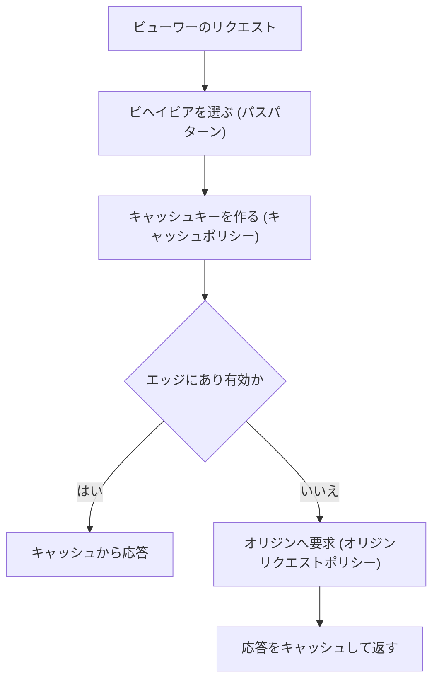

# ネットワーク（VPC / Route 53 / ELB / CloudFront）

[:material-sprout: CLF](../courses/clf/services.md){ .exam-badge .exam-foundational } [:material-sprout: AIF](../courses/aif/services.md){ .exam-badge .exam-foundational } [:material-certificate: SAA](../courses/saa/services.md){ .exam-badge .exam-associate } [:material-certificate: DVA](../courses/dva/services.md){ .exam-badge .exam-associate } [:material-certificate: SOA](../courses/soa/services.md){ .exam-badge .exam-associate } [:material-certificate: DEA](../courses/dea/services.md){ .exam-badge .exam-associate } [:material-certificate: MLA](../courses/mla/services.md){ .exam-badge .exam-associate } [:material-star-circle: SAP](../courses/sap/services.md){ .exam-badge .exam-professional } [:material-star-circle: DOP](../courses/dop/services.md){ .exam-badge .exam-professional } [:material-star-circle: AIP](../courses/aip/services.md){ .exam-badge .exam-professional } [:material-target: ANS](../courses/ans/services.md){ .exam-badge .exam-specialty } [:material-target: SCS](../courses/scs/services.md){ .exam-badge .exam-specialty }

各リソースがグローバル、リージョン、AZ のどの単位か、VPC の内外のどちらかは、[リソースの提供単位](resource-scope.md)にまとめています。

アプリケーションへの通信の入口と、AWS リソース間の通信経路を構成するサービス群です。開発者にとっては、接続できない原因の切り分け、ロードバランサーのヘルスチェック、CloudFront のキャッシュ設定が特に重要です。

[](../assets/diagrams/networking-vpc.png)

## VPC の基本 {#vpc}

[:material-sprout: CLF](../courses/clf/services.md){ .exam-badge .exam-foundational } [:material-sprout: AIF](../courses/aif/services.md){ .exam-badge .exam-foundational } [:material-certificate: SAA](../courses/saa/services.md){ .exam-badge .exam-associate } [:material-certificate: DVA](../courses/dva/services.md){ .exam-badge .exam-associate } [:material-certificate: SOA](../courses/soa/services.md){ .exam-badge .exam-associate } [:material-certificate: DEA](../courses/dea/services.md){ .exam-badge .exam-associate } [:material-certificate: MLA](../courses/mla/services.md){ .exam-badge .exam-associate } [:material-star-circle: SAP](../courses/sap/services.md){ .exam-badge .exam-professional } [:material-star-circle: DOP](../courses/dop/services.md){ .exam-badge .exam-professional } [:material-star-circle: AIP](../courses/aip/services.md){ .exam-badge .exam-professional } [:material-target: ANS](../courses/ans/services.md){ .exam-badge .exam-specialty } [:material-target: SCS](../courses/scs/services.md){ .exam-badge .exam-specialty }

**提供単位:** VPC はリージョン単位で、そのリージョンの全 AZ にまたがります。サブネットは AZ 単位で、VPC の中に作ります。一覧は[リソースの提供単位](resource-scope.md)を参照してください。

### サブネットとルートテーブル {#subnets-route-tables}

| 要素 | 役割 |
|---|---|
| VPC | 論理的に分離された仮想ネットワーク |
| サブネット | VPC を AZ ごとに分けた IP の範囲 |
| ルートテーブル | 宛先ごとの転送先を決める。VPC 内への `local` ルートは自動 |
| インターネットゲートウェイ | VPC とインターネットをつなぐ |
| NAT ゲートウェイ | プライベートサブネットから外へ出るための変換。外からの接続は受けない |

| サブネットの種類 | デフォルトルート（`0.0.0.0/0`）の転送先 | 置くもの |
|---|---|---|
| パブリック | インターネットゲートウェイ | ALB、NAT ゲートウェイ |
| プライベート | NAT ゲートウェイ | アプリケーション |
| 閉域 | なし | データベース |

!!! tip "VPC 内の Lambda"
    VPC に接続した Lambda は、パブリックサブネットに置いてもインターネットへ出られません。プライベートサブネットと NAT ゲートウェイ、または VPC エンドポイントを使います。詳細は [Lambda](lambda.md) を参照してください。

NAT ゲートウェイには AZ ごとに作るゾーン型のほか、複数の AZ へ自動で広がるリージョン型もあります。

**値を入れた例:** `10.0.0.0/16` の VPC を、2 つの AZ に 3 層で分けます。

| サブネット | CIDR | ルートテーブルの `0.0.0.0/0` |
|---|---|---|
| public-1a、public-1c | `10.0.0.0/24`、`10.0.1.0/24` | `igw-EXAMPLE` |
| app-1a | `10.0.10.0/24` | 1a の NAT ゲートウェイ |
| app-1c | `10.0.11.0/24` | 1c の NAT ゲートウェイ |
| db-1a、db-1c | `10.0.20.0/24`、`10.0.21.0/24` | なし（`local` のみ） |

- **例（経路の引き方）:** app-1a から `10.0.20.5` へは `10.0.0.0/16 → local` を使います。`203.0.113.10` へは `0.0.0.0/0` を使い、NAT ゲートウェイへ送ります。
- **例（使える IP）:** `/24` は 256 個ですが、AWS が 5 個を予約するので 251 個です。ALB を置くサブネットは `/27` 以上で、空き IP が 8 個以上必要です。
- **例（暗黙の関連付け）:** ルートテーブルを明示的に関連付けていないサブネットは、メインルートテーブルに従います。メインに IGW への経路を足すと、未関連付けのサブネットがすべてパブリックになります。
- **誤ると:** app-1c のルートも 1a の NAT へ向けると、1a の障害で 1c のアプリも外へ出られなくなります。db のルートに NAT を足すと、閉域にしたはずの DB から外へ出られます。

### セキュリティグループとネットワーク ACL {#security-groups-nacls}

| | セキュリティグループ | ネットワーク ACL |
|---|---|---|
| 適用先 | インスタンス（ENI）単位 | サブネット単位 |
| ルール | 許可のみ | 許可と拒否 |
| 評価 | すべてのルールを評価 | 番号の小さい順に、最初の一致を適用 |
| 戻り通信 | 自動で許可（ステートフル） | 明示的な許可が必要（ステートレス） |
| 使いどころ | 主な通信制御 | 特定の IP の拒否など、粗い制御 |

セキュリティグループは送信元に別のセキュリティグループを指定できます。「ALB からの通信だけをアプリで受ける」などの設定は IP ではなく、この方法で書きます。

ネットワーク ACL を自作するときは、戻り通信のエフェメラルポートを忘れないようにします。これが閉じていると ALB の 504 の原因にもなります。

**値を入れた例:** 3 層の Web アプリのセキュリティグループです。

| グループ | 受信ポート | 送信元 |
|---|---|---|
| `sg-alb` | TCP 443 | `0.0.0.0/0` |
| `sg-app` | TCP 8080 | `sg-alb` |
| `sg-db` | TCP 3306 | `sg-app` |

- **例（ステートフル）:** `sg-app` が 8080 を受信すれば、応答の送信ルールは不要です。送信ルールをすべて消しても、この応答は返ります。アプリから外へ接続を始める通信は止まります。
- **例（NACL を使う場面）:** `198.51.100.0/24` からの攻撃を止めるなら、サブネットの NACL に `DENY` を書きます。セキュリティグループには拒否のルールがありません。
- **誤ると:** `sg-db` の送信元を `10.0.0.0/16` にすると、同じ VPC の無関係なサーバーからも DB へ接続を試せます。

### 接続できないときの切り分け {#vpc-troubleshooting}

| 症状 | 確認するもの |
|---|---|
| タイムアウトする | セキュリティグループ、ネットワーク ACL、ルートテーブル |
| 接続拒否（すぐ失敗する） | アプリのプロセスとポート |
| 名前解決できない | VPC の DNS 設定、プライベート DNS |
| 通信の許可状況を確認したい | VPC フローログの `ACCEPT` と `REJECT` |

**値を入れた例:** `10.0.10.5` のアプリが、`10.0.20.5:3306` へ接続できないとします。

- しばらく待って `Connection timed out` が出たら、パケットが捨てられています。`sg-db` の 3306、両方のサブネットの NACL、ルートテーブルを順に確認します。
- `Connection refused` がすぐ出たら、経路と許可は通っています。DB のプロセスが 3306 で待ち受けているかを確認します。
- `Could not resolve host` なら、通信以前の DNS の問題です。`enableDnsSupport` と、プライベートホストゾーンの関連付けを確認します。
- フローログの `10.0.10.5 10.0.20.5 ... 3306 ... REJECT` は、SG か NACL が拒否した印です。記録がなければ、パケットが ENI まで来ていません。ルートを疑います。

### セキュリティグループのルール {#security-group-rules}

[:material-certificate: SOA](../courses/soa/services.md){ .exam-badge .exam-associate }

| 項目 | 内容 |
|---|---|
| 指定するもの | プロトコル、ポート範囲、送信元または宛先（CIDR、セキュリティグループ、プレフィックスリスト） |
| 既定の送信ルール | すべて許可 |
| ルール数の上限 | 受信と送信それぞれ 60 個（既定）。ENI あたり 5 グループ（既定） |
| 変更の反映 | 関連付け済みのリソースへ自動で反映 |

**具体例:** ALB の後ろの EC2 なら、EC2 のセキュリティグループの受信に「TCP 8080、送信元は ALB のセキュリティグループ」と書きます。ALB の IP は変わるので、CIDR では書きません。

**落とし穴:** 許可のルールしかないので、特定の IP だけ拒否する設定はできません。拒否は NACL で行います。

```bash
aws ec2 authorize-security-group-ingress --group-id sg-app \
  --protocol tcp --port 8080 --source-group sg-alb
```

- **例（ルール数の数え方）:** CIDR を指定したルールと SG を参照するルールは 1 個です。参照先の SG に 100 台あっても 1 個です。最大サイズ 20 の顧客管理プレフィックスリストを指定すると、20 個と数えます。AWS 管理のプレフィックスリストは、リストの重みの分だけ数えます。CloudFront のリストの重みは 55 なので、既定の上限 60 のうち 55 個を使います。
- **例（上限の別枠）:** 既定の 60 個は、受信と送信で別枠です。IPv4 と IPv6 でも別枠です。受信の IPv4 に 60 個、受信の IPv6 に 60 個を書けます。
- **例（上限の積）:** ENI あたりの SG 数と SG あたりのルール数の積は、1,000 を超えられません。SG を 5 個のままなら、ルールは最大 `1,000 / 5 = 200` 個です。
- **誤ると:** 上限に達すると、ルールの追加がエラーで失敗します。送信ルールをすべて消すと、アプリから外部 API や DB への接続がタイムアウトします。

### ネットワーク ACL のルール {#nacl-rules}

[:material-certificate: SOA](../courses/soa/services.md){ .exam-badge .exam-associate }

| 項目 | 既定の NACL | 自作の NACL |
|---|---|---|
| 番号付きのルール | 受信、送信とも全許可 | なし |
| `*` のルール（最後、変更不可） | 全拒否 | 全拒否 |
| 結果 | すべて通る | **すべて通らない** |

| ルールの項目 | 内容 |
|---|---|
| ルール番号 | 小さい順に評価し、一致したら以降は見ない |
| 送信元、宛先 | CIDR のみ。セキュリティグループは指定不可 |
| 動作 | `ALLOW` または `DENY` |
| 上限 | 1 つの NACL に受信、送信それぞれ 20 個（既定） |

**具体例:** `203.0.113.5` だけ拒否するなら、許可より小さい番号（`90 DENY 203.0.113.5/32`、`100 ALLOW 0.0.0.0/0`）にします。逆の番号だと、100 が先に一致して拒否されません。

**戻り通信の計算:** サブネットの ALB が EC2 の 8080 へ接続するとします。EC2 のサブネットの NACL には、受信の 8080 だけでなく、送信のエフェメラルポート（ロードバランサー宛なら `1024-65535`）が必要です。ないと応答が返らず、ALB は 504 を返します。

**ルール番号の範囲:** 1〜32766 です。既定の上限 20 個は、受信と送信で別枠です。受信、送信それぞれ 40 個まで増やせますが、性能に影響する場合があります。

**エフェメラルポートは、接続を始めた側で決まります。**

| 接続を始めた側 | ポート |
|---|---|
| 多くの Linux カーネル | `32768-61000` |
| Windows Server 2008 以降 | `49152-65535` |
| ELB、NAT ゲートウェイ、Lambda | `1024-65535` |

**値を入れた例:** インターネットへ HTTPS を公開するサブネットの最小構成です。

| 方向 | 番号 | ポート | 相手 | 動作 |
|---|---|---|---|---|
| 受信 | 100 | TCP 443 | `0.0.0.0/0` | `ALLOW` |
| 受信 | 120 | TCP 22 | `192.0.2.0/24` | `ALLOW` |
| 送信 | 140 | TCP `1024-65535` | `0.0.0.0/0` | `ALLOW` |

- **例:** 番号を 100、110 のように空けておくと、後から `90 DENY` を差し込めます。
- **誤ると:** 送信を `32768-65535` だけにすると、Linux の利用者には届きます。ELB や NAT ゲートウェイが `1024-32767` のポートを使った接続への応答は捨てられ、断続的に失敗します。

### VPC の DNS 属性 {#vpc-dns-attributes}

| 属性 | 意味 | 既定 |
|---|---|---|
| `enableDnsSupport` | Route 53 Resolver による名前解決 | 有効な前提で使う |
| `enableDnsHostnames` | パブリック IP のインスタンスへの DNS ホスト名の割り当て | デフォルト VPC 以外は `false` |

**落とし穴:** プライベートホストゾーンや、インターフェイスエンドポイントのプライベート DNS を使うには、**両方を `true`** にします。片方でも `false` なら、公開エンドポイントへ解決されるか、名前解決に失敗します。

- **`enableDnsSupport` の既定:** `true` です。`true` なら、`10.0.0.0/16` の VPC では `10.0.0.2` と `169.254.169.253` の Amazon DNS サーバーが応答します。
- **例:** 自作の VPC で `enableDnsHostnames` が `false` のままだと、パブリック IP のインスタンスに `ec2-...` の DNS 名が付きません。接続先を DNS 名で書いた手順が使えません。
- **例:** `corp.example.com` のプライベートホストゾーンを関連付けても、`enableDnsHostnames` が `false` だと `db.corp.example.com` を引けません。
- **誤ると:** `enableDnsSupport` を `false` にすると、VPC 内のアプリは AWS のサービス名も解決できず、SDK の呼び出しが名前解決のエラーで失敗します。

### VPC フローログ {#flow-logs}

**提供単位:** フローログはリージョン単位のリソースで、VPC、サブネット、ENI のいずれかに付けます。

ENI を通る IP 通信のメタデータを記録します。送信先は CloudWatch Logs、S3、Data Firehose です。通信の経路の外で集めるので、ネットワーク性能には影響しません。記録には `ACCEPT` と `REJECT` が含まれます。

**読み方:** 受信が `ACCEPT` で送信が `REJECT` なら、ステートレスな NACL の戻り通信の問題を疑います。

```bash
aws ec2 create-flow-logs --resource-type VPC --resource-ids vpc-EXAMPLE \
  --traffic-type REJECT --log-destination-type s3 \
  --log-destination arn:aws:s3:::my-flow-logs --max-aggregation-interval 60
```

- **例（`--traffic-type`）:** 値は `ACCEPT`、`REJECT`、`ALL` です。拒否の調査なら `REJECT` にすると、記録量を抑えられます。
- **例（読み方）:** `203.0.113.7 → 10.0.0.5:443` が `ACCEPT`、`10.0.0.5:443 → 203.0.113.7:49200` が `REJECT` なら、SG ではなく NACL です。SG はステートフルなので、受け入れた通信の戻りを拒否しません。
- **誤ると:** `REJECT` だけで作ると、通った通信の量や宛先は調べられません。作成後に変更できないので、作り直します。詳しい読み方は[フローログの分析](network-connectivity.md#flow-log-analysis)を参照してください。

### Lambda の VPC 接続 {#lambda-vpc}

| 設定 | 内容 |
|---|---|
| `SubnetIds` | 接続するサブネット。プライベートを指定する。複数 AZ が望ましい |
| `SecurityGroupIds` | 関数の ENI に付くセキュリティグループ |
| `Ipv6AllowedForDualStack` | デュアルスタックのサブネットで IPv6 を許可 |
| 実行ロール | `AWSLambdaVPCAccessExecutionRole`（`ec2:CreateNetworkInterface` などを含む） |
| 解除 | `SubnetIds=[],SecurityGroupIds=[]` で更新する |

```bash
aws lambda update-function-configuration --function-name orders \
  --vpc-config SubnetIds=subnet-aaa,subnet-bbb,SecurityGroupIds=sg-111
```

| 関数がやりたいこと | 必要なもの |
|---|---|
| RDS へ接続 | RDS の SG で、関数の SG からの受信を許可 |
| インターネットの API を呼ぶ | プライベートサブネットと NAT ゲートウェイ |
| S3、DynamoDB を呼ぶ | ゲートウェイエンドポイント、または NAT |
| Secrets Manager を呼ぶ | インターフェイスエンドポイント、または NAT |

**落とし穴:** パブリックサブネットに接続しても、関数にパブリック IP は付かず、インターネットへ出られません。症状はタイムアウトです。Lambda は Hyperplane ENI を使います。

**各設定の例:**

- **`SubnetIds`:** `subnet-aaa`（1a）と `subnet-bbb`（1c）のように複数の AZ を指定します。1a だけだと、1a の障害で関数が VPC のリソースへ届かなくなります。
- **`SecurityGroupIds`:** `sg-fn` を付け、`sg-db` の受信で「TCP 3306、送信元 `sg-fn`」を許可します。`sg-fn` の送信ルールを消すと、DB への接続がタイムアウトします。
- **`Ipv6AllowedForDualStack`:** 既定は無効です。デュアルスタックのサブネットで IPv6 の宛先へ送るときだけ `true` にします。
- **実行ロール:** `ec2:CreateNetworkInterface` などの権限が足りないと、VPC 設定の更新が権限エラーで失敗します。
- **解除:** `--vpc-config SubnetIds=[],SecurityGroupIds=[]` で更新すると、VPC の外へ戻ります。
- **誤ると:** 経路のないサブネットで `Timeout` が 3 秒なら、ログに `Task timed out after 3.00 seconds` だけが残ります。コードの遅さと見分けるには、SG と経路を先に確認します。

## VPC エンドポイントと PrivateLink {#vpc-endpoints}

[:material-sprout: CLF](../courses/clf/services.md){ .exam-badge .exam-foundational } [:material-certificate: SAA](../courses/saa/services.md){ .exam-badge .exam-associate } [:material-certificate: DVA](../courses/dva/services.md){ .exam-badge .exam-associate } [:material-certificate: SOA](../courses/soa/services.md){ .exam-badge .exam-associate } [:material-certificate: DEA](../courses/dea/services.md){ .exam-badge .exam-associate } [:material-star-circle: SAP](../courses/sap/services.md){ .exam-badge .exam-professional } [:material-star-circle: DOP](../courses/dop/services.md){ .exam-badge .exam-professional } [:material-star-circle: AIP](../courses/aip/services.md){ .exam-badge .exam-professional } [:material-target: ANS](../courses/ans/services.md){ .exam-badge .exam-specialty }

インターネットを経由せず、VPC から AWS サービスへ接続する仕組みです。NAT の料金削減とセキュリティの向上につながります。

**提供単位:** リージョン単位で、VPC に属します。ゲートウェイエンドポイントはルートテーブルに経路を足し、AZ を選びません。インターフェイスエンドポイントは AZ ごとのサブネットに ENI を置きます。一覧は[リソースの提供単位](resource-scope.md#scope-regional-vpc)を参照してください。

| | ゲートウェイエンドポイント | インターフェイスエンドポイント |
|---|---|---|
| 対象 | S3、DynamoDB | 多くの AWS サービス、PrivateLink 対応サービス |
| 仕組み | ルートテーブルにプレフィックスリストのルートを追加 | サブネットに ENI を作り、プライベート IP で接続 |
| 基盤 | PrivateLink を使わない | PrivateLink |
| 料金 | 追加料金なし | 時間とデータ量の料金 |
| アクセス制御 | エンドポイントポリシー | エンドポイントポリシーとセキュリティグループ |
| 名前解決 | 通常の公開エンドポイント名のまま | プライベート DNS を有効にすれば通常の名前のまま |

S3 はインターフェイスエンドポイントにも対応しています。

**プライベート DNS** を有効にすると、SDK のコードを変えずに通常のサービス名でエンドポイントへ接続できます。VPC の DNS ホスト名と DNS 解決の有効化が必要です。

**AWS PrivateLink** は、自社のサービスを NLB の裏に置いて、他の VPC へプライベートに公開する場合にも使います。

S3 のバケットポリシーで `aws:SourceVpce` 条件を使うと、特定のエンドポイントからのアクセスのみ許可できます。

**値を入れた例:**

- **ゲートウェイ:** 作成するとルートテーブルに `pl-EXAMPLE → vpce-EXAMPLE` が入ります。`pl-EXAMPLE` は S3 のプレフィックスリストです。これより具体的な経路がなければ、S3 宛はこの経路を通ります。
- **インターフェイス（プライベート DNS あり）:** `secretsmanager.ap-northeast-1.amazonaws.com` が `10.0.10.25` のようなプライベート IP に解決されます。SDK の設定は変えません。
- **インターフェイス（プライベート DNS なし）:** 同じ名前は公開 IP に解決され、NAT があれば NAT を通ります。エンドポイント固有の DNS 名を SDK に指定すれば、エンドポイントを通せます。
- **PrivateLink:** 提供側の NLB を `vpce-svc-EXAMPLE` として公開し、利用側はインターフェイスエンドポイントを作ります。両方の VPC が `10.0.0.0/16` でも接続できます。ルートを交換しないからです。
- **NAT の節約:** プライベートサブネットから S3 へ 1 日に 500 GB 送るワークロードなら、ゲートウェイエンドポイントに変えると、その 500 GB は NAT のデータ処理料金の対象から外れます。

### エンドポイントの選び方と制約 {#endpoint-settings}

| 項目 | ゲートウェイ | インターフェイス |
|---|---|---|
| 対象 | S3、DynamoDB | 多くのサービス |
| 指定するもの | ルートテーブル | サブネット（AZ ごとに 1 つ）、セキュリティグループ |
| VPC の外から | **使えない**（VPN、ピアリング、Transit Gateway、Direct Connect の先は不可） | 使える |
| ゲートウェイの範囲 | 作成したリージョンのサービスのみ | |
| 既定のポリシー | フルアクセス | フルアクセス |

**インターフェイスエンドポイントの確認項目:**

- エンドポイントの SG で、クライアントからの HTTPS（443）の受信を許可します。既定では VPC のデフォルト SG が付きます。
- `enableDnsSupport` と `enableDnsHostnames` を有効にします。
- NACL でも通信を許可します。

**具体例:** オンプレミスから VPN 経由で S3 へプライベートに接続したいなら、ゲートウェイエンドポイントでは届かないので、S3 のインターフェイスエンドポイントを使います。

```bash
aws ec2 create-vpc-endpoint --vpc-id vpc-EXAMPLE \
  --vpc-endpoint-type Interface \
  --service-name com.amazonaws.ap-northeast-1.secretsmanager \
  --subnet-ids subnet-aaa subnet-bbb --security-group-ids sg-vpce \
  --private-dns-enabled
```

- **例（指定するもの）:** ゲートウェイでは `rtb-app` だけを関連付けると、`rtb-app` のサブネットだけがエンドポイントを通ります。他のサブネットは公開エンドポイントへ向かいます。
- **例（SG）:** `sg-vpce` の受信に「TCP 443、送信元 `10.0.0.0/16`」を書きます。
- **誤ると（SG）:** 443 を許可しないと、SDK の呼び出しは接続タイムアウトになります。権限エラーではないので、IAM を調べても原因が見つかりません。
- **誤ると（リージョン）:** 東京のゲートウェイエンドポイントでは、大阪のバケットへ届きません。ゲートウェイは作成したリージョンのサービスだけが対象です。

### エンドポイントポリシー {#endpoint-policies}

エンドポイントに付けるリソースポリシーで、1 つのエンドポイントに 1 つです。既定はフルアクセスです。**権限を与えるものではなく**、IAM やバケットポリシーの許可に対する上限です。

```json
{
  "Statement": [{
    "Effect": "Allow",
    "Principal": "*",
    "Action": ["s3:GetObject"],
    "Resource": "arn:aws:s3:::my-app-assets/*"
  }]
}
```

バケット側は、`aws:SourceVpce`（特定のエンドポイント）や `aws:SourceVpc`（特定の VPC）で絞れます。

**落とし穴:** VPC エンドポイント経由のリクエストには、`aws:SourceIp` に使うパブリック IP がありません。公開 IP を条件にした許可はこの経路では効かないので、`aws:SourceVpce` に書き換えます。

**値を入れた例:** 上のポリシーを付けたエンドポイントで、IAM ロールに `s3:*` があるとします。

| 操作 | 結果 | 理由 |
|---|---|---|
| `my-app-assets` を `GetObject` | 成功 | IAM とエンドポイントの両方が許可 |
| `my-app-assets` へ `PutObject` | `AccessDenied` | エンドポイントポリシーが許可しない |
| `other-bucket` を `GetObject` | `AccessDenied` | 別のバケットは `Resource` の外 |

**バケット側で絞る例:**

```json
{
  "Effect": "Deny",
  "Principal": "*",
  "Action": "s3:*",
  "Resource": ["arn:aws:s3:::my-app-assets", "arn:aws:s3:::my-app-assets/*"],
  "Condition": {"StringNotEquals": {"aws:SourceVpce": "vpce-1a2b3c4d"}}
}
```

- **誤ると:** 上の `Deny` は、エンドポイントを通らないすべての要求を止めます。コンソールからの操作も止まるので、管理者も閉め出されます。
- **例（`aws:SourceVpc`）:** 同じ VPC に複数のエンドポイントがあるなら、`aws:SourceVpc` で VPC 単位に書くと一度で済みます。

## Route 53 {#route53}

[:material-sprout: CLF](../courses/clf/services.md){ .exam-badge .exam-foundational } [:material-certificate: SAA](../courses/saa/services.md){ .exam-badge .exam-associate } [:material-certificate: DVA](../courses/dva/services.md){ .exam-badge .exam-associate } [:material-certificate: SOA](../courses/soa/services.md){ .exam-badge .exam-associate } [:material-certificate: DEA](../courses/dea/services.md){ .exam-badge .exam-associate } [:material-star-circle: SAP](../courses/sap/services.md){ .exam-badge .exam-professional } [:material-star-circle: DOP](../courses/dop/services.md){ .exam-badge .exam-professional } [:material-star-circle: AIP](../courses/aip/services.md){ .exam-badge .exam-professional } [:material-target: ANS](../courses/ans/services.md){ .exam-badge .exam-specialty } [:material-target: SCS](../courses/scs/services.md){ .exam-badge .exam-specialty }

**提供単位:** Route 53 のホストゾーンとレコードはグローバルで、VPC の外です。プライベートホストゾーンも実体は外にあり、VPC に関連付けて使います。一覧は[リソースの提供単位](resource-scope.md)を参照してください。

### レコード {#route53-records}

| レコード | 内容 |
|---|---|
| `A` / `AAAA` | IPv4 / IPv6 アドレス |
| `CNAME` | 別のドメイン名への別名。ゾーンの頂点（`example.com`）には作れない |
| エイリアス | Route 53 独自の機能。AWS リソースを直接指す |
| `MX` / `TXT` / `NS` | メール、テキスト、ネームサーバー |

| | エイリアス | CNAME |
|---|---|---|
| ゾーンの頂点 | 作成できる | 作成できない |
| 指す先 | CloudFront、ALB、API Gateway、S3 Web サイトなど | 任意の DNS 名 |
| AWS リソースへのクエリ料金 | かからない | かかる |

ALB や CloudFront をドメインの頂点で公開するなら、エイリアスレコードを使います。

**レコードの値の例:**

| レコード | 名前 | 値 |
|---|---|---|
| `A` | `api.example.com` | `192.0.2.10` |
| `AAAA` | `api.example.com` | `2001:db8::10` |
| `CNAME` | `www.example.com` | `d111111abcdef8.cloudfront.net` |
| `MX` | `example.com` | `10 mail.example.com` |
| `TXT` | `example.com` | `"v=spf1 -all"` |

**頂点を CloudFront へ向ける例:**

```json
{
  "Changes": [{
    "Action": "UPSERT",
    "ResourceRecordSet": {
      "Name": "example.com",
      "Type": "A",
      "AliasTarget": {
        "HostedZoneId": "Z2FDTNDATAQYW2",
        "DNSName": "d111111abcdef8.cloudfront.net",
        "EvaluateTargetHealth": false
      }
    }
  }]
}
```

- **誤ると:** `example.com` に `CNAME` を作ろうとすると、作成時にエラーになります。頂点には `SOA` と `NS` があり、CNAME は他のレコードと共存できないからです。

### ルーティングポリシー {#routing-policies}

| ポリシー | 用途 |
|---|---|
| シンプル | 単一のリソース |
| 加重 | 割合で分ける。カナリアリリース |
| レイテンシー | 最も遅延の小さいリージョンへ |
| フェイルオーバー | アクティブとパッシブの切り替え |
| 位置情報 | 利用者の位置で振り分け |
| 地理的近接性 | リソースの位置で振り分け、範囲を調整 |
| IP ベース | 利用者の IP 範囲で振り分け |
| 複数値回答 | 最大 8 個の正常なレコードをランダムに返す |

DNS はキャッシュされるので、切り替えの速さはレコードの TTL に左右されます。

**値を入れた例:** 同じ `api.example.com` を次のように設定します。詳しい設定は[ルーティングポリシーの設定](#routing-settings)にあります。

| ポリシー | 設定 | 結果 |
|---|---|---|
| シンプル | `192.0.2.10` | 全員に同じ値。設定項目にヘルスチェックがなく、異常でも同じ値を返す |
| 加重 | A `90`、B `10` | 問い合わせの 90% に A、10% に B |
| レイテンシー | 東京、バージニア | 測定値の小さいリージョン |
| フェイルオーバー | 東京が `PRIMARY`、大阪が `SECONDARY` | 東京が異常なら大阪 |
| 位置情報 | `JP` は東京、既定はバージニア | 日本からは東京、それ以外はバージニア |
| 複数値回答 | 正常な IP が 3 個 | 3 個すべてを返す |

### TTL とエイリアスの違い {#route53-ttl}

TTL は DNS リゾルバーがレコードをキャッシュする秒数です。

| 値を長くすると | 値を短くすると |
|---|---|
| Route 53 へのクエリが減り、料金と遅延が下がる | 変更がすぐ広がる |
| 変更の反映が遅くなる | クエリ数と料金が増える |

**具体例:** 移行の前日に TTL を `86400` から `60` に下げておきます。古い値のキャッシュが切れてから切り替えれば、1 分程度で新しい先へ移ります。

- **計算例（問い合わせの数）:** 1 つのリゾルバーからの問い合わせは、TTL が `60` なら 1 時間に最大 `3600 / 60 = 60` 回、`3600` なら 1 回です。
- **誤ると:** TTL を下げた直後に切り替えると、以前の `86400` の値を持つリゾルバーは、最大 1 日古い IP を返し続けます。下げてから、以前の TTL の時間を待ちます。

| 項目 | エイリアス | CNAME |
|---|---|---|
| TTL | AWS リソース向けは**指定不可**。同じゾーンの別レコード向けは、その TTL を使う | 指定する |
| 料金 | AWS リソースへのクエリは無料 | 課金。Route 53 内の別レコードへの CNAME は 2 クエリ分 |
| 指せる先 | CloudFront、ELB、API Gateway、S3 Web サイト、VPC インターフェイスエンドポイント、Elastic Beanstalk、Global Accelerator、同じゾーンの同じタイプのレコードなど | 任意の DNS 名 |
| 頂点 | 作成できる | 作成できない |
| 変更の追従 | IP が変わっても自動で追従 | 名前を返すだけ |

ヘルスチェックとの組み合わせでは、エイリアスは `Evaluate Target Health` を `Yes` にします。ALB の状態がレコードの状態になります。

- **計算例（CNAME の料金）:** Route 53 内の別レコードを指す CNAME が 100 万回引かれると、`1,000,000 × 2 = 2,000,000` クエリ分の料金です。同じ先をエイリアスで AWS リソースへ向ければ、クエリ料金はかかりません。
- **例（`Evaluate Target Health`）:** `PRIMARY` のエイリアスが東京の ALB を指し、ALB のターゲットがすべて異常になったとします。`Yes` なら `SECONDARY` へ切り替わります。`No` なら東京の ALB を返し続けます。
- **例（タイプ）:** エイリアスは指す先と同じタイプで作ります。IPv4 と IPv6 の ALB には、`A` と `AAAA` の 2 つを作ります。`A` だけだと、IPv6 の問い合わせには答えが返りません。

### ルーティングポリシーの設定 {#routing-settings}

| ポリシー | 主な設定 | 動作の要点 |
|---|---|---|
| 加重 | `Weight`（0〜255）、`SetIdentifier` | 比率は `重み / 重みの合計` |
| レイテンシー | `Region` | 測定値が最小のリージョンへ。距離ではない |
| フェイルオーバー | `PRIMARY` / `SECONDARY` | プライマリにヘルスチェックを関連付ける |
| 位置情報 | 大陸、国、米国の州 | 最も具体的な一致が優先。**既定のレコードがなく一致しないと「no answer」** |
| 地理的近接性 | リージョンや座標、`Bias`（-99〜99） | 正で範囲を広げ、負で狭める |
| IP ベース | CIDR コレクション | IPv4 は /1〜/24、IPv6 は /1〜/48 |
| 複数値回答 | レコードごとにヘルスチェックを任意で関連付け | 正常なものを最大 8 個。全部異常でも最大 8 個返す |

**計算例:** 新バージョンへ 1% だけ流すなら、重みを旧 `99`、新 `1` にします。`1 / (1 + 99) = 1%` です。`255` と `1` にすると `1 / 256` です。

**各ポリシーの例:**

- **加重（3 つに分ける）:** 重みが `70`、`20`、`10` なら、合計 100 で 70%、20%、10% です。切り戻しは新の重みを `0` にします。すべてを `0` にすると均等に分かれます。
- **加重（`SetIdentifier`）:** 同じ名前とタイプのレコードを区別する値です。`blue`、`green` のように付けます。
- **レイテンシー:** `ap-northeast-1` と `ap-southeast-2` に置きます。ある利用者の測定値が東京 40 ms、シドニー 130 ms なら東京を返します。回線の状況で測定値が変わると、返す先も変わります。
- **フェイルオーバー:** `PRIMARY` に `RequestInterval=30`、`FailureThreshold=3` のヘルスチェックを付け、TTL が 60 秒なら、切り替わりの目安は `30 × 3 + 60 = 150` 秒です。
- **位置情報:** `JP` は東京、`AS`（アジア）はシンガポール、`*`（既定）はバージニアとします。日本は `JP` が優先され、韓国は `AS`、ブラジルは既定です。
- **地理的近接性:** 東京のレコードの `Bias` を `25` にすると、東京へ流れる地域が広がり、隣の地域は狭まります。`-25` なら逆です。
- **IP ベース:** CIDR コレクションに `isp-a: 203.0.113.0/24` を登録し、そのロケーションのレコードを専用の先へ向けます。`/24` より長いクエリは短い CIDR に一致します。`0.0.0.0/0` は指定できないので、既定のロケーション `*` を使います。
- **複数値回答:** 正常な IP が 10 個なら 8 個を返し、3 個なら 3 個を返します。全部異常なら、異常なものを最大 8 個返します。ヘルスチェックを付けないレコードは、常に正常として扱います。

**落とし穴:** 位置情報ルーティングで既定のレコードを作らないと、どこにも一致しない IP からの問い合わせに応答を返せません。

### Route 53 ヘルスチェック {#route53-health-checks}

| 種類 | 確認するもの |
|---|---|
| エンドポイント | IP またはドメインに世界中から HTTP、HTTPS、TCP で確認 |
| 計算（calculated） | 他のヘルスチェックの状態の組み合わせ |
| CloudWatch アラーム | アラームのデータストリーム |

| 設定 | 既定値、範囲 | 内容 |
|---|---|---|
| `RequestInterval` | 既定 30 秒。Fast は 10 秒（追加料金） | 確認の間隔 |
| `FailureThreshold` | 既定 3、範囲 1〜10 | 状態を変えるまでの連続回数 |
| `ResourcePath` | 255 文字まで | HTTP、HTTPS のパス |
| `SearchString` | 応答の先頭 5,120 バイト以内 | 文字列の一致。文字列一致の有無は作成後に変更不可 |
| `Inverted` | | 判定を反転 |

**正常の条件:**

- HTTP、HTTPS は、4 秒以内に TCP 接続、接続から 2 秒以内に `2xx` か `3xx` です。
- TCP は、10 秒以内に接続です。
- ヘルスチェッカーの **18% を超える**数が正常と報告すれば、エンドポイントは正常です。

**落とし穴:**

- チェッカーはインターネットにあるので、プライベートな IP には届きません。VPC 内のリソースは、CloudWatch アラームのヘルスチェックを使います。
- アラーム型は、標準解像度、基本の統計（`Average` など）に限られます。M out of N と拡張統計は使えません。
- エンドポイントのファイアウォールは、ヘルスチェッカーの IP を許可します。

**各設定の例:**

- **`RequestInterval`:** 異常判定までの目安は `間隔 × FailureThreshold` です。`30 × 3 = 90` 秒、`10 × 3 = 30` 秒です。作成後は変更できないので、10 秒にしたいなら作り直します。
- **`FailureThreshold`:** `1` にすると、一時的な遅れでも切り替わります。頻繁に切り替わるなら `3` に戻します。
- **`ResourcePath`:** `/healthz` を指定します。`/healthz` が 500 を返すと、そのチェッカーは失敗と数えます。
- **`SearchString`:** `HTTPS_STR_MATCH` で `"status":"ok"` を探します。応答が 2xx でも、先頭 5,120 バイトに文字列がなければ異常です。
- **`Inverted`:** メンテナンス画面の URL を監視し、「画面が出ている間は異常」と判定を反転する用途です。
- **`Regions`:** 指定しないと全リージョンから確認します。指定するなら最低 3 つです。

**計算ヘルスチェックの例:** 東京のチェック A、B、C を子にして、`HealthThreshold=2` とします。

| 正常な子の数 | 結果 |
|---|---|
| 3 または 2 | 正常 |
| 1 または 0 | 異常 |

`HealthThreshold=0` なら常に正常、子の数より大きいと常に異常です。計算ヘルスチェックを、別の計算ヘルスチェックの子にはできません。

**CloudWatch アラーム型の例:** VPC 内の RDS の接続数アラームを監視します。`InsufficientDataHealthStatus` は `Healthy`、`Unhealthy`、`LastKnownStatus` から選びます。データが届かないときに切り替えたくなければ `LastKnownStatus` です。

## Elastic Load Balancing {#elb}

[:material-certificate: SAA](../courses/saa/services.md){ .exam-badge .exam-associate } [:material-certificate: DVA](../courses/dva/services.md){ .exam-badge .exam-associate } [:material-certificate: SOA](../courses/soa/services.md){ .exam-badge .exam-associate } [:material-star-circle: SAP](../courses/sap/services.md){ .exam-badge .exam-professional } [:material-star-circle: DOP](../courses/dop/services.md){ .exam-badge .exam-professional } [:material-star-circle: AIP](../courses/aip/services.md){ .exam-badge .exam-professional } [:material-target: ANS](../courses/ans/services.md){ .exam-badge .exam-specialty } [:material-target: SCS](../courses/scs/services.md){ .exam-badge .exam-specialty }

**提供単位:** ALB、NLB、GWLB はリージョン単位で、VPC の中にあります。AZ ごとのサブネットにノードを置きます。ALB は 2 つ以上の AZ のサブネットを指定します。一覧は[リソースの提供単位](resource-scope.md#scope-regional-vpc)を参照してください。

### ALB と NLB の違い {#alb-vs-nlb}

| | ALB | NLB |
|---|---|---|
| 層 | レイヤー 7（HTTP/HTTPS、gRPC） | レイヤー 4（TCP、TLS、UDP、QUIC） |
| ルーティング | パス、ホスト、ヘッダー、クエリ文字列 | ポート |
| ターゲット | インスタンス、IP、Lambda | インスタンス、IP、ALB |
| 接続先の IP | 変わる | AZ ごとに固定可能（Elastic IP） |
| 送信元 IP | `X-Forwarded-For` で確認 | 保持される構成が可能 |
| 向いている場面 | Web アプリ、マイクロサービス、認証連携 | 固定 IP、非 HTTP、高負荷、PrivateLink |

**選び方の例:**

- `/api/*` と `/images/*` を別のサーバーへ分ける: ALB です。パスで振り分けるのは L7 の機能です。
- 取引先の許可リストに `198.51.100.10` を登録してもらう: NLB に Elastic IP を付けます。ALB の IP は変わるので登録できません。
- UDP 5060 の音声を受ける: NLB です。ALB は HTTP と HTTPS だけです。
- 固定 IP とパス振り分けの両方が要る: NLB の `alb` タイプのターゲットグループに ALB を登録します。

### ターゲットグループ {#target-groups}

リスナーのルールで選ばれた通信の転送先です。ヘルスチェックとスティッキーセッションはターゲットグループ単位で設定します。登録解除時は処理中のリクエストを待ちます（Deregistration delay、既定 300 秒、状態は `draining`）。

- **例:** 同じ ALB で `tg-api`（ポート 8080、パス `/healthz`）と `tg-web`（ポート 80、パス `/`）を分けます。ヘルスチェックも別々に設定できます。

### ヘルスチェック {#alb-health-checks}

ロードバランサーの各ノードが、ターゲットの状態を定期的に確認し、正常なターゲットにだけ転送します。`lambda` タイプのターゲットグループでは、ヘルスチェックは既定で無効です。

| 設定 | 既定値（instance / ip） | 範囲 |
|---|---|---|
| `HealthCheckProtocol` | HTTP | HTTP、HTTPS |
| `HealthCheckPort` | トラフィックのポート | |
| `HealthCheckPath` | `/` | |
| `HealthCheckIntervalSeconds` | 30 秒（Lambda は 35 秒） | 5〜300 秒 |
| `HealthCheckTimeoutSeconds` | 5 秒（Lambda は 30 秒） | 2〜120 秒 |
| `HealthyThresholdCount` | 5 回 | 2〜10 回 |
| `UnhealthyThresholdCount` | 2 回 | 2〜10 回 |
| `Matcher`（成功コード） | 200 | HTTP は 200〜499 で指定 |

| ターゲットの状態 | 意味 |
|---|---|
| `initial` | 登録中、または初回チェック中 |
| `healthy` | 正常 |
| `unhealthy` | チェックに失敗 |
| `unused` | 使用されていない（リスナールールの対象外、有効でない AZ、停止中など） |
| `draining` | 登録解除の処理中 |
| `unavailable` | ターゲットグループのヘルスチェックが無効 |

| 理由コード | 確認すること |
|---|---|
| `Target.ResponseCodeMismatch` | パスの誤り、認証必須のパス、`Matcher` の設定 |
| `Target.Timeout` | セキュリティグループ、アプリの応答速度 |
| `Target.FailedHealthChecks` | 接続不可。ポートやアプリの起動を確認 |

すべてのターゲットが異常になると、ALB は状態を無視して全ターゲットへ転送します（フェイルオープン）。

ヘルスチェック用のパスは軽くし、認証なしで 200 を返すようにします。ターゲットのセキュリティグループでは、ALB のセキュリティグループからの通信を許可します。全般的な設計は [オブザーバビリティ](observability.md) を参照してください。

**各設定の例:**

- **`HealthCheckPort`:** アプリが 8080、管理用が 8081 なら `8081` を指定します。SG で 8081 を許可しないと `Target.Timeout` です。
- **`HealthCheckPath`:** `/` がログイン画面へ 302 を返すと、既定の `Matcher` が 200 なので `Target.ResponseCodeMismatch` です。`/healthz` に変えます。
- **`HealthCheckTimeoutSeconds`:** DB まで確認するパスが 6 秒かかると、既定の 5 秒で失敗します。パスを軽くするのが先で、伸ばすのは次の手段です。
- **`Matcher`:** `/` が 301 を返す構成を正常と見なすなら `200,301` です。
- **フェイルオープン:** 4 台すべてが `unhealthy` なら、ALB は 4 台すべてへ送ります。利用者は 503 ではなく、アプリのエラーや遅い応答を受け取ります。
- **誤ると:** DB の障害でヘルスチェックのパスが 500 を返すと、全台が `unhealthy` になります。外部の依存先まで調べるパスは、この連鎖を招きます。

### クライアント IP と X-Forwarded ヘッダー {#x-forwarded-for}

ALB は接続を中継するので、ターゲットから見た送信元は ALB の IP です。元の情報は次のヘッダーで分かります。

| ヘッダー | 内容 |
|---|---|
| `X-Forwarded-For` | クライアントの IP |
| `X-Forwarded-Proto` | クライアントが使ったプロトコル |
| `X-Forwarded-Port` | クライアントが接続したポート |

```text
X-Forwarded-For: 203.0.113.7
```

クライアントがすでに `X-Forwarded-For` を送っていると、ALB はその値の後ろに IP を追加します（既定の `append` モード）。リクエストの値は偽装できるので、信頼できる値は右側から判断します。Web サーバーのアクセスログに元の IP を残したいときは、このヘッダーをログの形式に追加します。

- **例（偽装）:** クライアント `203.0.113.7` が `X-Forwarded-For: 198.51.100.9` を付けて送ると、ターゲットには `198.51.100.9, 203.0.113.7` が届きます。左端で IP 制限をすると、偽の値で通り抜けられます。
- **例（`X-Forwarded-Proto`）:** HTTPS で受けて HTTP でターゲットへ送ると、値は `https` です。アプリが通信自体を見て「HTTP だ」と判断すると、HTTPS へのリダイレクトを繰り返します。
- **例（ログ）:** Nginx なら `log_format` に `$http_x_forwarded_for` を足します。足さないと、ログの送信元はすべて ALB のプライベート IP です。

### スティッキーセッション {#stickiness}

同じクライアントを同じターゲットへ送り続ける機能です。ターゲットグループで有効にします。

| 種類 | Cookie | 期間 |
|---|---|---|
| 期間ベース | ロードバランサーが生成する `AWSALB` | 1 秒から 7 日 |
| アプリケーションベース | アプリが発行する Cookie を指定 | ロードバランサー生成の Cookie は 7 日固定 |

負荷が偏る原因にもなります。セッションデータは ElastiCache や DynamoDB へ外部化するのが基本で、スティッキーセッションは移行途中の手段と考えます。

```bash
aws elbv2 modify-target-group-attributes --target-group-arn <ARN> \
  --attributes Key=stickiness.enabled,Value=true \
  Key=stickiness.lb_cookie.duration_seconds,Value=1800
```

- **例（期間ベース）:** カートをサーバーのメモリに持つアプリなら、`1800` 秒にします。30 分は同じターゲットへ送ります。
- **例（アプリケーションベース）:** アプリが `JSESSIONID` を発行するなら、`stickiness.app_cookie.cookie_name` に指定します。ALB は `AWSALBAPP` を別に付けます。
- **誤ると:** Cookie を保存しないクライアントには効かず、毎回別のターゲットへ送られます。3 台のうち 1 台に大口の利用者が固定されると、その 1 台だけ CPU が上がります。

### ALB のエラーコード {#alb-errors}

| コード | 主な原因 |
|---|---|
| 502 | ターゲットが接続を閉じた（keep-alive が ALB のアイドルタイムアウトより短いなど）、不正な応答、Lambda の失敗 |
| 503 | ターゲットグループに登録済みのターゲットがない、またはすべて `unused` |
| 504 | ターゲットの応答がアイドルタイムアウトを超えた、接続できない、ネットワーク ACL のエフェメラルポートが閉じている |

`HTTPCode_ELB_5XX_Count` は ALB が返したエラー、`HTTPCode_Target_5XX_Count` はターゲットが返したエラーです。どちらのメトリクスが増えたかで切り分けます。

**値を入れた例:**

- **502:** Nginx の `keepalive_timeout` が 30 秒、ALB のアイドルタイムアウトが 60 秒です。30 秒以上空いた接続を ALB が再利用すると、ターゲットはすでに閉じていて 502 です。
- **503:** `/api/*` のルールが指す `tg-api` にターゲットが 0 台です。登録するか、ルールを直します。
- **504:** 処理に 90 秒かかる API と、60 秒のアイドルタイムアウトの組み合わせです。
- **切り分け:** `HTTPCode_ELB_5XX_Count` が 0 で `HTTPCode_Target_5XX_Count` が増えているなら、アプリが 500 を返しています。ALB の設定を変えても直りません。

### リスナーとルール {#alb-listeners}

リスナーは受信のプロトコルとポートです。ALB は HTTP と HTTPS、ポートは 1〜65535 です。既定のルールは必須で、削除できません。

| ルールの要素 | 内容 |
|---|---|
| 優先度 | 小さい順。既定のルールは最後 |
| 条件 | `host-header`、`path-pattern`、`http-request-method`、`source-ip` は各 0〜1 個。`http-header`、`query-string` は複数可 |
| アクション | ルーティングは `forward`、`redirect`、`fixed-response` のどれか 1 つで、最後に実行 |
| 事前のアクション | `authenticate-cognito`、`authenticate-oidc`、`jwt-validation` |
| 上限 | 1 条件 3 個、1 ルール 5 個の比較文字列。ルール 100 個（既定を除く） |

```bash
aws elbv2 create-rule --listener-arn <ARN> --priority 10 \
  --conditions Field=path-pattern,Values='/api/*' \
  --actions Type=forward,TargetGroupArn=<ARN>
```

**HTTP を HTTPS へリダイレクトする:** HTTP リスナーの既定のアクションを `redirect` にして、`Protocol: HTTPS`、`Port: 443`、`StatusCode: HTTP_301` とします。

**加重転送:** `forward` に最大 5 つのターゲットグループと重み（0〜999）を指定できます。ブルーグリーンで 90 と 10 のように分けます。

**落とし穴:** 加重の先の片方が空、または異常のみでも、自動で他方へは切り替わりません。

**ルールの評価の例:**

| 優先度 | 条件 | アクション |
|---|---|---|
| 10 | `host-header` が `admin.example.com` | `forward` → `tg-admin` |
| 20 | `path-pattern` が `/api/*` | `forward` → `tg-api` |
| 既定 | なし | `fixed-response` 404 |

| リクエスト | 一致 | 理由 |
|---|---|---|
| `admin.example.com/api/users` | 10 | 小さい番号が先。20 は見ない |
| `www.example.com/api/users` | 20 | 10 に一致しない |
| `www.example.com/API/users` | 既定 | パスは大文字小文字を区別する |
| `www.example.com/` | 既定 | どれにも一致しない |

- **例（比較文字列の上限）:** `host-header` に 3 個と `path-pattern` に 2 個で合計 5 個は作れます。`path-pattern` に 4 個は作れません。1 条件 3 個までです。分けるならルールを増やします。
- **例（加重の計算）:** 重み `90` と `10` なら `10 / (90 + 10) = 10%` です。`900` と `100` でも同じ比率です。切り戻しは新を `0` にします。
- **例（認証）:** `authenticate-oidc` を順序 1、`forward` を順序 2 にします。未認証の利用者は IdP へ送られ、認証後に転送されます。
- **誤ると:** 優先度を逆にして `/*` を 10、`/api/*` を 20 にすると、`/api/*` には届きません。

### ターゲットタイプ {#target-types}

| タイプ | 指定方法 | 注意 |
|---|---|---|
| `instance` | インスタンス ID | プライマリ ENI のプライマリ IP へ転送 |
| `ip` | IP アドレス | VPC 内の CIDR、ピアリングの先、オンプレミスも可。ECS の `awsvpc` で使う |
| `lambda` | 関数 ARN | 1 つのターゲットグループに 1 関数。本文は要求、応答とも 1 MB まで |
| `alb` | ALB | NLB のターゲットグループのみ |

Lambda をターゲットにするときは、`lambda:AddPermission` で ELB からの呼び出しを許可します。本文の大きさを超えると、要求は 413、応答は 502 です。

```bash
aws lambda add-permission --function-name orders --statement-id alb \
  --action lambda:InvokeFunction --principal elasticloadbalancing.amazonaws.com \
  --source-arn <ターゲットグループの ARN>
```

- **`instance` の例:** Auto Scaling グループの `i-0123456789abcdef0` をポート 8080 で登録します。同じ VPC のインスタンスだけを指定できます。
- **`ip` の例:** ECS の `awsvpc` タスクの `10.0.10.25:8080` や、Direct Connect の先の `192.168.1.10:443` を登録します。公開 IP は指定できません。
- **`lambda` の例:** 2 MB のアップロードは 1 MB を超えるので 413 です。大きなファイルは S3 の署名付き URL で受けます。
- **`alb` の例:** NLB の Elastic IP で受け、TCP 443 を ALB へ渡します。固定 IP と L7 のルールを両立します。
- **誤ると:** ターゲットタイプは作成後に変更できません。`instance` で作ったグループに Fargate のタスクの IP は登録できないので、`ip` で作り直します。

### ターゲットグループの属性 {#target-group-attributes}

| 属性 | 既定値、範囲 | 内容 |
|---|---|---|
| `deregistration_delay.timeout_seconds` | 300 秒、0〜3600 秒 | 登録解除時に処理中のリクエストを待つ時間 |
| `slow_start.duration_seconds` | 0（無効）、30〜900 秒 | 新しいターゲットへの割合を線形に増やす |
| `load_balancing.algorithm.type` | `round_robin` | ほかに `least_outstanding_requests`、`weighted_random` |
| `load_balancing.cross_zone.enabled` | LB の設定に従う | ターゲットグループ単位で無効にできる |
| `stickiness.enabled` | 無効 | スティッキーセッション |
| `stickiness.type` | | `lb_cookie` または `app_cookie` |
| `stickiness.lb_cookie.duration_seconds` | 1 秒〜7 日 | 期間ベースの有効期間 |
| `stickiness.app_cookie.cookie_name` | | アプリの Cookie 名。`AWSALB`、`AWSALBAPP`、`AWSALBTG` は不可 |

**登録解除の具体例:** 最長 120 秒かかるアップロードを扱うなら、`deregistration_delay` を 120 秒以上にします。短いと、処理中の接続が切れ、クライアントは 5xx を受け取ります。逆に、処理が数秒の API で 300 秒のままだと、デプロイが遅くなります。処理中のものがなければ待たずに完了します。

**スロースタートの具体例:** JVM のウォームアップに 2 分かかるなら 120 秒にします。起動直後の負荷集中を防げます。

**組み合わせの制約:**

- スロースタートは `round_robin` のみです（`least_outstanding_requests`、`weighted_random` とは不可）。
- `weighted_random` とスティッキーセッションは併用できません。
- スティッキーセッションは、クロスゾーンを無効にしたターゲットグループでは使えません。
- スティッキーセッションがあると、最初の選択だけアルゴリズムに従います。

**アルゴリズムの選び方の例:**

- **`round_robin`:** 処理時間がそろう API です。3 台に順番に配ります。
- **`least_outstanding_requests`:** 100 ミリ秒の要求と 60 秒の要求が混ざるなら、処理中が最も少ない 1 台へ送ります。`round_robin` だと、長い要求が重なった 1 台が詰まります。
- **`weighted_random`:** 自動ターゲット重み（異常の緩和）を使うときの選択肢です。一部のターゲットだけエラー率が高いときに、そのターゲットの割合を下げられます。

**クロスゾーンの例:** `load_balancing.cross_zone.enabled` を `false` にすると、AZ ごとに受けた分をその AZ のターゲットだけで処理します。AZ 間の通信を減らせますが、台数が不均等なら負荷も偏ります。

### クロスゾーン負荷分散 {#cross-zone}

| LB | LB レベルの既定 | 変更 | AZ 間のデータ転送料 |
|---|---|---|---|
| ALB | 常に有効 | ターゲットグループ単位で無効化できる | かからない |
| NLB | 無効 | 変更できる | 有効にするとかかる |
| GWLB | 無効 | 変更できる | 有効にするとかかる |

**計算例:** 2 つの AZ の A に 2 台、B に 8 台あるとします。有効なら 10 台それぞれ 10% です。無効なら、A の 2 台が各 25%、B の 8 台が各 6.25% です。

- **検算:** 無効のとき、A は `50% / 2 = 25%`、B は `50% / 8 = 6.25%` です。
- **誤ると:** NLB は既定で無効です。ある AZ のターゲットがすべて止まると、DNS がその AZ の IP を返す間は、その AZ に届いた接続を処理できません。

### ヘルスチェックの計算 {#health-check-calc}

**異常と判定されるまでの時間**は、おおよそ `HealthCheckIntervalSeconds × UnhealthyThresholdCount` です。既定なら `30 × 2 = 60` 秒です。**正常に戻るまで**は `30 × 5 = 150` 秒です。

| やりたいこと | 変更 |
|---|---|
| 故障を早く検出する | 間隔 10 秒、`UnhealthyThresholdCount` 2 で約 20 秒 |
| 起動の遅いアプリを誤判定しない | タイムアウトを伸ばす、ヘルスチェックを軽くする |
| 認証必須の `/` が 401 を返す | パスを変える、または `Matcher` を `200,401` にする |

`Matcher` は `200,202` や `200-299` と指定できます。gRPC では `0-99` の範囲です。

**ALB のヘルスチェックの理由コード（追加分）:**

| コード | 意味 |
|---|---|
| `Elb.RegistrationInProgress` | 登録中 |
| `Elb.InitialHealthChecking` | 初回チェック中 |
| `Target.NotRegistered` | 登録されていない |
| `Target.NotInUse` | リスナーで使われていない、AZ が無効 |
| `Target.InvalidState` | 停止または終了している |
| `Target.DeregistrationInProgress` | 登録解除中 |
| `Target.HealthCheckDisabled` | ヘルスチェックが無効 |

**理由コードの例:** ALB が 1a と 1c だけを有効にしているのに、1d のインスタンスを登録すると、状態は `unused`、理由は `Target.NotInUse` です。ALB に 1d のサブネットを足します。

**計算の組み合わせの例:**

| 間隔 | 回数 | 計算 | 結果 |
|---|---|---|---|
| 30 秒 | 異常 2 回 | `30 × 2` | 約 60 秒で異常 |
| 10 秒 | 異常 2 回 | `10 × 2` | 約 20 秒で異常 |
| 30 秒 | 正常 5 回 | `30 × 5` | 約 150 秒で復帰 |
| 10 秒 | 正常 3 回 | `10 × 3` | 約 30 秒で復帰 |

**誤ると:** 間隔を 5 秒、異常 2 回にすると約 10 秒で外れます。GC で一瞬止まるアプリでは、正常なターゲットが外れては戻ることを繰り返します。

### アイドルタイムアウトとキープアライブ {#alb-idle-timeout}

| 設定 | 既定値、範囲 | 内容 |
|---|---|---|
| ALB `idle_timeout.timeout_seconds` | 60 秒、1〜4000 秒 | データがない接続を閉じるまで |
| ALB HTTP クライアントキープアライブ | 3600 秒、最小 60 秒 | クライアント接続の上限 |
| NLB の TCP アイドルタイムアウト | 350 秒、60〜6000 秒 | |

**具体例:** 処理に 90 秒かかる API を既定の 60 秒のまま置くと、応答の前に ALB が切り、504 になります。120 秒に伸ばします。

**502 の防止:** ターゲットのキープアライブ（たとえば Nginx の `keepalive_timeout`）が ALB のアイドルタイムアウトより短いと、ターゲットが先に接続を閉じ、ALB が使おうとしたときに 502 になります。**ターゲット側のキープアライブを ALB のアイドルタイムアウトより長く**します。

- **値の組み合わせの例:** ALB が 60 秒なら、Nginx の `keepalive_timeout` を 65 秒にします。ALB を 120 秒に伸ばしたら、Nginx は 125 秒にします。ALB だけ伸ばすと 502 が出始めます。
- **HTTP クライアントキープアライブの例:** 既定の 3600 秒を過ぎると、ALB は次の応答で接続を閉じます。範囲は 60〜604800 秒です。AZ の切り離しで接続を早く移したいなら、短くします。
- **NLB の例:** DB の接続が 10 分間アイドルになるなら、既定の 350 秒で切れます。リスナー属性 `tcp.idle_timeout.seconds` を `900` にします。350 秒より長くするときは、ターゲット側の接続追跡のタイムアウトも同じか長くします。TLS リスナーは 350 秒固定です。

### ALB のエラーの原因一覧 {#alb-error-detail}

`HTTPCode_ELB_*` は ALB が生成したエラーです。

| コード | 主な原因 |
|---|---|
| 400 | 不正なリクエスト、ヘッダー超過（1 行 16K、全体 64K） |
| 401 | リスナーのユーザー認証で未認証、または IdP が拒否 |
| 403 | AWS WAF がブロック |
| 405 | `TRACE` メソッド |
| 408 | アイドルタイムアウトまでクライアントがデータを送らなかった |
| 413 | Lambda ターゲットで本文が 1 MB 超 |
| 414 | URL が長すぎる |
| 460 | クライアントがアイドルタイムアウトの前に接続を閉じた（クライアントのタイムアウトが短い） |
| 463 | `X-Forwarded-For` の IP が 30 個超 |
| 464 | リクエストとターゲットグループのプロトコルバージョンが不一致 |
| 500 | WAF の実行エラー、IdP と通信できない |
| 501 | 未対応の `Transfer-Encoding` |
| 502 | ターゲットの RST や FIN、不正な応答、応答ヘッダー 32K 超、登録解除の待ち時間が切れた、Lambda の失敗（エラー、スロットリング、応答 1 MB 超、タイムアウト） |
| 503 | 登録済みターゲットなし、またはすべて `unused` |
| 504 | 接続タイムアウト（10 秒）、アイドルタイムアウト、NACL のエフェメラルポート、`Content-Length` が本文より大きい |

**覚え方:**

- 502 は「応答がおかしい」です。
- 503 は「送り先がいない」です。すべて `unhealthy` なら、ALB は全ターゲットへ送るので 503 にはなりません。
- 504 は「応答が来ない」です。

**コードごとの例:**

- **400:** 20 KB のヘッダー行を送ると、1 行 16K を超えて 400 です。
- **408:** クライアントがリクエストの途中で 60 秒以上止まります。
- **413:** Lambda ターゲットに 2 MB の本文を送ります。
- **460:** クライアントのタイムアウトが 30 秒、処理が 45 秒です。ALB の 60 秒より先にクライアントが切ります。ターゲットは正常なので、クライアント側を伸ばします。
- **463:** プロキシを多段に通り、`X-Forwarded-For` に 31 個の IP が並びました。
- **464:** `ProtocolVersion=GRPC` のターゲットグループに、HTTP/1.1 のリクエストが来ました。
- **504（10 秒）:** ターゲットの SG が ALB を許可していないと、接続タイムアウトの 10 秒で 504 です。

### X-Forwarded-For の処理モード {#xff-modes}

ロードバランサー属性 `routing.http.xff_header_processing.mode` です。

| モード | 動作 |
|---|---|
| `append`（既定） | クライアント IP をヘッダーの末尾に追加 |
| `preserve` | ヘッダーを変更しない |
| `remove` | ヘッダーを削除して送る |

クライアントのポートも含めたいなら、`routing.http.xff_client_port.enabled` を有効にします。

**値を入れた例:** クライアントは `203.0.113.7`、送ってきたヘッダーは `X-Forwarded-For: 198.51.100.9` です。

| モード | ターゲットが受け取る値 |
|---|---|
| `append` | `198.51.100.9, 203.0.113.7` |
| `preserve` | `198.51.100.9` |
| `remove` | ヘッダーなし |

- **例:** `routing.http.xff_client_port.enabled` が有効なら、`append` の値は `198.51.100.9, 203.0.113.7:54321` です。
- **誤ると:** インターネットに直接面した ALB で `preserve` にすると、クライアントの本当の IP がターゲットに届きません。CDN の後ろで前段の値をそのまま渡したいときの設定です。

### NLB の設定 {#nlb-settings}

| 項目 | 既定値、範囲 |
|---|---|
| リスナー | TCP、TLS、UDP、TCP_UDP、QUIC、TCP_QUIC |
| ヘルスチェック | 既定は TCP。HTTP、HTTPS も可 |
| タイムアウト | 2〜120 秒。既定は HTTP 6 秒、TCP と HTTPS 10 秒 |
| 間隔 | 5〜300 秒。既定 30 秒 |
| 正常の回数 | 2〜10。既定 5 |
| 登録解除の待ち | 0〜3600 秒。既定 300 秒 |
| クロスゾーン | 既定は無効 |

**クライアント IP の保持:**

| ターゲットグループ | 既定 |
|---|---|
| `instance` タイプ | 有効 |
| `ip` タイプの UDP、TCP_UDP、QUIC、TCP_QUIC | 有効（無効にできない） |
| `ip` タイプの TCP、TLS | 無効 |

**落とし穴:** 保持が有効だと、ターゲットには実際のクライアント IP が届きます。ターゲットの SG で、NLB ではなくクライアントの範囲を許可します。

TLS をターゲットで終端したいなら、NLB の TCP リスナー 443 でそのまま通します。ALB の HTTPS リスナーは ALB で復号します。

**各設定の例:**

- **リスナー:** DNS は `TCP_UDP` の 53、Web は `TLS` の 443、音声は `UDP` です。
- **ヘルスチェック:** TCP の既定は接続できれば正常です。アプリが固まってもポートが開いていれば正常なので、HTTP の `/healthz` に変えられます。
- **`ip` タイプの送信元:** TCP で保持が無効だと、ターゲットには NLB のプライベート IP が見えます。元の IP が要るなら `preserve_client_ip.enabled` を `true` にするか、Proxy Protocol を使います。
- **誤ると:** 保持を有効にしたまま、NLB の後ろのターゲットが同じ NLB へ接続すると、失敗します。公式はヘアピンに非対応と説明しています。

### GWLB {#gwlb}

| 項目 | 内容 |
|---|---|
| 層 | レイヤー 3。全ポートの IP パケットを扱う |
| 用途 | ファイアウォール、IDS/IPS、パケット検査の仮想アプライアンス |
| プロトコル | GENEVE、ポート 6081 |
| 接続 | Gateway Load Balancer エンドポイントとルートテーブル |

アプリの HTTP ルーティングには使いません。試験では「第三者のアプライアンスを透過的に挟む」が判断の手がかりです。

**例:** アプライアンスの受信で UDP 6081 を許可します。GENEVE でカプセル化された元のパケットがそのまま届きます。詳しい構成は[Gateway Load Balancer による検査](network-connectivity.md#gwlb-inspection)を参照してください。

## CloudFront {#cloudfront}

[:material-sprout: CLF](../courses/clf/services.md){ .exam-badge .exam-foundational } [:material-sprout: AIF](../courses/aif/services.md){ .exam-badge .exam-foundational } [:material-certificate: SAA](../courses/saa/services.md){ .exam-badge .exam-associate } [:material-certificate: DVA](../courses/dva/services.md){ .exam-badge .exam-associate } [:material-certificate: SOA](../courses/soa/services.md){ .exam-badge .exam-associate } [:material-certificate: DEA](../courses/dea/services.md){ .exam-badge .exam-associate } [:material-certificate: MLA](../courses/mla/services.md){ .exam-badge .exam-associate } [:material-star-circle: SAP](../courses/sap/services.md){ .exam-badge .exam-professional } [:material-star-circle: DOP](../courses/dop/services.md){ .exam-badge .exam-professional } [:material-star-circle: AIP](../courses/aip/services.md){ .exam-badge .exam-professional } [:material-target: ANS](../courses/ans/services.md){ .exam-badge .exam-specialty } [:material-target: SCS](../courses/scs/services.md){ .exam-badge .exam-specialty }

世界中のエッジロケーションでコンテンツをキャッシュして配信する CDN です。応答の高速化とオリジンの負荷軽減が目的です。

**提供単位:** CloudFront はグローバルで、VPC の外です。ACM の証明書と WAF の web ACL は `us-east-1` のものを使います。一覧は[リソースの提供単位](resource-scope.md)を参照してください。

[](../assets/diagrams/networking-cloudfront.png)

### ビヘイビア {#cloudfront-behaviors}

ビヘイビアは、URL のパスパターンごとの設定です。リストの順に評価され、最初に一致したものが使われます。既定のビヘイビア（`*`）は最後に評価されます。

| パスパターン | オリジン | キャッシュ |
|---|---|---|
| `/api/*` | ALB | 無効（`CachingDisabled`） |
| `/images/*` | S3 | 長い TTL |
| `*`（既定） | S3 | `CachingOptimized` |

設定できる主な項目は、オリジン、ビューワープロトコルポリシー、許可する HTTP メソッド、キャッシュポリシー、オリジンリクエストポリシー、エッジ関数、署名の要求です。

**上の表で評価する例:**

| リクエスト | 一致するビヘイビア | 動作 |
|---|---|---|
| `/api/v1/orders` | `/api/*` | キャッシュせず ALB へ |
| `/images/logo.png` | `/images/*` | S3 の応答を長くキャッシュ |
| `/index.html` | `*` | `CachingOptimized` で S3 から |
| `/api` | `*` | `/api/*` は `/api/` で始まる値に一致するので、外れる |

**誤ると:** `/api/*` に `CachingOptimized` を設定すると、ある利用者の注文一覧がキャッシュされ、別の利用者へ返ります。

### キャッシュキーとポリシー {#cache-keys}

キャッシュキーは、キャッシュしたオブジェクトを識別する値です。既定ではディストリビューションのドメイン名と URL パスです。**クエリ文字列、ヘッダー、Cookie は既定では含まれません**。



| ポリシー | 決めること | 例 |
|---|---|---|
| キャッシュポリシー | キャッシュキーに含める値、TTL、圧縮 | `Accept-Language` ごとにキャッシュ |
| オリジンリクエストポリシー | キャッシュキーに含めずオリジンへ送る値 | アプリが使う Cookie やクエリ文字列 |

キャッシュキーに含めた値は自動でオリジンへ送られます。キャッシュキーの値を増やすほどヒット率は下がるので、応答が実際に変わる値だけを含めます。

マネージドポリシーには `CachingOptimized`、`CachingDisabled`、`UseOriginCacheControlHeaders` などがあります。

**値を入れた例:** 商品ページの次の 3 つの URL を考えます。

```text
/item?id=1&lang=ja&utm_source=mail
/item?id=1&lang=ja&utm_source=sns
/item?id=1&lang=en
```

キャッシュポリシーのクエリ文字列を `id` と `lang` だけにすると、上の 2 つは同じキャッシュです。`utm_source` はオリジンへも送られません。「すべて」にすると 3 つとも別のキャッシュで、広告のたびにオリジンへ要求が飛びます。

**計算例:** 商品 1,000 件を 2 言語で配信すると `1,000 × 2 = 2,000` オブジェクトです。`utm_source` の値が 10 種類ある状態でキャッシュキーに含めると、`1,000 × 2 × 10 = 20,000` オブジェクトに増えます。ヒット率は下がります。

**Cookie の使い分けの例:** アプリの行動分析に `tracking` Cookie が要るが、ページの中身は変わらないなら、キャッシュキーに含めず、オリジンリクエストポリシーで転送します。

**誤ると:** オリジンリクエストポリシーだけで `lang` を送ると、キャッシュキーに入りません。最初に来た `ja` の応答が `en` の利用者にも返ります。

### リクエストヘッダーに基づくキャッシュ {#header-caching}

既定ではヘッダーを考慮せず、1 つのオブジェクトのみキャッシュします。キャッシュポリシーに指定したヘッダーの値ごとに、別のキャッシュができます。

| 目的 | キャッシュキーに含めるヘッダー |
|---|---|
| 言語で出し分ける | `Accept-Language` |
| 端末で出し分ける | `CloudFront-Is-Mobile-Viewer`、`CloudFront-Is-Desktop-Viewer`、`CloudFront-Is-Tablet-Viewer` |
| 国で出し分ける | `CloudFront-Viewer-Country` |
| CORS に対応する | `Origin` など |
| 圧縮 | キャッシュポリシーで Gzip と Brotli を有効にする |

`CloudFront-Is-*-Viewer` は `User-Agent` から CloudFront が判定する値です。`User-Agent` をそのまま含めると値の種類が多すぎてヒット率が大きく下がるので、こちらを使います。

ヘッダーの値は大文字小文字も区別されます。値を CloudFront Functions で正規化すると、ヒット率を高められます。

**正規化の例:** `Accept-Language` は `ja`、`ja-JP,ja;q=0.9`、`ja,en-US;q=0.8` のように値が多様です。ビューワーリクエストの関数で 2 種類にそろえると、キャッシュは 2 つで済みます。

```javascript
function handler(event) {
  var r = event.request;
  var h = r.headers['accept-language'];
  var v = h && h.value.indexOf('ja') === 0 ? 'ja' : 'en';
  r.headers['accept-language'] = {value: v};
  return r;
}
```

- **端末の例:** `CloudFront-Is-Mobile-Viewer` は `true` か `false` です。キャッシュは最大 2 つなので、`User-Agent` より少なく済みます。
- **国の例:** `CloudFront-Viewer-Country` は `JP` や `US` です。10 か国なら最大 10 倍のオブジェクトになります。
- **CORS の誤り:** `Origin` をキャッシュキーに含めないと、`https://a.example.com` 向けの `Access-Control-Allow-Origin` がキャッシュされ、`https://b.example.com` のブラウザで CORS エラーになります。

### TTL とキャッシュの期間 {#cloudfront-ttl}

オリジンのヘッダーと、キャッシュポリシーの TTL で決まります。

| 設定 | 意味 |
|---|---|
| Minimum TTL | 最低限キャッシュする時間。0 より大きいと `no-cache` なども上書きする |
| Default TTL | オリジンが `Cache-Control` や `Expires` を返さないときの値 |
| Maximum TTL | オリジンのヘッダーがどんな値でも、これを超えない |

```text
Cache-Control: public, max-age=60, s-maxage=3600
```

`max-age` はブラウザと CloudFront、`s-maxage` は CloudFront などの共有キャッシュに使う値です。この例ではブラウザに 60 秒、CloudFront に 3,600 秒キャッシュします。キャッシュポリシーを使わないレガシー設定の Default TTL は 24 時間です。

- **例（Default TTL）:** Default TTL が 3,600 秒で、オリジンの S3 オブジェクトにメタデータがなければ、1 時間キャッシュします。
- **例（Maximum TTL）:** Maximum TTL が 86,400 秒なら、`max-age=31536000` でも CloudFront は 1 日で再検証します。ブラウザは 1 年間キャッシュします。
- **誤ると:** 更新の多い HTML に `max-age=86400` を付けると、CloudFront を無効化してもブラウザには最大 1 日残ります。無効化はブラウザのキャッシュを消しません。

### キャッシュの無効化 {#invalidation}

| 方法 | 特徴 | 向いている場面 |
|---|---|---|
| 無効化（invalidation） | パスを指定して削除。`/*` も可 | 緊急の修正 |
| バージョン付きファイル名 | `app.v2.js` のように名前を変える | 通常のリリース。ブラウザのキャッシュにも効く |

```bash
aws cloudfront create-invalidation --distribution-id <ID> --paths "/index.html" "/images/*"
```

無効化パスは月 1,000 個まで無料で、それ以降はパスごとに課金されます。`/*` は 1 パスとして数えます。キャッシュタグによる無効化も可能です。

**計算例:** 1 か月に `/index.html` と `/images/*` の 2 パスを 700 回実行すると、`2 × 700 = 1,400` パスです。無料枠を除いた `1,400 - 1,000 = 400` パスが課金されます。`/*` を 700 回なら 700 パスで、無料枠に収まります。

- **例（バージョン付き）:** `app.v2.js` に変えて HTML だけ無効化すれば、無効化は 1 パスです。古い `app.v1.js` を開いている利用者も壊れません。
- **誤ると:** パスは大文字小文字を区別します。`/Images/*` では `/images/a.png` は消えません。API では先頭の `/` も必要です。

### S3 オリジンの保護: OAC {#oac}

Origin Access Control を使うと、S3 バケットを公開せず CloudFront 経由だけでアクセスさせられます。

- SSE-KMS の暗号化、`PUT` や `DELETE` の動的リクエスト、全リージョンに対応
- 旧方式の OAI より OAC が推奨
- S3 の **Web サイトエンドポイントでは使えない**（カスタムオリジン扱いになる）
- SSE-KMS の場合は、KMS キーポリシーでも CloudFront を許可する

**値を入れた例:** バケットを非公開にしたまま、ディストリビューション `arn:aws:cloudfront::111122223333:distribution/EDFDVBD6EXAMPLE` だけに読ませます。下のポリシーの `<ディストリビューションの ARN>` にこの値を入れます。

- **誤ると（バケットポリシー）:** OAC を付けただけでは足りません。ポリシーがないと、CloudFront は S3 から 403 を受け取ります。
- **誤ると（KMS）:** SSE-KMS のオブジェクトだけ 403 で、SSE-S3 のオブジェクトは読める場合は、キーポリシーに `kms:Decrypt` がありません。
- **誤ると（オリジン）:** `my-bucket.s3-website-ap-northeast-1.amazonaws.com` をオリジンにすると、OAC は使えません。`my-bucket.s3.ap-northeast-1.amazonaws.com` を指定します。

```json
{
  "Version": "2012-10-17",
  "Statement": [
    {
      "Effect": "Allow",
      "Principal": {"Service": "cloudfront.amazonaws.com"},
      "Action": "s3:GetObject",
      "Resource": "arn:aws:s3:::<バケット名>/*",
      "Condition": {
        "StringEquals": {"AWS:SourceArn": "<ディストリビューションの ARN>"}
      }
    }
  ]
}
```

### 署名付き URL と署名付き Cookie {#signed-urls-cookies}

有料コンテンツなどの限定配信に使います。時間で期限が切れるアクセスを提供できます。

| | 署名付き URL | 署名付き Cookie |
|---|---|---|
| 対象 | 個別のファイル | 複数のファイル（HLS の動画、会員エリア） |
| URL | 変わる | 変わらない |
| Cookie 非対応のクライアント | 使える | 使えない |
| 例 | インストーラーのダウンロード | 会員向けサイト全体 |

| ポリシー | 指定できるもの |
|---|---|
| 既定（canned） | 終了日時のみ。URL が短い |
| カスタム | 開始日時、終了日時、IP の範囲。ワイルドカードで再利用可能 |

署名者には**信頼済みキーグループ**を使います。旧方式の CloudFront キーペアはルートユーザーでの管理が必要なので推奨されません。公開鍵を CloudFront に登録し、秘密鍵で署名します。

```python
from datetime import datetime, timedelta, timezone

from botocore.signers import CloudFrontSigner
from cryptography.hazmat.primitives import hashes, serialization
from cryptography.hazmat.primitives.asymmetric import padding

def rsa_signer(message):
    key = serialization.load_pem_private_key(PRIVATE_KEY_PEM, password=None)
    return key.sign(message, padding.PKCS1v15(), hashes.SHA1())

signer = CloudFrontSigner(PUBLIC_KEY_ID, rsa_signer)
url = signer.generate_presigned_url(
    "https://d111111abcdef8.cloudfront.net/private/report.pdf",
    date_less_than=datetime.now(timezone.utc) + timedelta(hours=1),
)
```

秘密鍵は [Secrets Manager](secrets.md) などで管理します。

**カスタムポリシーの例:** `2026-12-31 00:00 UTC` から `2027-01-01 00:00 UTC` の間、`192.0.2.0/24` からだけ `videos/` の下を許可します。

```json
{
  "Statement": [{
    "Resource": "https://d111111abcdef8.cloudfront.net/videos/*",
    "Condition": {
      "DateGreaterThan": {"AWS:EpochTime": 1798675200},
      "DateLessThan": {"AWS:EpochTime": 1798761600},
      "IpAddress": {"AWS:SourceIp": "192.0.2.0/24"}
    }
  }]
}
```

- **例（URL と Cookie の選択）:** HLS の動画はプレイリスト 1 個とセグメント 200 個です。署名付き URL なら 201 個の署名が要ります。Cookie なら 1 組で済み、URL も変わりません。
- **例（既定とカスタムの選択）:** 「購入後 1 時間だけ、このファイル」なら既定のポリシーで足ります。開始日時、IP、複数ファイルのどれかが要るならカスタムです。
- **誤ると:** 期限切れや IP の不一致では 403 です。社内プロキシの出口 IP を入れ忘れると、期限内でも開けません。

**S3 の署名付き URL との違い**

| | CloudFront の署名付き URL | S3 の署名付き URL |
|---|---|---|
| 署名に使うもの | CloudFront に登録した鍵ペア | IAM の認証情報 |
| 配信元 | エッジのキャッシュ | S3 に直接 |
| 期限 | ポリシーで指定 | IAM ユーザーの SigV4 で最長 7 日 |
| IP 制限 | カスタムポリシーで可能 | バケットポリシーなどで対応 |
| 向いている用途 | 世界中への限定配信 | 一時的なアップロードやダウンロード（[S3](s3.md)） |

### Lambda@Edge と CloudFront Functions {#edge-functions}

[:material-star-circle: AIP](../courses/aip/services.md){ .exam-badge .exam-professional }

| | CloudFront Functions | Lambda@Edge |
|---|---|---|
| 言語 | JavaScript | Node.js、Python |
| イベント | ビューワーリクエスト、ビューワーレスポンス | 左記とオリジンリクエスト、オリジンレスポンス |
| 実行時間 | 1 ミリ秒未満 | 最大 30 秒（ビューワー側も 30 秒。古い教材の 5 秒は現在の公式の値と異なる） |
| 最大メモリ | 2 MB | ビューワー側 128 MB、オリジン側 10,240 MB |
| コードサイズ | 10 KB | 50 MB |
| ネットワーク、ファイルアクセス | 不可 | 可能 |
| リクエスト本文へのアクセス | 不可 | 可能 |
| 規模 | 毎秒数百万リクエスト | リージョンあたり毎秒 10,000 リクエスト |

| やりたいこと | 選択 |
|---|---|
| キャッシュキーの正規化、ヘッダーの追加、リダイレクト | CloudFront Functions |
| JWT の簡易検証 | CloudFront Functions |
| 外部 API や DynamoDB の呼び出し | Lambda@Edge |
| リクエスト本文の処理、外部ライブラリの利用 | Lambda@Edge |
| オリジンの動的な切り替え（オリジンイベント） | Lambda@Edge |

**値を入れた例:**

- **CloudFront Functions:** `/old/a.html` を `/new/a.html` へ 301 で返す、`x-frame-options` を足す、といった処理です。コードは 10 KB に収めます。
- **サイズの超過:** 50 KB の JWT ライブラリは CloudFront Functions の 10 KB を超えるので、Lambda@Edge か、小さな検証処理に書き直します。
- **Lambda@Edge:** 会員の属性を DynamoDB から読み、ビューワーリクエストで判定します。ネットワークの呼び出しは CloudFront Functions ではできません。
- **オリジンレスポンス:** オリジンが 404 を返したときに、別のパスを読み直す処理は Lambda@Edge です。CloudFront Functions にオリジン側のイベントはありません。
- **誤ると:** ビューワーリクエストの Lambda@Edge は、全リクエストで動きます。キャッシュがヒットする応答まで遅くなるので、オリジンリクエストで済む処理はそちらへ移します。

Lambda@Edge の関数は `us-east-1` で作成します。制限の詳細は[エッジ関数の制限](#edge-function-limits)を参照してください。

### HTTPS {#cloudfront-https}

通信は 2 区間に分かれます。

| 区間 | 設定 | 値 |
|---|---|---|
| ビューワー ↔ CloudFront | ビューワープロトコルポリシー | HTTP と HTTPS、HTTP から HTTPS へリダイレクト、HTTPS のみ |
| CloudFront ↔ オリジン | オリジンプロトコルポリシー | HTTP のみ、HTTPS のみ、ビューワーに合わせる |

独自ドメインで使う ACM 証明書は **`us-east-1`** でリクエストまたはインポートします。ALB の証明書は ALB のリージョンに置くので、混同しないようにします。詳細は [証明書](certificates.md) を参照してください。

ALB や EC2 をプライベートサブネットに置いたままオリジンにできる VPC オリジンもあります。

**値を入れた例:**

- **ビューワー側:** `Redirect HTTP to HTTPS` なら、`http://example.com/` への要求に 301 を返します。`HTTPS Only` なら 403 です。
- **オリジン側（S3 Web サイト）:** HTTPS に対応しないので `HTTP Only` です。
- **オリジン側（ALB）:** `HTTPS Only` にし、ALB に `origin.example.com` の証明書を付け、オリジンドメイン名も同じ名前にします。
- **`ビューワーに合わせる`:** ビューワーが HTTP なら、オリジンへも HTTP で接続します。オリジンが HTTPS だけだと、HTTP の要求が失敗します。
- **誤ると（リージョン）:** 東京で発行した ACM 証明書は、CloudFront の設定画面に出てきません。`us-east-1` で発行し直します。東京の ALB 用と、`us-east-1` の CloudFront 用で計 2 枚です。

### ビヘイビアの全設定 {#behavior-settings}

| 設定 | 値 | 要点 |
|---|---|---|
| パスパターン | `images/*.jpg` など | **大文字小文字を区別する**。既定は `*` で変更不可 |
| オリジンまたはオリジングループ | | |
| ビューワープロトコルポリシー | `HTTP and HTTPS`、`Redirect HTTP to HTTPS`、`HTTPS Only` | |
| 許可するメソッド | `GET, HEAD` / `GET, HEAD, OPTIONS` / 全 7 メソッド | |
| キャッシュするメソッド | `GET`、`HEAD`、任意で `OPTIONS` | `POST` などはキャッシュしない |
| キャッシュポリシー | | キャッシュキーと TTL |
| オリジンリクエストポリシー | | オリジンへ追加で送る値 |
| レスポンスヘッダーポリシー | | 応答に CORS などのヘッダーを追加 |
| 圧縮 | Compress objects automatically | |
| エッジ関数の関連付け | イベントごとに設定 | |
| ビューワーアクセスの制限 | 信頼済みキーグループ | 署名付き URL、Cookie を必須にする |
| フィールドレベル暗号化 | | |

**落とし穴:** パスパターンは順に評価され、最初の一致が使われます。`*.jpg` を `images/*` より前に置くと、`images/a.jpg` は `*.jpg` に一致します。また、`*.jpg` は `LOGO.JPG` に一致しません。

**各設定の例:**

- **許可するメソッド:** API に `GET, HEAD` だけを許可すると、`POST /api/orders` は失敗します。API のビヘイビアは全 7 メソッドにします。
- **キャッシュするメソッド:** プリフライトの結果をキャッシュするなら `OPTIONS` を加えます。CORS ヘッダーが `Origin` で変わるなら、`Origin` をキャッシュキーに入れます。
- **レスポンスヘッダーポリシー:** アプリを変えず、`Strict-Transport-Security: max-age=31536000` を応答に足せます。
- **ビューワーアクセスの制限:** `/private/*` のビヘイビアに信頼済みキーグループを指定すると、署名のない要求は 403 です。`*` のビヘイビアには指定しなければ、公開ページはそのまま見えます。
- **エッジ関数の関連付け:** 1 つのビヘイビアの同じイベントには 1 つの関数です。

### キャッシュポリシーの項目と TTL の計算 {#ttl-worked}

| 項目 | 内容 |
|---|---|
| Minimum / Maximum / Default TTL | すべて 0 ならキャッシュ無効 |
| ヘッダー | なし、または指定のもの |
| Cookie | なし、すべて、指定のもの、指定以外 |
| クエリ文字列 | なし、すべて、指定のもの、指定以外 |
| 圧縮 | Gzip、Brotli |

| ポリシーを使わない場合の既定 | 値 |
|---|---|
| Minimum TTL | 0 秒 |
| Default TTL | 86,400 秒 |
| Maximum TTL | 31,536,000 秒 |

| マネージドキャッシュポリシー | Min | Default | Max |
|---|---|---|---|
| `CachingOptimized` | 1 秒 | 86,400 秒 | 31,536,000 秒 |
| `CachingDisabled` | 0 | 0 | 0 |
| `UseOriginCacheControlHeaders` | 0 | 0 | 31,536,000 秒 |

**TTL の決まり方**（Min=60、Default=3600、Max=86400 の場合）:

| オリジンのヘッダー | CloudFront のキャッシュ時間 | 理由 |
|---|---|---|
| なし | 3,600 秒 | Default |
| `max-age=30` | 60 秒 | Min より短い |
| `max-age=600` | 600 秒 | 範囲内 |
| `max-age=100000` | 86,400 秒 | Max で頭打ち |
| `max-age=30, s-maxage=7200` | 7,200 秒 | `s-maxage` が優先 |
| `no-cache` | 60 秒 | Min が 0 より大きいと上書き |

`Min=0` なら、`no-cache`、`no-store`、`private` はそのまま尊重され、キャッシュしません。

**Authorization ヘッダー:** CloudFront は既定でこのヘッダーを削除します。オリジンへ渡す方法は 3 つです。

| 方法 | 影響 |
|---|---|
| キャッシュポリシーのキャッシュキーに含める | トークンごとに別のキャッシュになる |
| オリジンリクエストポリシーに個別に追加する | キャッシュは共有のまま |
| `Managed-AllViewer` で全ヘッダーを転送する | キャッシュは共有のまま |

**落とし穴:** キャッシュキーに含めずに転送すると、最初のユーザーの応答がキャッシュされ、別のユーザーにも返ります。オリジンがこのヘッダーでアクセス制御をしているコンテンツをキャッシュするなら、キャッシュキーに含めます。

**キャッシュポリシーの設定の例:** `lang` だけをキャッシュキーに入れ、Gzip と Brotli を有効にします。

```json
{
  "Name": "lang-cache",
  "MinTTL": 60,
  "DefaultTTL": 3600,
  "MaxTTL": 86400,
  "ParametersInCacheKeyAndForwardedToOrigin": {
    "EnableAcceptEncodingGzip": true,
    "EnableAcceptEncodingBrotli": true,
    "HeadersConfig": {"HeaderBehavior": "none"},
    "CookiesConfig": {"CookieBehavior": "none"},
    "QueryStringsConfig": {
      "QueryStringBehavior": "whitelist",
      "QueryStrings": {"Quantity": 1, "Items": ["lang"]}
    }
  }
}
```

- **例（無効にする）:** API のビヘイビアは `CachingDisabled` です。Min、Default、Max がすべて 0 なので、毎回オリジンへ送ります。
- **例（`UseOriginCacheControlHeaders`）:** Min 0、Default 0 です。オリジンが `max-age=600` を返せば 600 秒、ヘッダーなしならキャッシュしません。
- **誤ると:** `MinTTL` を 60 にしたまま、ログイン後のページが `no-store` を返すと、60 秒キャッシュされて他人に見えることがあります。個人向けのパスは `CachingDisabled` に分けます。

### エラー応答のキャッシュ {#error-caching}

CloudFront は 4xx と 5xx を既定で **10 秒**キャッシュします。設定は Error Caching Minimum TTL です。

**具体例:** オリジンの一時的な 500 が、復旧後も最大 10 秒は返り続けます。長くするとオリジンの負荷は減りますが、復旧の反映は遅れます。カスタムエラーページで、応答コードの変更と独自の HTML も設定できます。

- **例（0 にする）:** `503` の Error Caching Minimum TTL を `0` にすると、次の要求でオリジンへ確かめに行きます。障害中はオリジンへの要求がそのまま届きます。
- **例（SPA）:** OAC の S3 では存在しないパスが 403 になります。`403` を `/index.html` と応答コード `200` に置き換えると、`/users/1` のような直接アクセスでも画面が開きます。
- **誤ると:** 404 を 1 時間キャッシュすると、公開直後のファイルが 1 時間見えないことがあります。

### オリジンの設定 {#origin-settings}

| 設定 | 既定値、範囲 | 内容 |
|---|---|---|
| 接続試行回数 | 3、1〜3 | 接続の試行回数 |
| 接続タイムアウト | 10 秒、1〜10 秒 | 1 回の接続の待ち時間 |
| 応答タイムアウト | 30 秒、1〜120 秒（引き上げ可） | 応答、パケット間の待ち時間 |
| キープアライブタイムアウト | 5 秒、1〜300 秒（カスタムと VPC オリジン） | 接続の維持 |
| オリジンパス | | パスの前に追加 |
| カスタムヘッダー | | オリジンへ送るヘッダーを追加 |
| 最小オリジン TLS プロトコル | | カスタムオリジンのみ |
| HTTP ポート | 既定 80 | 80、443、1024〜65535 |
| Origin Shield | | 中間のキャッシュ層 |

**具体例:** 既定ではプライマリの接続失敗に `3 × 10 = 30` 秒かかります。動画配信で早く切り替えたいなら、1 回 3 秒にして 3 秒にします。

**カスタムヘッダーの使い方:** `X-Origin-Verify: <秘密の値>` を付け、ALB のルールでその値を確認すれば、CloudFront を経由しない直接のアクセスを拒否できます。

**各設定の例:**

- **応答タイムアウト:** 集計 API が 60 秒かかるなら、既定の 30 秒では 504 です。90 秒にします。
- **再試行の計算:** カスタムオリジンで `GET` が応答しないと、接続試行回数の分だけ試します。既定なら `3 × 30 = 90` 秒待つ場合があります。`POST` は再試行しません。
- **キープアライブ:** 5 秒を 60 秒にすると、TLS の接続を使い回せます。オリジン側のキープアライブも 60 秒以上にします。
- **オリジンパス:** `/prod` を指定すると、`/images/a.png` はオリジンへ `/prod/images/a.png` として届きます。
- **最小オリジン TLS:** `TLSv1.2` にします。オリジンが対応しないと 502 です。
- **HTTP ポート:** アプリが 8080 で待つなら `8080` を指定します。`81` は指定できません。使えるのは 80、443、1024〜65535 です。
- **Origin Shield:** 東京のオリジンなら東京を選びます。エッジのキャッシュミスがここで集約され、オリジンへの要求が減ります。

### CloudFront のエラー {#cloudfront-errors}

| コード | 主な原因 |
|---|---|
| 502 | オリジンとの TLS の失敗（証明書の期限切れ、自己署名、ドメインの不一致）、対応しない暗号、ポートの応答なし、エッジ関数の検証エラー、DNS エラー |
| 504 | オリジンのファイアウォールやセキュリティグループが CloudFront を拒否、オリジンの応答が遅い |
| 403 | 地理的制限、署名の検証失敗、OAC の権限不足など |

**オリジンのドメインと証明書:** HTTPS で接続するとき、オリジンの証明書のドメインのいずれかが、オリジンドメイン名と一致する必要があります。一致しないと 502 です。

**値を入れた例:**

- **502:** オリジンドメイン名が `my-alb-123.ap-northeast-1.elb.amazonaws.com`、ALB の証明書が `api.example.com` です。名前が一致しません。オリジンドメイン名を `api.example.com` にします。
- **504:** ALB の SG が社内 IP だけを許可しています。CloudFront のマネージドプレフィックスリストを許可に足します。
- **403:** 地理的制限で拒否された国、期限切れの署名、OAC のバケットポリシーの不足です。

### オリジンフェイルオーバー {#origin-failover}

2 つのオリジンでオリジングループを作り、ビヘイビアに指定します。

| 項目 | 内容 |
|---|---|
| 条件にできるコード | 400、403、404、416、429、500、502、503、504 |
| 接続失敗、タイムアウト | それぞれ 503、504 を条件に含めると切り替わる |
| 対象のメソッド | `GET`、`HEAD`、`OPTIONS` のみ。`POST` や `PUT` は切り替わらない |
| 振り分け | 常にプライマリから試す。切り替えは要求ごと |
| `OPTIONS` | キャッシュするメソッドに入れないと切り替わらない |

**落とし穴:** 書き込みの可用性には使えません。また、前回セカンダリに切り替わっても、次の要求はまたプライマリへ行きます。

**値を入れた例:** プライマリを東京の S3、セカンダリをレプリケーション先の大阪の S3 にします。条件は `500`、`502`、`503`、`504` です。

- **計算例:** 接続試行 1 回、接続タイムアウト 3 秒にすると、東京に接続できないときは約 3 秒で大阪を試します。既定の `3 × 10 = 30` 秒より短くなります。
- **誤ると:** `404` を条件に含めないと、レプリケーションが遅れて東京にだけないファイルは 404 のままです。逆に含めると、本当に存在しないファイルでも両方を読みます。

### OAC の署名の設定 {#oac-settings}

| `SigningBehavior` | 動作 |
|---|---|
| `always`（推奨） | 常に署名する |
| `never` | 署名しない |
| `no-override` | ビューワーの `Authorization` があればそれを使い、なければ署名する |

`SigningProtocol` は `sigv4` です。

```bash
aws cloudfront create-origin-access-control \
  --origin-access-control-config \
  Name=s3-oac,SigningProtocol=sigv4,SigningBehavior=always,OriginAccessControlOriginType=s3
```

- **`always` の例:** 通常の S3 オリジンです。ビューワーの `Authorization` は署名で上書きされます。
- **`no-override` の例:** ビューワーの `Authorization` をそのままオリジンへ渡す必要があるときです。ヘッダーがない要求は CloudFront が署名します。
- **`never` の例:** 公開バケットのまま、一時的に OAC の署名を止めます。非公開のバケットでは 403 です。

### 署名付き URL の仕様 {#signed-url-details}

| 項目 | 内容 |
|---|---|
| 署名付き URL のクエリ | `Expires`、`Policy`、`Signature`、`Key-Pair-Id`、`Hash-Algorithm` |
| 署名付き Cookie | `CloudFront-Expires`、`CloudFront-Policy`、`CloudFront-Signature`、`CloudFront-Key-Pair-Id` |
| キーグループの上限 | ディストリビューションに既定で 4 つ、1 グループに 5 個の公開鍵 |
| 両方ある場合 | **署名付き URL が優先** |

**落とし穴:**

- 通常の URL に `Expires`、`Policy`、`Signature`、`Key-Pair-Id`、`Hash-Algorithm` というクエリがあると、署名付き URL とみなされます。アプリのクエリ名に使ってはいけません。
- `Expires` はエポック秒です。
- 鍵のローテーションでは、新しい鍵をグループに追加し、署名を切り替えてから古い鍵を外します。

**値を入れた例:**

```text
https://d111111abcdef8.cloudfront.net/report.pdf?Expires=1798761600&Signature=<署名>&Key-Pair-Id=K2JCJMDEHXQW5F
```

- **`Expires` の計算:** `1798761600` は `2027-01-01 00:00:00 UTC` です。現在時刻がこれを過ぎると 403 です。
- **`Hash-Algorithm`:** 既定の値は省略できます。`SHA256` で署名したときに指定します。
- **鍵のローテーションの例:** グループに `key-2026` があるとします。`key-2027` を足し、アプリの署名を切り替えます。発行済みの URL が期限切れになるのを待ち、`key-2026` を外します。先に外すと、発行済みの URL が 403 です。
- **誤ると:** アプリの URL に `?Policy=gold` を付けると、署名付き URL とみなされ、検証に失敗します。

### エッジ関数の制限 {#edge-function-limits}

| 項目 | CloudFront Functions | Lambda@Edge |
|---|---|---|
| KeyValueStore | 使える（ランタイム 2.0） | 使えない |
| 位置情報、端末の情報 | 使える | ビューワー側は不可、オリジン側は可 |
| 生成できる応答 | | ビューワー側 40 KB、オリジン側 1 MB |
| 作成とテスト | CloudFront 内で完結 | Lambda で作成 |

**Lambda@Edge で使えないもの:**

- `$LATEST` とエイリアス（**番号付きバージョンのみ**）
- 環境変数（予約済みを除く）
- VPC 接続
- デッドレターキュー
- レイヤー
- X-Ray
- プロビジョニング済み同時実行

**落とし穴:** `$LATEST` の ARN を関連付けるとエラーになります。設定を環境変数で渡せないので、コードやパラメータストアから読みます。

**値を入れた例:**

- **関連付ける ARN:** `arn:aws:lambda:us-east-1:111122223333:function:auth:3` のように、番号付きバージョンを指定します。
- **KeyValueStore:** A/B テストの比率 `10` を CloudFront Functions から読みます。コードを変えず、値の更新で比率を変えられます。
- **応答の大きさ:** ビューワーレスポンスで 50 KB の HTML を生成すると、40 KB を超えてエラーです。オリジンレスポンスなら 1 MB まで使えます。

### 地理的制限 {#geo-restriction}

ディストリビューション全体に、許可リストまたは拒否リストを国単位で設定します。拒否されると 403 です。一部のファイルだけ制限したい、国より細かく制限したい場合は、第三者の位置情報サービスを使います。

```json
{"GeoRestriction": {"RestrictionType": "whitelist", "Quantity": 2, "Items": ["JP", "US"]}}
```

- **例:** 日本と米国だけで配信する権利なら、上のように許可リストにします。ドイツからの要求は 403 です。
- **例（ファイル単位）:** `/movies/*` だけ制限したいなら、地理的制限では指定できません。ディストリビューション全体に効くからです。
- **誤ると:** 許可リストに `JP` だけを書くと、海外出張中の社員も 403 になります。

### フィールドレベル暗号化 {#field-level-encryption}

`POST` の指定のフィールドだけを、エッジで公開鍵により暗号化します。オリジンのアプリの特定の部分だけが秘密鍵で復号できます。

| 項目 | 値 |
|---|---|
| 暗号方式 | 公開鍵暗号（非対称） |
| フィールド数 | リクエストごとに最大 10 個 |
| 本文の長さ | 1 MB まで |
| オリジンの要件 | チャンクエンコーディング対応 |
| 設定 | 公開鍵、プロファイル、設定をビヘイビアへ |

**使いどころ:** HTTPS は通信路しか守りません。クレジットカード番号を社内のログやサーバーで平文にしたくないときに使います。

**値を入れた例:** `card_number` と `cvc` を指定し、決済サービスだけが秘密鍵を持ちます。Web サーバーのログには暗号文が残ります。

- **上限の例:** 1 フィールドは 16 KB までです。本文が 1 MB を超える `POST` や、チャンクエンコーディングに対応しないオリジンでは使えません。
- **誤ると:** フィールド名は大文字小文字を区別します。`Card_Number` で送られると暗号化されず、平文のまま届きます。

### WAF {#cloudfront-waf}

ディストリビューションに web ACL を関連付けます。web ACL は **`us-east-1` で作成**します。WAF にブロックされたビューワーには 403 が返ります。

- **例:** 同じ IP から 5 分間に 2,000 回を超える要求をブロックするレートベースのルールを付けます。超えた要求は 403 です。
- **誤ると:** 東京で作った web ACL は、ディストリビューションに関連付けられません。ALB 用と CloudFront 用は別に作ります。

### 圧縮 {#cloudfront-compression}

| 条件 | 内容 |
|---|---|
| 設定 | ビヘイビアの Compress objects automatically と、キャッシュポリシーの Gzip、Brotli |
| Brotli | キャッシュポリシーが必須。レガシー設定では不可 |
| サイズ | 1,000〜10,000,000 バイト |
| ビューワー | `Accept-Encoding` に `gzip` か `br` |
| オリジンの応答 | `Content-Length` があること。ステータスは 200、403、404 |
| HTTP/1.0 | 圧縮しない |

**落とし穴:** 設定を有効にしても、すでにキャッシュされたオブジェクトは圧縮されません。無効化するか、期限切れを待ちます。

**値を入れた例:**

| ファイル | 結果 | 理由 |
|---|---|---|
| 500 バイトの JSON | 圧縮しない | 1,000 バイト未満 |
| 2 MB の JS | 圧縮する | 範囲内 |
| 20 MB の JSON | 圧縮しない | 10,000,000 バイト超 |
| `Content-Length` のない応答 | 圧縮しない | サイズが分からない |

ビューワーが `Accept-Encoding: gzip, br` を送ると、CloudFront は Brotli を選びます。

### デフォルトルートオブジェクト {#default-root-object}

`https://example.com/` への要求で返すオブジェクトです。`index.html` のように、先頭の `/` なしで指定します。

**落とし穴:** サブディレクトリ（`/install/`）には効きません。S3 の Web サイトのインデックスドキュメントとは動作が違います。サブディレクトリにも効かせたいなら、S3 Web サイトエンドポイントをオリジンにするか、CloudFront Functions で URL を書き換えます。

- **例:** `index.html` を指定すると、`https://example.com/` は `index.html` を返します。`https://example.com/index.html` への要求は通常どおりです。
- **誤ると:** 名前が長すぎる、または無効な文字を含むと、`HTTP 400 Bad Request - InvalidDefaultRootObject` です。未設定なら、`/` への要求はエラーか、オリジンの一覧の応答になります。

### ログ {#cloudfront-logs}

| 種類 | 送信先 | 特徴 |
|---|---|---|
| アクセスログ（標準ログ v2） | CloudWatch Logs、Data Firehose、S3 | 全リクエストの記録。ベストエフォートで、会計用途には向かない |
| リアルタイムアクセスログ | Kinesis Data Streams | 数秒以内。サンプリング率を指定 |
| 関数のログ | CloudWatch Logs | エッジ関数の実行ログ |

**値を入れた例:**

- **サンプリング率:** 毎秒 10,000 リクエストで 10% にすると、リアルタイムログは毎秒約 `10,000 × 0.1 = 1,000` 件です。Kinesis の容量はこの値から計算します。
- **標準ログ:** S3 へ送り、Athena で集計します。ベストエフォートなので、請求の根拠にはしません。
- **誤ると:** Lambda@Edge のログは関数を作った `us-east-1` ではなく、実行されたリージョンの CloudWatch Logs に出ます。`us-east-1` だけを見ても見つかりません。

## 既定値と上限のまとめ {#numbers}

| 項目 | 値 |
|---|---|
| セキュリティグループのルール | 受信、送信それぞれ 60（既定） |
| NACL のルール | 受信、送信それぞれ 20（既定） |
| ゲートウェイエンドポイントの料金 | 追加料金なし |
| Route 53 の加重 | 0〜255 |
| 複数値回答 | 最大 8 レコード |
| 地理的近接性の Bias | -99〜99 |
| Route 53 の確認間隔 | 既定 30 秒、Fast 10 秒 |
| Route 53 の FailureThreshold | 既定 3、1〜10 |
| Route 53 の正常判定 | 18% を超える |
| 文字列の検索範囲 | 先頭 5,120 バイト |
| ALB のヘルスチェック間隔 | 既定 30 秒（Lambda 35 秒）、5〜300 秒 |
| ALB のヘルスチェックタイムアウト | 既定 5 秒（Lambda 30 秒）、2〜120 秒 |
| 正常、異常の回数 | 既定 5 と 2、2〜10 |
| `Matcher` | 既定 200、HTTP は 200〜499 |
| 登録解除の待ち | 既定 300 秒、0〜3600 秒 |
| スロースタート | 既定 0、30〜900 秒 |
| 期間ベースのスティッキー | 1 秒〜7 日 |
| アプリ Cookie の LB 側の期限 | 7 日固定 |
| ALB アイドルタイムアウト | 既定 60 秒、1〜4000 秒 |
| NLB アイドルタイムアウト | 既定 350 秒、60〜6000 秒 |
| ALB から Lambda への本文 | 1 MB |
| 加重転送 | 5 グループ、重み 0〜999 |
| CloudFront の TTL の既定 | 0 / 86,400 / 31,536,000 秒 |
| 接続試行、タイムアウト | 3 回、10 秒 |
| 応答タイムアウト | 30 秒、1〜120 秒 |
| キープアライブ | 5 秒、1〜300 秒 |
| エラーのキャッシュ | 10 秒 |
| 無効化の無料枠 | 月 1,000 パス（ディストリビューション合計） |
| キーグループ | 4 個、1 グループ 5 公開鍵 |
| CF Functions | 10 KB、2 MB、ビューワーイベント |
| Lambda@Edge | 50 MB、128 MB / 10,240 MB、30 秒、応答 40 KB / 1 MB |
| 圧縮 | 1,000〜10,000,000 バイト |
| フィールドレベル暗号化 | 10 フィールド、1 MB |

## 試験のポイント {#exam-points}

| こう問われたら | 答え |
|---|---|
| 戻り通信も明示的に許可が必要なのは | ネットワーク ACL（ステートレス） |
| 特定の IP を拒否したい | ネットワーク ACL（セキュリティグループに拒否はない） |
| プライベートサブネットから外へ出たい | NAT ゲートウェイ |
| VPC から S3 や DynamoDB へ無料で接続したい | ゲートウェイエンドポイント |
| VPC から Secrets Manager などへ接続したい | インターフェイスエンドポイント（PrivateLink） |
| ドメインの頂点を ALB や CloudFront へ向けたい | Route 53 のエイリアスレコード |
| 割合でトラフィックを分けたい | 加重ルーティング |
| パスごとに転送先を変えたい | ALB |
| 固定 IP が必要、または TCP/UDP | NLB |
| ALB の裏でクライアント IP を知りたい | `X-Forwarded-For` |
| 同じターゲットへ送り続けたい | スティッキーセッション |
| ヘルスチェックで `Target.ResponseCodeMismatch` | パスや成功コード（`Matcher`）を確認 |
| ALB が 503 を返す | 登録済みターゲットがない |
| ALB が 504 を返す | ターゲットの応答遅れ、アイドルタイムアウト |
| 言語ごとに別のページをキャッシュしたい | キャッシュポリシーに `Accept-Language` を含める |
| 端末の種類でキャッシュを分けたい | `CloudFront-Is-Mobile-Viewer` など（`User-Agent` は避ける） |
| キャッシュせずにオリジンへヘッダーを送りたい | オリジンリクエストポリシー |
| ヒット率を上げたい | キャッシュキーの値を減らす、値を正規化する |
| 古いコンテンツをすぐ消したい | 無効化、またはバージョン付きファイル名 |
| S3 を CloudFront 経由のみに限定したい | OAC とバケットポリシー |
| 1 ファイルを限定配信したい | CloudFront の署名付き URL |
| 複数ファイルを URL を変えずに限定配信したい | CloudFront の署名付き Cookie |
| IP の制限も付けたい | カスタムポリシー |
| 軽いヘッダー操作をエッジで行いたい | CloudFront Functions |
| 外部サービスを呼ぶ処理をエッジで行いたい | Lambda@Edge |
| CloudFront の独自ドメインの証明書の置き場所は | ACM の `us-east-1` |
| 自作の NACL を付けたら全通信が止まった | 自作の NACL は既定で全拒否 |
| NACL で拒否が効かない | 許可より小さい番号にする |
| プライベート DNS が効かない | `enableDnsSupport` と `enableDnsHostnames` |
| VPN の先から S3 へプライベートに | S3 のインターフェイスエンドポイント |
| エンドポイントポリシーで権限を与えられるか | 上限を絞るだけ |
| Lambda をパブリックサブネットに置いたのに外へ出られない | パブリック IP は付かない。NAT を使う |
| 位置情報で「no answer」 | 既定のレコードがない |
| エイリアスの TTL は | AWS リソース向けは設定できない |
| Route 53 の 10 秒間隔のチェックは | Fast、追加料金 |
| VPC 内のリソースを Route 53 でチェックしたい | CloudWatch アラーム型のヘルスチェック |
| 新しいターゲットを徐々に温めたい | スロースタート |
| 長い処理がデプロイで切れる | 登録解除の待ちを伸ばす |
| ALB の 502 が断続的に出る | ターゲットのキープアライブを ALB のアイドルタイムアウトより長くする |
| すべて異常なターゲットの ALB の動作は | フェイルオープン（503 ではない） |
| Lambda ターゲットのヘルスチェックの既定 | 無効 |
| 第三者のファイアウォールを透過的に挟む | GWLB（GENEVE 6081） |
| `no-cache` なのにキャッシュされる | Minimum TTL が 0 より大きい |
| キャッシュ時間の優先は | `s-maxage` |
| Lambda@Edge の `$LATEST` が使えない | 番号付きバージョンのみ |
| `POST` はオリジンフェイルオーバーするか | しない |
| パスワードだけをエッジで暗号化 | フィールドレベル暗号化 |
| サブディレクトリの `index.html` が返らない | デフォルトルートオブジェクトはルートのみ |
| WAF の web ACL を作るリージョンは | `us-east-1` |

## 関連ページ {#related}

- [Lambda](lambda.md)
- [S3](s3.md)
- [API Gateway](api-gateway.md)
- [オブザーバビリティ](observability.md)
- [証明書](certificates.md)
- [EC2 と Elastic Beanstalk](ec2-beanstalk.md)
- [コンテナ](containers.md)

## 参考 {#references}

- [Compare security groups and network ACLs (Infrastructure security in Amazon VPC)](https://docs.aws.amazon.com/vpc/latest/userguide/infrastructure-security.html)
- [NAT gateways](https://docs.aws.amazon.com/vpc/latest/userguide/vpc-nat-gateway.html)
- [Regional NAT gateways for automatic multi-AZ expansion](https://docs.aws.amazon.com/vpc/latest/userguide/nat-gateways-regional.html)
- [AWS PrivateLink concepts](https://docs.aws.amazon.com/vpc/latest/privatelink/concepts.html)
- [Gateway endpoints](https://docs.aws.amazon.com/vpc/latest/privatelink/gateway-endpoints.html)
- [Access an AWS service using an interface VPC endpoint](https://docs.aws.amazon.com/vpc/latest/privatelink/create-interface-endpoint.html)
- [Choosing a routing policy](https://docs.aws.amazon.com/Route53/latest/DeveloperGuide/routing-policy.html)
- [Choosing between alias and non-alias records](https://docs.aws.amazon.com/Route53/latest/DeveloperGuide/resource-record-sets-choosing-alias-non-alias.html)
- [Health checks for Application Load Balancer target groups](https://docs.aws.amazon.com/elasticloadbalancing/latest/application/target-group-health-checks.html)
- [HTTP headers and Application Load Balancers](https://docs.aws.amazon.com/elasticloadbalancing/latest/application/x-forwarded-headers.html)
- [Edit target group attributes for your Application Load Balancer](https://docs.aws.amazon.com/elasticloadbalancing/latest/application/edit-target-group-attributes.html)
- [Troubleshoot your Application Load Balancers](https://docs.aws.amazon.com/elasticloadbalancing/latest/application/load-balancer-troubleshooting.html)
- [Edit attributes for your Network Load Balancer target group](https://docs.aws.amazon.com/elasticloadbalancing/latest/network/edit-target-group-attributes.html)
- [Control the cache key with a policy](https://docs.aws.amazon.com/AmazonCloudFront/latest/DeveloperGuide/controlling-the-cache-key.html)
- [Understand the cache key](https://docs.aws.amazon.com/AmazonCloudFront/latest/DeveloperGuide/understanding-the-cache-key.html)
- [Control origin requests with a policy](https://docs.aws.amazon.com/AmazonCloudFront/latest/DeveloperGuide/controlling-origin-requests.html)
- [Cache content based on request headers](https://docs.aws.amazon.com/AmazonCloudFront/latest/DeveloperGuide/header-caching.html)
- [Manage how long content stays in the cache (expiration)](https://docs.aws.amazon.com/AmazonCloudFront/latest/DeveloperGuide/Expiration.html)
- [Invalidate files to remove content](https://docs.aws.amazon.com/AmazonCloudFront/latest/DeveloperGuide/Invalidation.html)
- [Restrict access to an Amazon S3 origin](https://docs.aws.amazon.com/AmazonCloudFront/latest/DeveloperGuide/private-content-restricting-access-to-s3.html)
- [Decide to use signed URLs or signed cookies](https://docs.aws.amazon.com/AmazonCloudFront/latest/DeveloperGuide/private-content-choosing-signed-urls-cookies.html)
- [Use signed URLs](https://docs.aws.amazon.com/AmazonCloudFront/latest/DeveloperGuide/private-content-signed-urls.html)
- [Specify signers that can create signed URLs and signed cookies](https://docs.aws.amazon.com/AmazonCloudFront/latest/DeveloperGuide/private-content-trusted-signers.html)
- [Differences between CloudFront Functions and Lambda@Edge](https://docs.aws.amazon.com/AmazonCloudFront/latest/DeveloperGuide/edge-functions-choosing.html)
- [Requirements for using SSL/TLS certificates with CloudFront](https://docs.aws.amazon.com/AmazonCloudFront/latest/DeveloperGuide/cnames-and-https-requirements.html)
- [Sharing objects with presigned URLs (Amazon S3)](https://docs.aws.amazon.com/AmazonS3/latest/userguide/using-presigned-url.html)
- [Custom network ACLs](https://docs.aws.amazon.com/vpc/latest/userguide/custom-network-acl.html) / [DNS attributes](https://docs.aws.amazon.com/vpc/latest/userguide/AmazonDNS-concepts.html) / [Amazon VPC quotas](https://docs.aws.amazon.com/vpc/latest/userguide/amazon-vpc-limits.html) / [VPC Flow Logs](https://docs.aws.amazon.com/vpc/latest/userguide/flow-logs.html)
- [Endpoint policies](https://docs.aws.amazon.com/vpc/latest/privatelink/vpc-endpoints-access.html) / [S3 gateway endpoints](https://docs.aws.amazon.com/vpc/latest/privatelink/vpc-endpoints-s3.html)
- [Connecting Lambda to a VPC](https://docs.aws.amazon.com/lambda/latest/dg/configuration-vpc.html)
- [Route 53 health check values](https://docs.aws.amazon.com/Route53/latest/DeveloperGuide/health-checks-creating-values.html) / [HealthCheckConfig](https://docs.aws.amazon.com/Route53/latest/APIReference/API_HealthCheckConfig.html) / [Determining health](https://docs.aws.amazon.com/Route53/latest/DeveloperGuide/dns-failover-determining-health-of-endpoints.html)
- [ALB listeners](https://docs.aws.amazon.com/elasticloadbalancing/latest/application/load-balancer-listeners.html) / [Listener rules](https://docs.aws.amazon.com/elasticloadbalancing/latest/application/listener-rules.html) / [Load balancer attributes](https://docs.aws.amazon.com/elasticloadbalancing/latest/application/edit-load-balancer-attributes.html) / [Lambda targets](https://docs.aws.amazon.com/elasticloadbalancing/latest/application/lambda-functions.html)
- [NLB health checks](https://docs.aws.amazon.com/elasticloadbalancing/latest/network/target-group-health-checks.html) / [Gateway Load Balancer](https://docs.aws.amazon.com/elasticloadbalancing/latest/gateway/introduction.html) / [Cross-zone load balancing](https://docs.aws.amazon.com/elasticloadbalancing/latest/userguide/how-elastic-load-balancing-works.html)
- [Cache behavior settings](https://docs.aws.amazon.com/AmazonCloudFront/latest/DeveloperGuide/DownloadDistValuesCacheBehavior.html) / [Origin settings](https://docs.aws.amazon.com/AmazonCloudFront/latest/DeveloperGuide/DownloadDistValuesOrigin.html) / [Managed cache policies](https://docs.aws.amazon.com/AmazonCloudFront/latest/DeveloperGuide/using-managed-cache-policies.html) / [Quotas](https://docs.aws.amazon.com/AmazonCloudFront/latest/DeveloperGuide/cloudfront-limits.html)
- [Origin failover](https://docs.aws.amazon.com/AmazonCloudFront/latest/DeveloperGuide/high_availability_origin_failover.html) / [Error caching](https://docs.aws.amazon.com/AmazonCloudFront/latest/DeveloperGuide/custom-error-pages-expiration.html) / [Geographic restrictions](https://docs.aws.amazon.com/AmazonCloudFront/latest/DeveloperGuide/georestrictions.html) / [Field-level encryption](https://docs.aws.amazon.com/AmazonCloudFront/latest/DeveloperGuide/field-level-encryption.html) / [Compression](https://docs.aws.amazon.com/AmazonCloudFront/latest/DeveloperGuide/ServingCompressedFiles.html) / [Default root object](https://docs.aws.amazon.com/AmazonCloudFront/latest/DeveloperGuide/DefaultRootObject.html) / [Logging](https://docs.aws.amazon.com/AmazonCloudFront/latest/DeveloperGuide/logging.html)
- [Lambda@Edge restrictions](https://docs.aws.amazon.com/AmazonCloudFront/latest/DeveloperGuide/lambda-at-edge-function-restrictions.html) / [AWS WAF and CloudFront](https://docs.aws.amazon.com/AmazonCloudFront/latest/DeveloperGuide/distribution-web-awswaf.html) / [WAF resources](https://docs.aws.amazon.com/waf/latest/developerguide/how-aws-waf-works-resources.html)
