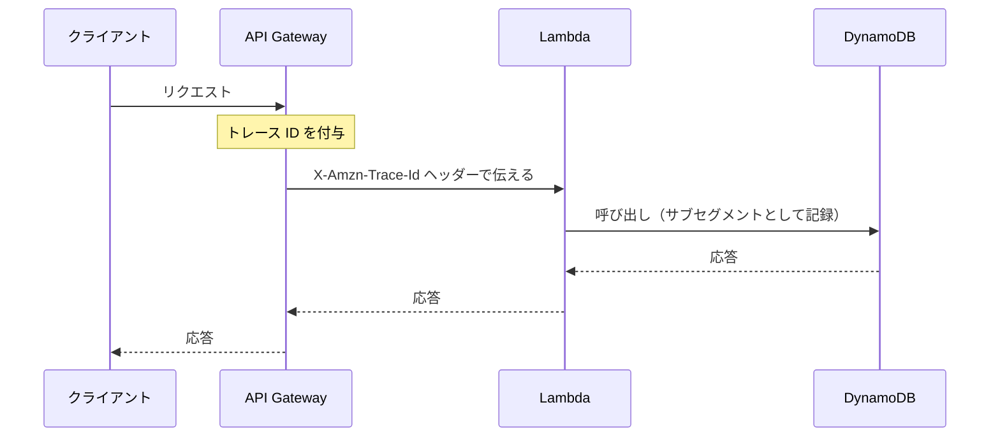

# オブザーバビリティ（CloudWatch / X-Ray / CloudTrail）

[:material-sprout: CLF](../courses/clf/services.md){ .exam-badge .exam-foundational } [:material-sprout: AIF](../courses/aif/services.md){ .exam-badge .exam-foundational } [:material-certificate: SAA](../courses/saa/services.md){ .exam-badge .exam-associate } [:material-certificate: DVA](../courses/dva/services.md){ .exam-badge .exam-associate } [:material-certificate: SOA](../courses/soa/services.md){ .exam-badge .exam-associate } [:material-certificate: DEA](../courses/dea/services.md){ .exam-badge .exam-associate } [:material-certificate: MLA](../courses/mla/services.md){ .exam-badge .exam-associate } [:material-star-circle: SAP](../courses/sap/services.md){ .exam-badge .exam-professional } [:material-star-circle: DOP](../courses/dop/services.md){ .exam-badge .exam-professional } [:material-star-circle: AIP](../courses/aip/services.md){ .exam-badge .exam-professional } [:material-target: ANS](../courses/ans/services.md){ .exam-badge .exam-specialty } [:material-target: SCS](../courses/scs/services.md){ .exam-badge .exam-specialty }

アプリケーションの状態をメトリクス、ログ、トレースで把握し、障害の原因や性能のボトルネックを見つけるための仕組みです。CloudWatch で数値とログを集め、X-Ray でリクエストの経路を追います。

[](../assets/diagrams/observability-signals.png)

## ロギング、モニタリング、オブザーバビリティの違い {#logging-monitoring-observability}

| 概念 | 問い | 内容 | AWS での例 |
|---|---|---|---|
| ロギング | 何が起きたか | 個々の出来事の記録 | CloudWatch Logs |
| モニタリング | 正常か | 既知の指標を見張り、異常を知らせる | CloudWatch メトリクス、アラーム |
| オブザーバビリティ | なぜ起きたか | 出力されたデータから、未知の問題の原因も調べられる性質 | ログ、メトリクス、トレースの組み合わせ |

モニタリングは「起きると分かっている問題」の検知です。オブザーバビリティは、想定外の問題を調べられるかどうかを指します。

**例:** 注文 API の `5XXError` が 5 分間で 40 件に増えたとします。

- ロギングは、1 件ごとの `PaymentFailed` のメッセージを残します。
- モニタリングは、アラームで「5 分で 10 件を超えた」と知らせます。
- オブザーバビリティは、想定していなかった「決済の呼び出しだけが 3 秒遅い」という原因まで、トレースとログからたどれる状態です。

## CloudWatch メトリクス {#cloudwatch-metrics}

**提供単位:** リージョン。VPC の外のサービスで、VPC の中からはインターフェイスエンドポイント（`monitoring`）か NAT 経由で呼びます（[提供単位の一覧](resource-scope.md#scope-regional-outside)）。

### 基本の用語 {#metrics-concepts}

| 用語 | 意味 |
|---|---|
| 名前空間 | メトリクスの入れ物。AWS サービスは `AWS/Lambda` のような形。カスタムは自由に命名（`AWS/` で始めない）。既定の名前空間はない |
| メトリクス | 名前空間、メトリクス名、ディメンションの組で一意に決まる |
| ディメンション | 名前と値の組。1 メトリクスに最大 30 個 |
| 統計 | `Average`、`Sum`、`Minimum`、`Maximum`、`SampleCount`、`p99` などのパーセンタイル |
| 期間 | 集計の時間幅 |

ディメンションの組み合わせが違えば別のメトリクスです。`userId` のような値をディメンションにすると、メトリクスが増えて料金も増えます。

メトリクスはリージョンごとに存在し、削除はできません。新しいデータがなければ 15 か月で期限切れになります。

- **名前空間の例:** `MyApp/Orders` は作れます。`AWS/Orders` のように `AWS/` で始めるとエラーです。
- **ディメンションの例:** `Service=checkout` と `Service=checkout, Operation=pay` は別のメトリクスです。後者だけ送っても、前者の値は自動で集計されません。
- **増え方の計算:** `userId` が 10,000 種類、`Operation` が 5 種類なら、組み合わせは `10,000 × 5 = 50,000` メトリクスです。`Operation` だけなら 5 個で済みます。
- **誤ると:** 東京で動かすアプリのメトリクスを `us-east-1` で探しても出ません。リージョンが違うと見えないので、まず画面のリージョンを確認します。

### 解像度と保持期間 {#metrics-resolution}

| 解像度 | 設定 | 特徴 |
|---|---|---|
| 標準 | `StorageResolution: 60` | 1 分単位。AWS サービスのメトリクスの既定 |
| 高解像度 | `StorageResolution: 1` | 1 秒単位。カスタムメトリクスで指定 |

| データポイントの期間 | 利用できる期間 |
|---|---|
| 60 秒未満 | 3 時間 |
| 60 秒 | 15 日 |
| 300 秒 | 63 日 |
| 3,600 秒 | 455 日（15 か月） |

EC2 は基本モニタリングでは多くのメトリクスが 5 分間隔で、詳細モニタリングを有効にすると 1 分間隔です。メモリ使用率のように OS の内部の値は既定では取得できず、CloudWatch エージェントが必要です。

**例:** 1 分間隔で送った標準メトリクスを読むと、次のようになります。

| 調べる時点 | 読める細かさ |
|---|---|
| 10 日前 | 1 分 |
| 40 日前 | 5 分 |
| 100 日前 | 1 時間 |
| 16 か月前 | 期限切れで読めない |

- **高解像度の例:** `StorageResolution: 1` で送った値を 1 秒単位で読めるのは 3 時間だけです。翌日に見ると 1 分単位になっています。
- **誤ると:** 基本モニタリングの EC2 に `Period=60` のアラームを作ると、データが 5 分に 1 回しか来ません。1 分ごとの判定では欠落が混ざり、`INSUFFICIENT_DATA` になりやすくなります。

### PutMetricData でカスタムメトリクスを送る {#put-metric-data}

```python
import boto3

cloudwatch = boto3.client("cloudwatch")

cloudwatch.put_metric_data(
    Namespace="MyApp/Orders",
    MetricData=[
        {
            "MetricName": "OrderLatency",
            "Dimensions": [{"Name": "Service", "Value": "checkout"}],
            "Value": 123.0,
            "Unit": "Milliseconds",
            "StorageResolution": 60,
        }
    ],
)
```

- IAM 権限 `cloudwatch:PutMetricData` が必要
- 1 リクエストは 1 MB まで、異なるメトリクスは 1,000 個まで
- 時刻は過去 2 週間から未来 2 時間まで指定可能（EMF は過去 14 日から未来 2 時間まで）
- `Values` と `Counts` で 1 データに最大 150 個の値をまとめられる

**計算例:** 2,500 種類のメトリクスを送るなら、1 回 1,000 個までなので `2,500 ÷ 1,000` を切り上げて 3 回に分けます。

- **時刻の例:** 今日が 10 月 31 日なら、10 月 20 日の値は送れます。3 週間前の 10 月 10 日の値は範囲外です。
- **誤ると:** 実行ロールに `cloudwatch:PutMetricData` がないと、呼び出しが権限エラーになります。例外を握りつぶすコードでは、メトリクスが出ないだけに見えます。

### Embedded Metric Format (EMF) {#emf}

ログの JSON に指示を埋め込むと、CloudWatch Logs がメトリクスを自動で抽出します。**API 呼び出しが不要**なので、Lambda の処理時間に影響しにくく、ログに詳細な項目も残せます。

```python
import json
import time

def handler(event, context):
    print(json.dumps({
        "_aws": {
            "Timestamp": int(time.time() * 1000),
            "CloudWatchMetrics": [
                {
                    "Namespace": "MyApp/Orders",
                    "Dimensions": [["Service"]],
                    "Metrics": [
                        {"Name": "OrderLatency", "Unit": "Milliseconds", "StorageResolution": 60}
                    ],
                }
            ],
        },
        "Service": "checkout",
        "OrderLatency": 123,
        "orderId": "o-1",
    }))
```

`Service` と `OrderLatency` がメトリクスになり、`orderId` はログとしてだけ残ります。

**例:** 上の出力で `Namespace` を `MyApp/Orders` にすると、CloudWatch には `MyApp/Orders` の `OrderLatency`（`Service=checkout`）が 1 つ増えます。`orderId` はメトリクスにならないので、注文が 100 万件あってもメトリクスは 1 つのままです。

| 制限 | 値 |
|---|---|
| 1 イベントのサイズ | 1 MB |
| 1 ログイベントのメトリクス定義 | 全ディレクティブの合計で 100 個。超えるとそのイベントからは何も抽出されない |
| 1 ディメンションセットのキー | 30 個 |

**例:** 1 イベントに 101 個のメトリクスを定義すると、100 個が抽出されるのではなく、そのイベントからは 1 つも抽出されません。多いときはイベントを分けます。

出力は Lambda の標準出力でそのまま処理されます。公式のクライアントライブラリや Powertools for AWS Lambda を使うと、自分で JSON を組み立てずに済みます。

| 方法 | 向いている場面 | 注意 |
|---|---|---|
| `PutMetricData` | Lambda 以外も含む単純な送信 | 呼び出しの遅延と料金、スロットリング |
| EMF | Lambda や大量の送信、ログと数値を結びつけたい | ログの料金がかかる |
| メトリクスフィルター | コードを変えずに既存ログから数値を作る | 過去のログには適用されない |

**選び方の計算:** Lambda が毎秒 600 回動き、1 回ごとに `PutMetricData` を呼ぶとします。API レートの既定は毎秒 500 件なので、`600 > 500` でスロットリングされます。EMF なら API を呼ばないので、この上限に当たりません。

### 統計とパーセンタイル {#statistics}

統計は、期間内のデータポイントをまとめる計算です。同じメトリクスでも、統計によって答えが変わります。

| 統計 | 意味 | 使いどころ |
|---|---|---|
| `SampleCount` | データポイントの数 | リクエスト数（API Gateway の `Count` はこれで見る） |
| `Sum` | 合計 | エラー件数、呼び出し回数 |
| `Average` | `Sum / SampleCount` | 全体の傾向。外れ値に引きずられる |
| `Minimum` / `Maximum` | 最小と最大 | 最悪値の確認 |
| `p95` など | パーセンタイル。p95 は 95% のデータがその値より小さい | ユーザーが感じる遅さ |
| `tm99` など | トリム平均。上位 1% を除いた平均 | 外れ値を除いた平均遅延 |
| `IQM` | 中央の 50% の平均。`TM(25%:75%)` と同じ | 安定した代表値 |
| `WM` | 境界の外の値を境界値に置き換えた平均 | 外れ値を捨てずに抑える |
| `PR(:300)` | 300 以下の値の割合 | 「300 ms 以内の率」 |
| `TC` / `TS` | トリムした範囲の件数と合計 | トリム平均の件数の確認 |

**具体例:** 99 件が 100 ms、1 件が 10,000 ms のとき、`Average` は 199 ms です。`p99` はほぼ 100 ms で、`Maximum` は 10,000 ms です。平均だけ見ると全員が 2 倍遅いように見えます。

**落とし穴:** パーセンタイル系は生のデータポイントが必要です。`StatisticValues`（統計セット）で送ると、原則として `p99` などを取得できません。例外は、`SampleCount` が 1 で `Min`、`Max`、`Sum` が等しい場合と、`Min` と `Max` が等しく `Sum` が `Min × SampleCount` の場合です。また、負の値を含むメトリクスではパーセンタイルを使えない場合があります。

**計算例:** 1 分間の値が `10, 20, 30, 40, 1000` のとき、次のようになります。

| 統計 | 結果 | 計算 |
|---|---|---|
| `SampleCount` | 5 | 値の個数 |
| `Sum` | 1,100 | 全部の合計 |
| `Average` | 220 | `1100 / 5` |
| `Minimum` / `Maximum` | 10 / 1,000 | 最小と最大 |
| `TM(0%:80%)` | 25 | 上位 20% の 1,000 を除いて `100 / 4` |
| `TC(0%:80%)` | 4 | 残った個数 |
| `TS(0%:80%)` | 100 | 残った値の合計 |

- **`PR` の例:** 1,000 件のうち 300 ms 以下が 970 件なら、`PR(:300)` は 97 です。「97% が 300 ms 以内」という SLO の確認に使えます。
- **`WM` の例:** `WM(:300)` で値が `100, 200, 1000` なら、1,000 を 300 として `(100 + 200 + 300) / 3 = 200` です。`Average` の 433 より外れ値の影響が小さくなります。

### 期間 {#metric-period}

期間は、統計を計算する時間幅です。取得時に指定し、値は秒です。

| 指定する期間 | 使える条件 |
|---|---|
| 1、5、10、20、30 秒 | 高解像度メトリクス（`StorageResolution: 1`）のみ意味がある |
| 60 秒の倍数 | すべて |

時間がたつと細かいデータは粗くまとめられます。たとえば 1 分のデータは 15 日間は 1 分単位で読め、その後は 5 分単位、63 日を過ぎると 1 時間単位になります。

**落とし穴:** 20 日前の障害を 1 分単位で調べようとしても、もう 5 分単位にしか戻せません。保持の段階は上の[解像度と保持期間](#metrics-resolution)の表で確認します。

**計算例:** 1 分ごとのエラー数が `12, 8, 10, 5, 15` なら、`Period=300` で `Sum` は 50、`Average` は 10 です。件数を見たいのに `Average` を選ぶと、50 件が 10 件に見えます。

### EC2 の既定メトリクスとエージェント {#ec2-metrics}

ハイパーバイザーから見える値は自動で届きます。OS の中の値は届きません。

| 区分 | 例 | 間隔 |
|---|---|---|
| 基本モニタリング（既定、無料） | `CPUUtilization`、`NetworkIn`、`NetworkOut` | 5 分 |
| 基本モニタリングのステータスチェック | `StatusCheckFailed` | 1 分 |
| 詳細モニタリング（有料） | 上と同じ | 1 分 |
| CloudWatch エージェントが必要 | `mem_used_percent`、`disk_used_percent`、`swap_used_percent` | エージェントの設定による |

**具体例:** メモリ不足で落ちる EC2 を調べたいのに `AWS/EC2` にメモリのメトリクスがない、というのは正常な動作です。エージェントを導入し、`mem_used_percent` を送ります。

**落とし穴:** 詳細モニタリングを有効にしても、メモリは増えません。間隔が 1 分になるだけです。

```bash
aws ec2 monitor-instances --instance-ids i-0123456789abcdef0
```

**例:** スケールアウトの判定を 5 分から 1 分に縮めたいなら、上のコマンドで詳細モニタリングを有効にします。ディスクの空きで通知したいなら、これではなくエージェントの `disk_used_percent` を使います。

### PutMetricData の全パラメータ {#put-metric-data-params}

| パラメータ | 内容 | 既定値、範囲 |
|---|---|---|
| `Namespace` | 名前空間。`AWS/` で始めない | 必須 |
| `MetricName` | メトリクス名 | 1〜255 文字 |
| `Dimensions` | 名前と値の組 | 最大 30 個 |
| `Value` | 単一の値 | -2^360〜2^360。`NaN` や `Infinity` は不可 |
| `Values` / `Counts` | 値と出現回数の配列 | 1 リクエストのメトリクスあたり 150 個。`Counts` を省くと各 1 |
| `StatisticValues` | `SampleCount`、`Sum`、`Minimum`、`Maximum` の集計済みの値 | パーセンタイルの制約あり |
| `Timestamp` | データの時刻 | 過去 2 週間〜未来 2 時間 |
| `Unit` | 単位。`Milliseconds`、`Count`、`Percent` など | |
| `StorageResolution` | `1` は高解像度、`60` は標準 | 既定は 60 |

```bash
aws cloudwatch put-metric-data --namespace MyApp/Orders \
  --metric-data 'MetricName=Latency,Unit=Milliseconds,Values=[100,200,300],Counts=[90,9,1],StorageResolution=60'
```

この 1 回で 100 件分の分布が送られ、パーセンタイルも計算できます。1 件ずつ 100 回呼ぶより速く、API 料金も抑えられます。

**検算:** 件数は `90 + 9 + 1 = 100` です。合計は `100×90 + 200×9 + 300×1 = 11,100` で、`Average` は 111 ms です。

パラメータごとの例です。

- **`Dimensions`:** 31 個指定するとエラーです。上限は 30 個です。
- **`Value`:** ゼロ除算で得た `NaN` をそのまま送るとエラーです。件数が 0 のときは送らないか、0 を送ります。
- **`StatisticValues`:** `SampleCount=100, Sum=11100, Minimum=100, Maximum=300` と送ると、`Average` は読めますが `p99` は読めません。
- **`Unit`:** 同じメトリクスに `Milliseconds` と `Seconds` を混ぜないようにします。単位を指定しないアラームは、動作が定まらなくなります。
- **`StorageResolution`:** 既定の 60 のまま 1 秒ごとに送っても、1 秒単位では読めません。1 分にまとめられます。

**動作の注意点:**

- 新しいメトリクスは、`ListMetrics` に出るまで最大 15 分かかります。送った直後に見えなくても失敗ではありません。
- 24 時間以上前の時刻で送ったデータは、`GetMetricData` で読めるまで 48 時間以上かかる場合があります。
- 1 リクエストは 1 MB、メトリクスは 1,000 個までです。gzip で圧縮して送れます。
- API レートの既定は毎秒 500 件で、超えるとスロットリングされます。

### EMF の JSON 構造 {#emf-structure}

EMF のログは次の構造です。キーの大文字小文字は区別されます。

| 位置 | キー | 内容 |
|---|---|---|
| ルート | `_aws` | メタデータ。必須 |
| `_aws` | `Timestamp` | エポックからのミリ秒。過去 14 日〜未来 2 時間 |
| `_aws` | `CloudWatchMetrics` | ディレクティブの配列 |
| ディレクティブ | `Namespace` | 1〜255 文字 |
| ディレクティブ | `Dimensions` | ディメンションセットの配列（配列の配列）。1 セット 30 キーまで |
| ディレクティブ | `Metrics` | `Name`、`Unit`、`StorageResolution` の配列 |
| ルート | 各ターゲット | ディメンションとメトリクスの値本体。ルートに置く |

**具体例:** `"Dimensions": [["Service"], ["Service", "Operation"]]` と書くと、同じ値から 2 つのメトリクスができます。カスタムメトリクスの数も 2 倍になります。

**最小の例:** `Dimensions` が `[["Service"]]` なら、ルートに `"Service": "checkout"` が必要です。`Metrics` の `Name` が `OrderLatency` なら、ルートに `"OrderLatency": 123` が必要です。`"Service": 1` のように数値にしないでください。

**落とし穴:**

- ログメッセージ全体が 1 つの JSON でなければなりません。`[INFO] {...}` のように前に文字が付くと抽出されません。`print` で JSON だけを出します。
- `Dimensions` に書いたキーの値がルートにないと、そのディメンションセットのメトリクスは発行されません。ディメンションの値は文字列です。
- Essentials クラスのロググループでは EMF は使えません。
- EMF の配信は少なくとも 1 回です。まれに重複します。

### Lambda の既定メトリクス {#lambda-metrics}

名前空間は `AWS/Lambda` です。統計の選び方も問われます。

| メトリクス | 意味 | 見方 |
|---|---|---|
| `Invocations` | 関数コードが呼ばれた回数。関数エラーを含む。スロットリングされた分は含まない | `Sum` |
| `Errors` | 関数エラーの回数 | `Sum`。率は `Errors / Invocations` |
| `Throttles` | スロットリングされた回数 | `Sum` |
| `Duration` | コードの実行時間（ms） | `p99` などのパーセンタイルも可 |
| `ConcurrentExecutions` | 処理中のインスタンス数 | `Maximum` |
| `UnreservedConcurrentExecutions` | 予約なしの関数の同時実行 | リージョンの見張り |
| `ClaimedAccountConcurrency` | オンデマンドで使えない同時実行の量 | クォータとの比較 |
| `ProvisionedConcurrencySpilloverInvocations` | プロビジョニング済みを超えて通常の同時実行で動いた回数 | 0 より大きければ不足 |
| `ProvisionedConcurrencyUtilization` | プロビジョニング済みの使用率 | 呼び出しがないと出ない |
| `IteratorAge` | ストリームの最後のレコードの古さ（ms） | 増えていれば処理が遅れている |
| `OffsetLag` | Kafka のオフセットの遅れ | MSK と自己管理 Kafka |
| `AsyncEventsReceived` / `AsyncEventAge` / `AsyncEventsDropped` | 非同期の受信数、待ち時間、破棄数 | 破棄は 0 が基本 |
| `DeadLetterErrors` | DLQ への送信の失敗 | 権限やサイズを確認 |
| `DestinationDeliveryFailures` | 送信先への配信の失敗 | |

イベントソースマッピングの詳しいメトリクスは既定で出ません。`EventCount`、`ErrorCount`、`KafkaMetrics` のグループを選んで有効にします。

```bash
aws lambda update-event-source-mapping --uuid <UUID> --metrics-config Metrics=EventCount
```

**落とし穴:** スロットリングされた呼び出しは `Invocations` に数えません。呼び出し回数が平らなのに利用者がエラーを訴えるなら、`Throttles` を見ます。

メトリクスごとの計算例です。

- **`Errors`:** 5 分で `Invocations` が 1,000、`Errors` が 20 なら、エラー率は `20 / 1000 = 2%` です。
- **`Throttles`:** 同じ 5 分に `Throttles` が 50 なら、届いた呼び出しは `1000 + 50 = 1,050` 件です。`Invocations` だけでは 50 件を見落とします。
- **`ConcurrentExecutions`:** 毎秒 100 件、平均 0.5 秒なら、`100 × 0.5 = 50` です。
- **`ClaimedAccountConcurrency`:** 予約 200、プロビジョニング済み 100、予約なしの実行 300 なら、`300 + 200 + 100 = 600` です。クォータが 1,000 なら、オンデマンドで使える残りは 400 です。
- **`ProvisionedConcurrencySpilloverInvocations`:** プロビジョニング済み 50 に同時 80 件が来ると、30 件は通常の同時実行で動き、コールドスタートが起きます。0 より大きければ、不足のサインです。
- **`IteratorAge`:** 値が `3,600,000` なら、最後に読んだレコードは 1 時間前のものです。Kinesis の保持期間を超えると、読む前に消えます。
- **`OffsetLag`:** 値が 5,000 で増え続けるなら、処理が書き込みに追いついていません。
- **`AsyncEventsDropped`:** 1 以上なら、イベントが捨てられています。送信先か DLQ がなければ、中身は失われます。
- **`DeadLetterErrors`:** DLQ が SQS なのに、実行ロールに `sqs:SendMessage` がないと増えます。

### API Gateway の既定メトリクス {#apigw-metrics}

名前空間は `AWS/ApiGateway` で、毎分送られます。次は REST API の名前です。

| メトリクス | 意味 | 見方 |
|---|---|---|
| `Count` | リクエストの総数 | `SampleCount` |
| `4XXError` | クライアントエラー | `Sum` で件数、`Average` でエラー率 |
| `5XXError` | サーバーエラー | `Sum` で件数、`Average` でエラー率 |
| `Latency` | 受信から応答までの全体（ms）。統合の時間を含む | `p99` など |
| `IntegrationLatency` | バックエンドへの中継から応答受信まで（ms） | `Latency` と比べる |
| `CacheHitCount` / `CacheMissCount` | キャッシュのヒットとミス | キャッシュ有効時 |

**具体例:** `Latency` の p99 が 3,000 ms、`IntegrationLatency` が 2,950 ms なら、遅いのはバックエンドです。`IntegrationLatency` が 300 ms なら、API Gateway 側（認可やマッピング）を疑います。

**落とし穴:** メソッドとリソース単位の値（`ApiName`、`Method`、`Resource`、`Stage`）は、ステージで詳細メトリクスを有効にしないと出ません。

**計算例:** 5 分で `Count` の `SampleCount` が 10,000、`4XXError` の `Sum` が 200 なら、エラー率は 2% です。`4XXError` の `Average` は 0.02 になります。

**キャッシュの例:** `CacheHitCount` が 900、`CacheMissCount` が 100 なら、ヒット率は `900 / (900 + 100) = 90%` です。

### メトリクス計算 {#metric-math}

複数のメトリクスから、新しい時系列を式で作ります。グラフ、ダッシュボード、アラーム、`GetMetricData` で使えます。関数名は大文字で書き、`Id` は小文字で始めます。

| 関数 | 用途 | 例 |
|---|---|---|
| 四則演算 | 比率 | `100 * m1 / m2` |
| `FILL` | 欠損を埋める | `FILL(m1, 0)` |
| `RATE` | 1 秒あたりの変化 | `RATE(m1)` |
| `IF` | 条件 | `IF(m2 > 100, m1 / m2 * 100, 0)` |
| `METRICS()` | リクエスト内の全メトリクス | `SUM(METRICS("errors"))` |
| `SERVICE_QUOTA` | クォータの値 | `m1 / SERVICE_QUOTA(m1) * 100` |
| `ANOMALY_DETECTION_BAND` | 異常検知の帯 | `ANOMALY_DETECTION_BAND(m1, 2)` |

**具体例:** Lambda のエラー率でアラームを作ります。`m1` を `Errors` の `Sum`、`m2` を `Invocations` の `Sum` とし、`e1 = 100 * FILL(m1, 0) / m2` の式を `ReturnData: true` にして、しきい値を 5 にします。

```python
cloudwatch.put_metric_alarm(
    AlarmName="orders-error-rate",
    EvaluationPeriods=3,
    Threshold=5,
    ComparisonOperator="GreaterThanThreshold",
    Metrics=[
        {"Id": "e1", "Expression": "100 * FILL(m1, 0) / m2", "ReturnData": True},
        {"Id": "m1", "ReturnData": False, "MetricStat": {
            "Metric": {"Namespace": "AWS/Lambda", "MetricName": "Errors",
                       "Dimensions": [{"Name": "FunctionName", "Value": "orders"}]},
            "Period": 60, "Stat": "Sum"}},
        {"Id": "m2", "ReturnData": False, "MetricStat": {
            "Metric": {"Namespace": "AWS/Lambda", "MetricName": "Invocations",
                       "Dimensions": [{"Name": "FunctionName", "Value": "orders"}]},
            "Period": 60, "Stat": "Sum"}},
    ],
)
```

**落とし穴:** 式を使うアラームでは、`Period` は最上位ではなく `Metrics` の各要素に書きます。`ReturnData: true` は式の 1 つだけにします。

関数ごとの計算例です。

- **四則演算:** `m1 = 12`、`m2 = 400` なら、`100 * m1 / m2` は 3 です。
- **`FILL`:** `Errors` はエラーのない期間にデータがないことがあります。`FILL(m1, 0)` なら 0 として計算でき、率が欠落しません。
- **`RATE`:** 累積の値が 5 分で 6,000 から 6,300 に増えたら、`(6300 - 6000) / 300 = 1` で毎秒 1 です。
- **`IF`:** 夜間に `m2 = 3`、`m1 = 2` なら、率は 66% に跳ねます。`IF(m2 > 100, m1 / m2 * 100, 0)` は 0 を返すので、少数の呼び出しで鳴りません。
- **`METRICS`:** `Id` が `errors_a`（3 件）と `errors_b`（5 件）なら、`SUM(METRICS("errors"))` は 8 です。文字列は `Id` との部分一致です。
- **`SERVICE_QUOTA`:** `m1 = 160`、クォータが 200 なら、`m1 / SERVICE_QUOTA(m1) * 100` は 80 です。

**誤ると:** `FILL` なしで `m1` が欠落すると、その期間の式の結果も欠落します。アラームは `TreatMissingData` の扱いで判定します。

## アラーム {#alarms}

メトリクスがしきい値を超えると通知やアクションを実行します。

| 設定 | 意味 |
|---|---|
| 状態 | `OK`、`ALARM`、`INSUFFICIENT_DATA` |
| `Period` | 評価の時間幅 |
| `EvaluationPeriods` | 判定に使う直近の期間数 |
| `DatapointsToAlarm` | そのうち何個超えたら `ALARM` にするか（M out of N） |
| `TreatMissingData` | 欠落データの扱い。`missing`、`notBreaching`、`breaching`、`ignore` |
| アクション | SNS 通知、Auto Scaling、EC2 の操作など |

```python
cloudwatch.put_metric_alarm(
    AlarmName="orders-errors",
    Namespace="AWS/Lambda",
    MetricName="Errors",
    Dimensions=[{"Name": "FunctionName", "Value": "orders"}],
    Statistic="Sum",
    Period=60,
    EvaluationPeriods=5,
    DatapointsToAlarm=3,
    Threshold=1,
    ComparisonOperator="GreaterThanOrEqualToThreshold",
    TreatMissingData="notBreaching",
    AlarmActions=["<SNS トピックの ARN>"],
)
```

高解像度メトリクスには、10 秒、20 秒、30 秒周期の高解像度アラームを設定できます（料金は高くなります）。

**複合アラーム**は複数のアラームの状態を AND や OR で組み合わせます。ノイズを減らしたいときに使います。

**例:** 上のアラームの動きです。`orders` 関数のエラーが 1 分に 1 件以上ある分が、直近 5 分のうち 3 分に達すると `ALARM` になり、SNS に通知します。

- **`TreatMissingData="notBreaching"`:** エラーがない分はデータが出ないので、正常として数えます。
- **`AlarmActions`:** `arn:aws:sns:ap-northeast-1:111122223333:ops-alerts` のように指定します。

### 評価の仕組みと M out of N {#alarm-evaluation}

| 設定 | 既定値、範囲 | 変えると何が起きるか |
|---|---|---|
| `Period` | 10、20、30 秒、または 60 秒の倍数 | 短いほど速く気づくが、誤検知が増える |
| `EvaluationPeriods`（N） | 1 以上 | 直近いくつの期間を見るか |
| `DatapointsToAlarm`（M） | 1 以上。省略すると N と同じ | そのうちいくつ超えたら `ALARM` か。連続でなくてよい |
| `ComparisonOperator` | `GreaterThanThreshold` など | しきい値の向き |
| `ActionsEnabled` | 既定は `TRUE` | `FALSE` なら状態は変わるがアクションは動かない |

**具体例:** `Period=60`、`EvaluationPeriods=5`、`DatapointsToAlarm=3` なら、直近 5 分のうち 3 分でしきい値を超えると `ALARM` です。単発のスパイクでは鳴らず、断続的な障害では鳴ります。

1 分以上の期間のアラームは毎分評価されます。期間が 10〜30 秒なら 10 秒ごとです。`EvaluationPeriods × Period` が 1 日を超えるアラームは、1 時間に 1 回の評価です。

新規作成の直後は `INSUFFICIENT_DATA` から始まります。更新すると状態は変わりませんが、設定は全部上書きされます。指定し忘れた項目は既定値に戻ります。

アラームの状態とは別に、評価の状態もあります（`PARTIAL_DATA`、`IN_WARM_UP`、`EVALUATION_ERROR`、`EVALUATION_FAILURE`）。

**検知までの時間の計算:**

| `Period` | N | M | 最短で `ALARM` になるまで |
|---|---|---|---|
| 60 秒 | 1 | 1 | 1 分 |
| 60 秒 | 5 | 3 | 3 分 |
| 300 秒 | 3 | 3 | 15 分 |
| 10 秒 | 3 | 3 | 30 秒（高解像度メトリクスのみ） |

- **`ComparisonOperator` の例:** ディスクの空きが 10% 未満で鳴らすなら、`LessThanThreshold` でしきい値を 10 にします。`GreaterThanThreshold` のままだと、空きがある間ずっと `ALARM` です。
- **`ActionsEnabled` の例:** メンテナンス中の 2 時間だけ通知を止めるなら `aws cloudwatch disable-alarm-actions` を使います。再開を忘れると、障害でも通知が来ません。
- **1 日を超える例:** `Period=3600`、N=48 は 48 時間で 1 日を超えるので、評価は 1 時間に 1 回です。検知が最大で 1 時間ほど遅れます。
- **誤ると:** `AlarmActions` を書かずに `put-metric-alarm` で更新すると、既存の通知先が消えます。更新では全項目を指定し直します。

### 欠落データの扱い {#treat-missing-data}

エラーが起きたときだけ出るメトリクスでは、平常時のデータはありません。そのときの扱いを `TreatMissingData` で決めます。

| 値 | 欠落の扱い | 向いている場面 |
|---|---|---|
| `missing`（既定） | 全部欠落なら `INSUFFICIENT_DATA` | 常に値が出るメトリクス |
| `notBreaching` | 正常とみなす | エラー時だけ出るメトリクス |
| `breaching` | 異常とみなす | データが来ないこと自体が障害（死活の監視） |
| `ignore` | 今の状態を維持 | 判断を保留したい |

アラームは `EvaluationPeriods` より広い範囲（評価範囲）を取得します。N が 3 なら 5 個です。公式の例で、`M=3`、`N=3`、データが左から古い順のとき次のようになります。`-` は欠落、`X` は超過、`0` は正常です。

| データ | `missing` | `ignore` | `breaching` | `notBreaching` |
|---|---|---|---|---|
| `- - - - -` | `INSUFFICIENT_DATA` | 状態を維持 | `ALARM` | `OK` |
| `0 X X - X` | `ALARM` | `ALARM` | `ALARM` | `ALARM` |
| `0 - X - X` | `OK` | `OK` | `OK` | `OK` |
| `- - X - -` | `ALARM` | 状態を維持 | `ALARM` | `OK` |

**具体例:** 1 日 3 回だけ動くバッチの `Errors` に、既定の `missing` でアラームを作ります。普段は `INSUFFICIENT_DATA` に留まり、ダッシュボードが灰色のままです。`notBreaching` にすると、普段は `OK` です。

**落とし穴:** 一度だけ `ALARM` になり、その後データが止まると、状態が変わらないままに見えることがあります。また、ヘルスチェック用のハートビートに `notBreaching` を選ぶと、プロセスが止まっても `OK` のままです。

**`breaching` の例:** バッチが 1 分ごとに `Heartbeat=1` を送るとします。`Period=60`、`N=3`、`M=3`、`breaching` にすると、プロセスが止まった 3 分後に `ALARM` です。

**`ignore` の例:** 夜間に止まるワーカーのメトリクスで、夜の間は直前の状態を残したいときに選びます。夜に入る前が `ALARM` なら、朝まで `ALARM` のままです。

### アラームのアクション {#alarm-actions}

`AlarmActions`、`OKActions`、`InsufficientDataActions` に、状態が変わったときの ARN を指定します。アクションは状態の変化で動き、同じ状態が続く間は繰り返しません。

| 種類 | ARN の例 | 補足 |
|---|---|---|
| SNS | トピックの ARN | 通知の基本 |
| Lambda | `arn:aws:lambda:<region>:<account>:function:<name>` | バージョンやエイリアスも指定可 |
| EC2 | `arn:aws:automate:<region>:ec2:stop`、`terminate`、`reboot`、`recover` | EC2 のメトリクス向け |
| Auto Scaling | スケーリングポリシーの ARN | 異常検知のアラームでは不可 |
| Systems Manager | OpsItem、インシデント | |

例です。

- **復旧:** `arn:aws:automate:ap-northeast-1:ec2:recover` を `StatusCheckFailed_System` のアラームに付けると、別のホストで復旧します。
- **停止:** `CPUUtilization` が 1 時間ずっと 1% 未満の開発サーバーに `arn:aws:automate:ap-northeast-1:ec2:stop` を付けると、費用を抑えられます。
- **復帰の通知:** `OKActions` にも同じ SNS トピックを指定すると、`ALARM` の 20 分後に復旧した、という流れが通知で追えます。
- **誤ると:** `ALARM` が続く間は再通知されません。担当者が通知を見落としても、次の通知は状態が変わるまで届きません。

### 高解像度とパーセンタイルのアラーム {#percentile-alarms}

`Period` を 10、20、30 にすると高解像度アラームです。元のメトリクスが `StorageResolution: 1` でないと、データのない周期が生じて `INSUFFICIENT_DATA` に落ちやすくなります。

パーセンタイルには `Statistic` の代わりに `ExtendedStatistic="p99"` を指定します。両方は指定できません。

データ件数が少ない期間の扱いは `EvaluateLowSampleCountPercentile` で決めます。

| 値 | 動作 |
|---|---|
| `evaluate`（省略時も） | 件数が少なくても評価する |
| `ignore` | 統計的に意味がなければ状態を変えない |

**具体例:** 夜間に 1 時間 3 件しかない API に `p99` のアラームがあると、1 件の遅延で鳴ります。`ignore` にすると防げます。

**高解像度の例:** `Period=10`、`EvaluationPeriods=3`、`DatapointsToAlarm=3` なら、最短 30 秒で `ALARM` です。元のメトリクスは `StorageResolution: 1` で送ります。

**誤ると:** `Statistic="Average"` と `ExtendedStatistic="p99"` を同時に指定すると、エラーで作成できません。

### 複合アラーム {#composite-alarms}

ほかのアラームの状態を論理式で組み合わせます。メトリクスは直接評価しません。

```bash
aws cloudwatch put-composite-alarm --alarm-name web-degraded \
  --alarm-rule '(ALARM("cpu-high") OR ALARM("disk-high")) AND OK("deploying")' \
  --alarm-actions <SNS トピックの ARN>
```

| 項目 | 内容 |
|---|---|
| 関数 | `ALARM()`、`OK()`、`INSUFFICIENT_DATA()`、`TRUE`、`FALSE` |
| 演算子 | `AND`、`OR`、`NOT` |
| 上限 | 1 つの複合アラームが見るのは 100 個まで。1 つのアラームを見る複合アラームは 150 個まで |
| アクション | SNS、Lambda、Systems Manager の OpsItem とインシデントのみ。**EC2 や Auto Scaling は不可** |
| 範囲 | 子のアラームは同じアカウント、同じリージョン |

**具体例:** CPU とメモリが両方高いときだけ通知したいなら、子には通知を付けず、複合アラームにだけ SNS を付けます。子にも付けると通知は減りません。

上の `web-degraded` の判定です。

| `cpu-high` | `disk-high` | `deploying` | 結果 |
|---|---|---|---|
| `ALARM` | `OK` | `OK` | `ALARM` |
| `OK` | `ALARM` | `OK` | `ALARM` |
| `ALARM` | `ALARM` | `ALARM` | `OK`（デプロイ中は鳴らさない） |
| `OK` | `OK` | `OK` | `OK` |

**誤ると:** 子を 101 個指定すると上限を超えます。EC2 の再起動を複合アラームのアクションに指定してもエラーです。再起動は子のメトリクスアラームに付けます。

### 異常検知 {#anomaly-detection}

固定のしきい値の代わりに、過去のデータから「普通の帯」を学習します。時間、曜日の周期と傾向を考慮します。

| 項目 | 内容 |
|---|---|
| 学習データ | 最大 2 週間分 |
| モデルの単位 | メトリクスと統計の組。`AVG` のモデルは `AVG` 専用 |
| しきい値 | 帯の幅。大きいほど帯が広く、鳴りにくい |
| 方向 | 帯の上、下、両方 |
| API | `ThresholdMetricId` に `ANOMALY_DETECTION_BAND` の式の `Id` を指定 |
| 制約 | Auto Scaling のアクションは付けられない |

**具体例:** 平日の昼に多く夜に少ない受注数は、固定のしきい値では夜の急減に気づけません。`LessThanLowerThreshold` の異常検知なら、夜の水準に対する急減で鳴ります。

**しきい値の例:** `ANOMALY_DETECTION_BAND(m1, 2)` より `ANOMALY_DETECTION_BAND(m1, 4)` のほうが帯が太く、鳴りにくくなります。誤検知が多ければ値を上げます。

**方向の例:** 急増だけ見るなら `GreaterThanUpperThreshold`、両方なら `LessThanLowerOrGreaterThanUpperThreshold` です。

**除外の例:** 11 月の大型セールの 2 日間を学習から除外します。除外しないと、その水準が「普通」に近づき、モデルの精度が落ちます。

## ダッシュボードとインサイト {#dashboards}

アプリケーションの健全性を一覧で確認する手段です。

| 機能 | 用途 |
|---|---|
| CloudWatch ダッシュボード | メトリクス、ログクエリ、アラームを 1 画面に並べる。リージョンやアカウントをまたげる |
| Lambda Insights | Lambda の CPU、メモリ、ネットワークなどの詳細 |
| Container Insights | ECS、EKS のタスクやノードの詳細 |
| Contributor Insights | 高カーディナリティのデータから上位要因を探す（例: エラーの多い IP） |
| Application Signals | アプリケーション単位の性能と SLO |
| Synthetics | 定期的に外部から URL や API を確認する |

例です。

- **Lambda Insights:** 割り当て 1,024 MB の関数で、メモリ使用量がピークで 900 MB に近いことを確認します。
- **Container Insights:** ECS サービスのタスク単位の CPU を見て、1 タスクだけ 95% に張り付いていることを見つけます。
- **Contributor Insights:** VPC フローログや API のアクセスログから、リクエストの多い IP の上位 10 件を出します。ログのイベントがルールに一致するたびに課金されます。
- **Application Signals:** `orders` サービスの可用性と遅延を SLO として追います。
- **Synthetics:** 利用者のいない深夜 3 時でも、5 分ごとに `/health` を確認します。

### ダッシュボードの設定 {#dashboard-settings}

| 項目 | 内容 |
|---|---|
| 範囲 | 1 つのダッシュボードに複数リージョンのリソースを載せられる。クロスアカウントオブザーバビリティで複数アカウントも可 |
| 自動ダッシュボード | サービスごとに事前に用意される |
| 期間の上書き | 全グラフの期間を揃える設定がある |
| グラフの上限 | 1 グラフにメトリクスと式で 500 個 |

**落とし穴:** Logs Insights のウィジェットは、ダッシュボードを更新するたびにクエリが走り、スキャン料金がかかります。自動更新の間隔を短くしすぎないようにします。

**例:** 東京と大阪の ALB の `RequestCount` を 1 枚に並べると、切り替え時の偏りが一目で分かります。1 グラフの 501 個目のメトリクスは載らないので、`SEARCH` の範囲を絞ります。

**計算例:** スキャン量 2 GB のウィジェットが 1 分ごとに更新されると、1 時間で `2 × 60 = 120` GB をスキャンします。1 時間ごとの更新なら 2 GB です。

## CloudWatch Logs {#cloudwatch-logs}

[:material-certificate: DVA](../courses/dva/services.md){ .exam-badge .exam-associate } [:material-certificate: DEA](../courses/dea/services.md){ .exam-badge .exam-associate } [:material-star-circle: DOP](../courses/dop/services.md){ .exam-badge .exam-professional } [:material-star-circle: AIP](../courses/aip/services.md){ .exam-badge .exam-professional }

**提供単位:** リージョン。ロググループはリージョンごとに分かれます。VPC の外のサービスで、VPC の中からはインターフェイスエンドポイント（`logs`）か NAT 経由で送ります（[提供単位の一覧](resource-scope.md#scope-regional-outside)）。

### ロググループと保持期間 {#log-groups}

| 用語 | 意味 |
|---|---|
| ログイベント | 1 件の記録。時刻とメッセージ |
| ログストリーム | 同じ発生元のイベントの並び（例: Lambda の実行環境） |
| ロググループ | ストリームの集まり。保持期間、アクセス権、暗号化を共有する |

既定では**無期限に保存**されます。料金を抑えるためロググループごとに保持期間を設定します。期限を過ぎても削除までに通常最大 72 時間かかります。

| 操作 | 方法 |
|---|---|
| 長期保管 | `CreateExportTask` で S3 へエクスポート |
| リアルタイム確認 | Live Tail |
| ログクラス | Standard と Essentials（旧 Infrequent Access） |

**例:** Lambda 関数 `orders` なら、ロググループは `/aws/lambda/orders` です。実行環境が 3 つあれば、ログストリームが 3 本並びます。

### 保持期間の設定 {#log-retention}

`PutRetentionPolicy` で日数を指定します。値は決まった中から選びます。

```bash
aws logs put-retention-policy --log-group-name /aws/lambda/orders --retention-in-days 30
```

選べる値は 1、3、5、7、14、30、60、90、120、150、180、365、400、545、731、1096、1827、2192、2557、2922、3288、3653 日です。無期限に戻すには `DeleteRetentionPolicy` を呼びます。

**落とし穴:**

- `--retention-in-days 45` のような一覧にない値はエラーになります。
- Lambda が自動で作るロググループは無期限です。IaC で事前に作ると保持期間を管理できます。
- 期限切れのログの削除には通常最大 72 時間かかりますが、削除対象になった時点で保管料金はかかりません。
- 保持期間より古い時刻のイベントは `PutLogEvents` で拒否されます。

**計算例:** 1 日 5 GB のログなら、保持 30 日で約 `5 × 30 = 150` GB、無期限で 1 年たつと `5 × 365 = 1,825` GB を保管します。保管量が 12 倍ほど違うので、料金も同じ比で増えます。

### ログクラス {#log-classes}

作成時に選び、**後から変更できません**。

| 機能 | Standard | Essentials（旧 Infrequent Access） |
|---|---|---|
| 取り込み料金 | 標準 | 安い（保管と Insights の料金は同じ） |
| Logs Insights | 使える | ほぼ使える（`pattern` など一部は不可） |
| S3 エクスポート | 使える | 使える |
| KMS 暗号化 | 使える | 使える |
| データ保護のマスク | 使える | 使える |
| メトリクスフィルター | 使える | **使えない** |
| サブスクリプションフィルター | 使える | **使えない** |
| Live Tail | 使える | **使えない** |
| EMF | 使える | **使えない** |
| `GetLogEvents` / `FilterLogEvents` | 使える | **使えない** |
| Lambda Insights、Container Insights | 使える | 使えない |

!!! note "名前の変更"
    Infrequent Access は Essentials に改称されました。API の入力では `INFREQUENT_ACCESS` と `ESSENTIALS` の両方を使えます。2026 年 12 月からは、読み取り系 API の応答が `ESSENTIALS` を返します。古い教材の名前で覚えている場合は読み替えます。

このほかに、Lambda のログを S3 や Firehose へ送るための `Delivery` クラスがあります。CloudWatch Logs での保持は 2 日で固定です。

**具体例:** 調査のときにだけ検索するアプリの大量ログは Essentials にすると安くなります。しかし、そのログからアラームを作りたいなら、メトリクスフィルターのために Standard を選びます。

```bash
aws logs create-log-group --log-group-name /app/debug --log-group-class ESSENTIALS
```

**誤ると:** Essentials で作ると、`put-metric-filter` が失敗します。クラスは変えられないので、Standard のロググループを作り直し、アプリの出力先を切り替えます。古いログはそのまま残ります。

### PutLogEvents の制限 {#put-log-events}

| 項目 | 値 |
|---|---|
| バッチのサイズ | 1,048,576 バイト。各イベントのメッセージと 26 バイトの合計 |
| バッチのイベント数 | 10,000 件 |
| 1 イベントのサイズ | 1 MB |
| 時刻の範囲 | 過去 14 日、未来 2 時間。外れたイベントは拒否され、残りは処理される |
| バッチの時間幅 | 24 時間以内 |
| 並び順 | 時刻の昇順。違えば失敗する |

**計算例:** 平均 200 バイトのログ 5,000 件を 1 回で送ると、サイズは `(200 + 26) × 5,000 = 1,130,000` バイトです。上限を超えるので 2 回に分けます。

**件数と容量のどちらが先か:** 10,000 件を 1 回で送れるのは、平均 78 バイトまでです。`(78 + 26) × 10,000 = 1,040,000` は収まり、`(79 + 26) × 10,000 = 1,050,000` は超えます。

- **時刻の例:** 今日が 10 月 31 日で、10 月 1 日のイベントが混ざると、そのイベントだけ拒否されます。応答の `rejectedLogEventsInfo` で分かります。
- **並び順の例:** 時刻が `10:00:02, 10:00:01` の順だとバッチごと失敗します。送る前に並べ替えます。

### KMS による暗号化 {#logs-kms}

ログは常に暗号化されます。既定は CloudWatch Logs の管理する鍵で、自分の KMS キーも指定できます。

```bash
aws logs associate-kms-key --log-group-name /aws/lambda/orders --kms-key-id <KMS キーの ARN>
```

| 項目 | 内容 |
|---|---|
| 指定する API | `CreateLogGroup` の `kmsKeyId`、または `AssociateKmsKey` |
| 鍵の種類 | 対称キーのみ |
| キーポリシー | プリンシパル `logs.<region>.amazonaws.com` に許可する |
| 呼び出し側の権限 | `kms:DescribeKey` |
| 反映 | 最大 5 分 |
| 対象 | 関連付けの後に取り込むログ。過去のログは再暗号化されない |

**落とし穴:** キーポリシーに `logs.<region>.amazonaws.com` がないと、関連付けが失敗します。鍵を無効化や削除すると、そのログは読めなくなります。関連付けを解除しても、過去のログはその鍵で暗号化されたままなので、鍵は残します。

```json
{
  "Effect": "Allow",
  "Principal": {"Service": "logs.ap-northeast-1.amazonaws.com"},
  "Action": ["kms:Encrypt*", "kms:Decrypt*", "kms:ReEncrypt*", "kms:GenerateDataKey*", "kms:Describe*"],
  "Resource": "*"
}
```

**例:** 東京のロググループに使うキーなら、上のようにキーポリシーへ追加します。関連付けの反映には最大 5 分かかります。

### S3 へのエクスポート {#logs-export}

```bash
aws logs create-export-task --log-group-name /aws/lambda/orders \
  --from 1767225600000 --to 1767312000000 \
  --destination my-log-archive --destination-prefix orders/2026-01-01
```

| 項目 | 内容 |
|---|---|
| 動作 | 非同期。`DescribeExportTasks` で状態を確認する |
| 同時実行 | アカウントで**アクティブな（`RUNNING` か `PENDING` の）タスクは 1 つ** |
| バケット | 同じリージョン。別のアカウントは可、別のリージョンは不可 |
| 権限 | バケットポリシーで CloudWatch Logs に `s3:GetBucketAcl` と `s3:PutObject` を許可 |
| 暗号化 | AES-256 と SSE-KMS に対応。DSSE-KMS は不可 |
| 順序 | ファイル内の時刻順は保証されない |

**使い分け:** 継続的な保管にエクスポートは向きません。公式も、継続的な送信にはサブスクリプションフィルターを勧めています。

**上のコマンドの範囲:** `--from 1767225600000` は 2026-01-01 00:00 UTC、`--to 1767312000000` は 2026-01-02 00:00 UTC です。値はミリ秒です。秒で渡すと 1970 年付近を指し、ログが出力されません。

- **並行の例:** 東京で 1 つ実行中に 2 つ目を作るとエラーです。1 つ終わるのを待ちます。
- **バケットの例:** 東京のロググループを `us-east-1` のバケットへは出せません。東京のバケットへ出してから、S3 のレプリケーションで移します。
- **時間の例:** 取り込み直後のログは、エクスポートできるまで最大 12 時間かかります。また、タスクは 24 時間でタイムアウトするので、1 年分で失敗したら 1 か月ずつに分けます。

### Live Tail {#live-tail}

取り込まれたログを、ほぼリアルタイムで流し見します。API は `StartLiveTail` で、セッションの使用時間で課金されます。

| 項目 | 値 |
|---|---|
| 対応クラス | Standard のみ |
| 同時セッション | 既定で 15 |
| 1 セッションのロググループ | 10 個 |

**使い分け:** 今起きている現象を見るなら Live Tail、過去を集計するなら Logs Insights です。

```bash
aws logs start-live-tail \
  --log-group-identifiers arn:aws:logs:ap-northeast-1:111122223333:log-group:/aws/lambda/orders \
  --log-event-filter-pattern "ERROR"
```

**例:** デプロイの直後に `ERROR` だけ流して様子を見ます。1 セッションは最長 3 時間です。一致するイベントが毎秒 500 件を超えると、表示はサンプルになります。

**誤ると:** Essentials クラスのロググループは指定できません。ロググループを 11 個指定すると上限を超えます。

### データ保護ポリシー {#logs-data-protection}

取り込み時に機密情報を検出してマスクします。ポリシーの詳細は [AI ページのデータ保護](ai.md#cloudwatch-data-protection)を参照してください。

| 項目 | 内容 |
|---|---|
| API | `PutDataProtectionPolicy`（ロググループ）、`PutAccountPolicy`（アカウント） |
| マスクの解除 | `logs:Unmask` 権限と、Logs Insights の `unmask(@message)` |
| 検知のメトリクス | `AWS/Logs` の `LogEventsWithFindings` |
| 範囲 | 適用後に取り込むログのみ |

**例:** `{"email": "user@example.com"}` というログは、検索結果では `email` の値が `*` の並びに置き換わります。`logs:Unmask` を持つ担当者だけが、Logs Insights の `fields unmask(@message)` で元の値を読めます。

**誤ると:** 適用より前に取り込んだログはマスクされないので、機微な値が残ります。古いログには保持期間で対処します。

### メトリクスフィルター {#metric-filters}

ログのパターンから数値メトリクスを作ります。作成後のログにだけ適用され、過去のログには遡りません。Standard クラスのロググループで使え、ロググループあたり 100 個までです。

```bash
aws logs put-metric-filter \
  --log-group-name /aws/lambda/orders \
  --filter-name PaymentErrors \
  --filter-pattern '{ $.level = "ERROR" && $.errorType = "PaymentFailed" }' \
  --metric-transformations \
    metricName=PaymentErrors,metricNamespace=MyApp/Orders,metricValue=1
```

### メトリクスフィルターの設定 {#metric-filter-settings}

上のコマンドの動きです。JSON のログ `{"level":"ERROR","errorType":"PaymentFailed"}` が 1 分に 7 件届くと、`MyApp/Orders` の `PaymentErrors` はその 1 分に `Sum=7` になります。

| 項目 | 内容 | 既定値、上限 |
|---|---|---|
| `filterPattern` | 一致させるパターン | |
| `metricValue` | 一致したときに発行する値。`1` または `$.latency` のようなフィールド | 必須 |
| `defaultValue` | 一致しなかったときに発行する値 | 省略時は発行しない |
| `dimensions` | ログのフィールドをディメンションにする | 3 個まで |
| `unit` | 単位。後から変えても効かない | `None` |

パターンの書き方は次のとおりです。

| 形式 | 例 | 一致するもの |
|---|---|---|
| 語句 | `ERROR` | `ERROR` を含む行 |
| 複数の語句 | `ERROR timeout` | 両方を含む行（AND） |
| OR | `?ERROR ?WARN` | どちらかを含む行 |
| 除外 | `ERROR -debug` | `ERROR` を含み `debug` を含まない行 |
| JSON | `{ $.status >= 500 }` | フィールドの条件 |
| スペース区切り | `[w1=ERROR, w2]` | 列の条件 |

**具体例:** 平常時も 0 を出したいなら `defaultValue=0` にします。一致がない期間も値が出るので、`Average` でエラー率を計算できます。指定しないとデータが欠落し、アラームの扱いに注意が必要です。

**`metricValue` の例:** ログが `{"latency": 250}` なら、`metricValue=$.latency` で値は 250 です。`metricValue=1` なら、件数を数えるだけです。

**`dimensions` の例:** `dimensions={Operation=$.operation}` で、操作ごとに分けます。`operation` が 5 種類なら 5 メトリクスです。4 個目のディメンションは指定できません。

**パターンの例:**

- `?ERROR ?WARN` は、`WARN disk 85%` に一致します。`INFO ok` には一致しません。
- `{ $.status >= 500 }` は、`{"status": 503}` に一致します。`{"status": 200}` には一致しません。
- `[w1=ERROR, w2]` は、スペースで 2 列に分かれる `ERROR timeout` に一致します。

**落とし穴:**

- `requestId` や IP をディメンションにしてはいけません。値ごとにカスタムメトリクスとして課金され、1,000 種類を超えると、そのフィルターは無効化されます。
- ディメンションを付けたメトリクスには `defaultValue` を指定できません。
- 負の値を発行するとパーセンタイルは使えなくなります。

**誤ると:** ログのレベルが `"level":"error"` と小文字なのに `$.level = "ERROR"` と書くと、一致せず 0 件のままです。コンソールの「パターンをテスト」で実際のログを試します。

### サブスクリプションフィルター {#subscription-filters}

ログをリアルタイムで別のサービスへ流します。

- 送信先: Kinesis Data Streams、Lambda、Data Firehose、OpenSearch Service
- データは Base64 エンコードされ、gzip で圧縮されて届く
- ロググループあたり 5 個まで（引き上げ不可）。`PutSubscriptionFilter` の API リファレンスには「2 個」という記述が残っているが、ユーザーガイドとクォータの一覧は 5 個

| やりたいこと | 使うもの |
|---|---|
| ログから数値を作りアラームにしたい | メトリクスフィルター |
| ログを別のサービスで処理したい | サブスクリプションフィルター |
| 必要なときに調べたい | Logs Insights |

**例:** 全ログを Firehose で S3 へ送り、別に `ERROR` だけ Lambda へ送ると、フィルターを 2 個使います。6 個目を作ろうとするとエラーです。

```python
import base64, gzip, json

def handler(event, context):
    payload = gzip.decompress(base64.b64decode(event["awslogs"]["data"]))
    for log_event in json.loads(payload)["logEvents"]:
        print(log_event["message"])
```

### サブスクリプションフィルターの設定 {#subscription-settings}

| 項目 | 内容 |
|---|---|
| `destinationArn` | Kinesis Data Streams、Lambda、Firehose、または別アカウント向けの論理的な宛先（`PutDestination`） |
| `filterPattern` | 空文字ならすべて |
| `roleArn` | Kinesis と Firehose で指定する。Lambda では使わない |
| `distribution` | Kinesis のみ。既定は `ByLogStream`、`Random` で均等に分散 |

Lambda を宛先にするときは、`lambda:AddPermission` で CloudWatch Logs からの呼び出しを許可します。

**具体例:** ログストリームの少ないロググループを Kinesis へ送ると、特定のシャードに偏って `DeliveryThrottling` が増えます。`distribution=Random` にするか、オンデマンドのストリームを使います。

**落とし穴:** スロットリングされた配信は最大 24 時間再試行され、その後は破棄されます。受け取る側は Base64 をデコードしてから gzip を展開します。Essentials クラスでは使えません。

設定ごとの例です。

```bash
aws logs put-subscription-filter \
  --log-group-name /aws/lambda/orders \
  --filter-name to-firehose \
  --filter-pattern "" \
  --destination-arn arn:aws:firehose:ap-northeast-1:111122223333:deliverystream/logs-to-s3 \
  --role-arn arn:aws:iam::111122223333:role/CWLtoFirehose
```

- **`filterPattern`:** `""` なら全件、`ERROR` なら `ERROR` を含む行だけです。
- **`roleArn`:** Firehose では、上のようにロールが必要です。Lambda を宛先にするときに指定する必要はありません。
- **別アカウントへ:** ログ集約アカウントの `PutDestination` で宛先を作り、送信元のアカウント `111122223333` を宛先ポリシーで許可します。
- **誤ると:** Lambda の権限を足し忘れると、フィルターの作成が失敗します。

## Logs Insights でログを検索する {#logs-insights}

コマンドを `|` でつなげてログを検索します。JSON ログのキーは自動でフィールドになります。料金はスキャン量で決まるので、ロググループと時間範囲を絞ります。

**最新のエラーを見る**

```text
fields @timestamp, @message
| filter level = "ERROR"
| sort @timestamp desc
| limit 25
```

**エラーを種類と時間で集計する**

```text
filter level = "ERROR"
| stats count(*) as errors by errorType, bin(5m)
| sort errors desc
```

**1 つのリクエストのログを追う**

```text
fields @timestamp, @message
| filter requestId = "c6af9ac6-7b61-11e6-9a41-93e8deadbeef"
| sort @timestamp asc
```

**正規表現とテキストからの抽出**

```text
filter @message like /timed out/
| parse @message "Task timed out after * seconds" as timeoutSeconds
| stats count(*) by timeoutSeconds
```

**Lambda の遅延を調べる**

```text
filter @type = "REPORT"
| stats avg(@duration), pct(@duration, 99), max(@duration) by bin(5m)
```

**Lambda の割り当てメモリの過不足を調べる**

```text
filter @type = "REPORT"
| stats max(@memorySize / 1000 / 1000) as provisionedMB,
        max(@maxMemoryUsed / 1000 / 1000) as maxUsedMB,
        provisionedMB - maxUsedMB as overProvisionedMB
```

**コールドスタートを数える**

```text
filter @type = "REPORT" and ispresent(@initDuration)
| stats count(*) as coldStarts, avg(@initDuration) by bin(1h)
```

| 主なコマンド | 用途 |
|---|---|
| `fields` | 表示するフィールド |
| `filter` | 条件で絞り込み。`like` で部分一致や正規表現 |
| `stats` | 集計。`count`、`avg`、`pct`、`bin` |
| `parse` | テキストから値を抽出 |
| `sort` / `limit` | 並べ替えと件数制限 |

API では `StartQuery` で開始し、`GetQueryResults` で結果を取得します（非同期）。Logs Insights の独自言語のほか、OpenSearch PPL や SQL でも書けます。

**料金の計算例:** 1 日 5 GB のロググループで、30 日分を検索するとスキャン量は `5 × 30 = 150` GB です。障害の前後 1 時間に絞れば、約 `5 × 2 / 24 = 0.42` GB で済みます。

### 自動で使えるフィールド {#insights-fields}

| フィールド | 内容 |
|---|---|
| `@message` | 生のログ |
| `@timestamp` | イベントの時刻 |
| `@ingestionTime` | 取り込まれた時刻 |
| `@logStream` | ログストリーム名 |
| `@log` | `<アカウント ID>:<ロググループ名>` |

Lambda の `REPORT` 行には、さらに `@type`、`@duration`、`@billedDuration`、`@memorySize`、`@maxMemoryUsed`、`@initDuration`、`@requestId` などがあります。

**例:** `@log` の値は `111122223333:/aws/lambda/orders` の形です。複数のロググループを 1 回で検索するとき、どのグループの行かを判別できます。

**例:** 取り込みの遅れは、`fields (@ingestionTime - @timestamp) / 1000 as delaySec` で秒にできます。値が 300 なら、発生から 5 分遅れて届いています。

### コマンドの詳細 {#insights-commands}

| コマンド | 働き | 例 |
|---|---|---|
| `display` | 表示する列だけ指定する | `display @timestamp, level` |
| `fields` | 列の指定に加え、計算で新しい列を作れる | `fields latency / 1000 as sec` |
| `dedup` | 指定した列の重複を除く。`sort` の順で先頭が残る。後に使えるのは `limit` だけ | `sort @timestamp desc \| dedup server` |
| `pattern` | ログを自動で型に分類する | `pattern @message` |
| `diff` | 前の同じ長さの期間と比べ、パターンの増減を返す。`diff previousDay` なども可 | `filter level = "ERROR" \| diff` |
| `unmask` | マスクされた内容を表示（`logs:Unmask` が必要） | `fields unmask(@message)` |
| `unnest` | リストを複数行に展開する | `unnest js.accounts into account`（`js` は `jsonParse` の結果） |

クエリの動きと上限は次のとおりです。

| 項目 | 値 |
|---|---|
| API | `StartQuery` → `queryId` → `GetQueryResults`。状態は `Running`、`Complete` など |
| 実行時間 | 60 分でタイムアウト |
| 同時実行 | 100 クエリ（ダッシュボード分を含む） |
| 1 クエリのロググループ | `logGroupNames` で 50 個 |
| 結果の件数 | `limit` は最大 100,000、`GetQueryResults` は 1 回 10,000 件 |

**例: 発生が新しいエラーの型を探す**

```text
filter level = "ERROR"
| diff
```

**例: ユーザーごとの最新の 1 件だけ見る**

```text
fields @timestamp, userId, event
| sort @timestamp desc
| dedup userId
| limit 50
```

**例: エラー率を時間ごとに計算する**

```text
fields strcontains(@message, "ERROR") as isError
| stats sum(isError) / count(*) * 100 as errorRate by bin(5m)
```

**落とし穴:** コンソールを閉じてもクエリは止まらず、最後まで課金されます。`sort @timestamp` の前に `filter` を置くと分かりやすく、時間範囲とロググループを絞ることが料金の節約になります。

**誤ると:** ロググループを 51 個指定するとエラーです。同時に 100 クエリを超えると、ダッシュボードの更新も巻き込んで制限に当たります。

## 構造化ログ {#structured-logging}

### ロギング戦略 {#logging-strategy}

ログはアプリの振る舞いと状態を後から再現できるように残します。

| 方針 | 内容 |
|---|---|
| ログレベルを分ける | `DEBUG`、`INFO`、`WARN`、`ERROR` を使い分け、本番は `INFO` 以上 |
| 相関 ID を入れる | リクエスト ID やトレース ID で処理を横断して追う |
| 決まった項目で出す | `service`、`operation`、`userId` など。キー名を統一する |
| 機微情報を出さない | パスワード、トークン、個人情報は記録しない |
| コストを管理する | 保持期間を設定し、大きなペイロードを丸ごと出さない |

**例:** 1 行が次の形なら、方針をすべて満たします。

```json
{"level":"INFO","service":"orders","operation":"createOrder","requestId":"c6af9ac6-7b61-11e6-9a41-93e8deadbeef","userId":"u-42","durationMs":123}
```

**誤ると:** `password` をログに出すと、保持期間の分だけ残り、ログを読める全員に見えます。100 KB のペイロードを毎秒 100 回出すと、`100 × 100 = 10,000` KB、毎秒約 10 MB のログが増えます。

### アプリケーションイベントとユーザー操作の構造化ログ {#structured-events}

JSON で出力すれば、Logs Insights でそのまま検索や集計ができます。

```python
import json
import logging

logger = logging.getLogger()
logger.setLevel(logging.INFO)

def handler(event, context):
    logger.info(json.dumps({
        "level": "INFO",
        "event": "order_created",
        "service": "orders",
        "requestId": context.aws_request_id,
        "userId": event["userId"],
        "orderId": "o-1",
    }))
```

Lambda には標準でログ形式の設定があり、`LogFormat` を `JSON` にすると `logging` の出力を JSON にできます。`print` の出力は JSON にならず、プレーンテキストのままです。

```yaml
# SAM の例
LoggingConfig:
  LogFormat: JSON
  ApplicationLogLevel: INFO
  SystemLogLevel: WARN
```

Powertools for AWS Lambda の Logger を使うと、相関 ID などの共通項目を自動で付けられます。

設定の値ごとの動きです。アプリのログレベルは `LogFormat: JSON` のときに効きます。

| 設定 | 既定 | 値 |
|---|---|---|
| `LogFormat` | `Text` | `Text`、`JSON` |
| `ApplicationLogLevel` | `INFO` | `DEBUG`、`INFO`、`WARN`、`ERROR`、`FATAL` など |
| `SystemLogLevel` | `INFO` | `DEBUG`、`INFO`、`WARN` |

- **例:** `ApplicationLogLevel: WARN` なら、`logger.info` の行は CloudWatch に送られません。障害の調査中だけ `DEBUG` に変えると、再デプロイなしで詳細を見られます。
- **誤ると:** `SystemLogLevel: WARN` にすると `start` と `report` の行が送られません。上で紹介した `filter @type = "REPORT"` のクエリが 0 件になります。

## X-Ray によるトレース {#xray}

[:material-sprout: CLF](../courses/clf/services.md){ .exam-badge .exam-foundational } [:material-certificate: SAA](../courses/saa/services.md){ .exam-badge .exam-associate } [:material-certificate: DVA](../courses/dva/services.md){ .exam-badge .exam-associate } [:material-certificate: SOA](../courses/soa/services.md){ .exam-badge .exam-associate } [:material-certificate: MLA](../courses/mla/services.md){ .exam-badge .exam-associate } [:material-star-circle: SAP](../courses/sap/services.md){ .exam-badge .exam-professional } [:material-star-circle: DOP](../courses/dop/services.md){ .exam-badge .exam-professional } [:material-star-circle: AIP](../courses/aip/services.md){ .exam-badge .exam-professional }

**提供単位:** リージョン。VPC の外のサービスで、VPC の中からはエンドポイントか NAT 経由で送ります。トレースは送ったリージョンに保存されます（[提供単位の考え方](resource-scope.md#two-axes)）。

分散アプリケーションで 1 つのリクエストの経路と、各区間の時間を可視化します。



### 基本の用語 {#xray-concepts}

| 用語 | 意味 |
|---|---|
| トレース | 1 リクエストに関する全セグメントの集まり。トレース ID で識別 |
| セグメント | 1 つのサービスの作業の記録。1 ドキュメント最大 64 KB |
| サブセグメント | 下流の呼び出しやコード区間を細かく分けた記録 |
| トレースヘッダー | `X-Amzn-Trace-Id`。トレース ID とサンプリング判定を伝える |
| サービスマップ | サービス間の依存関係と、遅延やエラーの図 |
| グループ | フィルター式で定義したトレースの集まり |

X-Ray の分類は、クライアントエラー（4xx）が **Error**、サーバーエラー（5xx）が **Fault**、429 が **Throttle** です。

**例:** `404` は Error、`503` は Fault、`429` は Throttle です。サービスマップで Fault が多いノードは、そのサービス自身の問題を疑います。Error が多いなら、呼び出し側の問題かもしれません。

### アノテーションとメタデータ {#annotations-metadata}

| | アノテーション | メタデータ |
|---|---|---|
| 検索 | **インデックスされる**（フィルター式で検索可能） | インデックスされない |
| 値 | 文字列、数値、真偽値 | オブジェクトやリストなど任意の型 |
| 制限 | トレースあたり 50 個までインデックス | セグメントのサイズ内 |
| 用途 | 顧客 ID など検索に使う値 | デバッグ用の詳細データ |

```python
from aws_xray_sdk.core import patch_all, xray_recorder

patch_all()  # boto3 や requests の呼び出しを自動で記録する

def handler(event, context):
    with xray_recorder.in_subsegment("charge_payment") as subsegment:
        subsegment.put_annotation("customer_tier", event["tier"])
        subsegment.put_metadata("request", event, "orders")
        charge(event)
```

コンソールや API では次のように検索します。

```text
annotation.customer_tier = "gold" AND responsetime > 2
```

API の `GetTraceSummaries` で ID を探し、`BatchGetTraces` で詳細を取得します。

**例:** `customer_tier` を `put_metadata` で入れると、上の検索では 0 件です。検索に使うキーはアノテーションにします。

### サンプリング {#xray-sampling}

全リクエストは記録しません。既定のルールは**毎秒最初の 1 件と、それ以降の 5%** です。

| ルールの項目 | 意味 |
|---|---|
| Priority | 小さい番号から評価し、最初に一致したルールを使う |
| Reservoir | 毎秒確保する固定の件数（サービス全体で共有） |
| Rate | Reservoir を超えた分に適用する割合 |
| 条件 | サービス名、HTTP メソッド、URL パスなど |

コンソールでルールを変更すれば、コードの修正や再デプロイは不要です。サンプリングの判定は最初のサービスで 1 度だけ行われ、下流はそれに従います。

**例:** 毎秒 10 リクエストの API なら、既定のルールで `1 + (10 - 1) × 0.05 = 1.45` 件です。1 分で約 87 件を記録します。1 件のエラーが記録される保証はないので、エラーの有無はメトリクスで見ます。

### サンプリングルールの全項目 {#xray-sampling-rule}

コンソールと API で単位が違うので注意します。

| 項目 | 範囲 | 内容 |
|---|---|---|
| `RuleName` | 文字列 | ルール名 |
| `Priority` | 1〜9999 | 小さいほど先に評価 |
| `ReservoirSize` | 0 以上の整数 | 毎秒の固定件数。全サービスで共有 |
| `FixedRate` | API は 0〜1。コンソールは 0〜100 | 超過分の割合 |
| `ServiceName` | 64 文字まで | サービス名。API Gateway は `<API 名>/<ステージ>` |
| `ServiceType` | | `AWS::EC2::Instance`、`AWS::APIGateway::Stage` など |
| `Host` | 64 文字まで | HTTP の Host |
| `HTTPMethod` | 10 文字まで | `GET`、`PUT` など |
| `URLPath` | | リクエストのパス |
| `ResourceARN` | 500 文字まで | SDK は `*` のルールしか使えない |
| `Attributes` | 任意 | SDK は属性付きのルールを無視する |

文字列の一致には `*`（0 文字以上）と `?`（1 文字）を使えます。

**計算例:** 毎秒 100 リクエスト、`ReservoirSize=1`、`FixedRate=0.05` なら、`1 + (100 - 1) × 0.05 = 5.95` で、毎秒約 6 件をトレースします。`ReservoirSize=10`、`FixedRate=0.1` なら `10 + 90 × 0.1 = 19` 件です。

**具体例:** 問題の起きているパスだけ全件見たいときは、`Priority=1`、`ReservoirSize=1`、`FixedRate=1`、`HTTPMethod=PUT`、`URLPath=/history/*` のルールを一時的に追加します。

**落とし穴:**

- 判定は親が決めます。下流のサービス B に厳しいルールを作っても、呼び出し元の A が判定済みなら無視されます。入口のサービスにルールを作ります。
- SDK のローカルの JSON ルールは、インスタンスごとに判定します。リザーバーがインスタンス数の分だけ増え、変更には再デプロイが要ります。コンソールのルールならサービスがリザーバーを配分します。
- Lambda のサンプリング率は変更できません（毎秒 1 件と、以降の 5%）。上流でのサンプリング判定には従います。

### X-Ray デーモン {#xray-daemon}

SDK からのデータを **UDP 2000 番**で受け取り、X-Ray API へ送るプログラムです。

| 実行環境 | 使い方 |
|---|---|
| EC2 | デーモンを導入して起動 |
| ECS | サイドカーコンテナとして実行 |
| Lambda | Lambda が用意するので導入不要 |

必要な権限は `xray:PutTraceSegments` と `xray:PutTelemetryRecords` で、管理ポリシー `AWSXRayDaemonWriteAccess` に含まれます。

**例:** ECS では、アプリのコンテナと同じタスク定義に X-Ray デーモンのコンテナを足し、`2000/udp` を受けます。

**誤ると:** タスクロールに `AWSXRayDaemonWriteAccess` がないと、アプリは UDP に投げるだけなのでエラーになりません。デーモンのログに権限エラーが出て、トレースだけが届きません。

### SDK と OpenTelemetry（現在の推奨） {#xray-opentelemetry}

[:material-star-circle: SAP](../courses/sap/services.md){ .exam-badge .exam-professional }

!!! warning "X-Ray SDK とデーモンはメンテナンスモード"
    X-Ray SDK とデーモンは 2026 年 2 月 25 日にメンテナンスモードに入り、セキュリティ修正のみになりました。新規の計装には **OpenTelemetry が推奨**されています。試験ではアノテーションなど X-Ray の概念も引き続き確認しておきましょう。

| 用途 | 従来 | 現在の推奨 |
|---|---|---|
| 計装 | X-Ray SDK | OpenTelemetry SDK、AWS Distro for OpenTelemetry (ADOT) |
| データの送信 | X-Ray デーモン | CloudWatch エージェント、OpenTelemetry Collector |
| Lambda | X-Ray SDK | ADOT の Lambda レイヤー |

トレースの保存先としての X-Ray や、CloudWatch コンソールでの表示は引き続き使えます。

**例:** 新しい Lambda は ADOT の Lambda レイヤーで計装します。EC2 の新しいアプリは OpenTelemetry SDK で計装し、デーモンの代わりに CloudWatch エージェントで送ります。既存の X-Ray SDK のアプリは動き続けますが、新機能は入りません。

### Lambda のアクティブトレース {#lambda-active-tracing}

| モード | 動作 |
|---|---|
| `Active` | Lambda がサンプリングされたリクエストのトレースを自動で X-Ray へ送る |
| `PassThrough` | 既定。トレースヘッダーを下流へ渡すだけで、Lambda 自身は送らない |

```yaml
# SAM の例
Tracing: Active
```

- 実行ロールに `xray:PutTraceSegments` と `xray:PutTelemetryRecords` が必要
- 関数のコード内の区間を見たい場合は、SDK での計装も追加する
- API Gateway ではステージで X-Ray を有効にする
- Lambda のサンプリングは毎秒 1 件と、それ以降の 5%
- Kafka や Amazon MQ、DocumentDB のイベントソースマッピングでは非対応

**例:** 毎秒 100 件の関数を `Active` にすると、`1 + 99 × 0.05 = 5.95` で毎秒約 6 件を記録します。全件は記録されません。

**誤ると:** 実行ロールに権限がないと、`Active` にしてもトレースが届きません。`AWSXRayDaemonWriteAccess` を付けます。

### API Gateway での有効化 {#xray-apigateway}

REST API のステージで有効にします。

```bash
aws apigateway update-stage --rest-api-id <ID> --stage-name prod \
  --patch-operations op=replace,path=/tracingEnabled,value=true
```

サンプリングルールは `ServiceName=<API 名>/<ステージ>`、`ServiceType=AWS::APIGateway::Stage` で指定します。

すでにトレース中のサービスから呼ばれた場合、API Gateway は無効の設定でもトレースを引き継ぎます。

**例:** API 名が `orders`、ステージが `prod` なら、`ServiceName=orders/prod` です。`ServiceName=orders` と書くとルールが一致せず、既定のルールが適用されます。

### セグメントのフィールド {#xray-segment-fields}

`PutTraceSegments` で自分で送るときに必要な項目です。

| フィールド | 必須 | 内容 |
|---|---|---|
| `name` | はい | サービス名。200 文字まで |
| `id` | はい | セグメント ID。16 桁の 16 進数 |
| `trace_id` | はい | トレース ID |
| `start_time` | はい | エポック秒の浮動小数点数 |
| `end_time` か `in_progress` | はい | 終了時刻、または処理中なら `true` |
| `parent_id` | 任意 | 親のサブセグメント ID |
| `http` | 任意 | リクエストと応答の情報 |
| `error` / `throttle` / `fault` | 任意 | 真偽値。4xx、429、5xx |
| `cause` | 任意 | 例外の情報 |
| `annotations` / `metadata` | 任意 | 下の表を参照 |
| `subsegments` | 任意 | 下流の呼び出し。別送もできる |

1 ドキュメントは 64 KB までです。**大きいセグメントはサブセグメントを別送**して分割します。長いリクエストは `in_progress` で先に送ると、処理中でも見えます。

```json
{
  "name": "orders",
  "id": "70de5b6f19ff9a0a",
  "trace_id": "1-581cf771-a006649127e371903a2de979",
  "start_time": 1478293361.271,
  "end_time": 1478293361.449
}
```

**例:** 上は最小のセグメントです。処理時間は `361.449 - 361.271 = 0.178` 秒です。`end_time` を省くなら `"in_progress": true` を入れます。どちらもないと拒否されます。

### アノテーションとメタデータの細かい違い {#annotation-limits}

| | アノテーション | メタデータ |
|---|---|---|
| 値の型 | 文字列、数値、真偽値。**オブジェクトと配列は不可** | 任意の JSON |
| 検索 | 可 | 不可 |
| 上限 | トレースあたり 50 個がインデックス対象 | セグメントのサイズの範囲内 |
| API | `put_annotation` | `put_metadata`（名前空間を指定できる） |

**具体例:** `orderId` を検索したいならアノテーションにします。注文の JSON 全体はメタデータにします。逆にすると検索できず、型の制約にも引っかかります。

**誤ると:** アノテーションを 60 個入れると、インデックスされるのは 50 個までです。残りの 10 個は検索できません。

### トレースヘッダーとトレース ID {#xray-trace-header}

```text
X-Amzn-Trace-Id: Root=1-5759e988-bd862e3fe1be46a994272793;Parent=53995c3f42cd8ad8;Sampled=1
```

| 部分 | 意味 |
|---|---|
| `Root` | トレース ID |
| `Parent` | 呼び出し元のセグメント ID |
| `Sampled` | サンプリング判定。`1` は記録、`0` はしない |
| `Lineage` | Lambda などが付ける。直接使わない |

トレース ID は 3 つの部分でできています。`1-58406520-a006649127e371903a2de979` のように、バージョン `1`、リクエスト時刻のエポック秒を 8 桁の 16 進数にしたもの、24 桁の 16 進数のランダム値です。

**落とし穴:** クライアントがヘッダーを送れば、それがそのまま使われます。不正な値や `Sampled=1` の大量送信を防ぎたいなら、入口で取り除きます。トレースの保持は 30 日です。

**時刻の例:** `58406520` を 10 進数にすると `1480615200` で、2016-12-01 18:00 UTC です。

**保持の例:** 40 日前の障害のトレースは残っていません。長く残すなら、ログにトレース ID を入れて CloudWatch Logs の保持期間で管理します。

### 環境変数 {#xray-env-vars}

| 変数 | 内容 | 既定値、例 |
|---|---|---|
| `AWS_XRAY_DAEMON_ADDRESS` | デーモンのホストとポート | `127.0.0.1:2000`（UDP と TCP の両方） |
| `AWS_XRAY_CONTEXT_MISSING` | セグメントがないまま記録したときの動作 | `RUNTIME_ERROR` は例外、`LOG_ERROR` はログのみ。Lambda は `LOG_ERROR` を設定する |
| `AWS_XRAY_TRACING_NAME` | セグメントのサービス名 | コードの指定より優先 |
| `AWS_XRAY_SDK_ENABLED` | `false` で SDK を無効化 | |
| `_X_AMZN_TRACE_ID` | Lambda の現在のトレースヘッダー | 呼び出しごとに変わる。OS 専用ランタイムでは未定義 |

**具体例:** ECS でデーモンを別のコンテナで動かすなら、`AWS_XRAY_DAEMON_ADDRESS=xray-daemon:2000` のように指定します。デーモンの送受信は UDP が基本で、サンプリングのルール取得は TCP です。

**落とし穴:** バックグラウンド処理でセグメントを開かずに記録すると、`RUNTIME_ERROR` では例外になり処理が止まります。`LOG_ERROR` なら処理は続きます。

デーモンの起動オプションには、`--region`（`-n`）、`--bind`（`-b`、UDP ポートの変更）、`--bind-tcp`（`-t`）、`--buffer-memory`（`-m`、最小 3 MB）、`--local-mode`（`-o`）、`--role-arn`（`-r`、別アカウントへ送信）があります。環境変数 `AWS_REGION` と `HTTPS_PROXY` も読みます。

```bash
./xray -o -n ap-northeast-1 -m 50 --bind "127.0.0.1:3000"
```

**例:** 上は EC2 の外で動かす設定です。`-o` でメタデータの確認を省き、東京へ送り、バッファを 50 MB にして UDP 3000 番で受けます。`-m` の既定はメモリの 1% です。ポートを変えたら、SDK 側も `AWS_XRAY_DAEMON_ADDRESS=127.0.0.1:3000` にします。

**他の変数の例:** 単体テストでは `AWS_XRAY_SDK_ENABLED=false` にすると、デーモンがなくても動きます。`AWS_XRAY_TRACING_NAME=orders-api` にすると、コードの指定より優先されてサービスマップに `orders-api` と出ます。

Elastic Beanstalk では `XRayEnabled` オプションでデーモンを有効にします。

### フィルター式 {#xray-filter-expressions}

コンソールと `GetTraceSummaries` の `FilterExpression` で使います。

| キーワード | 例 | 意味 |
|---|---|---|
| `responsetime` | `responsetime > 5` | サーバーの応答時間（秒） |
| `duration` | `duration >= 5 AND duration <= 8` | 下流を含む全体の時間（秒） |
| `http.status` | `http.status = 500` | 応答コード |
| `http.url` / `http.method` | `http.url CONTAINS "/api/"` | URL やメソッド |
| `fault` / `error` / `throttle` | `fault = true` | 5xx、4xx、429 |
| `annotation.<キー>` | `annotation.tier = "gold"` | アノテーション |
| `service()` | `service("api.example.com") { fault = true }` | そのサービスの条件 |
| `edge()` | `edge("A", "B")` | 2 サービス間の呼び出し |
| `rootcause.*` | `rootcause.fault.service { name = "orders" }` | 根本原因の条件 |

**組み合わせの例:** 3 秒より遅い `gold` 会員の失敗だけを探します。

```text
annotation.tier = "gold" AND fault = true AND responsetime > 3
```

- **`responsetime` と `duration` の例:** サーバーは 0.2 秒で応答し、非同期の処理が続いて 5 秒で終わると、`responsetime` は 0.2、`duration` は 5 です。
- **`edge` の例:** `edge("checkout", "payment") { responsetime > 3 }` は、その 2 つの間の呼び出しだけが遅いトレースを探します。

### グループ {#xray-groups}

フィルター式で定義したトレースの集まりです。

| 項目 | 内容 |
|---|---|
| 効果 | グループ別のサービスマップと、CloudWatch のメトリクスを毎分発行 |
| フィルター式の更新 | **過去のデータには効かない**。古い式と新しい式が混ざるので、きれいに分けたいなら作り直す |
| インサイト | グループごとに有効化できる |
| API | `CreateGroup`、`UpdateGroup`、`GetGroups` |

**具体例:** 有料会員だけのエラー率を監視したいなら、`annotation.tier = "paid"` のグループを作り、発行されるメトリクスにアラームを設定します。

**誤ると:** 上の式を `annotation.tier = "premium"` に更新しても、過去のトレースはそのままです。グラフに新旧が混ざるので、きれいに分けるならグループを作り直します。

### API {#xray-api}

| API | 用途 |
|---|---|
| `PutTraceSegments` | セグメントを送る |
| `PutTelemetryRecords` | デーモンのテレメトリを送る |
| `GetSamplingRules` / `GetSamplingTargets` | サンプリングのルールとクォータを取得 |
| `GetTraceSummaries` | 期間とフィルターで ID と概要を取得 |
| `BatchGetTraces` | ID を指定してセグメントの全文を取得 |
| `GetServiceGraph` | サービスマップのデータ |
| `GetTraceGraph` | 指定トレースのグラフ |
| `GetGroups` / `CreateGroup` | グループの管理 |

権限の管理ポリシーは次のとおりです。

| ポリシー | 用途 |
|---|---|
| `AWSXRayDaemonWriteAccess` | 書き込み。`PutTraceSegments`、`PutTelemetryRecords`、サンプリングの読み取り |
| `AWSXRayReadOnlyAccess` | 読み取り |

**調査の流れの例:** `GetTraceSummaries` に `fault = true` を渡して ID を 5 件得ます。その ID を `BatchGetTraces` に渡し、遅いサブセグメントを確認します。

!!! note "Transaction Search を使う場合"
    `BatchGetTraces` の API リファレンスには、Transaction Search を有効にするとトレースが X-Ray にインデックスされず、この API で見つからないとの注記があります。

### サービスマップの読み方 {#service-map}

サービスマップは CloudWatch コンソールで確認します。ノードごとの応答時間、エラーや障害の割合が分かります。

- 遅いノード → そのノードを含むトレースを開き、時間のかかるサブセグメントを探す
- Fault が多いノード → セグメントの例外を確認する
- Throttle が多いノード → 下流サービスの上限を確認する

**例:** `checkout` の平均応答時間が 2.5 秒で、下流の `payment` が 2.4 秒なら、遅さの大半は `payment` です。`payment` に Fault が 5% あれば、そのトレースを開いて例外を確認します。

## CloudWatch と CloudTrail の違い {#cloudtrail-vs-cloudwatch}

| | CloudWatch | CloudTrail |
|---|---|---|
| 目的 | 性能と運用の監視 | API 操作の監査 |
| 記録の内容 | メトリクス、アプリのログ | 誰が、いつ、どの API を呼んだか |
| 問いの例 | CPU 使用率は、エラーは増えたか | このバケットを誰が削除したか |
| 既定の動作 | サービスのメトリクスを収集 | イベント履歴で管理イベントを 90 日間確認可能（リージョンごと） |

CloudTrail のデータイベント（S3 オブジェクトや Lambda 呼び出しなど）は既定では記録されず、証跡やイベントデータストアで有効にします。CloudTrail のログを CloudWatch Logs に送ると、特定の操作でアラームを出せます。

**例:** 14:00 に EC2 の CPU が 100% になったのは CloudWatch で分かります。13:58 に誰かが `ModifyInstanceAttribute` でインスタンスタイプを変えたことは CloudTrail で分かります。

## CloudTrail の設定 {#cloudtrail}

[:material-sprout: CLF](../courses/clf/services.md){ .exam-badge .exam-foundational } [:material-sprout: AIF](../courses/aif/services.md){ .exam-badge .exam-foundational } [:material-certificate: SAA](../courses/saa/services.md){ .exam-badge .exam-associate } [:material-certificate: DVA](../courses/dva/services.md){ .exam-badge .exam-associate } [:material-certificate: SOA](../courses/soa/services.md){ .exam-badge .exam-associate } [:material-certificate: DEA](../courses/dea/services.md){ .exam-badge .exam-associate } [:material-certificate: MLA](../courses/mla/services.md){ .exam-badge .exam-associate } [:material-star-circle: SAP](../courses/sap/services.md){ .exam-badge .exam-professional } [:material-star-circle: DOP](../courses/dop/services.md){ .exam-badge .exam-professional } [:material-star-circle: AIP](../courses/aip/services.md){ .exam-badge .exam-professional } [:material-target: ANS](../courses/ans/services.md){ .exam-badge .exam-specialty } [:material-target: SCS](../courses/scs/services.md){ .exam-badge .exam-specialty }

**提供単位:** リージョン。証跡は全リージョン向けにも、組織全体向けにも作れます。VPC の外のサービスです（[提供単位の一覧](resource-scope.md#scope-regional-outside)）。

### イベントの種類 {#cloudtrail-events}

| 種類 | 記録するもの | 既定 |
|---|---|---|
| 管理イベント | リソースの設定操作。`CreateSubnet`、`AttachRolePolicy`、`CreateTrail` など | イベント履歴で 90 日 |
| データイベント | リソース内の操作。S3 の `GetObject`、Lambda の `Invoke`、DynamoDB の `PutItem` など | **記録しない**。追加料金で有効化 |
| ネットワークアクティビティイベント | VPC エンドポイント経由の API 操作 | 記録しない |
| Insights イベント | API の呼び出し率やエラー率の異常 | 記録しない。追加料金 |

管理イベントは、読み取り、書き込み、両方を選べます。

**具体例:** 「S3 のオブジェクトを誰が削除したか」を調べたいのに記録がないのは、データイベントが無効だからです。後から有効にしても過去の分は残りません。

データイベントは多くなりやすいので、対象を絞ります。次は 1 つのバケットの `DeleteObject` だけを記録する例です。

```bash
aws cloudtrail put-event-selectors --trail-name main-trail \
  --advanced-event-selectors '[{
    "Name": "S3 delete only",
    "FieldSelectors": [
      {"Field": "eventCategory", "Equals": ["Data"]},
      {"Field": "resources.type", "Equals": ["AWS::S3::Object"]},
      {"Field": "eventName", "Equals": ["DeleteObject"]},
      {"Field": "resources.ARN", "StartsWith": ["arn:aws:s3:::my-bucket/"]}
    ]
  }]'
```

**読み取りと書き込みの例:** `DescribeSubnets` は読み取り、`CreateSubnet` は書き込みです。書き込みだけ記録すると、誰がサブネットを一覧したかは証跡に残りません。

### 証跡とイベント履歴 {#cloudtrail-trails}

| | イベント履歴 | 証跡 |
|---|---|---|
| 費用と設定 | 無料、設定不要 | 作成が必要 |
| 期間 | 90 日 | S3 の設定次第で長期 |
| 対象 | 管理イベントのみ、リージョンごと | 全種類を選択可、全リージョンも可 |
| 確認 | コンソール、`LookupEvents` | S3、Athena、CloudWatch Logs |

| 証跡の設定 | 内容 |
|---|---|
| 配信先 | S3 バケット。任意で CloudWatch Logs |
| 配信の遅れ | **平均で約 5 分。保証はない** |
| ログファイルの検証 | SHA-256 のハッシュと SHA-256 with RSA の署名で、改ざんや削除を検出 |
| 組織の証跡 | 管理アカウントなどが組織全体で作成 |
| 暗号化 | コンソールで作る既定は KMS キー（SSE-KMS）。選ばなければ SSE-S3 |

**落とし穴:** API を呼んだ直後に CloudTrail のログを探しても、数分は届きません。即時に反応したい処理は EventBridge を検討します。

```bash
aws cloudtrail create-trail --name main-trail --s3-bucket-name my-trail-logs \
  --is-multi-region-trail --enable-log-file-validation
aws cloudtrail start-logging --name main-trail
```

- **`start-logging` の例:** `create-trail` だけでは記録が始まりません。CLI では `start-logging` まで実行します。
- **検証の例:** ダイジェストファイルは 1 時間に 1 つ届きます。`aws cloudtrail validate-logs --trail-arn arn:aws:cloudtrail:ap-northeast-1:111122223333:trail/main-trail --start-time 2026-10-01T00:00:00Z` で改ざんを確認します。ログを 1 つ消すと、検証で見つかります。
- **誤ると:** 配信先のバケットポリシーに `cloudtrail.amazonaws.com` の許可がないと、証跡は作れません。

CloudWatch Logs へ送ると、メトリクスフィルターで特定の操作にアラームを作れます。送るには IAM ロールが必要で、証跡の設定と一致するイベントだけが届きます。

**例:** 証跡の停止を検知するフィルターです。一致したらメトリクスを 1 増やし、アラームから SNS へ通知します。

```text
{ ($.eventName = "StopLogging") || ($.eventName = "DeleteTrail") }
```

### CloudTrail Lake {#cloudtrail-lake}

[:material-target: SCS](../courses/scs/services.md){ .exam-badge .exam-specialty }

イベントを ORC 形式でイベントデータストアに集め、SQL で検索する機能です。

**例:** 既存の顧客なら、次のクエリで「誰がバケットを消したか」を S3 のファイルを読まずに検索できます。

```sql
SELECT eventTime, userIdentity.arn, requestParameters
FROM <イベントデータストア ID>
WHERE eventName = 'DeleteBucket'
```

!!! warning "新規受付の終了"
    CloudTrail Lake は 2026 年 5 月 31 日で新規顧客の受付を終了しました。既存の顧客は引き続き使えます。AWS が勧める移行先は Amazon CloudWatch です。古い教材の「長期の検索には Lake」という答えは、新規アカウントでは取れない場合があるので注意します。

### CloudTrail Insights {#cloudtrail-insights}

平常時の傾向からの逸脱を検出します。

| 種類 | 必要な設定 |
|---|---|
| API 呼び出し率（管理イベント） | Insights と、**書き込み**の管理イベントの記録 |
| API エラー率（管理イベント） | Insights と、読み取りか書き込みの管理イベントの記録 |
| データイベントの呼び出し率、エラー率 | Insights と、データイベントの記録 |

**例:** 普段は毎分 10 回の `RunInstances` が毎分 300 回に増えると、呼び出し率の Insights イベントが記録されます。流出した認証情報の悪用に気づくきっかけになります。

**誤ると:** 読み取りの管理イベントだけを記録した証跡では、呼び出し率の Insights は使えません。有効にした直後は、最初のイベントの配信まで最大 36 時間かかることがあります。

## Application Signals {#application-signals}

CloudWatch Application Signals は、EC2、ECS、Lambda などのアプリから、メトリクスとトレースを自動で集めるアプリケーション性能監視（APM）の機能です。

- 呼び出し数、可用性、遅延、エラーなどの標準メトリクスを表示
- SLO（サービスレベル目標）の作成と監視
- アプリケーションの依存関係を自動で図示

計装は OpenTelemetry に基づきます。

**提供単位:** リージョン。アプリは VPC の中でも動きますが、Application Signals は VPC の外のサービスです。

**期間ベースの SLO の計算:** 30 日、1 分単位、目標 99% とします。全体は `30 × 24 × 60 = 43,200` 分で、99% は 42,768 分です。許容できる不健全な時間（エラーバジェット）は `43,200 - 42,768 = 432` 分です。すでに 130 分使っていれば、残りは 302 分です。

**リクエストベースの SLO の計算:** 月 100 万リクエスト、目標 99.9% なら、失敗してよいのは `1,000,000 × 0.001 = 1,000` 件です。

**間隔の選び方:** 月次の契約の報告ならカレンダー間隔、直近の体験を見るならローリング間隔を選びます。

## 通知アラートの実装 {#alerts}

[](../assets/diagrams/observability-alerts.png)

### クォータの上限に近づいたとき {#quota-alerts}

[:material-sprout: CLF](../courses/clf/services.md){ .exam-badge .exam-foundational } [:material-star-circle: SAP](../courses/sap/services.md){ .exam-badge .exam-professional }

対応するサービスでは、使用量が `AWS/Usage` 名前空間のメトリクスとして記録されます。

| 方法 | 内容 |
|---|---|
| Service Quotas コンソール | クォータの画面からアラームを作成し、しきい値を選ぶ |
| CloudWatch のメトリクス計算 | `SERVICE_QUOTA(m1)` で上限を取得してアラームを設定 |

使用率は次の式で出し、たとえば 80% を超えたら SNS へ通知します。

```text
m1 / SERVICE_QUOTA(m1) * 100
```

Lambda の `ConcurrentExecutions` のように、サービス自身のメトリクスにアラームを設定する方法もあります。

**計算例:** `m1 = 160`、クォータが 200 なら使用率は 80% です。しきい値 80 の `GreaterThanOrEqualToThreshold` で `ALARM` になります。引き上げの申請に数日かかるなら、余裕を持って 70% にします。

### デプロイが完了したとき {#deployment-alerts}

EventBridge ルールでデプロイの状態変化を受け取り、SNS へ送ります。

```json
{
  "source": ["aws.codedeploy"],
  "detail-type": ["CodeDeploy Deployment State-change Notification"],
  "detail": {
    "state": ["SUCCESS", "FAILURE"]
  }
}
```

CodePipeline の場合です。

```json
{
  "source": ["aws.codepipeline"],
  "detail-type": ["CodePipeline Pipeline Execution State Change"],
  "detail": {
    "state": ["SUCCEEDED", "FAILED"]
  }
}
```

SNS トピックのアクセスポリシーで、EventBridge（`events.amazonaws.com`）からの発行を許可します。CodeDeploy はデプロイグループのトリガーで直接 SNS へ通知することもできます。

```json
{
  "Effect": "Allow",
  "Principal": {"Service": "events.amazonaws.com"},
  "Action": "sns:Publish",
  "Resource": "arn:aws:sns:ap-northeast-1:111122223333:deploy-events"
}
```

**例:** `"state": ["FAILURE"]` だけにすると、失敗のときだけ通知します。

**誤ると:** 上の許可がないと、ルールは一致しても通知が届きません。ルールの `FailedInvocations` が増えます。CodePipeline の成功の値は `SUCCEEDED`、CodeDeploy は `SUCCESS` です。取り違えると一致しません。

## ヘルスチェックとプローブ {#health-checks}

ワークロードが正常かを自動で確認し、問題があるものへ通信を流さない、または置き換えます。

| 仕組み | 確認すること | 失敗時の動作 |
|---|---|---|
| ALB のターゲットグループ | HTTP/HTTPS の応答コード | そのターゲットへの送信を止める（[ネットワーク](networking.md)） |
| EC2 Auto Scaling | EC2 の状態。`ELB` タイプならロードバランサーの結果も | インスタンスを置き換える |
| ECS のコンテナ `healthCheck` | コンテナ内のコマンド | タスクを異常とみなして置き換える |
| Kubernetes のプローブ | HTTP、TCP、コマンド | 下表のとおり |
| Route 53 ヘルスチェック | エンドポイントへの外部からの確認 | DNS のフェイルオーバー |
| Synthetics | ユーザーの操作を模した確認 | メトリクスとアラーム |

| Kubernetes のプローブ | 問い | 失敗時 |
|---|---|---|
| Liveness | 生きているか | コンテナを再起動 |
| Readiness | 通信を受けられるか | Service の転送先から外す。再起動はしない |
| Startup | 起動が終わったか | コンテナを再起動。成功するまでライブネスとレディネスは実行されない |

```yaml
# EKS の Pod マニフェストの一部
readinessProbe:
  httpGet:
    path: /ready
    port: 8080
  periodSeconds: 10
livenessProbe:
  httpGet:
    path: /healthz
    port: 8080
  periodSeconds: 10
```

ECS の `healthCheck` は、`interval` の既定が 30 秒、`retries` の既定が 3 回です。`startPeriod` で起動中の猶予を設定できます。

```json
"healthCheck": {
  "command": ["CMD-SHELL", "curl -f http://localhost:8080/healthz || exit 1"],
  "interval": 30,
  "timeout": 5,
  "retries": 3,
  "startPeriod": 60
}
```

| 項目 | 既定 | 範囲 |
|---|---|---|
| `interval` | 30 秒 | 5〜300 秒 |
| `timeout` | 5 秒 | 2〜60 秒 |
| `retries` | 3 回 | 1〜10 回 |
| `startPeriod` | なし | 0〜300 秒 |

- **検知の計算:** 既定なら、`30 × 3 = 90` 秒ほどで異常とみなされます。`interval=10`、`retries=2` なら約 20 秒です。
- **猶予の例:** 起動に 45 秒かかるアプリは `startPeriod` を 60 にします。この間の失敗は回数に数えません。
- **誤ると:** `startPeriod` がないと、起動の遅いコンテナは準備中に異常とされ、タスクの置き換えを繰り返します。
- **プローブの計算:** Kubernetes の `failureThreshold` が既定の 3、`periodSeconds` が 10 なら、Liveness は約 30 秒で再起動します。Startup を `failureThreshold: 30`、`periodSeconds: 10` にすると、起動に最大 300 秒使えます。

!!! tip "エンドポイントの設計"
    Liveness は依存先を確認せず、プロセスだけを見ます。データベース障害で全コンテナが再起動すると、問題が悪化するためです。Readiness では、依存先を含めて通信を受けられるかを確認します。

## 性能の分析とボトルネックの検出 {#performance}

### アプリケーションの性能プロファイリング {#profiling}

平均値だけでなく、パーセンタイル（`p95`、`p99`）で遅いリクエストを見ます。まず全体から区間へ、順に絞り込みます。

| 手順 | ツール | 分かること |
|---|---|---|
| 1. 悪化に気づく | CloudWatch メトリクス、アラーム | いつ、どの API が遅くなったか |
| 2. 区間を特定する | X-Ray のトレース、サービスマップ | どのサービスや呼び出しが遅いか |
| 3. コード内を調べる | サブセグメント、言語のプロファイラー | どの処理に時間がかかるか |
| 4. 実行環境を調べる | Lambda Insights、Container Insights | CPU やメモリの逼迫 |

**例:** 14:05 に `p99` が 300 ms から 3 秒に増えたとします。トレースを見ると DynamoDB の呼び出しが 2.6 秒です。ログに `ProvisionedThroughputExceededException` の再試行が並ぶので、容量の不足と分かります。

### ログからボトルネックを見つける {#logs-bottlenecks}

Lambda の `REPORT` 行、処理時間を含むアプリのログを Logs Insights で集計します。

```text
filter event = "db_query"
| stats count(*) as calls, avg(durationMs) as avgMs, pct(durationMs, 99) as p99Ms by queryName
| sort p99Ms desc
| limit 10
```

遅いものを探すだけでなく、呼び出し回数も見ます。1 回は速くても大量に呼ばれる処理（N+1 問題など）もボトルネックになります。

**計算例:** 1 回 5 ms のクエリでも、1 リクエストで 200 回呼ぶと `5 × 200 = 1,000` ms です。`p99` が 50 ms のクエリを 1 回だけ呼ぶより、ずっと遅くなります。

### 代表的なメトリクスと原因 {#bottleneck-metrics}

| サービス | メトリクス | 示すこと |
|---|---|---|
| Lambda | `Duration`、`Errors`、`Throttles`、`ConcurrentExecutions` | 実行時間、エラー、同時実行の不足 |
| Lambda（イベントソース） | `IteratorAge`、`AsyncEventAge` | ストリームや非同期処理の遅れ |
| API Gateway | `Latency`、`IntegrationLatency`、`4XXError`、`5XXError` | 差が大きければ API Gateway 側、近ければ統合先が遅い |
| ALB | `TargetResponseTime`、`HTTPCode_Target_5XX_Count`、`UnHealthyHostCount` | ターゲットの遅れや異常 |
| DynamoDB | `ThrottledRequests`、`ConsumedReadCapacityUnits` | 容量の不足 |
| SQS | `ApproximateAgeOfOldestMessage` | 処理が追いついていない |

例です。

- **API Gateway:** `Latency` が 1,000 ms、`IntegrationLatency` が 950 ms なら、差は 50 ms で統合先が遅いです。
- **ALB:** `UnHealthyHostCount` が 2 で全 2 台なら、`HTTPCode_Target_5XX_Count` ではなく、ヘルスチェックを先に調べます。
- **DynamoDB:** `ConsumedReadCapacityUnits` が毎秒 100 に対し、割り当てが 100 なら、`ThrottledRequests` が増えます。
- **SQS:** 可視性タイムアウトが 60 秒のキューで `ApproximateAgeOfOldestMessage` が 3,600 秒なら、1 時間前のメッセージが残っています。ワーカーを増やします。

### リソース使用量の最適化 {#resource-optimization}

| 問題の兆候 | 対処 |
|---|---|
| Lambda の `maxMemoryUsed` が割り当てより大幅に小さい | メモリを減らす。ただし CPU も減るので実行時間と合わせて判断 |
| Lambda の処理が CPU で遅い | メモリを増やす（CPU も比例して増える） |
| コールドスタートが長い | パッケージの削減、初期化処理の見直し、プロビジョニング済み同時実行 |
| 下流サービスへの接続が多い | 接続の再利用、RDS Proxy（[データベース](databases.md)） |
| 同じデータを何度も読む | キャッシュの導入（[DynamoDB](dynamodb.md)、[ネットワーク](networking.md)） |
| ログの料金が高い | ログレベル、保持期間、サンプリングの見直し |

**メモリの計算例:** 1,024 MB で 1 秒かかる関数は 1 GB 秒です。`maxMemoryUsed` が 180 MB なので 512 MB に減らし、CPU も減って 1.3 秒になったとすると、`0.5 × 1.3 = 0.65` GB 秒です。2 秒で 1 GB 秒と同じになり、それより遅くなると逆に高くなります。

## デバッグとエラー診断 {#debugging}

### コードの欠陥を特定する {#debug-code}

1. エラーのログとスタックトレースを読む（Lambda なら `errorType`、`errorMessage`）
2. リクエスト ID で同じ処理のログをつなげる
3. 同じイベントをローカルで再現する（`sam local invoke -e event.json`、[IaC](iac.md)）
4. 失敗したケースを単体テストにして修正する

Lambda を同期的に呼び出すと、関数内のエラーでも API の HTTP ステータスは 200 で、レスポンスの `FunctionError` にエラーが示されます。呼び出し側はこの項目を確認します。

**例:** `aws lambda invoke --function-name orders out.json` の結果が次の形なら、関数は失敗しています。`StatusCode` だけを見ると成功に見えます。

```json
{"StatusCode": 200, "FunctionError": "Unhandled", "ExecutedVersion": "$LATEST"}
```

### メトリクス、ログ、トレースの読み解き {#interpret-signals}

| 順 | 見るもの | 答えられる問い |
|---|---|---|
| 1 | メトリクス | いつ始まり、どの程度の規模か |
| 2 | トレース | どの区間で失敗し、遅くなったか |
| 3 | ログ | なぜ失敗したか（具体的なメッセージ） |
| 4 | CloudTrail | 同じ時刻に設定変更はなかったか |

トレース ID やリクエスト ID をログに含めると、3 つのデータを行き来できます。デプロイの時刻と悪化の時刻を比べることも有効です。

**例:** 10:02 からエラーが増え（メトリクス）、`payment` の呼び出しで失敗し（トレース）、メッセージは `AccessDenied` です（ログ）。10:00 に `PutRolePolicy` の記録があれば（CloudTrail）、変更が原因です。

### サービス統合の問題を調べる {#debug-integration}

| 症状 | 確認先 | よくある原因 |
|---|---|---|
| S3 イベントで Lambda が動かない | 関数のリソースベースポリシー、通知設定 | 呼び出し権限なし、プレフィックスの不一致 |
| EventBridge からターゲットが動かない | `FailedInvocations`、`Invocations`、`test-event-pattern` | パターンの不一致、ターゲットの権限不足 |
| SQS のメッセージが重複する | 可視性タイムアウト、関数の実行時間 | タイムアウトより処理が長い |
| SQS のメッセージが DLQ に溜まる | DLQ の中身、関数のログ | 処理の失敗、形式の違い |
| VPC 内の Lambda から外へ出られない | ルートテーブル、セキュリティグループ | NAT や VPC エンドポイントがない |
| API Gateway から Lambda が動かない | 実行ログ、Lambda のログ | 権限不足、プロキシ応答の形式の違い |
| 外部 API の呼び出しが失敗する | X-Ray の例外、アプリのログ | タイムアウト、認証情報の期限切れ |

統合の入口と出口のどちらでイベントが止まったかを順に確認すると、切り分けが速くなります。

例です。

- **SQS の重複:** 関数が 60 秒かかるのに可視性タイムアウトが 30 秒なら、処理中に再配信されます。関数のタイムアウトの 6 倍の 360 秒にします。
- **S3 イベント:** 通知のプレフィックスが `upload/` で、実際のキーが `uploads/a.png` なら一致せず、関数は動きません。
- **EventBridge:** `Invocations` が増えず `FailedInvocations` も 0 なら、パターンが一致していません。`aws events test-event-pattern` で試します。`FailedInvocations` が増えるなら、ターゲット側の権限を見ます。

### 代表的なエラーコード {#error-codes}

| HTTP | エラー | 原因と対処 |
|---|---|---|
| 400 | `ValidationException` | リクエストの形式や値の誤り。再試行しても失敗する |
| 400 | DynamoDB `ProvisionedThroughputExceededException` | 容量超過。バックオフで再試行し、キーの偏りや容量を見直す |
| 400 | `ThrottlingException` | API のレート超過。バックオフで再試行 |
| 401 | API Gateway `Unauthorized` | トークンがない、無効。オーソライザーを確認 |
| 403 | `AccessDenied`、`AccessDeniedException` | IAM、リソースポリシー、KMS、SCP の権限を確認 |
| 403 | API Gateway `Missing Authentication Token` | 存在しないパスやステージへのリクエストが多い |
| 404 | `ResourceNotFoundException` | 名前、ARN、リージョンの間違い |
| 409 | `ResourceConflictException` | 更新中のリソースへの操作など |
| 413 | Lambda `RequestTooLargeException` | ペイロードのサイズ上限超過 |
| 429 | Lambda `TooManyRequestsException` | 同時実行の上限。バックオフ、予約や上限引き上げ |
| 429 | API Gateway `Too Many Requests` | スロットリング制限、使用量プランの超過 |
| 500 | API Gateway `Internal server error` | 統合先のエラーや権限の問題。実行ログを確認 |
| 502 | API Gateway `Bad Gateway` | Lambda プロキシの応答形式が不正、または関数のエラー |
| 502 | ALB | ターゲットが接続を閉じた、応答が不正、Lambda の失敗 |
| 503 | ALB | 登録済みのターゲットがない、またはすべて `unused`（すべて異常なだけならフェイルオープンで転送される） |
| 503 | S3 `SlowDown` | リクエストレートの超過。バックオフで再試行 |
| 504 | API Gateway `Endpoint request timed out` | 統合先がタイムアウト内に応答しない |
| 504 | ALB | ターゲットがアイドルタイムアウト内に応答しない、接続できない |

原則として **4xx はリクエストの修正、429 と 5xx はバックオフ付きの再試行**です。再試行の実装は [SDK と耐障害性](sdk-resilience.md)を参照してください。

例です。

- **バックオフ:** `429` には 1 秒、2 秒、4 秒、8 秒と待ち時間を倍にし、ジッターを加えます。一斉に再試行すると、同じ時刻に再び制限されます。
- **`Missing Authentication Token`:** ステージ `prod` の API に `/orders` で呼ぶと、この 403 です。`/prod/orders` が正しいパスです。
- **502:** Lambda プロキシが `{"statusCode": 200, "body": {"id": 1}}` を返すと、`body` が文字列でないので 502 です。`"body": "{\"id\": 1}"` にします。
- **504:** REST API の統合タイムアウトが 29 秒で、関数が 60 秒かかると 504 です。関数は動き続けるので、処理自体は完了する場合があります。

## 既定値と上限のまとめ {#numbers}

| 項目 | 値 |
|---|---|
| `StorageResolution` | 1 または 60。既定は 60 |
| データの利用期間 | 60 秒未満 3 時間、60 秒 15 日、300 秒 63 日、3,600 秒 455 日 |
| ディメンション | 1 メトリクス 30 個 |
| `PutMetricData` | 1 MB、1,000 メトリクス、1 メトリクス 150 値、過去 2 週間〜未来 2 時間 |
| EMF | 1 イベント 1 MB、合計 100 メトリクス定義、1 セット 30 ディメンション、過去 14 日〜未来 2 時間 |
| EC2 の間隔 | 基本 5 分（ステータスチェックは 1 分）、詳細 1 分 |
| アラームの `Period` | 10、20、30 秒、または 60 秒の倍数 |
| `TreatMissingData` の既定 | `missing` |
| 複合アラーム | 子 100 個、1 つの子に 150 個の複合アラーム |
| 異常検知の学習 | 最大 2 週間 |
| ログの既定の保持 | 無期限。削除は期限後 通常最大 72 時間 |
| `PutLogEvents` | 1,048,576 バイト、10,000 件、1 イベント 1 MB、過去 14 日〜未来 2 時間、幅 24 時間 |
| メトリクスフィルター | ロググループ 100 個、ディメンション 3 個 |
| サブスクリプションフィルター | ロググループ 5 個 |
| エクスポート | アクティブなタスク 1 個 |
| Live Tail | 同時 15 セッション、1 セッション 10 ロググループ |
| Logs Insights | 60 分、同時 100 クエリ、50 ロググループ、結果 100,000 件 |
| X-Ray の既定のサンプリング | 毎秒 1 件と、以降の 5% |
| `Priority` | 1〜9999 |
| セグメント | 64 KB |
| アノテーション | トレースあたり 50 個 |
| トレースの保持 | 30 日 |
| デーモン | UDP 2000 |
| CloudTrail のイベント履歴 | 90 日 |
| CloudTrail の配信 | 平均 約 5 分 |

## 試験のポイント {#exam-points}

| こう問われたら | 答え |
|---|---|
| コードから独自のメトリクスを送りたい | `PutMetricData` または EMF |
| Lambda で API 呼び出しなしでメトリクスを出したい | Embedded Metric Format |
| 1 秒単位のメトリクスが必要 | `StorageResolution: 1`（高解像度） |
| EC2 のメモリ使用率を見たい | CloudWatch エージェント |
| ログの特定のパターンを数えてアラームにしたい | メトリクスフィルター |
| メトリクスフィルターは過去のログに効くか | 効かない |
| ログをリアルタイムで Lambda や Firehose へ送りたい | サブスクリプションフィルター |
| ログを対話的に集計したい | CloudWatch Logs Insights |
| ログの既定の保持期間は | 無期限 |
| ログを JSON にする理由は | フィールドで検索と集計ができる |
| トレースを検索できるようにしたい | アノテーション（インデックスされる） |
| 検索しない詳細データを残したい | メタデータ |
| X-Ray の既定のサンプリングは | 毎秒最初の 1 件と、それ以降の 5% |
| コードを変えずにサンプリングを変えたい | コンソールのサンプリングルール |
| X-Ray デーモンのポートは | UDP 2000 |
| Lambda でトレースを有効にしたい | アクティブトレースと実行ロールの権限 |
| 新規の計装で推奨されるのは | OpenTelemetry、ADOT |
| 誰が API を呼んだか知りたい | CloudTrail |
| API Gateway の `Latency` と `IntegrationLatency` の差が小さい | 統合先（バックエンド）が遅い |
| クォータの 80% で通知したい | Service Quotas のアラーム、`AWS/Usage`、`SERVICE_QUOTA` |
| デプロイ完了を通知したい | EventBridge ルールと SNS |
| 起動中のコンテナに通信を流したくない | Readiness プローブ |
| ハングしたコンテナを再起動したい | Liveness プローブ |
| Lambda の 429 への対処 | 同時実行の確認とバックオフ付き再試行 |
| API Gateway の 502 の典型的な原因 | Lambda プロキシの応答形式の誤り |
| エラー時だけ出るメトリクスのアラームが `INSUFFICIENT_DATA` のまま | `TreatMissingData=notBreaching` |
| 10 秒周期のアラームが `INSUFFICIENT_DATA` に落ちる | 元のメトリクスが高解像度ではない |
| アラームの M out of N の M は | `DatapointsToAlarm`。連続でなくてよい |
| 通知を減らすために複数のアラームを束ねたい | 複合アラーム（EC2 や Auto Scaling のアクションは不可） |
| 周期のあるメトリクスで急な変化に気づきたい | 異常検知のアラーム |
| 統計セットで送ると `p99` が取れない | 生の値、または `Values` と `Counts` で送る |
| API Gateway のリクエスト数の統計は | `Count` の `SampleCount` |
| メソッド単位の API Gateway メトリクスが出ない | ステージの詳細メトリクスを有効化 |
| スロットリングは `Invocations` に数えられるか | 数えられない。`Throttles` を見る |
| Essentials クラスでアラームのためにログを数えたい | 不可。Standard を選ぶ（クラスは変更不可） |
| ログを同じアカウントの別リージョンの S3 へエクスポート | 不可。同じリージョンのみ |
| エクスポートを並行で実行したい | 不可。アクティブなタスクは 1 つ |
| KMS を関連付けたらエラー | キーポリシーで `logs.<region>.amazonaws.com` を許可 |
| 検索できるのはアノテーションのどの型か | 文字列、数値、真偽値 |
| 64 KB を超えるセグメント | サブセグメントを別送 |
| デーモンのアドレスを変える | `AWS_XRAY_DAEMON_ADDRESS` |
| セグメントなしでも処理を止めたくない | `AWS_XRAY_CONTEXT_MISSING=LOG_ERROR` |
| 下流に作ったサンプリングルールが効かない | 親の判定に従うため。入口にルールを作る |
| S3 の削除の記録がない | データイベントが無効 |
| CloudTrail のログが届くまでは | 平均 約 5 分 |

## 関連ページ {#related}

- [CI/CD](cicd.md)
- [IaC（CloudFormation / SAM / CDK）](iac.md)
- [Lambda](lambda.md)
- [API Gateway](api-gateway.md)
- [ネットワーク](networking.md)
- [SDK と耐障害性](sdk-resilience.md)

## 参考 {#references}

- [Publish custom metrics](https://docs.aws.amazon.com/AmazonCloudWatch/latest/monitoring/publishingMetrics.html)
- [Amazon CloudWatch concepts](https://docs.aws.amazon.com/AmazonCloudWatch/latest/monitoring/cloudwatch_concepts.html)
- [PutMetricData](https://docs.aws.amazon.com/AmazonCloudWatch/latest/APIReference/API_PutMetricData.html)
- [Embedded metric format specification](https://docs.aws.amazon.com/AmazonCloudWatch/latest/monitoring/CloudWatch_Embedded_Metric_Format_Specification.html)
- [Alarm evaluation](https://docs.aws.amazon.com/AmazonCloudWatch/latest/monitoring/alarm-evaluation.html)
- [Configuring how CloudWatch alarms treat missing data](https://docs.aws.amazon.com/AmazonCloudWatch/latest/monitoring/alarms-and-missing-data.html)
- [Composite alarms](https://docs.aws.amazon.com/AmazonCloudWatch/latest/monitoring/alarm-combining.html)
- [Using math expressions with CloudWatch metrics](https://docs.aws.amazon.com/AmazonCloudWatch/latest/monitoring/using-metric-math.html)
- [Visualizing your service quotas and setting alarms](https://docs.aws.amazon.com/AmazonCloudWatch/latest/monitoring/CloudWatch-Quotas-Visualize-Alarms.html)
- [Working with log groups and log streams](https://docs.aws.amazon.com/AmazonCloudWatch/latest/logs/Working-with-log-groups-and-streams.html)
- [Creating metrics from log events using filters](https://docs.aws.amazon.com/AmazonCloudWatch/latest/logs/MonitoringLogData.html)
- [Log group-level subscription filters](https://docs.aws.amazon.com/AmazonCloudWatch/latest/logs/SubscriptionFilters.html)
- [CloudWatch Logs quotas](https://docs.aws.amazon.com/AmazonCloudWatch/latest/logs/cloudwatch_limits_cwl.html)
- [CloudWatch Logs Insights query syntax](https://docs.aws.amazon.com/AmazonCloudWatch/latest/logs/CWL_QuerySyntax.html)
- [CloudWatch Logs Insights sample queries](https://docs.aws.amazon.com/AmazonCloudWatch/latest/logs/CWL_QuerySyntax-examples.html)
- [AWS X-Ray concepts](https://docs.aws.amazon.com/xray/latest/devguide/xray-concepts.html)
- [Configuring sampling rules](https://docs.aws.amazon.com/xray/latest/devguide/xray-console-sampling.html)
- [AWS X-Ray daemon](https://docs.aws.amazon.com/xray/latest/devguide/xray-daemon.html)
- [Migrating from X-Ray instrumentation to OpenTelemetry instrumentation](https://docs.aws.amazon.com/xray/latest/devguide/xray-sdk-migration.html)
- [X-Ray SDK and Daemon Support timeline](https://docs.aws.amazon.com/xray/latest/devguide/xray-sdk-daemon-timeline.html)
- [Visualize Lambda function invocations using AWS X-Ray](https://docs.aws.amazon.com/lambda/latest/dg/services-xray.html)
- [Application Signals](https://docs.aws.amazon.com/AmazonCloudWatch/latest/monitoring/CloudWatch-Application-Monitoring-Sections.html)
- [Monitoring deployments with Amazon CloudWatch Events (CodeDeploy)](https://docs.aws.amazon.com/codedeploy/latest/userguide/monitoring-cloudwatch-events.html)
- [Monitoring CodePipeline events](https://docs.aws.amazon.com/codepipeline/latest/userguide/detect-state-changes-cloudwatch-events.html)
- [Configure CloudWatch alarms for Service Quotas](https://docs.aws.amazon.com/servicequotas/latest/userguide/configure-cloudwatch.html)
- [CloudTrail concepts](https://docs.aws.amazon.com/awscloudtrail/latest/userguide/cloudtrail-concepts.html)
- [CloudWatch statistics definitions](https://docs.aws.amazon.com/AmazonCloudWatch/latest/monitoring/Statistics-definitions.html)
- [MetricDatum](https://docs.aws.amazon.com/AmazonCloudWatch/latest/APIReference/API_MetricDatum.html)
- [PutMetricAlarm](https://docs.aws.amazon.com/AmazonCloudWatch/latest/APIReference/API_PutMetricAlarm.html)
- [Anomaly detection](https://docs.aws.amazon.com/AmazonCloudWatch/latest/monitoring/CloudWatch_Anomaly_Detection.html)
- [Basic and detailed monitoring (EC2)](https://docs.aws.amazon.com/AWSEC2/latest/UserGuide/manage-detailed-monitoring.html)
- [Types of metrics for Lambda](https://docs.aws.amazon.com/lambda/latest/dg/monitoring-metrics-types.html)
- [API Gateway dimensions and metrics](https://docs.aws.amazon.com/apigateway/latest/developerguide/api-gateway-metrics-and-dimensions.html)
- [Log classes](https://docs.aws.amazon.com/AmazonCloudWatch/latest/logs/CloudWatch_Logs_Log_Classes.html)
- [PutRetentionPolicy](https://docs.aws.amazon.com/AmazonCloudWatchLogs/latest/APIReference/API_PutRetentionPolicy.html) / [PutLogEvents](https://docs.aws.amazon.com/AmazonCloudWatchLogs/latest/APIReference/API_PutLogEvents.html) / [MetricTransformation](https://docs.aws.amazon.com/AmazonCloudWatchLogs/latest/APIReference/API_MetricTransformation.html) / [PutSubscriptionFilter](https://docs.aws.amazon.com/AmazonCloudWatchLogs/latest/APIReference/API_PutSubscriptionFilter.html) / [CreateExportTask](https://docs.aws.amazon.com/AmazonCloudWatchLogs/latest/APIReference/API_CreateExportTask.html) / [StartQuery](https://docs.aws.amazon.com/AmazonCloudWatchLogs/latest/APIReference/API_StartQuery.html)
- [Encrypt log data with KMS](https://docs.aws.amazon.com/AmazonCloudWatch/latest/logs/encrypt-log-data-kms.html) / [Export to S3](https://docs.aws.amazon.com/AmazonCloudWatch/latest/logs/S3Export.html) / [Live Tail](https://docs.aws.amazon.com/AmazonCloudWatch/latest/logs/CloudWatchLogs_LiveTail.html) / [Filter pattern syntax](https://docs.aws.amazon.com/AmazonCloudWatch/latest/logs/FilterAndPatternSyntax.html)
- [X-Ray segment documents](https://docs.aws.amazon.com/xray/latest/devguide/xray-api-segmentdocuments.html) / [Filter expressions](https://docs.aws.amazon.com/xray/latest/devguide/xray-console-filters.html) / [Groups](https://docs.aws.amazon.com/xray/latest/devguide/xray-console-groups.html) / [SDK for Python configuration](https://docs.aws.amazon.com/xray/latest/devguide/xray-sdk-python-configuration.html) / [Daemon configuration](https://docs.aws.amazon.com/xray/latest/devguide/xray-daemon-configuration.html)
- [Set up X-Ray with API Gateway REST APIs](https://docs.aws.amazon.com/apigateway/latest/developerguide/apigateway-enabling-xray.html)
- [How CloudTrail works](https://docs.aws.amazon.com/awscloudtrail/latest/userguide/how-cloudtrail-works.html) / [Logging data events](https://docs.aws.amazon.com/awscloudtrail/latest/userguide/logging-data-events-with-cloudtrail.html) / [CloudTrail Lake](https://docs.aws.amazon.com/awscloudtrail/latest/userguide/cloudtrail-lake.html) / [Insights](https://docs.aws.amazon.com/awscloudtrail/latest/userguide/logging-insights-events-with-cloudtrail.html) / [Log file validation](https://docs.aws.amazon.com/awscloudtrail/latest/userguide/cloudtrail-log-file-validation-intro.html)
- [HealthCheck (Amazon ECS API)](https://docs.aws.amazon.com/AmazonECS/latest/APIReference/API_HealthCheck.html)
- [Application health checks (EKS best practices)](https://docs.aws.amazon.com/eks/latest/best-practices/application.html)
