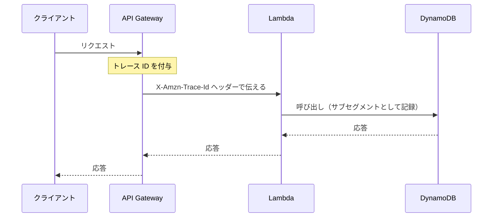

# オブザーバビリティ（CloudWatch / X-Ray / CloudTrail）

アプリケーションの状態をメトリクス、ログ、トレースで把握し、障害の原因や性能のボトルネックを見つけるための仕組みです。CloudWatch で数値とログを集め、X-Ray でリクエストの経路を追います。

[](../assets/diagrams/observability-signals.png)

## ロギング、モニタリング、オブザーバビリティの違い {#logging-monitoring-observability}

| 概念 | 問い | 内容 | AWS での例 |
|---|---|---|---|
| ロギング | 何が起きたか | 個々の出来事の記録 | CloudWatch Logs |
| モニタリング | 正常か | 既知の指標を見張り、異常を知らせる | CloudWatch メトリクス、アラーム |
| オブザーバビリティ | なぜ起きたか | 出力されたデータから、未知の問題の原因も調べられる性質 | ログ、メトリクス、トレースの組み合わせ |

モニタリングは「起きると分かっている問題」の検知です。オブザーバビリティは、想定外の問題を調べられるかどうかを指します。

## CloudWatch メトリクス {#cloudwatch-metrics}

### 基本の用語 {#metrics-concepts}

| 用語 | 意味 |
|---|---|
| 名前空間 | メトリクスの入れ物。AWS サービスは `AWS/Lambda` のような形。カスタムは自由に命名（`AWS/` で始めない）。既定の名前空間はない |
| メトリクス | 名前空間、メトリクス名、ディメンションの組で一意に決まる |
| ディメンション | 名前と値の組。1 メトリクスに最大 30 個 |
| 統計 | `Average`、`Sum`、`Minimum`、`Maximum`、`SampleCount`、`p99` などのパーセンタイル |
| 期間 | 集計の時間幅 |

ディメンションの組み合わせが違えば別のメトリクスです。`userId` のような値をディメンションにすると、メトリクスが増えて料金も増えます。

メトリクスはリージョンごとに存在し、削除はできません。新しいデータがなければ 15 か月で期限切れになります。

### 解像度と保持期間 {#metrics-resolution}

| 解像度 | 設定 | 特徴 |
|---|---|---|
| 標準 | `StorageResolution: 60` | 1 分単位。AWS サービスのメトリクスの既定 |
| 高解像度 | `StorageResolution: 1` | 1 秒単位。カスタムメトリクスで指定 |

| データポイントの期間 | 利用できる期間 |
|---|---|
| 60 秒未満 | 3 時間 |
| 60 秒 | 15 日 |
| 300 秒 | 63 日 |
| 3,600 秒 | 15 か月 |

EC2 は基本モニタリングでは多くのメトリクスが 5 分間隔で、詳細モニタリングを有効にすると 1 分間隔です。メモリ使用率のように OS の内部の値は既定では取得できず、CloudWatch エージェントが必要です。

### PutMetricData でカスタムメトリクスを送る {#put-metric-data}

```python
import boto3

cloudwatch = boto3.client("cloudwatch")

cloudwatch.put_metric_data(
    Namespace="MyApp/Orders",
    MetricData=[
        {
            "MetricName": "OrderLatency",
            "Dimensions": [{"Name": "Service", "Value": "checkout"}],
            "Value": 123.0,
            "Unit": "Milliseconds",
            "StorageResolution": 60,
        }
    ],
)
```

- IAM 権限 `cloudwatch:PutMetricData` が必要
- 1 リクエストは 1 MB まで、異なるメトリクスは 1,000 個まで
- 時刻は過去 2 週間から未来 2 時間まで指定可能
- `Values` と `Counts` で 1 データに最大 150 個の値をまとめられる

### Embedded Metric Format (EMF) {#emf}

ログの JSON に指示を埋め込むと、CloudWatch Logs がメトリクスを自動で抽出します。**API 呼び出しが不要**なので、Lambda の処理時間に影響しにくく、ログに詳細な項目も残せます。

```python
import json
import time

def handler(event, context):
    print(json.dumps({
        "_aws": {
            "Timestamp": int(time.time() * 1000),
            "CloudWatchMetrics": [
                {
                    "Namespace": "MyApp/Orders",
                    "Dimensions": [["Service"]],
                    "Metrics": [
                        {"Name": "OrderLatency", "Unit": "Milliseconds", "StorageResolution": 60}
                    ],
                }
            ],
        },
        "Service": "checkout",
        "OrderLatency": 123,
        "orderId": "o-1",
    }))
```

`Service` と `OrderLatency` がメトリクスになり、`orderId` はログとしてだけ残ります。

| 制限 | 値 |
|---|---|
| 1 イベントのサイズ | 1 MB |
| 1 ディレクティブのメトリクス定義 | 100 個 |
| 1 ディメンションセットのキー | 30 個 |

出力は Lambda の標準出力でそのまま処理されます。公式のクライアントライブラリや Powertools for AWS Lambda を使うと、自分で JSON を組み立てずに済みます。

| 方法 | 向いている場面 | 注意 |
|---|---|---|
| `PutMetricData` | Lambda 以外も含む単純な送信 | 呼び出しの遅延と料金、スロットリング |
| EMF | Lambda や大量の送信、ログと数値を結びつけたい | ログの料金がかかる |
| メトリクスフィルター | コードを変えずに既存ログから数値を作る | 過去のログには適用されない |

## アラーム {#alarms}

メトリクスがしきい値を超えると通知やアクションを実行します。

| 設定 | 意味 |
|---|---|
| 状態 | `OK`、`ALARM`、`INSUFFICIENT_DATA` |
| `Period` | 評価の時間幅 |
| `EvaluationPeriods` | 判定に使う直近の期間数 |
| `DatapointsToAlarm` | そのうち何個超えたら `ALARM` にするか（M out of N） |
| `TreatMissingData` | 欠落データの扱い。`missing`、`notBreaching`、`breaching`、`ignore` |
| アクション | SNS 通知、Auto Scaling、EC2 の操作など |

```python
cloudwatch.put_metric_alarm(
    AlarmName="orders-errors",
    Namespace="AWS/Lambda",
    MetricName="Errors",
    Dimensions=[{"Name": "FunctionName", "Value": "orders"}],
    Statistic="Sum",
    Period=60,
    EvaluationPeriods=5,
    DatapointsToAlarm=3,
    Threshold=1,
    ComparisonOperator="GreaterThanOrEqualToThreshold",
    TreatMissingData="notBreaching",
    AlarmActions=["<SNS トピックの ARN>"],
)
```

高解像度メトリクスには、10 秒または 30 秒周期の高解像度アラームを設定できます（料金は高くなります）。

**複合アラーム**は複数のアラームの状態を AND や OR で組み合わせます。ノイズを減らしたいときに使います。

## ダッシュボードとインサイト {#dashboards}

アプリケーションの健全性を一覧で確認する手段です。

| 機能 | 用途 |
|---|---|
| CloudWatch ダッシュボード | メトリクス、ログクエリ、アラームを 1 画面に並べる。リージョンやアカウントをまたげる |
| Lambda Insights | Lambda の CPU、メモリ、ネットワークなどの詳細 |
| Container Insights | ECS、EKS のタスクやノードの詳細 |
| Contributor Insights | 高カーディナリティのデータから上位要因を探す（例: エラーの多い IP） |
| Application Signals | アプリケーション単位の性能と SLO |
| Synthetics | 定期的に外部から URL や API を確認する |

## CloudWatch Logs {#cloudwatch-logs}

### ロググループと保持期間 {#log-groups}

| 用語 | 意味 |
|---|---|
| ログイベント | 1 件の記録。時刻とメッセージ |
| ログストリーム | 同じ発生元のイベントの並び（例: Lambda の実行環境） |
| ロググループ | ストリームの集まり。保持期間、アクセス権、暗号化を共有する |

既定では**無期限に保存**されます。料金を抑えるためロググループごとに保持期間を設定します。期限を過ぎても削除までに通常最大 72 時間かかります。

| 操作 | 方法 |
|---|---|
| 長期保管 | `CreateExportTask` で S3 へエクスポート |
| リアルタイム確認 | Live Tail |
| ログクラス | Standard と Essentials（旧 Infrequent Access） |

### メトリクスフィルター {#metric-filters}

ログのパターンから数値メトリクスを作ります。作成後のログにだけ適用され、過去のログには遡りません。Standard クラスのロググループで使え、ロググループあたり 100 個までです。

```bash
aws logs put-metric-filter \
  --log-group-name /aws/lambda/orders \
  --filter-name PaymentErrors \
  --filter-pattern '{ $.level = "ERROR" && $.errorType = "PaymentFailed" }' \
  --metric-transformations \
    metricName=PaymentErrors,metricNamespace=MyApp/Orders,metricValue=1
```

### サブスクリプションフィルター {#subscription-filters}

ログをリアルタイムで別のサービスへ流します。

- 送信先: Kinesis Data Streams、Lambda、Data Firehose、OpenSearch Service
- データは Base64 エンコードされ、gzip で圧縮されて届く
- ロググループあたり 5 個まで（引き上げ不可）。`PutSubscriptionFilter` の API リファレンスには「2 個」という記述が残っているが、ユーザーガイドとクォータの一覧は 5 個

| やりたいこと | 使うもの |
|---|---|
| ログから数値を作りアラームにしたい | メトリクスフィルター |
| ログを別のサービスで処理したい | サブスクリプションフィルター |
| 必要なときに調べたい | Logs Insights |

## Logs Insights でログを検索する {#logs-insights}

コマンドを `|` でつなげてログを検索します。JSON ログのキーは自動でフィールドになります。料金はスキャン量で決まるので、ロググループと時間範囲を絞ります。

**最新のエラーを見る**

```text
fields @timestamp, @message
| filter level = "ERROR"
| sort @timestamp desc
| limit 25
```

**エラーを種類と時間で集計する**

```text
filter level = "ERROR"
| stats count(*) as errors by errorType, bin(5m)
| sort errors desc
```

**1 つのリクエストのログを追う**

```text
fields @timestamp, @message
| filter requestId = "c6af9ac6-7b61-11e6-9a41-93e8deadbeef"
| sort @timestamp asc
```

**正規表現とテキストからの抽出**

```text
filter @message like /timed out/
| parse @message "Task timed out after * seconds" as timeoutSeconds
| stats count(*) by timeoutSeconds
```

**Lambda の遅延を調べる**

```text
filter @type = "REPORT"
| stats avg(@duration), pct(@duration, 99), max(@duration) by bin(5m)
```

**Lambda の割り当てメモリの過不足を調べる**

```text
filter @type = "REPORT"
| stats max(@memorySize / 1000 / 1000) as provisionedMB,
        max(@maxMemoryUsed / 1000 / 1000) as maxUsedMB,
        provisionedMB - maxUsedMB as overProvisionedMB
```

**コールドスタートを数える**

```text
filter @type = "REPORT" and ispresent(@initDuration)
| stats count(*) as coldStarts, avg(@initDuration) by bin(1h)
```

| 主なコマンド | 用途 |
|---|---|
| `fields` | 表示するフィールド |
| `filter` | 条件で絞り込み。`like` で部分一致や正規表現 |
| `stats` | 集計。`count`、`avg`、`pct`、`bin` |
| `parse` | テキストから値を抽出 |
| `sort` / `limit` | 並べ替えと件数制限 |

API では `StartQuery` で開始し、`GetQueryResults` で結果を取得します（非同期）。Logs Insights の独自言語のほか、OpenSearch PPL や SQL でも書けます。

## 構造化ログ {#structured-logging}

### ロギング戦略 {#logging-strategy}

ログはアプリの振る舞いと状態を後から再現できるように残します。

| 方針 | 内容 |
|---|---|
| ログレベルを分ける | `DEBUG`、`INFO`、`WARN`、`ERROR` を使い分け、本番は `INFO` 以上 |
| 相関 ID を入れる | リクエスト ID やトレース ID で処理を横断して追う |
| 決まった項目で出す | `service`、`operation`、`userId` など。キー名を統一する |
| 機微情報を出さない | パスワード、トークン、個人情報は記録しない |
| コストを管理する | 保持期間を設定し、大きなペイロードを丸ごと出さない |

### アプリケーションイベントとユーザー操作の構造化ログ {#structured-events}

JSON で出力すれば、Logs Insights でそのまま検索や集計ができます。

```python
import json
import logging

logger = logging.getLogger()
logger.setLevel(logging.INFO)

def handler(event, context):
    logger.info(json.dumps({
        "level": "INFO",
        "event": "order_created",
        "service": "orders",
        "requestId": context.aws_request_id,
        "userId": event["userId"],
        "orderId": "o-1",
    }))
```

Lambda には標準でログ形式の設定があり、`LogFormat` を `JSON` にすると `logging` の出力を JSON にできます。`print` の出力は JSON にならず、プレーンテキストのままです。

```yaml
# SAM の例
LoggingConfig:
  LogFormat: JSON
  ApplicationLogLevel: INFO
  SystemLogLevel: WARN
```

Powertools for AWS Lambda の Logger を使うと、相関 ID などの共通項目を自動で付けられます。

## X-Ray によるトレース {#xray}

分散アプリケーションで 1 つのリクエストの経路と、各区間の時間を可視化します。



### 基本の用語 {#xray-concepts}

| 用語 | 意味 |
|---|---|
| トレース | 1 リクエストに関する全セグメントの集まり。トレース ID で識別 |
| セグメント | 1 つのサービスの作業の記録。1 ドキュメント最大 64 KB |
| サブセグメント | 下流の呼び出しやコード区間を細かく分けた記録 |
| トレースヘッダー | `X-Amzn-Trace-Id`。トレース ID とサンプリング判定を伝える |
| サービスマップ | サービス間の依存関係と、遅延やエラーの図 |
| グループ | フィルター式で定義したトレースの集まり |

X-Ray の分類は、クライアントエラー（4xx）が **Error**、サーバーエラー（5xx）が **Fault**、429 が **Throttle** です。

### アノテーションとメタデータ {#annotations-metadata}

| | アノテーション | メタデータ |
|---|---|---|
| 検索 | **インデックスされる**（フィルター式で検索可能） | インデックスされない |
| 値 | 文字列、数値、真偽値 | オブジェクトやリストなど任意の型 |
| 制限 | トレースあたり 50 個までインデックス | セグメントのサイズ内 |
| 用途 | 顧客 ID など検索に使う値 | デバッグ用の詳細データ |

```python
from aws_xray_sdk.core import patch_all, xray_recorder

patch_all()  # boto3 や requests の呼び出しを自動で記録する

def handler(event, context):
    with xray_recorder.in_subsegment("charge_payment") as subsegment:
        subsegment.put_annotation("customer_tier", event["tier"])
        subsegment.put_metadata("request", event, "orders")
        charge(event)
```

コンソールや API では次のように検索します。

```text
annotation.customer_tier = "gold" AND responsetime > 2
```

API の `GetTraceSummaries` で ID を探し、`BatchGetTraces` で詳細を取得します。

### サンプリング {#xray-sampling}

全リクエストは記録しません。既定のルールは**毎秒最初の 1 件と、それ以降の 5%** です。

| ルールの項目 | 意味 |
|---|---|
| Priority | 小さい番号から評価し、最初に一致したルールを使う |
| Reservoir | 毎秒確保する固定の件数（サービス全体で共有） |
| Rate | Reservoir を超えた分に適用する割合 |
| 条件 | サービス名、HTTP メソッド、URL パスなど |

コンソールでルールを変更すれば、コードの修正や再デプロイは不要です。サンプリングの判定は最初のサービスで 1 度だけ行われ、下流はそれに従います。

### X-Ray デーモン {#xray-daemon}

SDK からのデータを **UDP 2000 番**で受け取り、X-Ray API へ送るプログラムです。

| 実行環境 | 使い方 |
|---|---|
| EC2 | デーモンを導入して起動 |
| ECS | サイドカーコンテナとして実行 |
| Lambda | Lambda が用意するので導入不要 |

必要な権限は `xray:PutTraceSegments` と `xray:PutTelemetryRecords` で、管理ポリシー `AWSXRayDaemonWriteAccess` に含まれます。

### SDK と OpenTelemetry（現在の推奨） {#xray-opentelemetry}

!!! warning "X-Ray SDK とデーモンはメンテナンスモード"
    X-Ray SDK とデーモンは 2026 年 2 月 25 日にメンテナンスモードに入り、セキュリティ修正のみになりました。新規の計装には **OpenTelemetry が推奨**されています。試験ではアノテーションなど X-Ray の概念も引き続き確認しておきましょう。

| 用途 | 従来 | 現在の推奨 |
|---|---|---|
| 計装 | X-Ray SDK | OpenTelemetry SDK、AWS Distro for OpenTelemetry (ADOT) |
| データの送信 | X-Ray デーモン | CloudWatch エージェント、OpenTelemetry Collector |
| Lambda | X-Ray SDK | ADOT の Lambda レイヤー |

トレースの保存先としての X-Ray や、CloudWatch コンソールでの表示は引き続き使えます。

### Lambda のアクティブトレース {#lambda-active-tracing}

| モード | 動作 |
|---|---|
| `Active` | Lambda がサンプリングされたリクエストのトレースを自動で X-Ray へ送る |
| `PassThrough` | 既定。トレースヘッダーを下流へ渡すだけで、Lambda 自身は送らない |

```yaml
# SAM の例
Tracing: Active
```

- 実行ロールに `xray:PutTraceSegments` と `xray:PutTelemetryRecords` が必要
- 関数のコード内の区間を見たい場合は、SDK での計装も追加する
- API Gateway ではステージで X-Ray を有効にする
- Lambda のサンプリングは毎秒 1 件と、それ以降の 5%
- Kafka や Amazon MQ、DocumentDB のイベントソースマッピングでは非対応

### サービスマップの読み方 {#service-map}

サービスマップは CloudWatch コンソールで確認します。ノードごとの応答時間、エラーや障害の割合が分かります。

- 遅いノード → そのノードを含むトレースを開き、時間のかかるサブセグメントを探す
- Fault が多いノード → セグメントの例外を確認する
- Throttle が多いノード → 下流サービスの上限を確認する

## CloudWatch と CloudTrail の違い {#cloudtrail-vs-cloudwatch}

| | CloudWatch | CloudTrail |
|---|---|---|
| 目的 | 性能と運用の監視 | API 操作の監査 |
| 記録の内容 | メトリクス、アプリのログ | 誰が、いつ、どの API を呼んだか |
| 問いの例 | CPU 使用率は、エラーは増えたか | このバケットを誰が削除したか |
| 既定の動作 | サービスのメトリクスを収集 | イベント履歴で管理イベントを 90 日間確認可能 |

CloudTrail のデータイベント（S3 オブジェクトや Lambda 呼び出しなど）は既定では記録されず、証跡やイベントデータストアで有効にします。CloudTrail のログを CloudWatch Logs に送ると、特定の操作でアラームを出せます。

## Application Signals {#application-signals}

CloudWatch Application Signals は、EC2、ECS、Lambda などのアプリから、メトリクスとトレースを自動で集めるアプリケーション性能監視（APM）の機能です。

- 呼び出し数、可用性、遅延、エラーなどの標準メトリクスを表示
- SLO（サービスレベル目標）の作成と監視
- アプリケーションの依存関係を自動で図示

計装は OpenTelemetry に基づきます。

## 通知アラートの実装 {#alerts}

[](../assets/diagrams/observability-alerts.png)

### クォータの上限に近づいたとき {#quota-alerts}

対応するサービスでは、使用量が `AWS/Usage` 名前空間のメトリクスとして記録されます。

| 方法 | 内容 |
|---|---|
| Service Quotas コンソール | クォータの画面からアラームを作成し、しきい値を選ぶ |
| CloudWatch のメトリクス計算 | `SERVICE_QUOTA(m1)` で上限を取得してアラームを設定 |

使用率は次の式で出し、たとえば 80% を超えたら SNS へ通知します。

```text
m1 / SERVICE_QUOTA(m1) * 100
```

Lambda の `ConcurrentExecutions` のように、サービス自身のメトリクスにアラームを設定する方法もあります。

### デプロイが完了したとき {#deployment-alerts}

EventBridge ルールでデプロイの状態変化を受け取り、SNS へ送ります。

```json
{
  "source": ["aws.codedeploy"],
  "detail-type": ["CodeDeploy Deployment State-change Notification"],
  "detail": {
    "state": ["SUCCESS", "FAILURE"]
  }
}
```

CodePipeline の場合です。

```json
{
  "source": ["aws.codepipeline"],
  "detail-type": ["CodePipeline Pipeline Execution State Change"],
  "detail": {
    "state": ["SUCCEEDED", "FAILED"]
  }
}
```

SNS トピックのアクセスポリシーで、EventBridge（`events.amazonaws.com`）からの発行を許可します。CodeDeploy はデプロイグループのトリガーで直接 SNS へ通知することもできます。

## ヘルスチェックとプローブ {#health-checks}

ワークロードが正常かを自動で確認し、問題があるものへ通信を流さない、または置き換えます。

| 仕組み | 確認すること | 失敗時の動作 |
|---|---|---|
| ALB のターゲットグループ | HTTP/HTTPS の応答コード | そのターゲットへの送信を止める（[ネットワーク](networking.md)） |
| EC2 Auto Scaling | EC2 の状態。`ELB` タイプならロードバランサーの結果も | インスタンスを置き換える |
| ECS のコンテナ `healthCheck` | コンテナ内のコマンド | タスクを異常とみなして置き換える |
| Kubernetes のプローブ | HTTP、TCP、コマンド | 下表のとおり |
| Route 53 ヘルスチェック | エンドポイントへの外部からの確認 | DNS のフェイルオーバー |
| Synthetics | ユーザーの操作を模した確認 | メトリクスとアラーム |

| Kubernetes のプローブ | 問い | 失敗時 |
|---|---|---|
| Liveness | 生きているか | コンテナを再起動 |
| Readiness | 通信を受けられるか | Service の転送先から外す。再起動はしない |
| Startup | 起動が終わったか | 成功するまで他のプローブを止める |

```yaml
# EKS の Pod マニフェストの一部
readinessProbe:
  httpGet:
    path: /ready
    port: 8080
  periodSeconds: 10
livenessProbe:
  httpGet:
    path: /healthz
    port: 8080
  periodSeconds: 10
```

ECS の `healthCheck` は、`interval` の既定が 30 秒、`retries` の既定が 3 回です。`startPeriod` で起動中の猶予を設定できます。

!!! tip "エンドポイントの設計"
    Liveness は依存先を確認せず、プロセスだけを見ます。データベース障害で全コンテナが再起動すると、問題が悪化するためです。Readiness では、依存先を含めて通信を受けられるかを確認します。

## 性能の分析とボトルネックの検出 {#performance}

### アプリケーションの性能プロファイリング {#profiling}

平均値だけでなく、パーセンタイル（`p95`、`p99`）で遅いリクエストを見ます。まず全体から区間へ、順に絞り込みます。

| 手順 | ツール | 分かること |
|---|---|---|
| 1. 悪化に気づく | CloudWatch メトリクス、アラーム | いつ、どの API が遅くなったか |
| 2. 区間を特定する | X-Ray のトレース、サービスマップ | どのサービスや呼び出しが遅いか |
| 3. コード内を調べる | サブセグメント、言語のプロファイラー | どの処理に時間がかかるか |
| 4. 実行環境を調べる | Lambda Insights、Container Insights | CPU やメモリの逼迫 |

### ログからボトルネックを見つける {#logs-bottlenecks}

Lambda の `REPORT` 行、処理時間を含むアプリのログを Logs Insights で集計します。

```text
filter event = "db_query"
| stats count(*) as calls, avg(durationMs) as avgMs, pct(durationMs, 99) as p99Ms by queryName
| sort p99Ms desc
| limit 10
```

遅いものを探すだけでなく、呼び出し回数も見ます。1 回は速くても大量に呼ばれる処理（N+1 問題など）もボトルネックになります。

### 代表的なメトリクスと原因 {#bottleneck-metrics}

| サービス | メトリクス | 示すこと |
|---|---|---|
| Lambda | `Duration`、`Errors`、`Throttles`、`ConcurrentExecutions` | 実行時間、エラー、同時実行の不足 |
| Lambda（イベントソース） | `IteratorAge`、`AsyncEventAge` | ストリームや非同期処理の遅れ |
| API Gateway | `Latency`、`IntegrationLatency`、`4XXError`、`5XXError` | 差が大きければ API Gateway 側、近ければ統合先が遅い |
| ALB | `TargetResponseTime`、`HTTPCode_Target_5XX_Count`、`UnHealthyHostCount` | ターゲットの遅れや異常 |
| DynamoDB | `ThrottledRequests`、`ConsumedReadCapacityUnits` | 容量の不足 |
| SQS | `ApproximateAgeOfOldestMessage` | 処理が追いついていない |

### リソース使用量の最適化 {#resource-optimization}

| 問題の兆候 | 対処 |
|---|---|
| Lambda の `maxMemoryUsed` が割り当てより大幅に小さい | メモリを減らす。ただし CPU も減るので実行時間と合わせて判断 |
| Lambda の処理が CPU で遅い | メモリを増やす（CPU も比例して増える） |
| コールドスタートが長い | パッケージの削減、初期化処理の見直し、プロビジョニング済み同時実行 |
| 下流サービスへの接続が多い | 接続の再利用、RDS Proxy（[データベース](databases.md)） |
| 同じデータを何度も読む | キャッシュの導入（[DynamoDB](dynamodb.md)、[ネットワーク](networking.md)） |
| ログの料金が高い | ログレベル、保持期間、サンプリングの見直し |

## デバッグとエラー診断 {#debugging}

### コードの欠陥を特定する {#debug-code}

1. エラーのログとスタックトレースを読む（Lambda なら `errorType`、`errorMessage`）
2. リクエスト ID で同じ処理のログをつなげる
3. 同じイベントをローカルで再現する（`sam local invoke -e event.json`、[IaC](iac.md)）
4. 失敗したケースを単体テストにして修正する

Lambda を同期的に呼び出すと、関数内のエラーでも API の HTTP ステータスは 200 で、レスポンスの `FunctionError` にエラーが示されます。呼び出し側はこの項目を確認します。

### メトリクス、ログ、トレースの読み解き {#interpret-signals}

| 順 | 見るもの | 答えられる問い |
|---|---|---|
| 1 | メトリクス | いつ始まり、どの程度の規模か |
| 2 | トレース | どの区間で失敗し、遅くなったか |
| 3 | ログ | なぜ失敗したか（具体的なメッセージ） |
| 4 | CloudTrail | 同じ時刻に設定変更はなかったか |

トレース ID やリクエスト ID をログに含めると、3 つのデータを行き来できます。デプロイの時刻と悪化の時刻を比べることも有効です。

### サービス統合の問題を調べる {#debug-integration}

| 症状 | 確認先 | よくある原因 |
|---|---|---|
| S3 イベントで Lambda が動かない | 関数のリソースベースポリシー、通知設定 | 呼び出し権限なし、プレフィックスの不一致 |
| EventBridge からターゲットが動かない | `FailedInvocations`、`Invocations`、`test-event-pattern` | パターンの不一致、ターゲットの権限不足 |
| SQS のメッセージが重複する | 可視性タイムアウト、関数の実行時間 | タイムアウトより処理が長い |
| SQS のメッセージが DLQ に溜まる | DLQ の中身、関数のログ | 処理の失敗、形式の違い |
| VPC 内の Lambda から外へ出られない | ルートテーブル、セキュリティグループ | NAT や VPC エンドポイントがない |
| API Gateway から Lambda が動かない | 実行ログ、Lambda のログ | 権限不足、プロキシ応答の形式の違い |
| 外部 API の呼び出しが失敗する | X-Ray の例外、アプリのログ | タイムアウト、認証情報の期限切れ |

統合の入口と出口のどちらでイベントが止まったかを順に確認すると、切り分けが速くなります。

### 代表的なエラーコード {#error-codes}

| HTTP | エラー | 原因と対処 |
|---|---|---|
| 400 | `ValidationException` | リクエストの形式や値の誤り。再試行しても失敗する |
| 400 | DynamoDB `ProvisionedThroughputExceededException` | 容量超過。バックオフで再試行し、キーの偏りや容量を見直す |
| 400 | `ThrottlingException` | API のレート超過。バックオフで再試行 |
| 401 | API Gateway `Unauthorized` | トークンがない、無効。オーソライザーを確認 |
| 403 | `AccessDenied`、`AccessDeniedException` | IAM、リソースポリシー、KMS、SCP の権限を確認 |
| 403 | API Gateway `Missing Authentication Token` | 存在しないパスやステージへのリクエストが多い |
| 404 | `ResourceNotFoundException` | 名前、ARN、リージョンの間違い |
| 409 | `ResourceConflictException` | 更新中のリソースへの操作など |
| 413 | Lambda `RequestTooLargeException` | ペイロードのサイズ上限超過 |
| 429 | Lambda `TooManyRequestsException` | 同時実行の上限。バックオフ、予約や上限引き上げ |
| 429 | API Gateway `Too Many Requests` | スロットリング制限、使用量プランの超過 |
| 500 | API Gateway `Internal server error` | 統合先のエラーや権限の問題。実行ログを確認 |
| 502 | API Gateway `Bad Gateway` | Lambda プロキシの応答形式が不正、または関数のエラー |
| 502 | ALB | ターゲットが接続を閉じた、応答が不正、Lambda の失敗 |
| 503 | ALB | 登録済みの正常なターゲットがない |
| 503 | S3 `SlowDown` | リクエストレートの超過。バックオフで再試行 |
| 504 | API Gateway `Endpoint request timed out` | 統合先がタイムアウト内に応答しない |
| 504 | ALB | ターゲットがアイドルタイムアウト内に応答しない、接続できない |

原則として **4xx はリクエストの修正、429 と 5xx はバックオフ付きの再試行**です。再試行の実装は [SDK と耐障害性](sdk-resilience.md)を参照してください。

## 試験のポイント {#exam-points}

| こう問われたら | 答え |
|---|---|
| コードから独自のメトリクスを送りたい | `PutMetricData` または EMF |
| Lambda で API 呼び出しなしでメトリクスを出したい | Embedded Metric Format |
| 1 秒単位のメトリクスが必要 | `StorageResolution: 1`（高解像度） |
| EC2 のメモリ使用率を見たい | CloudWatch エージェント |
| ログの特定のパターンを数えてアラームにしたい | メトリクスフィルター |
| メトリクスフィルターは過去のログに効くか | 効かない |
| ログをリアルタイムで Lambda や Firehose へ送りたい | サブスクリプションフィルター |
| ログを対話的に集計したい | CloudWatch Logs Insights |
| ログの既定の保持期間は | 無期限 |
| ログを JSON にする理由は | フィールドで検索と集計ができる |
| トレースを検索できるようにしたい | アノテーション（インデックスされる） |
| 検索しない詳細データを残したい | メタデータ |
| X-Ray の既定のサンプリングは | 毎秒最初の 1 件と、それ以降の 5% |
| コードを変えずにサンプリングを変えたい | コンソールのサンプリングルール |
| X-Ray デーモンのポートは | UDP 2000 |
| Lambda でトレースを有効にしたい | アクティブトレースと実行ロールの権限 |
| 新規の計装で推奨されるのは | OpenTelemetry、ADOT |
| 誰が API を呼んだか知りたい | CloudTrail |
| API Gateway の `Latency` と `IntegrationLatency` の差が小さい | 統合先（バックエンド）が遅い |
| クォータの 80% で通知したい | Service Quotas のアラーム、`AWS/Usage`、`SERVICE_QUOTA` |
| デプロイ完了を通知したい | EventBridge ルールと SNS |
| 起動中のコンテナに通信を流したくない | Readiness プローブ |
| ハングしたコンテナを再起動したい | Liveness プローブ |
| Lambda の 429 への対処 | 同時実行の確認とバックオフ付き再試行 |
| API Gateway の 502 の典型的な原因 | Lambda プロキシの応答形式の誤り |

## 関連ページ {#related}

- [CI/CD](cicd.md)
- [IaC（CloudFormation / SAM / CDK）](iac.md)
- [Lambda](lambda.md)
- [API Gateway](api-gateway.md)
- [ネットワーク](networking.md)
- [SDK と耐障害性](sdk-resilience.md)

## 参考 {#references}

- [Publish custom metrics](https://docs.aws.amazon.com/AmazonCloudWatch/latest/monitoring/publishingMetrics.html)
- [Amazon CloudWatch concepts](https://docs.aws.amazon.com/AmazonCloudWatch/latest/monitoring/cloudwatch_concepts.html)
- [PutMetricData](https://docs.aws.amazon.com/AmazonCloudWatch/latest/APIReference/API_PutMetricData.html)
- [Embedded metric format specification](https://docs.aws.amazon.com/AmazonCloudWatch/latest/monitoring/CloudWatch_Embedded_Metric_Format_Specification.html)
- [Alarm evaluation](https://docs.aws.amazon.com/AmazonCloudWatch/latest/monitoring/alarm-evaluation.html)
- [Configuring how CloudWatch alarms treat missing data](https://docs.aws.amazon.com/AmazonCloudWatch/latest/monitoring/alarms-and-missing-data.html)
- [Composite alarms](https://docs.aws.amazon.com/AmazonCloudWatch/latest/monitoring/alarm-combining.html)
- [Using math expressions with CloudWatch metrics](https://docs.aws.amazon.com/AmazonCloudWatch/latest/monitoring/using-metric-math.html)
- [Visualizing your service quotas and setting alarms](https://docs.aws.amazon.com/AmazonCloudWatch/latest/monitoring/CloudWatch-Quotas-Visualize-Alarms.html)
- [Working with log groups and log streams](https://docs.aws.amazon.com/AmazonCloudWatch/latest/logs/Working-with-log-groups-and-streams.html)
- [Creating metrics from log events using filters](https://docs.aws.amazon.com/AmazonCloudWatch/latest/logs/MonitoringLogData.html)
- [Log group-level subscription filters](https://docs.aws.amazon.com/AmazonCloudWatch/latest/logs/SubscriptionFilters.html)
- [CloudWatch Logs quotas](https://docs.aws.amazon.com/AmazonCloudWatch/latest/logs/cloudwatch_limits_cwl.html)
- [CloudWatch Logs Insights query syntax](https://docs.aws.amazon.com/AmazonCloudWatch/latest/logs/CWL_QuerySyntax.html)
- [CloudWatch Logs Insights sample queries](https://docs.aws.amazon.com/AmazonCloudWatch/latest/logs/CWL_QuerySyntax-examples.html)
- [AWS X-Ray concepts](https://docs.aws.amazon.com/xray/latest/devguide/xray-concepts.html)
- [Configuring sampling rules](https://docs.aws.amazon.com/xray/latest/devguide/xray-console-sampling.html)
- [AWS X-Ray daemon](https://docs.aws.amazon.com/xray/latest/devguide/xray-daemon.html)
- [Migrating from X-Ray instrumentation to OpenTelemetry instrumentation](https://docs.aws.amazon.com/xray/latest/devguide/xray-sdk-migration.html)
- [X-Ray SDK and Daemon Support timeline](https://docs.aws.amazon.com/xray/latest/devguide/xray-sdk-daemon-timeline.html)
- [Visualize Lambda function invocations using AWS X-Ray](https://docs.aws.amazon.com/lambda/latest/dg/services-xray.html)
- [Application Signals](https://docs.aws.amazon.com/AmazonCloudWatch/latest/monitoring/CloudWatch-Application-Monitoring-Sections.html)
- [Monitoring deployments with Amazon CloudWatch Events (CodeDeploy)](https://docs.aws.amazon.com/codedeploy/latest/userguide/monitoring-cloudwatch-events.html)
- [Monitoring CodePipeline events](https://docs.aws.amazon.com/codepipeline/latest/userguide/detect-state-changes-cloudwatch-events.html)
- [Configure CloudWatch alarms for Service Quotas](https://docs.aws.amazon.com/servicequotas/latest/userguide/configure-cloudwatch.html)
- [CloudTrail concepts](https://docs.aws.amazon.com/awscloudtrail/latest/userguide/cloudtrail-concepts.html)
- [HealthCheck (Amazon ECS API)](https://docs.aws.amazon.com/AmazonECS/latest/APIReference/API_HealthCheck.html)
- [Application health checks (EKS best practices)](https://docs.aws.amazon.com/eks/latest/best-practices/application.html)
