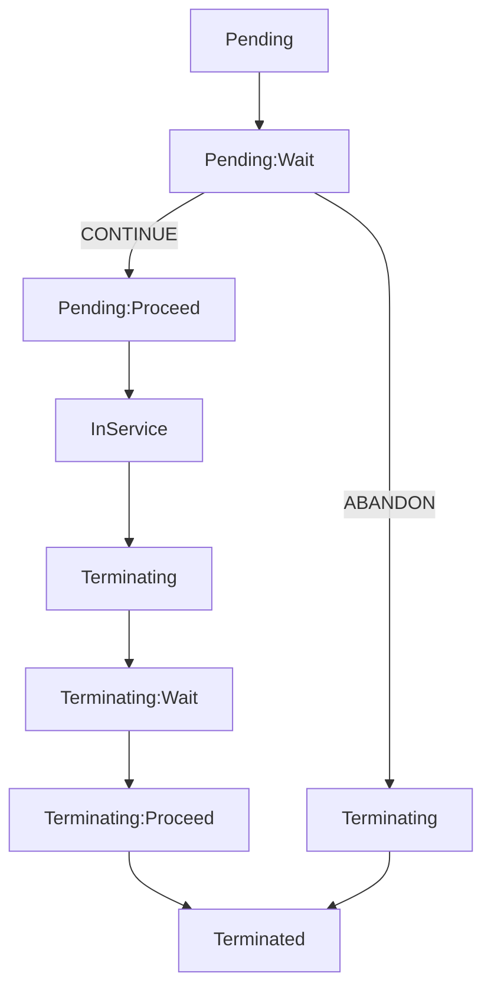
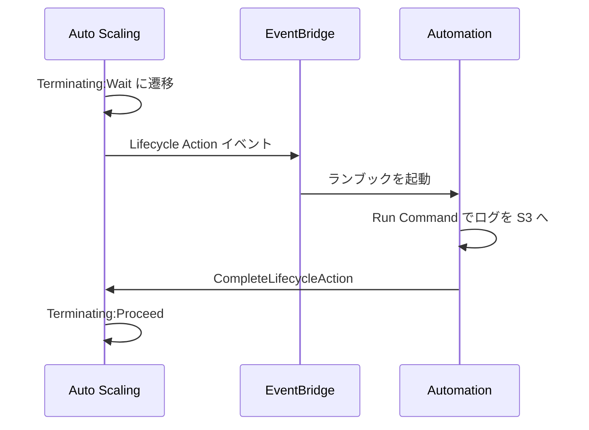
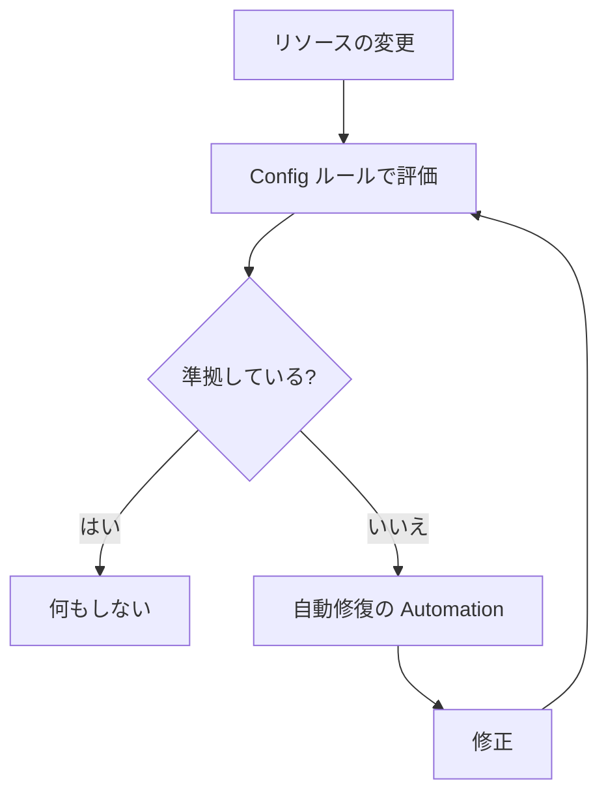

# 運用サービス

EC2 フリートの管理、パッチ、自動修復、監視の周辺サービスをまとめたページです。SOA-C03、DOP-C02、SAP-C03 で問われる運用の設定を中心に扱います。

CloudWatch の基本は [オブザーバビリティ](observability.md)、Auto Scaling の基本は [EC2 と Beanstalk](ec2-beanstalk.md)、StackSets の基本は [IaC と CLI](iac.md)、Parameter Store は [シークレットと設定](secrets.md) を参照してください。ここでは重複を避け、運用の視点を足します。

[](../assets/diagrams/operations-remediation.png)

| やりたいこと | 使うもの |
| --- | --- |
| 全ノードで一度コマンドを実行 | [Run Command](#run-command) |
| SSH や踏み台なしでログイン | [Session Manager](#session-manager) |
| OS のパッチを当てて準拠状況を見る | [Patch Manager](#patch-manager) |
| 複数の手順や AWS API を組み合わせて自動化 | [Automation](#automation) |
| 望ましい状態を保ち続ける | [State Manager](#state-manager) |
| 業務時間外に限って変更を実行 | [Maintenance Windows](#maintenance-windows) |
| AMI の作成を自動化 | [EC2 Image Builder](#image-builder) |
| 起動や終了の途中に独自処理を挟む | [ライフサイクルフック](#lifecycle-hooks) |
| AMI を入れ替えて全台を順に更新 | [インスタンスの更新](#instance-refresh) |
| 外形監視 | [CloudWatch Synthetics](#synthetics) |

## 2026 年 10 月時点の提供状況 {#status}

運用系では提供状況の変更が続いています。古い教材の説明と異なることがあるので、先に確認してください。

| サービス | 状況 | 日付 |
| --- | --- | --- |
| Amazon DevOps Guru | 新規受付を終了。既存顧客のサポートも終了予定 | 新規は 2026-10-29 まで、終了は 2027-09-30 |
| Incident Manager | 新規受付を終了。既存顧客は継続利用可、機能追加なし | 2025-11-07 |
| Change Manager | 新規受付を終了。既存顧客は継続利用可 | 2025-11-07 |
| Application Manager | メンテナンスに移行。未使用のアカウントはアクセス不可 | 未使用アカウントは 2026-07-30 から |
| AWS OpsWorks（Stacks、Chef、Puppet） | 完全に終了 | 2024-05-01 |
| AWS Chatbot | 名称変更。現在は Amazon Q Developer in chat applications | 2025-02-19 |

DevOps Guru の終了日は、サービスのガイドでは 2027 年 9 月 30 日、AWS General Reference の一覧では 2027 年 9 月 29 日です。

## AWS Systems Manager {#systems-manager}

EC2、オンプレミス、他クラウドのノードをまとめて運用するサービスです。多くの機能は、ノードが「マネージドノード」になっていることが前提です。

### マネージドノードの条件 {#managed-nodes}

次の 3 つがそろうと、ノードは Fleet Manager の一覧に出ます。

| 条件 | 内容 | 欠けたときの症状 |
| --- | --- | --- |
| SSM Agent | 導入して起動している | ノードが一覧に出ない |
| 権限 | インスタンスプロファイルの `AmazonSSMManagedInstanceCore`、または Default Host Management Configuration | 同上 |
| 通信 | `ssm`、`ssmmessages`、`ec2messages` へ HTTPS（443）で出られる | 同上、またはセッションが開始できない |

**Default Host Management Configuration（DHMC）** は、アカウントとリージョン単位の設定です。インスタンスプロファイルを個別に付けなくても、既定の IAM ロールでインスタンスを管理できます。

**プライベートサブネットの例:** インターネットへの経路がないサブネットでは、次のインターフェイスエンドポイントを作ります。エンドポイントのセキュリティグループは、ノードからの 443 番を許可します。

```text
com.amazonaws.ap-northeast-1.ssm
com.amazonaws.ap-northeast-1.ssmmessages
com.amazonaws.ap-northeast-1.ec2messages
```

**診断:** 管理対象にならない原因の調査には、診断と修復のランブックや `ssm-cli`、`AWSSupport-TroubleshootManagedInstance` を使えます。

#### オンプレミスと他クラウド {#hybrid-nodes}

EC2 以外のノードを登録する方法は 2 つです。

| 方法 | 使いどころ |
| --- | --- |
| ハイブリッドアクティベーション | オンプレミスのサーバーや VM。アクティベーションコードと ID を使って SSM Agent を登録 |
| Cloud Connector | Microsoft Azure の VM をまとめて登録 |

- macOS の非 EC2 マシンは対象外です。
- アドバンストインスタンス層は 2026 年 6 月 30 日に廃止されました。ハイブリッドノードの 1,000 台の上限はなくなりました。
- 2026 年 9 月 30 日から、ハイブリッドノードの Session Manager と Run Command は従量課金です。古い教材の「アドバンスト層が必要」は当てはまりません。

### Run Command {#run-command}

SSM ドキュメントで定義したコマンドを、ログインせずに多数のノードで実行します。単発の作業に向きます。

```bash
aws ssm send-command \
  --document-name "AWS-RunShellScript" \
  --targets "Key=tag:Env,Values=prod" \
  --parameters 'commands=["systemctl restart nginx"]' \
  --max-concurrency "10%" \
  --max-errors "2" \
  --output-s3-bucket-name "my-ops-logs" \
  --output-s3-key-prefix "run-command/"
```

| 設定 | 何が変わるか | 値と既定 | 誤ったときの症状 |
| --- | --- | --- | --- |
| `--targets` | 対象を指定する | タグ、リソースグループ、ノード ID。タグのキーは 5 個まで、キーごとに値は 5 個まで | 想定外のノードで実行される |
| `--max-concurrency` | 同時に実行するノード数 | 絶対数または割合 | 全台で同時に再起動し、サービスが止まる |
| `--max-errors` | 許容するエラー数 | 絶対数または割合。**既定は 0** | 少数の失敗で残りに送られなくなる |
| 出力先 | S3 または CloudWatch Logs | S3 への書き込みはノード側のロールの権限を使う | 実行者に権限があっても出力が保存されない |

**`--max-errors` の動き:** `3` なら 4 回目のエラーで、新しいノードへの送信を止めます。実行中のものは完了まで続くので、失敗数が上限を少し超えることがあります。厳密に守るなら `--max-concurrency 1` にします。

**タイムアウトの区別:**

| 状態 | 意味 | `max-errors` に数えるか |
| --- | --- | --- |
| `DeliveryTimedOut` | 期限内にノードへ届かなかった | 数えない |
| `ExecutionTimedOut` | 開始したが、期限内に終わらなかった | 失敗として数える |

ノードが止まっているときは `DeliveryTimedOut` になります。

### Session Manager {#session-manager}

ブラウザや CLI から、インバウンドのポートを開けずにノードへ接続します。SSH 鍵と踏み台を不要にでき、接続の操作は IAM で制御します。

```bash
# シェルに接続
aws ssm start-session --target i-0123456789abcdef0

# ローカルの 56789 番を、ノードの 3389 番へ転送
aws ssm start-session \
  --target i-0123456789abcdef0 \
  --document-name AWS-StartPortForwardingSession \
  --parameters '{"portNumber":["3389"],"localPortNumber":["56789"]}'
```

別のホストへ転送するには `AWS-StartPortForwardingSessionToRemoteHost` を使います。RDS など、ノードの先にあるリソースへの接続に便利です。

| 設定 | 既定と範囲 | 例と注意 |
| --- | --- | --- |
| アイドルタイムアウト | **20 分**。1〜60 分 | 操作がないと切断 |
| 最大セッション時間 | **上限なし**。1〜1,440 分 | 240 分に設定すると、操作中でも 4 時間で切断 |
| ログ | 既定はオフ。S3 または CloudWatch Logs | セッションの入出力を保存 |
| 暗号化 | KMS キーで追加の暗号化が可能 | ノード側に復号の権限が必要 |

**必要なもの:** SSM Agent 2.3.68.0 以降。CLI で使うなら、AWS CLI 1.16.12 以降と Session Manager プラグインが必要です。

**ログの落とし穴:** ポート転送と SSH のセッションは、内容をログに残せません。入力したパスワードがログに残らないよう、機微な値を入力するときは、エコーを止めるコマンドを使います。

**監査:** セッションの開始と終了は CloudTrail に記録されます。コマンドの中身まで残すには、上のログの設定が必要です。

### Patch Manager {#patch-manager}

OS のパッチの準拠確認と適用を自動化します。実体は `AWS-RunPatchBaseline` という SSM ドキュメントです。

| パラメータ | 値 | 動作 |
| --- | --- | --- |
| `Operation` | `Scan` | 不足パッチを確認して報告する。適用も再起動もしない |
| `Operation` | `Install` | 承認済みで不足しているパッチを適用する |
| `RebootOption` | `RebootIfNeeded`（既定） | 必要なら再起動 |
| `RebootOption` | `NoReboot` | 再起動しない |
| `InstallOverrideList` | HTTPS URL または S3 パスの YAML | ベースラインの代わりに、一覧のパッチを適用 |

`NoReboot` で適用した直後は、再起動待ちのパッチが残る場合があります。

`InstallOverrideList` で適用しても、準拠レポートはベースラインに基づきます。

#### 実行の設定方法 {#patch-methods}

| 方法 | 範囲 | 特徴 |
| --- | --- | --- |
| パッチポリシー（Quick Setup、**推奨**） | Organizations の複数アカウント、複数リージョン | スキャンと適用を別の日程にできる。パッチグループ不要 |
| Maintenance Windows のタスク | 1 アカウント、1 リージョン | 前後の処理と組み合わせられる |
| State Manager の関連付け | 1 アカウント、1 リージョン | 定期スキャンに向く |
| Patch now | 1 アカウント、1 リージョン | 即時の適用 |

#### パッチベースライン {#patch-baselines}

どのパッチを承認するかの規則です。定義済みのものは変更できないので、調整するならカスタムベースラインを作ります。

| OS | 定義済みベースラインの例 | 承認の内容 |
| --- | --- | --- |
| Amazon Linux 2023 | `AWS-AmazonLinux2023DefaultPatchBaseline` | Security の Critical、Important と Bugfix。リリースの 7 日後 |
| RHEL | `AWS-RedHatDefaultPatchBaseline` | Security の Critical、Important と Bugfix。7 日後 |
| Ubuntu | `AWS-UbuntuDefaultPatchBaseline` | セキュリティ関連を**待たずに**承認 |
| Windows Server | `AWS-DefaultPatchBaseline` | CriticalUpdates、SecurityUpdates の Critical、Important。7 日後 |

**定義済みの落とし穴:**

- 7 日の待機があるので、リリース直後の緊急パッチは対象になりません。7 日以内に適用するにはカスタムベースラインが必要です。
- 定義済みのものは、パッチの準拠レベルが `Unspecified` です。Critical などの準拠レベルを付けたいときもカスタムベースラインを作ります。

**カスタムベースラインの例（Amazon Linux 2023、3 日後に承認）:**

```bash
aws ssm create-patch-baseline \
  --name "al2023-prod" \
  --operating-system AMAZON_LINUX_2023 \
  --approval-rules '{"PatchRules":[{
    "PatchFilterGroup":{"PatchFilters":[
      {"Key":"CLASSIFICATION","Values":["Security"]},
      {"Key":"SEVERITY","Values":["Critical","Important"]}]},
    "ApproveAfterDays":3,
    "ComplianceLevel":"CRITICAL"}]}'
```

#### パッチグループ {#patch-groups}

ノードのタグ `Patch Group` または `PatchGroup` の値で、使うベースラインを切り替える従来の方法です。値が同じならキーが違っても同じグループになります。

パッチポリシーでは使いません。2022 年 12 月 22 日より前にパッチグループを使っていないアカウントとリージョンの組では、コンソールで使えません。新しい構成ではパッチポリシーを選びます。

**タグを付け忘れた場合:** パッチグループが定義されていないノードには、その OS の既定のベースラインが適用されます。

### Automation {#automation}

ランブック（Automation 用の SSM ドキュメント）で、複数の手順を実行します。Run Command がノードの中で動くのに対し、Automation は AWS API も呼べます。

**ランブックの例:** インスタンスを停止してから AMI を作り、再開します。

```yaml
schemaVersion: "0.3"
description: AMI を作成する
assumeRole: "{{ AutomationAssumeRole }}"
parameters:
  InstanceId:
    type: String
  AutomationAssumeRole:
    type: String
mainSteps:
  - name: stop
    action: aws:changeInstanceState
    inputs:
      InstanceIds: ["{{ InstanceId }}"]
      DesiredState: stopped
  - name: image
    action: aws:createImage
    inputs:
      InstanceId: "{{ InstanceId }}"
      ImageName: "backup-{{ global:DATE_TIME }}"
  - name: start
    action: aws:changeInstanceState
    inputs:
      InstanceIds: ["{{ InstanceId }}"]
      DesiredState: running
```

| アクション | 用途 |
| --- | --- |
| `aws:executeAwsApi` | 任意の AWS API を呼ぶ |
| `aws:executeScript` | スクリプトを実行する |
| `aws:runCommand` | ノードで Run Command を実行する |
| `aws:invokeLambdaFunction` | Lambda を呼ぶ |
| `aws:executeStateMachine` | Step Functions を実行する |
| `aws:createStack`、`aws:deleteStack` | CloudFormation スタックを操作する |
| `aws:branch` | 条件で分岐する |
| `aws:waitForAwsResourceProperty` | リソースの状態を待つ |
| `aws:approve` | 人の承認を待つ |
| `aws:executeAutomation` | 別のランブックを呼ぶ（入れ子は 5 段まで） |

**定義済みランブックの例:**

| ランブック | 用途 |
| --- | --- |
| `AWS-RestartEC2Instance`、`AWS-StopEC2Instance` | インスタンスの再起動、停止 |
| `AWS-UpdateLinuxAmi` | Linux AMI にパッチを当てて新しい AMI を作る |
| `AWS-DisableS3BucketPublicReadWrite` | S3 バケットの公開を止める |
| `AWSSupport-TroubleshootSSH`、`AWSSupport-TroubleshootRDP` | 接続の問題を調べる |
| `AWSSupport-ExecuteEC2Rescue` | EC2Rescue で OS の問題を調べる |

**権限の落とし穴:** `AutomationAssumeRole` を指定しないと、実行した主体の権限で動きます。その場合の実行時間は最大 12 時間です。修復を自動で動かすときは、必要な権限だけのロールを指定します。

**承認（`aws:approve`）:**

```yaml
- name: approve
  action: aws:approve
  timeoutSeconds: 3600
  inputs:
    NotificationArn: arn:aws:sns:ap-northeast-1:111122223333:AutomationApproval
    MinRequiredApprovals: 1
    Approvers:
      - arn:aws:iam::111122223333:role/OpsLead
```

タイムアウトの既定は 7 日、最大は 30 日です。このアクションは複数アカウント、複数リージョンの実行では使えません。

#### 複数アカウント、複数リージョンの実行 {#automation-multi-account}

中央のアカウントから実行します。OU を対象にするには、管理アカウントか委任管理者のアカウントが必要です。

| ロール | 置く場所 | 役割 |
| --- | --- | --- |
| `AWS-SystemsManager-AutomationAdministrationRole` | 中央のアカウント | 実行を開始する権限 |
| `AWS-SystemsManager-AutomationExecutionRole` | 対象の各アカウント | 実際に処理する権限 |

カスタムランブックは、対象のアカウントすべてに共有します。共有を忘れると対象のアカウントで失敗します。

#### レート制御 {#automation-rate-control}

タグなどで多数のリソースを対象にするときは、同時実行数とエラーしきい値を指定します。1 台で始めてから、徐々に同時実行数を増やす動きをします。

`3` を指定すると 4 回目のエラーで止まり、`0` なら最初のエラーで止まります。

### State Manager {#state-manager}

「関連付け」で、ノードやリソースの望ましい状態を保ちます。

| 項目 | 内容 |
| --- | --- |
| 実行するもの | Command ドキュメント、Automation ランブック、Policy ドキュメント |
| スケジュール | 作成時、オンデマンド、cron、rate。cron で月の指定はできない |
| 新しいノード | 対象のタグに一致するノードが現れると、関連付けを適用する |
| 準拠の報告 | 関連付けごとに Compliance に報告する |
| 安全策 | 最大同時実行数と最大エラー数 |

**例:** `Env=prod` のノードに 30 分ごとに CloudWatch エージェントの導入を確認し、別の手順で止められても元に戻します。スクリプトを State Manager で定期実行すれば、OpsWorks の後継としての構成管理にも使えます。Ansible プレイブックや Chef レシピも実行できます。

### Inventory {#inventory}

ノードのメタデータを集めて検索します。データの中身は集めません。

| 項目 | 内容 |
| --- | --- |
| 収集する情報 | アプリケーション、AWS コンポーネント、ファイル、ネットワーク、Windows の更新、サービス、Windows のロール、レジストリ、カスタム |
| 収集の間隔 | 最短 **30 分** |
| 集約 | リソースデータ同期で 1 つの S3 バケットにまとめ、複数リージョン、複数アカウントを検索 |
| カスタム | ノードの決まったディレクトリに JSON を置くと収集される |

**例:** 全リージョンのノードから特定のパッケージのバージョンを探すには、リソースデータ同期で S3 にまとめて Athena で検索します。

Inventory は何が入っているかの記録です。パッチの判定は Patch Manager、望ましい状態の維持は State Manager が担当します。

### OpsCenter {#opscenter}

運用の課題を OpsItem として一か所に集めます。関連する Config の変更、CloudTrail ログ、CloudWatch アラームの情報を一緒に確認でき、ランブックで対処できます。

| 作成の経路 | 例 |
| --- | --- |
| CloudWatch アラーム | EC2 のステータスチェックの失敗で OpsItem を作成 |
| EventBridge ルール | Auto Scaling の起動失敗、AWS Health の定期メンテナンス、Security Hub の検出 |
| 手動 | コンソールや API |

人が調査して対応する課題なら OpsCenter、人の判断が不要な定型の修復なら Automation を直接呼びます。

### Maintenance Windows {#maintenance-windows}

混乱を伴う作業を、決めた時間帯にだけ実行します。

```bash
aws ssm create-maintenance-window \
  --name "weekly-patch" \
  --schedule "cron(0 2 ? * SUN *)" \
  --schedule-timezone "Asia/Tokyo" \
  --duration 4 \
  --cutoff 1 \
  --no-allow-unassociated-targets
```

| 設定 | 何が変わるか | 範囲 | 例 |
| --- | --- | --- | --- |
| `--duration` | ウィンドウの長さ（時間） | 1〜24 | 4 なら 2 時から 6 時まで |
| `--cutoff` | 終了の何時間前から新しいタスクを始めないか | 0〜23 | 1 なら 5 時以降は新しいタスクを始めない |
| タスクの種類 | 実行するもの | `RUN_COMMAND`、`AUTOMATION`、`LAMBDA`、`STEP_FUNCTIONS` | Step Functions は Standard のみ |
| タスクの優先度 | 実行順 | 数字が小さいほど先 | 同じ優先度は並列 |

**動きの注意:**

- 開始済みのタスクは、ウィンドウの終了後も完了まで続きます。
- 優先度の高いタスクが失敗しても、低いタスクは実行されます。条件で止める分岐はありません。分岐が必要なら Automation を呼びます。
- パッチの範囲は 1 アカウント、1 リージョンです。組織全体ならパッチポリシーを使います。

### State Manager と Maintenance Windows の違い {#state-vs-maintenance}

| 観点 | State Manager | Maintenance Windows |
| --- | --- | --- |
| 目的 | 状態を保ち続ける | 決まった時間に作業する |
| 準拠の報告 | あり | なし |
| 新しいノードへの適用 | 自動 | 次の時間帯に対象なら |
| 複数タスクの順序 | なし | 優先度で指定 |
| 時間帯の制御 | スケジュールのみ | 長さとカットオフ |

### Fleet Manager {#fleet-manager}

ノードを一覧し、ログインせずにコンソールで調査する画面です。

- ファイル、ログ、プロセス、OS のユーザーとグループ、EBS ボリュームの確認
- Windows Server 2012 RTM 以降への、ブラウザからのリモートデスクトップ（API は Systems Manager GUI Connect）

### Distributor {#distributor}

ソフトウェアをパッケージ化して、マネージドノードに配布します。

- パッケージは SSM ドキュメントと zip ファイルで構成され、複数の OS に対応できます。
- 1 回限りの導入は Run Command、定期的な導入は State Manager で行います。
- `AmazonCloudWatchAgent` のように AWS が提供するパッケージもあります。

### Incident Manager と Change Manager の状況 {#incident-manager}

**Incident Manager** は、インシデントの対応計画、エスカレーション、対応後の分析を行う機能です。**2025 年 11 月 7 日で新規受付を終了**し、機能追加もありません。有効化済みのアカウントは継続して使えます。

**Change Manager** は、変更の申請と承認の機能です。同じ日に新規受付を終了しました。

**Application Manager** もメンテナンスに移行しました。

新しい構成でこれらを選ぶ根拠はありません。AWS のガイドにある移行先や、パートナーの ITSM を確認します。

## EC2 の運用 {#ec2-operations}

インスタンスプロファイル、IMDS、ユーザーデータ、インスタンスタイプは [EC2 と Beanstalk](ec2-beanstalk.md) にあります。

### AMI の管理 {#amis}

AMI はリージョンごとのリソースです。別のリージョンで使うにはコピーします。

| 操作 | 動作 | 注意 |
| --- | --- | --- |
| 作成（`create-image`） | 既定で再起動して一貫性を確保 | 再起動なしにするとファイルシステムの整合性は保証されない |
| コピー（`copy-image`） | 別リージョンへ。暗号化や再暗号化も可 | **起動許可は引き継がれない**。ユーザー定義タグはオプションでコピー |
| 共有 | アカウント、組織、OU へ起動許可を付与 | スナップショットの共有は不要 |
| 非推奨化 | 指定日以降、一覧に出にくくする | ID を指定すれば起動でき、起動テンプレートや Auto Scaling からも参照できる |
| 登録解除 | 新規起動ができなくなる | 起動済みのインスタンスには影響しない。**スナップショットは既定で残り課金が続く** |

**暗号化した AMI の共有:**

- AWS 管理キーで暗号化した AMI は共有できません。カスタマー管理キーを使います。
- 共有先に、そのキーの利用を許可します。許可がないと共有先の起動が失敗し、インスタンスは `pending` からすぐ `terminated` になります。

**誤操作の防止:**

| 機能 | 内容 |
| --- | --- |
| 登録解除の保護 | 誤った登録解除を防ぐ |
| ごみ箱 | 誤って登録解除した EBS ベースの AMI を復元する |
| AMI のパブリックアクセスブロック | アカウント単位で新しい公開共有を拒否。既に公開中のものは公開のまま |

**最新の AMI を参照する:** Amazon Linux の最新 AMI ID は、Parameter Store の公開パラメータから取得できます。

```bash
aws ssm get-parameter \
  --name /aws/service/ami-amazon-linux-latest/al2023-ami-kernel-default-x86_64 \
  --query Parameter.Value --output text
```

CloudFormation では、パラメータの型を `AWS::SSM::Parameter::Value<AWS::EC2::Image::Id>` にすると解決できます。

### EC2 Image Builder {#image-builder}

AMI とコンテナイメージの作成、テスト、配布を自動化します。自作の Packer やスクリプトの保守を減らせます。

| 構成要素 | 役割 | 例 |
| --- | --- | --- |
| レシピ | ベースイメージとコンポーネントの組み合わせ | AL2023 に nginx と CloudWatch エージェント |
| コンポーネント | 構築とテストの手順 | パッケージの導入、ポートの確認 |
| インフラストラクチャ設定 | ビルド用インスタンスの条件 | インスタンスタイプ、サブネット、IAM ロール |
| 配布設定 | 出力先 | 別リージョンへのコピー、別アカウントの起動許可、起動テンプレートの更新 |
| パイプライン | 全体の実行とスケジュール | 毎週、または依存関係の更新があるとき |
| ライフサイクルポリシー | 古いイメージの非推奨化、無効化、削除 | 1 日に 1 回自動で評価 |

**権限の落とし穴:** ビルド用インスタンスのロールには `EC2InstanceProfileForImageBuilder` と `AmazonSSMManagedInstanceCore` が必要です（コンテナのビルドは `EC2InstanceProfileForImageBuilderECRContainerBuilds` も）。足りないとインスタンスが Systems Manager に到達できず、`InvalidInstanceId` でビルドが失敗します（古いビルドではタイムアウトと表示）。インスタンスが SSM に接続できるネットワークも必要です。プライベートサブネットでは Systems Manager と Image Builder の PrivateLink エンドポイントを用意します。

**配布の違い:**

| 方法 | AMI の持ち主 | スナップショットの費用 |
| --- | --- | --- |
| 起動許可を付与 | 元のアカウント | 元のアカウント |
| ターゲットアカウントへコピー | 各ターゲットアカウント | 各ターゲットアカウント |

組織や OU にはコピーできません。起動許可を付与します。

Amazon Inspector でイメージの脆弱性を検査できます。作成後に SNS で通知し、Lambda で Parameter Store の AMI ID を更新する構成が定番です。

### プレイスメントグループ {#placement-groups}

インスタンスの物理的な配置を制御します。作成は無料です。

| 戦略 | 配置 | 上限 | 向くもの |
| --- | --- | --- | --- |
| クラスター | 1 AZ 内で近くに | AZ をまたげない | HPC、ノード間の低レイテンシー |
| パーティション | 論理パーティションごとに別のハードウェア | **AZ ごとに 7 パーティション**。台数はアカウントの上限まで | HDFS、HBase、Cassandra |
| スプレッド | 1 台ずつ別のラック | **AZ ごとに 7 台** | 少数の重要なインスタンス |
| 高精度時刻（Precision time） | 高精度の時刻源に直接接続できるハードウェア | 対応ハードウェアのみ | 時刻精度が重要な処理 |

**クラスターの容量エラー:**

- 必要な台数を 1 回のリクエストで、同じインスタンスタイプで起動します。後から追加すると `InsufficientInstanceCapacity` になりやすくなります。
- 容量エラーが出たら、グループの全インスタンスを停止して再開すると、容量のあるハードウェアへ移る場合があります。
- 容量を確保するには、クラスタープレイスメントグループ内のオンデマンドキャパシティ予約を使います。ゾーン指定のリザーブドインスタンスでは確保できません。

**その他の注意:**

- パーティションでは、インスタンスがどのパーティションにいるかを確認でき、トポロジーを認識するアプリに渡せます。
- パーティションの Dedicated Instances は 2 パーティションまでです。
- パーティションにはキャパシティ予約で容量を確保できません。
- スプレッドのホストレベルは AWS Outposts のみです。
- クラスターは、同じリージョンのピアリングした VPC にまたがれます。
- 停止してから再開しても同じグループに残りますが、容量がなければ再開に失敗します。

### ステータスチェック {#status-checks}

1 分ごとに実行され、結果が CloudWatch のメトリクスになります。

| チェック | 調べるもの | メトリクス | 原因の例 | 対処 |
| --- | --- | --- | --- | --- |
| システム | AWS 側の基盤 | `StatusCheckFailed_System` | ハードウェア、電源、ネットワークの障害 | 待つ、または停止して再開（別のホストへ移る） |
| インスタンス | OS とネットワーク設定 | `StatusCheckFailed_Instance` | メモリ不足、ファイルシステムの破損、起動設定の誤り | 再起動、設定の修正 |
| アタッチされた EBS | EBS への I/O | `StatusCheckFailed_AttachedEBS` | ストレージやネットワークの問題 | 自動的な回復を待つ、ボリュームの交換 |

**自動復旧:**

| 仕組み | 設定 | 特徴 |
| --- | --- | --- |
| 簡易自動復旧 | 対応インスタンスで既定で有効 | システムチェックの失敗で別のホストへ |
| CloudWatch アクションによる復旧 | `StatusCheckFailed_System` のアラームに復旧アクション | インスタンスストアのデータは失われる |

どちらも、インスタンス ID などを保ったまま別のホストへ移しますが、**メモリの内容は失われ、OS は再起動されます**。

インスタンスチェックの失敗には復旧アクションは効きません。こちらには再起動のアクションを使います。

**スケジュールされたイベント:**

| イベント | 動作 |
| --- | --- |
| `instance-stop` | 予定時刻に停止。再開すると別のホストへ（EBS ルートのみ） |
| `instance-retirement` | EBS ルートは停止、インスタンスストアのルートは終了 |
| `instance-reboot` | 再起動。同じホストのまま |
| `system-reboot` | 再起動して別のホストへ |
| `system-maintenance` | ネットワークや電源の保守で一時的に影響 |

これらは AWS Health のイベントにもなるので、[EventBridge で自動処理](#health-events) できます。

### インスタンスのトラブルシューティング {#instance-troubleshooting}

| 症状 | 原因 | 対処 |
| --- | --- | --- |
| `InstanceLimitExceeded` | リージョンのインスタンス数の上限 | Service Quotas で引き上げる |
| `InsufficientInstanceCapacity` | その AZ にオンデマンドの容量がない | 待つ、台数を分ける、AZ を指定しない、別のタイプにする |
| `pending` から `terminated` へ | EBS の上限超過、スナップショットの破損、**KMS キーの権限がない** | 終了理由を確認する |
| `Connection timed out` | セキュリティグループ、ルートテーブル、ネットワーク ACL、パブリック IP がない | 経路を順に確認。Reachability Analyzer も有効 |
| `Permission denied` | ユーザー名の誤り、鍵の不一致 | AMI の既定のユーザーを確認 |
| `Unprotected private key file` | 鍵のファイルの権限が広い | `chmod 400` |
| 秘密鍵をなくした | 鍵は復元できない | ルートボリュームを別のインスタンスにつなぎ、公開鍵を追加。Session Manager が使えるならそちらで |
| 接続できず OS の設定も疑わしい | ネットワークやブートの問題 | シリアルコンソールで接続（既定で無効）。`AWSSupport-TroubleshootSSH` |

**終了理由の確認:**

```bash
aws ec2 describe-instances --instance-ids i-0123456789abcdef0 \
  --query 'Reservations[].Instances[].StateReason'
```

**接続方法の使い分け:**

| 方法 | ネットワークの条件 | 使いどころ |
| --- | --- | --- |
| Session Manager | インバウンド不要。SSM への経路が必要 | 既定の選択 |
| EC2 Instance Connect Endpoint | パブリック IP 不要、踏み台不要 | SSH や RDP を使いたいプライベートのインスタンス |
| シリアルコンソール | ネットワーク不要 | ネットワークやブートの問題 |

### 購入オプションの運用 {#purchase-options}

コストの比較は [コスト管理](cost-management.md) に譲り、運用の違いをまとめます。

| オプション | 割引 | 容量の確保 | 運用のポイント |
| --- | --- | --- | --- |
| オンデマンド | なし | なし | 容量エラーの可能性あり |
| Savings Plans | あり | なし | 1 または 3 年、時間あたりの金額を約束 |
| リザーブドインスタンス | あり | ゾーン指定のみ | 1 または 3 年。変更と交換が可能 |
| スポット | 大きい | なし | 中断に備える |
| キャパシティ予約 | なし | あり | 使わなくても課金。期間の約束は不要（即時開始の場合） |
| Dedicated Hosts | ライセンスの持ち込みで削減 | ホスト単位 | ソケット、コア単位のライセンスを持ち込む |
| Dedicated Instances | なし | なし | 他の顧客とハードウェアを共有しない |

**リザーブドインスタンスの変更と交換:**

| 操作 | 内容 |
| --- | --- |
| 変更 | AZ、同じファミリー内のサイズなど。分割や統合もできる。リクエストした時間から適用 |
| 交換 | コンバーティブルのみ。別の構成のコンバーティブルへ |

**キャパシティ予約の使い分け:** 重要な日のために容量を確実に取りたいなら予約、割引だけならば Savings Plans を選びます。予約は割引がないので、Savings Plans やリージョナル RI と組み合わせます。

### スポットの中断への対応 {#spot-interruptions}

| シグナル | タイミング | 受け取り方 |
| --- | --- | --- |
| リバランスの推奨 | 中断のリスクが高まったとき。保証はない | EventBridge、IMDS |
| 中断の通知 | 中断の **2 分前** | EventBridge の `EC2 Spot Instance Interruption Warning`、IMDS の `spot/instance-action` |

```bash
TOKEN=$(curl -s -X PUT "http://169.254.169.254/latest/api/token" \
  -H "X-aws-ec2-metadata-token-ttl-seconds: 300")
curl -H "X-aws-ec2-metadata-token: $TOKEN" \
  http://169.254.169.254/latest/meta-data/spot/instance-action
```

中断の予定がなければ 404 が返ります。

- 中断の動作は終了、停止、休止から選べます。
- 休止の場合、通知はありますが 2 分の猶予はなく、すぐ休止が始まります。
- Auto Scaling の `price-capacity-optimized` を選ぶと、中断の少ないプールから起動できます。`lowest-price` は中断のリスクが最も高く、推奨されません。

### 休止 {#hibernate}

メモリの内容を EBS のルートボリュームに保存して停止します。再開すると、メモリの状態から続けられます。起動の遅いアプリに向きます。

| 条件 | 値 |
| --- | --- |
| 有効化 | **起動時のみ**。既存のインスタンスには設定できない |
| RAM | Linux は 150 GiB 未満、Windows は 16 GiB 以下 |
| ルートボリューム | **暗号化が必須**。gp2、gp3 など。RAM が入る空きが必要 |
| インスタンス | 対応ファミリーのみ。ベアメタルは不可 |
| スポット | 永続リクエストのみ。起動グループの指定は不可 |

**課金:** `stopped` の間はインスタンス料金がかかりません。EBS の料金はかかります。

**設定を誤ったときの症状:** ルートボリュームが暗号化されていないと、起動の検証で失敗します。後から休止したくなっても有効にできないので、起動し直します。

## EC2 Auto Scaling の運用 {#auto-scaling}

容量、クールダウン、ウォームアップ、ヘルスチェックの基本は [EC2 Auto Scaling](ec2-beanstalk.md#auto-scaling) を参照してください。ここでは DOP-C02 の深さで、更新と自動化の設定を扱います。

### ライフサイクルフック {#lifecycle-hooks}

起動や終了の途中でインスタンスを待機させ、独自の処理を挟みます。



```bash
aws autoscaling put-lifecycle-hook \
  --lifecycle-hook-name drain-logs \
  --auto-scaling-group-name web-asg \
  --lifecycle-transition autoscaling:EC2_INSTANCE_TERMINATING \
  --heartbeat-timeout 120 \
  --default-result CONTINUE
```

| 設定 | 何が変わるか | 既定と範囲 | 誤ったときの症状 |
| --- | --- | --- | --- |
| `--lifecycle-transition` | 起動または終了のどちらで止めるか | `EC2_INSTANCE_LAUNCHING`、`EC2_INSTANCE_TERMINATING` | |
| `--heartbeat-timeout` | 待機の長さ | **3,600 秒**。30〜7,200 秒 | 長すぎると、失敗時の入れ替えが遅れる |
| `--default-result` | タイムアウトや失敗時の結果 | **API の既定は `ABANDON`** | 下の表を参照 |
| 通知先 | EventBridge、SNS、SQS | EventBridge が既定 | SNS と SQS の指定はコンソールにない |

**結果の意味は、起動と終了で異なります。**

| 結果 | 起動のとき | 終了のとき |
| --- | --- | --- |
| `CONTINUE` | サービス開始 | 残りのフックを処理してから終了 |
| `ABANDON` | **終了して入れ替える** | 残りのフックを飛ばして、すぐ終了 |

終了のフックでは、どちらの結果でもインスタンスは終了します。つまり、**終了のフックは既定でベストエフォート** です。

**待機の延長と完了:**

```bash
# まだ時間が必要なら、タイムアウトをやり直す
aws autoscaling record-lifecycle-action-heartbeat \
  --lifecycle-hook-name drain-logs \
  --auto-scaling-group-name web-asg \
  --instance-id i-0123456789abcdef0

# 終わったら完了を伝える
aws autoscaling complete-lifecycle-action \
  --lifecycle-action-result CONTINUE \
  --lifecycle-hook-name drain-logs \
  --auto-scaling-group-name web-asg \
  --instance-id i-0123456789abcdef0
```

待機の全体の上限は **48 時間か、ハートビートの 100 倍の短いほう** です。

#### EventBridge でログを退避する例 {#lifecycle-eventbridge}

終了するインスタンスからログを取り出して S3 に保存する、定番の構成です。

```json
{
  "source": ["aws.autoscaling"],
  "detail-type": ["EC2 Instance-terminate Lifecycle Action"],
  "detail": {"AutoScalingGroupName": ["web-asg"]}
}
```



ターゲットに Lambda を使う場合、そのロールに `autoscaling:CompleteLifecycleAction` の権限が必要です。権限がないと、タイムアウトまで待ち続けます。

#### インスタンスの中から処理する {#lifecycle-imds}

起動のフックなら、通知先がなくてもユーザーデータの中で完了を伝えられます。終了を検知するにはインスタンスのメタデータ `autoscaling/target-lifecycle-state` を定期的に確認します。

```bash
curl -H "X-aws-ec2-metadata-token: $TOKEN" \
  http://169.254.169.254/latest/meta-data/autoscaling/target-lifecycle-state
```

値が `Terminated` になったら、終了の準備を始めます。

#### 注意点 {#lifecycle-notes}

- フックは自動のものも、`SetDesiredCapacity` のような手動のものも対象です。**アタッチ、デタッチ、スタンバイ、強制削除では動きません**。
- 起動のフックがあると、ヘルスチェックの猶予期間は `InService` になってから始まります。フックの時間を猶予期間に含める必要はありません。
- フックが失敗し続けると、起動の頻度が制限されます。
- スポットの中断は止められません。2 分の通知の中で処理します。
- シンプルスケーリングのポリシーは、フックの完了とクールダウンを待ちます。長いフックはスケーリングを遅らせます。

#### インスタンスライフサイクルポリシー {#instance-lifecycle-policy}

終了のフックが放棄されたとき、インスタンスを終了させずに保持する設定です。データの永続化が必須のステートフルなアプリで、シャットダウンの失敗時に人が調べられるようにします。

### ウォームプール {#warm-pools}

起動済みのインスタンスを待機させて、スケールアウトを速くします。起動に時間がかかるアプリに向きます。

| 状態 | 費用 | 特徴 |
| --- | --- | --- |
| `Stopped` | EBS と Elastic IP のみ | 既定の選択 |
| `Hibernated` | 同上 | メモリも保持。休止の条件を満たす必要がある |
| `Running` | インスタンス料金あり | 推奨されない |

| 設定 | 内容 |
| --- | --- |
| `MaxGroupPreparedCapacity` | グループとウォームプールの合計の上限 |
| `MinSize` | ウォームプールの最小数。既定はなし |
| インスタンス再利用ポリシー | スケールイン時に終了せず、プールに戻す |

**制限:**

- EBS のルートボリュームが必要です。インスタンスストアのルートでは停止できません。
- 混合インスタンスグループでは、重み付けとスポットが使えません。

**落とし穴:** ウォームプールに入る前の停止は、ユーザーデータの完了を待ちません。初期化を待つには `EC2_INSTANCE_LAUNCHING` のフックを使います。インスタンスは `Warmed:Pending:Wait` で止まります。

### インスタンスの更新 {#instance-refresh}

新しい AMI などの構成へ、グループのインスタンスを順に置き換えます。

```bash
aws autoscaling start-instance-refresh \
  --auto-scaling-group-name web-asg \
  --desired-configuration '{"LaunchTemplate":{"LaunchTemplateId":"lt-0123456789abcdef0","Version":"7"}}' \
  --preferences '{
    "MinHealthyPercentage": 90,
    "MaxHealthyPercentage": 120,
    "SkipMatching": true,
    "AutoRollback": true,
    "BakeTime": 600,
    "AlarmSpecification": {"Alarms": ["web-5xx-high"]}
  }'
```

| 設定 | 既定（CLI と SDK） | 内容 |
| --- | --- | --- |
| 最小正常割合 | 90%（メンテナンスポリシーがない場合） | 更新中に保つ容量 |
| 最大正常割合 | 100%（同上） | 超えて起動できる容量。100 超で先に起動してから置き換える |
| スキップマッチング | 無効（コンソールは有効） | 既に新しい構成のものを飛ばす |
| チェックポイント | 無効 | 途中で止めて確認する。遅延の既定は 1 時間 |
| ベイク時間 | 0 | 終了前の待機 |
| CloudWatch アラーム | 無効 | `ALARM` で失敗扱い |
| 自動ロールバック | 無効 | 失敗やアラームで元に戻す |
| スケールイン保護、スタンバイ | CLI は待つ、コンソールは無視 | 待つ設定だと更新が進まないことがある |

**ロールバックの条件:**

- 開始時に希望の構成を指定している。
- 起動テンプレートのバージョンが**番号で指定**されている。`$Latest`、`$Default` では使えない。
- Parameter Store の AMI エイリアスを使うテンプレートには戻せない。

**戦略:** 既定のローリングのほかに、ルートボリュームだけ交換する方式があります。ネットワークインターフェイス、ルート以外の EBS、インスタンスストアを残せます。混合インスタンスポリシーで `ImageId` を上書きしている必要があります。

### インスタンスメンテナンスポリシー {#instance-maintenance-policy}

ヘルスチェックによる置き換えや更新のときの容量の範囲を、グループに設定します。既定ではポリシーはありません。

| 選択 | 動作 | 向くもの |
| --- | --- | --- |
| 終了の前に起動 | 新しいものが準備できてから終了 | 可用性を優先 |
| 終了と起動を同時に | 容量を超えない | コストを優先、ライセンス数に制限がある |
| カスタム | 最小と最大の割合を指定 | バランス |

**例:** 希望容量 100、最小 90%、最大 120% なら、メンテナンス中は 90〜120 台の範囲で動きます。

### プロセスの一時停止 {#suspend-processes}

調査中に、Auto Scaling の動きを一部止めます。

| プロセス | 止めると |
| --- | --- |
| `Launch` | スケールアウトしない |
| `Terminate` | スケールインしない |
| `AddToLoadBalancer` | 起動したものがターゲットグループに入らない。再開後も自動では追加されない |
| `AlarmNotification` | アラームによるスケーリングが止まる |
| `AZRebalance` | AZ の均等化が止まる |
| `HealthCheck` | ヘルスチェックが止まる |
| `InstanceRefresh` | インスタンスの更新が止まる |
| `ReplaceUnhealthy` | 異常なインスタンスの置き換えが止まる |
| `ScheduledActions` | スケジュールされた動作が止まる |

**例:** 異常なインスタンスの原因を調べる間、置き換えられて証拠が消えないよう `ReplaceUnhealthy` を止めます。

**単体を残す方法:** `enter-standby` は、インスタンスをグループに残したまま、ロードバランサーとヘルスチェックから外します。

### 終了の制御 {#termination-protection}

| 機能 | 内容 | 例外 |
| --- | --- | --- |
| 終了ポリシー | どのインスタンスを先に終了するか | `Default`、`AllocationStrategy`、`OldestLaunchTemplate`、`OldestLaunchConfiguration`、`ClosestToNextInstanceHour`、`NewestInstance`、`OldestInstance`、カスタムの Lambda |
| スケールイン保護 | スケールインの対象から外す | ヘルスチェックの置き換えは防げない |
| 最大インスタンス有効期間 | 指定秒数で置き換える | 最小 86,400 秒（1 日）、0 で解除 |

**例:** ジョブを処理中のインスタンスだけ、アプリからスケールイン保護を有効にします。処理が終わったら解除します。

### 混合インスタンスとキャパシティ再調整 {#mixed-instances}

| 設定 | 内容 |
| --- | --- |
| 起動テンプレートの上書き | 複数のインスタンスタイプ、または属性ベースの指定 |
| スポットの配分戦略 | `price-capacity-optimized`（推奨）、`capacity-optimized`、`capacity-optimized-prioritized`、`lowest-price`（CLI のみ、非推奨） |
| キャパシティ再調整 | リバランスの推奨を受けて、中断の前に置き換える |

キャパシティ再調整を使わないと、中断してヘルスチェックに失敗してから置き換えます。

### 予測スケーリング {#predictive-scaling}

履歴から日次や週次のパターンを見つけ、需要の前に容量を増やします。初期化に時間がかかり、波が周期的なアプリに向きます。

最初は「予測のみ」モードで精度を確認し、それから有効にします。

### スケーリングの失敗の調査 {#asg-troubleshooting}

```bash
aws autoscaling describe-scaling-activities --auto-scaling-group-name web-asg
```

活動の説明に理由が出ます。EventBridge の `EC2 Instance Launch Unsuccessful` で OpsItem を作ると、人が気づけます。

| 症状 | 原因 |
| --- | --- |
| 起動と終了を繰り返す | ヘルスチェックの猶予期間が短い。コンソールの既定は 300 秒、**CLI と SDK の既定は 0 秒** |
| 起動テンプレートのエラー | AMI、セキュリティグループ、キーペアが削除済み |
| 起動できない | 容量不足、上限、暗号化キーの権限 |

## StackSets とドリフトの運用 {#stacksets-drift}

設定項目の一覧は [ネストされたスタックと StackSets](iac.md#nested-stacks-stacksets)、[ドリフト検出](iac.md#drift) にあります。ここでは運用の判断を扱います。

### StackSets の運用 {#stacksets-operations}

**リージョンのリソース:** StackSet は作成したリージョンでしか見えません。作成したリージョンで操作します。

| 判断 | 選択 | 理由 |
| --- | --- | --- |
| 権限のモデル | Organizations ならサービスマネージド | ロールが自動。新しいアカウントへの自動デプロイができる |
| 管理する場所 | 委任管理者のアカウント | 管理アカウントでの作業を減らす |
| 全 OU へ確実に | 自動デプロイを有効 | アカウントを追加すると自動で作る |
| OU から外れたアカウント | 削除か保持を選ぶ | 保持ならリソースは残るが StackSet の外へ |
| 大きな組織 | 自動デプロイとマネージド実行を併用 | 同時に処理して速くなる |

**自動デプロイの注意:**

- StackSet 単位の設定で、OU やリージョンごとには変えられません。
- パラメータの上書きは、現在のアカウントだけに適用されます。後で追加されたアカウントは既定値を使います。
- アカウントのフィルターは考慮されません。特定のアカウントに限定したいなら、自動デプロイを無効にします。

**同時実行のモード:**

| モード | 動作 | 向くもの |
| --- | --- | --- |
| Strict Failure Tolerance | 失敗があると同時実行数を下げる。失敗数は `Failure tolerance` + 1 を超えない | 安全を優先 |
| Soft Failure Tolerance | 失敗があっても指定の同時実行数を保つ | 速さを優先 |

**例:** `Failure tolerance` を 0、`Maximum concurrent accounts` を 1 にすると、1 アカウントずつ進み、最初の失敗で止まります。カナリアに近い展開です。

**`OUTDATED` のスタックインスタンス:** 操作に失敗すると、この状態になります。

| 原因 | 確認すること |
| --- | --- |
| 権限不足 | 対象アカウントの実行ロール |
| 信頼関係がない | セルフマネージドの場合、管理者アカウントとの信頼関係 |
| 一意な名前の衝突 | S3 バケットなどをテンプレートに固定名で書いていないか |
| クォータ超過 | 対象アカウントの上限 |

原因を直してから再度更新します。

### ドリフトの運用 {#drift-operations}

| 範囲 | コマンド |
| --- | --- |
| スタック | `detect-stack-drift`、`describe-stack-resource-drifts` |
| リソース単体 | `detect-stack-resource-drift` |
| StackSet | `detect-stack-set-drift`、`describe-stack-set-operation` |

| 結果 | 意味 |
| --- | --- |
| `IN_SYNC` | 一致している |
| `MODIFIED` | リソースのプロパティが異なる |
| `DELETED` | リソースが削除されている |
| `NOT_CHECKED` | 確認していない、または対応していないリソース |

**見逃しやすい点:**

- テンプレートに**明示したプロパティだけ**を比較します。既定値のままのプロパティの変更は検出しません。
- `NOT_CHECKED` のリソースは検出の対象外です。
- スタックインスタンスのスタックを CloudFormation で直接更新しても、StackSet のドリフトにはなりません。
- 検出だけで、修復はしません。

**修復の方法:**

| 方法 | 使いどころ |
| --- | --- |
| ドリフト対応の変更セット（`--deployment-mode REVERT_DRIFT`） | 実際の状態、前回のテンプレート、新しいテンプレートの 3 つを比較してテンプレートの状態へ戻す |
| テンプレートを実際の状態に合わせる | 手動の変更を残したいとき |
| リソースのインポート | ドリフトしたリソースをスタックから外して入れ直す |

**継続的な検知:** AWS Config の管理ルール `cloudformation-stack-drift-detection-check` で確認し、EventBridge で通知します。[AWS Config](governance.md) の修復と組み合わせられます。

## CloudWatch エージェント {#cloudwatch-agent}

OS の中のメトリクス（メモリ、ディスク）とログファイルを CloudWatch に送ります。既定のメトリクスの範囲は [EC2 の既定メトリクスとエージェント](observability.md#ec2-metrics) を参照してください。

| 手順 | 内容 |
| --- | --- |
| 権限 | インスタンスのロールに `CloudWatchAgentServerPolicy` |
| 導入 | Run Command の `AWS-ConfigureAWSPackage`（名前は `AmazonCloudWatchAgent`）や Distributor |
| 設定の作成 | ウィザード `amazon-cloudwatch-agent-config-wizard` または手書きの JSON |
| 設定の共有 | Parameter Store に置いて全台で読む |
| 開始 | `amazon-cloudwatch-agent-ctl` |

```bash
sudo /opt/aws/amazon-cloudwatch-agent/bin/amazon-cloudwatch-agent-ctl \
  -a fetch-config -m ec2 -s -c file:/opt/aws/agent-config.json
```

オンプレミスでは `-m onPremise` を使います。

**設定の例:**

```json
{
  "agent": {"metrics_collection_interval": 60},
  "metrics": {
    "namespace": "CWAgent",
    "append_dimensions": {
      "AutoScalingGroupName": "${aws:AutoScalingGroupName}",
      "InstanceId": "${aws:InstanceId}"
    },
    "aggregation_dimensions": [["AutoScalingGroupName"]],
    "metrics_collected": {
      "mem": {"measurement": ["mem_used_percent"]},
      "disk": {"measurement": ["used_percent"], "resources": ["/"]}
    }
  },
  "logs": {
    "logs_collected": {
      "files": {
        "collect_list": [{
          "file_path": "/var/log/nginx/error.log",
          "log_group_name": "/app/nginx/error",
          "log_stream_name": "{instance_id}",
          "retention_in_days": 30
        }]
      }
    }
  }
}
```

| 設定 | 何が変わるか | 既定と例 | 誤ったときの症状 |
| --- | --- | --- | --- |
| `namespace` | メトリクスの名前空間 | `CWAgent` | `AWS/EC2` を探しても見つからない |
| `metrics_collection_interval` | 収集の間隔 | 60 秒など | 短くするとコストが増える |
| `append_dimensions` | ディメンションを追加 | `InstanceId` など。ホスト名はディメンションから外れる | |
| `aggregation_dimensions` | 集約の単位 | Auto Scaling グループ単位の平均 | グループ全体のアラームが作れない |
| `log_stream_name` | ログストリーム名 | 既定は `{instance_id}` | |
| `retention_in_days` | ロググループの保持日数 | 例は 30 | エージェントが新しく作るロググループで省略すると、無期限になる |

**他の収集方法:** プロセスごとの `procstat`、アプリから受け取る `StatsD`、`collectd`、EC2 上の Prometheus の収集にも対応します。

**コンテナ:** EKS では Amazon CloudWatch Observability EKS アドオンで、エージェントと Fluent Bit を導入します。Container Insights と Application Signals が既定で有効になります。

**よくある問題:**

| 症状 | 確認すること |
| --- | --- |
| メトリクスが見つからない | 名前空間が `CWAgent` か |
| 設定を変えても反映されない | `-a fetch-config` を再実行したか |
| 開始できない | IAM の権限とリージョンの設定 |
| コンテナで起動が遅い、hop limit のエラー | IMDS のホップ制限 |

## CloudWatch Synthetics {#synthetics}

スケジュールで動くスクリプト（カナリア）で、エンドポイントや API を外から確認します。実際のユーザーのアクセスがない時間帯でも問題に気づけます。

カナリアはアカウント内に Lambda 関数として作られ、Node.js、Python、Java で書きます。ブラウザの操作には Playwright、Puppeteer、Selenium を使えます。

| ブループリント | 用途 |
| --- | --- |
| ハートビート | URL の死活と画面のスクリーンショット |
| API カナリア | REST API の確認 |
| 壊れたリンクのチェッカー | ページ内のリンク |
| ビジュアルモニタリング | ベースラインの画像と比較 |
| カナリアレコーダー | 操作を記録してスクリプト化 |
| GUI ワークフロービルダー | クリックや入力を画面で組み立てる |
| マルチチェック | 複数の HTTP チェックを JSON で定義 |

| 設定 | 範囲と例 | 注意 |
| --- | --- | --- |
| スケジュール | 1 回、rate（コンソールは 1 分〜1 時間）、cron | |
| データの保持 | 1〜455 日 | S3 の成果物には影響しない |
| 保存先 | S3 バケット。名前にピリオドは不可 | |
| VPC | プライベートのエンドポイントを確認するときに指定 | メトリクスと成果物を送る経路が必要。NAT か、CloudWatch（`monitoring`）の VPC エンドポイントと S3 のゲートウェイエンドポイント |

カナリアの失敗は、CloudWatch のメトリクスとアラームで通知します。[Application Signals](observability.md#application-signals) とも連携します。

## CloudWatch RUM {#rum}

実際のユーザーのブラウザやモバイルアプリから、性能のデータを集めます。

| 項目 | 内容 |
| --- | --- |
| 導入 | アプリモニターを作り、生成されたスニペットをアプリに追加 |
| 収集 | ページの読み込み時間、クライアント側のエラー、ユーザーの動き |
| サンプリング | セッションの一定の割合 |
| 保持 | **30 日** で自動で削除。長く残すなら CloudWatch Logs へコピー |

**Synthetics との違い:** Synthetics は合成の確認なのでトラフィックがなくても動きます。RUM は実際のユーザーの体験を測ります。問題の発見に Synthetics、影響の範囲の把握に RUM を使います。

## Amazon DevOps Guru {#devops-guru}

!!! warning "新規受付は終了しています"
    2026 年 10 月 29 日で新規顧客の受付を終了し、2027 年 9 月 30 日にサポートを終了します。AWS は CloudWatch と AWS DevOps Agent への移行を案内しています。

機械学習で運用データの異常を見つけ、推奨を示します。

| インサイト | 内容 |
| --- | --- |
| リアクティブ | 今起きている問題 |
| プロアクティブ | これから起きると予測される問題 |

試験では「ML で異常を検知して推奨を得る」の答えとして出る可能性があります。新しい構成には選びません。

## AWS DevOps Agent {#devops-agent}

インシデントの調査とリリースの確認を行う AI エージェントです。SOA-C03 のスキルで、修復の自動化の例として名前が挙がっています。

- アラートやサポートチケットを受けて調査を始め、テレメトリ、コード、デプロイの情報を関連付けて根本原因を探します。
- 緩和の手順を提示します。
- リリース管理の機能はプレビューです。

概要は [AI サービス](ai.md) にもあります。

## Amazon Managed Grafana {#managed-grafana}

Grafana のサーバーをマネージドで動かします。ワークスペースという単位で作ります。

| 項目 | 内容 |
| --- | --- |
| データソース | CloudWatch、OpenSearch、X-Ray、IoT SiteWise、Timestream、Managed Service for Prometheus など |
| 認証 | SAML 2.0 または IAM Identity Center（**IAM ユーザーでは直接ログインしない**） |
| 権限 | 閲覧者、編集者、管理者 |
| 料金 | ワークスペースのアクティブユーザー単位 |

**症状:** ワークスペースに入れないなら、IdP か Identity Center のユーザーに権限を割り当てたか確認します。

## Amazon Managed Service for Prometheus {#managed-prometheus}

Prometheus 互換のメトリクスを保存し、PromQL で検索するサーバーレスのサービスです。

| 項目 | 内容 |
| --- | --- |
| 収集 | AWS マネージドコレクター（EKS 向け、エージェントレス）、Prometheus の `remote_write`、ADOT |
| 冗長性 | 同じリージョンの 3 AZ に複製 |
| ルール | 記録ルール、アラートルール |
| 通知 | アラートマネージャーが重複排除、グループ化して SNS などへ |
| 可視化 | Managed Grafana |

**クォータの例:** ワークスペースごとのアクティブ系列の既定は 5,000 万（最大 15 億）、取り込みは毎秒 1,666,666 サンプルです。どちらも引き上げられます。

**CloudWatch との選択:** Prometheus の資産や PromQL をそのまま使いたいなら Managed Service for Prometheus、AWS サービスのメトリクスが中心なら CloudWatch を選びます。

## Amazon Q Developer in chat applications {#q-chat}

**旧称は AWS Chatbot です。** 2025 年 2 月 19 日に名称が変わりました。機能、料金、設定は同じです。

CloudFormation のリソース名、IAM のアクション、サービスプリンシパル、エンドポイントには `chatbot` が残っています。

| 項目 | 内容 |
| --- | --- |
| 通知 | SNS トピックから Slack や Microsoft Teams のチャネルへ転送 |
| 操作 | チャネルから AWS CLI のコマンドを実行 |
| 権限 | チャネルロールと、上限を決めるガードレールポリシー |

**例:** CloudWatch アラームを SNS に送り、Q Developer in chat applications の設定で Slack のチャネルを購読させます。

## AWS User Notifications {#user-notifications}

AWS の通知を一か所で管理します。

| 種類 | 内容 |
| --- | --- |
| AWS マネージド通知 | AWS Health、Marketplace、請求などから既定で届く |
| ユーザー設定の通知 | 自分で作るルール。内部で EventBridge を使う |

| 項目 | 内容 |
| --- | --- |
| 配信先 | コンソールの通知センター（既定）、メール、Q Developer in chat applications、AWS コンソールモバイルアプリ |
| 通知ハブ | 通知を保存、処理するリージョンを決めるアカウントの設定。通知の設定を作る前に必須 |

**使い分け:** 人に通知を届けるだけなら User Notifications、修復などの処理を動かすなら EventBridge を使います。

## AWS Health イベントの自動化 {#health-events}

AWS の障害や、アカウントに関係する予定を EventBridge で受け取ります。

```json
{
  "source": ["aws.health"],
  "detail-type": ["AWS Health Event"],
  "detail": {
    "service": ["EC2"],
    "eventTypeCategory": ["scheduledChange"]
  }
}
```

| フィールド | 値の例 |
| --- | --- |
| `eventTypeCategory` | `issue`、`accountNotification`、`investigation`、`scheduledChange` |
| `eventTypeCode` | `AWS_EC2_INSTANCE_REBOOT_MAINTENANCE_SCHEDULED` |
| `statusCode` | `open`、`closed`、`upcoming` |
| `affectedEntities` | 影響するリソースの ID |

| 用語 | 内容 |
| --- | --- |
| 公開イベント | 特定のアカウントに限らないサービスの問題 |
| アカウント固有のイベント | 自分のアカウントのリソースに関係する問題 |

**リージョンの設定:**

- EventBridge ルールは、イベントを受けたいリージョンごとに作ります。
- 米国西部（オレゴン）が他のリージョンのバックアップです。オレゴンのバックアップは米国東部（バージニア北部）です。
- 重複を避けるには `detail.communicationId` で排除します。バックアップを受けたくないなら `detail.backupEvent` で絞ります。
- 全リージョンのアカウント固有のイベントをオレゴンの 1 つのルールで受ける、簡易の構成もあります。
- 公開イベントは、ルールを作ってから流れ始めるまで最大 1 時間かかることがあります。

**組織の場合:** EventBridge ルールは自分のアカウントのイベントだけを受け取ります。組織全体を見るには組織ビューを有効にし、委任管理者を使います。

**API の条件:** AWS Health API には、Business Support+、Enterprise Support、Unified Operations のいずれかのプランが必要です。EventBridge での受信とは別の条件です。

**例:** `AWS_EC2_INSTANCE_RETIREMENT_SCHEDULED` のようなイベントで Automation を起動し、該当するインスタンスを停止、再開して別のホストへ移します。ルートデバイスが EBS のインスタンスに限ります。インスタンスストアのデータは失われます。

## EventBridge による修復パターン {#eventbridge-remediation}

EventBridge の基本は [EventBridge](messaging.md#eventbridge)、再試行は [ターゲットの再試行と DLQ](messaging.md#target-retry-dlq) を参照してください。

| きっかけ | ルールのパターン | ターゲット | 処理 |
| --- | --- | --- | --- |
| セキュリティグループの変更 | CloudTrail 経由の `AuthorizeSecurityGroupIngress` | Lambda、Automation | 許可しない規則を削除 |
| インスタンスの停止 | `EC2 Instance State-change Notification` | Automation、SNS | 通知、再開 |
| スポットの中断 | `EC2 Spot Instance Interruption Warning` | Lambda | ログの退避、ジョブの再キュー |
| Auto Scaling の起動失敗 | `EC2 Instance Launch Unsuccessful` | OpsItem | 人が調査 |
| AWS Health の予定 | `AWS Health Event` | Automation | 事前のインスタンスの移動 |
| Config の非準拠 | `Config Rules Compliance Change` | Automation | 設定の修正 |
| デプロイの失敗 | CodePipeline の状態変化 | SNS | 通知 |

EventBridge のターゲットには、Systems Manager の Automation、OpsItem、Run Command を直接指定できます。

**CloudWatch アラームから:** アラームは Systems Manager の OpsItem とインシデントのほか、[アラームのアクション](observability.md#alarm-actions) にある対象へ通知できます。ランブックを動かすなら、アラームの状態変化を EventBridge で受けます。

**AWS Config の修復:** ルールに Automation ドキュメントを関連付けます。

| 設定 | 内容 |
| --- | --- |
| 手動の修復 | コンソールで実行する |
| 自動の修復 | 非準拠になると実行する |
| 再試行 | 回数と秒数。例は 300 秒に 5 回 |



**設計の注意:**

- 修復が別のイベントを発生させて、ループにならないようにします。
- ランブックのロールは必要最小限にします。
- 修復の結果は SNS か OpsCenter で人に知らせます。

## AWS OpsWorks の状況 {#opsworks}

!!! warning "提供を終了しています"
    OpsWorks Stacks、OpsWorks for Chef Automate、OpsWorks for Puppet Enterprise は、いずれも 2024 年 5 月 1 日に完全に終了しました。

Chef や Puppet による構成管理のサービスでした。DOP-C02 の範囲のリストと、構成管理の例には今も名前があります。

試験で問われたら、「Chef または Puppet のレシピで構成を管理する」用途として理解してください。実際の環境では [State Manager](#state-manager) や [Automation](#automation) に置き換えます。

## AWS Device Farm {#device-farm}

実機のスマートフォンとタブレットで、Android、iOS、Web のアプリをテストするサービスです。SAP-C03 では範囲外です。

- **`us-west-2`（オレゴン）だけ** で提供されます。
- 2 つの使い方があります。ブラウザから実機を操作するリモートアクセスと、マネージドの環境でのテストの自動実行です。
- Appium のテストをローカルのクライアントから実機に対して実行できます。

## Amazon ECS Anywhere {#ecs-anywhere}

オンプレミスのサーバーや VM を、ECS クラスターの外部インスタンスとして登録します。ECS の基本は [コンテナ](containers.md) を参照してください。

| 項目 | 内容 |
| --- | --- |
| 起動タイプ | `EXTERNAL` |
| 登録 | SSM のアクティベーションと ECS Anywhere のインストールスクリプト |
| 権限 | Amazon ECS Anywhere の IAM ロール |
| ネットワークモード | `bridge`、`host`、`none`。**`awsvpc` は不可** |

**使えないもの:** サービスの負荷分散、サービスディスカバリ、キャパシティプロバイダー、EFS ボリューム、SELinux、App Mesh との連携。

外向きの通信やデータ処理に向きます。インバウンドのトラフィックを受けるには、自分で仕組みを用意します。

**対応 OS:** 2026 年 8 月 7 日から Amazon Linux 2、RHEL 7 と 8、Ubuntu 18 などのサポートがなくなりました。Amazon Linux 2023、Ubuntu 20 以降、RHEL 9 を使います。

## Amazon EKS Anywhere {#eks-anywhere}

自分のデータセンターで Kubernetes クラスターを作って運用するためのソフトウェアです。

| 項目 | 内容 |
| --- | --- |
| コントロールプレーン | お客様が管理、お客様の環境に配置 |
| データプレーン | お客様の物理マシンや VM |
| 基盤の例 | VMware vSphere、ベアメタル、Nutanix |
| 向く環境 | インターネットに接続しない環境 |

**オンプレミスの Kubernetes の選び方:**

| 選択肢 | コントロールプレーン | ノード |
| --- | --- | --- |
| EKS Hybrid Nodes | AWS のリージョンで AWS が管理 | 自社のマシン |
| EKS on AWS Outposts | リージョンまたは Outposts | Outposts の EC2 |
| EKS Anywhere | 自社で管理 | 自社のマシン |
| EKS Distro | 自社ですべて管理 | 自社のマシン |

AWS との常時接続が取れるなら Hybrid Nodes、取れないなら EKS Anywhere を検討します。

## Amazon EKS Distro {#eks-distro}

Amazon EKS で使っている Kubernetes の構成要素の配布版です。

クラスターの構築、更新、バックアップはすべて自分で行います。EKS と同じ部品を、自分の環境で使いたいときに選びます。ライフサイクル管理も欲しいなら EKS Anywhere を選びます。

## Red Hat OpenShift Service on AWS (ROSA) {#rosa}

Red Hat OpenShift を AWS でマネージドで使うサービスです。既に OpenShift を使っている組織が、そのまま AWS へ移るときに選びます。

| 構成 | コントロールプレーン | ワーカーノード | 特徴 |
| --- | --- | --- | --- |
| Hosted control plane（HCP） | Red Hat のアカウント | お客様のアカウント | インフラの費用が少なく、作成が速い |
| Classic | お客様のアカウント | お客様のアカウント | |

## 選び方の比較 {#choosing}

| 迷う組み合わせ | 選び方 |
| --- | --- |
| Run Command と Automation | ノード内の単発のコマンドは Run Command、複数の手順や AWS API を含むなら Automation |
| State Manager と Maintenance Windows | 状態の維持と準拠の報告は State Manager、時間帯を限るなら Maintenance Windows |
| Inventory と AWS Config | ノードの中のソフトウェアは Inventory、AWS リソースの設定履歴は Config |
| Session Manager と EC2 Instance Connect Endpoint | ログと SSH 不要を優先するなら Session Manager、SSH や RDP のクライアントを使うなら Endpoint |
| AWS Config の修復と EventBridge | 設定の準拠を保つなら Config、任意のイベントへの反応なら EventBridge |
| Image Builder と `AWS-UpdateLinuxAmi` | テストと配布を含むパイプラインは Image Builder、単純なパッチ適用は Automation |
| ライフサイクルフックとユーザーデータ | サービス開始を待たせる、終了前に処理するならフック |
| Synthetics と RUM | 合成の確認は Synthetics、実ユーザーの計測は RUM |
| Managed Grafana と CloudWatch ダッシュボード | 複数のソースをまとめる、Grafana の資産を使うなら Managed Grafana |
| User Notifications と SNS | AWS の通知を人に届けるなら User Notifications、アプリへの配信は SNS |
| OpsCenter と Incident Manager | 新しい構成では OpsCenter。Incident Manager は新規受付を終了 |

## 既定値と上限のまとめ {#numbers}

| 項目 | 値 |
| --- | --- |
| Run Command の `max-errors` の既定 | 0 |
| Session Manager のアイドルタイムアウト | 既定 20 分、1〜60 分 |
| Session Manager の最大セッション時間 | 既定は上限なし、1〜1,440 分 |
| 定義済みパッチベースラインの待機 | 多くの OS で 7 日。Ubuntu、Debian は待機なし |
| Automation の同時実行 | 100（アダプティブ同時実行で 500 まで） |
| Automation のキュー | 5,000 |
| レート制御の Automation の同時実行 | 25 |
| 入れ子の Automation | 5 段 |
| Automation の実行履歴 | 30 日 |
| 実行者の権限での Automation の実行時間 | 最大 12 時間 |
| `aws:approve` のタイムアウト | 既定 7 日、最大 30 日 |
| Inventory の収集間隔 | 最短 30 分 |
| Maintenance Windows の長さ | 1〜24 時間 |
| Maintenance Windows のカットオフ | 0〜23 時間 |
| パーティションプレイスメントグループ | AZ ごとに 7 パーティション |
| スプレッドプレイスメントグループ | AZ ごとに 7 台 |
| 休止の RAM | Linux は 150 GiB 未満、Windows は 16 GiB 以下 |
| スポットの中断の通知 | 2 分前 |
| ライフサイクルフックのタイムアウト | 既定 3,600 秒、30〜7,200 秒 |
| ライフサイクルフックの待機の上限 | 48 時間か、ハートビートの 100 倍の短いほう |
| インスタンスの更新の最小正常割合 | 既定 90% |
| ヘルスチェックの猶予期間 | コンソールは 300 秒、CLI は 0 秒 |
| 最大インスタンス有効期間 | 最小 86,400 秒 |
| Synthetics のデータの保持 | 1〜455 日 |
| RUM のデータの保持 | 30 日 |

## 試験のポイント {#exam-points}

| こう問われたら | 答え |
| --- | --- |
| インバウンドのポートなし、踏み台なしで接続し、ログも残す | Session Manager と S3 または CloudWatch Logs |
| ポート転送のセッションの内容をログに残したい | 残せない |
| 組織全体のパッチを 1 か所で設定 | Quick Setup のパッチポリシー |
| リリースから 7 日以内にパッチを当てたい | カスタムパッチベースライン |
| 非準拠のリソースを自動で修正 | AWS Config のルールと Automation の修復 |
| 新しいノードにも自動で構成を適用 | State Manager の関連付け |
| 全リージョンのソフトウェアの一覧を検索 | Inventory、リソースデータ同期、Athena |
| 土曜の深夜だけパッチを当てる | Maintenance Windows |
| 終了前のログの保存 | `EC2_INSTANCE_TERMINATING` のフック |
| 起動中のインスタンスの準備が終わるまでサービスに入れない | `EC2_INSTANCE_LAUNCHING` のフック |
| 起動に時間がかかるアプリのスケールアウトを速くしたい | ウォームプール |
| 新しい AMI を順に適用し、失敗なら戻す | インスタンスの更新と自動ロールバック |
| 自動ロールバックが使えない | 起動テンプレートが `$Latest` か `$Default` |
| 調査中に異常なインスタンスを消されたくない | `ReplaceUnhealthy` の一時停止、またはスタンバイ |
| インスタンスが `pending` からすぐ `terminated` | EBS の暗号化キーの権限、ボリュームの上限 |
| システムステータスチェックの失敗で自動復旧 | `StatusCheckFailed_System` のアラームと復旧アクション |
| HPC の低レイテンシー | クラスタープレイスメントグループ |
| Cassandra をラックの障害から守る | パーティションプレイスメントグループ |
| 少数の重要なインスタンスを別のハードウェアへ | スプレッドプレイスメントグループ |
| メモリの内容を保って停止 | 休止（起動時に有効化、ルートの暗号化が必須） |
| 別のアカウントへ暗号化した AMI を共有 | カスタマー管理キーと、キーの利用の許可 |
| AMI のパッチとテストを定期的に自動化 | EC2 Image Builder |
| 全アカウントに同じテンプレートを自動で展開 | StackSets のサービスマネージド権限と自動デプロイ |
| 手動の変更を見つける | ドリフト検出 |
| メモリのメトリクスを取得する | CloudWatch エージェント |
| 名前空間 `CWAgent` が見えない | エージェントの IAM 権限と設定の読み込み |
| ユーザーが使っていない間も API を確認 | CloudWatch Synthetics |
| 実際のユーザーの読み込み時間を測る | CloudWatch RUM |
| Slack へアラームを通知 | SNS と Amazon Q Developer in chat applications（旧 AWS Chatbot） |
| AWS の定期メンテナンスの予定に自動で対応 | AWS Health と EventBridge |
| オンプレミスの VM で ECS タスク | ECS Anywhere、`EXTERNAL` |
| 接続しない環境で Kubernetes | EKS Anywhere |
| OpenShift をそのまま AWS で | ROSA |

## 関連ページ {#related}

- [オブザーバビリティ](observability.md)
- [EC2 と Beanstalk](ec2-beanstalk.md)
- [IaC と CLI](iac.md)
- [CI/CD](cicd.md)
- [コンテナ](containers.md)
- [シークレットと設定](secrets.md)
- [メッセージング](messaging.md)
- [ガバナンス](governance.md)
- [コスト管理](cost-management.md)
- [耐障害性](resilience.md)
- [その他のサービス](other-services.md)

## 参考 {#references}

- [Services in Sunset](https://docs.aws.amazon.com/general/latest/gr/sunset_services.html)
- [Services in Maintenance](https://docs.aws.amazon.com/general/latest/gr/maintenance_services.html)
- [Services in Full Shutdown](https://docs.aws.amazon.com/general/latest/gr/full_shutdown_services.html)
- [What is AWS Systems Manager?](https://docs.aws.amazon.com/systems-manager/latest/userguide/what-is-systems-manager.html)
- [Managing nodes in hybrid and multicloud environments](https://docs.aws.amazon.com/systems-manager/latest/userguide/systems-manager-hybrid-multicloud.html)
- [Default Host Management Configuration](https://docs.aws.amazon.com/systems-manager/latest/userguide/fleet-manager-default-host-management-configuration.html)
- [Run commands at scale](https://docs.aws.amazon.com/systems-manager/latest/userguide/send-commands-multiple.html)
- [Session Manager logging](https://docs.aws.amazon.com/systems-manager/latest/userguide/session-manager-logging.html)
- [Predefined and custom patch baselines](https://docs.aws.amazon.com/systems-manager/latest/userguide/patch-manager-predefined-and-custom-patch-baselines.html)
- [Patch policy configurations in Quick Setup](https://docs.aws.amazon.com/systems-manager/latest/userguide/patch-manager-policies.html)
- [Running automations in multiple Regions and accounts](https://docs.aws.amazon.com/systems-manager/latest/userguide/running-automations-multiple-accounts-regions.html)
- [Choosing between State Manager and Maintenance Windows](https://docs.aws.amazon.com/systems-manager/latest/userguide/state-manager-vs-maintenance-windows.html)
- [AWS Systems Manager Inventory](https://docs.aws.amazon.com/systems-manager/latest/userguide/systems-manager-inventory.html)
- [AWS Systems Manager OpsCenter](https://docs.aws.amazon.com/systems-manager/latest/userguide/OpsCenter.html)
- [AWS Systems Manager Maintenance Windows](https://docs.aws.amazon.com/systems-manager/latest/userguide/maintenance-windows.html)
- [Incident Manager availability change](https://docs.aws.amazon.com/incident-manager/latest/userguide/incident-manager-availability-change.html)
- [Change Manager availability change](https://docs.aws.amazon.com/systems-manager/latest/userguide/change-manager-availability-change.html)
- [Placement groups](https://docs.aws.amazon.com/AWSEC2/latest/UserGuide/placement-groups.html)
- [Status checks](https://docs.aws.amazon.com/AWSEC2/latest/UserGuide/monitoring-system-instance-status-check.html)
- [Troubleshoot instance launch issues](https://docs.aws.amazon.com/AWSEC2/latest/UserGuide/troubleshooting-launch.html)
- [Hibernation prerequisites](https://docs.aws.amazon.com/AWSEC2/latest/UserGuide/hibernating-prerequisites.html)
- [Spot Instance interruption notices](https://docs.aws.amazon.com/AWSEC2/latest/UserGuide/spot-instance-termination-notices.html)
- [What is Image Builder?](https://docs.aws.amazon.com/imagebuilder/latest/userguide/what-is-image-builder.html)
- [Amazon EC2 Auto Scaling lifecycle hooks](https://docs.aws.amazon.com/autoscaling/ec2/userguide/lifecycle-hooks.html)
- [Warm pools](https://docs.aws.amazon.com/autoscaling/ec2/userguide/ec2-auto-scaling-warm-pools.html)
- [Default values for an instance refresh](https://docs.aws.amazon.com/autoscaling/ec2/userguide/understand-instance-refresh-default-values.html)
- [Suspend and resume processes](https://docs.aws.amazon.com/autoscaling/ec2/userguide/as-suspend-resume-processes.html)
- [StackSets concepts](https://docs.aws.amazon.com/AWSCloudFormation/latest/UserGuide/stacksets-concepts.html)
- [Concurrency mode](https://docs.aws.amazon.com/AWSCloudFormation/latest/UserGuide/concurrency-mode.html)
- [Drift-aware change sets](https://docs.aws.amazon.com/AWSCloudFormation/latest/UserGuide/drift-aware-change-sets.html)
- [CloudWatch agent configuration file](https://docs.aws.amazon.com/AmazonCloudWatch/latest/monitoring/CloudWatch-Agent-Configuration-File-Details.html)
- [Synthetic monitoring](https://docs.aws.amazon.com/AmazonCloudWatch/latest/monitoring/CloudWatch_Synthetics_Canaries.html)
- [CloudWatch RUM](https://docs.aws.amazon.com/AmazonCloudWatch/latest/monitoring/CloudWatch-RUM.html)
- [Amazon DevOps Guru end of support](https://docs.aws.amazon.com/devops-guru/latest/userguide/devops-guru-end-of-support.html)
- [About AWS DevOps Agent](https://docs.aws.amazon.com/devopsagent/latest/userguide/about-aws-devops-agent.html)
- [What is Amazon Managed Grafana?](https://docs.aws.amazon.com/grafana/latest/userguide/what-is-Amazon-Managed-Service-Grafana.html)
- [What is Amazon Managed Service for Prometheus?](https://docs.aws.amazon.com/prometheus/latest/userguide/what-is-Amazon-Managed-Service-Prometheus.html)
- [Amazon Q Developer in chat applications rename](https://docs.aws.amazon.com/chatbot/latest/adminguide/service-rename.html)
- [What is AWS User Notifications?](https://docs.aws.amazon.com/notifications/latest/userguide/what-is-service.html)
- [Monitoring AWS Health events with EventBridge](https://docs.aws.amazon.com/health/latest/ug/cloudwatch-events-health.html)
- [Creating EventBridge rules for Region coverage](https://docs.aws.amazon.com/health/latest/ug/choosing-a-region.html)
- [Remediating noncompliant resources with AWS Config](https://docs.aws.amazon.com/config/latest/developerguide/remediation.html)
- [What is AWS Device Farm?](https://docs.aws.amazon.com/devicefarm/latest/developerguide/welcome.html)
- [Amazon ECS clusters for external instances](https://docs.aws.amazon.com/AmazonECS/latest/developerguide/ecs-anywhere.html)
- [Amazon EKS deployment options](https://docs.aws.amazon.com/eks/latest/userguide/eks-deployment-options.html)
- [ROSA architecture](https://docs.aws.amazon.com/rosa/latest/userguide/rosa-architecture-models.html)
