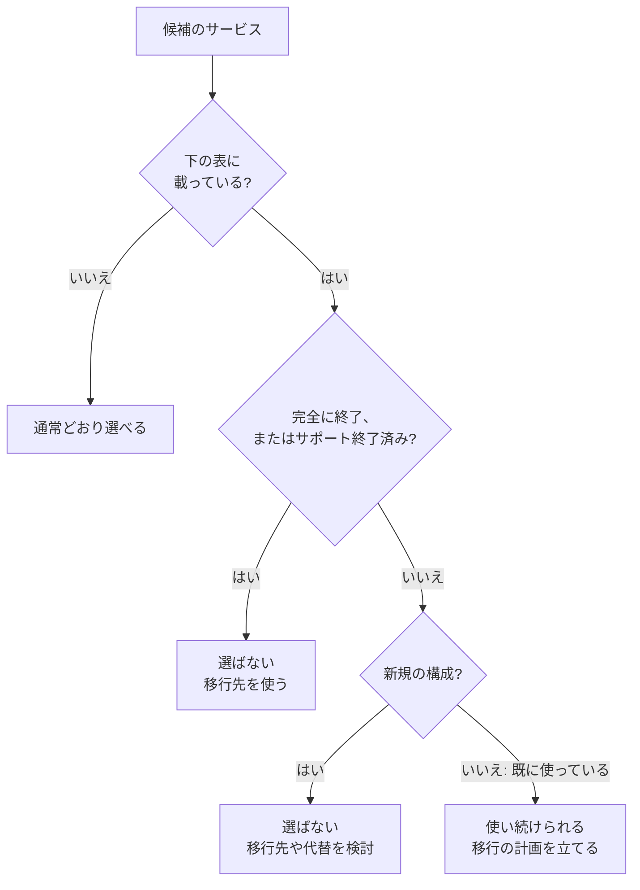
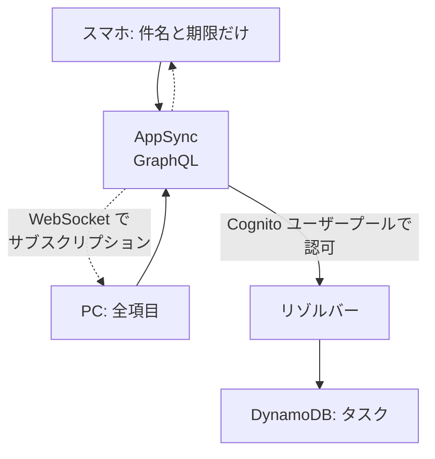
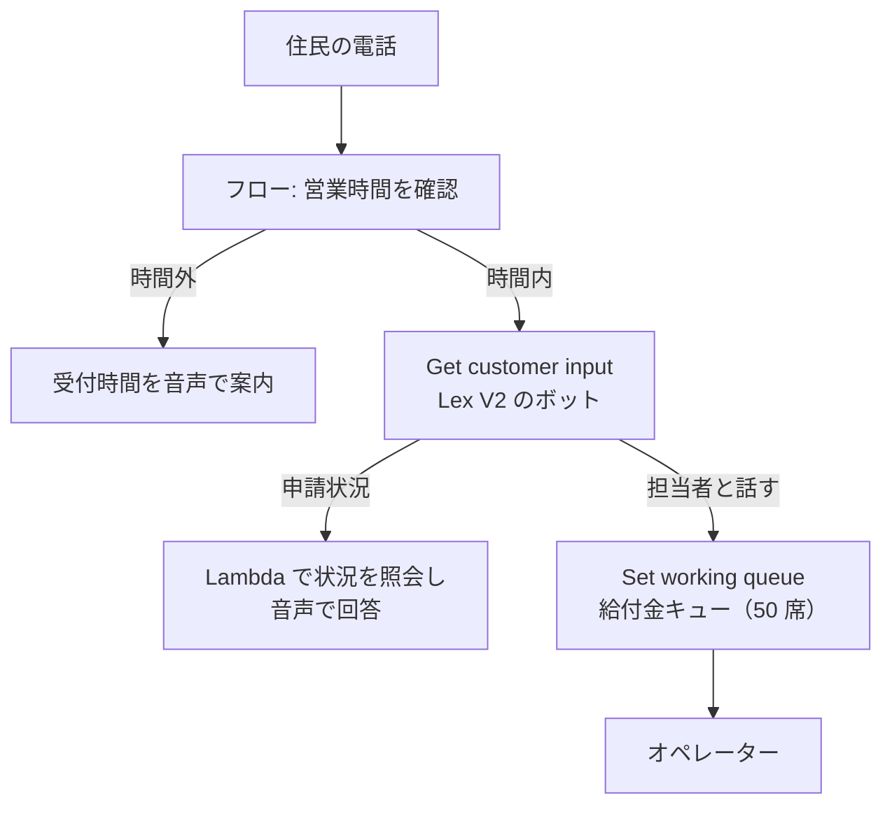
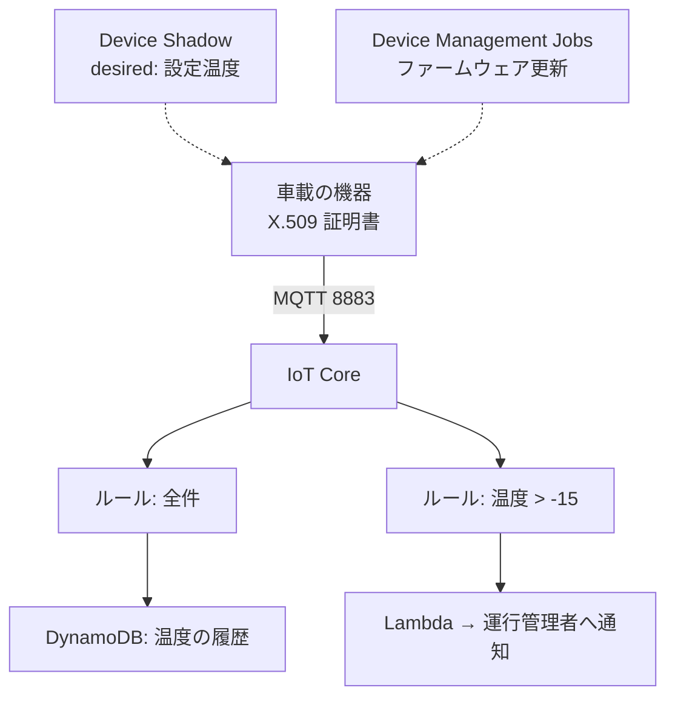
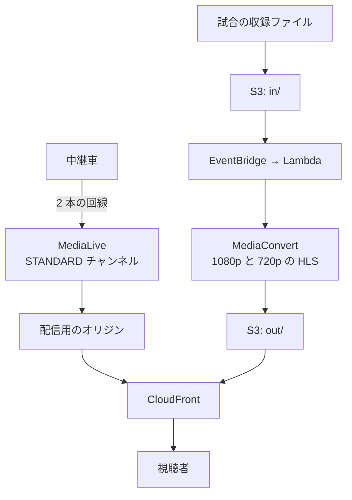
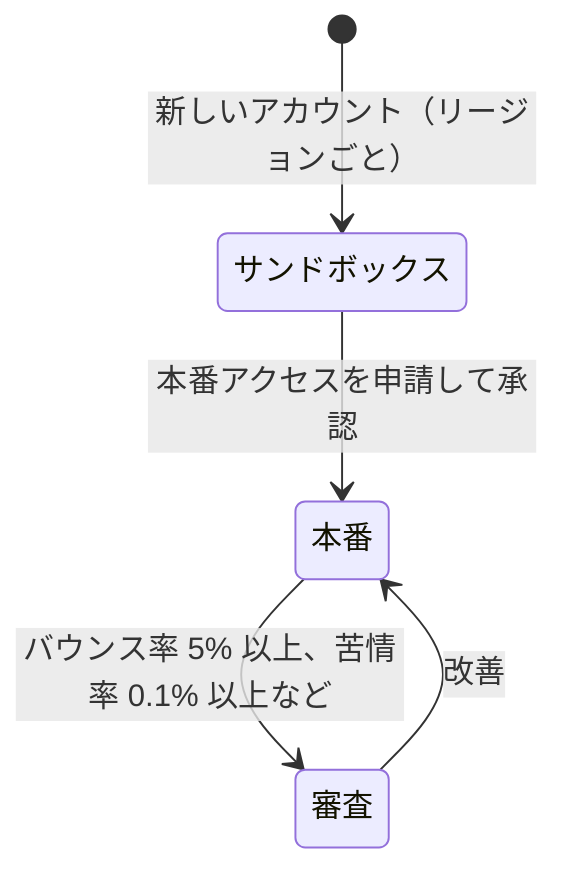
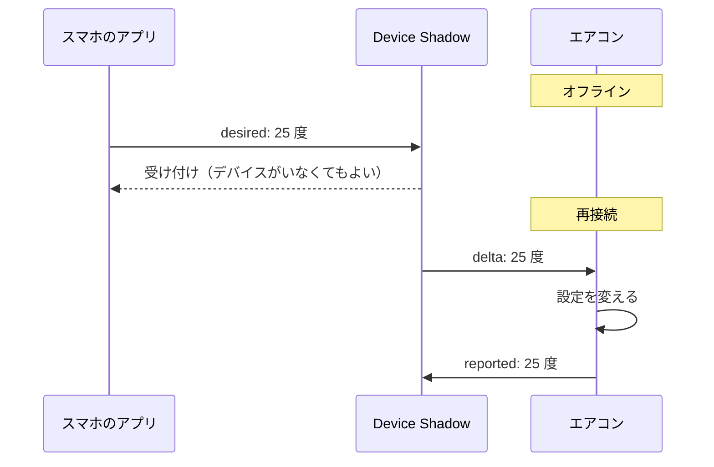
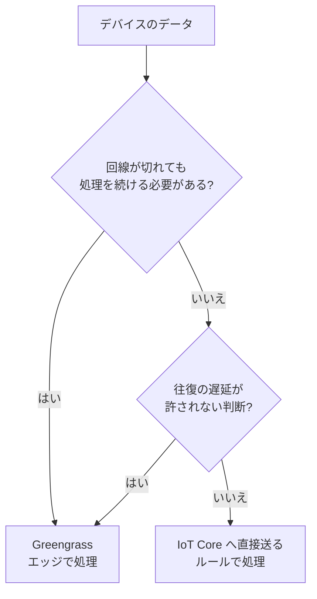
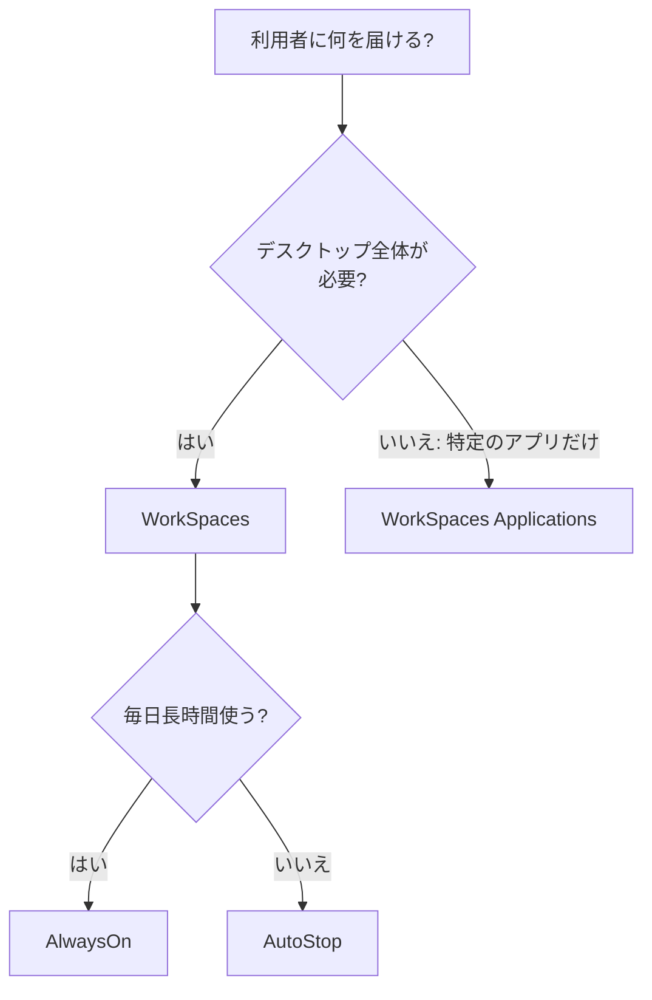
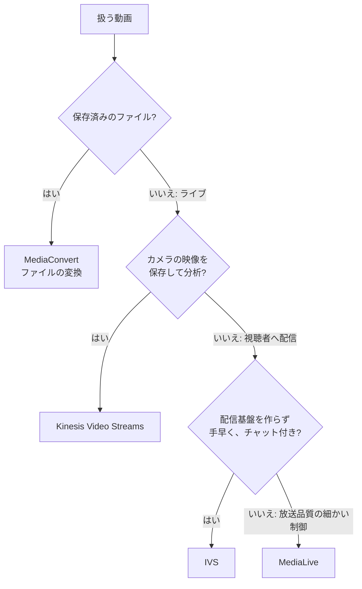

# その他のサービス

[:material-sprout: CLF](../courses/clf/services.md){ .exam-badge .exam-foundational } [:material-certificate: SAA](../courses/saa/services.md){ .exam-badge .exam-associate } [:material-certificate: SOA](../courses/soa/services.md){ .exam-badge .exam-associate } [:material-certificate: DEA](../courses/dea/services.md){ .exam-badge .exam-associate } [:material-certificate: MLA](../courses/mla/services.md){ .exam-badge .exam-associate } [:material-star-circle: SAP](../courses/sap/services.md){ .exam-badge .exam-professional } [:material-star-circle: DOP](../courses/dop/services.md){ .exam-badge .exam-professional } [:material-star-circle: AIP](../courses/aip/services.md){ .exam-badge .exam-professional } [:material-target: SCS](../courses/scs/services.md){ .exam-badge .exam-specialty }

試験の範囲リストにあるものの、専用のページを作るほどではないサービスを短くまとめました。提供が終わったものも、古い教材や範囲リストに名前が残っているので状況を記載します。

## 提供状況の一覧 {#status}

2026 年 10 月時点の状況です。範囲リストに名前があっても、新規の構成では選べないものがあります。

AWS は、提供をやめるサービスをいきなり止めず、段階を踏んで告知します。既存の利用者が移行する時間を取るためです。AWS General Reference では、次の 3 つの一覧に分けて載せています（[参考](#references)）。

| 段階 | 新しい利用者 | 既存の利用者 | 一覧 |
| --- | --- | --- | --- |
| メンテナンス | 使えない | 使い続けられる | Services in Maintenance |
| サポート終了の予定（サンセット） | 使えない | 終了日まで使える | Services in Sunset |
| 完全に終了 | 使えない | 使えない | Services in Full Shutdown |

試験や設計で迷ったら、次の順で判断します。



| サービス | 状況 | 日付 | 移行先 |
| --- | --- | --- | --- |
| Amazon Pinpoint | サポート終了 | 2026-10-30 | Connect Customer、AWS End User Messaging |
| AWS IoT Events | 完全に終了 | 2026-05-20 | |
| AWS IoT Things Graph | 完全に終了 | 2022-11-09 | |
| AWS IoT 1-Click | 完全に終了 | 2025-01-29（IoT のガイドでは 2024-12-16） | |
| Amazon Elastic Transcoder | 完全に終了 | 2025-11-13 | AWS Elemental MediaConvert |
| AWS DeepComposer | 完全に終了 | 2025-09-17 | |
| AWS DeepRacer | コンソールでの提供を終了 | 2025-12-15 | DeepRacer on AWS（自分のアカウントで動かす OSS） |
| AWS IoT Greengrass V1 | サポート終了 | 2026-10-07 | Greengrass V2 |
| AWS Proton | サポート終了 | 2026-10-07 | |
| AWS App Mesh | サポート終了 | 2026-09-30 | ECS Service Connect など |
| AWS Infrastructure Composer | 新規受付を終了。スタンドアロンのコンソールも終了予定 | 2026-10-29、2026-12-07 | コンソールの IaC エディタ、VS Code の AWS Toolkit |
| Amazon Managed Blockchain | 新規受付を終了。サポートも終了予定 | 2026-10-29、2027-09-29 | |
| WorkSpaces Secure Browser | メンテナンス（新規利用不可） | 2026-10-29（公表は 2026-09-29） | |
| WorkSpaces Pools | 新規受付を終了。サポートも終了予定 | 2026-07-31、2027-12-31 | WorkSpaces Applications |
| PCoIP の WorkSpaces Personal | 新規受付を終了。サポートも終了予定 | 2026-07-31、2027-10-31 | |
| Timestream for LiveAnalytics | メンテナンス | 2025-06-20 | Timestream for InfluxDB |
| AWS IoT Device Defender の Detect | 新規利用不可 | 2026-06-30 | |
| AWS IoT SiteWise Monitor | メンテナンス | 2025-10-07 | |
| AWS App Runner | メンテナンス | 2026-03-31 | ECS Express Mode |
| AWS App2Container | 新規受付を終了 | 2025-11-07 | AWS Transform |
| Amazon CodeGuru Reviewer | メンテナンス | 2025-10-07 | |

メンテナンスの行の日付は、AWS General Reference の一覧にある公表日です。実際に新規利用ができなくなる日は、サービスごとに異なる場合があります。

名称の変更もあります。

| 旧称 | 現在の名称 |
| --- | --- |
| Amazon AppStream 2.0 | Amazon WorkSpaces Applications |
| Amazon Connect | Amazon Connect Customer（Amazon Connect は複数のソリューションの総称に） |
| Amazon GameLift | Amazon GameLift Servers |
| AWS Application Composer | AWS Infrastructure Composer |

## 使いどころと具体例 {#use-cases}

このページのサービスは、どれも「主要なサービスで作ると手間が合わない特定の用途」のためにあります。用途がはっきりしているので、合う場面ではほぼ迷わず選べ、合わない場面では選ぶ理由がありません。

**使う場面:**

| 場面 | 具体例 | 使う機能 |
|---|---|---|
| 大量のバッチを並べて回す | 創薬の研究所が 1 万件の化合物のシミュレーションを夜間に回す | [Batch](#batch) |
| 画面ごとに要る項目が違い、更新をすぐ届けたい | プロジェクト管理 SaaS で、他のメンバーのタスク変更を即座に画面へ反映する | [AppSync](#appsync) |
| アプリからメールを送る | ネットスーパーが 1 日 2 万通の注文確認メールを送る | [SES](#ses) |
| JMS や AMQP の既存アプリを書き換えずに移す | 銀行の口座振替の連携で使う ActiveMQ を、アプリはそのままでクラウドへ移す | [Amazon MQ](#mq) |
| 期間限定の電話窓口 | 市の給付金のコールセンターを、申請期間の 3 か月だけ 50 席で開く | [Connect Customer](#connect) |
| 多数の機器から計測値を集める | 冷凍トラック 2,000 台の庫内の温度を 1 分ごとに集める | [IoT Core](#iot-core) |
| 回線が切れても現場で判断する | 部品工場の検査カメラで、不良品をその場でラインから外す | [Greengrass](#iot-greengrass)、[SiteWise](#iot-sitewise) |
| 端末にデータを残さず画面だけを届ける | 委託先のオペレーターに仮想デスクトップを、大学の授業に CAD のアプリだけを配る | [WorkSpaces](#workspaces)、[WorkSpaces Applications](#appstream) |
| カメラの映像を保存して分析する | 介護施設の居室のカメラで転倒を検知し、前後の映像を見返す | [Kinesis Video Streams](#kinesis-video) |
| チャット付きのライブ配信 | 雑貨チェーンが店頭からライブコマースを配信する | [IVS](#ivs) |
| 放送品質の生中継と見逃し配信 | 有料のスポーツ配信で試合を生中継し、終了後に見逃し配信を作る | [MediaLive](#medialive)、[MediaConvert](#mediaconvert) |
| 対戦ゲームの専用サーバー | 8 人対戦のゲームで、プレイヤーの近くのリージョンに試合を置く | [GameLift Servers](#gamelift) |

**使わない方がよい場面:**

| 場面 | 理由 | 代わりの選択肢 |
|---|---|---|
| 新しい構成で、メンテナンスやサポート終了のサービスを選ぶ（App Runner、Pinpoint など） | 新しい利用者は使えないか、まもなく使えなくなる | [提供状況](#status)の移行先 |
| 新しく作るアプリ同士のメッセージに Amazon MQ を使う | ブローカーの大きさと台数の運用が残る | [SQS と SNS](messaging.md) |
| 数秒で終わるイベントごとの処理に Batch を使う | キューの待ちと容量の起動があり、軽い処理には重い | [Lambda](lambda.md) |
| SMS やプッシュ通知を SES で送ろうとする | SES はメールのサービス | [SNS](messaging.md)、AWS End User Messaging |
| ログやクリックのレコードを Kinesis Video Streams に流す | 動画などのメディアの時系列向けで、レコードの処理には向かない | [Kinesis Data Streams](streaming.md) |

### 例: 創薬研究所の化合物シミュレーション {#use-case-drug}

**状況:** 研究者 10 名の創薬の研究所です。候補の化合物 1 万件について、1 件 20〜40 分の CPU の計算を行います。結果は 3 日以内に出ればよく、研究費の範囲に収めるため、計算機は安く使いたいと考えています。

**構成:**

| 要素 | 内容 |
|---|---|
| 入力 | S3 に化合物ごとのファイル 1 万個 |
| ジョブ | サイズ 10,000 の配列ジョブ。子は `AWS_BATCH_JOB_ARRAY_INDEX`（0〜9,999）で担当のファイルを選ぶ |
| コンピューティング環境 | Spot の EC2。ジョブがないときは 0 台 |
| 出力 | S3 に化合物ごとの結果。最後に集計のジョブを `N_TO_N` でなく通常の依存で 1 つ置く |

**設定値:**

| 設定 | 値 | 理由 |
|---|---|---|
| `attemptDurationSeconds` | 3,600 | 最長 40 分の計算に余裕を持たせる。暴走した計算を 1 時間で止める |
| `retryStrategy.attempts` | 3 | Spot の中断で止まった子を再実行する。範囲は 1〜10 |
| `evaluateOnExit` | 入力ファイルの不正による終了は `EXIT`、それ以外は `RETRY` | 直らない失敗を 3 回繰り返さない。条件は最大 6 つ |

**なぜこのサービスか:** 1 件 40 分は Lambda の 15 分を超えます。EC2 を自分で並べると、順番待ち、失敗した計算の再実行、終わった台の停止を自分で作ることになります。Batch はこれを引き受け、ジョブがないときは 0 台にできます。

**つまずきやすい点:**

- 化合物が 1 万 1 件になると、配列ジョブのサイズ上限 10,000 を超えます。2 つのジョブに分けます。
- 計算のバグで全件が失敗すると、`attempts` の回数だけ再実行され、Spot の料金が 3 倍かかります。`evaluateOnExit` で直らない失敗を止めます。
- 結果を `/tmp` に書いたまま S3 へ送らないと、コンテナの終了とともに消えます。

### 例: プロジェクト管理 SaaS のリアルタイム更新 {#use-case-pm-saas}

**状況:** 利用企業 1,200 社のプロジェクト管理 SaaS で、平日の昼は 3 万人が同時に画面を開いています。スマホの一覧は件名と期限だけ、PC の詳細画面は担当者やコメントまで表示します。同じチームの誰かがタスクを動かしたら、他のメンバーの画面にもすぐ反映したいと考えています。

**構成:**



**設定値:**

| 設定 | 値 | 理由 |
|---|---|---|
| 認可 | Cognito ユーザープール | 利用者ごとに企業とチームを判定する。API キーは期限が切れるので主な認可にしない |
| サブスクリプション | `updateTask` のミューテーションに `@aws_subscribe` | チーム ID を引数にして、自分のチームの変更だけ受け取る |
| キャッシュ | 一覧のリゾルバーに TTL 60 秒、キーに `context.identity` を含める | 読み取りの多い一覧の問い合わせを減らし、他社のデータを返さない |

**なぜこのサービスか:** REST では画面ごとにエンドポイントを分けるか、要らない項目まで返すことになります。リアルタイムの通知も、WebSocket の接続管理を自分で作る必要があります。AppSync は、項目の選択とサブスクリプションの接続管理を 1 つの API で引き受けます。

**つまずきやすい点:**

- サブスクリプションは AppSync のミューテーションをきっかけに届きます。夜間のインポートで DynamoDB に直接書いた変更は、どの画面にも通知されません。
- サブスクリプションの選択セットに書いていない項目は届きません。ミューテーションの選択セットにない項目は `null` になります。
- キャッシュのキーをタスク ID だけにすると、別の企業の利用者に他社の結果を返すおそれがあります。

### 例: ネットスーパーの注文確認とお知らせのメール {#use-case-grocery-mail}

**状況:** 会員 50 万人のネットスーパーです。注文確認と配達予定のメールが 1 日 2 万通、週 1 回のセールのお知らせが 30 万通です。注文確認が迷惑メールに入ると問い合わせが増えるので、お知らせの苦情が注文確認の届きやすさに響かないようにしたいと考えています。

**構成:**

| 要素 | 内容 |
|---|---|
| 送信元 | `example.com` を東京リージョンで検証し、Easy DKIM を設定 |
| 設定セット | 注文確認用とお知らせ用の 2 つに分ける |
| イベントの発行 | Bounce と Complaint を SNS へ送り、Lambda が会員の配信設定を更新する |
| 監視 | CloudWatch で設定セットごとのバウンス率と苦情率を見る |

**設定値:**

| 設定 | 値 | 理由 |
|---|---|---|
| 本番アクセス | 申請して承認を得る | サンドボックスでは検証済みの宛先に 24 時間で 200 通まで |
| お知らせの送信の速さ | 送信のクォータの範囲で数時間に分けて送る | 30 万通を一度に送るとクォータに当たる |
| 宛先の整理 | 1 年間開封のない会員はお知らせから外す | 古い宛先はバウンスの原因になる |
| バウンス率のアラーム | 2% | 審査の対象になる 5% より前に気付く |

**なぜこのサービスか:** 自前のメールサーバーでは、送信元の評判の管理とバウンスの処理を自分で作ります。SES は、送信の結果をイベントとして受け取れるので、配信停止の処理を自動にできます。

**つまずきやすい点:**

- 1,000 通で 60 件がバウンスすると 6% で、審査の対象になります。古い会員の名簿にいきなり送るときに起きやすい失敗です。
- 東京で検証したドメインは、大阪では未検証です。災害対策で大阪から送る構成なら、大阪でも検証と本番アクセスの申請が要ります。
- 設定セットを指定し忘れたメールは、イベントが発行されず、バウンスの処理から漏れます。

### 例: 地方銀行のメッセージ連携の移行 {#use-case-bank-mq}

**状況:** 地方銀行の口座振替の連携システムで、収納代行の会社とのやり取りを ActiveMQ と JMS で行っています。1 日 50 万メッセージ、月末はその 10 倍が数時間に集中します。メッセージは 1 件も失えません。アプリの改修予算はなく、データセンターの閉鎖に合わせてブローカーだけをクラウドへ移します。

**構成:**

| 要素 | 内容 |
|---|---|
| ブローカー | Amazon MQ for ActiveMQ、アクティブ/スタンバイ |
| ストレージ | EFS（複数の AZ に保存） |
| ネットワーク | 2 つの AZ のプライベートサブネット。公開のアクセスは無効 |
| 接続 | オンプレミスのアプリから専用線経由で同じプロトコルのまま |

**設定値の計算:** 月末のピークを 1 日 500 万メッセージが 8 時間に集中すると考えると、5,000,000 ÷ (8 × 3,600) ≒ 毎秒 174 件です。1 KB のメッセージの公式の目安は EFS で毎秒 80 件なので、1 つのブローカーでは足りません。キューを業務ごとに分けて複数のブローカーに分散するか、月末の処理の開始を前倒しします。平常の 1 日 50 万件は毎秒約 6 件で、余裕があります。

**なぜこのサービスか:** SQS に移すとアプリの JMS のコードを書き換える必要があります。ブローカーを自前の EC2 で動かすと、パッチと冗長化が残ります。Amazon MQ なら、プロトコルを変えずにサーバーの運用だけを手放せます。

**つまずきやすい点:**

- 速さを求めて EBS を選ぶと、アクティブ/スタンバイにできず、データは 1 つの AZ だけになります。失えないメッセージには EFS です。
- 検証で使った単一インスタンスのまま本番にすると、ブローカーの障害で連携が止まります。
- 移行後に新しく作る連携まで Amazon MQ に載せると、運用の対象が増えます。新しい連携は SQS と SNS を検討します。

### 例: 市の給付金コールセンター {#use-case-city-call}

**状況:** 人口 40 万人の市が、新しい給付金の申請受付を 3 か月行います。最初の 2 週間は 1 日 3,000 件の電話が見込まれ、50 席を用意します。期間後は 5 席で十分です。窓口は平日 9 時から 17 時で、「申請状況の確認」は自動で答えたいと考えています。

**構成:**



**設定値:**

| 設定 | 値 | 理由 |
|---|---|---|
| Lex のエイリアス | 本番用のエイリアス（`TestBotAlias` は使わない） | テスト用のエイリアスは同時の呼び出し数が限られる |
| 言語の属性 | `Set voice` などで日本語に合わせる | Lex V2 のボットの言語と、Connect Customer の言語の属性が一致する必要がある |
| 席数 | 最初の 2 週間は 50、その後は 5 | 交換機の設備と違い、使う席の分だけで済む |

**なぜこのサービスか:** 3 か月のために交換機と回線を調達すると、期間後に設備が余ります。Connect Customer は電話の受付とキューをクラウドで用意し、席を増減できます。申請状況の確認を自動にすれば、オペレーターは申請の相談に集中できます。

**つまずきやすい点:**

- テストの延長で `TestBotAlias` のまま公開すると、受付の初日に同時の呼び出しが上限に当たり、ボットが応答しなくなります。
- Lex V2 のボットの言語とフローの言語の属性が違うと、音声が認識されません。
- 申請状況の照会で住民の番号を読み上げてもらうなら、通話の録音やログに番号が残ります。残す範囲を事前に決めます。

### 例: 冷凍トラックの温度監視 {#use-case-coldchain}

**状況:** 冷凍食品の物流会社で、冷凍トラック 2,000 台が庫内の温度を 1 分ごとに送ります。1 日 2,000 × 1,440 = 288 万メッセージです。マイナス 15 度を超えたら運行管理者に知らせます。山間部では回線がよく切れ、車載の機器は営業所のファイアウォールの内側で更新することもあります。

**構成:**



**設定値:**

| 設定 | 値 | 理由 |
|---|---|---|
| 認証 | 1 台ごとに別の X.509 証明書 | 1 台の漏えいで全台が影響を受けないようにする |
| 通知のルール | `SELECT temp, truckId FROM 'trucks/+/temp' WHERE temp > -15` | 超えたものだけ Lambda に渡す |
| 設定温度の変更 | Shadow の `desired` に書く | 圏外のトラックにも、つながったときに差分が届く |
| ファームウェアの更新 | まず 50 台、失敗率 5% を超えたら中止 | 全台を一度に止めない |

**なぜこのサービスか:** HTTP で数分ごとに問い合わせる方式では、2,000 台分の通信量と、圏外の間に届かない指示の扱いを自分で作ることになります。IoT Core は軽い MQTT の接続を受け、Shadow で圏外の機器への指示も保持します。

**つまずきやすい点:**

- 量産の都合で全台に同じ証明書を入れると、Device Defender の Audit で指摘されます。1 台の漏えいで全台の証明書を失効させることになります。
- 証明書にポリシーを付け忘れると、接続や Publish が拒否されます。
- 営業所のファイアウォールで 8883 番が閉じていると接続できません。443 番を使うなら ALPN に `x-amzn-mqtt-ca` を指定します。

### 例: 部品工場の外観検査 {#use-case-factory}

**状況:** 自動車部品の工場で、8 本のラインに検査カメラがあります。1 ラインあたり毎秒 10 枚を撮り、不良品は 100 ms 以内にラインから外す必要があります。工場の回線は月に数回、1〜2 時間切れます。設備の停止の記録から、平均故障間隔も毎日見たいと考えています。

**構成:**

| 場所 | 要素 | 役割 |
|---|---|---|
| 工場 | Greengrass V2 のコアデバイス | カメラの画像をその場で推論し、不良品を外す信号を出す |
| 工場 | SiteWise Edge | 設備の稼働と停止を集める |
| クラウド | IoT Core、S3 | 判定の結果と疑わしい画像を回線が戻ってから受け取る |
| クラウド | IoT SiteWise | 平均故障間隔などをメトリクスとして計算する |

**設定値:**

- **推論の場所:** 100 ms の判定はクラウドとの往復を待てないので、すべて工場の中で行います。
- **送る量:** 全画像を送ると回線を圧迫するので、不良と判定した画像と、信頼度が低かった画像だけを送ります。
- **平均故障間隔:** 稼働 700 時間、停止 7 回なら 100 時間です。この式を SiteWise のメトリクスとして定義します。

**なぜこのサービスか:** 判定をクラウドで行うと、回線が切れた 2 時間はラインを止めるか、検査なしで流すことになります。Greengrass なら判定は現場で続き、ソフトウェアと推論のモデルの配布はクラウドから一括で行えます。

**つまずきやすい点:**

- 既存の資料が Greengrass V1 を前提にしていることがあります。V1 はサポートが終了したので V2 で作ります。
- SiteWise Monitor は新規に使えません。ダッシュボードは別の可視化の手段で作ります。
- 推論のモデルを更新するとき、全ラインに同時に配ると、不具合で全ラインが止まります。1 ラインで確かめてから広げます。

### 例: 商社の在宅勤務と委託先の端末 {#use-case-vdi}

**状況:** 社員 3,000 人の商社が、在宅勤務の社員 800 名と、受発注の事務を委託する会社のオペレーター 300 名に業務の端末を用意します。委託先の PC は会社の管理外なので、顧客の情報を端末に残せません。社員の認証は既存のオンプレミスの Active Directory です。

**構成:**

| 要素 | 内容 |
|---|---|
| ディレクトリ | AD Connector で既存の Active Directory を使う。社員は今のパスワードでサインイン |
| WorkSpaces | 東京リージョンの 2 つの AZ のプライベートサブネット |
| 社内システム | Direct Connect でオンプレミスの基幹システムへ |
| 端末側 | データは WorkSpace に残り、手元には画面だけが届く |

**設定値:**

| 対象 | 実行モード | 理由 |
|---|---|---|
| 毎日 8 時間使う委託先のオペレーター | AlwaysOn | 月額固定のほうが安くなりやすい |
| 週 1〜2 日の在宅勤務の社員 | AutoStop（切断から 1 時間で停止） | 使った時間だけの課金にする |
| プロトコル | PCoIP 以外 | PCoIP の WorkSpaces Personal は新規受付を終了している |

**なぜこのサービスか:** オンプレミスの VDI はピークの人数に合わせてサーバーを買う必要があり、委託先の増減に合わせにくいです。WorkSpaces なら人数分を作り、契約が終われば消せます。

**つまずきやすい点:**

- AutoStop の WorkSpace は停止すると、開いていたアプリの状態が失われることがあります。GPU の AutoStop などはハイバネートに対応しません。
- 検証で作った AD Connector を 30 日使わずにいると、WorkSpaces から登録が外れ、ディレクトリの料金がかかり始めます。
- 利用者がアプリを 1 つしか使わないなら、デスクトップ全体を配るより WorkSpaces Applications のほうが管理は軽くなります。

### 例: 大学の CAD 授業 {#use-case-university}

**状況:** 工学部の学生 1,200 名が、設計の授業で CAD を使います。授業は週 20 コマで、1 コマに 80 名が同時に使います。課題は夜や週末にも取り組みます。学生の私物の PC は性能がまちまちで、CAD を入れられない機種もあります。

**構成:**

| 要素 | 内容 |
|---|---|
| 配信 | WorkSpaces Applications で CAD だけをブラウザへ配信 |
| 授業の時間帯 | Always-On のフリートを授業の人数分待機させる |
| 夜と週末 | On-Demand のフリート。接続時に起動 |
| ライセンス | CAD のライセンスサーバーへ VPC 経由で接続 |

**設定値:**

- **授業の容量:** 9 時の授業開始に 80 名が一斉に接続するので、8 時 50 分には 80 名分を Always-On で起動しておきます。
- **夜の容量:** 夜は同時 20 名ほどなので On-Demand にし、起動の少しの待ちを受け入れます。

**なぜこのサービスか:** 演習室の PC を CAD が動く性能でそろえると、授業のない時間も設備が遊びます。デスクトップ全体を配る WorkSpaces より、CAD だけを配るほうが学生のアカウントの管理も軽くなります。

**つまずきやすい点:**

- Elastic のフリートで同時接続の上限を低くすると、授業の開始時に超えた学生が接続できません。
- CAD のライセンス数を超える同時接続を許すと、起動はできてもライセンスの取得で失敗します。フリートの上限をライセンス数に合わせます。

### 例: 介護施設の見守りカメラ {#use-case-care}

**状況:** 3 拠点、合わせて 120 室の介護施設です。夜間の転倒を早く見つけるため、居室のカメラの映像を AWS に送り、転倒を検知したら夜勤の職員に知らせます。検知の前後の映像は、家族への説明のため 3 日間見返せるようにします。

**構成:**

| 要素 | 内容 |
|---|---|
| 取り込み | カメラ 1 台に 1 つの Kinesis video stream |
| 保持 | `DataRetentionInHours` を 72 |
| 検知 | ストリームの映像を転倒検知のモデル（SageMaker AI など）で処理 |
| 確認 | 職員のタブレットで、通知の前後の映像を再生 |
| 暗号化 | 自分で管理する KMS キーを `KmsKeyId` に指定 |

**設定値:**

| 設定 | 値 | 理由 |
|---|---|---|
| `DataRetentionInHours` | 72 | 家族への説明に 3 日分を残す。既定の 0 では保存されない |
| `KmsKeyId` | 施設の鍵 | 指定しないと `aws/kinesisvideo` の鍵で暗号化される。鍵の権限で見られる人を絞る |

**なぜこのサービスか:** 録画の機器を各拠点に置くと、映像の分析は拠点ごとに機器をそろえる必要があります。Kinesis Video Streams なら、取り込み、保存、分析への受け渡しをまとめて任せられます。

**つまずきやすい点:**

- `DataRetentionInHours` を指定せずに作ると既定の 0 で、映像は保存されません。サービスのバッファに 5 分、200 MB までしか残らず、後から見返せません。
- 保持を「念のため」30 日にすると、120 台分の保存の費用が 10 倍になります。目的に必要な期間にします。
- 居室の映像は特に慎重に扱う情報です。再生できる職員のロールを絞り、再生の操作を CloudTrail で記録します。

### 例: 雑貨チェーンのライブコマース {#use-case-livecommerce}

**状況:** 全国 120 店舗の雑貨チェーンが、週 3 回、店頭から 1 時間のライブコマースを配信します。視聴は 1 回 5,000 人ほどで、チャットの質問に数秒で答えます。配信はスタッフのスマホから行うので、電波の具合で途切れることがあります。終了後は録画をアーカイブとして公開します。

**構成:**

| 要素 | 内容 |
|---|---|
| 配信 | IVS の低レイテンシーストリーミング（5 秒未満）と IVS Chat |
| 録画 | S3 への自動録画。HLS とサムネイルが保存される |
| アーカイブの配信 | 非公開の S3 を、オリジンアクセスコントロールを設定した CloudFront から配信 |
| 公開の処理 | EventBridge の録画終了のイベントで Lambda が商品ページにリンクを追加 |

**設定値:**

| 設定 | 値 | 理由 |
|---|---|---|
| `recordingReconnectWindowSeconds` | 60 | 電波で切れても 60 秒以内の再接続なら 1 つの録画にまとめる |
| サムネイルの間隔 | 既定の 60 秒 | アーカイブの目次に使う。範囲は 1〜60 秒 |

**なぜこのサービスか:** チャットの質問に答える配信は、数十秒の遅れがあると会話になりません。放送用の MediaLive を組み合わせて作るより、IVS は配信とチャットをまとめて手早く用意できます。

**つまずきやすい点:**

- 再接続の待ち時間を設定すると、録画終了のイベントがその時間以上遅れます。終了直後にアーカイブを公開する処理は、その分待たせます。
- Web Broadcast SDK はビットレートを変えるので、再接続した配信が 1 つの録画にまとまらないことがあります。
- 録画のファイルは非公開です。S3 の URL を直接商品ページに貼っても再生できません。

### 例: 有料スポーツ配信の生中継と見逃し配信 {#use-case-sports}

**状況:** 月間 1,000 万再生の有料スポーツ配信です。週末の試合を同時に最大 20 万人が視聴します。中継が止まると返金の対象になるので、映像の変換に冗長性が必要です。試合後 2 時間以内に見逃し配信を公開します。

**構成:**



**設定値:**

| 設定 | 値 | 理由 |
|---|---|---|
| チャンネルクラス | `STANDARD` | 2 つのパイプラインの片方が止まっても中継が続く |
| 上流の映像 | 中継車から 2 本 | `STANDARD` は 2 つの入口で同じ映像を受ける |
| 見逃し配信の出力 | 1080p と 720p の HLS | 回線の速さに合わせて切り替える |

**なぜこのサービスか:** 放送局の専用機材を週末のためだけに持つと、平日は遊びます。ライブの変換は MediaLive、保存済みファイルの変換は MediaConvert と、用途で分かれています。視聴者との会話が主役でなく、放送品質と冗長性が要るので、IVS ではなく MediaLive です。

**つまずきやすい点:**

- 費用を抑えて `SINGLE_PIPELINE` にすると、パイプラインの障害で中継が止まります。
- `STANDARD` にしたのに上流から 1 本しか送っていないと、冗長になりません。
- 古い手順書が Elastic Transcoder を前提にしていることがあります。完全に終了しているので MediaConvert で作ります。

### 例: 対戦ゲームの専用サーバー {#use-case-game}

**状況:** 8 人対戦のアクションゲームで、1 試合は約 10 分です。日本と北米で配信し、21 時台のピークは同時 3 万人、つまり 3 万 ÷ 8 = 3,750 試合です。遅延が 100 ms を超えると操作の遅れに苦情が出ます。不正を防ぐため、試合の判定はサーバー側で行います。

**構成:**

| 要素 | 内容 |
|---|---|
| フリート | 東京とオレゴンのリージョンに、Spot とオンデマンドのフリート |
| 配置 | 複数の場所を含むキューで、プレイヤーの遅延が小さい場所に試合を置く |
| マッチング | FlexMatch で、腕前の近い 8 人を 2 チームに分ける |
| 試合の記録 | 試合の結果を DynamoDB に保存 |

**設定値:**

- **容量:** 目標ベースの自動スケーリングで、空きの試合枠を一定の割合だけ常に残します。21 時の立ち上がりで、起動を待つプレイヤーを出さないためです。
- **費用:** 平常の試合は Spot のフリートに置き、容量が足りないときはオンデマンドへ回します。
- **マッチングの規模:** FlexMatch は 2〜200 人の試合に対応するので、8 人対戦は範囲内です。

**なぜこのサービスか:** 試合ごとのサーバーの起動と停止、空いたサーバーへの割り当て、プレイヤーの近くへの配置を自前で作ると、ゲームの開発より基盤の作業が大きくなります。GameLift Servers はこれを引き受けます。

**つまずきやすい点:**

- Spot が中断されると、その上の試合も終わります。順位に影響する大会の試合はオンデマンドのフリートに置きます。
- プレイヤーごとの遅延の値をキューに渡さないと、遅延を考えずに試合が置かれ、日本のプレイヤーが北米のサーバーに入ることがあります。
- 夜間に容量を 0 近くまで減らすと、深夜の少数のプレイヤーが試合の開始を長く待ちます。

## コンピューティングと開発 {#compute-dev}

EC2、Lambda、コンテナの主要な選択肢では手間が合わない用途（大量のバッチ、小さな Web サイト、ライセンスの管理）のためのサービスです。提供を終えたものも多いので、[提供状況](#status)と合わせて読みます。

### AWS Batch {#batch}

[:material-sprout: CLF](../courses/clf/services.md){ .exam-badge .exam-foundational } [:material-certificate: SAA](../courses/saa/services.md){ .exam-badge .exam-associate } [:material-certificate: DEA](../courses/dea/services.md){ .exam-badge .exam-associate } [:material-certificate: MLA](../courses/mla/services.md){ .exam-badge .exam-associate }

[提供単位](resource-scope.md#two-axes): リージョン。コンピューティング環境のインスタンスやタスクはサブネット（AZ、VPC の中）で動きます。

コンテナのバッチジョブを、必要な量の容量を用意して順に実行します。ジョブの定義、キュー、コンピューティング環境を用意すれば、スケジューラーとインフラの管理は任せられます。

夜間の集計や大量の画像処理を自前で行うと、ピークに合わせた台数のサーバーを買い、昼は遊ばせることになります。さらに、ジョブの順番待ちや再実行を管理するスケジューラーも必要です。Batch は、ジョブがあるときだけ容量を用意し、順番待ちも引き受けるためのサービスです。

| 観点 | オンプレミスのジョブ管理（HPC のスケジューラーなど） | AWS Batch |
| --- | --- | --- |
| 同じ点 | ジョブをキューに入れ、空いた計算資源で順に実行する | 同じ |
| 計算資源 | 買った台数で固定 | ジョブの量に合わせて増減し、なければ 0 台にできる |
| 安く済ませる方法 | 稼働率を上げる | Spot を使う。中断はリトライで吸収する |
| 実行の単位 | スクリプトやバイナリ | コンテナイメージ |

[](../assets/diagrams/other-services-batch.png)

- EC2、Fargate、ECS Managed Instances で動き、ECS または EKS 上で実行します。
- 配列ジョブは 2〜10,000 の子ジョブに分割します。
- マルチノード並列ジョブは、複数の EC2 にまたがる HPC や分散学習に使います。
- ジョブのタイムアウト（`attemptDurationSeconds`）は 60 秒以上です。
- SageMaker のトレーニングジョブのキューイングにも使えます。

- **配列ジョブの例:** サイズ 1,000 で投入すると、1 つのジョブが 1,000 の子を生みます。子は環境変数 `AWS_BATCH_JOB_ARRAY_INDEX`（0〜999）で担当のファイルを選びます。サイズ 1 や 10,001 は指定できません。
- **タイムアウトの例:** `attemptDurationSeconds` を 3600 にすると、開始から 1 時間で `SIGTERM` を受けて終了します。60 未満は指定できません。時間ちょうどとは限らず、数秒遅れることがあります。
- **依存の例:** `N_TO_N` で配列ジョブ B が A に依存すると、B の 5 番は A の 5 番の完了を待ちます。`SEQUENTIAL` なら 0 番から順に実行します。
- **Spot の例:** 中断に耐えるジョブは Spot の環境に送り、リトライを `attempts: 3` にします。

**選び方:** 15 分を超える長時間の処理や、数千のジョブを並べるなら Batch を選びます。短いイベント処理は Lambda、複数のステップの制御は [Step Functions](step-functions.md) です。

### Amazon Lightsail {#lightsail}

[提供単位](resource-scope.md#two-axes): リージョン。インスタンスは AZ を選んで作り、AWS が管理する Lightsail 用の VPC に入ります。

仮想サーバー、コンテナ、データベースなどをまとめて簡単に使えるサービスです。小さな Web サイトや個人のプロジェクトに向きます。

**選び方:** 細かい設定が要らず、すぐ始めたいなら Lightsail を選びます。VPC やスケーリングの細かい制御が必要なら EC2 です。

- **例:** 個人のブログで WordPress を 1 台動かすなら Lightsail です。セール時に 2 台から 20 台へ自動で増やすなら EC2 です。

SAP-C03 では範囲外です。

### AWS App Runner {#app-runner}

[:material-star-circle: DOP](../courses/dop/services.md){ .exam-badge .exam-professional } [:material-star-circle: AIP](../courses/aip/services.md){ .exam-badge .exam-professional }

[提供単位](resource-scope.md#two-axes): リージョン。サービスは VPC の外で動きます。VPC コネクタで VPC のリソースへ接続します。

コンテナやソースコードを、インフラを意識せずに Web アプリとして動かすサービスです。

**メンテナンスに移行し、新規顧客は使えません（公表は 2026 年 3 月 31 日）。** 既存の顧客は継続できます。新規の場合、AWS は Amazon ECS Express Mode を勧めています。[コンテナ](containers.md) を参照してください。

### AWS App2Container {#app2container}

オンプレミスの Java や .NET アプリをコンテナ化し、ECS や EKS へ展開するツールです。

**2025 年 11 月 7 日で新規受付を終了しました。** AWS は [AWS Transform](migration.md) を勧めています。

### AWS Proton {#proton}

プラットフォームチームが用意したテンプレートから、開発者がインフラとパイプラインをセルフサービスで作るサービスでした。

**公式の告知では 2026 年 10 月 7 日でサポート終了です。** この日以降はコンソールとリソースにアクセスできません。デプロイ済みのインフラはそのまま残ります。DOP-C02 と SAA-C03 の対象サービス一覧には名前が残っています。

### AWS Infrastructure Composer {#infrastructure-composer}

CloudFormation のテンプレートを図で組み立てるツールです。旧称は AWS Application Composer です。

**2026 年 10 月 29 日で新規受付を終了し、2026 年 12 月 7 日にスタンドアロンのコンソールが終了します。** コンソール内の新しい IaC エディタと、VS Code の AWS Toolkit で同様のことができます。テンプレートの書き方は [IaC と CLI](iac.md) を参照してください。

AWS General Reference の一覧には、終了日として 2027 年 9 月 29 日とあり、サービスのガイドと日付が異なります。

### Amazon CodeGuru {#codeguru}

コードの品質と性能を分析するサービス群です。

| 機能 | 状況 |
| --- | --- |
| CodeGuru Reviewer | 2025 年 11 月 7 日から新しいリポジトリを関連付けられない。メンテナンス中 |
| CodeGuru Security | 2025 年 11 月 20 日にサポートを終了し、コンソールとドキュメントも利用できない。後継は Inspector の Code Security |
| CodeGuru Profiler | アプリケーションの性能を分析する。提供状況の変更は確認できない |

### AWS App Mesh {#app-mesh}

Envoy プロキシによるサービスメッシュでした。

**公式の告知では 2026 年 9 月 30 日でサポート終了です。この日以降はコンソールとリソースにアクセスできません。** AWS は ECS Service Connect への移行を案内しています。[コンテナ](containers.md) を参照してください。

### AWS License Manager {#license-manager}

[提供単位](resource-scope.md#two-axes): リージョン。VPC の外です。

Microsoft、SAP、Oracle、IBM などのソフトウェアライセンスを、リージョンとアカウントをまたいで管理します。

**使う場面:** 50 のアカウントを持つ製薬会社が、持ち込んだ Oracle のライセンス 100 vCPU を全アカウントで数え、どの部署が起動しても契約を超えないようにする。

クラウドではサーバーを数分で増やせるため、ライセンスの数を超えて起動してしまう事故が起きやすくなります。オンプレミスでは購入の手続きが歯止めでしたが、その歯止めがありません。License Manager は、ライセンスの台帳と起動の制限を結び付けて、この歯止めを取り戻すためにあります。

- ライセンスの持ち込み（BYOL）に使います。
- 使用数の上限をハードリミットやソフトリミットで設定できます。
- ハードリミットは超過の起動を止め、ソフトリミットは通知します。

監査で問題になるライセンスの超過を防ぎたいときに選びます。

- **ハードリミットの例:** 契約が 100 vCPU の Oracle で、ハードリミットを 100 にします。使用が 96 vCPU のときに 8 vCPU の起動は、合計 104 になるので拒否されます。ソフトリミットなら起動でき、通知が届きます。
- **上限の例:** 自己管理ライセンスはリソースあたり 10 個、リージョンあたり 25 個までです。
- **誤ると:** 共有するアカウントと AMI の関連付けを忘れると、数えられずに監査で超過が見つかります。

## アプリケーションとメッセージ {#app-integration}

API Gateway、SQS、SNS が合わない場面のための選択肢です。どれも「既存の方式を変えずに AWS に載せたい」か「特定の方式（GraphQL、メール、電話）を自分で作りたくない」かのどちらかが選ぶ理由になります。

### AWS AppSync {#appsync}

[:material-star-circle: AIP](../courses/aip/services.md){ .exam-badge .exam-professional }

[提供単位](resource-scope.md#two-axes): リージョン。VPC の外です。プライベート API は VPC エンドポイントから呼びます。

GraphQL API と Pub/Sub API をサーバーレスで作るサービスです。

REST では、画面ごとに必要な項目が違っても、同じエンドポイントが同じ形のデータを返します。足りなければ何度も呼び、余れば捨てることになります。GraphQL は、クライアントが欲しい項目をクエリで指定する方式で、この過不足をなくすためにあります。引き換えに、キャッシュや認可をフィールドやリゾルバーの単位で考える必要があります。

| 項目 | 内容 |
| --- | --- |
| データソース | DynamoDB、Lambda、OpenSearch、HTTP エンドポイント、EventBridge など |
| 認可 | API キー、Lambda、IAM、OIDC、Cognito ユーザープール |
| マージド API | 複数の GraphQL API を 1 つにまとめる |
| サーバーサイドキャッシュ | 全リクエストまたはリゾルバーごと、TTL を指定 |
| AppSync Events | コードなしの WebSocket API。多数の購読者へ配信 |

**選び方:** クライアントが必要なフィールドだけを取得する、複数のデータソースを 1 つの API にまとめる、リアルタイムの更新を届けるなら AppSync を選びます。REST なら [API Gateway](api-gateway.md) です。

- **例:** スマホの一覧画面は `name` と `price` だけを取得し、PC の詳細画面は全項目を取得します。REST なら別のエンドポイントが要るか、不要なデータも返します。
- **キャッシュの例:** 商品一覧に TTL 60 秒のリゾルバーのキャッシュを付けると、毎秒 100 件の読み取りでも、データソースへの問い合わせはキーごとに 60 秒に 1 回です。TTL の上限は 3,600 秒です。キャッシュのキーに `context.identity` を入れると、利用者ごとに分かれます。
- **認可の例:** 公開の読み取りは API キー、利用者の書き込みは Cognito ユーザープールにします。API キーは期限が切れるので、本番の主な認可には向きません。
- **誤ると:** 利用者ごとのデータを返すリゾルバーで、キャッシュのキーを `context.arguments.id` だけにすると、他の利用者の結果が返る恐れがあります。

### Amazon SES {#ses}

[:material-sprout: CLF](../courses/clf/services.md){ .exam-badge .exam-foundational } [:material-certificate: SOA](../courses/soa/services.md){ .exam-badge .exam-associate }

[提供単位](resource-scope.md#two-axes): リージョン。送信の ID、クォータ、サンドボックスはリージョンごとで、VPC の外です。VPC からは SMTP のインターフェイスエンドポイントで呼べます。

メールの送受信サービスです。SOA-C03、SAP、CLF の範囲に入ります。

自前のメールサーバーで大量に送ると、送信元の IP が迷惑メールの送り手と見なされ、受信側に拒否されるようになります。送信の評判（レピュテーション）の管理は、メールサーバーの運用で最も手間のかかる部分です。SES はその基盤を提供し、共有の IP の評判を守るために、新しいアカウントに制限をかけます。

| 観点 | 自前のメールサーバー（Postfix など） | Amazon SES |
| --- | --- | --- |
| 同じ点 | SMTP で送れる。DKIM などの送信ドメイン認証を設定する | 同じ |
| 送信元の IP | 自分の IP。評判も自分だけのもの | 既定は他の利用者と共有。専用 IP も選べる |
| 新規の制限 | なし（受信側に拒否されて初めて気づく） | サンドボックスで送り先と量を制限 |
| 評判の監視 | 自分でブラックリストを確認する | バウンス率と苦情率をアカウントの指標として監視 |

**なぜサンドボックスがあるか:** AWS は、不正や乱用を防ぎ、送信者としての評判を守るために、新しいアカウントに制限をかけると説明しています。共有の IP を使う以上、1 つのアカウントの迷惑メールが、ほかの利用者の届きやすさにも影響するためです。



| 項目 | 値 |
| --- | --- |
| サンドボックス | 新しいアカウントはリージョンごとにサンドボックス |
| サンドボックスの制限 | 検証済みアドレスにのみ送信可。24 時間で 200 通、毎秒 1 通 |
| 本番アクセス | 申請すれば任意の宛先へ。**送信元の ID は引き続き検証が必要** |
| メッセージサイズ | v1 API は 10 MB、v2 API と SMTP は 40 MB |
| 認証 | Easy DKIM、BYODKIM、Deterministic Easy DKIM |
| バウンス率 | 5% 未満を保つ。5% 以上で審査の対象 |
| 苦情率 | 0.1% 未満を保つ。0.1% 以上で審査の対象 |
| IP | 既定は共有。専用 IP も利用可 |

**症状:** テストで届くのに本番で `MessageRejected` が出るなら、未検証の宛先に送っていて、サンドボックスのままの可能性があります。

計算の例です。

- **クォータの例:** クォータは宛先の数で数えます。1 通に 50 人（1 メッセージの上限）を入れると 50 と数えます。サンドボックスの 200 通は、50 人宛てなら 4 回で終わります。
- **サイズの例:** サイズは Base64 エンコード後の値で、上限は v1 API が 10 MB、v2 API が 40 MB です。元のファイルで約 7.5 MB、約 30 MB が目安です。ヘッダーや本文の分も数えるので、20 MB の添付なら v2 API で送れますが、v1 API では送れません。
- **バウンス率の例:** 1,000 通で 60 件なら 6% で、5% を超えるので審査の対象です。
- **苦情率の例:** 10,000 通で 12 件なら 0.12% で、0.1% を超えます。
- **ID の例:** 東京で `example.com` を検証しても、大阪では未検証です。リージョンごとに検証します。

**選び方:** アプリからのメールは SES、受信者の管理と購読があるシステム通知は [SNS](messaging.md) です。

### Amazon Pinpoint {#pinpoint}

!!! warning "サポートが終了しました"
    2026 年 10 月 30 日にサポートが終了し、コンソール、エンドポイント、セグメント、キャンペーン、ジャーニー、分析は使えません。

- エンゲージメントの機能は、Connect Customer のアウトバウンドキャンペーンとカスタマープロファイルへ移行します。
- SMS、音声、プッシュ、WhatsApp の配信 API は、AWS End User Messaging として続きます。

### Amazon MQ {#mq}

[:material-certificate: SAA](../courses/saa/services.md){ .exam-badge .exam-associate } [:material-star-circle: SAP](../courses/sap/services.md){ .exam-badge .exam-professional }

[提供単位](resource-scope.md#two-axes): リージョン。ブローカーはサブネット（AZ、VPC の中）に置きます。公開のアクセスも選べます。

Apache ActiveMQ Classic と RabbitMQ のマネージドブローカーです。

既存のアプリが JMS や AMQP で ActiveMQ や RabbitMQ に話しかけている場合、SQS に移すにはコードの書き換えが必要です。Amazon MQ は、プロトコルはそのままにブローカーのサーバー運用だけを AWS に移すための、移行の受け皿です。

| 観点 | 自前の ActiveMQ / RabbitMQ | Amazon MQ | SQS |
| --- | --- | --- | --- |
| アプリの変更 | 不要 | 不要（同じプロトコル） | 必要（AWS の API） |
| サーバーの運用 | パッチ、冗長化、ディスクを自分で | AWS が担当。ブローカーの大きさは自分で選ぶ | サーバーの概念がない |
| 規模の上げ方 | サーバーを足す | インスタンスタイプやノードを選ぶ | ほぼ意識しない |

| エンジン | デプロイ | ストレージ |
| --- | --- | --- |
| ActiveMQ | 単一インスタンス、アクティブ/スタンバイ、ブローカーのネットワーク | EFS または EBS |
| RabbitMQ | 単一インスタンス、3 ノードのクラスター | EBS |

**選び方:** 既存のアプリが AMQP、MQTT、JMS などの標準プロトコルを使っていて、コードを変えずに移すなら Amazon MQ を選びます。新規のクラウドネイティブな構成なら [SQS と SNS](messaging.md) です。

- **ストレージの例:** 決済のように失えない ActiveMQ のメッセージは、複数 AZ に保存する EFS です。大量の注文で速さが要るなら EBS です。1 KB のメッセージをブローカーに入れる速さの公式の目安は、毎秒 EFS が 80 件、EBS が 500 件です。
- **EBS の罠:** EBS は `mq.m5` のファミリーだけで使え、データは 1 つの AZ です。アクティブ/スタンバイでは使えません。
- **単一インスタンスの例:** 検証は単一インスタンスで十分です。本番の ActiveMQ はアクティブ/スタンバイ、RabbitMQ は 3 ノードにします。

### Amazon Connect {#connect}

[:material-sprout: CLF](../courses/clf/services.md){ .exam-badge .exam-foundational } [:material-star-circle: AIP](../courses/aip/services.md){ .exam-badge .exam-professional }

[提供単位](resource-scope.md#two-axes): リージョン。インスタンスはリージョンに作り、VPC の外です。

クラウドのコンタクトセンターです。現在の製品名は **Amazon Connect Customer** で、Amazon Connect は複数の業務向け AI ソリューションの総称になりました。

電話やチャットのルーティング、エージェントの画面、性能の追跡を提供します。自前の設備なしでコールセンターを作るときに選びます。

オンプレミスのコールセンターでは、電話の交換機（PBX）や回線の設備を買い、席数の上限も設備で決まります。Connect Customer は、その交換機の役割をクラウドで提供し、使った分だけの料金にするためのサービスです。

- **例:** 問い合わせの「請求」を選んだ電話を、請求担当 5 人のキューへ送ります。営業時間外は音声で案内します。

## IoT {#iot}

[](../assets/diagrams/other-services-iot.png)

IoT のデバイスは、普通のサーバーと条件が大きく違います。数が桁違いに多く、回線は細くて途切れがちで、現場に人がいないことも多いです。AWS の IoT サービスは、この条件ごとに役割を分けています。

| デバイスの事情 | 困ること | 受け持つサービス |
| --- | --- | --- |
| 数万台が細い回線でつながる | 新しい指示がないか何度も HTTP で問い合わせると、通信量と電力の負担が大きい | IoT Core（軽い MQTT） |
| よくオフラインになる | 送った指示が届かない、最新の状態が分からない | Device Shadow |
| 現場に人がいない | ファームウェアの更新や設定の確認ができない | Device Management、Device Defender |
| 回線が切れても止められない | クラウドの判断を待てない | Greengrass（エッジで処理） |

### AWS IoT Core {#iot-core}

[:material-sprout: CLF](../courses/clf/services.md){ .exam-badge .exam-foundational } [:material-target: SCS](../courses/scs/services.md){ .exam-badge .exam-specialty }

[提供単位](resource-scope.md#two-axes): リージョン。エンドポイントはアカウントとリージョンごとで、VPC の外です。

デバイスと AWS を接続するメッセージブローカーです。

オンプレミスで Mosquitto などの MQTT ブローカーを立てるのと役割は同じです。違いは、大量の接続を受けるブローカーのサーバーを自分で運用しないことと、デバイスごとの証明書とポリシーで、どのトピックに書けるかまで制御できることです。

| 項目 | 内容 |
| --- | --- |
| プロトコル | MQTT、MQTT over WebSocket、HTTPS |
| ポート | MQTT は 8883 または 443、WebSocket は 443 |
| 認証 | X.509 クライアント証明書、SigV4、カスタム認証 |
| ルールエンジン | MQTT のトピックに SQL 風のルールを適用し、DynamoDB や Lambda へ |
| Device Shadow | デバイスがオフラインでも状態を読み書きできる |

**例:** センサーの温度を MQTT で送り、ルールで閾値を超えたものだけ Lambda へ渡します。

```sql
SELECT temperature, deviceId FROM 'factory/+/temp' WHERE temperature > 80
```

- **ルールの例:** 上の SQL は `factory/line1/temp` の値が 85 なら一致し、75 なら一致しません。一致したものだけ Lambda に渡します。
- **ポートの例:** MQTT の X.509 は 8883 番です。ファイアウォールで 443 番しか出られないなら、ALPN に `x-amzn-mqtt-ca` を指定して 443 番を使います。
- **Shadow の例:** スマホからの「エアコンを 25 度に」を Shadow の `desired` に書くと、オフラインの機器が接続したときに差分を受け取ります。

**Device Shadow はなぜあるか:** デバイスがオフラインだと、アプリからの指示は届かず、アプリは最新の状態も読めません。Shadow はクラウドに置いた「状態の伝言板」で、アプリは `desired`（こうしてほしい）を書き、デバイスは `reported`（今こうなっている）を書きます。両者の差は `delta` として届きます。


- **誤ると:** 証明書にポリシーを付けないと、接続や Publish が拒否されます。

### AWS IoT Device Defender {#iot-device-defender}

[提供単位](resource-scope.md#two-axes): リージョン。VPC の外です。

IoT デバイスのセキュリティ監査と監視を行います。

**使う場面:** スマートロックのメーカーが、出荷済みの 5 万台の証明書とポリシーを毎日監査し、使い回しや広すぎる権限を見つける。

- **Audit**: デバイスの設定が、ベストプラクティスに沿っているか確認します。
- **Detect**: デバイスの異常な動きを検知します。**新規顧客は使えません（公表は 2026 年 6 月 30 日）。**

- **Audit の例:** 複数のデバイスで同じ X.509 証明書を使っていると指摘されます。1 台の漏えいで全台が影響を受けるので、デバイスごとに分けます。

SCS-C03 の範囲です。

### AWS IoT Device Management {#iot-device-management}

[提供単位](resource-scope.md#two-axes): リージョン。VPC の外です。

大量のデバイスの登録、整理、更新を行います。

**使う場面:** 自動販売機の運営会社が、全国 3 万台のうちファームウェアの古い機種だけをフリートインデックスで探し、Jobs で段階的に更新する。

| 機能 | 内容 |
| --- | --- |
| Jobs | デバイスにファームウェアの更新などのリモート操作を送る |
| フリートインデックス | レジストリ、シャドウ、接続状況を検索 |
| セキュアトンネリング | ファイアウォールの内側のデバイスへ安全に接続 |

Fleet Hub は 2025 年 10 月 18 日に終了しました。

- **Jobs の例:** 10,000 台のファームウェア更新を、まず 100 台に送り、失敗率が 5% を超えたら中止する設定にします。

### AWS IoT Events {#iot-events}

デバイスのデータからイベントを検知するサービスでした。**2026 年 5 月 20 日に完全に終了しました。**

### AWS IoT Greengrass {#iot-greengrass}

[提供単位](resource-scope.md#two-axes): デバイスで動くソフトウェアです。管理はリージョンのサービスで、VPC の外です。

エッジデバイスで動くオープンソースの実行環境です。データをローカルで処理し、推論を実行し、接続が切れても動き続けます。

すべての判断をクラウドで行うと、回線が切れたとき、また往復の遅延が許されないときに困ります。Greengrass は、工場の片隅に置く小型のサーバーのように、判断を現場で済ませるためにあります。オンプレミスの小型サーバーと違い、ソフトウェアの配布と更新をクラウドから一括で管理できます。



**V1 は 2026 年 10 月 7 日にサポートが終了しました。** V2 を使います。

**選び方:** デバイスが IoT Core に直接送るだけなら Greengrass は不要です。ローカルでの判断が必要なら Greengrass を選びます。

- **例:** 工場の回線が切れている 2 時間も、カメラの映像をローカルで推論して不良品を止めます。結果は回線が戻ってから送ります。

### AWS IoT SiteWise {#iot-sitewise}

[提供単位](resource-scope.md#two-axes): リージョン。SiteWise Edge は現場のゲートウェイで動きます。VPC の外です。

産業機器のデータを大規模に収集、整理、監視します。製造現場の平均故障間隔や設備総合効率の計算に向きます。

**使う場面:** 浄水場を運営する自治体が、ポンプ 200 台の稼働時間と停止の記録を集め、設備ごとの平均故障間隔から点検の順番を決める。

- SiteWise Edge でローカルに収集、処理します。
- **SiteWise Monitor と Data Processing Pack はメンテナンスに移行しました。** 新規利用はできません。

- **例:** 稼働時間 700 時間、停止 7 回の設備の平均故障間隔は 700 ÷ 7 = 100 時間です。この計算をメトリクスとして定義します。

### AWS IoT Things Graph {#iot-things-graph}

デバイスとサービスを図で接続するサービスでした。**2022 年 11 月 9 日に完全に終了しました。**

### AWS IoT 1-Click {#iot-1-click}

ボタンなどの簡単なデバイスから Lambda を呼ぶサービスでした。**終了しています。** IoT Core のガイドでは 2024 年 12 月 16 日、AWS General Reference では 2025 年 1 月 29 日とあります。

## エンドユーザーコンピューティング {#euc}

社員の端末ではなく AWS 上でデスクトップやアプリを動かし、画面だけを届けるサービスです。端末にデータを残さないことと、端末の性能に左右されないことが目的です。

### Amazon WorkSpaces {#workspaces}

[:material-sprout: CLF](../courses/clf/services.md){ .exam-badge .exam-foundational }

[提供単位](resource-scope.md#two-axes): リージョン。WorkSpace は指定した VPC のサブネット（AZ）に置きます。

クラウドの仮想デスクトップです。Windows、Ubuntu、Rocky Linux、RHEL を使えます。

社員の PC にデータを置くと、紛失や持ち出しのたびに情報漏えいの心配が出ます。仮想デスクトップは、画面だけを手元に送り、データはデータセンターに残す仕組みです。オンプレミスの VDI と同じ考え方で、違いはサーバーやストレージを買わずに、人数に合わせて増減できることです。

| 観点 | オンプレミスの VDI | WorkSpaces |
| --- | --- | --- |
| 同じ点 | データを端末に置かず、画面を転送する | 同じ |
| 設備 | ピークの人数に合わせてサーバーを買う | 人数分を作り、不要になれば消す |
| 費用 | 設備の購入と保守 | 月額（AlwaysOn）か時間単位（AutoStop） |
| 置き場所 | 自社のデータセンター | 指定した VPC のサブネット |



| 種類 | 特徴 | 状況 |
| --- | --- | --- |
| WorkSpaces Personal | 利用者専用の永続的なデスクトップ | 継続。PCoIP のものは 2027-10-31 に終了 |
| WorkSpaces Pools | 非永続、一時的なインフラ | 2026-07-31 に新規受付を終了、2027-12-31 に終了 |

| 実行モード | 課金 |
| --- | --- |
| AlwaysOn | 月額固定。常用する利用者に |
| AutoStop | 時間単位。切断から一定時間で停止 |

- **`AutoStop Time` の例:** 既定は 1 時間です。切断から 1 時間で課金が止まり、実際の停止は数分遅れることがあります。
- **選び方の例:** 毎日 8 時間使う人は AlwaysOn、月に数回だけ使う人は AutoStop です。損益の分かれ目は、月額と時間単価の比で計算します。
- **誤ると:** GPU の AutoStop などはハイバネートに対応せず、停止で未保存の作業が消えます。

**選び方:** 全画面のデスクトップが必要なら WorkSpaces、特定のアプリだけなら WorkSpaces Applications です。

### Amazon WorkSpaces Secure Browser {#secure-browser}

[:material-sprout: CLF](../courses/clf/services.md){ .exam-badge .exam-foundational }

[提供単位](resource-scope.md#two-axes): リージョン。VPC の外で配信し、社内の Web アプリへは指定した VPC を通ります。

社内の Web アプリや SaaS に、管理されたブラウザから安全にアクセスするサービスです。

**メンテナンスに移行しました（公表は 2026 年 9 月 29 日）。** 2026 年 10 月 29 日から新しい顧客は使えません。既存の顧客は使い続けられます。

### Amazon WorkSpaces Applications（旧 AppStream 2.0） {#appstream}

[:material-sprout: CLF](../courses/clf/services.md){ .exam-badge .exam-foundational }

[提供単位](resource-scope.md#two-axes): リージョン。ストリーミングのインスタンスは AWS が管理し、指定した VPC のサブネットへ接続できます。

デスクトップアプリを、ブラウザやクライアントへストリーミングします。**旧称は Amazon AppStream 2.0** です。

| フリート | 特徴 |
| --- | --- |
| Always-On | インスタンスを起動しておく。すぐ使える |
| On-Demand | 接続時に起動 |
| Elastic | アプリブロックをマウントして使う。容量管理は AWS |

**例:** CAD などの重いアプリを、ダウンロードさせずに配信します。

- **フリートの例:** 始業の 9 時に 200 人が同時に使うなら Always-On で待機させます。不定期に 10 人が使うなら On-Demand で、起動を少し待ちます。
- **誤ると:** Elastic で同時接続の上限を低くすると、超えた利用者は接続できません。

## メディア {#media}

動画の処理は、ファイルの大きさ、変換の計算量、配信の遅延という 3 つの重さがあります。放送局が専用の機材でまかなってきたこれらを、用途ごとのマネージドサービスに分けたのがこの節のサービスです。どれを選ぶかは、動画が「保存されたファイル」か「今流れているライブ」か、で最初に分かれます。



### Amazon Kinesis Video Streams {#kinesis-video}

[:material-certificate: SAA](../courses/saa/services.md){ .exam-badge .exam-associate } [:material-certificate: MLA](../courses/mla/services.md){ .exam-badge .exam-associate }

[提供単位](resource-scope.md#two-axes): リージョン。VPC の外です。

カメラなどの動画を AWS へ送り、保存して処理します。

- 指定の保持期間で保存し、保存時に暗号化します。
- 動画以外の、時系列のデータも扱えます（音声、サーモグラフィー、深度など）。
- WebRTC でリアルタイムの双方向通信もできます。

**選び方:** 動画のストリームなら Kinesis Video Streams、ログやイベントのレコードなら [Kinesis Data Streams](streaming.md) です。

- **例:** 店舗のカメラ 50 台の映像を 7 日保持し、Rekognition Video で人の検出に使います。不要な保持期間を長くすると、保存の費用が増えます。

### Amazon Interactive Video Service {#ivs}

[:material-star-circle: SAP](../courses/sap/services.md){ .exam-badge .exam-professional }

[提供単位](resource-scope.md#two-axes): リージョン。VPC の外です。

インタラクティブなライブ配信のマネージドサービスです。

| 機能 | レイテンシー |
| --- | --- |
| 低レイテンシーストリーミング | 5 秒未満 |
| リアルタイムストリーミング | 300 ミリ秒未満 |
| IVS Chat | ライブのチャット |

**選び方:** 配信基盤を作らず、チャットなどのある配信を手早く作るなら IVS を選びます。細かい制御が必要な放送品質の配信なら MediaLive です。

- **例:** 視聴者の質問に数秒で答えるオンラインセミナーは低レイテンシー（5 秒未満）です。登壇者が会話する配信はリアルタイム（300 ミリ秒未満）です。

### AWS Elemental MediaConvert {#mediaconvert}

[:material-star-circle: SAP](../courses/sap/services.md){ .exam-badge .exam-professional }

[提供単位](resource-scope.md#two-axes): リージョン。VPC の外です。

ファイルベースの動画変換サービスです。保存された動画を、再生機器に合わせた形式へ変換します。放送品質のコーデックや HDR にも対応します。

S3 に動画が届いたらジョブを実行する構成が定番です。

- **例:** `s3://videos/in/a.mov` の到着を EventBridge で受け、Lambda がジョブを作成します。1080p と 720p の HLS を `s3://videos/out/` に出力します。

### AWS Elemental MediaLive {#medialive}

[:material-star-circle: SAP](../courses/sap/services.md){ .exam-badge .exam-professional }

[提供単位](resource-scope.md#two-axes): リージョン。チャンネルは VPC の外です。VPC の入力も選べます。

ライブ動画のリアルタイム変換サービスです。放送やストリーミング向けの出力を作ります。

チャンネルクラスは `STANDARD`（2 パイプライン）と `SINGLE_PIPELINE` です。冗長性が必要なら `STANDARD` を選びます。

- **例:** `STANDARD` は同じ入力を 2 つの入口で受け、1 つのパイプラインが止まってももう 1 つで続きます。上流から 2 本送る必要があります。社内の小さな配信なら `SINGLE_PIPELINE` です。
- **誤ると:** `SINGLE_PIPELINE` で重要な配信を行うと、パイプラインの障害で配信が止まります。

**選び方:** 保存された動画は MediaConvert、ライブは MediaLive です。

### Amazon Elastic Transcoder {#elastic-transcoder}

動画変換サービスでした。**2025 年 11 月 13 日に完全に終了しました。** MediaConvert へ移行します。

## 専門分野 {#specialized}

衛星のアンテナ、量子コンピューター、ゲームの専用サーバーのように、自前で設備を持つと高価で利用頻度の低いものを、使う分だけ借りるためのサービスです。

### Amazon Timestream {#timestream}

[提供単位](resource-scope.md#two-axes): リージョン。Timestream for InfluxDB は VPC の中に置きます。

時系列データベースです。詳しくは [専門データベース](databases-specialized.md) を参照してください。

**使う場面:** ビルの空調を管理する会社が、1 万個のセンサーの 10 秒ごとの値を保存し、「直近 1 時間の平均温度」をフロアごとに集計する。

Timestream for LiveAnalytics はメンテナンスに移行しました（公表は 2025 年 6 月 20 日）。Timestream for InfluxDB を検討します。

### Amazon Managed Blockchain {#managed-blockchain}

[:material-star-circle: SAP](../courses/sap/services.md){ .exam-badge .exam-professional }

[提供単位](resource-scope.md#two-axes): リージョン。VPC の外で、VPC エンドポイントからつなぎます。

パブリックの Ethereum と Bitcoin のノード、プライベートの Hyperledger Fabric のネットワークを提供します。

**2026 年 10 月 29 日で新規受付を終了し、2027 年 9 月 29 日にサポートが終了します。** SAP-C03 では範囲外です。

### Amazon GameLift Servers {#gamelift}

[:material-star-circle: SAP](../courses/sap/services.md){ .exam-badge .exam-professional }

[提供単位](resource-scope.md#two-axes): リージョン。フリートはリージョンと Local Zones に置きます。

セッション型のマルチプレイヤーゲームの専用サーバーを、デプロイ、運用、スケーリングします。旧称は Amazon GameLift です。

リージョンと Local Zones に配置し、プレイヤーの近くで動かせます。SAP-C03 では範囲外です。

- **例:** 日本のプレイヤーは東京のフリートに、米国のプレイヤーはオレゴンのフリートにつなぎ、対戦の遅延を抑えます。

### Amazon Braket {#braket}

[:material-star-circle: SAP](../courses/sap/services.md){ .exam-badge .exam-professional }

[提供単位](resource-scope.md#two-axes): リージョン。量子デバイスごとに提供リージョンが異なります。VPC の外です。

量子コンピューティングのマネージドサービスです。量子ハードウェアにアクセスし、アルゴリズムを試せます。

自前のハードウェアなしで量子コンピューティングを評価するときに選びます。

**使う場面:** 物流会社の研究チームが、配送ルートの最適化の問題を小さな規模で量子アルゴリズムに書き、従来の解法と結果を比べる。

- **例:** 組み合わせ最適化のアルゴリズムを、まずシミュレーターで試し、結果がよければ量子デバイスで実行します。

### AWS Ground Station {#ground-station}

[:material-star-circle: SAP](../courses/sap/services.md){ .exam-badge .exam-professional }

[提供単位](resource-scope.md#two-axes): リージョン。受信したデータの届け先は VPC の EC2 か S3 です。

衛星との通信のためのアンテナをマネージドで提供します。

**使う場面:** 小型の観測衛星を運用する新興企業が、自前の地上局を建てずに、1 日数回のパスで撮影データを受信して S3 に保存する。

- 衛星のコマンド、制御、データのダウンリンクができます。
- 受信したデータは、リアルタイムなら EC2、非同期なら S3 へ届けます。
- アンテナの利用時間は分単位で予約し、課金します。
- オンデマンドは 15 分前から 7 日前までに予約します。

- **例:** 10 分の衛星のパスを、開始の 1 時間前に予約します。開始の 10 分前では遅すぎます。

### AWS DeepComposer {#deepcomposer}

[:material-star-circle: SAP](../courses/sap/services.md){ .exam-badge .exam-professional }

生成 AI で作曲を学ぶサービスでした。**2025 年 9 月 17 日に完全に終了しました。**

### AWS DeepRacer {#deepracer}

[:material-star-circle: SAP](../courses/sap/services.md){ .exam-badge .exam-professional }

強化学習を自動運転のレースで学ぶサービスでした。

**2025 年 12 月 15 日でコンソールでの提供が終了し、学生ポータルも 2025 年 9 月 15 日に終了しました。** オープンソースの DeepRacer on AWS を、自分のアカウントにデプロイして使えます。

## 関連する説明へのリンク {#pointers}

### AWS X-Ray {#xray}

分散トレーシングのサービスです。[X-Ray によるトレース](observability.md#xray) を参照してください。

## 選び方の比較 {#choosing}

| 迷う組み合わせ | 選び方 |
| --- | --- |
| AppSync と API Gateway | GraphQL やリアルタイムなら AppSync、REST なら API Gateway |
| SES と SNS | メール本文を自由に作るなら SES、通知の配信なら SNS |
| Amazon MQ と SQS | 既存のプロトコルを保つなら Amazon MQ、新規なら SQS |
| Batch と Lambda | 長時間や大量のジョブなら Batch |
| WorkSpaces と WorkSpaces Applications | デスクトップ全体か、特定のアプリか |
| MediaConvert と MediaLive | ファイルか、ライブか |
| IVS と MediaLive | 手軽なインタラクティブ配信か、放送品質か |
| Kinesis Video Streams と Kinesis Data Streams | 動画か、レコードか |
| IoT Core と Greengrass | クラウドの接続か、エッジの処理か |
| Lightsail と EC2 | 手軽さか、細かい制御か |

## 試験のポイント {#exam-points}

| こう問われたら | 答え |
| --- | --- |
| 新しいアカウントの SES で未検証の宛先へ送れない | サンドボックス。本番アクセスを申請 |
| SES のアカウントが審査に入る | バウンス率 5% 以上、または苦情率 0.1% 以上 |
| 既存の ActiveMQ を、コードを変えずに移行 | Amazon MQ |
| GraphQL でリアルタイムの更新 | AppSync |
| 大量の並列ジョブ、HPC | AWS Batch |
| IoT デバイスの認証 | X.509 クライアント証明書 |
| オフラインのデバイスの状態を保持 | Device Shadow |
| ローカルで推論を実行 | Greengrass |
| デバイスの設定を監査 | Device Defender の Audit |
| ファームウェアを一括で更新 | Device Management の Jobs |
| 工場の機器データの収集 | IoT SiteWise |
| Elastic Transcoder からの移行 | MediaConvert |
| ライブ動画の変換 | MediaLive |
| カメラの動画を保存して分析 | Kinesis Video Streams |
| 仮想デスクトップ | WorkSpaces |
| アプリだけをブラウザへ配信 | WorkSpaces Applications（旧 AppStream 2.0） |
| コールセンター | Connect Customer（旧 Amazon Connect） |
| Pinpoint の SMS 機能 | AWS End User Messaging |
| Pinpoint のキャンペーンの移行先 | Connect Customer のアウトバウンドキャンペーン |
| 衛星データの受信 | Ground Station |
| 量子コンピューティング | Braket |
| ゲームサーバー | GameLift Servers |

## 関連ページ {#related}

- [運用サービス](operations.md)
- [メッセージング](messaging.md)
- [API Gateway](api-gateway.md)
- [ストリーミング](streaming.md)
- [コンテナ](containers.md)
- [IaC と CLI](iac.md)
- [専門データベース](databases-specialized.md)
- [移行](migration.md)

## 参考 {#references}

- [Services in Sunset](https://docs.aws.amazon.com/general/latest/gr/sunset_services.html)
- [Services in Maintenance](https://docs.aws.amazon.com/general/latest/gr/maintenance_services.html)
- [Services in Full Shutdown](https://docs.aws.amazon.com/general/latest/gr/full_shutdown_services.html)
- [What is AWS Batch?](https://docs.aws.amazon.com/batch/latest/userguide/what-is-batch.html)
- [What is AWS AppSync?](https://docs.aws.amazon.com/appsync/latest/devguide/what-is-appsync.html)
- [AWS AppSync Events](https://docs.aws.amazon.com/appsync/latest/eventapi/event-api-welcome.html)
- [Request production access for SES](https://docs.aws.amazon.com/ses/latest/dg/request-production-access.html)
- [SES service quotas](https://docs.aws.amazon.com/ses/latest/dg/quotas.html)
- [SES reputation messages](https://docs.aws.amazon.com/ses/latest/dg/reputationdashboardmessages.html)
- [Amazon Pinpoint end of support](https://docs.aws.amazon.com/pinpoint/latest/userguide/migrate.html)
- [What is Amazon Kinesis Video Streams?](https://docs.aws.amazon.com/kinesisvideostreams/latest/dg/what-is-kinesis-video.html)
- [What is AWS IoT?](https://docs.aws.amazon.com/iot/latest/developerguide/what-is-aws-iot.html)
- [AWS IoT protocols](https://docs.aws.amazon.com/iot/latest/developerguide/protocols.html)
- [AWS IoT Device Defender](https://docs.aws.amazon.com/iot-device-defender/latest/devguide/what-is-device-defender.html)
- [Learn about AWS IoT 1-Click](https://docs.aws.amazon.com/iot/latest/developerguide/iot-legacy-services.html)
- [What is AWS IoT Greengrass?](https://docs.aws.amazon.com/greengrass/v2/developerguide/what-is-iot-greengrass.html)
- [What is AWS IoT SiteWise?](https://docs.aws.amazon.com/iot-sitewise/latest/userguide/what-is-sitewise.html)
- [What is Amazon WorkSpaces?](https://docs.aws.amazon.com/workspaces/latest/adminguide/amazon-workspaces.html)
- [WorkSpaces Pools end of support](https://docs.aws.amazon.com/workspaces/latest/adminguide/wsp-pools-end-of-support.html)
- [PCoIP-based WorkSpaces Personal end of support](https://docs.aws.amazon.com/workspaces/latest/adminguide/workspaces-pcoip-end-of-support.html)
- [What is Amazon WorkSpaces Applications?](https://docs.aws.amazon.com/appstream2/latest/developerguide/what-is-appstream.html)
- [What is Amazon Connect?](https://docs.aws.amazon.com/connect/latest/adminguide/what-is-amazon-connect.html)
- [What is Amazon Timestream?](https://docs.aws.amazon.com/timestream/latest/developerguide/what-is-timestream.html)
- [What is Amazon Managed Blockchain?](https://docs.aws.amazon.com/managed-blockchain/latest/hyperledger-fabric-dev/what-is-managed-blockchain.html)
- [What is Amazon IVS Low-Latency Streaming?](https://docs.aws.amazon.com/ivs/latest/LowLatencyUserGuide/what-is.html)
- [What is Amazon IVS Real-Time Streaming?](https://docs.aws.amazon.com/ivs/latest/RealTimeUserGuide/what-is.html)
- [What is AWS Elemental MediaConvert?](https://docs.aws.amazon.com/mediaconvert/latest/ug/what-is.html)
- [What is AWS Elemental MediaLive?](https://docs.aws.amazon.com/medialive/latest/ug/what-is.html)
- [Support for Amazon Elastic Transcoder ending soon](https://aws.amazon.com/blogs/media/support-for-amazon-elastic-transcoder-ending-soon/)
- [What is Amazon GameLift Servers?](https://docs.aws.amazon.com/gameliftservers/latest/developerguide/gamelift-intro.html)
- [What is Amazon Braket?](https://docs.aws.amazon.com/braket/latest/developerguide/what-is-braket.html)
- [AWS Ground Station FAQs](https://aws.amazon.com/ground-station/faqs/)
- [DeepRacer FAQs](https://aws.amazon.com/deepracer/faqs/)
- [Update on the AWS DeepRacer Student Portal](https://aws.amazon.com/blogs/machine-learning/update-on-the-aws-deepracer-student-portal/)
- [What is Amazon MQ?](https://docs.aws.amazon.com/amazon-mq/latest/developer-guide/welcome.html)
- [Amazon MQ for RabbitMQ deployment options](https://docs.aws.amazon.com/amazon-mq/latest/developer-guide/rabbitmq-broker-architecture.html)
- [What is AWS Infrastructure Composer?](https://docs.aws.amazon.com/infrastructure-composer/latest/dg/what-is-composer.html)
- [What is Amazon Lightsail?](https://docs.aws.amazon.com/lightsail/latest/userguide/what-is-amazon-lightsail.html)
- [What is AWS App Runner?](https://docs.aws.amazon.com/apprunner/latest/dg/what-is-apprunner.html)
- [What is AWS App2Container?](https://docs.aws.amazon.com/app2container/latest/UserGuide/what-is-a2c.html)
- [AWS Proton](https://docs.aws.amazon.com/proton/latest/userguide/Welcome.html)
- [Amazon CodeGuru Reviewer availability change](https://docs.aws.amazon.com/codeguru/latest/reviewer-ug/codeguru-reviewer-availability-change.html)
- [AWS CLI: codeguru-security（サポート終了の告知）](https://docs.aws.amazon.com/cli/latest/reference/codeguru-security/index.html)
- [What is AWS App Mesh?](https://docs.aws.amazon.com/app-mesh/latest/userguide/what-is-app-mesh.html)
- [What is AWS License Manager?](https://docs.aws.amazon.com/license-manager/latest/userguide/license-manager.html)
