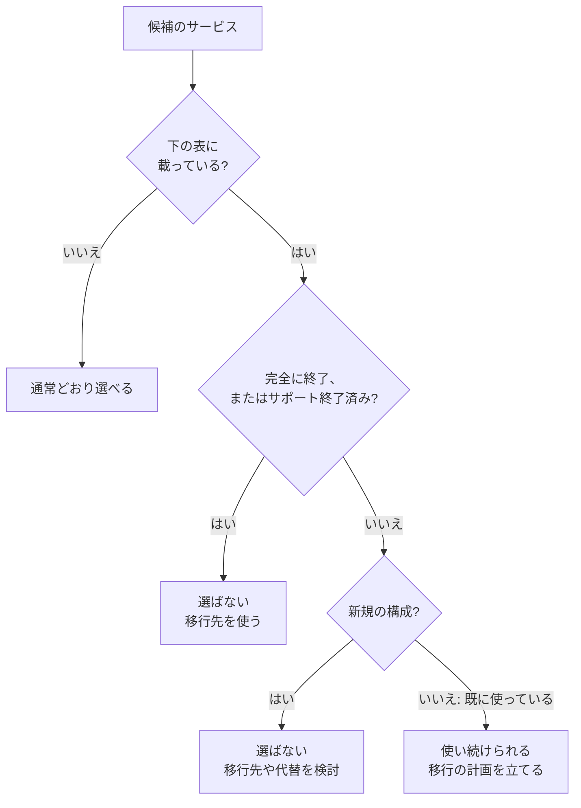
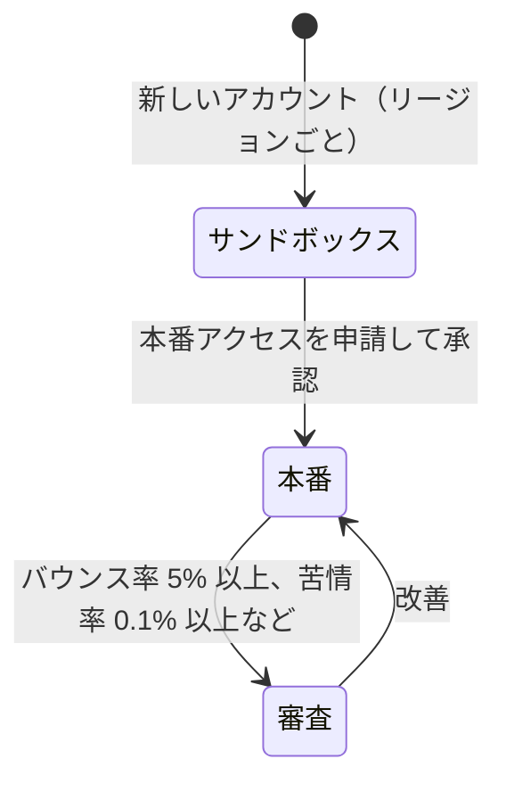
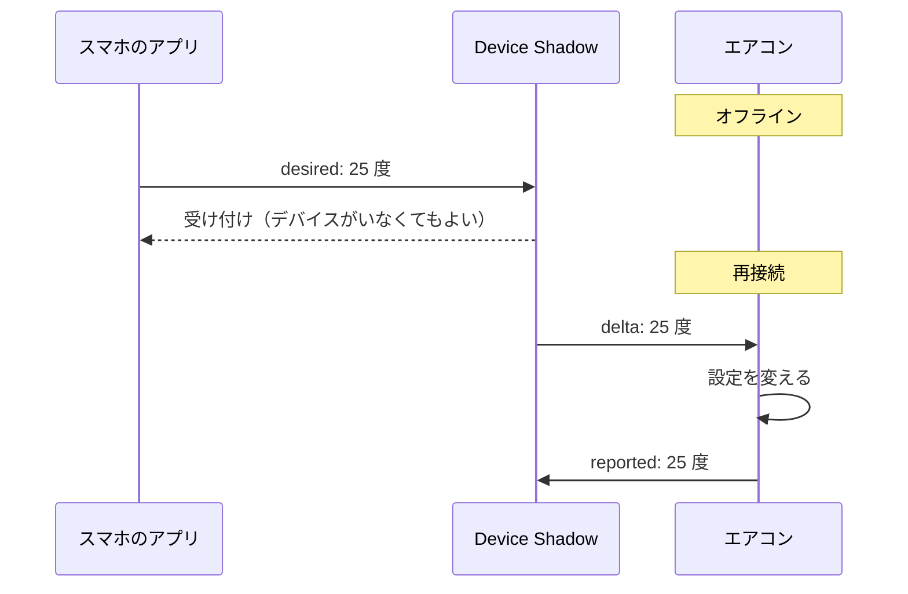
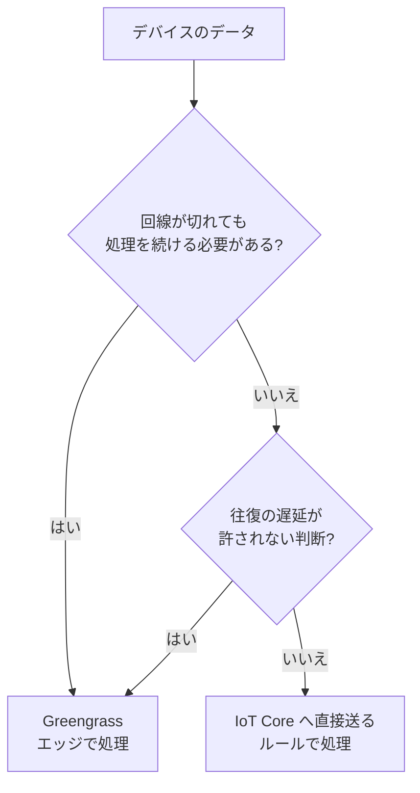
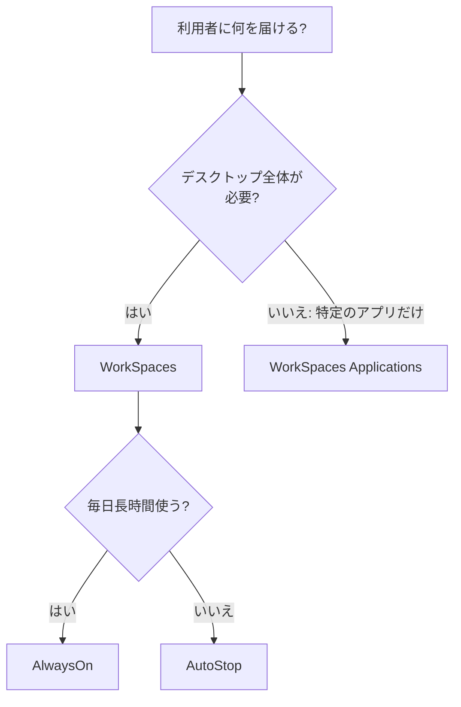
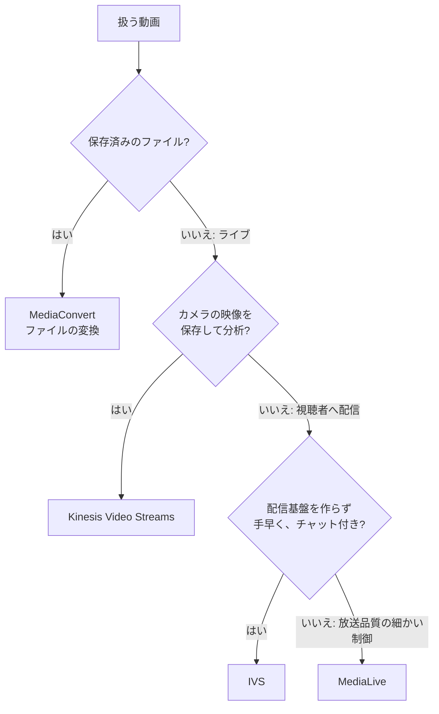

# その他のサービス

[:material-sprout: CLF](../courses/clf/services.md){ .exam-badge .exam-foundational } [:material-certificate: SAA](../courses/saa/services.md){ .exam-badge .exam-associate } [:material-certificate: SOA](../courses/soa/services.md){ .exam-badge .exam-associate } [:material-certificate: DEA](../courses/dea/services.md){ .exam-badge .exam-associate } [:material-certificate: MLA](../courses/mla/services.md){ .exam-badge .exam-associate } [:material-star-circle: SAP](../courses/sap/services.md){ .exam-badge .exam-professional } [:material-star-circle: DOP](../courses/dop/services.md){ .exam-badge .exam-professional } [:material-star-circle: AIP](../courses/aip/services.md){ .exam-badge .exam-professional } [:material-target: SCS](../courses/scs/services.md){ .exam-badge .exam-specialty }

試験の範囲リストにあるものの、専用のページを作るほどではないサービスを短くまとめました。提供が終わったものも、古い教材や範囲リストに名前が残っているので状況を記載します。

## 提供状況の一覧 {#status}

2026 年 10 月時点の状況です。範囲リストに名前があっても、新規の構成では選べないものがあります。

AWS は、提供をやめるサービスをいきなり止めず、段階を踏んで告知します。既存の利用者が移行する時間を取るためです。AWS General Reference では、次の 3 つの一覧に分けて載せています（[参考](#references)）。

| 段階 | 新しい利用者 | 既存の利用者 | 一覧 |
| --- | --- | --- | --- |
| メンテナンス | 使えない | 使い続けられる | Services in Maintenance |
| サポート終了の予定（サンセット） | 使えない | 終了日まで使える | Services in Sunset |
| 完全に終了 | 使えない | 使えない | Services in Full Shutdown |

試験や設計で迷ったら、次の順で判断します。



| サービス | 状況 | 日付 | 移行先 |
| --- | --- | --- | --- |
| Amazon Pinpoint | サポート終了 | 2026-10-30 | Connect Customer、AWS End User Messaging |
| AWS IoT Events | 完全に終了 | 2026-05-20 | |
| AWS IoT Things Graph | 完全に終了 | 2022-11-09 | |
| AWS IoT 1-Click | 完全に終了 | 2025-01-29（IoT のガイドでは 2024-12-16） | |
| Amazon Elastic Transcoder | 完全に終了 | 2025-11-13 | AWS Elemental MediaConvert |
| AWS DeepComposer | 完全に終了 | 2025-09-17 | |
| AWS DeepRacer | コンソールでの提供を終了 | 2025-12-15 | DeepRacer on AWS（自分のアカウントで動かす OSS） |
| AWS IoT Greengrass V1 | サポート終了 | 2026-10-07 | Greengrass V2 |
| AWS Proton | サポート終了 | 2026-10-07 | |
| AWS App Mesh | サポート終了 | 2026-09-30 | ECS Service Connect など |
| AWS Infrastructure Composer | 新規受付を終了。スタンドアロンのコンソールも終了予定 | 2026-10-29、2026-12-07 | コンソールの IaC エディタ、VS Code の AWS Toolkit |
| Amazon Managed Blockchain | 新規受付を終了。サポートも終了予定 | 2026-10-29、2027-09-29 | |
| WorkSpaces Secure Browser | メンテナンス（新規利用不可） | 2026-10-29（公表は 2026-09-29） | |
| WorkSpaces Pools | 新規受付を終了。サポートも終了予定 | 2026-07-31、2027-12-31 | WorkSpaces Applications |
| PCoIP の WorkSpaces Personal | 新規受付を終了。サポートも終了予定 | 2026-07-31、2027-10-31 | |
| Timestream for LiveAnalytics | メンテナンス | 2025-06-20 | Timestream for InfluxDB |
| AWS IoT Device Defender の Detect | 新規利用不可 | 2026-06-30 | |
| AWS IoT SiteWise Monitor | メンテナンス | 2025-10-07 | |
| AWS App Runner | メンテナンス | 2026-03-31 | ECS Express Mode |
| AWS App2Container | 新規受付を終了 | 2025-11-07 | AWS Transform |
| Amazon CodeGuru Reviewer | メンテナンス | 2025-10-07 | |

メンテナンスの行の日付は、AWS General Reference の一覧にある公表日です。実際に新規利用ができなくなる日は、サービスごとに異なる場合があります。

名称の変更もあります。

| 旧称 | 現在の名称 |
| --- | --- |
| Amazon AppStream 2.0 | Amazon WorkSpaces Applications |
| Amazon Connect | Amazon Connect Customer（Amazon Connect は複数のソリューションの総称に） |
| Amazon GameLift | Amazon GameLift Servers |
| AWS Application Composer | AWS Infrastructure Composer |

## コンピューティングと開発 {#compute-dev}

EC2、Lambda、コンテナの主要な選択肢では手間が合わない用途（大量のバッチ、小さな Web サイト、ライセンスの管理）のためのサービスです。提供を終えたものも多いので、[提供状況](#status)と合わせて読みます。

### AWS Batch {#batch}

[:material-sprout: CLF](../courses/clf/services.md){ .exam-badge .exam-foundational } [:material-certificate: SAA](../courses/saa/services.md){ .exam-badge .exam-associate } [:material-certificate: DEA](../courses/dea/services.md){ .exam-badge .exam-associate } [:material-certificate: MLA](../courses/mla/services.md){ .exam-badge .exam-associate }

[提供単位](resource-scope.md#two-axes): リージョン。コンピューティング環境のインスタンスやタスクはサブネット（AZ、VPC の中）で動きます。

コンテナのバッチジョブを、必要な量の容量を用意して順に実行します。ジョブの定義、キュー、コンピューティング環境を用意すれば、スケジューラーとインフラの管理は任せられます。

夜間の集計や大量の画像処理を自前で行うと、ピークに合わせた台数のサーバーを買い、昼は遊ばせることになります。さらに、ジョブの順番待ちや再実行を管理するスケジューラーも必要です。Batch は、ジョブがあるときだけ容量を用意し、順番待ちも引き受けるためのサービスです。

| 観点 | オンプレミスのジョブ管理（HPC のスケジューラーなど） | AWS Batch |
| --- | --- | --- |
| 同じ点 | ジョブをキューに入れ、空いた計算資源で順に実行する | 同じ |
| 計算資源 | 買った台数で固定 | ジョブの量に合わせて増減し、なければ 0 台にできる |
| 安く済ませる方法 | 稼働率を上げる | Spot を使う。中断はリトライで吸収する |
| 実行の単位 | スクリプトやバイナリ | コンテナイメージ |

[](../assets/diagrams/other-services-batch.png)

- EC2、Fargate、ECS Managed Instances で動き、ECS または EKS 上で実行します。
- 配列ジョブは 2〜10,000 の子ジョブに分割します。
- マルチノード並列ジョブは、複数の EC2 にまたがる HPC や分散学習に使います。
- ジョブのタイムアウト（`attemptDurationSeconds`）は 60 秒以上です。
- SageMaker のトレーニングジョブのキューイングにも使えます。

- **配列ジョブの例:** サイズ 1,000 で投入すると、1 つのジョブが 1,000 の子を生みます。子は環境変数 `AWS_BATCH_JOB_ARRAY_INDEX`（0〜999）で担当のファイルを選びます。サイズ 1 や 10,001 は指定できません。
- **タイムアウトの例:** `attemptDurationSeconds` を 3600 にすると、開始から 1 時間で `SIGTERM` を受けて終了します。60 未満は指定できません。時間ちょうどとは限らず、数秒遅れることがあります。
- **依存の例:** `N_TO_N` で配列ジョブ B が A に依存すると、B の 5 番は A の 5 番の完了を待ちます。`SEQUENTIAL` なら 0 番から順に実行します。
- **Spot の例:** 中断に耐えるジョブは Spot の環境に送り、リトライを `attempts: 3` にします。

**選び方:** 15 分を超える長時間の処理や、数千のジョブを並べるなら Batch を選びます。短いイベント処理は Lambda、複数のステップの制御は [Step Functions](step-functions.md) です。

### Amazon Lightsail {#lightsail}

[提供単位](resource-scope.md#two-axes): リージョン。インスタンスは AZ を選んで作り、AWS が管理する Lightsail 用の VPC に入ります。

仮想サーバー、コンテナ、データベースなどをまとめて簡単に使えるサービスです。小さな Web サイトや個人のプロジェクトに向きます。

**選び方:** 細かい設定が要らず、すぐ始めたいなら Lightsail を選びます。VPC やスケーリングの細かい制御が必要なら EC2 です。

- **例:** 個人のブログで WordPress を 1 台動かすなら Lightsail です。セール時に 2 台から 20 台へ自動で増やすなら EC2 です。

SAP-C03 では範囲外です。

### AWS App Runner {#app-runner}

[:material-star-circle: DOP](../courses/dop/services.md){ .exam-badge .exam-professional } [:material-star-circle: AIP](../courses/aip/services.md){ .exam-badge .exam-professional }

[提供単位](resource-scope.md#two-axes): リージョン。サービスは VPC の外で動きます。VPC コネクタで VPC のリソースへ接続します。

コンテナやソースコードを、インフラを意識せずに Web アプリとして動かすサービスです。

**メンテナンスに移行し、新規顧客は使えません（公表は 2026 年 3 月 31 日）。** 既存の顧客は継続できます。新規の場合、AWS は Amazon ECS Express Mode を勧めています。[コンテナ](containers.md) を参照してください。

### AWS App2Container {#app2container}

オンプレミスの Java や .NET アプリをコンテナ化し、ECS や EKS へ展開するツールです。

**2025 年 11 月 7 日で新規受付を終了しました。** AWS は [AWS Transform](migration.md) を勧めています。

### AWS Proton {#proton}

プラットフォームチームが用意したテンプレートから、開発者がインフラとパイプラインをセルフサービスで作るサービスでした。

**公式の告知では 2026 年 10 月 7 日でサポート終了です。** この日以降はコンソールとリソースにアクセスできません。デプロイ済みのインフラはそのまま残ります。DOP-C02 と SAA-C03 の対象サービス一覧には名前が残っています。

### AWS Infrastructure Composer {#infrastructure-composer}

CloudFormation のテンプレートを図で組み立てるツールです。旧称は AWS Application Composer です。

**2026 年 10 月 29 日で新規受付を終了し、2026 年 12 月 7 日にスタンドアロンのコンソールが終了します。** コンソール内の新しい IaC エディタと、VS Code の AWS Toolkit で同様のことができます。テンプレートの書き方は [IaC と CLI](iac.md) を参照してください。

AWS General Reference の一覧には、終了日として 2027 年 9 月 29 日とあり、サービスのガイドと日付が異なります。

### Amazon CodeGuru {#codeguru}

コードの品質と性能を分析するサービス群です。

| 機能 | 状況 |
| --- | --- |
| CodeGuru Reviewer | 2025 年 11 月 7 日から新しいリポジトリを関連付けられない。メンテナンス中 |
| CodeGuru Security | 2025 年 11 月 20 日にサポートを終了し、コンソールとドキュメントも利用できない。後継は Inspector の Code Security |
| CodeGuru Profiler | アプリケーションの性能を分析する。提供状況の変更は確認できない |

### AWS App Mesh {#app-mesh}

Envoy プロキシによるサービスメッシュでした。

**公式の告知では 2026 年 9 月 30 日でサポート終了です。この日以降はコンソールとリソースにアクセスできません。** AWS は ECS Service Connect への移行を案内しています。[コンテナ](containers.md) を参照してください。

### AWS License Manager {#license-manager}

[提供単位](resource-scope.md#two-axes): リージョン。VPC の外です。

Microsoft、SAP、Oracle、IBM などのソフトウェアライセンスを、リージョンとアカウントをまたいで管理します。

クラウドではサーバーを数分で増やせるため、ライセンスの数を超えて起動してしまう事故が起きやすくなります。オンプレミスでは購入の手続きが歯止めでしたが、その歯止めがありません。License Manager は、ライセンスの台帳と起動の制限を結び付けて、この歯止めを取り戻すためにあります。

- ライセンスの持ち込み（BYOL）に使います。
- 使用数の上限をハードリミットやソフトリミットで設定できます。
- ハードリミットは超過の起動を止め、ソフトリミットは通知します。

監査で問題になるライセンスの超過を防ぎたいときに選びます。

- **ハードリミットの例:** 契約が 100 vCPU の Oracle で、ハードリミットを 100 にします。使用が 96 vCPU のときに 8 vCPU の起動は、合計 104 になるので拒否されます。ソフトリミットなら起動でき、通知が届きます。
- **上限の例:** 自己管理ライセンスはリソースあたり 10 個、リージョンあたり 25 個までです。
- **誤ると:** 共有するアカウントと AMI の関連付けを忘れると、数えられずに監査で超過が見つかります。

## アプリケーションとメッセージ {#app-integration}

API Gateway、SQS、SNS が合わない場面のための選択肢です。どれも「既存の方式を変えずに AWS に載せたい」か「特定の方式（GraphQL、メール、電話）を自分で作りたくない」かのどちらかが選ぶ理由になります。

### AWS AppSync {#appsync}

[:material-star-circle: AIP](../courses/aip/services.md){ .exam-badge .exam-professional }

[提供単位](resource-scope.md#two-axes): リージョン。VPC の外です。プライベート API は VPC エンドポイントから呼びます。

GraphQL API と Pub/Sub API をサーバーレスで作るサービスです。

REST では、画面ごとに必要な項目が違っても、同じエンドポイントが同じ形のデータを返します。足りなければ何度も呼び、余れば捨てることになります。GraphQL は、クライアントが欲しい項目をクエリで指定する方式で、この過不足をなくすためにあります。引き換えに、キャッシュや認可をフィールドやリゾルバーの単位で考える必要があります。

| 項目 | 内容 |
| --- | --- |
| データソース | DynamoDB、Lambda、OpenSearch、HTTP エンドポイント、EventBridge など |
| 認可 | API キー、Lambda、IAM、OIDC、Cognito ユーザープール |
| マージド API | 複数の GraphQL API を 1 つにまとめる |
| サーバーサイドキャッシュ | 全リクエストまたはリゾルバーごと、TTL を指定 |
| AppSync Events | コードなしの WebSocket API。多数の購読者へ配信 |

**選び方:** クライアントが必要なフィールドだけを取得する、複数のデータソースを 1 つの API にまとめる、リアルタイムの更新を届けるなら AppSync を選びます。REST なら [API Gateway](api-gateway.md) です。

- **例:** スマホの一覧画面は `name` と `price` だけを取得し、PC の詳細画面は全項目を取得します。REST なら別のエンドポイントが要るか、不要なデータも返します。
- **キャッシュの例:** 商品一覧に TTL 60 秒のリゾルバーのキャッシュを付けると、毎秒 100 件の読み取りでも、データソースへの問い合わせはキーごとに 60 秒に 1 回です。TTL の上限は 3,600 秒です。キャッシュのキーに `context.identity` を入れると、利用者ごとに分かれます。
- **認可の例:** 公開の読み取りは API キー、利用者の書き込みは Cognito ユーザープールにします。API キーは期限が切れるので、本番の主な認可には向きません。
- **誤ると:** 利用者ごとのデータを返すリゾルバーで、キャッシュのキーを `context.arguments.id` だけにすると、他の利用者の結果が返る恐れがあります。

### Amazon SES {#ses}

[:material-sprout: CLF](../courses/clf/services.md){ .exam-badge .exam-foundational } [:material-certificate: SOA](../courses/soa/services.md){ .exam-badge .exam-associate }

[提供単位](resource-scope.md#two-axes): リージョン。送信の ID、クォータ、サンドボックスはリージョンごとで、VPC の外です。VPC からは SMTP のインターフェイスエンドポイントで呼べます。

メールの送受信サービスです。SOA-C03、SAP、CLF の範囲に入ります。

自前のメールサーバーで大量に送ると、送信元の IP が迷惑メールの送り手と見なされ、受信側に拒否されるようになります。送信の評判（レピュテーション）の管理は、メールサーバーの運用で最も手間のかかる部分です。SES はその基盤を提供し、共有の IP の評判を守るために、新しいアカウントに制限をかけます。

| 観点 | 自前のメールサーバー（Postfix など） | Amazon SES |
| --- | --- | --- |
| 同じ点 | SMTP で送れる。DKIM などの送信ドメイン認証を設定する | 同じ |
| 送信元の IP | 自分の IP。評判も自分だけのもの | 既定は他の利用者と共有。専用 IP も選べる |
| 新規の制限 | なし（受信側に拒否されて初めて気づく） | サンドボックスで送り先と量を制限 |
| 評判の監視 | 自分でブラックリストを確認する | バウンス率と苦情率をアカウントの指標として監視 |

**なぜサンドボックスがあるか:** AWS は、不正や乱用を防ぎ、送信者としての評判を守るために、新しいアカウントに制限をかけると説明しています。共有の IP を使う以上、1 つのアカウントの迷惑メールが、ほかの利用者の届きやすさにも影響するためです。



| 項目 | 値 |
| --- | --- |
| サンドボックス | 新しいアカウントはリージョンごとにサンドボックス |
| サンドボックスの制限 | 検証済みアドレスにのみ送信可。24 時間で 200 通、毎秒 1 通 |
| 本番アクセス | 申請すれば任意の宛先へ。**送信元の ID は引き続き検証が必要** |
| メッセージサイズ | v1 API は 10 MB、v2 API と SMTP は 40 MB |
| 認証 | Easy DKIM、BYODKIM、Deterministic Easy DKIM |
| バウンス率 | 5% 未満を保つ。5% 以上で審査の対象 |
| 苦情率 | 0.1% 未満を保つ。0.1% 以上で審査の対象 |
| IP | 既定は共有。専用 IP も利用可 |

**症状:** テストで届くのに本番で `MessageRejected` が出るなら、未検証の宛先に送っていて、サンドボックスのままの可能性があります。

計算の例です。

- **クォータの例:** クォータは宛先の数で数えます。1 通に 50 人（1 メッセージの上限）を入れると 50 と数えます。サンドボックスの 200 通は、50 人宛てなら 4 回で終わります。
- **サイズの例:** サイズは Base64 エンコード後の値で、上限は v1 API が 10 MB、v2 API が 40 MB です。元のファイルで約 7.5 MB、約 30 MB が目安です。ヘッダーや本文の分も数えるので、20 MB の添付なら v2 API で送れますが、v1 API では送れません。
- **バウンス率の例:** 1,000 通で 60 件なら 6% で、5% を超えるので審査の対象です。
- **苦情率の例:** 10,000 通で 12 件なら 0.12% で、0.1% を超えます。
- **ID の例:** 東京で `example.com` を検証しても、大阪では未検証です。リージョンごとに検証します。

**選び方:** アプリからのメールは SES、受信者の管理と購読があるシステム通知は [SNS](messaging.md) です。

### Amazon Pinpoint {#pinpoint}

!!! warning "サポートが終了しました"
    2026 年 10 月 30 日にサポートが終了し、コンソール、エンドポイント、セグメント、キャンペーン、ジャーニー、分析は使えません。

- エンゲージメントの機能は、Connect Customer のアウトバウンドキャンペーンとカスタマープロファイルへ移行します。
- SMS、音声、プッシュ、WhatsApp の配信 API は、AWS End User Messaging として続きます。

### Amazon MQ {#mq}

[:material-certificate: SAA](../courses/saa/services.md){ .exam-badge .exam-associate } [:material-star-circle: SAP](../courses/sap/services.md){ .exam-badge .exam-professional }

[提供単位](resource-scope.md#two-axes): リージョン。ブローカーはサブネット（AZ、VPC の中）に置きます。公開のアクセスも選べます。

Apache ActiveMQ Classic と RabbitMQ のマネージドブローカーです。

既存のアプリが JMS や AMQP で ActiveMQ や RabbitMQ に話しかけている場合、SQS に移すにはコードの書き換えが必要です。Amazon MQ は、プロトコルはそのままにブローカーのサーバー運用だけを AWS に移すための、移行の受け皿です。

| 観点 | 自前の ActiveMQ / RabbitMQ | Amazon MQ | SQS |
| --- | --- | --- | --- |
| アプリの変更 | 不要 | 不要（同じプロトコル） | 必要（AWS の API） |
| サーバーの運用 | パッチ、冗長化、ディスクを自分で | AWS が担当。ブローカーの大きさは自分で選ぶ | サーバーの概念がない |
| 規模の上げ方 | サーバーを足す | インスタンスタイプやノードを選ぶ | ほぼ意識しない |

| エンジン | デプロイ | ストレージ |
| --- | --- | --- |
| ActiveMQ | 単一インスタンス、アクティブ/スタンバイ、ブローカーのネットワーク | EFS または EBS |
| RabbitMQ | 単一インスタンス、3 ノードのクラスター | EBS |

**選び方:** 既存のアプリが AMQP、MQTT、JMS などの標準プロトコルを使っていて、コードを変えずに移すなら Amazon MQ を選びます。新規のクラウドネイティブな構成なら [SQS と SNS](messaging.md) です。

- **ストレージの例:** 決済のように失えない ActiveMQ のメッセージは、複数 AZ に保存する EFS です。大量の注文で速さが要るなら EBS です。1 KB のメッセージをブローカーに入れる速さの公式の目安は、毎秒 EFS が 80 件、EBS が 500 件です。
- **EBS の罠:** EBS は `mq.m5` のファミリーだけで使え、データは 1 つの AZ です。アクティブ/スタンバイでは使えません。
- **単一インスタンスの例:** 検証は単一インスタンスで十分です。本番の ActiveMQ はアクティブ/スタンバイ、RabbitMQ は 3 ノードにします。

### Amazon Connect {#connect}

[:material-sprout: CLF](../courses/clf/services.md){ .exam-badge .exam-foundational } [:material-star-circle: AIP](../courses/aip/services.md){ .exam-badge .exam-professional }

[提供単位](resource-scope.md#two-axes): リージョン。インスタンスはリージョンに作り、VPC の外です。

クラウドのコンタクトセンターです。現在の製品名は **Amazon Connect Customer** で、Amazon Connect は複数の業務向け AI ソリューションの総称になりました。

電話やチャットのルーティング、エージェントの画面、性能の追跡を提供します。自前の設備なしでコールセンターを作るときに選びます。

オンプレミスのコールセンターでは、電話の交換機（PBX）や回線の設備を買い、席数の上限も設備で決まります。Connect Customer は、その交換機の役割をクラウドで提供し、使った分だけの料金にするためのサービスです。

- **例:** 問い合わせの「請求」を選んだ電話を、請求担当 5 人のキューへ送ります。営業時間外は音声で案内します。

## IoT {#iot}

[](../assets/diagrams/other-services-iot.png)

IoT のデバイスは、普通のサーバーと条件が大きく違います。数が桁違いに多く、回線は細くて途切れがちで、現場に人がいないことも多いです。AWS の IoT サービスは、この条件ごとに役割を分けています。

| デバイスの事情 | 困ること | 受け持つサービス |
| --- | --- | --- |
| 数万台が細い回線でつながる | 新しい指示がないか何度も HTTP で問い合わせると、通信量と電力の負担が大きい | IoT Core（軽い MQTT） |
| よくオフラインになる | 送った指示が届かない、最新の状態が分からない | Device Shadow |
| 現場に人がいない | ファームウェアの更新や設定の確認ができない | Device Management、Device Defender |
| 回線が切れても止められない | クラウドの判断を待てない | Greengrass（エッジで処理） |

### AWS IoT Core {#iot-core}

[:material-sprout: CLF](../courses/clf/services.md){ .exam-badge .exam-foundational } [:material-target: SCS](../courses/scs/services.md){ .exam-badge .exam-specialty }

[提供単位](resource-scope.md#two-axes): リージョン。エンドポイントはアカウントとリージョンごとで、VPC の外です。

デバイスと AWS を接続するメッセージブローカーです。

オンプレミスで Mosquitto などの MQTT ブローカーを立てるのと役割は同じです。違いは、大量の接続を受けるブローカーのサーバーを自分で運用しないことと、デバイスごとの証明書とポリシーで、どのトピックに書けるかまで制御できることです。

| 項目 | 内容 |
| --- | --- |
| プロトコル | MQTT、MQTT over WebSocket、HTTPS |
| ポート | MQTT は 8883 または 443、WebSocket は 443 |
| 認証 | X.509 クライアント証明書、SigV4、カスタム認証 |
| ルールエンジン | MQTT のトピックに SQL 風のルールを適用し、DynamoDB や Lambda へ |
| Device Shadow | デバイスがオフラインでも状態を読み書きできる |

**例:** センサーの温度を MQTT で送り、ルールで閾値を超えたものだけ Lambda へ渡します。

```sql
SELECT temperature, deviceId FROM 'factory/+/temp' WHERE temperature > 80
```

- **ルールの例:** 上の SQL は `factory/line1/temp` の値が 85 なら一致し、75 なら一致しません。一致したものだけ Lambda に渡します。
- **ポートの例:** MQTT の X.509 は 8883 番です。ファイアウォールで 443 番しか出られないなら、ALPN に `x-amzn-mqtt-ca` を指定して 443 番を使います。
- **Shadow の例:** スマホからの「エアコンを 25 度に」を Shadow の `desired` に書くと、オフラインの機器が接続したときに差分を受け取ります。

**Device Shadow はなぜあるか:** デバイスがオフラインだと、アプリからの指示は届かず、アプリは最新の状態も読めません。Shadow はクラウドに置いた「状態の伝言板」で、アプリは `desired`（こうしてほしい）を書き、デバイスは `reported`（今こうなっている）を書きます。両者の差は `delta` として届きます。


- **誤ると:** 証明書にポリシーを付けないと、接続や Publish が拒否されます。

### AWS IoT Device Defender {#iot-device-defender}

[提供単位](resource-scope.md#two-axes): リージョン。VPC の外です。

IoT デバイスのセキュリティ監査と監視を行います。

- **Audit**: デバイスの設定が、ベストプラクティスに沿っているか確認します。
- **Detect**: デバイスの異常な動きを検知します。**新規顧客は使えません（公表は 2026 年 6 月 30 日）。**

- **Audit の例:** 複数のデバイスで同じ X.509 証明書を使っていると指摘されます。1 台の漏えいで全台が影響を受けるので、デバイスごとに分けます。

SCS-C03 の範囲です。

### AWS IoT Device Management {#iot-device-management}

[提供単位](resource-scope.md#two-axes): リージョン。VPC の外です。

大量のデバイスの登録、整理、更新を行います。

| 機能 | 内容 |
| --- | --- |
| Jobs | デバイスにファームウェアの更新などのリモート操作を送る |
| フリートインデックス | レジストリ、シャドウ、接続状況を検索 |
| セキュアトンネリング | ファイアウォールの内側のデバイスへ安全に接続 |

Fleet Hub は 2025 年 10 月 18 日に終了しました。

- **Jobs の例:** 10,000 台のファームウェア更新を、まず 100 台に送り、失敗率が 5% を超えたら中止する設定にします。

### AWS IoT Events {#iot-events}

デバイスのデータからイベントを検知するサービスでした。**2026 年 5 月 20 日に完全に終了しました。**

### AWS IoT Greengrass {#iot-greengrass}

[提供単位](resource-scope.md#two-axes): デバイスで動くソフトウェアです。管理はリージョンのサービスで、VPC の外です。

エッジデバイスで動くオープンソースの実行環境です。データをローカルで処理し、推論を実行し、接続が切れても動き続けます。

すべての判断をクラウドで行うと、回線が切れたとき、また往復の遅延が許されないときに困ります。Greengrass は、工場の片隅に置く小型のサーバーのように、判断を現場で済ませるためにあります。オンプレミスの小型サーバーと違い、ソフトウェアの配布と更新をクラウドから一括で管理できます。



**V1 は 2026 年 10 月 7 日にサポートが終了しました。** V2 を使います。

**選び方:** デバイスが IoT Core に直接送るだけなら Greengrass は不要です。ローカルでの判断が必要なら Greengrass を選びます。

- **例:** 工場の回線が切れている 2 時間も、カメラの映像をローカルで推論して不良品を止めます。結果は回線が戻ってから送ります。

### AWS IoT SiteWise {#iot-sitewise}

[提供単位](resource-scope.md#two-axes): リージョン。SiteWise Edge は現場のゲートウェイで動きます。VPC の外です。

産業機器のデータを大規模に収集、整理、監視します。製造現場の平均故障間隔や設備総合効率の計算に向きます。

- SiteWise Edge でローカルに収集、処理します。
- **SiteWise Monitor と Data Processing Pack はメンテナンスに移行しました。** 新規利用はできません。

- **例:** 稼働時間 700 時間、停止 7 回の設備の平均故障間隔は 700 ÷ 7 = 100 時間です。この計算をメトリクスとして定義します。

### AWS IoT Things Graph {#iot-things-graph}

デバイスとサービスを図で接続するサービスでした。**2022 年 11 月 9 日に完全に終了しました。**

### AWS IoT 1-Click {#iot-1-click}

ボタンなどの簡単なデバイスから Lambda を呼ぶサービスでした。**終了しています。** IoT Core のガイドでは 2024 年 12 月 16 日、AWS General Reference では 2025 年 1 月 29 日とあります。

## エンドユーザーコンピューティング {#euc}

社員の端末ではなく AWS 上でデスクトップやアプリを動かし、画面だけを届けるサービスです。端末にデータを残さないことと、端末の性能に左右されないことが目的です。

### Amazon WorkSpaces {#workspaces}

[:material-sprout: CLF](../courses/clf/services.md){ .exam-badge .exam-foundational }

[提供単位](resource-scope.md#two-axes): リージョン。WorkSpace は指定した VPC のサブネット（AZ）に置きます。

クラウドの仮想デスクトップです。Windows、Ubuntu、Rocky Linux、RHEL を使えます。

社員の PC にデータを置くと、紛失や持ち出しのたびに情報漏えいの心配が出ます。仮想デスクトップは、画面だけを手元に送り、データはデータセンターに残す仕組みです。オンプレミスの VDI と同じ考え方で、違いはサーバーやストレージを買わずに、人数に合わせて増減できることです。

| 観点 | オンプレミスの VDI | WorkSpaces |
| --- | --- | --- |
| 同じ点 | データを端末に置かず、画面を転送する | 同じ |
| 設備 | ピークの人数に合わせてサーバーを買う | 人数分を作り、不要になれば消す |
| 費用 | 設備の購入と保守 | 月額（AlwaysOn）か時間単位（AutoStop） |
| 置き場所 | 自社のデータセンター | 指定した VPC のサブネット |



| 種類 | 特徴 | 状況 |
| --- | --- | --- |
| WorkSpaces Personal | 利用者専用の永続的なデスクトップ | 継続。PCoIP のものは 2027-10-31 に終了 |
| WorkSpaces Pools | 非永続、一時的なインフラ | 2026-07-31 に新規受付を終了、2027-12-31 に終了 |

| 実行モード | 課金 |
| --- | --- |
| AlwaysOn | 月額固定。常用する利用者に |
| AutoStop | 時間単位。切断から一定時間で停止 |

- **`AutoStop Time` の例:** 既定は 1 時間です。切断から 1 時間で課金が止まり、実際の停止は数分遅れることがあります。
- **選び方の例:** 毎日 8 時間使う人は AlwaysOn、月に数回だけ使う人は AutoStop です。損益の分かれ目は、月額と時間単価の比で計算します。
- **誤ると:** GPU の AutoStop などはハイバネートに対応せず、停止で未保存の作業が消えます。

**選び方:** 全画面のデスクトップが必要なら WorkSpaces、特定のアプリだけなら WorkSpaces Applications です。

### Amazon WorkSpaces Secure Browser {#secure-browser}

[:material-sprout: CLF](../courses/clf/services.md){ .exam-badge .exam-foundational }

[提供単位](resource-scope.md#two-axes): リージョン。VPC の外で配信し、社内の Web アプリへは指定した VPC を通ります。

社内の Web アプリや SaaS に、管理されたブラウザから安全にアクセスするサービスです。

**メンテナンスに移行しました（公表は 2026 年 9 月 29 日）。** 2026 年 10 月 29 日から新しい顧客は使えません。既存の顧客は使い続けられます。

### Amazon WorkSpaces Applications（旧 AppStream 2.0） {#appstream}

[:material-sprout: CLF](../courses/clf/services.md){ .exam-badge .exam-foundational }

[提供単位](resource-scope.md#two-axes): リージョン。ストリーミングのインスタンスは AWS が管理し、指定した VPC のサブネットへ接続できます。

デスクトップアプリを、ブラウザやクライアントへストリーミングします。**旧称は Amazon AppStream 2.0** です。

| フリート | 特徴 |
| --- | --- |
| Always-On | インスタンスを起動しておく。すぐ使える |
| On-Demand | 接続時に起動 |
| Elastic | アプリブロックをマウントして使う。容量管理は AWS |

**例:** CAD などの重いアプリを、ダウンロードさせずに配信します。

- **フリートの例:** 始業の 9 時に 200 人が同時に使うなら Always-On で待機させます。不定期に 10 人が使うなら On-Demand で、起動を少し待ちます。
- **誤ると:** Elastic で同時接続の上限を低くすると、超えた利用者は接続できません。

## メディア {#media}

動画の処理は、ファイルの大きさ、変換の計算量、配信の遅延という 3 つの重さがあります。放送局が専用の機材でまかなってきたこれらを、用途ごとのマネージドサービスに分けたのがこの節のサービスです。どれを選ぶかは、動画が「保存されたファイル」か「今流れているライブ」か、で最初に分かれます。



### Amazon Kinesis Video Streams {#kinesis-video}

[:material-certificate: SAA](../courses/saa/services.md){ .exam-badge .exam-associate } [:material-certificate: MLA](../courses/mla/services.md){ .exam-badge .exam-associate }

[提供単位](resource-scope.md#two-axes): リージョン。VPC の外です。

カメラなどの動画を AWS へ送り、保存して処理します。

- 指定の保持期間で保存し、保存時に暗号化します。
- 動画以外の、時系列のデータも扱えます（音声、サーモグラフィー、深度など）。
- WebRTC でリアルタイムの双方向通信もできます。

**選び方:** 動画のストリームなら Kinesis Video Streams、ログやイベントのレコードなら [Kinesis Data Streams](streaming.md) です。

- **例:** 店舗のカメラ 50 台の映像を 7 日保持し、Rekognition Video で人の検出に使います。不要な保持期間を長くすると、保存の費用が増えます。

### Amazon Interactive Video Service {#ivs}

[:material-star-circle: SAP](../courses/sap/services.md){ .exam-badge .exam-professional }

[提供単位](resource-scope.md#two-axes): リージョン。VPC の外です。

インタラクティブなライブ配信のマネージドサービスです。

| 機能 | レイテンシー |
| --- | --- |
| 低レイテンシーストリーミング | 5 秒未満 |
| リアルタイムストリーミング | 300 ミリ秒未満 |
| IVS Chat | ライブのチャット |

**選び方:** 配信基盤を作らず、チャットなどのある配信を手早く作るなら IVS を選びます。細かい制御が必要な放送品質の配信なら MediaLive です。

- **例:** 視聴者の質問に数秒で答えるオンラインセミナーは低レイテンシー（5 秒未満）です。登壇者が会話する配信はリアルタイム（300 ミリ秒未満）です。

### AWS Elemental MediaConvert {#mediaconvert}

[:material-star-circle: SAP](../courses/sap/services.md){ .exam-badge .exam-professional }

[提供単位](resource-scope.md#two-axes): リージョン。VPC の外です。

ファイルベースの動画変換サービスです。保存された動画を、再生機器に合わせた形式へ変換します。放送品質のコーデックや HDR にも対応します。

S3 に動画が届いたらジョブを実行する構成が定番です。

- **例:** `s3://videos/in/a.mov` の到着を EventBridge で受け、Lambda がジョブを作成します。1080p と 720p の HLS を `s3://videos/out/` に出力します。

### AWS Elemental MediaLive {#medialive}

[:material-star-circle: SAP](../courses/sap/services.md){ .exam-badge .exam-professional }

[提供単位](resource-scope.md#two-axes): リージョン。チャンネルは VPC の外です。VPC の入力も選べます。

ライブ動画のリアルタイム変換サービスです。放送やストリーミング向けの出力を作ります。

チャンネルクラスは `STANDARD`（2 パイプライン）と `SINGLE_PIPELINE` です。冗長性が必要なら `STANDARD` を選びます。

- **例:** `STANDARD` は同じ入力を 2 つの入口で受け、1 つのパイプラインが止まってももう 1 つで続きます。上流から 2 本送る必要があります。社内の小さな配信なら `SINGLE_PIPELINE` です。
- **誤ると:** `SINGLE_PIPELINE` で重要な配信を行うと、パイプラインの障害で配信が止まります。

**選び方:** 保存された動画は MediaConvert、ライブは MediaLive です。

### Amazon Elastic Transcoder {#elastic-transcoder}

動画変換サービスでした。**2025 年 11 月 13 日に完全に終了しました。** MediaConvert へ移行します。

## 専門分野 {#specialized}

衛星のアンテナ、量子コンピューター、ゲームの専用サーバーのように、自前で設備を持つと高価で利用頻度の低いものを、使う分だけ借りるためのサービスです。

### Amazon Timestream {#timestream}

[提供単位](resource-scope.md#two-axes): リージョン。Timestream for InfluxDB は VPC の中に置きます。

時系列データベースです。詳しくは [専門データベース](databases-specialized.md) を参照してください。

Timestream for LiveAnalytics はメンテナンスに移行しました（公表は 2025 年 6 月 20 日）。Timestream for InfluxDB を検討します。

### Amazon Managed Blockchain {#managed-blockchain}

[:material-star-circle: SAP](../courses/sap/services.md){ .exam-badge .exam-professional }

[提供単位](resource-scope.md#two-axes): リージョン。VPC の外で、VPC エンドポイントからつなぎます。

パブリックの Ethereum と Bitcoin のノード、プライベートの Hyperledger Fabric のネットワークを提供します。

**2026 年 10 月 29 日で新規受付を終了し、2027 年 9 月 29 日にサポートが終了します。** SAP-C03 では範囲外です。

### Amazon GameLift Servers {#gamelift}

[:material-star-circle: SAP](../courses/sap/services.md){ .exam-badge .exam-professional }

[提供単位](resource-scope.md#two-axes): リージョン。フリートはリージョンと Local Zones に置きます。

セッション型のマルチプレイヤーゲームの専用サーバーを、デプロイ、運用、スケーリングします。旧称は Amazon GameLift です。

リージョンと Local Zones に配置し、プレイヤーの近くで動かせます。SAP-C03 では範囲外です。

- **例:** 日本のプレイヤーは東京のフリートに、米国のプレイヤーはオレゴンのフリートにつなぎ、対戦の遅延を抑えます。

### Amazon Braket {#braket}

[:material-star-circle: SAP](../courses/sap/services.md){ .exam-badge .exam-professional }

[提供単位](resource-scope.md#two-axes): リージョン。量子デバイスごとに提供リージョンが異なります。VPC の外です。

量子コンピューティングのマネージドサービスです。量子ハードウェアにアクセスし、アルゴリズムを試せます。

自前のハードウェアなしで量子コンピューティングを評価するときに選びます。

- **例:** 組み合わせ最適化のアルゴリズムを、まずシミュレーターで試し、結果がよければ量子デバイスで実行します。

### AWS Ground Station {#ground-station}

[:material-star-circle: SAP](../courses/sap/services.md){ .exam-badge .exam-professional }

[提供単位](resource-scope.md#two-axes): リージョン。受信したデータの届け先は VPC の EC2 か S3 です。

衛星との通信のためのアンテナをマネージドで提供します。

- 衛星のコマンド、制御、データのダウンリンクができます。
- 受信したデータは、リアルタイムなら EC2、非同期なら S3 へ届けます。
- アンテナの利用時間は分単位で予約し、課金します。
- オンデマンドは 15 分前から 7 日前までに予約します。

- **例:** 10 分の衛星のパスを、開始の 1 時間前に予約します。開始の 10 分前では遅すぎます。

### AWS DeepComposer {#deepcomposer}

[:material-star-circle: SAP](../courses/sap/services.md){ .exam-badge .exam-professional }

生成 AI で作曲を学ぶサービスでした。**2025 年 9 月 17 日に完全に終了しました。**

### AWS DeepRacer {#deepracer}

[:material-star-circle: SAP](../courses/sap/services.md){ .exam-badge .exam-professional }

強化学習を自動運転のレースで学ぶサービスでした。

**2025 年 12 月 15 日でコンソールでの提供が終了し、学生ポータルも 2025 年 9 月 15 日に終了しました。** オープンソースの DeepRacer on AWS を、自分のアカウントにデプロイして使えます。

## 関連する説明へのリンク {#pointers}

### AWS X-Ray {#xray}

分散トレーシングのサービスです。[X-Ray によるトレース](observability.md#xray) を参照してください。

## 選び方の比較 {#choosing}

| 迷う組み合わせ | 選び方 |
| --- | --- |
| AppSync と API Gateway | GraphQL やリアルタイムなら AppSync、REST なら API Gateway |
| SES と SNS | メール本文を自由に作るなら SES、通知の配信なら SNS |
| Amazon MQ と SQS | 既存のプロトコルを保つなら Amazon MQ、新規なら SQS |
| Batch と Lambda | 長時間や大量のジョブなら Batch |
| WorkSpaces と WorkSpaces Applications | デスクトップ全体か、特定のアプリか |
| MediaConvert と MediaLive | ファイルか、ライブか |
| IVS と MediaLive | 手軽なインタラクティブ配信か、放送品質か |
| Kinesis Video Streams と Kinesis Data Streams | 動画か、レコードか |
| IoT Core と Greengrass | クラウドの接続か、エッジの処理か |
| Lightsail と EC2 | 手軽さか、細かい制御か |

## 試験のポイント {#exam-points}

| こう問われたら | 答え |
| --- | --- |
| 新しいアカウントの SES で未検証の宛先へ送れない | サンドボックス。本番アクセスを申請 |
| SES のアカウントが審査に入る | バウンス率 5% 以上、または苦情率 0.1% 以上 |
| 既存の ActiveMQ を、コードを変えずに移行 | Amazon MQ |
| GraphQL でリアルタイムの更新 | AppSync |
| 大量の並列ジョブ、HPC | AWS Batch |
| IoT デバイスの認証 | X.509 クライアント証明書 |
| オフラインのデバイスの状態を保持 | Device Shadow |
| ローカルで推論を実行 | Greengrass |
| デバイスの設定を監査 | Device Defender の Audit |
| ファームウェアを一括で更新 | Device Management の Jobs |
| 工場の機器データの収集 | IoT SiteWise |
| Elastic Transcoder からの移行 | MediaConvert |
| ライブ動画の変換 | MediaLive |
| カメラの動画を保存して分析 | Kinesis Video Streams |
| 仮想デスクトップ | WorkSpaces |
| アプリだけをブラウザへ配信 | WorkSpaces Applications（旧 AppStream 2.0） |
| コールセンター | Connect Customer（旧 Amazon Connect） |
| Pinpoint の SMS 機能 | AWS End User Messaging |
| Pinpoint のキャンペーンの移行先 | Connect Customer のアウトバウンドキャンペーン |
| 衛星データの受信 | Ground Station |
| 量子コンピューティング | Braket |
| ゲームサーバー | GameLift Servers |

## 関連ページ {#related}

- [運用サービス](operations.md)
- [メッセージング](messaging.md)
- [API Gateway](api-gateway.md)
- [ストリーミング](streaming.md)
- [コンテナ](containers.md)
- [IaC と CLI](iac.md)
- [専門データベース](databases-specialized.md)
- [移行](migration.md)

## 参考 {#references}

- [Services in Sunset](https://docs.aws.amazon.com/general/latest/gr/sunset_services.html)
- [Services in Maintenance](https://docs.aws.amazon.com/general/latest/gr/maintenance_services.html)
- [Services in Full Shutdown](https://docs.aws.amazon.com/general/latest/gr/full_shutdown_services.html)
- [What is AWS Batch?](https://docs.aws.amazon.com/batch/latest/userguide/what-is-batch.html)
- [What is AWS AppSync?](https://docs.aws.amazon.com/appsync/latest/devguide/what-is-appsync.html)
- [AWS AppSync Events](https://docs.aws.amazon.com/appsync/latest/eventapi/event-api-welcome.html)
- [Request production access for SES](https://docs.aws.amazon.com/ses/latest/dg/request-production-access.html)
- [SES service quotas](https://docs.aws.amazon.com/ses/latest/dg/quotas.html)
- [SES reputation messages](https://docs.aws.amazon.com/ses/latest/dg/reputationdashboardmessages.html)
- [Amazon Pinpoint end of support](https://docs.aws.amazon.com/pinpoint/latest/userguide/migrate.html)
- [What is Amazon Kinesis Video Streams?](https://docs.aws.amazon.com/kinesisvideostreams/latest/dg/what-is-kinesis-video.html)
- [What is AWS IoT?](https://docs.aws.amazon.com/iot/latest/developerguide/what-is-aws-iot.html)
- [AWS IoT protocols](https://docs.aws.amazon.com/iot/latest/developerguide/protocols.html)
- [AWS IoT Device Defender](https://docs.aws.amazon.com/iot-device-defender/latest/devguide/what-is-device-defender.html)
- [Learn about AWS IoT 1-Click](https://docs.aws.amazon.com/iot/latest/developerguide/iot-legacy-services.html)
- [What is AWS IoT Greengrass?](https://docs.aws.amazon.com/greengrass/v2/developerguide/what-is-iot-greengrass.html)
- [What is AWS IoT SiteWise?](https://docs.aws.amazon.com/iot-sitewise/latest/userguide/what-is-sitewise.html)
- [What is Amazon WorkSpaces?](https://docs.aws.amazon.com/workspaces/latest/adminguide/amazon-workspaces.html)
- [WorkSpaces Pools end of support](https://docs.aws.amazon.com/workspaces/latest/adminguide/wsp-pools-end-of-support.html)
- [PCoIP-based WorkSpaces Personal end of support](https://docs.aws.amazon.com/workspaces/latest/adminguide/workspaces-pcoip-end-of-support.html)
- [What is Amazon WorkSpaces Applications?](https://docs.aws.amazon.com/appstream2/latest/developerguide/what-is-appstream.html)
- [What is Amazon Connect?](https://docs.aws.amazon.com/connect/latest/adminguide/what-is-amazon-connect.html)
- [What is Amazon Timestream?](https://docs.aws.amazon.com/timestream/latest/developerguide/what-is-timestream.html)
- [What is Amazon Managed Blockchain?](https://docs.aws.amazon.com/managed-blockchain/latest/hyperledger-fabric-dev/what-is-managed-blockchain.html)
- [What is Amazon IVS Low-Latency Streaming?](https://docs.aws.amazon.com/ivs/latest/LowLatencyUserGuide/what-is.html)
- [What is Amazon IVS Real-Time Streaming?](https://docs.aws.amazon.com/ivs/latest/RealTimeUserGuide/what-is.html)
- [What is AWS Elemental MediaConvert?](https://docs.aws.amazon.com/mediaconvert/latest/ug/what-is.html)
- [What is AWS Elemental MediaLive?](https://docs.aws.amazon.com/medialive/latest/ug/what-is.html)
- [Support for Amazon Elastic Transcoder ending soon](https://aws.amazon.com/blogs/media/support-for-amazon-elastic-transcoder-ending-soon/)
- [What is Amazon GameLift Servers?](https://docs.aws.amazon.com/gameliftservers/latest/developerguide/gamelift-intro.html)
- [What is Amazon Braket?](https://docs.aws.amazon.com/braket/latest/developerguide/what-is-braket.html)
- [AWS Ground Station FAQs](https://aws.amazon.com/ground-station/faqs/)
- [DeepRacer FAQs](https://aws.amazon.com/deepracer/faqs/)
- [Update on the AWS DeepRacer Student Portal](https://aws.amazon.com/blogs/machine-learning/update-on-the-aws-deepracer-student-portal/)
- [What is Amazon MQ?](https://docs.aws.amazon.com/amazon-mq/latest/developer-guide/welcome.html)
- [Amazon MQ for RabbitMQ deployment options](https://docs.aws.amazon.com/amazon-mq/latest/developer-guide/rabbitmq-broker-architecture.html)
- [What is AWS Infrastructure Composer?](https://docs.aws.amazon.com/infrastructure-composer/latest/dg/what-is-composer.html)
- [What is Amazon Lightsail?](https://docs.aws.amazon.com/lightsail/latest/userguide/what-is-amazon-lightsail.html)
- [What is AWS App Runner?](https://docs.aws.amazon.com/apprunner/latest/dg/what-is-apprunner.html)
- [What is AWS App2Container?](https://docs.aws.amazon.com/app2container/latest/UserGuide/what-is-a2c.html)
- [AWS Proton](https://docs.aws.amazon.com/proton/latest/userguide/Welcome.html)
- [Amazon CodeGuru Reviewer availability change](https://docs.aws.amazon.com/codeguru/latest/reviewer-ug/codeguru-reviewer-availability-change.html)
- [AWS CLI: codeguru-security（サポート終了の告知）](https://docs.aws.amazon.com/cli/latest/reference/codeguru-security/index.html)
- [What is AWS App Mesh?](https://docs.aws.amazon.com/app-mesh/latest/userguide/what-is-app-mesh.html)
- [What is AWS License Manager?](https://docs.aws.amazon.com/license-manager/latest/userguide/license-manager.html)
