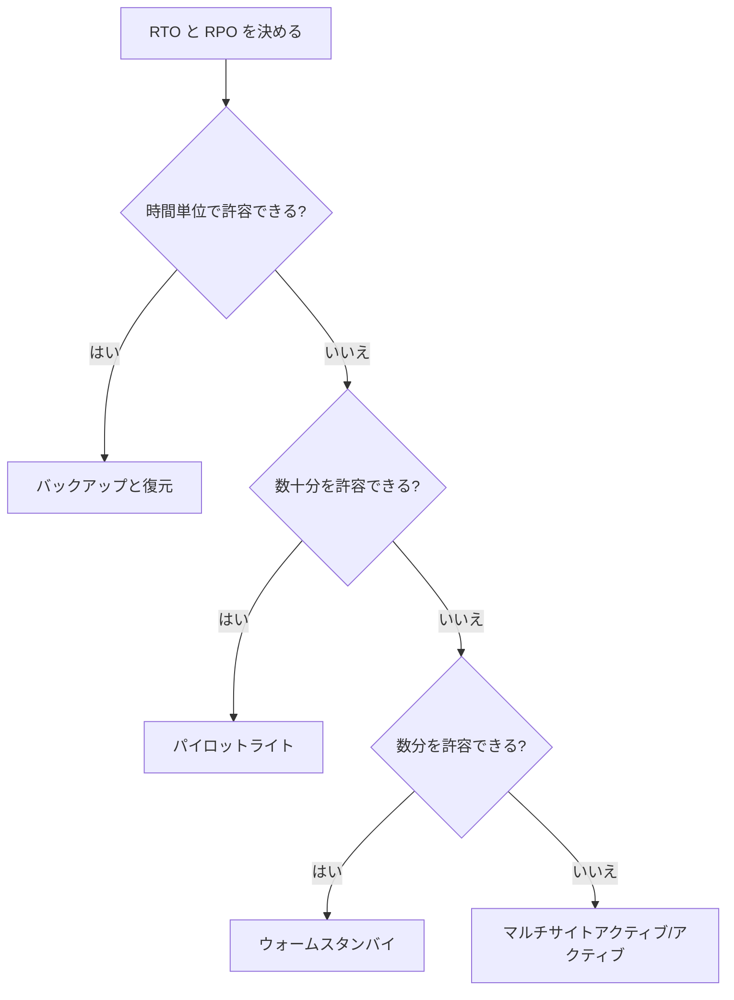
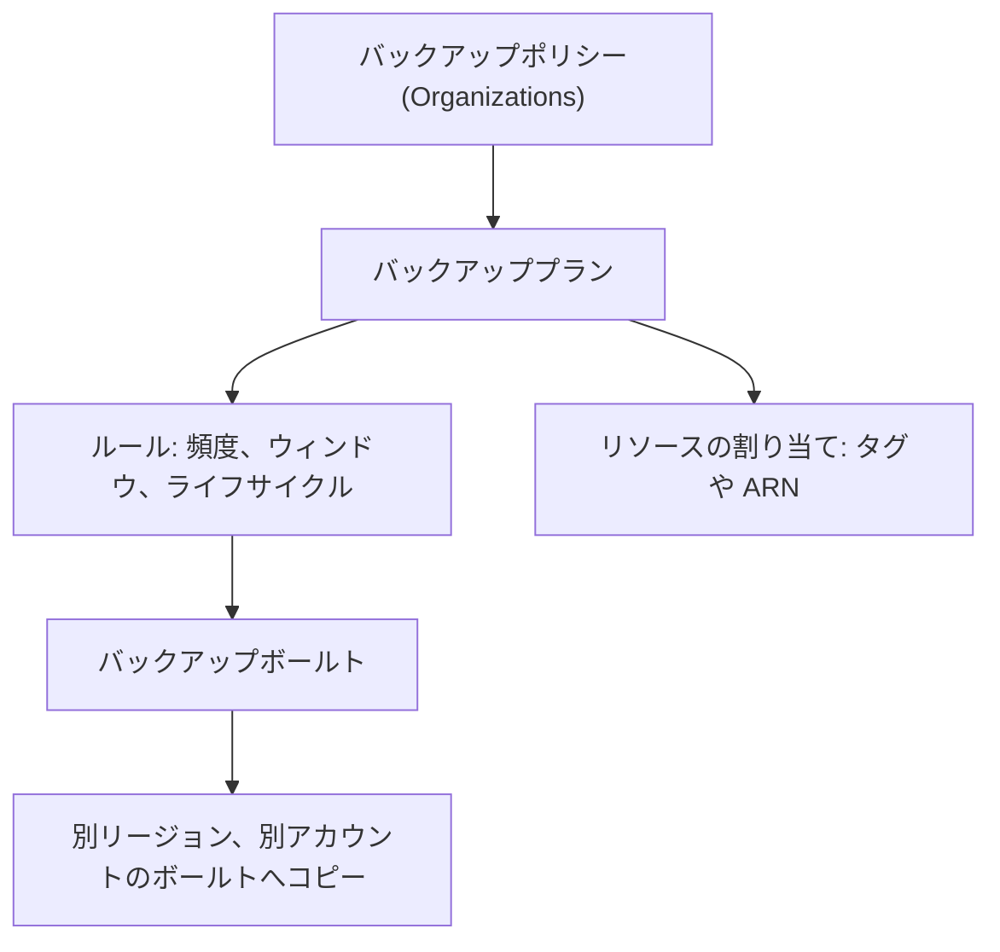
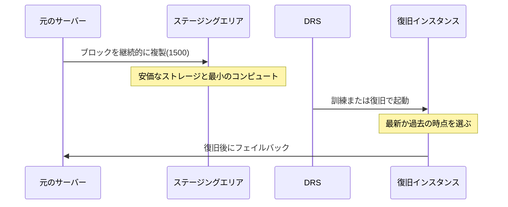
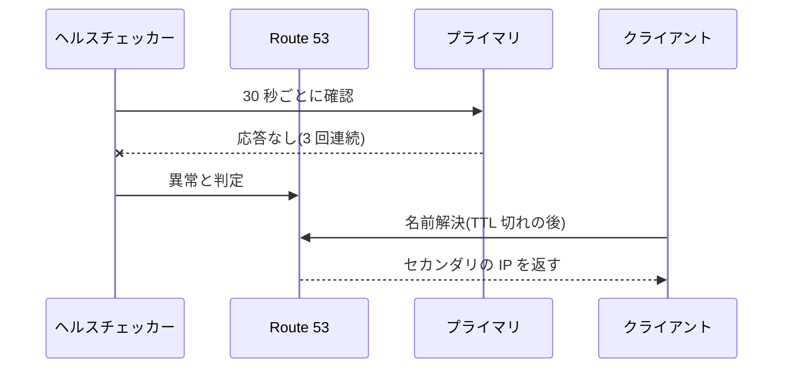

# 耐障害性と DR

[:material-sprout: CLF](../courses/clf/services.md){ .exam-badge .exam-foundational } [:material-certificate: SAA](../courses/saa/services.md){ .exam-badge .exam-associate } [:material-certificate: SOA](../courses/soa/services.md){ .exam-badge .exam-associate } [:material-certificate: DEA](../courses/dea/services.md){ .exam-badge .exam-associate } [:material-star-circle: SAP](../courses/sap/services.md){ .exam-badge .exam-professional } [:material-star-circle: DOP](../courses/dop/services.md){ .exam-badge .exam-professional } [:material-target: SCS](../courses/scs/services.md){ .exam-badge .exam-specialty } [:material-target: ANS](../courses/ans/services.md){ .exam-badge .exam-specialty .exam-badge--related }

障害が起きても業務を続け、許容する時間とデータ損失の範囲で復旧するための設計とサービスをまとめます。出発点は RTO と RPO で、これが戦略、構成、費用を決めます。

[](../assets/diagrams/resilience-warm-standby.png)

| DR 戦略 | RTO、RPO の目安 | DR リージョンの状態 | 費用 |
| --- | --- | --- | --- |
| [バックアップと復元](#backup-restore) | 時間 | データのコピーのみ | 低 |
| [パイロットライト](#pilot-light) | 数十分 | データは稼働、アプリは停止 | 中 |
| [ウォームスタンバイ](#warm-standby) | 分 | 縮小した全体が稼働 | 高 |
| [マルチサイトアクティブ/アクティブ](#active-active) | ほぼリアルタイム | 全量が稼働しトラフィックを処理 | 最高 |

| サービス | 役割 |
| --- | --- |
| [AWS Backup](#backup) | バックアップの一元管理と保護 |
| [Elastic Disaster Recovery](#drs) | サーバーを継続的に複製し、数分で復旧 |
| [Resilience Hub](#resilience-hub) | RTO、RPO を満たせるか評価 |
| [Application Recovery Controller](#arc) | AZ やリージョンからトラフィックを移す |
| [Fault Injection Service](#fis) | 実際に障害を起こして試す |

コードでのリトライ、タイムアウト、サーキットブレーカーは [SDK と耐障害性](sdk-resilience.md) を参照してください。

## RTO と RPO {#rto-rpo}

| 指標 | 意味 | 決めるもの | 例 |
| --- | --- | --- | --- |
| RTO(目標復旧時間) | 中断から復旧までに許容する時間 | 待機系をどこまで動かしておくか | RTO 1 時間なら、1 時間以内に業務を再開 |
| RPO(目標復旧時点) | 最後の復旧点から中断までに許容する時間。失うデータの量 | バックアップの間隔、レプリケーション | RPO 15 分なら、最大 15 分のデータを失ってよい |

- RPO は過去を、RTO は未来を見ます。
- 短くするほど費用と複雑さが増えます。業務の損失と比べて決めます。

### 達成できるかの計算 {#rto-rpo-budget}

**RPO の例**: 4 時間ごとのスナップショットの場合、最悪で直前の 3 時間 59 分を失います。RPO 15 分を求められたら、スナップショットの間隔では足りません。継続的バックアップやレプリケーションにします。

**RTO の例**: 次の時間を足します。

| 段階 | 時間の例 |
| --- | --- |
| 検知(ヘルスチェック 30 秒 × 失敗 3 回) | 1.5 分 |
| 判断(人の承認が必要な場合) | 15 分 |
| DB の昇格 | 数分(5 分とする) |
| アプリの増強 | 10 分 |
| DNS の切り替え(TTL 60 秒) | 1 分 |
| 合計 | 約 33 分 |

RTO 30 分なら、この構成では足りません。判断を自動化するか、スケールを待たずに済むよう事前に容量を確保します。

## 4 つの DR 戦略 {#dr-strategies}



どの戦略でも、レプリケーションだけでは破損や誤削除を防げません。破損も複製されるからです。必ず時点復旧のバックアップも持ちます。

### バックアップと復元 {#backup-restore}

データを別リージョンにコピーしておき、障害時にインフラを作って復元します。

- **データ**: EBS スナップショット、RDS スナップショット、DynamoDB のバックアップ、S3 の CRR と AWS Backup です。
- **インフラ**: CloudFormation などの IaC で再作成します。手作業は時間がかかり、誤りも起きます。
- **AMI**: アプリのイメージをコピーしておきます。

**例**: 社内の日報システムで RTO 24 時間、RPO 24 時間です。毎日のバックアップを別リージョンにコピーし、CloudFormation で再作成します。

**落とし穴**: 復元を試していないバックアップは当てになりません。定期的に[復元テスト](#backup-testing)をします。

### パイロットライト {#pilot-light}

データは常に複製し、アプリサーバーは停止か未作成の状態で待機します。そのままではリクエストを処理できません。

- **データ**: Aurora Global Database、RDS のクロスリージョンリードレプリカ、DynamoDB グローバルテーブル、S3 のレプリケーションなどです。
- **障害時**: DB を昇格し、アプリを起動し、トラフィックを切り替えます。

**例**: Aurora のセカンダリだけを動かし、Auto Scaling グループは希望 0 台にしておきます。障害時に希望を増やします。

### ウォームスタンバイ {#warm-standby}

縮小した本番の完全なコピーが常に動いています。パイロットライトとの違いは、**すぐにリクエストを処理できる**ことです。容量が足りないだけなので、増やして全量にします。

**例**: 本番 12 台、DR 2 台で動かします。障害時は 2 台で処理を始めつつ 12 台に増やします。常に動いているので、定期的なテストもしやすくなります。

**落とし穴**: 障害のときにスケールできるとは限りません。増やす操作はコントロールプレーンの操作です。容量やクォータも DR リージョンで事前に確認します。

### マルチサイトアクティブ/アクティブ {#active-active}

複数のリージョンで同時に動かし、どちらもトラフィックを処理します。フェイルオーバーという操作自体がなく、障害のリージョンを外すだけです。

全量が動いていて 1 つのリージョンだけが処理するのが**ホットスタンバイ**です。

### 書き込みの戦略 {#write-patterns}

アクティブ/アクティブでは、書き込みをどう扱うかで次のように分かれます。

| 戦略 | 動作 | 適したサービス |
| --- | --- | --- |
| Write global | 書き込みを 1 つのリージョンに集める。障害時に別を昇格 | Aurora Global Database |
| Write local | 最も近いリージョンに書く | DynamoDB グローバルテーブル(最後の書き込みが優先) |
| Write partitioned | パーティションキーで書くリージョンを決める | S3 の双方向レプリケーション |

### フェイルオーバーはデータプレーンで {#failover-data-plane}

障害のときはコントロールプレーン(作成、更新の API)が使えないことがあります。データプレーン(実際の処理)の操作だけで切り替えられるようにします。

| 方法 | プレーン | 備考 |
| --- | --- | --- |
| Route 53 のヘルスチェックに基づくフェイルオーバー | データプレーン | レコードの編集は不要 |
| ARC のルーティングコントロールの状態変更 | データプレーン | 推奨は CLI と API |
| Route 53 のレコードを編集 | コントロールプレーン(us-east-1) | 復旧の手順に含めない |
| 事前に容量を確保 | 操作なし | スケールに頼らない |

## AWS Backup {#backup}

[:material-sprout: CLF](../courses/clf/services.md){ .exam-badge .exam-foundational } [:material-certificate: SAA](../courses/saa/services.md){ .exam-badge .exam-associate } [:material-certificate: SOA](../courses/soa/services.md){ .exam-badge .exam-associate } [:material-certificate: DEA](../courses/dea/services.md){ .exam-badge .exam-associate } [:material-star-circle: SAP](../courses/sap/services.md){ .exam-badge .exam-professional } [:material-star-circle: DOP](../courses/dop/services.md){ .exam-badge .exam-professional } [:material-target: SCS](../courses/scs/services.md){ .exam-badge .exam-specialty }

複数のサービスのバックアップを一元管理します。対象は EBS、EC2、RDS、Aurora、DynamoDB、EFS、FSx、Storage Gateway のボリューム、S3 などです。リージョンごとに対象のサービスをオプトインします。



### バックアッププランとルール {#backup-plans}

| 設定 | 既定と範囲 | 誤ったときの症状と例 |
| --- | --- | --- |
| 頻度 | 毎時、12 時間、毎日、毎週、毎月、cron。最短は 1 時間 | 毎日のバックアップで RPO 1 時間は満たせない |
| 開始ウィンドウ | コンソールの既定は 0:30 に開始、8 時間以内に開始 | 短すぎるとジョブが始まらず失敗する |
| 完了ウィンドウ | コンソールの既定は 7 日(FSx には適用されない) | 大きな資源が時間内に終わらない |
| 継続的バックアップ | 任意。時点復旧(PITR)、最大 35 日 | スケジュールでは指定できない。秒単位に近い RPO に使う |
| 保持期間 | 1 日〜100 年、または無期限 | 無期限と Vault Lock を組み合わせると消せなくなる |
| コールドへの移行 | 任意。コールドでは最低 90 日 | 保持期間は移行日数 + 90 日以上にする |
| コピー先 | 別リージョン、別アカウントのボールト | コールドのバックアップはリージョン間でコピーできない |

複数のルールの開始ウィンドウが重なると、**保持期間が長いルール**のバックアップが残ります。

**落とし穴**: データベース系は、メンテナンスウィンドウの 1 時間前からその間まで開始できません。FSx は 3 時間前から開始できません。この時間帯に予定したジョブは失敗します。

```json
{
  "BackupPlanName": "daily-35d-dr",
  "Rules": [{
    "RuleName": "daily",
    "TargetBackupVaultName": "prod-vault",
    "ScheduleExpression": "cron(0 17 ? * * *)",
    "StartWindowMinutes": 60,
    "CompletionWindowMinutes": 480,
    "Lifecycle": {"DeleteAfterDays": 35},
    "CopyActions": [{
      "DestinationBackupVaultArn": "arn:aws:backup:ap-northeast-3:123456789012:backup-vault:dr-vault",
      "Lifecycle": {"DeleteAfterDays": 35}
    }]
  }]
}
```

```bash
aws backup create-backup-plan --backup-plan file://plan.json
```

**増分**: 最初は全量で、その後は変更分だけ保存します。増分に対応しないリソースは毎回全量です。

### リソースの割り当て {#backup-assignment}

タグか ARN で、プランの対象を決めます。

**例**: タグ `backup=daily` が付いたリソースを対象にすると、新しいリソースもタグだけで保護できます。

**落とし穴**: 対象のサービスがオプトインされていないと、割り当てても保護されません。

### バックアップボールト {#backup-vaults}

バックアップ(復旧ポイント)を保存する入れ物です。

| 項目 | 内容 |
| --- | --- |
| 暗号化 | ボールトごとの KMS キー |
| アクセスポリシー | リソースベースのポリシー。例: 特定のロールに削除を拒否 |
| 別アカウントからの操作 | `backup:CopyIntoBackupVault` 以外は拒否される |

### Vault Lock {#vault-lock}

WORM でバックアップを保護します。保持期間が終わるまで、ルートユーザーでも消せません。追加料金はありません。

| モード | ロックの解除 | 使う場面 |
| --- | --- | --- |
| ガバナンス | 十分な IAM 権限があれば解除できる | 社内の統制 |
| コンプライアンス | 猶予期間の後は、顧客も AWS も解除できない | 規制(SEC 17a-4、CFTC、FINRA の評価あり) |

| 設定 | 動作 | 誤ったときの症状 |
| --- | --- | --- |
| 最小保持期間(`MinRetentionDays`) | 短い保持のジョブを拒否 | 条件に合わないバックアップとコピーのジョブが失敗する |
| 最大保持期間(`MaxRetentionDays`) | 長い保持のジョブを拒否 | 同上 |
| 猶予期間(`ChangeableForDays`) | コンプライアンスモードで、確定までの日数。3 日(72 時間)以上 | 確定後は変更できない |

```bash
aws backup put-backup-vault-lock-configuration \
  --backup-vault-name prod-vault \
  --min-retention-days 35 \
  --max-retention-days 3650 \
  --changeable-for-days 3
```

`--changeable-for-days` を指定するとコンプライアンスモード、省略するとガバナンスモードです。

**落とし穴**: 最小、最大の設定はロック後の新しいジョブに適用され、既存の復旧ポイントには適用されません。コンプライアンスモードで無期限の復旧ポイントがあると、確定後はボールトを消せず費用が続きます。

### 論理的にエアギャップされたボールト {#logically-air-gapped}

強化された保護を持つボールトです。

- Vault Lock のコンプライアンスモードが自動で適用されます。
- 既定で AWS 所有キーで暗号化します。カスタマー管理キーも選べます。
- AWS RAM や Multi-party approval で別のアカウントと共有し、そこから復元できます。ボールトのアカウントが侵害されたり閉鎖されたりしても、復旧の道を残せます。

**例**: ランサムウェアで本番のアカウントごと乗っ取られた場合に備え、別アカウントのこのボールトにコピーを置きます。

### リージョン間コピー {#backup-cross-region}

| 項目 | 内容 |
| --- | --- |
| 初回 | 全量 |
| 2 回目以降 | サービスが対応していれば増分 |
| 暗号化 | コピー先のボールトのキーで再暗号化 |
| EBS の例外 | 別のキーのボールトへのコピーは全量になる |
| コールド | コピーできない |

**例**: 東京の本番を大阪のボールトにコピーします。コストを抑えるなら、毎回同じボールトに同じキーでコピーします。

### アカウント間コピーと組織での管理 {#backup-cross-account}

アカウントは同じ AWS Organizations に属している必要があります。

| 機能 | 内容 |
| --- | --- |
| 別アカウントへのコピー | 送信先にボールトとアクセスポリシーを作り、`backup:CopyIntoBackupVault` を許可 |
| バックアップポリシー | 組織で定義して OU やアカウントに適用。子のポリシーは親と統合される |
| クロスアカウントモニタリング | ジョブをまとめて確認 |
| 委任管理者 | 管理アカウント以外に管理を任せる |

**例**: 組織全体に「毎日、7 日保持」を適用し、Finance の OU に「毎月、1 年保持」を足します。Finance の OU には両方が統合されて適用されます。

**落とし穴**: カスタム IAM ロールでコピーするなら、`backup:CopyIntoBackupVault` がロールのポリシーと送信先のボールトポリシーの両方に必要です。

### 復元テストと監査 {#backup-testing}

| 機能 | 内容 |
| --- | --- |
| 復元テスト | 定期的に自動で復元し、成否と所要時間を測る。実際の RTO の確認に使う |
| Backup Audit Manager | バックアップがポリシーに沿っているかを監査し、レポートを作る |

### ランサムウェアと誤削除の防止 {#immutable-compare}

| 対象 | 機能 | 保護の内容 |
| --- | --- | --- |
| S3 | [Object Lock](s3.md#object-lock) | オブジェクトの WORM |
| EBS スナップショット | スナップショットロック | ガバナンス、コンプライアンスのモード。期間中は権限があっても削除できない |
| バックアップ全般 | Vault Lock | ボールト内の復旧ポイントの WORM |
| 組織全体 | 論理的にエアギャップされたボールト | 別アカウントからの復元 |

## AWS Elastic Disaster Recovery(DRS) {#drs}

[:material-sprout: CLF](../courses/clf/services.md){ .exam-badge .exam-foundational } [:material-star-circle: SAP](../courses/sap/services.md){ .exam-badge .exam-professional } [:material-star-circle: DOP](../courses/dop/services.md){ .exam-badge .exam-professional }

オンプレミスや他のクラウドのサーバー、別リージョンの EC2 を、ブロック単位で継続的に AWS へ複製します。**サーバー単位のパイロットライト**として使います。データベースのエンジンに依存しません。

| 指標 | 値 |
| --- | --- |
| RPO | 通常は秒単位 |
| RTO | 通常は 5〜20 分。Linux は約 5 分、Windows は約 20 分で起動 |



| 設定 | 既定と範囲 | 動作と例 |
| --- | --- | --- |
| PIT スナップショットの保持 | 1〜365 日 | 長くすると選択肢が増え費用も増える |
| PIT の間隔 | 分は 10 分間隔で 60 分保持、時は 1 時間間隔で 24 時間保持(変更不可)、日は保持日数を変更可 | ランサムウェアの前の時点を選んで復旧 |
| 通信 | TCP 443、TCP 1500 | 1500 が閉じていると複製できない |

**RPO を守る条件**: ネットワークとステージングエリアが、書き込みより速く受け取れることです。10 MB/s で書くサーバーが 10 台なら、100 MB/s(約 800 Mbps)が必要です。足りないと RPO が伸びます。

**整合性**: 復旧点はクラッシュ整合です。メモリにあってディスクに書かれていないデータは含まれません。

**試験の見分け方**: EC2 でないサーバーも含めて分単位で復旧するなら DRS、DB 単体なら Aurora Global Database や RDS のレプリカです。

## AWS Resilience Hub {#resilience-hub}

[:material-star-circle: SAP](../courses/sap/services.md){ .exam-badge .exam-professional } [:material-star-circle: DOP](../courses/dop/services.md){ .exam-badge .exam-professional } [:material-target: SCS](../courses/scs/services.md){ .exam-badge .exam-specialty }

アプリが目標の RTO、RPO を満たせるか評価し、改善を提案します。

| 概念 | 内容 |
| --- | --- |
| アプリケーション | CloudFormation スタック、リソースグループ、Terraform の状態ファイル、EKS クラスターから定義 |
| AppComponent | 一緒に動き、一緒に障害になるリソースの単位 |
| 回復性ポリシー | RTO、RPO の目標。階層(Mission critical、Foundational IT core services など) |
| 評価 | 構成を調べ、推定の RTO、RPO を出す |
| 状態 | Policy met、Policy breached、Not assessed、Changes detected |

ポリシーでは、次の障害の種類ごとに目標を指定します。

| 障害の種類 | 内容 |
| --- | --- |
| Application | 必要なソフトウェアやプロセスの喪失 |
| Cloud infrastructure | EC2 などハードウェアの喪失 |
| Cloud infrastructure AZ | AZ が使えない |
| Cloud infrastructure Region | リージョンが使えない |

**例**: リージョンの障害に RTO 24 時間、RPO 24 時間を設定したのに、バックアップが別リージョンにコピーされていなければ Policy breached です。推奨に従って AWS Backup のコピーを追加し、再評価します。

評価の結果から、推奨のアラーム、Systems Manager の手順(SOP)、FIS の実験を使って、実際に回復できるかを確認します。

**落とし穴**: RTO、RPO を 0 と指定できますが、評価の最小はほぼ 0 です。0 のままだと常に違反になることがあります。

## Amazon Application Recovery Controller(ARC) {#arc}

[:material-certificate: SOA](../courses/soa/services.md){ .exam-badge .exam-associate } [:material-target: SCS](../courses/scs/services.md){ .exam-badge .exam-specialty }

トラフィックを AZ やリージョンから移す機能の集まりです。

| 機能 | 範囲 | 実行 | 要点 |
| --- | --- | --- | --- |
| ゾーンシフト | AZ | 手動 | 期限は 1 分〜3 日(延長可)。事前に容量が必要 |
| ゾーンオートシフト | AZ | AWS が自動 | AWS の監視で判断。練習実行が必須 |
| ルーティングコントロール | リージョン | 手動 | Route 53 のヘルスチェックと連動するスイッチ |
| Region switch | リージョン | 手動か CloudWatch アラーム | 手順全体を計画として実行 |
| 準備状況チェック | リージョン | 継続監視 | **新規受付を終了**。既存のお客様は継続可 |

### ゾーンシフトとオートシフト {#arc-zonal}

| 項目 | ゾーンシフト | ゾーンオートシフト |
| --- | --- | --- |
| 開始 | 自分 | AWS のテレメトリ |
| 使う場面 | 悪いデプロイや AZ の障害を見つけたとき | AZ の障害に自動で備えたいとき |
| 個別リソースの状態 | 自分で判断 | 見ない。影響がなくても移ることがある |
| 容量 | 事前に増やす | 事前に増やす。スケールに頼らない |

**例**: ALB 配下のアプリで特定の AZ だけエラーが増えました。ゾーンシフトで 2 時間その AZ から外し、調査します。

**落とし穴**: 残りの AZ で処理できる容量がないと、シフトで過負荷になります。Auto Scaling の最小容量を、1 つの AZ を失っても足りる値にします。

### ルーティングコントロール {#arc-routing-control}

DNS のフェイルオーバーを、オン/オフのスイッチで操作します。

| 要素 | 内容 |
| --- | --- |
| クラスター | データプレーン。冗長な API を持つ |
| コントロールパネル | ルーティングコントロールをまとめる |
| ルーティングコントロール | オン/オフのスイッチ |
| ヘルスチェック | スイッチの状態を Route 53 のレコードに反映 |
| アサーションルール | 条件を強制。例: 少なくとも 1 つのセルはオン |
| ゲーティングルール | 全体のスイッチで個別のスイッチの変更を制御 |

**アサーションの例**: 両方のリージョンを同時にオフにする操作を拒否します。全停止を防げます。

**Route 53 のヘルスチェックとの違い**: エンドポイントを自動で見るのではなく、人や自動化の判断で切り替えます。誤った自動切り替えを避けたいときに向きます。

### Region switch {#arc-region-switch}

複数のアカウントにまたがる復旧手順を、計画として定義して実行します。

- 計画はワークフロー、ステップ、実行ブロックで構成します。
- アクティブ/パッシブのフェイルオーバーと、アクティブ/アクティブの切り離しに対応します。
- 各リージョンにデータプレーンがあり、切り離すリージョンに依存せず実行できます。
- 手動のほか、CloudWatch アラームでも開始できます。

## AWS Fault Injection Service(FIS) {#fis}

[:material-star-circle: SAP](../courses/sap/services.md){ .exam-badge .exam-professional } [:material-star-circle: DOP](../courses/dop/services.md){ .exam-badge .exam-professional } [:material-target: SCS](../courses/scs/services.md){ .exam-badge .exam-specialty }

本物の AWS リソースに本物の障害を起こして、カオスエンジニアリングを行います。本番の前に検証環境で試し、計画を立てます。

**手順**: 定常状態を定義し、仮説を立て、実験します。結果から設計を改善します。

| 例 | 内容 |
| --- | --- |
| 定常状態 | p99 が 500 ms 以下、エラー率が 1% 未満 |
| 仮説 | AZ の 1 つが落ちても、定常状態を保つ |
| 実験 | AZ の障害シナリオを実行 |

### 実験テンプレート {#fis-template}

| 要素 | 内容 | 誤ったときの症状 |
| --- | --- | --- |
| アクション | 何を起こすか。順次または並列 | |
| ターゲット | タグ、状態などで選ぶ。`selectionMode` で数や割合を決める | `ALL` にすると全台が止まる |
| 停止条件 | CloudWatch アラーム。超えたら実験を止める | ないと影響が広がっても止まらない |
| 実験ロール | FIS が使う IAM ロール | 権限がないとアクションが失敗する |
| レポート | 結果を文書で出力 | |

```json
{
  "description": "1 台を 5 分止めて、復旧を確認する",
  "targets": {
    "web": {
      "resourceType": "aws:ec2:instance",
      "resourceTags": {"env": "staging"},
      "selectionMode": "COUNT(1)"
    }
  },
  "actions": {
    "stop": {
      "actionId": "aws:ec2:stop-instances",
      "parameters": {"startInstancesAfterDuration": "PT5M"},
      "targets": {"Instances": "web"}
    }
  },
  "stopConditions": [{
    "source": "aws:cloudwatch:alarm",
    "value": "arn:aws:cloudwatch:ap-northeast-1:123456789012:alarm:HighErrorRate"
  }],
  "roleArn": "arn:aws:iam::123456789012:role/fis-role"
}
```

| アクションの例 | 再現する障害 |
| --- | --- |
| `aws:ec2:stop-instances` | インスタンスの停止 |
| `aws:rds:failover-db-cluster` | Aurora のフェイルオーバー |
| `aws:network:disrupt-connectivity` | サブネットの通信の遮断 |
| `aws:fis:inject-api-internal-error` | AWS API のエラー |
| `aws:ec2:asg-insufficient-instance-capacity-error` | Auto Scaling の容量不足 |

| シナリオ | 内容 |
| --- | --- |
| AZ Availability: Power Interruption | AZ の電源喪失。コンピュートの喪失、再スケールの失敗など |
| Cross-Region: Connectivity | リージョン間の通信を遮断し、S3 と DynamoDB のレプリケーションを止める |

**フェイルオーバーの計測**: FIS で障害を起こし、Route 53 のヘルスチェックが異常になるまでの時間と、CloudWatch のエラー率が戻るまでの時間を測ります。これが実際の RTO です。

## サービスごとの Multi-AZ と Multi-Region {#patterns-by-service}

| サービス | Multi-AZ の方法 | Multi-Region の方法 |
| --- | --- | --- |
| EC2 | Auto Scaling を複数 AZ に | AMI のコピー、別リージョンの Auto Scaling |
| ALB、NLB | 複数 AZ のサブネット | Route 53、Global Accelerator |
| RDS | Multi-AZ DB インスタンス(同期スタンバイ、読み取り不可) | クロスリージョンリードレプリカを昇格 |
| RDS | Multi-AZ DB クラスター(読み取り可のレプリカ 2 台、フェイルオーバーは通常 35 秒未満) | 同上 |
| Aurora | 3 AZ の 6 つのストレージノード、最大 15 のレプリカ | Global Database(最大 10 のセカンダリ、RPO は通常秒単位) |
| DynamoDB | 標準で複数 AZ | グローバルテーブル(MREC は既定、MRSC は 3 リージョンのみ) |
| ElastiCache | レプリカと Multi-AZ | Global Datastore(ノードベースのクラスターのみ) |
| S3 | 標準で 3 AZ 以上(One Zone を除く) | CRR、[Multi-Region Access Points](storage-advanced.md#mrap) |
| EFS | Regional タイプ | EFS のレプリケーション |
| FSx | タイプにより異なる。[高度なストレージ](storage-advanced.md) を参照 | ONTAP の SnapMirror、バックアップのコピーなど |
| EBS | 1 つの AZ のみ。スナップショットは全 AZ に | スナップショットのコピー |
| Lambda、API Gateway | 標準で複数 AZ | 別リージョンにデプロイ |
| NAT ゲートウェイ | AZ ごとに作成 | リージョンごとに作成 |

**落とし穴**:

- RDS の Multi-AZ DB インスタンスのスタンバイでは読み取れません。読み取りの負荷分散にはリードレプリカか Multi-AZ DB クラスターです。
- DNS 名がフェイルオーバーで指す先を変えるので、IP を保持せず DNS の TTL を短くします。
- NAT ゲートウェイを 1 つの AZ だけに置くと、その AZ の障害で他の AZ の外向き通信も止まります。
- NLB のクロスゾーン負荷分散は既定で無効です。ALB はロードバランサーのレベルで常に有効です。

## 高可用性のための Auto Scaling {#auto-scaling-ha}

Auto Scaling は負荷の変動だけでなく、台数の維持と自己修復にも使います。基本の設定は [EC2 Auto Scaling](ec2-beanstalk.md#auto-scaling) を参照してください。

| 設定 | 効果 | 誤ったときの症状 |
| --- | --- | --- |
| 複数の AZ のサブネット | AZ の障害でも残る | 1 つの AZ だけだと全停止する |
| ELB ヘルスチェック | アプリの異常でも置き換える | EC2 チェックだけだと、500 を返し続けても置き換えない |
| 猶予期間 | 起動中の誤判定を防ぐ | 短いと起動中に終了を繰り返す |
| AZ の分散方式 | 下の表 | |
| Capacity Rebalancing | 中断のリスクが高い Spot を先に置き換える | 無効だと中断後に置き換える |

| AZ 分散方式 | 動作 | 向く場面 |
| --- | --- | --- |
| Balanced best effort | AZ で失敗したら他の AZ で起動 | ほとんどのアプリ |
| Balanced only | 失敗しても同じ AZ で試し続ける | クォーラムなど、偏りが困るもの |
| Reservations then balanced | Capacity Reservation を優先 | 予約を使い切りたいとき |

AZ が回復すると、Auto Scaling は自動で再分散します。

**容量の計算(静的安定性)**: 必要な台数を AZ を 1 つ失っても保てるように、次の式で最小容量を決めます。

```text
AZ あたりの台数 = 必要な台数 ÷ (AZ の数 - 1)
```

| 必要な台数 | AZ の数 | AZ あたり | 最小容量 |
| --- | --- | --- | --- |
| 6 | 3 | 3 | 9 |
| 6 | 2 | 6 | 12 |
| 30 | 3 | 15 | 45 |

## Route 53 のフェイルオーバー設計 {#route53-failover}

ヘルスチェックの設定値は [Route 53 ヘルスチェック](networking.md#route53-health-checks) を参照してください。

| 構成 | 設定 | 動作 |
| --- | --- | --- |
| アクティブ/パッシブ | フェイルオーバールーティング(`PRIMARY`、`SECONDARY`) | プライマリが異常ならセカンダリを返す |
| アクティブ/アクティブ | フェイルオーバー以外のルーティング(レイテンシー、加重など) | 異常なレコードを除いて返す |
| 複雑な構成 | エイリアスを組み合わせたツリー | リージョンをレイテンシーで選び、中を加重で分ける |



### 設計のポイント {#route53-design}

| 項目 | 内容 |
| --- | --- |
| AWS リソース | ヘルスチェックを作らず、エイリアスの `EvaluateTargetHealth` を `true` にする |
| プライベートのリソース | ヘルスチェッカーは届かない。CloudWatch アラームのヘルスチェックを使う |
| 複数の条件 | 計算ヘルスチェックで「3 つのうち 2 つ正常」などにまとめる |
| パス | 依存先まで確認するパスにする。ただし依存先の一時的な障害で全リージョンが落ちないよう注意 |
| TTL | 短くする。例: 60 秒 |
| 検知の時間 | 30 秒 × 3 回 = 90 秒。Fast なら 10 秒 × 3 回 = 30 秒 |

**切り替えの所要時間**: 検知 + TTL です。30 秒間隔、3 回、TTL 60 秒なら最大約 2.5 分です。Fast なら約 1.5 分です。

**落とし穴**:

- HTTPS のヘルスチェックは証明書を検証しません。証明書の期限切れでは異常になりません。
- Route 53 のコントロールプレーンは us-east-1 にあり、データプレーンは世界に分散しています。フェイルオーバーはレコードの編集に頼らず、ヘルスチェックで行います。
- 自動のフェイルオーバーは誤検知でも動きます。データの整合性が問題になるなら、ARC で人が判断する設計にします。
- クライアントが DNS をキャッシュすると、TTL の後も古い先に接続します。

### Global Accelerator との比較 {#global-accelerator}

| 観点 | Route 53 のフェイルオーバー | Global Accelerator |
| --- | --- | --- |
| 仕組み | DNS | 固定の IP アドレスと AWS のネットワーク |
| 切り替え | TTL に依存 | DNS キャッシュの影響を受けない |
| 向く場面 | 一般的な Web、低コスト | 固定 IP が必要、TCP や UDP、すばやい切り替え |

## 静的安定性 {#static-stability}

依存先が障害になっても、**変更せずに**動き続けられる性質です。障害時に新しいリソースを作ることに頼りません。

| パターン | 内容 | 例 |
| --- | --- | --- |
| 事前の確保 | 障害後に必要な容量を先に持つ | 3 AZ に 45 台。1 AZ を失っても 30 台残る |
| 状態の維持 | 依存先が止まっても最後の状態で動く | 設定をローカルにキャッシュする |
| 独立した起動 | 依存先がなくても起動する | 機能を減らして起動し、後で戻す |
| 非同期 | キューで待たせる | 更新をプッシュし、失敗してもやり直せるようにする |

**例**: AZ が落ちたら Auto Scaling で増やす設計は、コントロールプレーンと容量の両方に依存します。最初から余分に動かしておく設計なら、何もしなくても処理を続けられます。

| 操作 | 依存 | 障害時 |
| --- | --- | --- |
| 動いている EC2 への通信 | データプレーン | 続く |
| 新しい EC2 の起動 | コントロールプレーン | 失敗する可能性がある |

ゾーンシフトも同じ考えで、事前の容量を前提にしています。

## 疎結合と耐障害性 {#loose-coupling}

部品の間に中間層を入れると、障害の影響を部品の中に閉じ込められます。

| 中間層 | 効果 | 例 |
| --- | --- | --- |
| ELB | 異常なターゲットを外す | ウェブ層と API 層の間 |
| SQS | 下流の障害や遅延をキューで吸収 | 注文の受付と処理を分ける |
| SNS | 1 つの送信者から複数へ | 注文イベントを在庫と通知へ |
| EventBridge | 送信者と受信者を切り離す | イベント駆動の連携 |
| Kinesis | 順序のあるストリームを複数で読む | クリックストリーム |
| Step Functions | リトライ、失敗の分岐を定義 | 決済の手順 |

**例**: 同期の API で注文処理が 2 秒止まると、受付も止まります。受付を SQS に書くだけにすれば、処理側が 10 分止まっても受付を続けられ、後から処理します。

**注意**: 同期の処理は依存先と同じ可用性になります。応答を待たなくてよいものは非同期にします。ただし古くなったメッセージは処理しても意味がないことがあるので、有効期限やデッドレターキューを設定します。

詳しくは [メッセージング](messaging.md)、[Step Functions](step-functions.md)、[SDK と耐障害性](sdk-resilience.md) を参照してください。

## コンテナのマルチクラスター戦略 {#multi-cluster}

ECS と EKS のクラスターはリージョン単位です。リージョンの障害に備えるには、各リージョンにクラスターを用意します。

| 層 | 設計 |
| --- | --- |
| タスク、Pod | 複数の AZ に分散。異常なら置き換える |
| クラスター | 同じ構成を IaC と CI/CD で複数のリージョンにデプロイ |
| イメージ | ECR のレプリケーションで別リージョンへ |
| トラフィック | Route 53 か Global Accelerator で切り替える |
| データ | Aurora Global Database、DynamoDB グローバルテーブルなど |
| 永続ストレージ | AWS Backup や EFS のレプリケーション |

**例**: 静的安定性のためには、スタンバイのクラスターにも DR の容量を確保しておきます。障害時に Karpenter（EKS）や Auto Scaling で増やす設計なら、DR リージョンのクォータと容量を事前に確認します。

## 選び方の比較 {#choosing}

| 迷う組み合わせ | 見分け方 |
| --- | --- |
| パイロットライトとウォームスタンバイ | すぐに処理できないのがパイロットライト、できるのがウォームスタンバイ |
| ホットスタンバイとアクティブ/アクティブ | 1 つだけ処理するのがホットスタンバイ、全部処理するのがアクティブ/アクティブ |
| AWS Backup と DRS | データの時点コピーなら Backup、サーバー全体を分単位で起動するなら DRS |
| DRS と MGN | 備え続けるなら DRS、移して終わりなら [MGN](migration.md#mgn) |
| Resilience Hub と FIS | 構成の評価は Resilience Hub、実際に壊して確かめるのは FIS |
| ARC と Route 53 のヘルスチェック | 人の判断か複雑な手順なら ARC、自動の切り替えなら Route 53 |
| ゾーンシフトとリージョンの切り替え | 1 つの AZ ならゾーンシフト、リージョンならルーティングコントロールや Region switch |
| Vault Lock のガバナンスとコンプライアンス | 権限で解除できるのがガバナンス、誰も解除できないのがコンプライアンス |
| Multi-AZ とリードレプリカ | 可用性は Multi-AZ、読み取りの拡張はレプリカ |

## 既定値と上限のまとめ {#numbers}

| 項目 | 値 |
| --- | --- |
| AWS Backup の最短頻度 | 1 時間 |
| AWS Backup の開始ウィンドウの既定 | 8 時間 |
| AWS Backup の完了ウィンドウの既定 | 7 日 |
| AWS Backup の保持 | 1 日〜100 年、無期限も可 |
| コールドストレージの最低期間 | 90 日 |
| 継続的バックアップ | 最大 35 日 |
| Vault Lock の猶予期間 | 3 日以上 |
| DRS の RPO、RTO | 秒単位、通常 5〜20 分 |
| DRS の PIT 保持 | 1〜365 日 |
| ゾーンシフトの期限 | 1 分〜3 日(延長可) |
| FIS の実験の最大時間 | 12 時間 |
| FIS のアクティブな実験 | 5 |
| FIS のテンプレートあたりのアクション | 20(並列は 10) |
| FIS の停止条件 | テンプレートあたり 5 |
| FIS の完了データの保持 | 120 日 |
| Route 53 の検知 | 30 秒 × 3 回が既定。Fast は 10 秒 |
| Route 53 の正常の判定 | ヘルスチェッカーの 18% を超える |
| Multi-AZ DB クラスターのフェイルオーバー | 通常 35 秒未満 |
| Aurora Global Database | 最大 10 のセカンダリ |
| DynamoDB MRSC | 3 リージョンのみ |
| S3 RTC | 大半を数秒、99.99% を 15 分以内 |

## 試験のポイント {#exam-points}

| こう問われたら | 答え |
| --- | --- |
| 費用を最小に、RTO は時間単位 | バックアップと復元 |
| データは常に複製、アプリは起動してから処理 | パイロットライト |
| 縮小版が常に動く、すぐに処理できる | ウォームスタンバイ |
| RTO、RPO がほぼ 0、最高の費用 | マルチサイトアクティブ/アクティブ |
| レプリケーションがあるのに破損からの復旧ができない | 時点復旧のバックアップも持つ |
| 複数サービスのバックアップを一元管理 | AWS Backup |
| 組織全体にバックアップを強制 | Organizations のバックアップポリシー |
| ルートユーザーでもバックアップを消せないように | Vault Lock のコンプライアンスモード |
| ランサムウェアの対策で別アカウントから復元 | 論理的にエアギャップされたボールト、アカウント間コピー |
| EBS スナップショットの誤削除を防ぐ | スナップショットロック、Recycle Bin |
| バックアップを定期的に復元して確かめる | AWS Backup の復元テスト |
| バックアップの方針の遵守を監査 | Backup Audit Manager |
| オンプレミスのサーバーの DR、RPO が秒 | Elastic Disaster Recovery |
| RTO、RPO を満たすかを評価 | Resilience Hub |
| 特定の AZ からすばやくトラフィックを外す | ARC のゾーンシフト |
| AZ の障害に自動で対応 | ゾーンオートシフト、事前に容量 |
| リージョン間の切り替えを安全にスイッチ | ARC のルーティングコントロールと安全ルール |
| 複数アカウントの復旧手順を自動実行 | ARC の Region switch |
| 本番で障害を試す、問題が起きたら止める | FIS と停止条件(CloudWatch アラーム) |
| AZ の電源喪失を再現 | FIS の AZ Availability シナリオ |
| AZ が落ちても追加なしで処理を続ける | 静的安定性、N+1 の AZ の容量 |
| 3 AZ で 6 台が必要、最小容量は | 9 台 |
| アプリの 500 でも Auto Scaling で置き換えたい | ELB ヘルスチェック |
| プライベートのエンドポイントの Route 53 ヘルスチェック | CloudWatch アラームのヘルスチェック |
| 固定 IP で素早いリージョン切り替え | Global Accelerator |
| 下流の障害で受付を止めたくない | SQS で疎結合にする |
| Multi-AZ のスタンバイで読みたい | Multi-AZ DB クラスターかリードレプリカ |

## 関連ページ {#related}

- [SDK と耐障害性](sdk-resilience.md)
- [移行と転送](migration.md)
- [高度なストレージ](storage-advanced.md)
- [ネットワークと配信](networking.md)
- [EC2 と Elastic Beanstalk](ec2-beanstalk.md)
- [データベースとキャッシュ](databases.md)
- [DynamoDB](dynamodb.md)
- [メッセージング](messaging.md)
- [運用](operations.md)

## 参考 {#references}

- [Disaster recovery options in the cloud](https://docs.aws.amazon.com/whitepapers/latest/disaster-recovery-workloads-on-aws/disaster-recovery-options-in-the-cloud.html)
- [Static stability](https://docs.aws.amazon.com/whitepapers/latest/aws-fault-isolation-boundaries/static-stability.html)
- [REL11-BP05 Use static stability](https://docs.aws.amazon.com/wellarchitected/latest/reliability-pillar/rel_withstand_component_failures_static_stability.html)
- [REL04-BP02 Implement loosely coupled dependencies](https://docs.aws.amazon.com/wellarchitected/latest/reliability-pillar/rel_prevent_interaction_failure_loosely_coupled_system.html)
- [What is AWS Backup?](https://docs.aws.amazon.com/aws-backup/latest/devguide/whatisbackup.html)
- [Backup plan options and configuration](https://docs.aws.amazon.com/aws-backup/latest/devguide/plan-options-and-configuration.html)
- [AWS Backup Vault Lock](https://docs.aws.amazon.com/aws-backup/latest/devguide/vault-lock.html)
- [Logically air-gapped vault](https://docs.aws.amazon.com/aws-backup/latest/devguide/logicallyairgappedvault.html)
- [Creating backup copies across AWS Regions](https://docs.aws.amazon.com/aws-backup/latest/devguide/cross-region-backup.html)
- [Creating backup copies across AWS accounts](https://docs.aws.amazon.com/aws-backup/latest/devguide/create-cross-account-backup.html)
- [Managing AWS Backup resources across accounts](https://docs.aws.amazon.com/aws-backup/latest/devguide/manage-cross-account.html)
- [Restore testing](https://docs.aws.amazon.com/aws-backup/latest/devguide/restore-testing.html)
- [AWS Backup Audit Manager](https://docs.aws.amazon.com/aws-backup/latest/devguide/aws-backup-audit-manager.html)
- [Continuous backups and PITR](https://docs.aws.amazon.com/aws-backup/latest/devguide/point-in-time-recovery.html)
- [Amazon EBS snapshot lock](https://docs.aws.amazon.com/ebs/latest/userguide/ebs-snapshot-lock.html)
- [What is Elastic Disaster Recovery?](https://docs.aws.amazon.com/drs/latest/userguide/what-is-drs.html)
- [Elastic Disaster Recovery concepts](https://docs.aws.amazon.com/drs/latest/userguide/CloudEndure-Concepts.html)
- [DRS point in time policy](https://docs.aws.amazon.com/drs/latest/userguide/point-in-time.html)
- [What is AWS Resilience Hub?](https://docs.aws.amazon.com/resilience-hub/latest/userguide/what-is.html)
- [Resilience Hub concepts](https://docs.aws.amazon.com/resilience-hub/latest/userguide/concepts-terms.html)
- [Resilience Hub resiliency policies](https://docs.aws.amazon.com/resilience-hub/latest/userguide/resiliency-policies.html)
- [What is ARC?](https://docs.aws.amazon.com/r53recovery/latest/dg/what-is-route53-recovery.html)
- [Zonal shift in ARC](https://docs.aws.amazon.com/r53recovery/latest/dg/arc-zonal-shift.html)
- [Zonal autoshift in ARC](https://docs.aws.amazon.com/r53recovery/latest/dg/arc-zonal-autoshift.html)
- [Routing control in ARC](https://docs.aws.amazon.com/r53recovery/latest/dg/routing-control.html)
- [Safety rules in ARC](https://docs.aws.amazon.com/r53recovery/latest/dg/routing-control.safety-rules.html)
- [Region switch in ARC](https://docs.aws.amazon.com/r53recovery/latest/dg/region-switch.html)
- [ARC readiness check availability change](https://docs.aws.amazon.com/r53recovery/latest/dg/arc-readiness-availability-change.html)
- [What is AWS Fault Injection Service?](https://docs.aws.amazon.com/fis/latest/userguide/what-is.html)
- [AWS FIS actions reference](https://docs.aws.amazon.com/fis/latest/userguide/fis-actions-reference.html)
- [AWS FIS stop conditions](https://docs.aws.amazon.com/fis/latest/userguide/stop-conditions.html)
- [AWS FIS scenario library](https://docs.aws.amazon.com/fis/latest/userguide/scenario-library.html)
- [AWS FIS quotas](https://docs.aws.amazon.com/fis/latest/userguide/fis-quotas.html)
- [Auto Scaling group Availability Zone distribution](https://docs.aws.amazon.com/autoscaling/ec2/userguide/ec2-auto-scaling-availability-zone-balanced.html)
- [Health checks for instances in an Auto Scaling group](https://docs.aws.amazon.com/autoscaling/ec2/userguide/ec2-auto-scaling-health-checks.html)
- [Capacity Rebalancing in Auto Scaling](https://docs.aws.amazon.com/autoscaling/ec2/userguide/ec2-auto-scaling-capacity-rebalancing.html)
- [Active-active and active-passive failover](https://docs.aws.amazon.com/Route53/latest/DeveloperGuide/dns-failover-types.html)
- [How Route 53 determines health](https://docs.aws.amazon.com/Route53/latest/DeveloperGuide/dns-failover-determining-health-of-endpoints.html)
- [Route 53 control and data plane concepts](https://docs.aws.amazon.com/Route53/latest/DeveloperGuide/route-53-concepts.html)
- [What is AWS Global Accelerator?](https://docs.aws.amazon.com/global-accelerator/latest/dg/what-is-global-accelerator.html)
- [Multi-AZ DB instance deployments](https://docs.aws.amazon.com/AmazonRDS/latest/UserGuide/Concepts.MultiAZSingleStandby.html)
- [Multi-AZ DB cluster failover](https://docs.aws.amazon.com/AmazonRDS/latest/UserGuide/multi-az-db-clusters-concepts-failover.html)
- [Aurora high availability](https://docs.aws.amazon.com/AmazonRDS/latest/AuroraUserGuide/Concepts.AuroraHighAvailability.html)
- [Aurora Global Database](https://docs.aws.amazon.com/AmazonRDS/latest/AuroraUserGuide/aurora-global-database.html)
- [DynamoDB global tables](https://docs.aws.amazon.com/amazondynamodb/latest/developerguide/GlobalTables.html)
- [ElastiCache global datastores](https://docs.aws.amazon.com/AmazonElastiCache/latest/dg/Redis-Global-Datastore.html)
- [S3 Replication Time Control](https://docs.aws.amazon.com/AmazonS3/latest/userguide/replication-time-control.html)
- [How Elastic Load Balancing works](https://docs.aws.amazon.com/elasticloadbalancing/latest/userguide/how-elastic-load-balancing-works.html)
