# 耐障害性と DR

[:material-sprout: CLF](../courses/clf/services.md){ .exam-badge .exam-foundational } [:material-certificate: SAA](../courses/saa/services.md){ .exam-badge .exam-associate } [:material-certificate: SOA](../courses/soa/services.md){ .exam-badge .exam-associate } [:material-certificate: DEA](../courses/dea/services.md){ .exam-badge .exam-associate } [:material-star-circle: SAP](../courses/sap/services.md){ .exam-badge .exam-professional } [:material-star-circle: DOP](../courses/dop/services.md){ .exam-badge .exam-professional } [:material-target: SCS](../courses/scs/services.md){ .exam-badge .exam-specialty } [:material-target: ANS](../courses/ans/services.md){ .exam-badge .exam-specialty .exam-badge--related }

障害が起きても業務を続け、許容する時間とデータ損失の範囲で復旧するための設計とサービスをまとめます。出発点は RTO と RPO で、これが戦略、構成、費用を決めます。

[](../assets/diagrams/resilience-warm-standby.png)

| DR 戦略 | RTO、RPO の目安 | DR リージョンの状態 | 費用 |
| --- | --- | --- | --- |
| [バックアップと復元](#backup-restore) | 時間 | データのコピーのみ | 低 |
| [パイロットライト](#pilot-light) | 数十分 | データは稼働、アプリは停止 | 中 |
| [ウォームスタンバイ](#warm-standby) | 分 | 縮小した全体が稼働 | 高 |
| [マルチサイトアクティブ/アクティブ](#active-active) | ほぼリアルタイム | 全量が稼働しトラフィックを処理 | 最高 |

| サービス | 役割 |
| --- | --- |
| [AWS Backup](#backup) | バックアップの一元管理と保護 |
| [Elastic Disaster Recovery](#drs) | サーバーを継続的に複製し、数分で復旧 |
| [Resilience Hub](#resilience-hub) | RTO、RPO を満たせるか評価 |
| [Application Recovery Controller](#arc) | AZ やリージョンからトラフィックを移す |
| [Fault Injection Service](#fis) | 実際に障害を起こして試す |

コードでのリトライ、タイムアウト、サーキットブレーカーは [SDK と耐障害性](sdk-resilience.md) を参照してください。

## データセンターの冗長構成との対比 {#vs-datacenter}

オンプレミスでも、電源やネットワークを二重にし、遠くに DR サイトを持ち、テープを別の場所へ運んで障害に備えます。AWS でも考え方は同じですが、備えの「単位」があらかじめ用意されています。

AZ は、独立した冗長な電源、ネットワーク、接続を持つ 1 つ以上のデータセンターです。同じリージョンの AZ どうしは、同時に被災しないよう最大で約 100 km 離れ、同期レプリケーションができる 1 桁ミリ秒の遅延でつながっています。

| オンプレミスの備え | AWS で対応するもの | 違う点（AWS ならでは） |
| --- | --- | --- |
| サーバーの二重化、予備機 | 複数のインスタンスと Auto Scaling | 壊れた機械を直さず、新しいものに置き換える |
| 同じ構内の別系統の電源、別棟 | 複数の AZ | 発電機や冷却を AZ の間で共有しない。自分で建てずに、サブネットを分けるだけで使える |
| 遠隔地の DR サイト | 別のリージョン | 使う分だけ払う。待機系を小さく動かせる |
| テープを遠隔地の倉庫へ運ぶ | AWS Backup のリージョン間、アカウント間のコピー | 運搬がなく、ポリシーで自動化できる |
| 年に 1 回の DR 訓練 | 復元テスト、FIS、ゾーンオートシフトの練習実行 | 本物の障害を API で何度でも起こせる |

### 障害の範囲と備え {#failure-domains}

障害は、起きる範囲によって備え方が変わります。どの範囲まで備えるかを、RTO と RPO と費用で決めます。

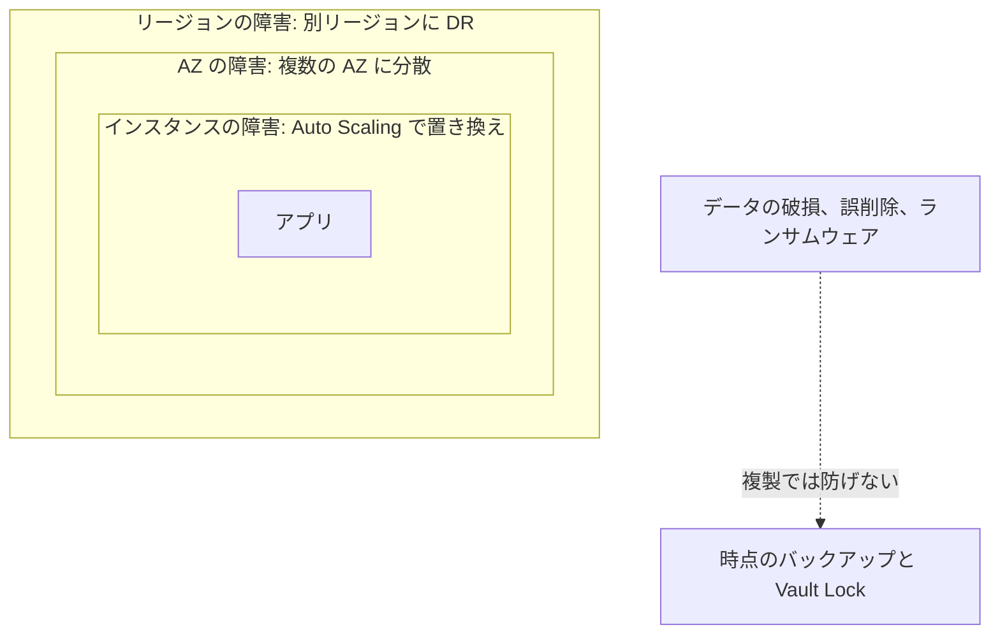

| 障害 | 起きると | 主な備え |
| --- | --- | --- |
| インスタンスやプロセスの障害 | 1 台が止まる | Auto Scaling、ELB のヘルスチェック |
| AZ の障害 | AZ の中のすべてが止まる | Multi-AZ、静的安定性、ゾーンシフト |
| リージョンの障害 | リージョンの中のすべてが止まる | DR 戦略、Route 53、ARC |
| データの破損、削除 | 正しいデータがなくなる。レプリカにも伝わる | AWS Backup、PITR、Vault Lock |
| 悪いデプロイ | 新しい版の部分だけ壊れる | ブルー/グリーン、デプロイのロールバック |

## 使いどころと具体例 {#use-cases}

どこまで備えるかは、「止まると何が困るか」で決まります。同じ会社の中でも、ネットバンキングと月次の集計では、許される停止の長さも、かけられる費用も違います。

ここでは、場面ごとの選び方と、架空のサービスでの組み方を示します。設定の詳細は各節へのリンク先にあります。

### 使う場面 {#use-cases-fit}

| 場面 | 具体例 | 使う機能 |
| --- | --- | --- |
| リージョンの障害でも数分で再開したい | 地方銀行のネットバンキングを、東京の障害時に大阪で続ける | [ウォームスタンバイ](#warm-standby)、[ルーティングコントロール](#arc-routing-control) |
| 費用を抑えて、リージョンの障害に半日で戻したい | 自治体の施設予約システムを、東京の障害時に大阪で作り直す | [バックアップと復元](#backup-restore) |
| AWS に作り替えられない古いサーバーを守りたい | 部品工場の Windows の生産管理サーバーを、数十分で別の場所で起動する | [DRS](#drs) |
| ランサムウェアにバックアップごと消されたくない | 歯科クリニックのチェーンで、管理者の権限を奪われても消せないコピーを持つ | [Vault Lock](#vault-lock)、[論理的にエアギャップされたボールト](#logically-air-gapped) |
| 規制で決まった年数のバックアップを残したい | 証券会社の取引記録を、誰も消せない形で 7 年残す | [ランサムウェアと誤削除の防止](#immutable-compare) |
| 誤って消した行を、消す直前に戻したい | 会計 SaaS で、14:33 に消した請求データを 14:32 の状態に戻す | [バックアッププランとルール](#backup-plans) の継続的バックアップ |
| 1 つの AZ だけ調子が悪いときに外したい | 動画配信で、ある AZ のターゲットだけエラーが増えた | [ゾーンシフトとオートシフト](#arc-zonal) |
| 決めた RTO と RPO を満たしているか確かめたい | 保険会社の 40 システムを、重要度ごとの目標で一括して評価する | [Resilience Hub](#resilience-hub) |
| DR の手順が本当に動くか試したい | EC サイトで、セールの前に AZ の電源喪失を検証環境で起こす | [FIS](#fis) |
| 複数のリージョンで同時に書き込みを受けたい | オンラインゲームで、東京と大阪の両方でプレイヤーの進行を保存する | [書き込みの戦略](#write-patterns) |

### 使わない方がよい場面 {#use-cases-avoid}

| 場面 | 理由 | 代わりの選択肢 |
| --- | --- | --- |
| 止まっても翌営業日に戻せばよい社内ツールに、ウォームスタンバイを組む | 平常時から 2 リージョン分の費用がかかり、損失に見合わない | [バックアップと復元](#backup-restore) |
| レプリケーションだけで誤削除やランサムウェアに備える | 削除や暗号化もそのまま複製される | 時点のバックアップと [Vault Lock](#vault-lock) |
| DB だけを守りたいのに DRS でサーバーごと複製する | DB の機能で複製するほうが RPO が短く、運用も単純 | Aurora Global Database や RDS のリードレプリカ（[パイロットライト](#pilot-light)） |
| 移行が終われば不要なサーバーを DRS で複製し続ける | 備え続けるための仕組みで、移したら費用だけが残る | [MGN](migration.md#mgn) |
| 停止条件を決めずに本番で FIS の実験をする | 影響が広がっても止まらない | 検証環境で停止条件付きの実験から始める（[実験テンプレート](#fis-template)） |

### 例: 地方銀行のネットバンキングをウォームスタンバイで {#use-case-regional-bank}

**状況:** 個人顧客 120 万人の地方銀行です。ネットバンキングは東京で動かし、平日の朝 9 時と給料日に利用が集中します。監督官庁への説明のため、リージョンの障害でも RTO 30 分、RPO 1 分を目標にしています。インフラ担当は 6 人です。

**構成:**

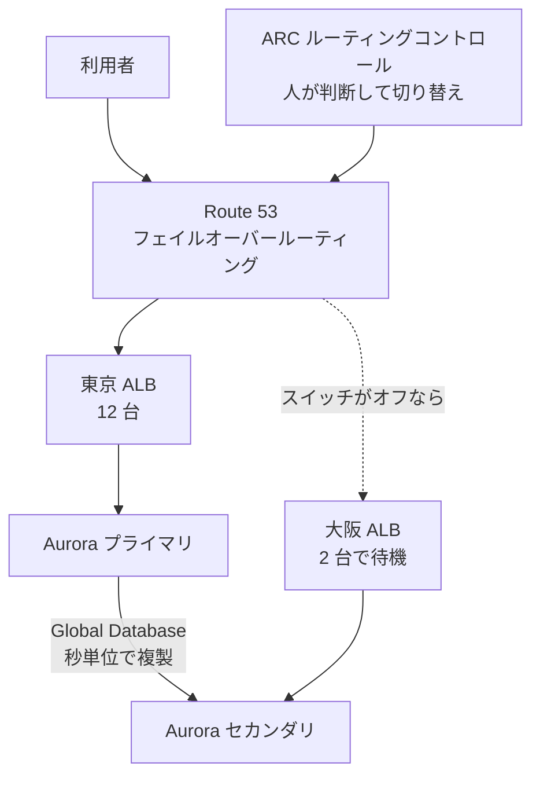

**設定値:**

| 設定 | 値 | 理由 |
| --- | --- | --- |
| 大阪の待機台数 | 2 台（本番は 12 台） | 切り替えの直後から処理を始め、その間に 12 台へ増やす（[ウォームスタンバイ](#warm-standby)） |
| 切り替えの方法 | ARC のルーティングコントロール | 誤検知で口座の更新が両方に流れないよう、人が判断して切り替える |
| アサーションルール | 少なくとも 1 つはオン | 東京と大阪を同時にオフにする誤操作を止める |
| Route 53 の TTL | 60 秒 | 切り替えた後、利用者が古い先へ接続し続ける時間を短くする |
| 大阪の EC2 のクォータ | 12 台分を平常時に引き上げ | 障害時に増やせないことを防ぐ |

**なぜこの戦略か:** パイロットライトでは、アプリの起動の間は処理できず、RTO 30 分に余裕がありません。アクティブ/アクティブは、残高の書き込みを 2 か所で受けると整合性の扱いが難しくなります。ウォームスタンバイなら、書き込みは東京に集めたまま、切り替えた直後から大阪で処理できます（[4 つの DR 戦略](#dr-strategies)）。

**つまずきやすい点:**

- 復旧の手順に「Route 53 のレコードを書き換える」と書くと、コントロールプレーンの障害時に実行できません（[フェイルオーバーはデータプレーンで](#failover-data-plane)）。
- ルーティングコントロールの Regional エンドポイントを 1 つしか手順に書かないと、そのリージョンの障害で操作できません。
- 判断に 15 分かかる前提だと、DB の昇格と増強を足して RTO 30 分を超えます。判断の基準と担当者を先に決めておきます（[達成できるかの計算](#rto-rpo-budget)）。

### 例: 部品工場の Windows サーバーを DRS で守る {#use-case-factory-drs}

**状況:** 自動車部品の工場で、生産管理と検査記録の Windows サーバー 15 台がオンプレミスにあります。市販のソフトで、AWS のサービスへは作り替えられません。工場の停止は 1 時間で数千万円の損失になり、RTO 1 時間、RPO 5 分を求められています。

**構成:**

| 要素 | 置き場所 | 内容 |
| --- | --- | --- |
| 元のサーバー | 工場のデータセンター | エージェントがブロックを継続的に送る |
| ステージングエリア | 東京の VPC のサブネット | 安価なストレージと最小のコンピュートでデータを受ける |
| 復旧インスタンス | 同じ VPC | 訓練や障害のときだけ起動する |
| 通信 | Direct Connect | TCP 443 と 1500 を許可する |

**設定値:**

| 設定 | 値 | 理由 |
| --- | --- | --- |
| 回線の帯域 | 15 台 × 毎秒 4 MB = 60 MB/s（約 480 Mbps）以上 | 書き込みより遅いと RPO が伸びる（[DRS](#drs)） |
| PIT の DAY の保持 | 30 日 | 潜伏していた攻撃にも、感染前の時点を選べるようにする |
| 訓練 | 四半期に 1 回、復旧インスタンスを起動 | Windows は起動に約 20 分かかる。手順を含めて 1 時間に収まるかを測る |

**なぜこのサービスか:** Aurora や DynamoDB の複製は、そのサービスのデータしか守れません。DRS はディスクをまるごと複製するので、市販のソフトを作り替えずに DR を用意できます。待機側でサーバーを動かし続けないので、同じ台数の DR サイトを持つより安くなりやすいです。

**つまずきやすい点:**

- ファイアウォールで TCP 1500 を閉じていると、エージェントの登録は成功しても初回の同期が進みません。
- 既定のレプリケーション設定を変えても、追加済みの 15 台には効きません。サーバーごとに変えます。
- 復旧点はクラッシュ整合です。DB を持つサーバーは、起動時のクラッシュリカバリで戻ることを訓練で確かめます。

### 例: 歯科クリニックのチェーンでバックアップを消されないようにする {#use-case-clinic-backup}

**状況:** 全国 45 院の歯科クリニックのチェーンです。予約とカルテのシステムは RDS for PostgreSQL と S3 に置いています。同業でランサムウェアの被害が続き、「管理者の権限を奪われても、バックアップだけは残す」ことを経営会議で決めました。情報システムの担当は 2 人です。

**構成:**

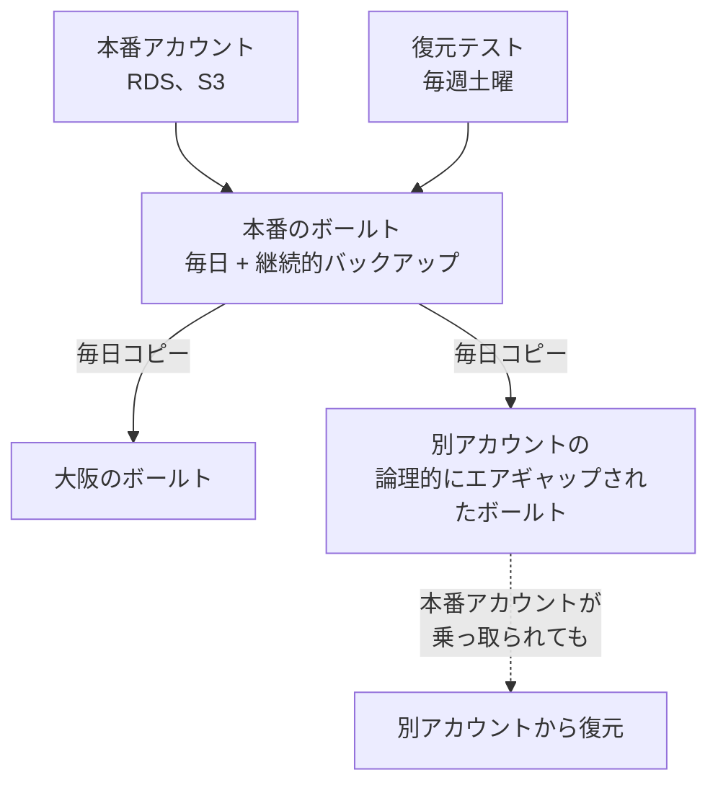

**設定値:**

| 設定 | 値 | 理由 |
| --- | --- | --- |
| 継続的バックアップ | 14 日 | 誤操作に気づいたとき、その直前に戻す |
| 毎日のバックアップ | 日本時間 2 時（`cron(0 17 ? * * *)`）、35 日保持 | 診療時間外に取る |
| エアギャップされたボールト | 最小 30 日、最大 365 日 | 本番アカウントの権限では消せないコピーを持つ |
| ボールトのアクセスポリシー | 運用ロールに `backup:DeleteRecoveryPoint` を `Deny` | 運用担当の認証情報が盗まれても消せない（[バックアップボールト](#backup-vaults)） |
| 復元テスト | 毎週土曜、直近 1 か月の復旧ポイント | 実際に戻るか、何分かかるかを測る |

**なぜこのサービスか:** RDS と S3 で別々に設定すると、少人数では保護の漏れを追えません。AWS Backup ならタグで対象を選び、保管、コピー、監査を 1 か所で扱えます。オンプレミスでテープを外の倉庫へ運んでいた役割を、別アカウントのボールトが担います。

**つまずきやすい点:**

- タグの綴りが `Backup=Daily` のように違うと、保護されないままエラーも出ません。Backup Audit Manager で漏れを確かめます（[リソースの割り当て](#backup-assignment)）。
- RDS のメンテナンスウィンドウの 1 時間前からは、バックアップを始められません。2 時の開始とメンテナンスの時間帯が重ならないようにします。
- エアギャップされたボールトの最小 30 日より短い保持のコピーは失敗します。コピーの `DeleteAfterDays` を 30 以上にします。

### 例: 自治体の施設予約を最小の費用で備える {#use-case-municipality-dr}

**状況:** 人口 15 万人の市の施設予約システムです。止まっても窓口と電話で受け付けられるので、リージョンの障害には RTO 24 時間、RPO 24 時間で足ります。DR の予算は年間で限られ、平常時に大阪で何かを動かし続ける余裕はありません。

**構成:**

| 要素 | 平常時 | 東京の障害時 |
| --- | --- | --- |
| データ | AWS Backup で毎日、大阪へコピー | 大阪で復元する |
| アプリ | AMI を大阪へコピー | CloudFormation で作り直す |
| 評価 | Resilience Hub で四半期ごとに評価 | 推定の RTO と RPO を目標と比べる |

**設定値:**

| 設定 | 値 | 理由 |
| --- | --- | --- |
| 回復性ポリシー | リージョンの障害に RTO 24 時間、RPO 24 時間 | 業務の影響から決めた目標 |
| 階層 | `Important` | 住民サービスだが、窓口で代わりが利く |
| 再評価 | スタックを更新したら必ず | `Changes detected` のまま古い結果を信じない |

**なぜこのサービスか:** 4 つの戦略のうち最も安い構成ですが、コピーや AMI を忘れると、障害時に初めて戻れないと分かります。Resilience Hub は構成を調べて「大阪にコピーがない」といった穴を先に示すので、少ない予算でも目標を満たしているかを確かめられます（[Resilience Hub](#resilience-hub)）。

**つまずきやすい点:**

- AMI のコピーを忘れると、大阪で `InvalidAMIID.NotFound` になり、スタックを作れません（[バックアップと復元](#backup-restore)）。
- 毎日 2 時のバックアップと 1 時間のコピーなら、大阪側の RPO は最大で約 25 時間です。RPO 24 時間をわずかに超えるので、12 時間ごとのバックアップにするか、目標を見直します（[リージョン間コピー](#backup-cross-region)）。
- RTO と RPO を 0 にすると、評価は常に違反になることがあります。

### 例: EC サイトがセールの前に AZ の障害を試す {#use-case-ec-fis}

**状況:** 会員 300 万人の家電の EC サイトです。11 月末のセールでは注文が平常時の 10 倍になります。3 つの AZ に分散しているつもりでしたが、去年のセールで 1 つの AZ が不調になった際、残りの AZ に負荷が集中して応答が遅れました。

**構成:**

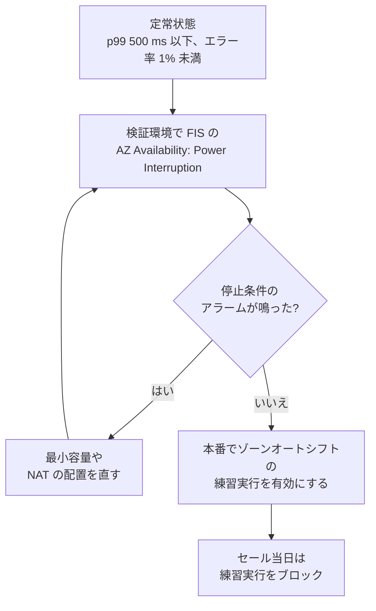

**設定値:**

| 設定 | 値 | 理由 |
| --- | --- | --- |
| Auto Scaling の最小容量 | 必要な 30 台 ÷ (3 - 1) = AZ ごとに 15 台、計 45 台 | 1 つの AZ を失っても 30 台残す（[静的安定性](#static-stability)） |
| FIS の停止条件 | 1 分間のエラー率 5% 超のアラーム | 影響が広がったら実験を止める |
| 練習実行の結果アラーム | 注文 API のエラー率 | アプリと無関係なメトリクスでは、容量不足でも成功になる |
| ブロックする日付 | セール当日 | 当日に練習実行で AZ を外さない（[ゾーンシフトとオートシフト](#arc-zonal)） |

**なぜこのサービスか:** 設計の図では 3 AZ に分散していても、NAT ゲートウェイが 1 つの AZ にだけある、といった穴は壊してみないと分かりません。FIS で日時を選んで障害を起こし、停止条件という中止の合図を決めておけば、セールの前に安全に確かめられます。

**つまずきやすい点:**

- NAT ゲートウェイを 1 つの AZ だけに置いていると、その AZ の障害で他の AZ の外向き通信も止まります（[サービスごとの Multi-AZ と Multi-Region](#patterns-by-service)）。
- 障害の後に Auto Scaling で増やす前提にすると、増やす操作と容量の両方に頼ることになります。
- ターゲットを `ALL` にし、タグを `env=prod` にすると、本番の全台が止まります（[実験テンプレート](#fis-template)）。

### 例: オンラインゲームを東京と大阪のアクティブ/アクティブで動かす {#use-case-game-active}

**状況:** 同時接続 20 万人のオンラインゲームです。メンテナンス以外で止まると、ソーシャルメディアで批判が広がり、課金の返金対応も発生します。東京と大阪の両方でプレイヤーを受け付け、片方の障害でも遊び続けられるようにします。

**構成:**

| 要素 | 内容 |
| --- | --- |
| 振り分け | Route 53 のレイテンシールーティングとヘルスチェック |
| アプリ | 東京と大阪で ECS のサービスを動かす |
| データ | DynamoDB グローバルテーブル（MREC） |
| 書き込みの分け方 | プレイヤーの所属サーバーで、書き込むリージョンを決める |

**設定値:**

| 設定 | 値 | 理由 |
| --- | --- | --- |
| 各リージョンの台数 | 全量の 100%（両方で 2 倍） | 片方が止まっても、増やさずに全員を受ける |
| 書き込みの戦略 | Write partitioned | 同じプレイヤーへの同時の書き込みが、2 つのリージョンで競合しない（[書き込みの戦略](#write-patterns)） |
| ヘルスチェック | Fast（10 秒 × 3 回）、TTL 60 秒 | 切り替えを約 1.5 分に縮める（[設計のポイント](#route53-design)） |
| ECR のレプリケーション | 東京から大阪 | 大阪で新しいタスクを起動するときにイメージを取れるようにする |

**なぜこの戦略か:** アクティブ/アクティブには、フェイルオーバーという操作自体がありません。障害のリージョンを外すだけなので、切り替えの手順が失敗する心配が減ります。その代わり、平常時から両リージョンで全量の費用がかかり、書き込みの競合を設計で避ける必要があります。

**つまずきやすい点:**

- Write local のまま両方で同じプレイヤーのアイテム数を更新すると、最後の書き込みが優先され、片方の更新が失われます。
- 各リージョンを全量の 50% にすると、片方の障害で容量が半分になります（[マルチサイトアクティブ/アクティブ](#active-active)）。
- ヘルスチェックのパスで DynamoDB まで確かめると、テーブルの一時的な不調で両方のリージョンが同時に外れることがあります。

## RTO と RPO {#rto-rpo}

DR の設計は、「どれだけ止まってよいか」と「どれだけ失ってよいか」を決めることから始まります。これが決まらないと、どこまでお金をかけるかを決められません。

お店の火事にたとえると、RTO は「何日で営業を再開するか」、RPO は「何日分の帳簿を失ってよいか」です。毎晩帳簿のコピーを別の場所に置いていれば、失うのは最大で 1 日分です。

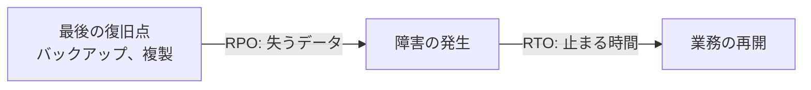

| 指標 | 意味 | 決めるもの | 例 |
| --- | --- | --- | --- |
| RTO(目標復旧時間) | 中断から復旧までに許容する時間 | 待機系をどこまで動かしておくか | RTO 1 時間なら、1 時間以内に業務を再開 |
| RPO(目標復旧時点) | 最後の復旧点から中断までに許容する時間。失うデータの量 | バックアップの間隔、レプリケーション | RPO 15 分なら、最大 15 分のデータを失ってよい |

- RPO は過去を、RTO は未来を見ます。
- 短くするほど費用と複雑さが増えます。業務の損失と比べて決めます。

- **例:** 1 時間の停止で 200 万円の損失が出る受注システムが、年に 1 回、4 時間止まると想定します。損失は年 800 万円です。DR の費用が年 300 万円で停止を 30 分に縮められるなら、損失は 100 万円に減り、合計 400 万円で済みます。
- **誤ると:** 全システムに RTO 5 分を求めると、月次レポートのような止まってもよいシステムにも費用をかけます。逆に業務の損失を確かめずに決めると、障害のあとで「24 時間は長すぎた」と気づきます。

### 達成できるかの計算 {#rto-rpo-budget}

**RPO の例**: 4 時間ごとのスナップショットの場合、最悪で直前の 3 時間 59 分を失います。RPO 15 分を求められたら、スナップショットの間隔では足りません。継続的バックアップやレプリケーションにします。

**RTO の例**: 次の時間を足します。

| 段階 | 時間の例 |
| --- | --- |
| 検知(ヘルスチェック 30 秒 × 失敗 3 回) | 1.5 分 |
| 判断(人の承認が必要な場合) | 15 分 |
| DB の昇格 | 数分(5 分とする) |
| アプリの増強 | 10 分 |
| DNS の切り替え(TTL 60 秒) | 1 分 |
| 合計 | 約 33 分 |

RTO 30 分なら、この構成では足りません。判断を自動化するか、スケールを待たずに済むよう事前に容量を確保します。

判断の 15 分を自動化すると合計は約 18 分になり、RTO 30 分を満たします。アプリの増強 10 分を事前の容量で省くと、さらに約 8 分に縮みます。

## 4 つの DR 戦略 {#dr-strategies}

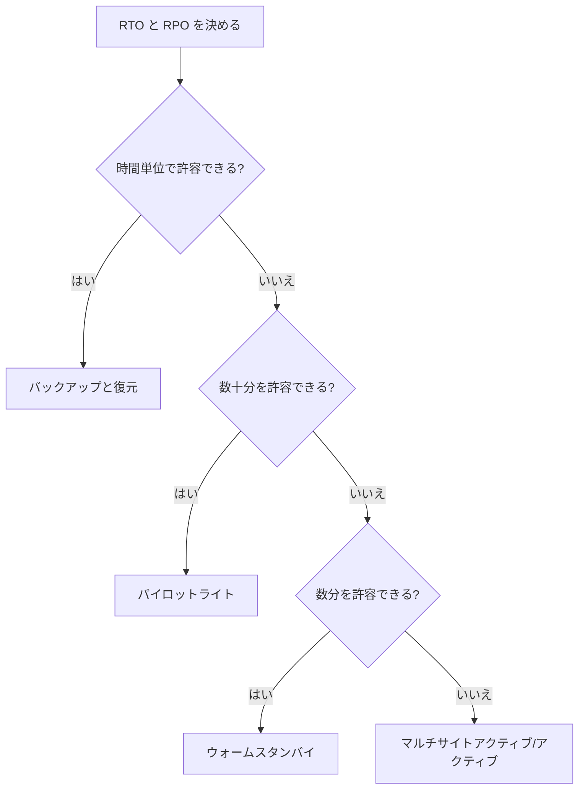

どの戦略でも、レプリケーションだけでは破損や誤削除を防げません。破損も複製されるからです。必ず時点復旧のバックアップも持ちます。

戦略が 4 つあるのは、待機系をどこまで動かしておくかで、RTO と費用が逆向きに動くからです。待機系を多く動かすほど早く戻れますが、平常時の費用が増えます。

オンプレミスの DR で使うコールドサイト、ウォームサイト、ホットサイトの区別に近いものです。

| 戦略 | オンプレミスでいえば | お店でたとえると |
| --- | --- | --- |
| バックアップと復元 | コールドサイト。場所とデータだけあり、機器は障害後に用意する | 設計図と帳簿の写しを倉庫に預けておく |
| パイロットライト | データの複製だけ動かしておく DR サイト | 別の店舗で冷蔵庫（データ）だけを動かしておく |
| ウォームスタンバイ | ウォームサイト。小さな構成で常に動かす | 小さな支店を営業しておき、いざとなれば広げる |
| マルチサイトアクティブ/アクティブ | ホットサイト。両方で本番を処理する | 2 つの本店が、どちらも普段から営業する |

パイロットライトの名前は、ガス給湯器の種火から来ています。種火（データ）が付いていれば、すぐに全体へ火を付けられます。

違いは、AWS では待機系の大きさを後から変えられることです。オンプレミスの DR サイトはピークに合わせた機器を先に買いますが、AWS では平常時は小さく動かし、切り替えのときに増やせます。ただし、増やす操作に頼るほど、障害時のコントロールプレーンと容量に依存します（[静的安定性](#static-stability)）。

### バックアップと復元 {#backup-restore}

データを別リージョンにコピーしておき、障害時にインフラを作って復元します。

- **データ**: EBS スナップショット、RDS スナップショット、DynamoDB のバックアップ、S3 の CRR と AWS Backup です。
- **インフラ**: CloudFormation などの IaC で再作成します。手作業は時間がかかり、誤りも起きます。
- **AMI**: アプリのイメージをコピーしておきます。

**例**: 社内の日報システムで RTO 24 時間、RPO 24 時間です。毎日のバックアップを別リージョンにコピーし、CloudFormation で再作成します。

- **復元の時間の例:** 2 TB を 200 MB/s で復元するなら、2,000,000 MB ÷ 200 MB/s = 10,000 秒で約 2.8 時間です。CloudFormation での再作成に 30 分かかれば合計約 3.3 時間で、RTO 4 時間は満たし、RTO 2 時間は満たしません。
- **誤ると:** AMI をコピーし忘れると、DR リージョンで `InvalidAMIID.NotFound` になり、スタックの作成に失敗します。

**落とし穴**: 復元を試していないバックアップは当てになりません。定期的に[復元テスト](#backup-testing)をします。

### パイロットライト {#pilot-light}

データは常に複製し、アプリサーバーは停止か未作成の状態で待機します。そのままではリクエストを処理できません。

データは障害のあとで作り直せませんが、アプリサーバーは IaC と AMI があれば作り直せます。作り直せないものだけを常に動かし、作り直せるものは止めておくことで、費用を抑えつつ RPO を短くします。

[](../assets/diagrams/resilience-pilot-light.png)

- **データ**: Aurora Global Database、RDS のクロスリージョンリードレプリカ、DynamoDB グローバルテーブル、S3 のレプリケーションなどです。
- **障害時**: DB を昇格し、アプリを起動し、トラフィックを切り替えます。

**例**: Aurora のセカンダリだけを動かし、Auto Scaling グループは希望 0 台にしておきます。障害時に希望を増やします。

- **所要時間の例:** Aurora の昇格 5 分、12 台の起動 5 分、DNS の切り替え 1 分で合計約 11 分です。起動の間はリクエストを処理できません。
- **誤ると:** DR リージョンのインスタンスのクォータが 4 台分しかないと、希望を 12 にしても 8 台は起動に失敗します。クォータは平常時に引き上げておきます。

### ウォームスタンバイ {#warm-standby}

縮小した本番の完全なコピーが常に動いています。パイロットライトとの違いは、**すぐにリクエストを処理できる**ことです。容量が足りないだけなので、増やして全量にします。

**例**: 本番 12 台、DR 2 台で動かします。障害時は 2 台で処理を始めつつ 12 台に増やします。常に動いているので、定期的なテストもしやすくなります。

**落とし穴**: 障害のときにスケールできるとは限りません。増やす操作はコントロールプレーンの操作です。容量やクォータも DR リージョンで事前に確認します。

- **容量の例:** DR 2 台は本番 12 台の 2 ÷ 12 ≒ 17% です。増えるまでの間は、残り 83% のリクエストを断るか待たせる設計が要ります。

### マルチサイトアクティブ/アクティブ {#active-active}

複数のリージョンで同時に動かし、どちらもトラフィックを処理します。フェイルオーバーという操作自体がなく、障害のリージョンを外すだけです。

全量が動いていて 1 つのリージョンだけが処理するのが**ホットスタンバイ**です。

- **例:** 全量に 12 台が必要なアプリを東京と大阪で 6 台ずつ動かすと、片方の障害で 6 台になり、容量は 50% に落ちます。増やさずに全量を処理するなら 12 台ずつ、計 24 台です。ホットスタンバイも同じ 24 台ですが、処理するのは片方だけです。

### 書き込みの戦略 {#write-patterns}

アクティブ/アクティブでは、書き込みをどう扱うかで次のように分かれます。

| 戦略 | 動作 | 適したサービス |
| --- | --- | --- |
| Write global | 書き込みを 1 つのリージョンに集める。障害時に別を昇格 | Aurora Global Database |
| Write local | 最も近いリージョンに書く | DynamoDB グローバルテーブル(最後の書き込みが優先) |
| Write partitioned | パーティションキーで書くリージョンを決める | S3 の双方向レプリケーション |

- **Write global の例:** 書き込みは東京の Aurora だけに送ります。大阪のアプリの書き込みはリージョン間の遅延の分だけ遅くなります。
- **Write local の例:** 東京が 10:00:00.100 に在庫を 5 に、大阪が 10:00:00.200 に在庫を 7 に更新すると、最後の書き込みが優先され 7 になります。東京の更新は失われます。
- **Write partitioned の例:** `customerId` の範囲で書くリージョンを分け、日本の顧客は東京、欧州の顧客はフランクフルトに書きます。同じ顧客の書き込みが競合しません。

### フェイルオーバーはデータプレーンで {#failover-data-plane}

障害のときはコントロールプレーン(作成、更新の API)が使えないことがあります。データプレーン(実際の処理)の操作だけで切り替えられるようにします。

この用語はルーターから来ています。パケットを転送する部分がデータプレーン、転送のルールを作って配る部分がコントロールプレーンです。

AWS によると、コントロールプレーンは多くの依存を持つ複雑な仕組みです。たとえば EC2 の起動では、ホストの確保、ネットワークインターフェイス、EBS、セキュリティグループの準備などのどれかが失敗すると起動全体が失敗します。データプレーンは意図的に単純にしてあり、依存が少ないので、広い範囲の障害が起きにくくなっています。

電話にたとえると、通話がデータプレーン、新しい番号を契約する窓口がコントロールプレーンです。窓口が閉まっていても、つながっている電話は話せます。障害時の手順は「窓口に行かなくても済む」形にしておきます。

| 操作 | どちらか | 障害時の当てにしやすさ |
| --- | --- | --- |
| 動いている EC2 への通信、EBS の読み書き | データプレーン | 高い |
| S3 のオブジェクトの取得と保存 | データプレーン | 高い |
| Route 53 の名前解決とヘルスチェック | データプレーン | 高い |
| EC2 の起動、バケットの作成、レコードの編集 | コントロールプレーン | 低い |

| 方法 | プレーン | 備考 |
| --- | --- | --- |
| Route 53 のヘルスチェックに基づくフェイルオーバー | データプレーン | レコードの編集は不要 |
| ARC のルーティングコントロールの状態変更 | データプレーン | 推奨は CLI と API |
| Route 53 のレコードを編集 | コントロールプレーン(us-east-1) | 復旧の手順に含めない |
| 事前に容量を確保 | 操作なし | スケールに頼らない |

- **例:** 復旧の手順に「Route 53 のレコードを大阪の ALB へ書き換える」と書くと、`us-east-1` のコントロールプレーンの障害時に実行できません。ヘルスチェックに基づくフェイルオーバーレコードを事前に作っておけば、編集せずに切り替わります。

## AWS Backup {#backup}

[:material-sprout: CLF](../courses/clf/services.md){ .exam-badge .exam-foundational } [:material-certificate: SAA](../courses/saa/services.md){ .exam-badge .exam-associate } [:material-certificate: SOA](../courses/soa/services.md){ .exam-badge .exam-associate } [:material-certificate: DEA](../courses/dea/services.md){ .exam-badge .exam-associate } [:material-star-circle: SAP](../courses/sap/services.md){ .exam-badge .exam-professional } [:material-star-circle: DOP](../courses/dop/services.md){ .exam-badge .exam-professional } [:material-target: SCS](../courses/scs/services.md){ .exam-badge .exam-specialty }

[提供単位](resource-scope.md#two-axes): リージョン。プランとボールトはリージョンごとに作り、VPC の外です。

複数のサービスのバックアップを一元管理します。対象は EBS、EC2、RDS、Aurora、DynamoDB、EFS、FSx、Storage Gateway のボリューム、S3 などです。リージョンごとに対象のサービスをオプトインします。

RDS の自動バックアップ、EBS のスナップショット、DynamoDB のバックアップは、それぞれのサービスでも設定できます。ただし、サービスごと、アカウントごとに設定が散らばると、「どれが守られていないか」が分からなくなります。AWS Backup は、設定と保管と監査を 1 か所に集めます。

| 観点 | オンプレミスのバックアップサーバー | AWS Backup |
| --- | --- | --- |
| 方針 | バックアップのソフトでジョブを定義する | バックアッププランとルール。組織全体にはバックアップポリシー |
| 対象の選び方 | サーバーごとにエージェントを入れて登録する | タグや ARN で選ぶ。タグを付けた新しいリソースも自動で対象になる |
| 保管先 | テープライブラリ、別拠点への搬送 | ボールト。別リージョン、別アカウントへのコピー |
| 改ざんの防止 | WORM テープ、オフラインの保管 | Vault Lock、論理的にエアギャップされたボールト |
| 確認 | 手作業の復元訓練 | 復元テスト、Backup Audit Manager |

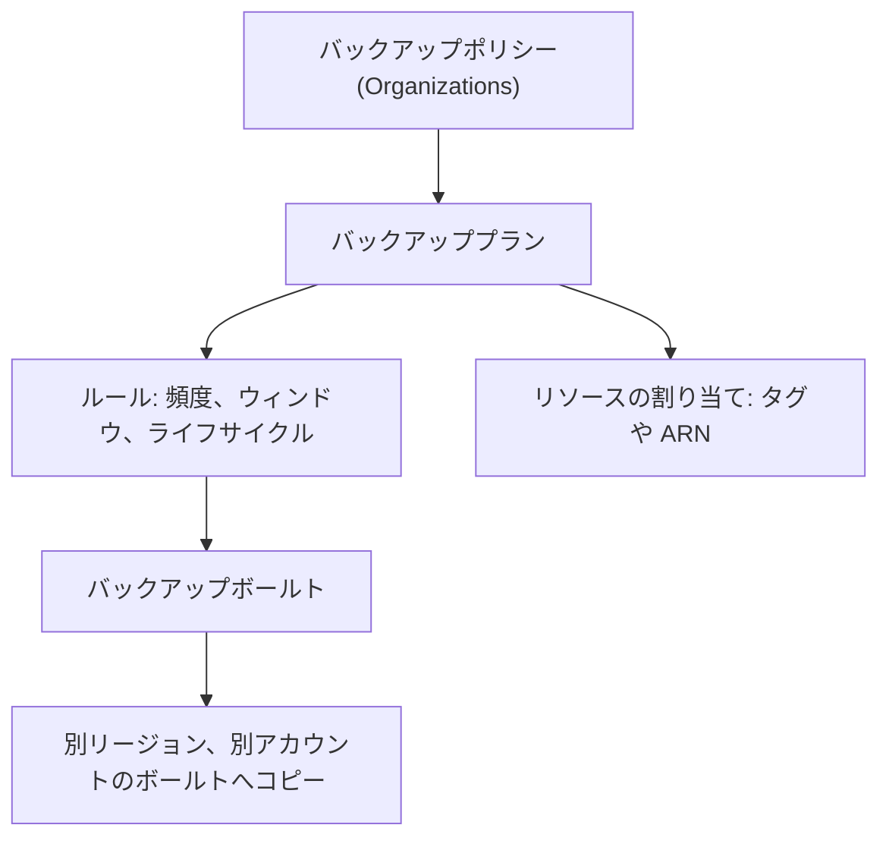

### バックアッププランとルール {#backup-plans}

| 設定 | 既定と範囲 | 誤ったときの症状と例 |
| --- | --- | --- |
| 頻度 | 毎時、12 時間、毎日、毎週、毎月、cron。最短は 1 時間 | 毎日のバックアップで RPO 1 時間は満たせない |
| 開始ウィンドウ | コンソールの既定は 0:30 に開始、8 時間以内に開始 | 短すぎるとジョブが始まらず失敗する |
| 完了ウィンドウ | コンソールの既定は 7 日(FSx には適用されない) | 大きな資源が時間内に終わらない |
| 継続的バックアップ | 任意。時点復旧(PITR)、最大 35 日 | スケジュールでは指定できない。秒単位に近い RPO に使う |
| 保持期間 | 1 日〜100 年、または無期限 | 無期限と Vault Lock を組み合わせると消せなくなる |
| コールドへの移行 | 任意。コールドでは最低 90 日 | 保持期間は移行日数 + 90 日以上にする |
| コピー先 | 別リージョン、別アカウントのボールト | コールドのバックアップはリージョン間でコピーできない |

複数のルールの開始ウィンドウが重なると、**保持期間が長いルール**のバックアップが残ります。

**重なりの例**（公式の例）: 「毎時、開始ウィンドウ 1 時間、1 日保持」と「12 時間ごと、開始ウィンドウ 8 時間、1 週間保持」のルールがあるとします。0 時〜8 時と 12 時〜20 時は 12 時間ごとのルールが優先されます。24 時間で、12 時間ごとの分が 2 個、毎時の分が 8 個できます。

設定ごとの例です。

- **頻度の例:** RPO 1 時間なら毎時のスナップショットにします。`cron(15 * ? * * *)` は毎時 15 分に取ります。RPO 15 分なら、スナップショットでは足りないので継続的バックアップです。
- **開始ウィンドウ（`StartWindowMinutes`）の例:** 60 分以上にする必要があります。`cron(0 17 ? * * *)` は UTC の 17 時、日本時間の午前 2 時です。60 分なら午前 3 時までに始まらないジョブは取り消されます。
- **完了ウィンドウ（`CompletionWindowMinutes`）の例:** 開始からの時間です。480 分なら、開始から 8 時間で終わらないジョブは取り消されます。
- **継続的バックアップの例:** 14:33 に誤って行を消したなら、14:32:50 の時点に戻せます。保持は 1〜35 日で、36 日以上は指定できません。続けられない場合は自動でスナップショットに切り替わります。オンデマンドでは使えません。
- **コールドの例:** `MoveToColdStorageAfterDays` が 30 なら、`DeleteAfterDays` は 30 + 90 = 120 以上にします。100 にするとコールドの最低 90 日を満たせません。

**落とし穴**: データベース系は、メンテナンスウィンドウの 1 時間前からその間まで開始できません。FSx は 3 時間前から開始できません。この時間帯に予定したジョブは失敗します。

```json
{
  "BackupPlanName": "daily-35d-dr",
  "Rules": [{
    "RuleName": "daily",
    "TargetBackupVaultName": "prod-vault",
    "ScheduleExpression": "cron(0 17 ? * * *)",
    "StartWindowMinutes": 60,
    "CompletionWindowMinutes": 480,
    "Lifecycle": {"DeleteAfterDays": 35},
    "CopyActions": [{
      "DestinationBackupVaultArn": "arn:aws:backup:ap-northeast-3:111122223333:backup-vault:dr-vault",
      "Lifecycle": {"DeleteAfterDays": 35}
    }]
  }]
}
```

```bash
aws backup create-backup-plan --backup-plan file://plan.json
```

**増分**: 最初は全量で、その後は変更分だけ保存します。増分に対応しないリソースは毎回全量です。

### リソースの割り当て {#backup-assignment}

タグか ARN で、プランの対象を決めます。

**例**: タグ `backup=daily` が付いたリソースを対象にすると、新しいリソースもタグだけで保護できます。

```json
{
  "SelectionName": "daily-by-tag",
  "IamRoleArn": "arn:aws:iam::111122223333:role/backup-role",
  "ListOfTags": [{
    "ConditionType": "STRINGEQUALS",
    "ConditionKey": "backup",
    "ConditionValue": "daily"
  }]
}
```

1 つの割り当てで指定できるのは、ワイルドカードなしの ARN が 500、ワイルドカードありの ARN が 30、条件が 30、タグが 30 です。

- **例:** `NotResources` や条件のタグで `env=dev` を除くと、開発環境の費用を払わずに済みます。
- **誤ると:** タグの綴りが `Backup=Daily` だと条件に合わず、保護されないままジョブのエラーも出ません。Backup Audit Manager で保護の漏れを確かめます。

**落とし穴**: 対象のサービスがオプトインされていないと、割り当てても保護されません。

### バックアップボールト {#backup-vaults}

バックアップ(復旧ポイント)を保存する入れ物です。

| 項目 | 内容 |
| --- | --- |
| 暗号化 | ボールトごとの KMS キー |
| アクセスポリシー | リソースベースのポリシー。例: 特定のロールに削除を拒否 |
| 別アカウントからの操作 | `backup:CopyIntoBackupVault` 以外は拒否される |

- **アクセスポリシーの例:** 運用ロールに `backup:DeleteRecoveryPoint` と `backup:UpdateRecoveryPointLifecycle` を `Deny` します。運用担当の認証情報が盗まれても、復旧ポイントを消せません。
- **暗号化の例:** 東京の `prod-vault` はカスタマー管理キーの A で暗号化します。別のキーのボールトへコピーすると、そのボールトのキーで暗号化し直します。

### Vault Lock {#vault-lock}

WORM でバックアップを保護します。保持期間が終わるまで、ルートユーザーでも消せません。追加料金はありません。

ランサムウェアの攻撃者は、管理者の権限を奪うと、本番のデータを暗号化する前にバックアップを消そうとします。バックアップを消せる権限がある限り、バックアップは最後の砦になりません。Vault Lock は、権限を持つ人でも消せない状態を作ります。

時限式の金庫にたとえると、ガバナンスモードは管理者の鍵で開けられる金庫、コンプライアンスモードは期日まで誰の鍵でも開かない金庫です。オンプレミスでは、一度しか書き込めない WORM のテープやストレージが同じ役割です。

| モード | ロックの解除 | 使う場面 |
| --- | --- | --- |
| ガバナンス | 十分な IAM 権限があれば解除できる | 社内の統制 |
| コンプライアンス | 猶予期間の後は、顧客も AWS も解除できない | 規制(SEC 17a-4、CFTC、FINRA の評価あり) |

| 設定 | 動作 | 誤ったときの症状 |
| --- | --- | --- |
| 最小保持期間(`MinRetentionDays`) | 短い保持のジョブを拒否 | 条件に合わないバックアップとコピーのジョブが失敗する |
| 最大保持期間(`MaxRetentionDays`) | 長い保持のジョブを拒否 | 同上 |
| 猶予期間(`ChangeableForDays`) | コンプライアンスモードで、確定までの日数。3 日(72 時間)以上 | 確定後は変更できない |

- **最小、最大の例:** `MinRetentionDays` が 35、`MaxRetentionDays` が 3650 のボールトに、`DeleteAfterDays` が 30 や 4000 のジョブを送ると失敗します。35 や 3650 なら成功します。
- **猶予期間の例:** 値は 3〜36,500 です。10 月 31 日に `--changeable-for-days 3` で設定すると、11 月 3 日に確定します。それまでは解除や変更ができます。
- **猶予期間が短いと:** 誤った値に気づいたときには確定しているので、最初は 7 日などにして動作を確認します。

```bash
aws backup put-backup-vault-lock-configuration \
  --backup-vault-name prod-vault \
  --min-retention-days 35 \
  --max-retention-days 3650 \
  --changeable-for-days 3
```

`--changeable-for-days` を指定するとコンプライアンスモード、省略するとガバナンスモードです。

**落とし穴**: 最小、最大の設定はロック後の新しいジョブに適用され、既存の復旧ポイントには適用されません。コンプライアンスモードで無期限の復旧ポイントがあると、確定後はボールトを消せず費用が続きます。

### 論理的にエアギャップされたボールト {#logically-air-gapped}

強化された保護を持つボールトです。

オンプレミスの「エアギャップ」は、テープを抜いてネットワークから物理的に切り離すことです。ネットワークでつながっていなければ、侵入者は届きません。このボールトは物理的には切り離しませんが、本番のアカウントの権限では消せず、別のアカウントから復元できるようにして、同じ効果を論理的に作ります。

- Vault Lock のコンプライアンスモードが自動で適用されます。
- 既定で AWS 所有キーで暗号化します。カスタマー管理キーも選べます。
- AWS RAM や Multi-party approval で別のアカウントと共有し、そこから復元できます。ボールトのアカウントが侵害されたり閉鎖されたりしても、復旧の道を残せます。

- 最小と最大の保持期間を指定します。最小より短い保持のバックアップはコピーできません。

**例**: ランサムウェアで本番のアカウントごと乗っ取られた場合に備え、別アカウントのこのボールトにコピーを置きます。

- **値の例:** 最小 30 日、最大 365 日のボールトへ、`DeleteAfterDays` が 90 のコピーを送ります。`DeleteAfterDays` が 7 のコピーは失敗します。

### リージョン間コピー {#backup-cross-region}

**使う場面:** 東京の本番を守る通販会社で、東京のリージョン全体の障害に備え、毎晩の RDS と EBS のバックアップを大阪のボールトへ自動で送る。

| 項目 | 内容 |
| --- | --- |
| 初回 | 全量 |
| 2 回目以降 | サービスが対応していれば増分 |
| 暗号化 | コピー先のボールトのキーで再暗号化 |
| EBS の例外 | 別のキーのボールトへのコピーは全量になる |
| コールド | コピーできない |

**例**: 東京の本番を大阪のボールトにコピーします。コストを抑えるなら、毎回同じボールトに同じキーでコピーします。

- **増分の例:** 500 GB の EBS で 1 日の変更が 5 GB なら、初回は 500 GB、翌日からは約 5 GB のコピーです。
- **誤ると:** コピー先のキーを変えると EBS は全量のコピーになり、500 GB 分の転送と保存の費用がかかります。
- **RPO の例:** コピーはバックアップの完了後に始まります。毎日 2 時のバックアップと 1 時間のコピーなら、大阪側の RPO は最大で約 25 時間です。

### アカウント間コピーと組織での管理 {#backup-cross-account}

アカウントは同じ AWS Organizations に属している必要があります。

**使う場面:** 50 アカウントを持つ持株会社で、各社の本番アカウントのバックアップを、監査部門だけが入れるバックアップ専用アカウントへ集める。

| 機能 | 内容 |
| --- | --- |
| 別アカウントへのコピー | 送信先にボールトとアクセスポリシーを作り、`backup:CopyIntoBackupVault` を許可 |
| 暗号化キー | 送信元がカスタマー管理キーなら、そのキーを送信先のアカウントへ共有する。AWS Backup が完全に管理するリソースなら、送信先のボールトはカスタマー管理キーか `aws/backup`。それ以外のリソースはカスタマー管理キーが必須で、AWS 管理キーはキーポリシーを変えられないのでアカウント間でコピーできない |
| バックアップポリシー | 組織で定義して OU やアカウントに適用。子のポリシーは親と統合される |
| クロスアカウントモニタリング | ジョブをまとめて確認 |
| 委任管理者 | 管理アカウント以外に管理を任せる |

**例**: 組織全体に「毎日、7 日保持」を適用し、Finance の OU に「毎月、1 年保持」を足します。Finance の OU には両方が統合されて適用されます。

**落とし穴**: カスタム IAM ロールでコピーするなら、`backup:CopyIntoBackupVault` がロールのポリシーと送信先のボールトポリシーの両方に必要です。

- **バックアップポリシーの例:** 組織のルートに「毎日、7 日保持」、Finance の OU に「毎月、1 年保持」を付けます。Finance のアカウントには両方のルールが効きます。Finance でない OU には毎日のルールだけが効きます。

### 復元テストと監査 {#backup-testing}

**使う場面:** 監査で「本当に戻せるか」を問われる信用金庫で、毎週の自動の復元で所要時間を記録し、RTO の根拠として提出する。

| 機能 | 内容 |
| --- | --- |
| 復元テスト | 定期的に自動で復元し、成否と所要時間を測る。実際の RTO の確認に使う |
| Backup Audit Manager | バックアップがポリシーに沿っているかを監査し、レポートを作る |

- **復元テストの例:** 毎週土曜に、直近 1 か月の復旧ポイントから RDS を自動で復元します。実測が 40 分なら、RTO 1 時間の根拠になります。2 時間なら計画を見直します。対象の復旧ポイントの範囲は 1〜365 日、1〜52 週、1〜12 か月、1 年から選びます。テストの後はリソースが自動で削除されます。
- **誤ると:** 復元したリソースの `awsbackup-restore-test` タグを外すと自動で削除されず、手で消すまで費用が続きます。
- **監査の例:** コントロールの「バックアップは毎日か」を「毎週か」に変えられます。レポートは 24 時間ごとに S3 へ届きます。先に AWS Config のリソース追跡を有効にします。停止中の EC2 は評価されません。

### ランサムウェアと誤削除の防止 {#immutable-compare}

| 対象 | 機能 | 保護の内容 |
| --- | --- | --- |
| S3 | [Object Lock](s3.md#object-lock) | オブジェクトの WORM |
| EBS スナップショット | スナップショットロック | ガバナンス、コンプライアンスのモード。期間中は権限があっても削除できない |
| バックアップ全般 | Vault Lock | ボールト内の復旧ポイントの WORM |
| 組織全体 | 論理的にエアギャップされたボールト | 別アカウントからの復元 |

- **例:** 監査で 7 年の保持を求められたバックアップは、Vault Lock のコンプライアンスモードで `MinRetentionDays` を 2557 にします。7 年 × 365 日 + うるう日 2 日です。
- **スナップショットロックの例:** EBS スナップショットだけを 30 日守るなら、スナップショットロックです。ロック中は IAM の権限にかかわらず削除できません。

## AWS Elastic Disaster Recovery(DRS) {#drs}

[:material-sprout: CLF](../courses/clf/services.md){ .exam-badge .exam-foundational } [:material-star-circle: SAP](../courses/sap/services.md){ .exam-badge .exam-professional } [:material-star-circle: DOP](../courses/dop/services.md){ .exam-badge .exam-professional }

[提供単位](resource-scope.md#two-axes): リージョン。レプリケーションサーバーと復旧インスタンスは指定したサブネット（AZ、VPC の中）に置きます。

オンプレミスや他のクラウドのサーバー、別リージョンの EC2 を、ブロック単位で継続的に AWS へ複製します。**サーバー単位のパイロットライト**として使います。データベースのエンジンに依存しません。

Aurora Global Database や DynamoDB グローバルテーブルは、そのサービスのデータしか複製できません。オンプレミスの古いアプリや市販のソフトは、AWS のサービスに作り替えないと、これらを使えません。DRS は中身を問わずディスクをまるごと複製するので、作り替えずに DR を用意できます。

オンプレミスのストレージ装置どうしのリモートレプリケーションや、仮想マシンの複製に近い仕組みです。違いは、待機側にはサーバーを動かさず、安価なステージングエリアにデータだけを受けておき、訓練や復旧のときだけ起動することです。

| 指標 | 値 |
| --- | --- |
| RPO | 通常は秒単位 |
| RTO | 通常は 5〜20 分。Linux は約 5 分、Windows は約 20 分で起動 |

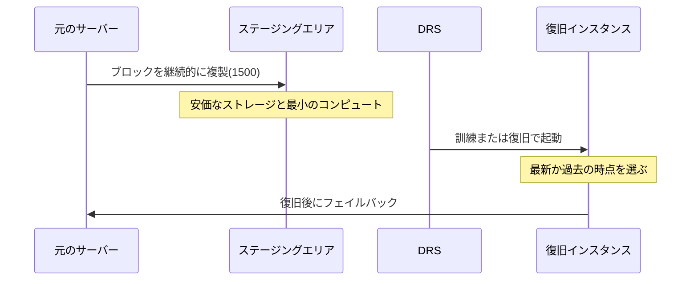

| 設定 | 既定と範囲 | 動作と例 |
| --- | --- | --- |
| PIT スナップショットの保持 | 1〜365 日 | 長くすると選択肢が増え費用も増える |
| PIT の間隔 | 分は 10 分間隔で 60 分保持、時は 1 時間間隔で 24 時間保持(変更不可)、日は保持日数を変更可 | ランサムウェアの前の時点を選んで復旧 |
| 通信 | TCP 443、TCP 1500 | 1500 が閉じていると複製できない |

```bash
aws drs update-replication-configuration \
  --source-server-id s-1234567890abcdef0 \
  --pit-policy \
    enabled=true,interval=10,retentionDuration=60,ruleID=1,units="MINUTE" \
    enabled=true,interval=1,retentionDuration=24,ruleID=2,units="HOUR" \
    enabled=true,interval=1,retentionDuration=14,ruleID=3,units="DAY"
```

ルールは MINUTE、HOUR、DAY の 3 つちょうどで、変更できるのは DAY の日数だけです。

- **時点の選び方の例:** 3:20 に暗号化が始まり 3:50 に気づいたなら、10 分間隔の 3:10 の時点を選びます。20 時間後に気づいたなら 1 時間間隔の時点、5 日後に気づいたなら 1 日間隔の時点です。
- **保持の例:** 14 日保持で、15 日前に侵入されていたなら、きれいな時点が残っていません。潜伏の期間を見込んで日数を決めます。
- **既定の設定の罠:** 既定のレプリケーション設定の変更は、そのあとに追加したサーバーにだけ効きます。追加済みのサーバーは個別に変えます。
- **誤ると:** ファイアウォールで TCP 1500 を閉じていると、エージェントの登録は成功しても初回の同期が進みません。

**RPO を守る条件**: ネットワークとステージングエリアが、書き込みより速く受け取れることです。10 MB/s で書くサーバーが 10 台なら、100 MB/s(約 800 Mbps)が必要です。足りないと RPO が伸びます。

**整合性**: 復旧点はクラッシュ整合です。メモリにあってディスクに書かれていないデータは含まれません。

- **例:** データベースのサーバーを複製した場合、起動時にエンジンのクラッシュリカバリが走ります。そのため、ログを使って自動で回復できるアプリに向きます。

**試験の見分け方**: EC2 でないサーバーも含めて分単位で復旧するなら DRS、DB 単体なら Aurora Global Database や RDS のレプリカです。

## AWS Resilience Hub {#resilience-hub}

[:material-star-circle: SAP](../courses/sap/services.md){ .exam-badge .exam-professional } [:material-star-circle: DOP](../courses/dop/services.md){ .exam-badge .exam-professional } [:material-target: SCS](../courses/scs/services.md){ .exam-badge .exam-specialty }

[提供単位](resource-scope.md#two-axes): リージョン。評価するアプリのリソースは VPC の中でもかまいませんが、サービス自体は VPC の外です。

アプリが目標の RTO、RPO を満たせるか評価し、改善を提案します。

RTO と RPO を決めても、実際の構成がそれを満たすかは別の話です。バックアップのコピーを忘れた、DB が 1 つの AZ にしかない、といった穴は、障害が起きるまで気づきにくいものです。Resilience Hub は、構成を調べてその穴を先に見つけます。実際に壊して確かめるのは [FIS](#fis) の役割です。

| 概念 | 内容 |
| --- | --- |
| アプリケーション | CloudFormation スタック、リソースグループ、Terraform の状態ファイル、EKS クラスターから定義 |
| AppComponent | 一緒に動き、一緒に障害になるリソースの単位 |
| 回復性ポリシー | RTO、RPO の目標。階層(Mission critical、Foundational IT core services など) |
| 評価 | 構成を調べ、推定の RTO、RPO を出す |
| 状態 | Policy met、Policy breached、Not assessed、Changes detected |

ポリシーでは、次の障害の種類ごとに目標を指定します。

| 障害の種類 | 内容 |
| --- | --- |
| Application | 必要なソフトウェアやプロセスの喪失 |
| Cloud infrastructure | EC2 などハードウェアの喪失 |
| Cloud infrastructure AZ | AZ が使えない |
| Cloud infrastructure Region | リージョンが使えない |

**例**: リージョンの障害に RTO 24 時間、RPO 24 時間を設定したのに、バックアップが別リージョンにコピーされていなければ Policy breached です。推奨に従って AWS Backup のコピーを追加し、再評価します。

評価の結果から、推奨のアラーム、Systems Manager の手順(SOP)、FIS の実験を使って、実際に回復できるかを確認します。

**落とし穴**: RTO、RPO を 0 と指定できますが、評価の最小はほぼ 0 です。0 のままだと常に違反になることがあります。

- **階層の例:** リアルタイムの取引システムは `Mission critical`、月次レポートは `Non-critical` にします。階層には Foundational IT core services、Mission critical、Critical、Important、Non-critical があります。
- **判定の例:** AZ の障害の目標が RTO 1 時間で、評価の推定が 2 時間なら Policy breached です。推定が 30 分なら Policy met です。
- **状態の例:** 評価の後にスタックを更新すると `Changes detected` になり、再評価するまで結果は古いままです。

## Amazon Application Recovery Controller(ARC) {#arc}

[:material-certificate: SOA](../courses/soa/services.md){ .exam-badge .exam-associate } [:material-target: SCS](../courses/scs/services.md){ .exam-badge .exam-specialty }

[提供単位](resource-scope.md#two-axes): 機能で異なります。ARC 全体はグローバルのサービスで、CLI の多くは `--region us-west-2` を指定します。ゾーンシフトは 1 つのリージョンの中で AZ を避ける操作です。VPC の外です。

トラフィックを AZ やリージョンから移す機能の集まりです。

自動のヘルスチェックは便利ですが、誤検知でも切り替わります。逆に、「AZ の 1 つだけ遅い」のようにヘルスチェックには通る不調では切り替わりません。ARC は、確実に動く「切り替えのスイッチ」を用意し、人や自動化が判断して操作できるようにします。

鉄道の分岐器（ポイント）にたとえると、Route 53 のヘルスチェックは自動の分岐、ルーティングコントロールは指令所が操作する分岐です。アサーションルールは「両方の線路を同時に閉じない」安全装置にあたります。

| 機能 | 範囲 | 実行 | 要点 |
| --- | --- | --- | --- |
| ゾーンシフト | AZ | 手動 | 期限は 1 分〜3 日(延長可)。事前に容量が必要 |
| ゾーンオートシフト | AZ | AWS が自動 | AWS の監視で判断。練習実行が必須 |
| ルーティングコントロール | リージョン | 手動 | Route 53 のヘルスチェックと連動するスイッチ |
| Region switch | リージョン | 手動か CloudWatch アラーム | 手順全体を計画として実行 |
| 準備状況チェック | リージョン | 継続監視 | **新規受付を終了**。既存のお客様は継続可 |

### ゾーンシフトとオートシフト {#arc-zonal}

| 項目 | ゾーンシフト | ゾーンオートシフト |
| --- | --- | --- |
| 開始 | 自分 | AWS のテレメトリ |
| 使う場面 | 悪いデプロイや AZ の障害を見つけたとき | AZ の障害に自動で備えたいとき |
| 個別リソースの状態 | 自分で判断 | 見ない。影響がなくても移ることがある |
| 容量 | 事前に増やす | 事前に増やす。スケールに頼らない |

**例**: ALB 配下のアプリで特定の AZ だけエラーが増えました。ゾーンシフトで 2 時間その AZ から外し、調査します。

**落とし穴**: 残りの AZ で処理できる容量がないと、シフトで過負荷になります。Auto Scaling の最小容量を、1 つの AZ を失っても足りる値にします。

```bash
aws arc-zonal-shift start-zonal-shift \
  --resource-identifier arn:aws:elasticloadbalancing:ap-northeast-1:111122223333:loadbalancer/app/web/0123456789abcdef \
  --away-from apne1-az1 \
  --expires-in 2h \
  --comment "az1 でエラーが増加"
```

- **期限の例:** `--expires-in` は 1 分〜3 日で、`30m`、`2h`、`72h` のように分（`m`）か時間（`h`）で書きます。3 日を超えて外し続けるなら延長します。期限が来るとトラフィックは戻ります。
- **容量の例:** 3 AZ に 10 台ずつ計 30 台で、20 台あれば足りるなら、1 つの AZ を外せます。20 台ずつ必要な負荷なら、残りが足りず過負荷になります。
- **オプトインの罠:** リソースをゾーンシフトにオプトインしておかないと使えません。
- **フェイルオープンの罠:** ロードバランサーの全ターゲットが異常でフェイルオープンの状態では、シフトしても効果がありません。
- **クロスゾーンの罠:** 同じターゲットを共有する複数のロードバランサーがある場合、クロスゾーン有効の 1 つをシフトすると、シフトしていない他のロードバランサーからもターゲットの容量が減ります。
- **練習実行の例:** 約週 1 回、1 つのリソースを 30 分だけ 1 つの AZ から外します。結果アラーム（必須）が `ALARM` になると、`FAILED` で打ち切ります。30 分間ならなければ `SUCCEEDED` です。
- **ブロックの例:** 任意のブロックアラームが `ALARM` の間は練習実行が始まりません。セール当日は日付 `2026-11-27` をブロックし、毎週の集計は UTC で `MON-20:30-21:30` をブロックします。
- **誤ると:** 結果アラームにアプリと無関係なメトリクスを選ぶと、容量不足でも `SUCCEEDED` になり、本番の自動シフトで初めて不足に気づきます。

### ルーティングコントロール {#arc-routing-control}

DNS のフェイルオーバーを、オン/オフのスイッチで操作します。

| 要素 | 内容 |
| --- | --- |
| クラスター | データプレーン。冗長な API を持つ |
| コントロールパネル | ルーティングコントロールをまとめる |
| ルーティングコントロール | オン/オフのスイッチ |
| ヘルスチェック | スイッチの状態を Route 53 のレコードに反映 |
| アサーションルール | 条件を強制。例: 少なくとも 1 つのセルはオン |
| ゲーティングルール | 全体のスイッチで個別のスイッチの変更を制御 |

**アサーションの例**: 両方のリージョンを同時にオフにする操作を拒否します。全停止を防げます。

```bash
aws route53-recovery-cluster update-routing-control-state \
  --routing-control-arn arn:aws:route53-recovery-control::111122223333:controlpanel/abcd1234/routingcontrol/ef567890 \
  --routing-control-state Off \
  --region us-west-2 \
  --endpoint-url https://host-dddddd.us-west-2.example.com/v1
```

`--region` と `--endpoint-url` には、クラスターが返す Regional エンドポイントのものを使います（上の URL は形を示す例です）。

- **アサーションの動きの例:** 東京オン、大阪オンの状態で東京をオフにするのは成功します。そのあと大阪もオフにする操作は、「少なくとも 1 つはオン」に反するので拒否されます。
- **ゲーティングの例:** 全体のスイッチをオフにしておくと、対象のスイッチの変更をすべて拒否します。メンテナンスの間、自動化による切り替えを止められます。
- **上書きの例:** 緊急時に安全ルールが切り替えを止めたら、`--safety-rules-to-override` にエラーで示されたルールの ARN を渡します。
- **誤ると:** エンドポイントを 1 つしか手順に書いていないと、そのリージョンの障害で操作できません。複数の Regional エンドポイントを順に試す手順にします。

**Route 53 のヘルスチェックとの違い**: エンドポイントを自動で見るのではなく、人や自動化の判断で切り替えます。誤った自動切り替えを避けたいときに向きます。

### Region switch {#arc-region-switch}

複数のアカウントにまたがる復旧手順を、計画として定義して実行します。

**使う場面:** 航空券の予約サービスで、DB の切り替え、大阪の台数の増強、トラフィックの切り替えの 3 段階を、深夜の担当者でも同じ順で実行できるようにする。

- 計画はワークフロー、ステップ、実行ブロックで構成します。
- アクティブ/パッシブのフェイルオーバーと、アクティブ/アクティブの切り離しに対応します。
- 各リージョンにデータプレーンがあり、切り離すリージョンに依存せず実行できます。
- 手動のほか、CloudWatch アラームでも開始できます。

- **例:** 大阪への切り替えの計画を、1 Aurora Global Database の切り替え、2 Auto Scaling を 2 台から 12 台へ、3 トラフィックの切り替えの順に定義します。1 と 2 が終わってから 3 に進むので、DB の準備前にトラフィックが届きません。
- **誤ると:** 計画を試さないまま本番で使うと、DR 側の権限不足やクォータ不足で途中で止まります。定期的に実行して確かめます。

## AWS Fault Injection Service(FIS) {#fis}

[:material-star-circle: SAP](../courses/sap/services.md){ .exam-badge .exam-professional } [:material-star-circle: DOP](../courses/dop/services.md){ .exam-badge .exam-professional } [:material-target: SCS](../courses/scs/services.md){ .exam-badge .exam-specialty }

[提供単位](resource-scope.md#two-axes): リージョン。実験テンプレートはリージョンごとで、サービス自体は VPC の外です。対象のリソースは VPC の中でもかまいません。

本物の AWS リソースに本物の障害を起こして、カオスエンジニアリングを行います。本番の前に検証環境で試し、計画を立てます。

試していない DR の手順は、本番で動かないことが多いものです。権限の不足、クォータの不足、古くなった手順書は、実際に動かして初めて分かります。消防訓練と同じで、障害を起こせる日時を自分で選び、停止条件という「中止の合図」を決めてから行います。

**手順**: 定常状態を定義し、仮説を立て、実験します。結果から設計を改善します。

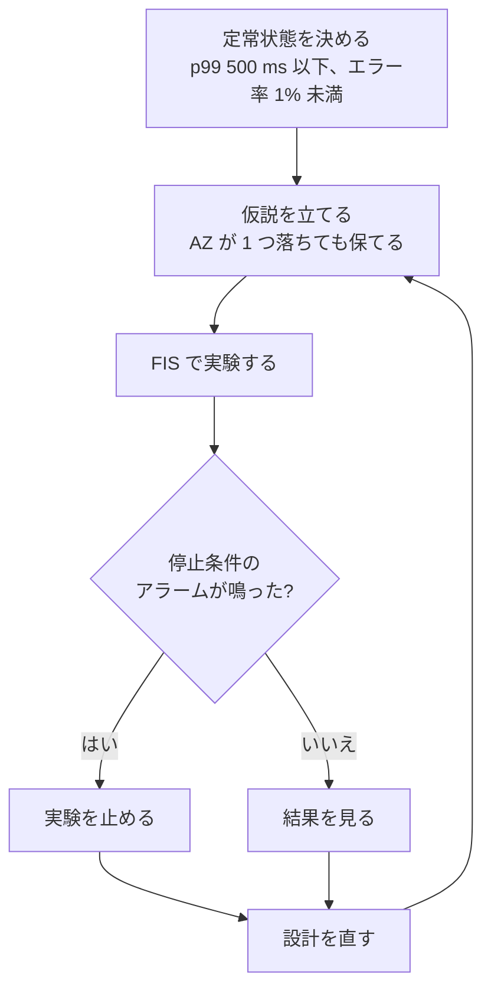

| 例 | 内容 |
| --- | --- |
| 定常状態 | p99 が 500 ms 以下、エラー率が 1% 未満 |
| 仮説 | AZ の 1 つが落ちても、定常状態を保つ |
| 実験 | AZ の障害シナリオを実行 |

### 実験テンプレート {#fis-template}

| 要素 | 内容 | 誤ったときの症状 |
| --- | --- | --- |
| アクション | 何を起こすか。順次または並列 | |
| ターゲット | タグ、状態などで選ぶ。`selectionMode` で数や割合を決める | `ALL` にすると全台が止まる |
| 停止条件 | CloudWatch アラーム。超えたら実験を止める | ないと影響が広がっても止まらない |
| 実験ロール | FIS が使う IAM ロール | 権限がないとアクションが失敗する |
| レポート | 結果を文書で出力 | |

```json
{
  "description": "1 台を 5 分止めて、復旧を確認する",
  "targets": {
    "web": {
      "resourceType": "aws:ec2:instance",
      "resourceTags": {"env": "staging"},
      "selectionMode": "COUNT(1)"
    }
  },
  "actions": {
    "stop": {
      "actionId": "aws:ec2:stop-instances",
      "parameters": {"startInstancesAfterDuration": "PT5M"},
      "targets": {"Instances": "web"}
    }
  },
  "stopConditions": [{
    "source": "aws:cloudwatch:alarm",
    "value": "arn:aws:cloudwatch:ap-northeast-1:111122223333:alarm:HighErrorRate"
  }],
  "roleArn": "arn:aws:iam::111122223333:role/fis-role"
}
```

| アクションの例 | 再現する障害 |
| --- | --- |
| `aws:ec2:stop-instances` | インスタンスの停止 |
| `aws:rds:failover-db-cluster` | Aurora のフェイルオーバー |
| `aws:network:disrupt-connectivity` | サブネットの通信の遮断 |
| `aws:fis:inject-api-internal-error` | AWS API のエラー |
| `aws:ec2:asg-insufficient-instance-capacity-error` | Auto Scaling の容量不足 |

設定ごとの例です。

- **`selectionMode` の例:** 12 台の `env=staging` に対して、`COUNT(1)` は 1 台、`PERCENT(25)` は 3 台、`ALL` は 12 台です。
- **`resourceTags` の例:** 複数のタグを指定すると、すべてに合うリソースだけが選ばれます（AND）。対象は開始時に決まり、見つからなければ実験は失敗します。
- **`duration` の例:** `PT5M` は 5 分、`PT1H` は 1 時間です。実験とアクションの上限は 12 時間です。
- **停止条件の例:** 「1 分間のエラー率が 5% を超える」アラームを指定すると、超えた時点で実験を止めます。テンプレートに 5 個まで指定できます。
- **並列の例:** 1 つのテンプレートにアクションは 20 個、並列は 10 個までです。11 個を同時に動かすテンプレートは実行できません。
- **誤ると:** `"selectionMode": "ALL"` と `env=prod` を組み合わせると、本番の全台が止まります。停止条件のないテンプレートでは、悪化しても止まりません。

| シナリオ | 内容 |
| --- | --- |
| AZ Availability: Power Interruption | AZ の電源喪失。コンピュートの喪失、再スケールの失敗など |
| Cross-Region: Connectivity | リージョン間の通信を遮断し、S3 と DynamoDB のレプリケーションを止める |

**フェイルオーバーの計測**: FIS で障害を起こし、Route 53 のヘルスチェックが異常になるまでの時間と、CloudWatch のエラー率が戻るまでの時間を測ります。これが実際の RTO です。

## サービスごとの Multi-AZ と Multi-Region {#patterns-by-service}

AZ やリージョンへの分散のしかたは、サービスによって違います。S3 や DynamoDB のように何もしなくても複数の AZ に置かれるものもあれば、EBS や NAT ゲートウェイのように 1 つの AZ にしかないものもあります。自分で分散が必要なものを知っておくことが大事です。提供単位の整理は [リソースの提供単位](resource-scope.md) を参照してください。

| サービス | Multi-AZ の方法 | Multi-Region の方法 |
| --- | --- | --- |
| EC2 | Auto Scaling を複数 AZ に | AMI のコピー、別リージョンの Auto Scaling |
| ALB、NLB | 複数 AZ のサブネット | Route 53、Global Accelerator |
| RDS | Multi-AZ DB インスタンス(同期スタンバイ、読み取り不可) | クロスリージョンリードレプリカを昇格 |
| RDS | Multi-AZ DB クラスター(読み取り可のレプリカ 2 台、フェイルオーバーは通常 35 秒未満) | 同上 |
| Aurora | 3 AZ の 6 つのストレージノード、最大 15 のレプリカ | Global Database(最大 10 のセカンダリ、RPO は通常秒単位) |
| DynamoDB | 標準で複数 AZ | グローバルテーブル(MREC は既定、MRSC は 3 リージョンのみ) |
| ElastiCache | レプリカと Multi-AZ | Global Datastore(ノードベースのクラスターのみ) |
| S3 | 標準で 3 AZ 以上(One Zone を除く) | CRR、[Multi-Region Access Points](storage-advanced.md#mrap) |
| EFS | Regional タイプ | EFS のレプリケーション |
| FSx | タイプにより異なる。[高度なストレージ](storage-advanced.md) を参照 | ONTAP の SnapMirror、バックアップのコピーなど |
| EBS | 1 つの AZ のみ。スナップショットは全 AZ に | スナップショットのコピー |
| Lambda、API Gateway | 標準で複数 AZ | 別リージョンにデプロイ |
| NAT ゲートウェイ | AZ ごとに作成 | リージョンごとに作成 |

**落とし穴**:

- RDS の Multi-AZ DB インスタンスのスタンバイでは読み取れません。読み取りの負荷分散にはリードレプリカか Multi-AZ DB クラスターです。
- DNS 名がフェイルオーバーで指す先を変えるので、IP を保持せず DNS の TTL を短くします。
- NAT ゲートウェイを 1 つの AZ だけに置くと、その AZ の障害で他の AZ の外向き通信も止まります。
- NLB のクロスゾーン負荷分散は既定で無効です。ALB はロードバランサーのレベルで常に有効です。

- **Multi-AZ の例:** RDS の Multi-AZ DB インスタンスのスタンバイにレポートのクエリを送ることはできません。Multi-AZ DB クラスターならリーダーエンドポイントで読めます。
- **EBS の例:** 1a の EC2 と EBS は 1a の障害で止まります。スナップショットから 1c にボリュームを作って復旧します。
- **NAT の例:** 1a と 1c に NAT ゲートウェイを 1 つずつ置き、各サブネットのルートを同じ AZ の NAT へ向けます。

## 高可用性のための Auto Scaling {#auto-scaling-ha}

Auto Scaling は負荷の変動だけでなく、台数の維持と自己修復にも使います。基本の設定は [EC2 Auto Scaling](ec2-beanstalk.md#auto-scaling) を参照してください。

**使う場面:** 夜間に担当者がいないコールセンターのシステムで、アプリが 500 を返し始めた台を ELB ヘルスチェックで自動で置き換え、朝まで台数を保つ。

| 設定 | 効果 | 誤ったときの症状 |
| --- | --- | --- |
| 複数の AZ のサブネット | AZ の障害でも残る | 1 つの AZ だけだと全停止する |
| ELB ヘルスチェック | アプリの異常でも置き換える | EC2 チェックだけだと、500 を返し続けても置き換えない |
| 猶予期間 | 起動中の誤判定を防ぐ | 短いと起動中に終了を繰り返す |
| AZ の分散方式 | 下の表 | |
| Capacity Rebalancing | 中断のリスクが高い Spot を先に置き換える | 無効だと中断後に置き換える |

- **猶予期間の例:** `HealthCheckGracePeriod` の既定は、コンソールで作ると 300 秒、CLI や SDK で作ると 0 秒です。起動に 180 秒かかるアプリなら 300 秒にします。
- **誤ると:** CLI で作って 0 秒のまま ELB ヘルスチェックを使うと、起動中に異常と判定され、終了と起動を繰り返します。
- **ヘルスチェックの例:** `--health-check-type ELB` を付けると、ターゲットグループで異常になった台が置き換わります。
- **AZ の例:** `--vpc-zone-identifier "subnet-0aaa,subnet-0bbb,subnet-0ccc"` で 3 AZ に分散します。1 つの AZ の障害でも 3 分の 2 が残ります。

| AZ 分散方式 | 動作 | 向く場面 |
| --- | --- | --- |
| Balanced best effort | AZ で失敗したら他の AZ で起動 | ほとんどのアプリ |
| Balanced only | 失敗しても同じ AZ で試し続ける | クォーラムなど、偏りが困るもの |
| Reservations then balanced | Capacity Reservation を優先 | 予約を使い切りたいとき |

AZ が回復すると、Auto Scaling は自動で再分散します。

**容量の計算(静的安定性)**: 必要な台数を AZ を 1 つ失っても保てるように、次の式で最小容量を決めます。

```text
AZ あたりの台数 = 必要な台数 ÷ (AZ の数 - 1)
```

| 必要な台数 | AZ の数 | AZ あたり | 最小容量 |
| --- | --- | --- | --- |
| 6 | 3 | 3 | 9 |
| 6 | 2 | 6 | 12 |
| 30 | 3 | 15 | 45 |

## Route 53 のフェイルオーバー設計 {#route53-failover}

ヘルスチェックの設定値は [Route 53 ヘルスチェック](networking.md#route53-health-checks) を参照してください。

**使う場面:** 旅行会社の予約サイトで、東京の ALB が応答しなくなったら、人の操作なしに大阪の ALB を返すようにする。

リージョンをまたぐ切り替えでは、利用者がどこへ接続するかを変える必要があります。ロードバランサーはリージョンの中のものなので、その上の DNS で行先を変えます。オンプレミスでいえば、拠点をまたいで振り分ける GSLB（広域負荷分散）の役割です。

| 構成 | 設定 | 動作 |
| --- | --- | --- |
| アクティブ/パッシブ | フェイルオーバールーティング(`PRIMARY`、`SECONDARY`) | プライマリが異常ならセカンダリを返す |
| アクティブ/アクティブ | フェイルオーバー以外のルーティング(レイテンシー、加重など) | 異常なレコードを除いて返す |
| 複雑な構成 | エイリアスを組み合わせたツリー | リージョンをレイテンシーで選び、中を加重で分ける |

```json
{
  "Name": "shop.example.com",
  "Type": "A",
  "SetIdentifier": "tokyo",
  "Failover": "PRIMARY",
  "AliasTarget": {
    "HostedZoneId": "Z14GRHDCWA56QT",
    "DNSName": "web-tokyo.ap-northeast-1.elb.amazonaws.com",
    "EvaluateTargetHealth": true
  }
}
```

セカンダリは同じ `Name` と `Type` で、`SetIdentifier` を変え、`Failover` を `SECONDARY` にします。

- **誤ると:** `EvaluateTargetHealth` が `false` だと、ALB のターゲットが全滅しても東京を返し続けます。

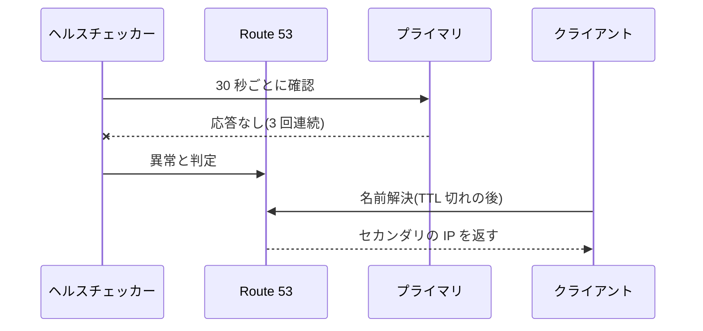

### 設計のポイント {#route53-design}

| 項目 | 内容 |
| --- | --- |
| AWS リソース | ヘルスチェックを作らず、エイリアスの `EvaluateTargetHealth` を `true` にする |
| プライベートのリソース | ヘルスチェッカーは届かない。CloudWatch アラームのヘルスチェックを使う |
| 複数の条件 | 計算ヘルスチェックで「3 つのうち 2 つ正常」などにまとめる |
| パス | 依存先まで確認するパスにする。ただし依存先の一時的な障害で全リージョンが落ちないよう注意 |
| TTL | 短くする。例: 60 秒 |
| 検知の時間 | 30 秒 × 3 回 = 90 秒。Fast なら 10 秒 × 3 回 = 30 秒 |

**切り替えの所要時間**: 検知 + TTL です。30 秒間隔、3 回、TTL 60 秒なら最大約 2.5 分です。Fast なら約 1.5 分です。

- **計算の例:** 30 秒 × 3 回 = 90 秒、TTL 60 秒を足して 150 秒、つまり 2.5 分です。Fast では 10 秒 × 3 回 = 30 秒、足して 90 秒、つまり 1.5 分です。
- **TTL の例:** TTL を 300 秒のままにすると、30 秒間隔でも 90 + 300 = 390 秒、6.5 分かかります。
- **計算ヘルスチェックの例:** 子が 3 つでしきい値が 2 なら、2 つ正常な間は正常です。1 つの依存先の不調では切り替わりません。

**落とし穴**:

- HTTPS のヘルスチェックは証明書を検証しません。証明書の期限切れでは異常になりません。
- Route 53 のコントロールプレーンは us-east-1 にあり、データプレーンは世界に分散しています。フェイルオーバーはレコードの編集に頼らず、ヘルスチェックで行います。
- 自動のフェイルオーバーは誤検知でも動きます。データの整合性が問題になるなら、ARC で人が判断する設計にします。
- クライアントが DNS をキャッシュすると、TTL の後も古い先に接続します。

### Global Accelerator との比較 {#global-accelerator}

| 観点 | Route 53 のフェイルオーバー | Global Accelerator |
| --- | --- | --- |
| 仕組み | DNS | 固定の IP アドレスと AWS のネットワーク |
| 切り替え | TTL に依存 | DNS キャッシュの影響を受けない |
| 向く場面 | 一般的な Web、低コスト | 固定 IP が必要、TCP や UDP、すばやい切り替え |

- **例:** 取引先のファイアウォールに許可する IP を固定したいなら Global Accelerator です。ALB の IP は変わるので、許可リストに書けません。

## 静的安定性 {#static-stability}

依存先が障害になっても、**変更せずに**動き続けられる性質です。障害時に新しいリソースを作ることに頼りません。

停電に備えて、発電機を「停電してから買いに行く」のではなく、最初から置いておく考え方です。障害の最中は、新しく作る操作（コントロールプレーン）も容量も当てになりません。何もしなくても続く構成にしておけば、障害時にやることがなくなります。トレードオフは、普段は使わない余分な容量の費用です。

| パターン | 内容 | 例 |
| --- | --- | --- |
| 事前の確保 | 障害後に必要な容量を先に持つ | 3 AZ に 45 台。1 AZ を失っても 30 台残る |
| 状態の維持 | 依存先が止まっても最後の状態で動く | 設定をローカルにキャッシュする |
| 独立した起動 | 依存先がなくても起動する | 機能を減らして起動し、後で戻す |
| 非同期 | キューで待たせる | 更新をプッシュし、失敗してもやり直せるようにする |

**例**: AZ が落ちたら Auto Scaling で増やす設計は、コントロールプレーンと容量の両方に依存します。最初から余分に動かしておく設計なら、何もしなくても処理を続けられます。

| 操作 | 依存 | 障害時 |
| --- | --- | --- |
| 動いている EC2 への通信 | データプレーン | 続く |
| 新しい EC2 の起動 | コントロールプレーン | 失敗する可能性がある |

- **計算の例:** 30 台が必要で、3 AZ なら 30 ÷ (3 - 1) = 15 台を AZ ごとに持ち、計 45 台です。1 AZ が止まっても 30 台が残るので、何も操作しません。余分な 15 台の費用が、静的安定性の代金です。

ゾーンシフトも同じ考えで、事前の容量を前提にしています。

## 疎結合と耐障害性 {#loose-coupling}

部品の間に中間層を入れると、障害の影響を部品の中に閉じ込められます。

**使う場面:** チケット販売で、発売開始の 10 分間に集中する申し込みを SQS で受け、決済の処理が遅れても受付の画面は止めない。

部品どうしが直接呼び合うと、呼ばれる側が止まった瞬間に呼ぶ側も止まります。間に郵便受け（キュー）を置けば、受け取る人が留守でも、送る人は投函して帰れます。

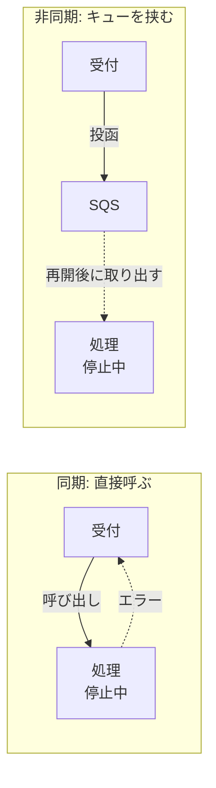

| 中間層 | 効果 | 例 |
| --- | --- | --- |
| ELB | 異常なターゲットを外す | ウェブ層と API 層の間 |
| SQS | 下流の障害や遅延をキューで吸収 | 注文の受付と処理を分ける |
| SNS | 1 つの送信者から複数へ | 注文イベントを在庫と通知へ |
| EventBridge | 送信者と受信者を切り離す | イベント駆動の連携 |
| Kinesis | 順序のあるストリームを複数で読む | クリックストリーム |
| Step Functions | リトライ、失敗の分岐を定義 | 決済の手順 |

**例**: 同期の API で注文処理が 2 秒止まると、受付も止まります。受付を SQS に書くだけにすれば、処理側が 10 分止まっても受付を続けられ、後から処理します。

- **吸収の計算の例:** 毎秒 100 件の注文で処理側が 10 分止まると、100 × 600 = 60,000 件がキューにたまります。再開後に毎秒 200 件処理できるなら、減る速さは毎秒 100 件で、60,000 ÷ 100 = 600 秒で追いつきます。
- **誤ると:** SQS の保持期間を処理の停止より短くすると、メッセージは処理されないまま消えます。

**注意**: 同期の処理は依存先と同じ可用性になります。応答を待たなくてよいものは非同期にします。ただし古くなったメッセージは処理しても意味がないことがあるので、有効期限やデッドレターキューを設定します。

詳しくは [メッセージング](messaging.md)、[Step Functions](step-functions.md)、[SDK と耐障害性](sdk-resilience.md) を参照してください。

## コンテナのマルチクラスター戦略 {#multi-cluster}

ECS と EKS のクラスターはリージョン単位です。リージョンの障害に備えるには、各リージョンにクラスターを用意します。

**使う場面:** 配車アプリの会社で、東京の EKS クラスターと同じ構成を大阪にも CI/CD で置き、東京の障害時に大阪のクラスターへ配車の API を移す。

コンテナはどこでも同じイメージで動くので、別のリージョンに同じものを並べやすいのが利点です。ただし、イメージ、データ、容量のどれか 1 つでも DR 側に欠けると起動できません。下の表の層をすべてそろえます。

| 層 | 設計 |
| --- | --- |
| タスク、Pod | 複数の AZ に分散。異常なら置き換える |
| クラスター | 同じ構成を IaC と CI/CD で複数のリージョンにデプロイ |
| イメージ | ECR のレプリケーションで別リージョンへ |
| トラフィック | Route 53 か Global Accelerator で切り替える |
| データ | Aurora Global Database、DynamoDB グローバルテーブルなど |
| 永続ストレージ | AWS Backup や EFS のレプリケーション |

**例**: 静的安定性のためには、スタンバイのクラスターにも DR の容量を確保しておきます。障害時に Karpenter（EKS）や Auto Scaling で増やす設計なら、DR リージョンのクォータと容量を事前に確認します。

- **イメージの例:** ECR のレプリケーションで東京から大阪へ複製します。設定を忘れると、DR 側でタスクを起動するときにイメージを取得できず、`CannotPullContainerError` で失敗します。
- **容量の例:** 本番 20 タスクなら DR にも 20 タスク分のノードを用意します。Karpenter で増やす設計なら、DR 側の vCPU のクォータが足りるかを確かめます。

## 選び方の比較 {#choosing}

| 迷う組み合わせ | 見分け方 |
| --- | --- |
| パイロットライトとウォームスタンバイ | すぐに処理できないのがパイロットライト、できるのがウォームスタンバイ |
| ホットスタンバイとアクティブ/アクティブ | 1 つだけ処理するのがホットスタンバイ、全部処理するのがアクティブ/アクティブ |
| AWS Backup と DRS | データの時点コピーなら Backup、サーバー全体を分単位で起動するなら DRS |
| DRS と MGN | 備え続けるなら DRS、移して終わりなら [MGN](migration.md#mgn) |
| Resilience Hub と FIS | 構成の評価は Resilience Hub、実際に壊して確かめるのは FIS |
| ARC と Route 53 のヘルスチェック | 人の判断か複雑な手順なら ARC、自動の切り替えなら Route 53 |
| ゾーンシフトとリージョンの切り替え | 1 つの AZ ならゾーンシフト、リージョンならルーティングコントロールや Region switch |
| Vault Lock のガバナンスとコンプライアンス | 権限で解除できるのがガバナンス、誰も解除できないのがコンプライアンス |
| Multi-AZ とリードレプリカ | 可用性は Multi-AZ、読み取りの拡張はレプリカ |

## 既定値と上限のまとめ {#numbers}

| 項目 | 値 |
| --- | --- |
| AWS Backup の最短頻度 | 1 時間 |
| AWS Backup の開始ウィンドウの既定 | 8 時間 |
| AWS Backup の完了ウィンドウの既定 | 7 日 |
| AWS Backup の保持 | 1 日〜100 年、無期限も可 |
| コールドストレージの最低期間 | 90 日 |
| 継続的バックアップ | 最大 35 日 |
| Vault Lock の猶予期間 | 3 日以上 |
| DRS の RPO、RTO | 秒単位、通常 5〜20 分 |
| DRS の PIT 保持 | 1〜365 日 |
| ゾーンシフトの期限 | 1 分〜3 日(延長可) |
| FIS の実験の最大時間 | 12 時間 |
| FIS のアクティブな実験 | 5 |
| FIS のテンプレートあたりのアクション | 20(並列は 10) |
| FIS の停止条件 | テンプレートあたり 5 |
| FIS の完了データの保持 | 120 日 |
| Route 53 の検知 | 30 秒 × 3 回が既定。Fast は 10 秒 |
| Route 53 の正常の判定 | ヘルスチェッカーの 18% を超える |
| Multi-AZ DB クラスターのフェイルオーバー | 通常 35 秒未満 |
| Aurora Global Database | 最大 10 のセカンダリ |
| DynamoDB MRSC | 3 リージョンのみ |
| S3 RTC | 大半を数秒、99.9%（専用ページと SLA の基準。公式の一部のページは 99.99% と記載）を 15 分以内 |

## 試験のポイント {#exam-points}

| こう問われたら | 答え |
| --- | --- |
| 費用を最小に、RTO は時間単位 | バックアップと復元 |
| データは常に複製、アプリは起動してから処理 | パイロットライト |
| 縮小版が常に動く、すぐに処理できる | ウォームスタンバイ |
| RTO、RPO がほぼ 0、最高の費用 | マルチサイトアクティブ/アクティブ |
| レプリケーションがあるのに破損からの復旧ができない | 時点復旧のバックアップも持つ |
| 複数サービスのバックアップを一元管理 | AWS Backup |
| 組織全体にバックアップを強制 | Organizations のバックアップポリシー |
| ルートユーザーでもバックアップを消せないように | Vault Lock のコンプライアンスモード |
| ランサムウェアの対策で別アカウントから復元 | 論理的にエアギャップされたボールト、アカウント間コピー |
| EBS スナップショットの誤削除を防ぐ | スナップショットロック、Recycle Bin |
| バックアップを定期的に復元して確かめる | AWS Backup の復元テスト |
| バックアップの方針の遵守を監査 | Backup Audit Manager |
| オンプレミスのサーバーの DR、RPO が秒 | Elastic Disaster Recovery |
| RTO、RPO を満たすかを評価 | Resilience Hub |
| 特定の AZ からすばやくトラフィックを外す | ARC のゾーンシフト |
| AZ の障害に自動で対応 | ゾーンオートシフト、事前に容量 |
| リージョン間の切り替えを安全にスイッチ | ARC のルーティングコントロールと安全ルール |
| 複数アカウントの復旧手順を自動実行 | ARC の Region switch |
| 本番で障害を試す、問題が起きたら止める | FIS と停止条件(CloudWatch アラーム) |
| AZ の電源喪失を再現 | FIS の AZ Availability シナリオ |
| AZ が落ちても追加なしで処理を続ける | 静的安定性、N+1 の AZ の容量 |
| 3 AZ で 6 台が必要、最小容量は | 9 台 |
| アプリの 500 でも Auto Scaling で置き換えたい | ELB ヘルスチェック |
| プライベートのエンドポイントの Route 53 ヘルスチェック | CloudWatch アラームのヘルスチェック |
| 固定 IP で素早いリージョン切り替え | Global Accelerator |
| 下流の障害で受付を止めたくない | SQS で疎結合にする |
| Multi-AZ のスタンバイで読みたい | Multi-AZ DB クラスターかリードレプリカ |

## 関連ページ {#related}

- [SDK と耐障害性](sdk-resilience.md)
- [移行と転送](migration.md)
- [高度なストレージ](storage-advanced.md)
- [ネットワークと配信](networking.md)
- [EC2 と Elastic Beanstalk](ec2-beanstalk.md)
- [データベースとキャッシュ](databases.md)
- [DynamoDB](dynamodb.md)
- [メッセージング](messaging.md)
- [運用](operations.md)

## 参考 {#references}

- [Disaster recovery options in the cloud](https://docs.aws.amazon.com/whitepapers/latest/disaster-recovery-workloads-on-aws/disaster-recovery-options-in-the-cloud.html)
- [Static stability](https://docs.aws.amazon.com/whitepapers/latest/aws-fault-isolation-boundaries/static-stability.html)
- [REL11-BP05 Use static stability](https://docs.aws.amazon.com/wellarchitected/latest/reliability-pillar/rel_withstand_component_failures_static_stability.html)
- [REL04-BP02 Implement loosely coupled dependencies](https://docs.aws.amazon.com/wellarchitected/latest/reliability-pillar/rel_prevent_interaction_failure_loosely_coupled_system.html)
- [What is AWS Backup?](https://docs.aws.amazon.com/aws-backup/latest/devguide/whatisbackup.html)
- [Backup plan options and configuration](https://docs.aws.amazon.com/aws-backup/latest/devguide/plan-options-and-configuration.html)
- [AWS Backup Vault Lock](https://docs.aws.amazon.com/aws-backup/latest/devguide/vault-lock.html)
- [Logically air-gapped vault](https://docs.aws.amazon.com/aws-backup/latest/devguide/logicallyairgappedvault.html)
- [Creating backup copies across AWS Regions](https://docs.aws.amazon.com/aws-backup/latest/devguide/cross-region-backup.html)
- [Creating backup copies across AWS accounts](https://docs.aws.amazon.com/aws-backup/latest/devguide/create-cross-account-backup.html)
- [Managing AWS Backup resources across accounts](https://docs.aws.amazon.com/aws-backup/latest/devguide/manage-cross-account.html)
- [Restore testing](https://docs.aws.amazon.com/aws-backup/latest/devguide/restore-testing.html)
- [AWS Backup Audit Manager](https://docs.aws.amazon.com/aws-backup/latest/devguide/aws-backup-audit-manager.html)
- [Continuous backups and PITR](https://docs.aws.amazon.com/aws-backup/latest/devguide/point-in-time-recovery.html)
- [Amazon EBS snapshot lock](https://docs.aws.amazon.com/ebs/latest/userguide/ebs-snapshot-lock.html)
- [What is Elastic Disaster Recovery?](https://docs.aws.amazon.com/drs/latest/userguide/what-is-drs.html)
- [Elastic Disaster Recovery concepts](https://docs.aws.amazon.com/drs/latest/userguide/CloudEndure-Concepts.html)
- [DRS point in time policy](https://docs.aws.amazon.com/drs/latest/userguide/point-in-time.html)
- [What is AWS Resilience Hub?](https://docs.aws.amazon.com/resilience-hub/latest/userguide/what-is.html)
- [Resilience Hub concepts](https://docs.aws.amazon.com/resilience-hub/latest/userguide/concepts-terms.html)
- [Resilience Hub resiliency policies](https://docs.aws.amazon.com/resilience-hub/latest/userguide/resiliency-policies.html)
- [What is ARC?](https://docs.aws.amazon.com/r53recovery/latest/dg/what-is-route53-recovery.html)
- [Zonal shift in ARC](https://docs.aws.amazon.com/r53recovery/latest/dg/arc-zonal-shift.html)
- [Zonal autoshift in ARC](https://docs.aws.amazon.com/r53recovery/latest/dg/arc-zonal-autoshift.html)
- [Routing control in ARC](https://docs.aws.amazon.com/r53recovery/latest/dg/routing-control.html)
- [Safety rules in ARC](https://docs.aws.amazon.com/r53recovery/latest/dg/routing-control.safety-rules.html)
- [Region switch in ARC](https://docs.aws.amazon.com/r53recovery/latest/dg/region-switch.html)
- [ARC readiness check availability change](https://docs.aws.amazon.com/r53recovery/latest/dg/arc-readiness-availability-change.html)
- [What is AWS Fault Injection Service?](https://docs.aws.amazon.com/fis/latest/userguide/what-is.html)
- [AWS FIS actions reference](https://docs.aws.amazon.com/fis/latest/userguide/fis-actions-reference.html)
- [AWS FIS stop conditions](https://docs.aws.amazon.com/fis/latest/userguide/stop-conditions.html)
- [AWS FIS scenario library](https://docs.aws.amazon.com/fis/latest/userguide/scenario-library.html)
- [AWS FIS quotas](https://docs.aws.amazon.com/fis/latest/userguide/fis-quotas.html)
- [Auto Scaling group Availability Zone distribution](https://docs.aws.amazon.com/autoscaling/ec2/userguide/ec2-auto-scaling-availability-zone-balanced.html)
- [Health checks for instances in an Auto Scaling group](https://docs.aws.amazon.com/autoscaling/ec2/userguide/ec2-auto-scaling-health-checks.html)
- [Capacity Rebalancing in Auto Scaling](https://docs.aws.amazon.com/autoscaling/ec2/userguide/ec2-auto-scaling-capacity-rebalancing.html)
- [Active-active and active-passive failover](https://docs.aws.amazon.com/Route53/latest/DeveloperGuide/dns-failover-types.html)
- [How Route 53 determines health](https://docs.aws.amazon.com/Route53/latest/DeveloperGuide/dns-failover-determining-health-of-endpoints.html)
- [Route 53 control and data plane concepts](https://docs.aws.amazon.com/Route53/latest/DeveloperGuide/route-53-concepts.html)
- [What is AWS Global Accelerator?](https://docs.aws.amazon.com/global-accelerator/latest/dg/what-is-global-accelerator.html)
- [Multi-AZ DB instance deployments](https://docs.aws.amazon.com/AmazonRDS/latest/UserGuide/Concepts.MultiAZSingleStandby.html)
- [Multi-AZ DB cluster failover](https://docs.aws.amazon.com/AmazonRDS/latest/UserGuide/multi-az-db-clusters-concepts-failover.html)
- [Aurora high availability](https://docs.aws.amazon.com/AmazonRDS/latest/AuroraUserGuide/Concepts.AuroraHighAvailability.html)
- [Aurora Global Database](https://docs.aws.amazon.com/AmazonRDS/latest/AuroraUserGuide/aurora-global-database.html)
- [DynamoDB global tables](https://docs.aws.amazon.com/amazondynamodb/latest/developerguide/GlobalTables.html)
- [ElastiCache global datastores](https://docs.aws.amazon.com/AmazonElastiCache/latest/dg/Redis-Global-Datastore.html)
- [S3 Replication Time Control](https://docs.aws.amazon.com/AmazonS3/latest/userguide/replication-time-control.html)
- [How Elastic Load Balancing works](https://docs.aws.amazon.com/elasticloadbalancing/latest/userguide/how-elastic-load-balancing-works.html)
