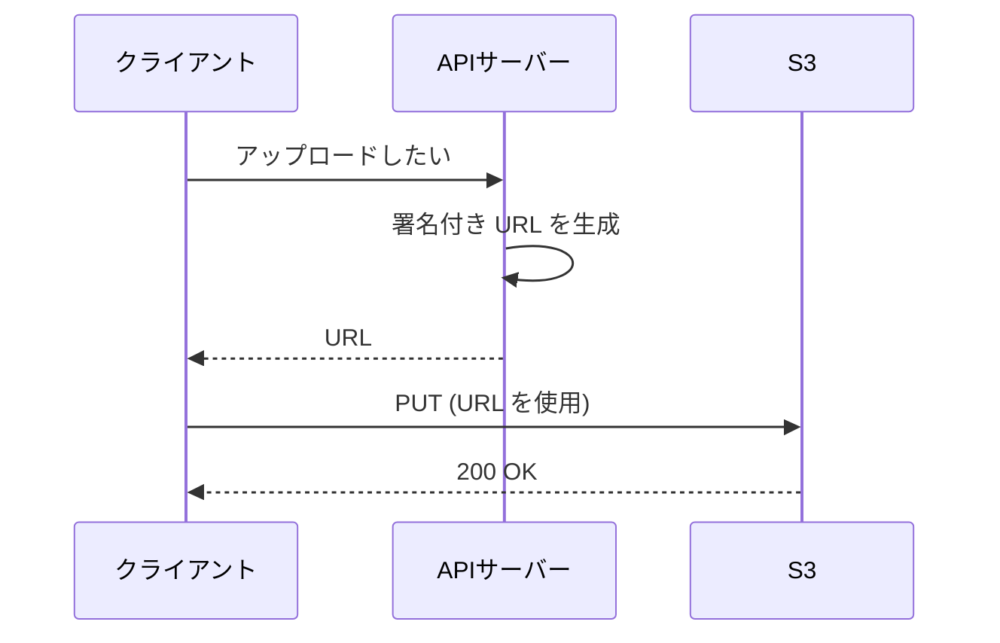

# Amazon S3 と S3 Glacier

オブジェクトをキーで保存し、HTTPS の API でアクセスするストレージです。アプリのファイル、静的コンテンツ、バックアップ、アーカイブに使います。

[](../assets/diagrams/s3-events-lifecycle.png)

## 基本と整合性 {#basics}

| 項目 | 内容 |
| --- | --- |
| 構成 | バケット(リージョン単位)にオブジェクトを保存。オブジェクトはキーで識別 |
| 1 回の `PUT` の上限 | 5 GB |
| マルチパートの上限 | 48.8 TiB（AWS のドキュメントでは「50 TB」とも表記） |
| デフォルト | バケットとオブジェクトは非公開、ACL は無効 |

### 整合性 {#consistency}

オブジェクトの `PUT` と `DELETE` は、すべてのリージョンで強力な書き込み後の読み取り整合性を持ちます。成功応答の後の `GET` や `LIST` には変更が反映されています。

| 操作 | 結果 |
| --- | --- |
| 新規 `PUT` の後の `LIST` | 新しいオブジェクトが現れる |
| 上書き `PUT` の後の `GET` | 新しいデータを返す |
| `DELETE` の後の `GET` | データを返さない |
| 同じキーへの同時 `PUT` | タイムスタンプが最新のものが残る |
| バケット設定の変更 | 結果整合性 |

オブジェクトのロック機構はなく、複数キーをまとめて原子的に更新もできません。必要ならアプリ側で作ります。バージョニングを初めて有効にしたときは、反映に時間がかかるため 15 分待ってから書き込むことが推奨されています。

## ストレージクラス {#storage-classes}

| クラス | 用途 | AZ | 最小保存期間 | 最小課金サイズ | 取得 |
| --- | --- | --- | --- | --- | --- |
| S3 Standard (`STANDARD`) | 頻繁なアクセス | 3 以上 | なし | なし | ミリ秒 |
| S3 Intelligent-Tiering | アクセスパターンが不明、変わる | 3 以上 | なし | なし | ミリ秒(アーカイブ階層は復元が必要) |
| S3 Standard-IA (`STANDARD_IA`) | 月 1 回程度、失えないデータ | 3 以上 | 30 日 | 128 KB | ミリ秒、取得料金あり |
| S3 One Zone-IA (`ONEZONE_IA`) | 月 1 回程度、再生成できるデータ | 1 | 30 日 | 128 KB | ミリ秒、取得料金あり |
| S3 Express One Zone | 1 桁ミリ秒が必要な処理 | 1 | なし | なし | 1 桁ミリ秒 |
| S3 Glacier Instant Retrieval (`GLACIER_IR`) | 四半期に 1 回、すぐ読みたいアーカイブ | 3 以上 | 90 日 | 128 KB | ミリ秒、取得料金あり |
| S3 Glacier Flexible Retrieval (`GLACIER`) | 年 1 回程度のアーカイブ | 3 以上 | 90 日 | なし(メタデータ分 40 KB を追加課金) | 復元が必要、数分から数時間 |
| S3 Glacier Deep Archive (`DEEP_ARCHIVE`) | 年 1 回未満の長期保管 | 3 以上 | 180 日 | なし(メタデータ分 40 KB を追加課金) | 復元が必要、数時間 |

耐久性の設計値は、推奨されない Reduced Redundancy Storage を除きイレブンナイン(99.999999999%)です。One Zone-IA と Express One Zone は AZ の喪失に耐えられません。

Intelligent-Tiering は、30 日アクセスがないと低頻度アクセス階層に、90 日で Archive Instant Access 階層に自動で移します。128 KB 未満のオブジェクトは監視されず、高頻度アクセス階層に留まります。

## ライフサイクル {#lifecycle}

オブジェクトを別のクラスに移す移行アクションと、削除する失効アクションを、ルールで自動実行します。データの保持期間を設計するときの中心となる機能です。

```json
{
  "Rules": [
    {
      "ID": "archive-logs",
      "Status": "Enabled",
      "Filter": {"Prefix": "logs/"},
      "Transitions": [
        {"Days": 30, "StorageClass": "STANDARD_IA"},
        {"Days": 120, "StorageClass": "GLACIER"}
      ],
      "Expiration": {"Days": 365},
      "NoncurrentVersionExpiration": {"NoncurrentDays": 30},
      "AbortIncompleteMultipartUpload": {"DaysAfterInitiation": 7}
    }
  ]
}
```

| 要点 | 内容 |
| --- | --- |
| 移行の方向 | Standard から低コスト側へ一方向(ウォーターフォール)。Deep Archive から戻すルールは作れない |
| 小さなオブジェクト | 128 KB 未満はデフォルトで移行しない。サイズフィルターで変更可能 |
| 最小保存期間 | 1 つのルールで最小保存期間を満たさない連続移行は設定できない |
| 早期移行、早期削除 | 最小保存期間の残り分が課金される |
| タグのフィルター | 実行時にタグを再評価するので、外すと移行されない場合がある |
| バージョニング有効時 | 現行バージョンと非現行バージョンを別々に指定する |
| 未完了のマルチパート | `AbortIncompleteMultipartUpload` で片付ける |

!!! warning "バージョニングとの組み合わせ"
    バージョニングを有効にしたバケットで `Expiration` を設定しても、削除マーカーが付くだけで実データは残ります。実データを消すには `NoncurrentVersionExpiration` も必要です。

他のサービスの保持の設定は [ストレージの選び方](storage.md) を参照してください。

## バージョニング {#versioning}

| 状態 | 動作 |
| --- | --- |
| 未設定(デフォルト) | 上書きで前のデータは消える |
| 有効 | 新しいバージョン ID を付与。上書きと削除で以前のバージョンが残る |
| 停止 | 既存のバージョンは残るが、新しいバージョンは作らない |

- 一度有効にすると未設定には戻せず、停止のみできます。
- 有効化より前からあったオブジェクトのバージョン ID は `null` です。
- バージョン ID を指定しない `DELETE` は削除マーカーを追加します。バージョン ID を指定すると、そのバージョンを完全に削除します。
- 各バージョンが丸ごと課金されます。差分ではありません。
- MFA Delete を設定すると、バージョンの完全削除に MFA を求められます。

## 署名付き URL {#presigned-urls}

AWS の認証情報を持たない相手に、期限付きで特定のオブジェクトの操作を許可します。バケットポリシーの変更は不要です。

```python
import boto3

s3 = boto3.client("s3")

download_url = s3.generate_presigned_url(
    "get_object",
    Params={"Bucket": "my-bucket", "Key": "report.pdf"},
    ExpiresIn=900,
)

upload_url = s3.generate_presigned_url(
    "put_object",
    Params={
        "Bucket": "my-bucket",
        "Key": "uploads/photo.jpg",
        "ContentType": "image/jpeg",
    },
    ExpiresIn=300,
)
```



サーバーを経由せずに S3 と直接やり取りできるので、大きなファイルでもアプリの負荷が増えません。

**有効期限**

| 作成に使う認証情報 | 最長 |
| --- | --- |
| コンソールから生成 | 12 時間(1 分から) |
| CLI、SDK で IAM ユーザーの認証情報(SigV4) | 7 日 |
| IAM ロール、STS の一時認証情報 | 認証情報の期限まで |
| EC2 のインスタンスプロファイル | ロール認証情報の期限まで(通常 6 時間程度) |

**動作のルール**

- URL の権限は生成した IAM プリンシパルの権限に依存します。生成者が `s3:GetObject` を持たなければ、URL は 403 になります。
- 認証情報が先に失効すれば、指定した期限より前に URL も無効になります。認証情報を無効化、削除した場合も同様です。
- 期限はリクエスト時に確認します。開始済みのダウンロードは途中で期限が来ても続きますが、切れた後の再開はできません。
- 期限内なら何度でも使えます。持っている人は誰でも使えるので、漏えいに注意します。
- `PUT` 用の URL は、署名時に指定した `Content-Type` と同じものを送ります。違うと `SignatureDoesNotMatch` になります。
- バケットポリシーの条件キー `s3:signatureAge` で、署名の経過時間を制限できます。

### CloudFront 署名付き URL との違い {#cloudfront-signed-urls}

| 観点 | S3 署名付き URL | CloudFront 署名付き URL |
| --- | --- | --- |
| アクセス先 | S3 バケットに直接 | CloudFront ディストリビューション |
| 署名に使うもの | IAM プリンシパルの認証情報 | 信頼されたキーグループの秘密鍵 |
| 権限の源 | 生成者の IAM 権限 | キャッシュ動作に設定した署名者 |
| キャッシュ | なし | エッジでキャッシュ |
| 条件 | 期限中心 | 期限、開始日時、IP 範囲などカスタムポリシーで指定可能 |
| アップロード | `PUT` で可能 | 配信が主な用途 |
| 向く場面 | ファイルの受け渡し、ブラウザからの直接アップロード | 有料コンテンツの配信、世界中への配信 |

CloudFront の署名者には、キーグループを使うことが推奨されています。ルートユーザーが不要で、API で管理できるためです。キーペアは RSA 2048 か ECDSA 256 です。

| CloudFront の選択肢 | 向く場面 |
| --- | --- |
| 署名付き URL | 個々のファイル。Cookie に対応していないクライアント |
| 署名付き Cookie | 複数のファイル(HLS 動画一式など)。URL を変えたくない |

両方が指定された場合は署名付き URL が優先されます。CloudFront を迂回して S3 に直接アクセスされないように、オリジンのバケットはオリジンアクセスコントロール (OAC) で CloudFront からのアクセスのみに制限します。

## Event Notifications {#event-notifications}

オブジェクトの作成や削除などをトリガーに、他のサービスに通知します。

| 送信先 | 備考 |
| --- | --- |
| SQS | FIFO キューは指定できない(EventBridge 経由なら可能) |
| SNS | ファンアウトに使う |
| Lambda | 直接呼び出す |
| EventBridge | バケットで有効化すれば全イベントが送られ、ルールで振り分ける |

- 対象は作成、削除、復元、レプリケーション、ライフサイクル、タグ、ACL などのイベントです。プレフィックスとサフィックスで絞れます。
- 配信は **少なくとも 1 回** です。通常は数秒ですが、1 分以上かかることもあります。処理は冪等にします。
- SQS、SNS、Lambda 側のリソースポリシーで、S3 からの発行や呼び出しを許可します。
- 設定の反映には通常 5 分ほどかかり、初回は `s3:TestEvent` が送られます。

!!! warning "無限ループに注意"
    通知を受けた Lambda が同じバケットに書き込むと、自分自身を呼び続けます。出力を別のバケットにするか、入力用のプレフィックスだけを通知の対象にします。

連携の全体像は [メッセージング](messaging.md) を参照してください。

## 暗号化 {#encryption}

保存時の暗号化は常に有効で、新しいオブジェクトはデフォルトで SSE-S3 で暗号化されます。

| 方式 | キーの管理者 | 暗号化する場所 | 指定 | 使いどころ |
| --- | --- | --- | --- | --- |
| SSE-S3 | S3 | サーバー | `AES256` | 特に要件がない |
| SSE-KMS | KMS | サーバー | `aws:kms` | 監査、キーのアクセス制御、ローテーション |
| DSSE-KMS | KMS | サーバー(2 層) | `aws:kms:dsse` | 2 層の暗号化が要件のとき |
| SSE-C | 自分(リクエストごとに送る) | サーバー | `SSECustomerKey` など | 自分でキーを持つ要件。下記の制約あり |
| クライアント側 | 自分 | アップロード前 | SDK やライブラリ | AWS に平文を渡したくない |

```python
s3.put_object(
    Bucket="my-bucket",
    Key="secret.csv",
    Body=data,
    ServerSideEncryption="aws:kms",
    SSEKMSKeyId="arn:aws:kms:ap-northeast-1:123456789012:key/EXAMPLE",
    BucketKeyEnabled=True,
)
```

### SSE-KMS の注意点 {#sse-kms}

- **権限**: アップロードには `kms:GenerateDataKey`、ダウンロードには `kms:Decrypt` が必要です。マルチパートアップロードには両方が必要です。
- **S3 Bucket Key**: バケット単位のキーを使い、KMS へのリクエストを最大 99% 減らします。リクエスト数のクォータやコストが問題になったら検討します。
- **リージョン**: KMS キーはバケットと同じリージョンに置きます。対称キーのみ使えます。
- **クロスアカウント**: AWS マネージドキー(`aws/s3`)では共有できません。カスタマーマネージドキーを使います。
- **`GET`**: 暗号化のヘッダーを付けると 400 Bad Request になります。HTTPS と SigV4 が必須です。

### SSE-C の注意点 {#sse-c}

!!! warning "SSE-C は 2026 年 4 月からデフォルトで無効"
    新しい汎用バケット（中東のバーレーンと UAE のリージョンを除く）と、SSE-C のオブジェクトを持たないアカウントの既存バケットでは、SSE-C の書き込みがブロックされます。ブロック中は `PutObject` や `CopyObject`、マルチパートなどが HTTP 403 の `AccessDenied` になります。使うには、`PutBucketEncryption` でデフォルト暗号化の `BlockedEncryptionTypes` を `NONE` にします。

- S3 はキーを保存しません。キーを失うとデータも失います。
- リクエストごとにキーを送るので HTTPS が必須です。HTTP のリクエストは拒否されます。
- どのオブジェクトにどのキーを使ったかは自分で管理します。
- コンソールからは使えません。AWS のマネージドサービスは復号できません。

### バケットのデフォルト暗号化とポリシーによる強制 {#enforcing-encryption}

バケットのデフォルト暗号化を SSE-KMS にすると、指定のない `PUT` は自動でその方式で暗号化されます。既存のオブジェクトは変わりません。変更するには S3 Batch Operations のコピーなどを使います。

要件で「このキーでの暗号化以外は拒否」とする場合はポリシーを使います。

```json
{
  "Version": "2012-10-17",
  "Statement": [
    {
      "Sid": "DenyWrongKmsKey",
      "Effect": "Deny",
      "Principal": "*",
      "Action": "s3:PutObject",
      "Resource": "arn:aws:s3:::my-bucket/*",
      "Condition": {
        "StringNotEquals": {
          "s3:x-amz-server-side-encryption-aws-kms-key-id":
            "arn:aws:kms:ap-northeast-1:123456789012:key/EXAMPLE"
        }
      }
    },
    {
      "Sid": "DenyInsecureTransport",
      "Effect": "Deny",
      "Principal": "*",
      "Action": "s3:*",
      "Resource": [
        "arn:aws:s3:::my-bucket",
        "arn:aws:s3:::my-bucket/*"
      ],
      "Condition": {"Bool": {"aws:SecureTransport": "false"}}
    }
  ]
}
```

`Null` 条件で `s3:x-amz-server-side-encryption-aws-kms-key-id` を調べれば、KMS キーの指定がないリクエストを拒否することもできます。

転送中の暗号化は TLS で行います。上の後半の文で HTTP のアクセスを拒否できます。

### クライアント側暗号化を選ぶとき {#client-side-encryption}

| 要件 | 選択 |
| --- | --- |
| AWS に平文を渡してはいけない | クライアント側 |
| 暗号化の手間をなくしたい | SSE-S3 |
| 誰がいつ復号したかを監査したい | SSE-KMS(CloudTrail に記録) |
| 自分のキーを使い、かつ処理は S3 に任せたい | SSE-C |

キーの扱いは [KMS](kms.md) を参照してください。

## バケットポリシーとアクセス制御 {#bucket-policies}

バケットに付けるリソースベースのポリシーです。サイズの上限は 20 KB です。

```json
{
  "Version": "2012-10-17",
  "Statement": [{
    "Sid": "AllowPartnerRead",
    "Effect": "Allow",
    "Principal": {"AWS": "arn:aws:iam::111122223333:role/PartnerRole"},
    "Action": "s3:GetObject",
    "Resource": "arn:aws:s3:::my-bucket/shared/*"
  }]
}
```

| 仕組み | 用途 |
| --- | --- |
| IAM ポリシー | 同じアカウントのプリンシパルの権限 |
| バケットポリシー | クロスアカウント、匿名アクセス、条件による拒否 |
| ブロックパブリックアクセス | 公開設定を上書きして防ぐ。デフォルトで有効 |
| オブジェクト所有者の設定 | ACL の有効、無効。デフォルトで ACL は無効 |
| ACL | 古い仕組み。多くの場面で不要 |

`s3:ListBucket` はバケットの ARN に、`s3:GetObject` はオブジェクトの ARN(`/*` 付き)に指定します。

## CORS {#cors}

別のドメインのウェブページから、ブラウザの JavaScript で S3 にアクセスするときに設定します。

```json
[
  {
    "AllowedOrigins": ["https://www.example.com"],
    "AllowedMethods": ["GET", "PUT"],
    "AllowedHeaders": ["*"],
    "ExposeHeaders": ["ETag"],
    "MaxAgeSeconds": 3000
  }
]
```

- S3 は最初に一致したルールを使います。`Origin`、メソッド、`Access-Control-Request-Headers` のすべてが一致する必要があります。
- CORS は権限を与えません。バケットポリシーや署名付き URL は別途必要です。
- ブラウザからマルチパートアップロードするなら、`ETag` を `ExposeHeaders` に入れます。

## マルチパートアップロード {#multipart-upload}

大きなオブジェクトを分割してアップロードします。

| 項目 | 値 |
| --- | --- |
| 推奨 | 100 MB 以上 |
| 必須 | 5 GB を超える場合 |
| パート数 | 最大 10,000 |
| パートサイズ | 5 MiB から 5 GiB(最後のパートに下限なし) |
| オブジェクトの上限 | 48.8 TiB（AWS のドキュメントでは「50 TB」とも表記） |

API の順序は `CreateMultipartUpload`、`UploadPart`(番号と ETag を記録)、`CompleteMultipartUpload` です。やめるときは `AbortMultipartUpload` を呼びます。

- パートは並列に、順不同で送れます。失敗したパートだけを再送できます。
- **未完了のパートにも課金されます**。ライフサイクルの `AbortIncompleteMultipartUpload` で自動的に片付けます。
- boto3 の `upload_file` は、サイズに応じて自動でマルチパートにします。

```python
from boto3.s3.transfer import TransferConfig

config = TransferConfig(multipart_threshold=100 * 1024 * 1024, max_concurrency=8)
s3.upload_file("big.bin", "my-bucket", "big.bin", Config=config)
```

## アクセスポイント {#access-points}

バケットに接続する名前付きのエンドポイントです。アクセスポイントごとに独自のポリシー、ネットワーク制限、ブロックパブリックアクセスを設定できます。

| 使いどころ | 内容 |
| --- | --- |
| 共有データセット | 巨大なバケットポリシーを、用途別のアクセスポイントに分ける |
| VPC 限定 | 特定の VPC からのリクエストだけを受ける |

- `GetObject`、`PutObject` などのオブジェクト操作だけが対象です。バケットの削除などはできません。
- 権限はアクセスポイントのポリシーと、元のバケットのポリシーの両方で評価されます。
- ARN やエイリアスで指定できます。

## Object Lock {#object-lock}

WORM(一度書き込み、何度でも読める)モデルで、バージョンを削除や上書きから守ります。**バージョニングが必須** です。

| 種類 | 動作 |
| --- | --- |
| ガバナンスモード | `s3:BypassGovernanceRetention` と `x-amz-bypass-governance-retention:true` があれば変更、削除できる |
| コンプライアンスモード | ルートユーザーも含めて誰も削除できず、期間の短縮もできない |
| リーガルホールド | 期限なし。`s3:PutObjectLegalHold` を持つユーザーが外すまで有効。保持期間とは独立 |

- 保持期間は、固定(日付を指定)と可変(イベントホールドの解放時に確定)があります。バケットのデフォルトも設定できます。
- 延長はできますが、短縮はできません(コンプライアンスの場合)。
- バージョン ID なしの `DELETE` は成功し、削除マーカーが付きます。バージョン ID を指定した削除は 403 になります。

## 静的ウェブサイトホスティング {#static-website}

| 観点 | ウェブサイトエンドポイント | REST API エンドポイント |
| --- | --- | --- |
| HTTPS | 非対応 | 対応 |
| 公開範囲 | 公開コンテンツのみ | 公開、非公開の両方 |
| ルートへのアクセス | インデックスドキュメント | キーの一覧 |
| エラー応答 | HTML | XML |
| リダイレクト | 対応 | 非対応 |
| アクセスポイント | 非対応 | 対応 |
| 操作 | `GET`、`HEAD` のみ | すべて |

URL の形式は `http://{bucket}.s3-website-{region}.amazonaws.com` か `http://{bucket}.s3-website.{region}.amazonaws.com` で、リージョンによって異なります。

公開にはブロックパブリックアクセスの解除と、`s3:GetObject` を許可するバケットポリシーが必要です。HTTPS が必要なら CloudFront か Amplify Hosting を前に置きます。

## S3 Glacier のデータ取得 {#glacier-retrieval}

Glacier Instant Retrieval は通常の `GET` で読めます。Flexible Retrieval と Deep Archive は、`RestoreObject` で一時的なコピーを作ってから読みます。

| 取得オプション (`Tier`) | Flexible Retrieval | Deep Archive |
| --- | --- | --- |
| Expedited | 1〜5 分(250 MB 未満) | 使えない |
| Standard(デフォルト) | 3〜5 時間 | 12 時間以内 |
| Bulk(最安) | 5〜12 時間 | 48 時間以内 |

```python
s3.restore_object(
    Bucket="my-bucket",
    Key="archive/2020.tar",
    RestoreRequest={"Days": 7, "GlacierJobParameters": {"Tier": "Standard"}},
)
```

- 復元中でもストレージクラスは `GLACIER` のままです。指定した日数が過ぎるとコピーは消えます。
- 復元中はアーカイブと一時コピーの両方が課金されます。
- 別のクラスに変えるには、復元してから `CopyObject` で上書きします。
- Expedited の容量を保証するには、プロビジョンドキャパシティを購入します。需要が高いときは受け付けられないことがあります。
- 復元完了は Event Notifications で検知できます(`s3:ObjectRestore:Completed`)。
- S3 Glacier ストレージクラスのオブジェクトは S3 の API で扱います。別サービスの Amazon Glacier のボールト API では扱えません。

## 試験のポイント {#exam-points}

| こう問われたら | 答え |
| --- | --- |
| 未ログインのユーザーに一時的にダウンロードさせたい | 署名付き URL |
| ブラウザから S3 に直接アップロードしたい | `PUT` の署名付き URL と CORS |
| 署名付き URL が期限より早く切れる | 一時認証情報の失効 |
| 署名付き URL が 403 | 生成したプリンシパルの権限不足 |
| 有料動画をエッジで配信、複数ファイル | CloudFront 署名付き Cookie |
| 古いログを安くし、1 年で削除 | ライフサイクル |
| 消したはずのデータの容量が減らない | 非現行バージョン、または未完了のマルチパート |
| アクセスパターンが読めない | Intelligent-Tiering |
| アップロードで Lambda を起動 | Event Notifications |
| SQS FIFO に通知したい | EventBridge 経由 |
| 通知が 2 回届く | 少なくとも 1 回の配信。冪等に処理する |
| 誰がいつ復号したかを監査 | SSE-KMS |
| SSE-KMS で KMS のスロットリングやコスト | S3 Bucket Key |
| SSE-KMS で `PutObject` が 403 | `kms:GenerateDataKey` の不足 |
| AWS に平文を渡したくない | クライアント側暗号化 |
| 新しいバケットで SSE-C が 403 | デフォルトでブロック。`PutBucketEncryption` で解除 |
| 指定した方式やキー以外のアップロードを拒否 | バケットポリシーの `s3:x-amz-server-side-encryption`、`s3:x-amz-server-side-encryption-aws-kms-key-id` 条件 |
| HTTP でのアクセスを拒否 | `aws:SecureTransport` が `false` なら Deny |
| 別ドメインの JS で読めない | CORS の設定 |
| 100 MB を超えるファイル | マルチパートアップロード |
| 規制で誰も削除できないように | Object Lock のコンプライアンスモード |
| 権限を持つ管理者だけは削除できるように | Object Lock のガバナンスモード |
| 期間未定で削除を止めたい | リーガルホールド |
| アーカイブを最短で読みたい | Expedited(Flexible Retrieval のみ) |
| アーカイブを最も安く読みたい | Bulk |
| 静的サイトを HTTPS で | CloudFront か Amplify Hosting |

## 関連ページ {#related}

- [ストレージの選び方](storage.md)
- [KMS](kms.md)
- [IAM](iam.md)
- [Lambda](lambda.md)
- [メッセージング](messaging.md)
- [データベースとキャッシュ](databases.md)
- [ネットワーク](networking.md)

## 参考 {#references}

- [What is Amazon S3?](https://docs.aws.amazon.com/AmazonS3/latest/userguide/Welcome.html)
- [Understanding and managing Amazon S3 storage classes](https://docs.aws.amazon.com/AmazonS3/latest/userguide/storage-class-intro.html)
- [Transitioning objects using Amazon S3 Lifecycle](https://docs.aws.amazon.com/AmazonS3/latest/userguide/lifecycle-transition-general-considerations.html)
- [Retaining multiple versions of objects with S3 Versioning](https://docs.aws.amazon.com/AmazonS3/latest/userguide/Versioning.html)
- [Download and upload objects with presigned URLs](https://docs.aws.amazon.com/AmazonS3/latest/userguide/using-presigned-url.html)
- [Uploading objects with presigned URLs](https://docs.aws.amazon.com/AmazonS3/latest/userguide/PresignedUrlUploadObject.html)
- [Decide to use signed URLs or signed cookies](https://docs.aws.amazon.com/AmazonCloudFront/latest/DeveloperGuide/private-content-choosing-signed-urls-cookies.html)
- [Specify signers that can create signed URLs and signed cookies](https://docs.aws.amazon.com/AmazonCloudFront/latest/DeveloperGuide/private-content-trusted-signers.html)
- [Amazon S3 Event Notifications](https://docs.aws.amazon.com/AmazonS3/latest/userguide/EventNotifications.html)
- [Using Amazon SQS, Amazon SNS, and Lambda](https://docs.aws.amazon.com/AmazonS3/latest/userguide/how-to-enable-disable-notification-intro.html)
- [Protecting data with encryption](https://docs.aws.amazon.com/AmazonS3/latest/userguide/UsingEncryption.html)
- [Using server-side encryption with AWS KMS keys](https://docs.aws.amazon.com/AmazonS3/latest/userguide/UsingKMSEncryption.html)
- [Using server-side encryption with customer-provided keys](https://docs.aws.amazon.com/AmazonS3/latest/userguide/ServerSideEncryptionCustomerKeys.html)
- [Using cross-origin resource sharing (CORS)](https://docs.aws.amazon.com/AmazonS3/latest/userguide/cors.html)
- [Uploading objects](https://docs.aws.amazon.com/AmazonS3/latest/userguide/upload-objects.html)
- [Uploading and copying objects using multipart upload](https://docs.aws.amazon.com/AmazonS3/latest/userguide/mpuoverview.html)
- [Amazon S3 multipart upload limits](https://docs.aws.amazon.com/AmazonS3/latest/userguide/qfacts.html)
- [Managing access to shared datasets with access points](https://docs.aws.amazon.com/AmazonS3/latest/userguide/access-points.html)
- [Locking objects with Object Lock](https://docs.aws.amazon.com/AmazonS3/latest/userguide/object-lock.html)
- [Website endpoints](https://docs.aws.amazon.com/AmazonS3/latest/userguide/WebsiteEndpoints.html)
- [Understanding archive retrieval options](https://docs.aws.amazon.com/AmazonS3/latest/userguide/restoring-objects-retrieval-options.html)
