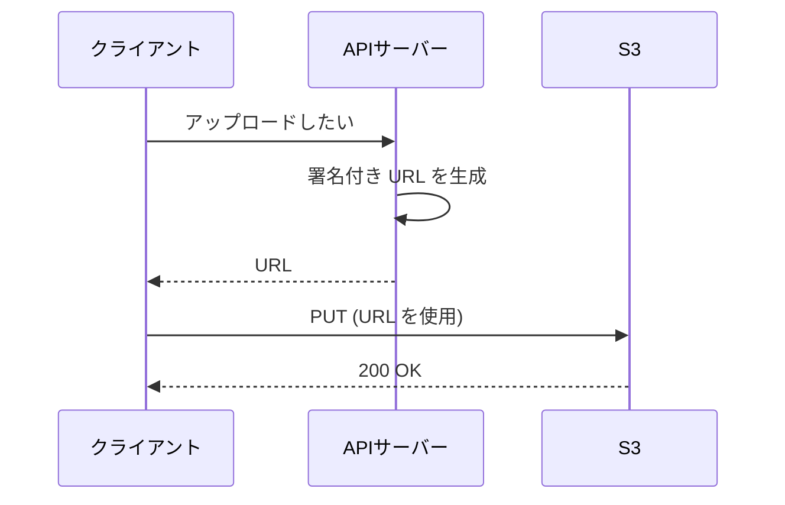

# Amazon S3 と S3 Glacier

[:material-sprout: CLF](../courses/clf/services.md){ .exam-badge .exam-foundational } [:material-sprout: AIF](../courses/aif/services.md){ .exam-badge .exam-foundational } [:material-certificate: SAA](../courses/saa/services.md){ .exam-badge .exam-associate } [:material-certificate: DVA](../courses/dva/services.md){ .exam-badge .exam-associate } [:material-certificate: SOA](../courses/soa/services.md){ .exam-badge .exam-associate } [:material-certificate: DEA](../courses/dea/services.md){ .exam-badge .exam-associate } [:material-certificate: MLA](../courses/mla/services.md){ .exam-badge .exam-associate } [:material-star-circle: SAP](../courses/sap/services.md){ .exam-badge .exam-professional } [:material-star-circle: DOP](../courses/dop/services.md){ .exam-badge .exam-professional } [:material-star-circle: AIP](../courses/aip/services.md){ .exam-badge .exam-professional } [:material-target: ANS](../courses/ans/services.md){ .exam-badge .exam-specialty } [:material-target: SCS](../courses/scs/services.md){ .exam-badge .exam-specialty }

オブジェクトをキーで保存し、HTTPS の API でアクセスするストレージです。アプリのファイル、静的コンテンツ、バックアップ、アーカイブに使います。

[](../assets/diagrams/s3-events-lifecycle.png)

## 基本と整合性 {#basics}

| 項目 | 内容 |
| --- | --- |
| 構成 | バケット(リージョン単位)にオブジェクトを保存。オブジェクトはキーで識別 |
| 1 回の `PUT` の上限 | 5 GB |
| マルチパートの上限 | 48.8 TiB（AWS のドキュメントでは「50 TB」とも表記） |
| デフォルト | バケットとオブジェクトは非公開、ACL は無効 |

### 整合性 {#consistency}

オブジェクトの `PUT` と `DELETE` は、すべてのリージョンで強力な書き込み後の読み取り整合性を持ちます。成功応答の後の `GET` や `LIST` には変更が反映されています。

| 操作 | 結果 |
| --- | --- |
| 新規 `PUT` の後の `LIST` | 新しいオブジェクトが現れる |
| 上書き `PUT` の後の `GET` | 新しいデータを返す |
| `DELETE` の後の `GET` | データを返さない |
| 同じキーへの同時 `PUT` | タイムスタンプが最新のものが残る |
| バケット設定の変更 | 結果整合性 |

オブジェクトのロック機構はなく、複数キーをまとめて原子的に更新もできません。必要ならアプリ側で作ります。バージョニングを初めて有効にしたときは、反映に時間がかかるため 15 分待ってから書き込むことが推奨されています。

### リクエストレートとプレフィックス {#request-rate}

| 項目 | 値 |
| --- | --- |
| 書き込み(`PUT`、`COPY`、`POST`、`DELETE`) | プレフィックスごとに毎秒 3,500 以上 |
| 読み取り(`GET`、`HEAD`) | プレフィックスごとに毎秒 5,500 以上 |
| プレフィックスの数 | 無制限 |

S3 は負荷に応じて自動でスケールしますが、急に増えると最適化が終わるまで一時的に HTTP 503(Slow Down)が返ります。

**例**: 毎秒 20,000 件の `GET` が必要なら、データを 4 つのプレフィックスに分け、それぞれから並列に読みます。理論上は毎秒 22,000 件を読めます。503 が出たら指数バックオフで再試行します。

## ストレージクラス {#storage-classes}

[:material-star-circle: AIP](../courses/aip/services.md){ .exam-badge .exam-professional }

| クラス | 用途 | AZ | 最小保存期間 | 最小課金サイズ | 取得 |
| --- | --- | --- | --- | --- | --- |
| S3 Standard (`STANDARD`) | 頻繁なアクセス | 3 以上 | なし | なし | ミリ秒 |
| S3 Intelligent-Tiering | アクセスパターンが不明、変わる | 3 以上 | なし | なし | ミリ秒(アーカイブ階層は復元が必要) |
| S3 Standard-IA (`STANDARD_IA`) | 月 1 回程度、失えないデータ | 3 以上 | 30 日 | 128 KB | ミリ秒、取得料金あり |
| S3 One Zone-IA (`ONEZONE_IA`) | 月 1 回程度、再生成できるデータ | 1 | 30 日 | 128 KB | ミリ秒、取得料金あり |
| S3 Express One Zone | 1 桁ミリ秒が必要な処理 | 1 | なし | なし | 1 桁ミリ秒 |
| S3 Glacier Instant Retrieval (`GLACIER_IR`) | 四半期に 1 回、すぐ読みたいアーカイブ | 3 以上 | 90 日 | 128 KB | ミリ秒、取得料金あり |
| S3 Glacier Flexible Retrieval (`GLACIER`) | 年 1 回程度のアーカイブ | 3 以上 | 90 日 | なし(メタデータ分 40 KB を追加課金) | 復元が必要、数分から数時間 |
| S3 Glacier Deep Archive (`DEEP_ARCHIVE`) | 年 1 回未満の長期保管 | 3 以上 | 180 日 | なし(メタデータ分 40 KB を追加課金) | 復元が必要、数時間 |

耐久性の設計値は、推奨されない Reduced Redundancy Storage を除きイレブンナイン(99.999999999%)です。One Zone-IA と Express One Zone は AZ の喪失に耐えられません。

Intelligent-Tiering は、30 日アクセスがないと低頻度アクセス階層に、90 日で Archive Instant Access 階層に自動で移します。128 KB 未満のオブジェクトは監視されず、高頻度アクセス階層に留まります。

有効にすると、さらに Archive Access 階層(90 日以上)と Deep Archive Access 階層(180 日以上)にも移せます。この 2 つは読むときに復元が必要です。監視と自動化の料金がオブジェクトごとにかかりますが、取得料金はかかりません。

| 設定の違い | 影響 |
| --- | --- |
| 可用性の設計値 | Standard 99.99%、Standard-IA と Intelligent-Tiering と Glacier IR 99.9%、One Zone-IA 99.5%、Express One Zone 99.95% |
| 最小課金サイズ 128 KB | 10 KB のオブジェクトも Standard-IA では 128 KB 分課金される |
| 最小保存期間 | 30 日の Standard-IA を 10 日で消しても 30 日分課金される |
| Glacier の 40 KB | 32 KB はそのクラスの料金、8 KB は Standard の料金で課金される |

**例**: 平均 20 KB の小さなログを大量に保存するなら、Standard-IA は不利です。128 KB 分の課金になるからです。Standard のままにするか、まとめて 1 つの大きなオブジェクトにします。

`STANDARD` が `PutObject` のデフォルトで、`x-amz-storage-class` ヘッダー(SDK では `StorageClass`)で変更します。

```bash
aws s3api put-object --bucket my-bucket --key logs/a.gz --body a.gz \
  --storage-class STANDARD_IA
```

## ライフサイクル {#lifecycle}

[:material-star-circle: AIP](../courses/aip/services.md){ .exam-badge .exam-professional }

オブジェクトを別のクラスに移す移行アクションと、削除する失効アクションを、ルールで自動実行します。データの保持期間を設計するときの中心となる機能です。

```json
{
  "Rules": [
    {
      "ID": "archive-logs",
      "Status": "Enabled",
      "Filter": {"Prefix": "logs/"},
      "Transitions": [
        {"Days": 30, "StorageClass": "STANDARD_IA"},
        {"Days": 120, "StorageClass": "GLACIER"}
      ],
      "Expiration": {"Days": 365},
      "NoncurrentVersionExpiration": {"NoncurrentDays": 30},
      "AbortIncompleteMultipartUpload": {"DaysAfterInitiation": 7}
    }
  ]
}
```

| 要点 | 内容 |
| --- | --- |
| 移行の方向 | Standard から低コスト側へ一方向(ウォーターフォール)。Deep Archive から戻すルールは作れない |
| 小さなオブジェクト | 128 KB 未満はデフォルトで移行しない。サイズフィルターで変更可能 |
| 最小保存期間 | 1 つのルールで最小保存期間を満たさない連続移行は設定できない |
| 早期移行、早期削除 | 最小保存期間の残り分が課金される |
| タグのフィルター | 実行時にタグを再評価するので、外すと移行されない場合がある |
| バージョニング有効時 | 現行バージョンと非現行バージョンを別々に指定する |
| 未完了のマルチパート | `AbortIncompleteMultipartUpload` で片付ける |

!!! warning "バージョニングとの組み合わせ"
    バージョニングを有効にしたバケットで `Expiration` を設定しても、削除マーカーが付くだけで実データは残ります。実データを消すには `NoncurrentVersionExpiration` も必要です。

### ライフサイクルのルール要素 {#lifecycle-elements}

1 つのバケットに設定は 1 つで、ルールは最大 1,000 個です。この上限は変更できません。

| 要素 | 内容 | 例と注意 |
| --- | --- | --- |
| `ID` | ルールの名前 | `archive-logs` |
| `Status` | `Enabled` か `Disabled` | `Disabled` のルールは何もしない |
| `Filter` | 対象を絞る | プレフィックス、タグ、サイズ。複数なら `And` で囲む |
| `Transition` | 現行バージョンを移す | `Days` か `Date`、`StorageClass` |
| `Expiration` | 現行バージョンを失効させる | `Days`、`Date`、`ExpiredObjectDeleteMarker` |
| `NoncurrentVersionTransition` | 非現行バージョンを移す | `NoncurrentDays`、`NewerNoncurrentVersions` |
| `NoncurrentVersionExpiration` | 非現行バージョンを完全に削除する | `NoncurrentDays`、`NewerNoncurrentVersions` |
| `AbortIncompleteMultipartUpload` | 未完了のマルチパートを止める | `DaysAfterInitiation`。タグのフィルターと併用できない |
| `ExpiredObjectDeleteMarker` | 古い版がない削除マーカーを消す | `true`。`Days` と同じルールに書けない。タグのフィルターと併用できない |

`Filter` のサイズはバイト単位で、指定した値ちょうどのオブジェクトは含みません。`ObjectSizeGreaterThan` は `ObjectSizeLessThan` より小さくします。

日数の計算は、作成時刻に日数を足して、翌日の UTC 0 時に切り上げます。1 月 15 日 10 時 30 分に作ったオブジェクトに 3 日を指定すると、1 月 19 日 0 時が起点です。移行はその後に非同期で行われるので、ぴったりの時刻に動くとは限りません。

バケットのバージョニングの状態で、`Expiration` の動作が変わります。

| 状態 | `Expiration` の動作 | 非現行バージョン用のアクション |
| --- | --- | --- |
| 未設定 | オブジェクトを完全に削除。戻せない | 効果なし |
| 有効 | 削除マーカーを作り、現行バージョンを非現行にする | 効果あり |
| 停止 | バージョン ID が `null` の削除マーカーを作る | 効果あり |

**例**: ログを 30 日で Standard-IA、1 年で削除、古いバージョンは 2 世代だけ 30 日残すなら、次のようにします。

```json
{
  "Rules": [{
    "ID": "logs",
    "Status": "Enabled",
    "Filter": {"Prefix": "logs/"},
    "Transitions": [{"Days": 30, "StorageClass": "STANDARD_IA"}],
    "Expiration": {"Days": 365},
    "NoncurrentVersionExpiration": {"NoncurrentDays": 30, "NewerNoncurrentVersions": 2},
    "AbortIncompleteMultipartUpload": {"DaysAfterInitiation": 7}
  }]
}
```

**落とし穴**:

- MFA Delete を設定したバケットには、ライフサイクルを設定できません。
- Object Lock で保護されたバージョンは、ライフサイクルでも削除できません。
- レプリケーションの状態が `PENDING` または `FAILED` のオブジェクトは、移行も失効もされません。失敗が続くと費用がかかり続けます。
- Deep Archive から他のクラスへ移すルールは作れません。復元してコピーします。Flexible Retrieval からルールで移せるのは Deep Archive だけです。
- 2024 年 9 月以降、128 KB 未満のオブジェクトはデフォルトで移行されません。古い資料とは違います。

他のサービスの保持の設定は [ストレージの選び方](storage.md) を参照してください。

## バージョニング {#versioning}

| 状態 | 動作 |
| --- | --- |
| 未設定(デフォルト) | 上書きで前のデータは消える |
| 有効 | 新しいバージョン ID を付与。上書きと削除で以前のバージョンが残る |
| 停止 | 既存のバージョンは残るが、新しいバージョンは作らない |

- 一度有効にすると未設定には戻せず、停止のみできます。
- 有効化より前からあったオブジェクトのバージョン ID は `null` です。
- バージョン ID を指定しない `DELETE` は削除マーカーを追加します。バージョン ID を指定すると、そのバージョンを完全に削除します。
- 各バージョンが丸ごと課金されます。差分ではありません。
- MFA Delete を設定すると、バージョンの完全削除に MFA を求められます。

### 状態ごとの動作と削除マーカー {#delete-markers}

| 操作 | 有効 | 停止 |
| --- | --- | --- |
| `PUT` | 新しいバージョン ID を付与 | ID が `null` のものを作るか上書きする |
| バージョン ID なしの `DELETE` | 削除マーカーを追加 | ID が `null` の削除マーカーを追加 |
| バージョン ID ありの `DELETE` | そのバージョンを完全に削除 | そのバージョンを完全に削除 |

削除マーカーへの `GET` の動作は次のとおりです。

| リクエスト | 応答 |
| --- | --- |
| バージョン ID なしで、現行が削除マーカー | 404 と `x-amz-delete-marker: true` |
| バージョン ID ありで、そのバージョンが削除マーカー | 405 Method Not Allowed |

**例**: 誤って `report.pdf` を消したら、削除マーカーのバージョン ID を指定して `DELETE` します。マーカーが消えて、前のバージョンが現行に戻ります。

**MFA Delete の設定**: `MFADelete=Enabled` を付けた `PutBucketVersioning` で有効にします。これを実行できるのはバケット所有者のルートユーザーだけです。

```bash
aws s3api put-bucket-versioning --bucket my-bucket \
  --versioning-configuration Status=Enabled,MFADelete=Enabled \
  --mfa "arn:aws:iam::123456789012:mfa/root-account-mfa-device 123789"
```

## レプリケーション {#replication}

[:material-star-circle: AIP](../courses/aip/services.md){ .exam-badge .exam-professional }

オブジェクトを別のバケットに非同期でコピーします。別リージョンへは CRR、同じリージョンへは SRR です。

**前提**:

- 送信元と送信先の両方でバージョニングが有効です。
- S3 が引き受ける IAM ロールが必要です。
- 別アカウントなら、送信先のバケットポリシーで許可します。送信先はリクエスタ支払いにできません。
- Object Lock を使うなら両方で有効にし、ロールに `s3:GetObjectRetention` と `s3:GetObjectLegalHold` を許可します。

| ルールの要素 | 内容 |
| --- | --- |
| `Status` | `Enabled` か `Disabled` |
| `Priority` | 複数ルールが同じオブジェクトに当たるときの優先度 |
| `Filter` | プレフィックスとタグ |
| `Destination.Bucket` | 送信先バケット |
| `Destination.StorageClass` | 送信先のストレージクラス。例: `GLACIER` |
| `Destination.AccessControlTranslation` | レプリカの所有者を送信先アカウントに変える |
| `DeleteMarkerReplication` | 削除マーカーを複製するか |
| `SourceSelectionCriteria.SseKmsEncryptedObjects` | SSE-KMS のオブジェクトを複製するか(オプトイン) |
| `Destination.EncryptionConfiguration.ReplicaKmsKeyID` | 送信先リージョンの KMS キー |
| `Destination.ReplicationTime`、`Metrics` | S3 RTC。新しいオブジェクトの 99.99% を 15 分以内に複製 |

何が複製されるかは次のとおりです。

| 対象 | 複製されるか |
| --- | --- |
| 設定後に作られたオブジェクト | される |
| 設定前からあるオブジェクト | されない。S3 Batch Replication を使う |
| メタデータ、タグ、Object Lock の保持情報 | される |
| SSE-S3、SSE-C | デフォルトでされる |
| SSE-KMS、DSSE-KMS | オプトインが必要 |
| 削除マーカー | デフォルトでされない。タグのルールでは設定できない |
| バージョン ID を指定した削除 | されない |
| 他のルールで作られたレプリカ | されない。Batch Replication なら可能 |
| Flexible Retrieval、Deep Archive のオブジェクト | されない |
| ライフサイクルの設定など、バケットの設定 | されない |
| ライフサイクルの失効で作られた削除マーカー | されない |

**例**: 東京のバケットをバージニアに複製するとします。既存の 1 億件は設定しても複製されません。Batch Replication を別途実行します。SSE-KMS のオブジェクトは `SseKmsEncryptedObjects` を `Enabled` にして、ロールに送信元キーの `kms:Decrypt` と送信先キーの `kms:Encrypt` を許可しないと `FAILED` になります。

## 署名付き URL {#presigned-urls}

AWS の認証情報を持たない相手に、期限付きで特定のオブジェクトの操作を許可します。バケットポリシーの変更は不要です。

```python
import boto3

s3 = boto3.client("s3")

download_url = s3.generate_presigned_url(
    "get_object",
    Params={"Bucket": "my-bucket", "Key": "report.pdf"},
    ExpiresIn=900,
)

upload_url = s3.generate_presigned_url(
    "put_object",
    Params={
        "Bucket": "my-bucket",
        "Key": "uploads/photo.jpg",
        "ContentType": "image/jpeg",
    },
    ExpiresIn=300,
)
```



サーバーを経由せずに S3 と直接やり取りできるので、大きなファイルでもアプリの負荷が増えません。

**有効期限**

| 作成に使う認証情報 | 最長 |
| --- | --- |
| コンソールから生成 | 12 時間(1 分から) |
| CLI、SDK で IAM ユーザーの認証情報(SigV4) | 7 日 |
| IAM ロール、STS の一時認証情報 | 認証情報の期限まで |
| EC2 のインスタンスプロファイル | ロール認証情報の期限まで(通常 6 時間程度) |

**例**: Lambda の実行ロールで `ExpiresIn=604800`(7 日)を指定しても、URL は Lambda の認証情報が切れた時点で無効になります。7 日間確実に使いたいなら IAM ユーザーの認証情報で作ります。CloudFront の署名付き URL も選択肢です。

**動作のルール**

- URL の権限は生成した IAM プリンシパルの権限に依存します。生成者が `s3:GetObject` を持たなければ、URL は 403 になります。
- 認証情報が先に失効すれば、指定した期限より前に URL も無効になります。認証情報を無効化、削除した場合も同様です。
- 期限はリクエスト時に確認します。開始済みのダウンロードは途中で期限が来ても続きますが、切れた後の再開はできません。
- 期限内なら何度でも使えます。持っている人は誰でも使えるので、漏えいに注意します。
- `PUT` 用の URL は、署名時に指定した `Content-Type` と同じものを送ります。違うと `SignatureDoesNotMatch` になります。
- バケットポリシーの条件キー `s3:signatureAge` で、署名の経過時間を制限できます。

### CloudFront 署名付き URL との違い {#cloudfront-signed-urls}

| 観点 | S3 署名付き URL | CloudFront 署名付き URL |
| --- | --- | --- |
| アクセス先 | S3 バケットに直接 | CloudFront ディストリビューション |
| 署名に使うもの | IAM プリンシパルの認証情報 | 信頼されたキーグループの秘密鍵 |
| 権限の源 | 生成者の IAM 権限 | キャッシュ動作に設定した署名者 |
| キャッシュ | なし | エッジでキャッシュ |
| 条件 | 期限中心 | 期限、開始日時、IP 範囲などカスタムポリシーで指定可能 |
| アップロード | `PUT` で可能 | 配信が主な用途 |
| 向く場面 | ファイルの受け渡し、ブラウザからの直接アップロード | 有料コンテンツの配信、世界中への配信 |

CloudFront の署名者には、キーグループを使うことが推奨されています。ルートユーザーが不要で、API で管理できるためです。キーペアは RSA 2048 か ECDSA 256 です。

| CloudFront の選択肢 | 向く場面 |
| --- | --- |
| 署名付き URL | 個々のファイル。Cookie に対応していないクライアント |
| 署名付き Cookie | 複数のファイル(HLS 動画一式など)。URL を変えたくない |

両方が指定された場合は署名付き URL が優先されます。CloudFront を迂回して S3 に直接アクセスされないように、オリジンのバケットはオリジンアクセスコントロール (OAC) で CloudFront からのアクセスのみに制限します。

## Event Notifications {#event-notifications}

オブジェクトの作成や削除などをトリガーに、他のサービスに通知します。

| 送信先 | 備考 |
| --- | --- |
| SQS | FIFO キューは指定できない(EventBridge 経由なら可能) |
| SNS | ファンアウトに使う |
| Lambda | 直接呼び出す |
| EventBridge | バケットで有効化すれば全イベントが送られ、ルールで振り分ける |

| イベントタイプ | 発生するとき |
| --- | --- |
| `s3:ObjectCreated:*`(`Put`、`Post`、`Copy`、`CompleteMultipartUpload`) | オブジェクトの作成 |
| `s3:ObjectRemoved:*`(`Delete`、`DeleteMarkerCreated`) | 削除 |
| `s3:ObjectRestore:*`(`Post`、`Completed`、`Delete`) | 復元の開始、完了、一時コピーの失効 |
| `s3:Replication:*` | 複製の失敗、15 分の閾値の超過など |
| `s3:LifecycleExpiration:*`、`s3:LifecycleTransition` | ライフサイクルの失効、移行 |
| `s3:IntelligentTiering` | Archive 系の階層への移動 |
| `s3:ObjectTagging:*`、`s3:ObjectAcl:Put` | タグと ACL の変更 |

**フィルターの規則**:

- プレフィックスとサフィックスだけです。ワイルドカード `*` は使えません。スペースは `+` に、他の特殊文字は URL エンコードします。
- 同じイベントタイプで、プレフィックスやサフィックスが重なるルールは作れません。`images/` と `images/thumb/` のように重なる場合は、設定に失敗します。
- 非同期で複数の宛先に送るなら、SNS を 1 つ置いてファンアウトします。

**例**: `uploads/` の `.jpg` だけを Lambda で処理するなら、`s3:ObjectCreated:*` に `prefix=uploads/`、`suffix=.jpg` を指定します。大きなファイルはマルチパートで届くので、`s3:ObjectCreated:Put` だけを指定すると `CompleteMultipartUpload` を取り逃がします。

EventBridge は有効にするか無効にするかだけで、全イベントが送られます。S3 の 2 つのイベント設定を比べると、複雑なフィルターや FIFO キューへの送信が必要なら EventBridge です。

- 対象は作成、削除、復元、レプリケーション、ライフサイクル、タグ、ACL などのイベントです。プレフィックスとサフィックスで絞れます。
- 配信は **少なくとも 1 回** です。通常は数秒ですが、1 分以上かかることもあります。処理は冪等にします。
- SQS、SNS、Lambda 側のリソースポリシーで、S3 からの発行や呼び出しを許可します。
- 設定の反映には通常 5 分ほどかかり、初回は `s3:TestEvent` が送られます。

!!! warning "無限ループに注意"
    通知を受けた Lambda が同じバケットに書き込むと、自分自身を呼び続けます。出力を別のバケットにするか、入力用のプレフィックスだけを通知の対象にします。

連携の全体像は [メッセージング](messaging.md) を参照してください。

## 暗号化 {#encryption}

保存時の暗号化は常に有効で、新しいオブジェクトはデフォルトで SSE-S3 で暗号化されます。

| 方式 | キーの管理者 | 暗号化する場所 | 指定 | 使いどころ |
| --- | --- | --- | --- | --- |
| SSE-S3 | S3 | サーバー | `AES256` | 特に要件がない |
| SSE-KMS | KMS | サーバー | `aws:kms` | 監査、キーのアクセス制御、ローテーション |
| DSSE-KMS | KMS | サーバー(2 層) | `aws:kms:dsse` | 2 層の暗号化が要件のとき |
| SSE-C | 自分(リクエストごとに送る) | サーバー | `SSECustomerKey` など | 自分でキーを持つ要件。下記の制約あり |
| クライアント側 | 自分 | アップロード前 | SDK やライブラリ | AWS に平文を渡したくない |

```python
s3.put_object(
    Bucket="my-bucket",
    Key="secret.csv",
    Body=data,
    ServerSideEncryption="aws:kms",
    SSEKMSKeyId="arn:aws:kms:ap-northeast-1:123456789012:key/EXAMPLE",
    BucketKeyEnabled=True,
)
```

### 方式ごとのリクエストヘッダー {#encryption-headers}

| 方式 | ヘッダー | 値 |
| --- | --- | --- |
| SSE-S3 | `x-amz-server-side-encryption` | `AES256` |
| SSE-KMS | `x-amz-server-side-encryption` | `aws:kms` |
| SSE-KMS | `x-amz-server-side-encryption-aws-kms-key-id` | KMS キーの ARN など。省略すると `aws/s3` |
| SSE-KMS | `x-amz-server-side-encryption-context` | 暗号化コンテキスト(base64) |
| SSE-KMS | `x-amz-server-side-encryption-bucket-key-enabled` | `true` か `false` |
| DSSE-KMS | `x-amz-server-side-encryption` | `aws:kms:dsse` |
| SSE-C | `x-amz-server-side-encryption-customer-algorithm` | `AES256` |
| SSE-C | `x-amz-server-side-encryption-customer-key` | 256 ビットのキー(base64) |
| SSE-C | `x-amz-server-side-encryption-customer-key-MD5` | キーの MD5(base64) |

SSE-C のオブジェクトをコピーするときは、元のオブジェクト用に `x-amz-copy-source-server-side-encryption-customer-algorithm`、`-key`、`-key-MD5` も送ります。

署名付き URL で SSE-C を使う場合は、利用者が URL とは別に 3 つのヘッダーをすべて送ります。

### SSE-KMS の注意点 {#sse-kms}

- **権限**: アップロードには `kms:GenerateDataKey`、ダウンロードには `kms:Decrypt` が必要です。マルチパートアップロードには両方が必要です。
- **S3 Bucket Key**: バケット単位のキーを使い、KMS へのリクエストを最大 99% 減らします。リクエスト数のクォータやコストが問題になったら検討します。
- **リージョン**: KMS キーはバケットと同じリージョンに置きます。対称キーのみ使えます。
- **クロスアカウント**: AWS マネージドキー(`aws/s3`)が使えるのは、アップロードとアクセスのプリンシパルが同じアカウントの場合だけです。別のアカウントに読ませるならカスタマーマネージドキーを使います。
- **`GET`**: 暗号化のヘッダーを付けると 400 Bad Request になります。HTTPS と SigV4 が必須です。

### S3 Bucket Key の動作 {#bucket-key}

| 項目 | 内容 |
| --- | --- |
| 設定 | デフォルト暗号化の `BucketKeyEnabled`、または `PutObject` などのヘッダー |
| 既存のオブジェクト | 影響しない。使うには `CopyObject` で作り直す |
| DSSE-KMS | 非対応 |
| 暗号化コンテキスト | オブジェクトの ARN ではなくバケットの ARN になる |
| CloudTrail | KMS のイベントが減り、バケットの ARN が記録される |

**落とし穴**: KMS のキーポリシーや IAM ポリシーで、`kms:EncryptionContext:aws:s3:arn` にオブジェクトの ARN を指定していると、Bucket Key を有効にしたときに動かなくなります。バケットの ARN に変更します。

**例**: 毎秒 5,000 件のアップロードで KMS がスロットリングするなら、Bucket Key を有効にします。リクエスト元が変わるごとにキーを取り直すので、ロールが多いほど削減効果は小さくなります。

### SSE-C の注意点 {#sse-c}

!!! warning "SSE-C は 2026 年 4 月からデフォルトで無効"
    新しい汎用バケット（中東のバーレーンと UAE のリージョンを除く）と、SSE-C のオブジェクトを持たないアカウントの既存バケットでは、SSE-C の書き込みがブロックされます。ブロック中は `PutObject` や `CopyObject`、マルチパートなどが HTTP 403 の `AccessDenied` になります。使うには、`PutBucketEncryption` でデフォルト暗号化の `BlockedEncryptionTypes` を `NONE` にします。

- S3 はキーを保存しません。キーを失うとデータも失います。
- リクエストごとにキーを送るので HTTPS が必須です。HTTP のリクエストは拒否されます。
- どのオブジェクトにどのキーを使ったかは自分で管理します。
- コンソールからは使えません。AWS のマネージドサービスは復号できません。

### バケットのデフォルト暗号化とポリシーによる強制 {#enforcing-encryption}

バケットのデフォルト暗号化を SSE-KMS にすると、指定のない `PUT` は自動でその方式で暗号化されます。既存のオブジェクトは変わりません。変更するには S3 Batch Operations のコピーなどを使います。

要件で「このキーでの暗号化以外は拒否」とする場合はポリシーを使います。

```json
{
  "Version": "2012-10-17",
  "Statement": [
    {
      "Sid": "DenyWrongKmsKey",
      "Effect": "Deny",
      "Principal": "*",
      "Action": "s3:PutObject",
      "Resource": "arn:aws:s3:::my-bucket/*",
      "Condition": {
        "StringNotEquals": {
          "s3:x-amz-server-side-encryption-aws-kms-key-id":
            "arn:aws:kms:ap-northeast-1:123456789012:key/EXAMPLE"
        }
      }
    },
    {
      "Sid": "DenyInsecureTransport",
      "Effect": "Deny",
      "Principal": "*",
      "Action": "s3:*",
      "Resource": [
        "arn:aws:s3:::my-bucket",
        "arn:aws:s3:::my-bucket/*"
      ],
      "Condition": {"Bool": {"aws:SecureTransport": "false"}}
    }
  ]
}
```

`Null` 条件で `s3:x-amz-server-side-encryption-aws-kms-key-id` を調べれば、KMS キーの指定がないリクエストを拒否することもできます。

転送中の暗号化は TLS で行います。上の後半の文で HTTP のアクセスを拒否できます。

### クライアント側暗号化を選ぶとき {#client-side-encryption}

| 要件 | 選択 |
| --- | --- |
| AWS に平文を渡してはいけない | クライアント側 |
| 暗号化の手間をなくしたい | SSE-S3 |
| 誰がいつ復号したかを監査したい | SSE-KMS(CloudTrail に記録) |
| 自分のキーを使い、かつ処理は S3 に任せたい | SSE-C |

キーの扱いは [KMS](kms.md) を参照してください。

## バケットポリシーとアクセス制御 {#bucket-policies}

バケットに付けるリソースベースのポリシーです。サイズの上限は 20 KB です。

```json
{
  "Version": "2012-10-17",
  "Statement": [{
    "Sid": "AllowPartnerRead",
    "Effect": "Allow",
    "Principal": {"AWS": "arn:aws:iam::111122223333:role/PartnerRole"},
    "Action": "s3:GetObject",
    "Resource": "arn:aws:s3:::my-bucket/shared/*"
  }]
}
```

| 仕組み | 用途 |
| --- | --- |
| IAM ポリシー | 同じアカウントのプリンシパルの権限 |
| バケットポリシー | クロスアカウント、匿名アクセス、条件による拒否 |
| ブロックパブリックアクセス | 公開設定を上書きして防ぐ。デフォルトで有効 |
| オブジェクト所有者の設定 | ACL の有効、無効。デフォルトで ACL は無効 |
| ACL | 古い仕組み。多くの場面で不要 |

`s3:ListBucket` はバケットの ARN に、`s3:GetObject` はオブジェクトの ARN(`/*` 付き)に指定します。

### ブロックパブリックアクセス {#block-public-access}

4 つの独立した設定があり、アクセスポイント、バケット、アカウント、組織の単位で適用できます。新しいバケットではデフォルトで有効です。

| 設定 | `TRUE` のときの動作 |
| --- | --- |
| `BlockPublicAcls` | 公開 ACL を付ける `PutBucketAcl`、`PutObjectAcl`、`PutObject` を拒否する |
| `IgnorePublicAcls` | 公開 ACL を無視する。`PutObject` 自体は成功する |
| `BlockPublicPolicy` | 公開を許可するバケットポリシーの `PutBucketPolicy` を拒否する |
| `RestrictPublicBuckets` | 公開ポリシーのあるバケットへのアクセスを、AWS サービスと所有者アカウント内に限る |

**例**: `Principal: "*"` のポリシーを入れると、`BlockPublicPolicy` が有効なバケットでは `PutBucketPolicy` が拒否されます。アカウント単位が有効だと、バケットの設定を外しても拒否されます。

### オブジェクト所有者 {#object-ownership}

| 設定 | 所有者 | ACL |
| --- | --- | --- |
| Bucket owner enforced(デフォルト) | バケット所有者 | 無効。設定は失敗し、読み取りのみ可 |
| Bucket owner preferred | `bucket-owner-full-control` 付きならバケット所有者 | 有効 |
| Object writer | アップロードしたアカウント | 有効 |

**例**: 別のアカウントが `x-amz-acl: public-read` を付けて、デフォルトのバケットにアップロードすると、ACL が無効なのでリクエストは失敗します。ACL を付けないか、`bucket-owner-full-control` だけを付けます。

## リクエスタ支払い {#requester-pays}

通常はバケット所有者がリクエストとダウンロードの費用を払いますが、リクエスタ支払いでは利用者が払います。ストレージの費用は常に所有者が払います。

| 項目 | 内容 |
| --- | --- |
| 匿名アクセス | 許可されない。すべて認証が必要 |
| リクエスト | `x-amz-request-payer` ヘッダー(CLI は `--request-payer`)で同意を示す |
| ロールを引き受けた場合 | ロールのアカウントに課金 |
| ウェブサイトエンドポイント | 使えない。403 |
| レプリケーションの送信先 | 別アカウントの送信先には設定できない |

**例**: 別の会社に大きなデータセットを公開するとき、ダウンロード費用を負担したくなければ有効にします。ヘッダーを付けない要求は 403 になります。

## CORS {#cors}

別のドメインのウェブページから、ブラウザの JavaScript で S3 にアクセスするときに設定します。

```json
[
  {
    "AllowedOrigins": ["https://www.example.com"],
    "AllowedMethods": ["GET", "PUT"],
    "AllowedHeaders": ["*"],
    "ExposeHeaders": ["ETag"],
    "MaxAgeSeconds": 3000
  }
]
```

- S3 は最初に一致したルールを使います。`Origin`、メソッド、`Access-Control-Request-Headers` のすべてが一致する必要があります。
- CORS は権限を与えません。バケットポリシーや署名付き URL は別途必要です。
- ブラウザからマルチパートアップロードするなら、`ETag` を `ExposeHeaders` に入れます。

| 要素 | 値 | 動作 |
| --- | --- | --- |
| `AllowedOrigins` | `https://www.example.com`、`https://*.example.com`、`*` | ワイルドカードは 1 つまで |
| `AllowedMethods` | `GET`、`PUT`、`POST`、`DELETE`、`HEAD` | `OPTIONS` は指定しない |
| `AllowedHeaders` | `x-amz-*`、`*` など | プリフライトの `Access-Control-Request-Headers` と照合する |
| `ExposeHeaders` | `ETag` など | JavaScript から読める応答ヘッダー |
| `MaxAgeSeconds` | 秒数 | ブラウザがプリフライトの結果をキャッシュする時間 |

**例**: `https://app.example.com` から `PUT` で署名付き URL に送るなら、`AllowedOrigins` にそのオリジンを、`AllowedMethods` に `PUT` を入れます。`AllowedHeaders` に `Content-Type` が入っていないと、プリフライトが失敗します。設定がないと `403 Forbidden: CORS is not enabled for this bucket`、ルールに一致しないと `This CORS request is not allowed` になります。

## マルチパートアップロード {#multipart-upload}

大きなオブジェクトを分割してアップロードします。

| 項目 | 値 |
| --- | --- |
| 推奨 | 100 MB 以上 |
| 必須 | 5 GB を超える場合 |
| パート数 | 最大 10,000 |
| パートサイズ | 5 MiB から 5 GiB(最後のパートに下限なし) |
| オブジェクトの上限 | 48.8 TiB（AWS のドキュメントでは「50 TB」とも表記） |

API の順序は `CreateMultipartUpload`、`UploadPart`(番号と ETag を記録)、`CompleteMultipartUpload` です。やめるときは `AbortMultipartUpload` を呼びます。

- パートは並列に、順不同で送れます。失敗したパートだけを再送できます。
- **未完了のパートにも課金されます**。ライフサイクルの `AbortIncompleteMultipartUpload` で自動的に片付けます。
- boto3 の `upload_file` は、サイズに応じて自動でマルチパートにします。

```python
from boto3.s3.transfer import TransferConfig

config = TransferConfig(multipart_threshold=100 * 1024 * 1024, max_concurrency=8)
s3.upload_file("big.bin", "my-bucket", "big.bin", Config=config)
```

boto3 の `TransferConfig` のデフォルトは、`multipart_threshold` が 8 MB、`max_concurrency` が 10 です。

**例**: 1 TiB のファイルを送るなら、パートは 10,000 個までなので 1 パートは約 105 MiB 以上にします。`UploadPart` を自分で呼ぶとき、5 MiB のパートでは 10,000 個で約 48.8 GiB にしかなりません。

**落とし穴**: `CompleteMultipartUpload` には、記録した番号と ETag の一覧を渡します。`ListParts` の結果を使わないでください。`Expiration` のライフサイクルでは未完了のアップロードは消えません。必ず `AbortIncompleteMultipartUpload` を設定します。

### 片付けの設定 {#abort-multipart}

```bash
aws s3api put-bucket-lifecycle-configuration --bucket my-bucket \
  --lifecycle-configuration '{"Rules":[{"ID":"abort","Status":"Enabled","Filter":{"Prefix":""},
    "AbortIncompleteMultipartUpload":{"DaysAfterInitiation":7}}]}'
```

開始から 7 日で完了しないアップロードを止め、パートを削除します。パートはコンソールのオブジェクト一覧には現れないので、気づかないまま課金が続きます。

## Transfer Acceleration {#transfer-acceleration}

エッジロケーションを経由して、遠くのクライアントと S3 の間の転送を速くします。

| 項目 | 内容 |
| --- | --- |
| 有効化 | `put-bucket-accelerate-configuration` の `Status=Enabled`。停止は `Suspended` |
| エンドポイント | `バケット名.s3-accelerate.amazonaws.com` |
| 反映 | 有効化から最大 20 分で速くなる |
| バケット名 | DNS 準拠で、ピリオド(`.`)を含められない |
| アドレス形式 | 仮想ホスト形式のみ |
| 使えない API | `ListBuckets`、`CreateBucket`、`DeleteBucket` は加速エンドポイントで使えない |

```bash
aws s3api put-bucket-accelerate-configuration --bucket my-bucket \
  --accelerate-configuration Status=Enabled
aws s3 cp big.bin s3://my-bucket/big.bin \
  --endpoint-url https://s3-accelerate.amazonaws.com
```

**例**: 世界中のスマホアプリから東京のバケットに大きな動画をアップロードするなら有効にします。同じリージョンのアプリからの転送は速くなりません。CloudFront はダウンロードのキャッシュが中心で、Transfer Acceleration はアップロードの速度を上げるときに選びます。

## アクセスポイント {#access-points}

バケットに接続する名前付きのエンドポイントです。アクセスポイントごとに独自のポリシー、ネットワーク制限、ブロックパブリックアクセスを設定できます。

| 使いどころ | 内容 |
| --- | --- |
| 共有データセット | 巨大なバケットポリシーを、用途別のアクセスポイントに分ける |
| VPC 限定 | 特定の VPC からのリクエストだけを受ける |

- `GetObject`、`PutObject` などのオブジェクト操作だけが対象です。バケットの削除などはできません。
- 権限はアクセスポイントのポリシーと、元のバケットのポリシーの両方で評価されます。
- ARN やエイリアスで指定できます。

| 制約 | 内容 |
| --- | --- |
| 名前 | 3〜50 文字。アカウントとリージョンの中で一意 |
| 接続先 | 作成後に別のバケットへ変更できない |
| VPC の設定 | 作成後に変更できない |
| ポリシーのサイズ | 20 KB |
| 数の上限 | アカウントとリージョンごとに 10,000 |
| アドレス形式 | 仮想ホスト形式のみ |
| レプリケーション | 送信先に指定できない |

**例**: 分析チームには読み取りだけのアクセスポイント、VPC 内のバッチには VPC 限定のアクセスポイントを作り、バケットポリシーからは許可を外します。

**落とし穴**: アクセスポイントのポリシーで許可しても、バケットポリシーでも許可されていなければ拒否されます。バケットポリシーで `s3:DataAccessPointAccount` を使い、自分のアカウントのアクセスポイントに権限を委任すると、管理が 1 か所で済みます。

## Object Lambda と S3 Select の現在の状況 {#retired-features}

| 機能 | 状況 | 代わり |
| --- | --- | --- |
| S3 Object Lambda | 2025 年 11 月 7 日以降、新規利用は不可。既存の利用者と一部のパートナーのみ | CloudFront と Lambda、アプリ側での変換 |
| S3 Select | 新規の利用者には提供されない。既存の利用者は継続できる | Athena、アプリ側での処理 |

古い資料では「`GET` の結果を変換するなら Object Lambda」「オブジェクトの一部を SQL で読むなら S3 Select」と説明されますが、新規の設計には使えません。

## Object Lock {#object-lock}

WORM(一度書き込み、何度でも読める)モデルで、バージョンを削除や上書きから守ります。**バージョニングが必須** です。

| 種類 | 動作 |
| --- | --- |
| ガバナンスモード | `s3:BypassGovernanceRetention` と `x-amz-bypass-governance-retention:true` があれば変更、削除できる |
| コンプライアンスモード | ルートユーザーも含めて誰も削除できず、期間の短縮もできない |
| リーガルホールド | 期限なし。`s3:PutObjectLegalHold` を持つユーザーが外すまで有効。保持期間とは独立 |

- 保持期間は、固定(日付を指定)と可変(イベントホールドの解放時に確定)があります。バケットのデフォルトも設定できます。
- 延長はできますが、短縮はできません(コンプライアンスの場合)。
- バージョン ID なしの `DELETE` は成功し、削除マーカーが付きます。バージョン ID を指定した削除は 403 になります。
- 一度有効にすると、Object Lock は無効にできず、バージョニングも停止できません。
- コンプライアンスモードで期限前に消す方法は、AWS アカウントの削除だけです。
- ガバナンスモードの迂回には権限とヘッダーの両方が必要です。コンソールはヘッダーを自動で付けます。リーガルホールドは迂回の対象外です。
- 保持期間は個々のバージョンごとです。バケットのデフォルト(日数か年数)より、個別の指定が優先されます。

**例**: 30 日の保持の途中で同じキーに 60 日の保持で `PUT` すると、新しいバージョンができ、古いバージョンは元の期限のままです。「ファイルを上書きできないように」ではなく「各バージョンを消せないように」する機能です。

## 静的ウェブサイトホスティング {#static-website}

| 観点 | ウェブサイトエンドポイント | REST API エンドポイント |
| --- | --- | --- |
| HTTPS | 非対応 | 対応 |
| 公開範囲 | 公開コンテンツのみ | 公開、非公開の両方 |
| ルートへのアクセス | インデックスドキュメント | キーの一覧 |
| エラー応答 | HTML | XML |
| リダイレクト | 対応 | 非対応 |
| アクセスポイント | 非対応 | 対応 |
| 操作 | `GET`、`HEAD` のみ | すべて |

URL の形式は `http://{bucket}.s3-website-{region}.amazonaws.com` か `http://{bucket}.s3-website.{region}.amazonaws.com` で、リージョンによって異なります。

公開にはブロックパブリックアクセスの解除と、`s3:GetObject` を許可するバケットポリシーが必要です。HTTPS が必要なら CloudFront か Amplify Hosting を前に置きます。

```bash
aws s3 website s3://www.example.com/ \
  --index-document index.html --error-document error.html
```

| 設定 | 動作 |
| --- | --- |
| インデックスドキュメント | 必須。`/` や `docs/` へのアクセスで返す |
| エラードキュメント | 任意。4xx のときに返す |
| リダイレクト | 全リクエストの転送か、条件付きのルーティングルール |

**落とし穴**: REST エンドポイントではルートのアクセスがキーの一覧を返し、インデックスドキュメントは返りません。ブラウザから `https://バケット.s3-website...` には接続できません。リクエスタ支払いのバケットはウェブサイトエンドポイントで 403 になります。

## S3 Glacier のデータ取得 {#glacier-retrieval}

[:material-sprout: CLF](../courses/clf/services.md){ .exam-badge .exam-foundational } [:material-sprout: AIF](../courses/aif/services.md){ .exam-badge .exam-foundational } [:material-certificate: SAA](../courses/saa/services.md){ .exam-badge .exam-associate } [:material-certificate: DVA](../courses/dva/services.md){ .exam-badge .exam-associate } [:material-certificate: DEA](../courses/dea/services.md){ .exam-badge .exam-associate } [:material-certificate: MLA](../courses/mla/services.md){ .exam-badge .exam-associate } [:material-star-circle: DOP](../courses/dop/services.md){ .exam-badge .exam-professional }

Glacier Instant Retrieval は通常の `GET` で読めます。Flexible Retrieval と Deep Archive は、`RestoreObject` で一時的なコピーを作ってから読みます。

| 取得オプション (`Tier`) | Flexible Retrieval | Deep Archive |
| --- | --- | --- |
| Expedited | 1〜5 分(250 MB 未満。それ以上は最大 300 MB/秒) | 使えない |
| Standard(デフォルト) | 3〜5 時間 | 12 時間以内 |
| Bulk(最安) | 5〜12 時間 | 48 時間以内 |
| Standard を Batch Operations で実行 | 数分〜5 時間 | 9〜12 時間 |

```python
s3.restore_object(
    Bucket="my-bucket",
    Key="archive/2020.tar",
    RestoreRequest={"Days": 7, "GlacierJobParameters": {"Tier": "Standard"}},
)
```

- 復元中でもストレージクラスは `GLACIER` のままです。指定した日数が過ぎるとコピーは消えます。
- 復元中はアーカイブと一時コピーの両方が課金されます。
- 別のクラスに変えるには、復元してから `CopyObject` で上書きします。
- Expedited の容量を保証するには、プロビジョンドキャパシティを購入します。需要が高いときは受け付けられないことがあります。
- 復元完了は Event Notifications で検知できます(`s3:ObjectRestore:Completed`)。
- S3 Glacier ストレージクラスのオブジェクトは S3 の API で扱います。別サービスの Amazon Glacier のボールト API では扱えません。
- Intelligent-Tiering のアーカイブ階層の復元は `Days` を受け付けません。
- 復元の進捗は `HeadObject` の `x-amz-restore` で確認します。`ongoing-request="true"` なら実行中です。
- 復元リクエストは毎秒 1,000 件までです。超えるとスロットリングされます。

**例**: 監査で 20 GB のログが明日までに必要なら、Flexible Retrieval の Standard で 3〜5 時間です。至急なら Expedited で分単位です。Deep Archive に入っているなら Expedited は使えず、Standard で 12 時間以内です。費用が最優先で 2 日待てるなら Bulk です。

## 既定値と上限のまとめ {#numbers}

| 項目 | 値 |
| --- | --- |
| 1 回の `PUT`、マルチパートの上限 | 5 GB、48.8 TiB |
| パート数、パートサイズ | 最大 10,000、5 MiB〜5 GiB |
| マルチパートの推奨 | 100 MB 以上 |
| boto3 の `multipart_threshold` | デフォルト 8 MB |
| リクエストレート | プレフィックスごとに毎秒 3,500 書き込み、5,500 読み取り |
| Standard-IA、One Zone-IA | 最小 30 日、128 KB |
| Glacier IR | 最小 90 日、128 KB |
| Flexible Retrieval、Deep Archive | 最小 90 日、180 日。追加 40 KB |
| Intelligent-Tiering | 30 日、90 日で自動移動。任意で 90 日、180 日のアーカイブ。128 KB 未満は対象外 |
| ライフサイクルのルール | 1 バケット 1,000 個 |
| ライフサイクルの最小サイズ | 128 KB 未満はデフォルトで移行しない |
| 署名付き URL(コンソール) | 1 分〜12 時間 |
| 署名付き URL(CLI、SDK) | 最長 7 日 |
| バケットポリシー、アクセスポイントポリシー | 20 KB |
| イベント通知の配信 | 少なくとも 1 回。設定の反映は約 5 分 |
| S3 RTC | 99.99% を 15 分以内 |
| Bucket Key の削減効果 | KMS リクエストを最大 99% |
| Transfer Acceleration の反映 | 最大 20 分 |
| アクセスポイント | アカウントとリージョンごとに 10,000 |
| Expedited | 1〜5 分(Flexible Retrieval のみ) |
| Standard | 3〜5 時間、Deep Archive は 12 時間以内 |
| Bulk | 5〜12 時間、Deep Archive は 48 時間以内 |

## 試験のポイント {#exam-points}

| こう問われたら | 答え |
| --- | --- |
| 未ログインのユーザーに一時的にダウンロードさせたい | 署名付き URL |
| ブラウザから S3 に直接アップロードしたい | `PUT` の署名付き URL と CORS |
| 署名付き URL が期限より早く切れる | 一時認証情報の失効 |
| 署名付き URL が 403 | 生成したプリンシパルの権限不足 |
| 有料動画をエッジで配信、複数ファイル | CloudFront 署名付き Cookie |
| 古いログを安くし、1 年で削除 | ライフサイクル |
| 消したはずのデータの容量が減らない | 非現行バージョン、または未完了のマルチパート |
| アクセスパターンが読めない | Intelligent-Tiering |
| アップロードで Lambda を起動 | Event Notifications |
| SQS FIFO に通知したい | EventBridge 経由 |
| 通知が 2 回届く | 少なくとも 1 回の配信。冪等に処理する |
| 誰がいつ復号したかを監査 | SSE-KMS |
| SSE-KMS で KMS のスロットリングやコスト | S3 Bucket Key |
| SSE-KMS で `PutObject` が 403 | `kms:GenerateDataKey` の不足 |
| AWS に平文を渡したくない | クライアント側暗号化 |
| 新しいバケットで SSE-C が 403 | デフォルトでブロック。`PutBucketEncryption` で解除 |
| 指定した方式やキー以外のアップロードを拒否 | バケットポリシーの `s3:x-amz-server-side-encryption`、`s3:x-amz-server-side-encryption-aws-kms-key-id` 条件 |
| HTTP でのアクセスを拒否 | `aws:SecureTransport` が `false` なら Deny |
| 別ドメインの JS で読めない | CORS の設定 |
| 100 MB を超えるファイル | マルチパートアップロード |
| 規制で誰も削除できないように | Object Lock のコンプライアンスモード |
| 権限を持つ管理者だけは削除できるように | Object Lock のガバナンスモード |
| 期間未定で削除を止めたい | リーガルホールド |
| アーカイブを最短で読みたい | Expedited(Flexible Retrieval のみ) |
| アーカイブを最も安く読みたい | Bulk |
| 静的サイトを HTTPS で | CloudFront か Amplify Hosting |
| 既存のオブジェクトを別リージョンにコピー | S3 Batch Replication |
| レプリケーションの有効化が拒否される | 両方のバケットでバージョニングが必要 |
| SSE-KMS のオブジェクトが複製されない | `SseKmsEncryptedObjects` のオプトインとロールの KMS 権限 |
| 削除が複製先に反映されない | 削除マーカーの複製はオプション。バージョン指定の削除は複製されない |
| 消したオブジェクトを戻す | 削除マーカーをバージョン ID 指定で削除 |
| マルチパートのゴミの費用 | `AbortIncompleteMultipartUpload` |
| 世界中から大きなファイルを速くアップロード | Transfer Acceleration |
| ダウンロードの費用を利用者に | リクエスタ支払い |
| 公開のバケットポリシーを設定できない | `BlockPublicPolicy` |
| ACL 付きの `PUT` が失敗する | Bucket owner enforced で ACL が無効 |
| 毎秒多数のリクエストで 503 | プレフィックスに分散、バックオフ |
| Bucket Key を有効にしたら KMS の条件で拒否 | 暗号化コンテキストがバケットの ARN になる |
| 新規に `GET` の結果を変換したい | Object Lambda は新規不可。CloudFront と Lambda など |
| CSV の一部を SQL で読みたい(新規) | S3 Select は新規不可。Athena など |

## 関連ページ {#related}

- [ストレージの選び方](storage.md)
- [KMS](kms.md)
- [IAM](iam.md)
- [Lambda](lambda.md)
- [メッセージング](messaging.md)
- [データベースとキャッシュ](databases.md)
- [ネットワーク](networking.md)

## 参考 {#references}

- [What is Amazon S3?](https://docs.aws.amazon.com/AmazonS3/latest/userguide/Welcome.html)
- [Understanding and managing Amazon S3 storage classes](https://docs.aws.amazon.com/AmazonS3/latest/userguide/storage-class-intro.html)
- [Transitioning objects using Amazon S3 Lifecycle](https://docs.aws.amazon.com/AmazonS3/latest/userguide/lifecycle-transition-general-considerations.html)
- [Retaining multiple versions of objects with S3 Versioning](https://docs.aws.amazon.com/AmazonS3/latest/userguide/Versioning.html)
- [Download and upload objects with presigned URLs](https://docs.aws.amazon.com/AmazonS3/latest/userguide/using-presigned-url.html)
- [Uploading objects with presigned URLs](https://docs.aws.amazon.com/AmazonS3/latest/userguide/PresignedUrlUploadObject.html)
- [Decide to use signed URLs or signed cookies](https://docs.aws.amazon.com/AmazonCloudFront/latest/DeveloperGuide/private-content-choosing-signed-urls-cookies.html)
- [Specify signers that can create signed URLs and signed cookies](https://docs.aws.amazon.com/AmazonCloudFront/latest/DeveloperGuide/private-content-trusted-signers.html)
- [Amazon S3 Event Notifications](https://docs.aws.amazon.com/AmazonS3/latest/userguide/EventNotifications.html)
- [Using Amazon SQS, Amazon SNS, and Lambda](https://docs.aws.amazon.com/AmazonS3/latest/userguide/how-to-enable-disable-notification-intro.html)
- [Protecting data with encryption](https://docs.aws.amazon.com/AmazonS3/latest/userguide/UsingEncryption.html)
- [Using server-side encryption with AWS KMS keys](https://docs.aws.amazon.com/AmazonS3/latest/userguide/UsingKMSEncryption.html)
- [Using server-side encryption with customer-provided keys](https://docs.aws.amazon.com/AmazonS3/latest/userguide/ServerSideEncryptionCustomerKeys.html)
- [Using cross-origin resource sharing (CORS)](https://docs.aws.amazon.com/AmazonS3/latest/userguide/cors.html)
- [Uploading objects](https://docs.aws.amazon.com/AmazonS3/latest/userguide/upload-objects.html)
- [Uploading and copying objects using multipart upload](https://docs.aws.amazon.com/AmazonS3/latest/userguide/mpuoverview.html)
- [Amazon S3 multipart upload limits](https://docs.aws.amazon.com/AmazonS3/latest/userguide/qfacts.html)
- [Managing access to shared datasets with access points](https://docs.aws.amazon.com/AmazonS3/latest/userguide/access-points.html)
- [Locking objects with Object Lock](https://docs.aws.amazon.com/AmazonS3/latest/userguide/object-lock.html)
- [Website endpoints](https://docs.aws.amazon.com/AmazonS3/latest/userguide/WebsiteEndpoints.html)
- [Understanding archive retrieval options](https://docs.aws.amazon.com/AmazonS3/latest/userguide/restoring-objects-retrieval-options.html)
- [Lifecycle configuration elements](https://docs.aws.amazon.com/AmazonS3/latest/userguide/intro-lifecycle-rules.html)
- [Working with delete markers](https://docs.aws.amazon.com/AmazonS3/latest/userguide/DeleteMarker.html)
- [Configuring MFA delete](https://docs.aws.amazon.com/AmazonS3/latest/userguide/MultiFactorAuthenticationDelete.html)
- [Replicating objects within and across Regions](https://docs.aws.amazon.com/AmazonS3/latest/userguide/replication.html)
- [What does Amazon S3 replicate?](https://docs.aws.amazon.com/AmazonS3/latest/userguide/replication-what-is-isnot-replicated.html)
- [Reducing the cost of SSE-KMS with S3 Bucket Keys](https://docs.aws.amazon.com/AmazonS3/latest/userguide/bucket-key.html)
- [Blocking public access](https://docs.aws.amazon.com/AmazonS3/latest/userguide/access-control-block-public-access.html)
- [Object Ownership](https://docs.aws.amazon.com/AmazonS3/latest/userguide/about-object-ownership.html)
- [Requester Pays](https://docs.aws.amazon.com/AmazonS3/latest/userguide/RequesterPaysBuckets.html)
- [Transfer Acceleration](https://docs.aws.amazon.com/AmazonS3/latest/userguide/transfer-acceleration.html)
- [S3 Object Lambda availability change](https://docs.aws.amazon.com/AmazonS3/latest/userguide/amazons3-ol-change.html)
- [S3 Select](https://docs.aws.amazon.com/AmazonS3/latest/userguide/selecting-content-from-objects.html)
- [Best practices design patterns: optimizing performance](https://docs.aws.amazon.com/AmazonS3/latest/userguide/optimizing-performance.html)
